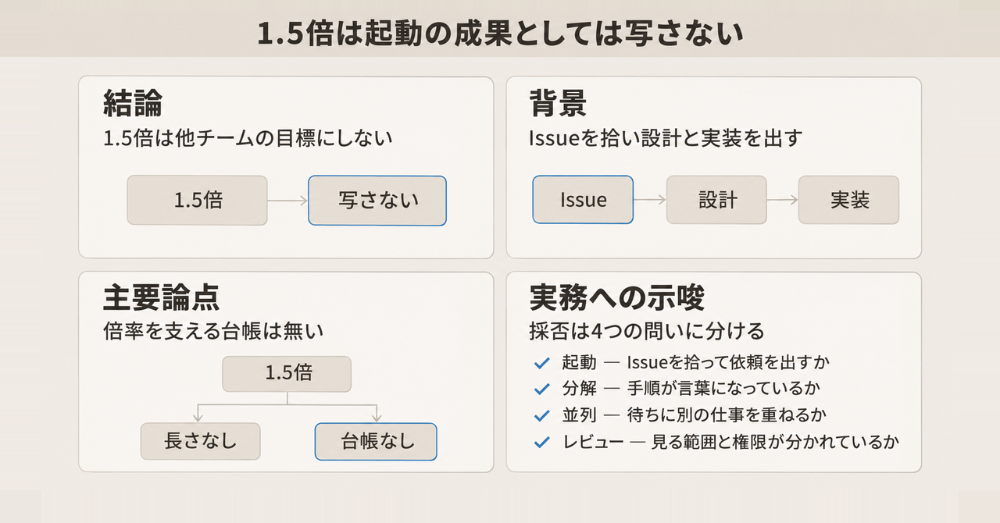
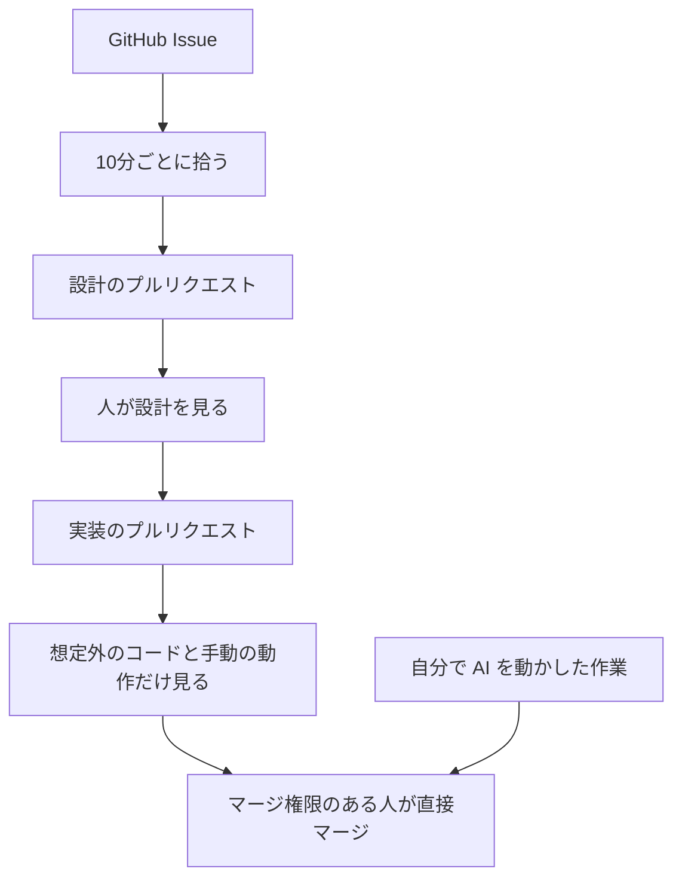

丸平（Zenn の `z_maruhira`、表示名 y-hirakaw）が 2026-11-22 21:10 JST に公開した記録です。3か月、仕事と並行して、GitHub Issue を流すと設計と実装のプルリクエストが出る自作のソフトウェアファクトリーを使い、1スプリントで1人がこなせるストーリーポイントが 1.5倍になった、と本人が書いています。1人の3か月の自己申告です。タイトルの起動は、Issue を拾って設計と実装のプルリクエストを出すことです。自分で AI を動かす作業は、この起動とは別です。この記事では、そのファクトリーの流れと、人が見ている範囲と、著者が予想として分けた置き場所を順に追います。

出典は [ソフトウェアファクトリーは不要なのか？](https://zenn.dev/z_maruhira/articles/software-factory-needed) です。Zenn API の `published_at` は 2026-11-22T21:10:53+09:00、本文 7570 字、種別は idea です。idea は、Zenn の記事区分の名前です。

*この記事の全体像。以下、順に解説します。*

## ソフトウェアファクトリーとは

ソフトウェアファクトリーとは、ここでは丸平氏が自作した開発の流れです。入口は GitHub Issue です。10分ごとに Issue を拾い、GitHub のラベルで状態を進めます。実行はローカルです。夜と休日は動きません。クラウドなら違う、と著者は留保しています。何が違うかは、丸平氏の記事には書いてありません。

ストーリーポイントは、1スプリントでこなせる仕事の大きさを点数で表す見積の単位です。著者は、1スプリントで1人がこなせる点数が 1.5倍になった、と書いています。数値上は2倍近かった、とも書いています。納期前の残業が重なったので割り引いた、と著者は書いています。

設計以外のモデルは Sonnet です。Sonnet は、著者が設計以外の作業に固定したモデルの名前です。どの製品の系列かは、丸平氏の記事には書いてありません。設計と実装のうち、ファクトリーに流したのが7割、自分で AI を動かしたのが3割くらい、と著者は書いています。語は「くらい」です。ファクトリーの設計や実装にかかる時間は、だいたい30分前後です。長くても1時間くらいです。丸平氏の記事では、図に書いたその時間は目安だとされています。

人が見る範囲は分かれています。設計のプルリクエストは、しっかり見ます。実装のプルリクエストは、想定外のコードと、手動でしか確かめられない動作だけ見ます。テストは、CI が通っていれば見ません。CI は、変更を自動で検査する仕組みです。

マージ権限を持つレビュアーが、ファクトリーのプルリクエストを直接見てマージできます。以前は、起動した人のプルリクエストになり、その人以外のレビューを待っていました。

ファクトリーを直す時間は、ストーリーポイントに入りません。1.5倍は、その時間を使った期間の点数の倍率です。

マイルストーンは二つです。一つは、開発プロセスをファクトリーの中で一通り完結させることです。もう一つは、著者以外の人がファクトリーを改善できることです。

### Issue からマージまで

仕事は Issue から入ります。ファクトリーは、設計のプルリクエストと実装のプルリクエストを順に出します。人は設計を見てから、実装は狭い範囲だけ見ます。自分で AI を動かした作業は、ファクトリーの起動とは別に、同じマージの手前で合流します。

### 著者が予想として分けた三つ

著者は、ここから先は予想だとしたうえで、置き換わるもの、設定に移すもの、持っていけるものを分けています。

| 色 | 著者の置き場所 | 中身 |
|---|---|---|
| 赤 | 製品に置き換わる | 10分ごとの拾い上げ、ラベル、sandbox とトークンとプロセスの後始末、書き込みを CLI に限ること、次の行き先を決まった中から選ばせること |
| 黄 | 製品の設定 | triage、implement、review の定義、人が見る地点、往復の上限、動かす Issue の選び方 |
| 緑 | 持っていける | 流れの設計、CLAUDE.md と skills とレビュー由来のルール、渡せる Issue の書き方、テストと受け入れ、少人数とレビュアーの直接マージ、自分の詰まりどころと 1.5倍という数字 |

赤は、著者の見立てでは、あとから製品の機能として置き換わる側です。sandbox、トークン、プロセスは、その後始末の名前です。個々の仕組みの中身は、丸平氏の記事では名前の列挙にとどまります。書き込みを CLI に限ることと、次の行き先を決まった中から選ばせることの対象も、同じ記事では特定されていません。安全性の勘所としての後始末は、人の側には移さず、この赤に置いたままです。

黄は、製品の設定へ移す側です。triage、implement、review は、著者がその設定へ置いた手順の名前です。図のどの段に当たるかは、丸平氏の記事には書いてありません。往復の上限が、レビューの往復なのか実行のやり直しなのかも、同じ記事にはありません。人が見る地点と、動かす Issue の選び方は、ここに入ります。

緑は、製品を待っても残る側です。CLAUDE.md は、エージェントへ渡す指示を置くファイルの名前です。skills は、再利用する作業手順のまとまりです。流れの設計、レビュー由来のルール、渡せる Issue の書き方、テストと受け入れも、緑です。少人数は、人数が少ない状態です。何人かは、丸平氏の記事には書いてありません。レビュアーの直接マージと、1.5倍という数字も、緑です。自分の詰まりどころの中身は、丸平氏の記事では特定されていません。

## 注意点

1.5倍は、完了した仕事量をスプリントごとに並べた公開の数値列ではありません。本文にあることと、本文に無いことを分けると、次のとおりです。

| 項目 | 丸平氏の記事にあること | 丸平氏の記事に無いこと |
|---|---|---|
| 倍率 | 1スプリントで1人がこなせるストーリーポイントが 1.5倍。数値上は2倍近かった | スプリントの長さ、比べた本数、基準の点数、人数 |
| 割引 | 納期前の残業が重なったので割り引いた | 残業時間と割引の式。式は未確認 |
| 内訳 | 設計と実装のうち、ファクトリーに流した7割、自分で AI を動かした3割くらい | 件数の台帳。語は「くらい」 |
| 時間 | 30分前後、長くて1時間くらい。図は目安 | 実行ログ |
| リードタイム | レビュアーが直接マージできるようになり、減った | 減った時間 |

リードタイムは、所要時間の長さとして出ています。どの時点からどの時点までは、丸平氏の記事には書いてありません。

見積の単位が変わっても、ポイントの倍率は動き得ます。Martin Fowler は、上限を「大きすぎる」の印にすると、8 はその点数ちょうどではなく 8以上を意味する、と書いています。あわせて、その数で完了時期を予測しないよう注意している、と書いています（2013-07-16、[Story Point](https://martinfowler.com/bliki/StoryPoint.html)）。Chuck Suscheck は、ポイントをベロシティとして日程予測に使うことが問題で、工数や時間へは自信を持って換算できない、と書いています（2023-01-13、[Scrum.org](https://www.scrum.org/resources/blog/story-points-are-not-problem-velocity)）。ベロシティは、一定期間に完了したストーリーポイントの合計です。この著者について、スプリントごとの点数の列が、見積の切り方や分割で膨らんでいたという実測はありません。その列が無いので、膨らんでいなかったとも言えません。ここでの膨らみは、完了した仕事が増えていなくても点数が増えることです。

### 同じ著者の先行記事

11月の記事は、起動そのものは便利という程度だとしています。それより前の記事は、起動側の仕組みを軽くは扱っていません。いずれも 1.5倍の前後比較ではありません。11月の因果を測定結果として読むときの歯止めにはなります。

2026-07-19 の [ループエンジニアリングは実際に作るとどこで詰まるのか](https://zenn.dev/z_maruhira/articles/ba4eba465034d1) では、95%の判断が10箇所で約60%、97%なら約74%、判断を3箇所に減らせば同じ95%で約86%、は仮定の計算です。その記事が「として」「仮に」と書いています。実測の成功率ではありません。何を分母にした割合かは、引用の外では特定していません。続きは、精度を上げるより判断の回数を減らす方が数字が動く、という話です。ファクトリーの準備で時間がかかったのは、ラッパー、権限、ラベル、テストだと書いています。ラッパーは、その記事が、判断の回数を減らし、準備に時間がかかった仕組みとして挙げているものです。

2026-07-26 の [段階1から6](https://zenn.dev/z_maruhira/articles/54263469e32574) では、段階5で、システム自身がタスクを見つけ、人が拾って持ち込む段階4までとは質が変わる、と書いています。

2026-08-30 の [グラフエンジニアリング](https://zenn.dev/z_maruhira/articles/auto-factory-graph-engineering) では、リリースまで必要だったのは、より賢いモデルでもより精巧なプロンプトでもなく、仕組みづくりだった、と書いています。

2026-10-25 の [agentcells](https://zenn.dev/z_maruhira/articles/agentcells-tips) は、個人のゲーム用に一から作り直した仕組みです。仕事のファクトリーと混ぜません。同じセルが2回動いた、という記述はラベル検索の遅れです。自動承認の差し戻し率ではありません。セルは、その記事の実行単位の名前です。

### 外部の数値は版でずれる

外部の数値は、丸平氏の記事の文と、一次資料の文で分類がずれます。丸平氏のファクトリーが出したプルリクエストへ、そのまま倍率を重ねる材料にはしません。

LinearB は、開発の所要時間を集計した外部のベンチマークです。リンク先ランディングは、「AI PRs wait 4.6x longer before review – but are reviewed 2x faster once picked up」と「32.7% vs. 84.4%」と書いています（[Benchmarks Report](https://linearb.io/resources/software-engineering-benchmarks-report)、2026-11-23 取得）。同じページからリンクされる PDF は、メールなしで取得できました（[2026 Benchmarks Report PDF](https://assets.linearb.io/image/upload/v1777392920/resources/LinearB_2026_Software_Engineering_Benchmarks_Report.pdf)、2026-11-23 に本文を抽出）。P75 は、小さい方から数えて 75% の位置の値です。pickup は、レビューが始まるまでの待ちです。agentic、AI-assisted、unassisted は、LinearB が分けた3分類の名前です。PDF の manual は、解説側の unassisted と百分比が一致しないので、同じ群だとは扱いません。pickup の P75 は、agentic が 1055分、AI-assisted が 496分、unassisted が 201分です。見出しの 5.3倍は agentic の pickup で、1055分は 201分の約5.3倍です。496分は 201分の約2.5倍です。PDF 本文に 4.6倍はありません。レビュー時間の P75 は、agentic が 382分、AI-assisted が 194分、unassisted が 252分です。AI-assisted は unassisted より短いですが、2倍ではありません。agentic は unassisted より長いです。30日以内マージとして印刷されているのは、AI 32.7% 対 manual 84.4% です。agentic だけの30日率は、PDF 本文にありません。

公開解説（Jamie Birss、datePublished 2026-10-20、[解説](https://linearb.io/library/engineering-benchmarks-and-research/ai-coding-adoption-statistics)）は、4.6倍を AI-assisted の pickup、agentic を 5.3倍、30日以内マージを AI-assisted 32.7%・unassisted 84.5% と書いています。レビュー時間の 194分と 252分は PDF と一致します。4.6倍と 84.5% は、PDF の分数と 84.4% とは一致しません。4.6倍は、レビュー作業の長さではありません。

GitHub Octoverse の期間は 2025-10-01 から 2026-09-30 です。2026年9月、プルリクエストの40%以上がエージェントの下書きから始まり、3月は17%、9月だけで1億1000万件、と Octoverse の本文にあります（[Octoverse 2026](https://github.blog/news-insights/octoverse/octoverse-commits-pushes-reach-new-highs-in-2026-as-developers-build-with-agents/)）。2週間以内のマージは、2月は agent 関与 83%・検出なし約86%、9月は agent 90%・比較群約86%です。検出なしは、エージェントの関与が検出されなかった側です。検出は下限だと、用語集が書いています。「見る人の手は増えていません」は、GitHub の文ではありません。丸平氏の読解です。レビュアーの人数は、丸平氏の記事にはありません。

StrongDM は、丸平氏とは別の組織が公開したソフトウェアファクトリーの説明です。原文は、人がコードを書かない、人がレビューしない、人間のエンジニア1人あたり今日少なくとも1000ドルのトークン、です（[factory.strongdm.ai](https://factory.strongdm.ai)、ページ日付 2026-02-06）。ここでのトークンは、利用量の費用です。上の後始末に挙がったトークンとは、丸平氏の記事は結んでいません。月あたり約2万ドルは、Simon Willison の換算です（[2026-02-07](https://simonwillison.net/2026/Feb/7/software-factory/)）。この換算は二次情報です。

Factory は、丸平氏の自作とは別の製品の名です。2026-11-18 の発表は、人の承認でプルリクエストを開くことに加え、顧客の設定で最終マージを自動化し得る、と書いています（[microsoft-collaboration](https://factory.com/news/microsoft-collaboration)）。2025-07-24 の Marketplace 初掲載とは別の発表です。どの Marketplace かは、この対比では特定していません。Factory 側の本文には、公式と同じ "open a pull request for human approval, or even automate the final merge based on customer-controlled preferences." があります。

Qodo は、丸平氏とは別の製品です。Auto Approval は、その製品の自動承認です。Beta です（article:published_time 2026-11-18）。qodo-bot は、Qodo 側のボットです。その承認は1票になり、required reviewers と code owners は残ります（[公式](https://www.qodo.ai/blog/introducing-auto-approval-workflows-and-agent-session-review/)）。required reviewers は、マージに必須のレビュアーです。code owners は、その公式記事がレビュー条件として残すと書いている所有者の指定です。無制限の自動マージではありません。

### まだ数値がないもの

次は、丸平氏の記事にも、確認した製品発表にも、揃っていません。

- ポイントをスプリントごとに並べた列、スプリント長、見積者、分割で点数が増えていないか。
- 納期前残業の時間と、2倍近くを 1.5倍にした式。式は未確認です。
- 少人数化と、設計以外を Sonnet に固定したことが、倍率のどれだけを動かすか。
- マージ後の欠陥と手戻り。
- agentic だけの、30日以内にマージされた割合。2026-11-23 に抽出した PDF の本文には、AI 32.7% 対 manual 84.4% しか無く、agentic 単独の率はありませんでした。
- 起動の自動化そのものが完了量を上げた、という公開の前後比較。確認した範囲では見つかっていません。無いとは断定しません。

## 1.5倍を組織の指標に写さない

1.5倍は、他のチームの目標値へ写す指標にはしません。起動の自動化、仕事の分解と引き渡し、待ちと並列、レビューの権限と負荷は、別々に測ります。

支持になるのは、著者の本文がすでにその分解を書いていることです。起動そのものは便利という程度だとし、3つの要因は理屈の上ではファクトリーがなくても手に入る、と書いています。3つの要因は、手順を言葉にしたこと、並列に進める習慣、レビュアーが直接マージできることです。ファクトリーを作ったから手順を言葉にし、並列の習慣ができた、とも書いています。これは、チケットで起動するかだけで採否を決めず、手放した工程と残した工程を分ける、という読みと合います。レビューが重いままで、A の実装が終わらないと B に進めない、という上限も本文にあります。

反証は、その分解を測定済みの原因割合として扱えないことです。

- 7月から8月の記事は、判断回数を減らすラッパー、タスクを見つけて着手する自動化、プロンプトではない仕組みを、差の本体に置いています。11月の、増分は起動そのものより外にある、という置き方と緊張します。1.5倍の台帳は、どちらにもありません。
- Octoverse の9月は、エージェント下書きの方が2週間以内にマージされています。量が増えてレビューが追いついていない、という外部根拠には使いにくいです。90%がレビュー人数の増加だとは、GitHub は書いていません。
- LinearB の 4.6倍は、上に書いたとおり、ランディングと 2026-10-20 の解説にあり、PDF の pickup とは一致しません。丸平氏のファクトリーが出したプルリクエストへそのまま重ねると、分類も版もずれます。
- 人のレビューが、どのソフトウェアファクトリーでも天井になる、とまでは言えません。Factory は顧客設定の自動マージを書いています。StrongDM は人のレビューを禁止しています。Qodo は承認1票を足しますが、必須レビュアーは残します。いずれも、マージ後の本番結果は、確認したページにありません。Dev Interrupted（2026-08-13）は、StrongDM と Kiro Crew について、マージのあと何が起きたかをどちらも示せていない、と書いています（[Everyone building a software factory](https://devinterrupted.substack.com/p/everyone-building-a-software-factory)）。Kiro Crew は、そのニュースレターが StrongDM と並べた、別の工場の名前です。
- 見積単位の変化は、棄却できません。確認もできていません。

## 測るなら4つを混ぜない

採否の切り口は、自動化の有無ではありません。人が手放した工程と、残した工程の内訳です。1.5倍は、その内訳の証拠としては置きません。

測るなら、次の4つを混ぜません。

| 測るもの | この記録で言えること | まだ言えないこと |
|---|---|---|
| 起動の自動化 | Issue を10分ごとに拾い、設計と実装のプルリクエストを出す | その起動が 1.5倍の主因だという測定 |
| 分解と引き渡し | 流れ、Issue、skills、ルールを言葉にした。自分で動かすときにも効く、と著者 | 言葉にするだけで同じ倍率が出るか |
| 待ちと並列 | ファクトリーの仕事と自分の仕事を重ねる習慣。ローカルなので夜は止まる | 並列数の上限がレビュー以外で動いたか |
| レビュー | 起動者以外のプルリクエストになり、権限のある人が直接マージする。設計は見て、実装は狭く見る | リードタイムが何時間減ったか。欠陥が増えたか |

現場で採否を分けるときは、この4行を別の質問にします。チケットから起動できるか、だけを聞きません。手順が言葉になっているか。待ちのあいだに別の仕事を重ねているか。設計と実装で、見る範囲とマージ権限が分かれているか。この4つが、丸平氏の記録から持ち出せる問いです。1.5倍を、他のチームのストーリーポイント、プルリクエスト数、リードタイムへ読み替える材料は、丸平氏の記事にはありません。

著者は、予想として、Issue から起動してプルリクエストを出すところは2〜3年後には GitHub やクラウドの機能として当たり前になる、と書いています。同じ段落で、2026年11月の Factory と Qodo をその動きの例に挙げています。赤を待てば手に入る、黄と緑は待っても手に入らない、とも書いています。Issue の書き方、受け入れ、誰がどこを見るかは、起動が製品になっても残ります。

## まとめ

丸平氏のソフトウェアファクトリーは、GitHub Issue を10分ごとに拾い、設計と実装のプルリクエストを順に出すローカルの流れです。人は設計を見て、実装は想定外のコードと手動の動作だけを見ます。マージ権限のある人が、起動者以外のプルリクエストを直接マージします。著者は、1.5倍の増分を、起動そのものより、手順を言葉にしたこと、並列の習慣、レビュアーの直接マージに置いています。

1.5倍は、1人の3か月の自己申告です。スプリント長、基準の点数、割引の式、件数の台帳、減った時間、マージ後の欠陥は、丸平氏の記事にはありません。外部の 4.6倍や 30日率は、版と分類がずれます。組織の指標へ写さず、起動、分解、並列、レビューを別々に見ます。起動が製品になっても、Issue の書き方、受け入れ、誰がどこを見るかは残ります。

この記事が少しでも参考になった、あるいは改善点などがあれば、ぜひリアクションやコメント、SNSでのシェアをいただけると励みになります！

## 参考リンク

- 丸平、2026-11-22、[ソフトウェアファクトリーは不要なのか？](https://zenn.dev/z_maruhira/articles/software-factory-needed)
- 丸平、2026-07-19、[ループエンジニアリングは実際に作るとどこで詰まるのか](https://zenn.dev/z_maruhira/articles/ba4eba465034d1)
- 丸平、2026-07-26、[自動工場の段階](https://zenn.dev/z_maruhira/articles/54263469e32574)
- 丸平、2026-08-30、[グラフエンジニアリング](https://zenn.dev/z_maruhira/articles/auto-factory-graph-engineering)
- 丸平、2026-10-25、[agentcells](https://zenn.dev/z_maruhira/articles/agentcells-tips)
- LinearB、[Software Engineering Benchmarks Report](https://linearb.io/resources/software-engineering-benchmarks-report) と [PDF](https://assets.linearb.io/image/upload/v1777392920/resources/LinearB_2026_Software_Engineering_Benchmarks_Report.pdf)（2026-11-23 に本文を抽出）
- Jamie Birss、2026-10-20、[AI coding adoption statistics](https://linearb.io/library/engineering-benchmarks-and-research/ai-coding-adoption-statistics)
- GitHub、[Octoverse 2026](https://github.blog/news-insights/octoverse/octoverse-commits-pushes-reach-new-highs-in-2026-as-developers-build-with-agents/)（窓は 2025-10-01 から 2026-09-30）
- Factory、2026-11-18、[Microsoft collaboration](https://factory.com/news/microsoft-collaboration)
- Qodo、2026-11-18、[Auto Approval Workflows](https://www.qodo.ai/blog/introducing-auto-approval-workflows-and-agent-session-review/)
- StrongDM、[Software Factory](https://factory.strongdm.ai)（ページ日付 2026-02-06）
- Simon Willison、2026-02-07、[Software factory](https://simonwillison.net/2026/Feb/7/software-factory/)
- Andrew Zigler、Ben Lloyd Pearson、2026-08-13、[Everyone building a software factory](https://devinterrupted.substack.com/p/everyone-building-a-software-factory)
- Martin Fowler、2013-07-16、[Story Point](https://martinfowler.com/bliki/StoryPoint.html)
- Chuck Suscheck、2023-01-13、[Story points are not the problem](https://www.scrum.org/resources/blog/story-points-are-not-problem-velocity)
