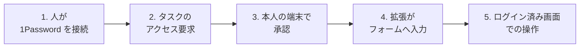

2026-10-22 に 1Password が発表した「1Password for Agents」を整理します。この記事を読むと、何を仲介する仕組みか、どこまで安全と言えるか、開発用の API キー管理とどう使い分けるかが分かります。情報源は 1Password の発表、製品ページ、開発者向けドキュメント（2026-10-24 に確認）で、多くは 1Password 自身の説明です。

*この記事の全体像。以下、順に解説します。*

## 1Password for Agentsとは

1Password for Agents は、個人向け AI エージェントがログイン画面に来たときに、サインインを仲介するプラットフォームです。利用者は自分の端末で、どの保存ログインを使うかを選びます。すると 1Password がパスワードまたはワンタイムコードをその画面へ入れます。公式の説明では、エージェントとモデルはその文字列を受け取りません。

### 要点

- 対象は、Muse（Meta）、Grok Bot（SpaceXSI）、Claude Duet（Anthropic）、ChatGPT Work と dots（OpenAI）、Townie（Town）などの個人向けエージェントです。ほかにも提携先が並びます。
- 追加料金はなく、1Password.com の Individual と Family のプランに含まれます。
- 以下では、エージェント製品側を「相手」と呼びます。1Password と連携する側の製品です。
- 開発者向けの経路とは別物です。たとえば Service Account（プログラムが API で秘密を読むための 1Password のアカウント）や SDK（そのプログラム用ライブラリ）は、開発者がプログラムに API キーを渡すための仕組みです。Environments は、開発プロジェクトの秘密をローカルのファイルやプロセス環境へ渡す仕組みです。

### 特徴

- 連携は相手ごとのオプトインです。接続を選んだときだけ動き、資格情報へのアクセスには本人の承認が要ります。
- エージェントは固有のデジタル鍵で 1Password に身元を示します。利用者は必要なログインと理由を見て、自分の端末で承認します。
- 複数の保存ログインが一致するときは、利用者がどれを使うか選びます。
- 接続してもボルト（保存データの入れ物）全体は開きません。ほかの保存パスワードはエンドツーエンド暗号化のままです。
- 入力できるのは、現行範囲ではログインのユーザー名、パスワード、ワンタイムパスワードです。
- パスワードを 1Password 側で更新すれば、接続済みのエージェントは更新後のログインを使えます。

### 仕組み

Agentic Autofill は、承認されたログインをブラウザ拡張がフォームへ入れる 1Password の機構の名前で、for Agents はこれを使います。利用者向けの説明も、連携先の開発者向けガイドも、同じ機構名を使います。ガイドは一般提供前の Partner preview で、エンドポイントや日付は変わり得ると書かれています。次の図は、そのガイドの 4 段階にログイン後の操作を足したものです。5 番目は 1Password の入力経路の外にあります。

1. 接続の単位は人です。相手の製品は OAuth のトークン（接続の許可証。短命の access token と更新用の refresh token があります）と integration key（拡張の呼び出しに必要な鍵）を受け取ります。この時点でボルトは読めません。
2. タスクがサインインを必要とすると、相手は目的と、サイトおよび理由つきのログイン要求を作ります。
3. 承認リンクは本人の 1Password アプリで開きます。
4. ブラウザ拡張が、承認されたログインだけをフォームへ入れて送信します。値は相手のコードにもモデルにも渡さない、とガイドは書いています。

ここでは「承認」と「入力」が別の操作です。承認（grant、付与）は、あるログインの使用を本人が許可することです。入力（fill）は、その許可の範囲で拡張がフォームへ値を入れることです。1 回の承認で複数回の入力ができ、その期間はガイドの規定で後述します。

1 要求に含められるログインは最大 5 件です。資格情報の置き場所は、Individual の Personal ボルトか、Family の Private ボルトです。共有ボルトのログインは、ガイドの範囲では提示されません。

## 注意点

発表文の「the best option」「the standard」「trust layer」は 1Password の自己記述で、到達度の測定結果ではありません。

### 発表日に一般提供されていた相手は少ない

2026-10-22 のブログは、相手ごとに状態を分けています。

| 相手 | ブログの状態 |
|---|---|
| Muse | 今後数日で、全プラットフォームへ順次 |
| SpaceXSI Grok Bot | 今後数日で、全プラットフォームへ順次 |
| Claude Duet | coming soon |
| ChatGPT Work と dots | coming soon |
| Town Townie | web と iOS は coming soon |
| Instinct、Browserbase、Browser Use、Dana、KERNEL、Perplexity、Ramp、Tomo、Wajo | coming soon |

プレスリリースは先頭の 5 者を「building with」と書き、rolling out や coming soon を付けません。製品ページの統合カード本文は、2026-10-24 時点で Muse と Grok Bot だけでした。「0 円で最初から 6 種が使える」という読み方は、順次提供と近日提供を一括にしたもので、公式の状態分けより広い読みです。

### 承認は連携によって「その場のたび」とは限らない

製品 FAQ は、承認を求められる頻度は連携によって変わり得ると書いています。文書は 3 系統あり、内容が異なります。

- **パートナーガイド**: 承認は fill（入力）のたびではなく、ログインごとです。承認後、そのログインはタスクが必要とする回数だけ再入力できます。ローンチ時点の grant（付与）は 30 日残り、チャットセッションには縛られません。この間、fill は本人と 1Password アプリを介さないため、人が離れていても承認済みログインを再入力できます。設定可能な寿命は計画中です。
- **1Password for Claude のサポート記事（2026-08-17）**: 常設の承認はなく、新しいエージェントセッションごとに新しいプロンプトが出ます。資格情報はメモリ上に AES-256-GCM で保持され、セッション終了、ブラウザ終了、または 9 時間の上限で破棄されます。これは Claude 統合の記述で、全パートナーの仕様ではありません。
- **発表ブログ**: 安全策と制御は連携ごとに異なる、と書いています。

Muse と Grok Bot の消費者向けページは 30 日とは書いていません。30 日はビルダー向けガイドの規定で、両者がその通りに実装しているかは、消費者向けページだけでは確定できません。

そのほか、ガイドには次の制限があります。

- デスクトップアプリ（Mac、Windows、Linux）での承認は、ガイド上は Nightly チャネル（先行版の配布経路）に限られます。
- 1Password アプリ本体の iOS と Android から承認リンクを開く経路は、開発中でテストできません。
- 承認プロンプトとロック解除プロンプトは、それぞれ 2 分で閉じます。
- 承認リンク上の目的、理由、キーワード、サイトは、ローンチ時点では読める base64url JSON（符号化しただけの文字列）で、エンドツーエンドでは暗号化されていません。理由文は相手が作る主張として読む必要があります。

### 取り消しと分離

1Password アプリの中から接続を取り消す操作は、ガイドではローンチ時点で提供されていません。取り消しは接続全体で、相手製品の側から行います。単一ログインだけの取り消しはありません。Grok Bot の製品ページは「いつでも切断できる」と書いていますが、その操作がどこにあるかは確認できていません。

同じ相手接続の中の複数エージェントは、1Password からは区別されません。その接続のトークンと integration key を共有します。タスク間の分離は、相手製品の実装に依存します。

### パスワード文字列とログイン後のアカウントは別

製品 FAQ は、サインイン後にエージェントがアカウント内の情報を見たり操作したりし得ると書いています。Grok Bot の FAQ も同様です。1Password の保証は保管、承認、配送、入力までで、ログインできた後のエージェントの行動は含みません。

入力の瞬間、値はページ上にあります。パートナー FAQ は、`fillCredential` が返るまでモデルとエージェントがページを読まないようにするのは統合側の義務だと書いています。`fill_submitted` は、フォームを送信して入力値をページから消したことを意味し、ログインの成功ではありません。送信後の値は宛先サイトと、そのページ上のスクリプトの手に渡ります。

access token は 15 分で切れ、refresh token はブラウザへ渡されません。一方、extension の呼び出しには access token と integration key の両方が要り、ローンチ時点ではその両方がエージェントの動かすブラウザ上に載ります。つまり、承認済みログインの入力を呼び出せる鍵が、そのブラウザに置かれます。ブラウザの外へ出す方法は検討中です。

別件として、2026-01-30 の 1Password 公式 advisory は、AI 支援ブラウジングで拡張がロック解除済みだと、保存 URL に一致する autofill や 1Password.com への操作を誘発し得ると書いています。暗号モデルの破壊ではない、という限定つきです。for Agents の同意フローを使わない通常の拡張利用では、この注意が残ります。

### 対象アカウントは狭い

ブログの脚注では、追加料金なしの対象は 1Password.com の Individual と Family です。1Password.eu と 1Password.ca は現時点で非対応です。

連携先向けの開発者ガイドの Supported today は、さらに次の条件を書いています。

- 米国の 1password.com 上の Individual と Family
- 本人の Personal または Private ボルト
- Chromium 系ブラウザ

Business、その他の地域、共有ボルト、passkey、ソーシャルログイン、支払いカード、住所は未対応です。Grok Bot の FAQ は、Business と Team Starter Pack をこの連携の対象外と明示しています。日本の 1password.com アカウントがガイドの「in the US」に含まれるかは、確認できていません。

1Password for Claude は、Business 管理者が「Allow AI agents to autofill for users」で Agentic Autofill を制御できると書いています。これは Claude デスクトップ統合の記述で、個人向けの for Agents が Business を含む根拠にはなりません。

### 監査と SLA

Claude 統合は、付与をアカウントの item usage に記録すると書いています。組織の監査ログは Business の所有者、管理者、および View Administrative Sidebar 権限を持つグループのメンバーが見られます。どの台帳を、どの連携の、どのプランで読めるかは、文書ごとに記述が分かれています。for Agents の契約 SLA ページは確認できませんでした。

### 料金の読み方

Grok Bot 連携ページの料金ウィジェットは、2026-10-24 時点の年額請求の月額表示で、次の通りでした。

| プラン | 当初 | 表示 |
|---|---|---|
| Individual | 3.99 米ドル | 2.99 米ドル |
| Families | 5.99 米ドル | 4.49 米ドル |

これはパスワードマネージャの表示価格で、Agents の加算額ではありません。表示価格は変動します。

## 既存の渡し方との違い

1Password には、エージェントという言葉が付く製品が複数あります。名前が近くても、秘密の行き先が違います。表に出る主な用語は次の通りです。

- `op run`: 秘密をプロセスの環境変数に入れて、コマンドを実行する仕組み
- Environments MCP: エージェントから Environments を管理する MCP。秘密の値は返さない
- NVIDIA OpenShell ベータ: サンドボックス（隔離環境）内のエージェントには仮の文字列（プレースホルダ）だけを渡し、承認した宛先への要求のときだけ外側で本物に置き換える仕組み
- Connect: 自前サーバで動かす REST API
- 1Password for Claude: Claude 向けの別の連携（Claude デスクトップ統合）

| 経路 | 秘密の行き先 | 人が出す承認 | 位置づけ |
|---|---|---|---|
| 1Password for Agents | ブラウザのフォーム。モデルと相手コードには値を渡さない | ログインの初回付与。ガイドではその後 30 日 | 個人向け。順次と近日が大半。API は Partner preview |
| 1Password for Claude | 拡張が Mac 上のページへ入力。エージェントは項目の概要だけ | セッションごと。上限 9 時間 | 2026-08-17 のセキュリティ記事。Mac |
| Browserbase 向け Secure Agentic Autofill | ヘッドレスブラウザの拡張へ、暗号化チャネル | 要求ごと（2025-10-08 のブログ） | 早期アクセスの発表 |
| SDK と Service Account | `secrets.resolve()` の戻りがプロセスに入る | トークンを渡した時点で、範囲内は無人で読める | チュートリアル自身が推奨しないと書く |
| Environments、`op run`、hooks、Environments MCP | ローカルのマウントやプロセス環境。MCP は秘密の値を返さない | デスクトップアプリの認可 | Claude Code と Cursor のプラグインはこの系統 |
| NVIDIA OpenShell ベータ | サンドボックス内はプレースホルダ。承認したホストへの要求だけ外で置換 | 接続時に変数、宛先、期限を確認 | Mac または Linux |
| Connect | 自前サーバの REST。値は呼び出し側に返る | アクセストークン | インフラ向け |

SDK チュートリアルは、生の資格情報をモデルへ出すやり方を推奨しないと警告しています。2025-04-22 のブログは同じ系統の手順を「Pass the secrets to your agent」と書いていたので、現行の方が推奨しない側に更新されています。

Service Account のレート制限は、for Agents の制限ではありません。トークンごとの 1 時間あたりでは、Business の読取が 10,000、書込が 1,000、Individual、Families、Teams の読取が 1,000、書込が 100 です。アカウント全体の 24 時間では、Business が 50,000、Teams が 5,000、Individual と Families が 1,000 です。超過すると 429 が返ります。パートナー API の状態確認にも制限があり、`rateLimitExceeded` のときは少なくとも 1 分待つよう案内されています。

## 用途別の選び方

判断の軸は、コーディングエージェントや無人の定期実行に秘密を渡すことと、個人の Web ログインを人の承認つきで代行させることを分けて考えることです。

| 基準 | for Agents | Environments と op | Service Account | OpenShell ベータ |
|---|---|---|---|---|
| 向く作業 | 対応エージェントの Web ログイン | 開発プロジェクトの API キー | CI やアプリからの読み取り | サンドボックス内のコーディングエージェント |
| モデルが秘密を見るか | ガイド通りなら見ない。入力中のページ読み取りは統合の義務 | プロセス環境には入る。MCP の管理操作は値を返さない | 呼び出し側のプロセスに入る | エージェントはプレースホルダだけ |
| 無人の再実行 | grant の 30 日以内なら人が不在でも fill できる | マウントやトークンの寿命による | トークンの権限内なら可 | 設定した TTL の間、承認ホストだけ |
| 共有ボルト | ガイドでは不可 | Environment の権限による | Personal 等は不可 | Environment の中身 |
| 発表時点の対応 | 一覧に Claude Code、Codex は無い | Claude Code と Cursor のプラグインがある | SDK 例はあるが推奨されない | 例に Claude Code |

製品 FAQ は「supported personal and coding agent integrations」と書いています。これは全ツール対応ではなく、対応する範囲を限る表現です。

## 判断と実践

### 使ってよい場面

個人の Web 作業を、実際に接続できる相手へ委任するときは、パスワードをチャットへ貼る代わりに選べます。パスワード文字列をモデルの文脈に置かない点では、公式の設計は平文貼り付けより狭く安全側です。

### 使わない場面

コーディングエージェント、無人の定期実行、共有ボルト、API キー項目が相手なら、主経路にしません。

- 開発用の秘密は、Environments と `op run`、または権限をボルトと読取に絞った Service Account に置きます。
- モデルに値を返したくないサンドボックス実行なら、文書化されているのは NVIDIA OpenShell ベータです。
- SDK チュートリアルの `sensitive_data` への受け渡しは、公式が推奨しない例として扱います。

### 接続前の確認

1. 自分のアカウントが 1password.com の Individual または Families か、.eu、.ca、Business、Team Starter Pack かを見る
2. 使いたい相手が、ブログの「順次」か「近日」かを、その相手の連携ページで見る
3. 渡すログインは Personal または Private ボルトにあるものに限る
4. 承認画面の理由文は、相手の主張として読む
5. 付与が 30 日残る前提で、不要になったら相手製品側の切断を探す
6. ログイン後にそのアカウントで何をされ得るかを、承認の前にタスクとサイトで判断する

### 判断が変わる条件

- 使う相手の文書が、grant をセッションまたは 1 回の fill に縮め、1Password アプリ内から単一ログインを取り消せると書いたとき
- 自分のリージョンと契約プランが、対象文に明示されたとき
- Claude Code や Codex 向けに、秘密の値をプロセスへ返さない公式統合が for Agents の名前で手順つき公開されたとき

### 未確認の点

- Muse と Grok Bot が、ガイドの 30 日 grant、Nightly 承認、相手製品側の切断をそのまま実装しているか
- 日本を含む米国以外の 1password.com アカウントが「in the US」に含まれるか
- 「全プラットフォーム」にどの OS が入るか
- 個人プランで、どの連携の入力履歴を後から読めるか

## まとめ

1Password for Agents は、個人向けエージェントのサインインを、パスワード文字列をモデルに渡さず仲介する仕組みです。一方で、30 日残る付与、ログイン後の操作権限、入力中のページ上の値は保証の外にあります。発表時点では提供済みの相手が少なく、対象アカウントも限られます。コーディングエージェントの秘密管理は別の仕組み（Environments や Service Account、OpenShell）で考える必要があります。

この記事が少しでも参考になった、あるいは改善点などがあれば、ぜひリアクションやコメント、SNSでのシェアをいただけると励みになります！

## 参考リンク

- [Introducing 1Password for Agents（1Password、2026-10-22）](https://1password.com/blog/1password-for-ai-agents)
- [プレスリリース（2026-10-22）](https://1password.com/press/2026/october/1password-for-agents-trust-layer-personal-ai-agents)
- [製品ページ](https://1password.com/personal-ai-agent-integrations)
- [Grok Bot 連携ページ](https://1password.com/partners/spacexsi-grokbot)
- [1Password Community の告知](https://www.1password.community/announcements-52/introducing-1password-for-agents-25883)
- [Build with 1Password Agentic Autofill（Partner preview）](https://www.1password.dev/agentic-autofill/partners.md)
- [Get the user's approval](https://www.1password.dev/agentic-autofill/partners/approval.md)
- [Partner FAQ](https://www.1password.dev/agentic-autofill/partners/faq.md)
- [About the security of 1Password for Claude](https://support.1password.com/1password-claude-security/)
- [Closing the credential risk gap for AI agents using a browser](https://1password.com/blog/closing-the-credential-risk-gap-for-browser-use-ai-agents)
- [SDK チュートリアル（AI エージェント）](https://www.1password.dev/sdks/ai-agent.md)
- [Supercharge your workflow（2025-04-22）](https://1password.com/blog/service-accounts-sdks-agentic-ai)
- [Service account rate limits](https://www.1password.dev/service-accounts/rate-limits)
- [Secure secrets for AI agents and tools](https://www.1password.dev/get-started/secure-ai-access.md)
- [NVIDIA OpenShell（beta）](https://www.1password.dev/environments/nvidia-openshell.md)
- [Security advisory for AI-assisted browsing（2026-01-30）](https://1password.com/blog/security-advisory-for-ai-assisted-browsing-with-the-1password-browser)
