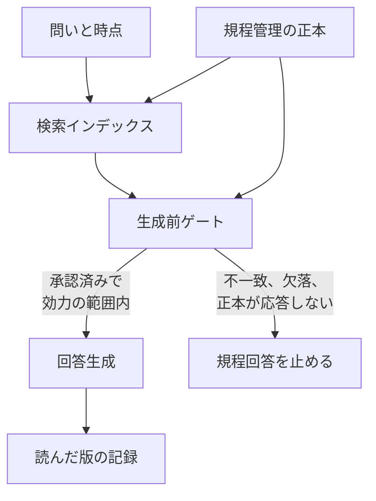

AI エージェントが社内規程や社内データを参照するとき、どの版を読んだかが回答の前提になります。この記事では、利用または検証中と答えた人への設問で、古いルールや最新版か分からないデータの参照を前提にしたヒヤリの割合と、規程に基づく回答を生成の前に止める条件を整理します。読者は、規程管理の正本、検索インデックス、生成前ゲートの役割を分けて判断できます。数値は、株式会社 KiteRa が 2026年9月3日に公表したインターネット調査の自己申告であり、インシデント台帳との突合は公開されていません。

*この記事の全体像。以下、順に解説します。*

## 古い社内ルールの参照とは

対象は、勤務先で AI エージェントを利用または検証していると答えた人に、古い社内ルールや最新版か分からないデータをエージェントが参照したことによるトラブルやヒヤリを聞いた結果と、その参照を止める制御です。設計上の問いは、参照してよい文書の正本を規程管理に置くか検索インデックスに置くか、不一致のとき誰が回答生成を止めるか、です。

株式会社 KiteRa は 2026年9月3日10時、インターネット調査「企業のGRCに関する実態調査 vol.4（データガバナンス）」を公表しました。調査期間は 2026年8月12日から14日です。Q1 の有効回答は、20歳以上のビジネスパーソン 11,075人です。Q2 以降は、勤務先がエージェントを利用または検証中と答えた 1,206人です。KiteRa の定義では、AI エージェントは「与えられた目的や指示に基づき、社内データやシステムを参照・連携しながら、複数の処理を自律的に進めるAI」です。ビジネスパーソンは、正社員、契約社員、派遣社員、会社経営者・役員です。構成比は小数第2位の四捨五入です。

Q1 は単一回答で、勤務先の利用状況を聞いています。利用または検証中は 31.1% です。内訳は、全社的に利用 11.4%、複数部門 7.4%、一部部門 9.6%、試験導入・検証 2.7% です。この 31.1% が、以降の設問の母集団 1,206人です。利用・検討していないは 36.1%、分からないは 27.9% です。導入を検討している 4.8% は、利用または検証中の外にある別の枝です。

Q8 は複数回答です。設問は、古い社内ルールや最新版かどうか分からないデータをエージェントが連携・参照したことによって、日常業務のトラブルやヒヤリとした経験があるかを聞いています。公開本文が名指しする枝は次のとおりです。

| 選択肢 | 率 |
|---|---|
| 特にトラブルやヒヤリとした経験はない | 30.8% |
| システムへの入力申請、発注などの手続きを誤って進めそうになった／実際に誤った | 23.2% |
| AIの回答を信じ、顧客や取引先に誤った説明をしそうになった／実際に説明した | 23.1% |
| 規程や法令に違反しそうになった／実際に違反した | 13.4% |
| 顧客・取引先からのクレーム、金銭的損失、システム障害、法令違反など、実際に会社の損害につながった | 8.0% |

2026年10月14日に確認した公表図には、このほかに次の枝があります。部署やシステムごとに参照する情報が異なり、矛盾する回答や処理をした 14.8%。回答や処理結果の誤りで、確認・修正・やり直しが起きた 12.9%。分からない／参照した情報を把握していない 15.8%。その他 0.1%。

同じ 1,206人について、関連する単一回答の主な点は次のとおりです。

| 設問 | 公開された点 | 率 |
|---|---|---|
| Q2 全社方針 | 全社的に定められている | 38.2% |
| Q2 | 部署・部門ごとに個別に定められている | 25.5% |
| Q2 | 未策定（策定・検討中 13.9% と、定められていない 12.7%） | 26.6% |
| Q3 関連マニュアル | 最新の状態で整備され、必要なときに参照できる | 34.4% |
| Q4 管理方法 | 全社で統一されている | 36.5% |
| Q4 | 全社利用と答えた層での全社統一 | 59.1% |
| Q6 無許可入力 | 許可なし 22.5% と許可不明 27.2% の合計 | 49.7% |
| Q6 | ない | 34.3% |
| Q7 信頼 | 信頼できない側（あまり 17.2% と全く 3.7%） | 20.9% |
| Q7 | 信頼できる側（とても 19.0% とある程度 50.4%） | 69.4% |
| Q10 経営課題 | 深刻 14.5% とある程度 45.5% の合計 | 60.0% |
| Q11 経営層 | ほとんど関与していない | 30.8% |
| Q12 一元管理 | とても必要 26.6% とある程度必要 45.4% の合計 | 72.0% |

Q3 の残りの枝は、一部に古い情報や分散した情報がある 23.2%、保管場所や最新版が分かりにくい 12.9%、ほとんど整備されていない 12.6%、分からない 8.5%、全く整備されていない 8.4% です。合計は 100.0% です。Q4 の公表図では、全社的に利用が 421人、複数部門が 313人、一部部門が 363人、試験導入・検証が 109人で、合計は 1,206人です。59.1% の分母は、この 421人です。公開本文は、複数部門の層では「全社で統一されている」と「一部の部署・部門や拠点では独自の方法で管理している」の合計が 71.2%、一部部門の層では同じ合計が 49.3%、とも書いています。

Q5 は、所属部署について単一回答で聞いています。シャドーITがあるは 44.9%、シャドーAIがあるは 38.7%、シャドーデータがあるは 36.2% です。公表図では、ない／分からないが、シャドーITで 35.5%／19.7%（3枝の和 100.1）、シャドーAIで 40.9%／20.4%（和 100.0）、シャドーデータで 39.9%／24.0%（和 100.1）です。シャドーAIとシャドーデータは、「ない」が「ある」より多いです。

Q6 の残りの枝は、AIツールを仕事で利用していない 8.7%、分からない 7.3% です。「ない」34.3% がこの設問の最多です。公開本文は、1,001人以上の企業に勤める回答者の 42.6% が、無許可または許可不明の入力を経験した、と書いています。公表図では、この層は 504人で、42.6% は許可していないツールへの入力 22.2% と、許可の有無が分からないツールへの入力 20.4% の合計です。規模の内訳は、100人以下 196人、101〜300人 214人、301〜500人 147人、501〜1,000人 145人、1,001人以上 504人で、合計は 1,206人です。

Q9 は複数回答です。公開本文が上位として書く枝は、ルール整備が十分でない 25.9%、管理責任が曖昧 23.0%、品質・正確性に課題 22.1%、情報が分散 16.3% です。

この記事が整理する参照制御は、5つの要素で動きます。規程管理の正本は、承認状態、版の識別子、効力の開始、効力の終了を持ちます。終了が空で、後継の版がないときは、その版を有効と扱います。検索インデックスは、その版識別子をコピーした投影です。生成前ゲートは、問いの時点でその版が承認済みかつ効力の範囲内かを正本に照合し、通ったときだけ生成へ進みます。生成結果には、読んだ版の識別子を残します。ゲートが照合するのは、文書の版と効力です。主体がその操作をしてよいかは、別の判定が扱います。

## 注意点

13.4% は、実違反の発生率ではありません。Q8 は、古いルールや最新版不明のデータの参照を前提に、トラブルやヒヤリを複数回答で聞いています。13.4% の枝は「違反しそうになった」と「実際に違反した」を一つに束ねます。8.0% の枝も、クレーム、金銭的損失、システム障害、法令違反などを一つに束ねます。同じ回答者が何枝を選んだかは、本文にも図にも出ていません。本文が名指しする5つの率（30.8、23.2、23.1、13.4、8.0）の名目和は 98.5 です。図の9枝の名目和は 142.1 です。複数回答の分割表にはなっていません。30.8% は、図の全枝でも一本の棒として最多です。残りの人が実害を受けた、という意味の補数ではありません。

分母は、企業数でも、回答者本人がエージェントを使った件数でもありません。Q1 で利用または検証中と答えた 1,206人です。11,075人のうち、この設問を聞かれたのは 31.1% です。Q4 の 59.1% は、公表図で全社的に利用と答えた 421人の内訳です。Q1 の全社利用 11.4%（母数 11,075人）とは別の率です。調査の実施会社、抽出枠、ウェイト、信頼区間、回収率は、公開文にありません。

「約7人に1人」は、KiteRa の見出しと、@IT が 2026年10月13日11時に出した記事の見出し表現です。100 を 13.4 で割ると約 7.5 です。7人に1人は約 14.3% なので、13.4% より高い言い方です。8.0% の「約12人に1人」も、100 を 8.0 で割ると 12.5 です。KiteRa の見出しは「規程・法令違反のリスクを経験」と書き、しそうになった経験を含みます。@IT の見出しは「法令違反リスク」です。@IT の記事は会員限定の表示があります。公開されている本文は KiteRa の公表を圧縮したもので、独自の再集計はありません。本文は「違反しそうになった、あるいは実際に違反した」と、ヒヤリを残しています。

Q3 の 34.4% は、AI エージェント関連の従業員向け規程・手順書・マニュアルに限ります。未整備と、最新版が分からないことは、期限切れとは別です。Q7 の「分からない」は 9.6% です。信頼できる側 69.4% と、信頼できない側 20.9% を足しても 100% にはなりません。

Q10 の「6割」は、14.5% と 45.5% の合計 60.0% で、丸めではありません。公開本文の残りの枝は、あまり経営課題ではない 19.2%、分からない 13.8%、全く経営課題ではない 6.9% です。Q11 の「経営層の3割は無関与」は、「ほとんど関与していない」30.8% だけを指します。「主に担当部門に任せている」17.8% は別の枝です。足すと 48.6% になりますが、リリースも @IT もそこまでは足していません。関与側として公開されているのは、方針策定には関与している 26.7% と、方針策定から進捗確認まで継続的に関与している 16.1% です。分からないは 8.6% です。

Q12 の 72.0% は、「とても必要」と「ある程度必要」の合計です。聞いているのは、規程・社内データ・監査記録を一つのプラットフォームで確認・管理したいかであり、生成前に止めるべきかではありません。KiteRa は企業向けの KiteRa Biz と社労士向けの KiteRa Pro を提供し、リリースは参照元の管理を自社の GRC 基盤へ接続しています。

13.4% のうち、ヒヤリと実違反の内訳、8.0% との重なり、企業単位の件数は、公開文にありません。条単位の施行状態を正本が返せる社内規程システムが、どの製品クラスで一般的かも、今回の範囲では未調査です。正本が応答しないとき、ラベル付きでインデックス時点の回答を許す運用が、どの文書種別で許容されるかは、組織の判断であり、この調査からは決まりません。

デジタル庁の「法令文書とバージョン管理」（2023年3月27日、法令データ ドキュメンテーションα版）は、後述の版の型を説明する一次資料です。サイト自身が、α版であり、注記のない限り政府の公式見解ではない、と書いています。社内規程へそのまま適用する法令ではありません。

## 生成前ゲートが止める条件

止める主体は、規程管理システムでも、検索インデックスでも、モデルでもありません。回答生成の前に置くゲートです。判定の材料は正本が返します。インデックスは候補を返す投影です。クロールの遅れそのものは、不一致の違反として扱いません。

| 条件 | ゲートの扱い |
|---|---|
| チャンクの版が、問いの時点の承認済みかつ効力内の版と一致 | 生成してよい。版の識別子を記録する |
| 版が違う、未承認、廃止済み、問いの時点では未施行 | 規程に基づく回答を止める |
| 文書種別が効力期間の記入を必須にしていて、期間が空 | 止める。空を期限なしとみなさない |
| 終期のない現行規程で、後継版がない | 止めない。終了日の空は、この種別では正常 |
| 過去のある日のルールを聞いている | 止めない。正本がその日の版を一意に返せるなら、その版を読む |
| 公布済みで未施行の条文を、将来のルールとして聞いている | 現行ルールとしては止める。将来案としては、未施行だとラベルして生成できる |
| 一つの文書の中で、条ごとに施行日が分かれる | 文書の版が一致しても通さない。正本が条の効力を返せるときだけ通す |
| 正本が応答しない | 規程に基づく回答は止める。一般説明を出すなら、インデックスの時点をラベルする |

デジタル庁の解説は、公布で内容は確定しても効力は施行で生じること、施行日が「政令で定める日」だと公布時点では未確定であること、を版の正規の状態として説明しています。公布済み・未施行が複数あり、かつ施行期日が未確定で前後しうるとき、中間時点の条文は二通りになりえます。後から出た改正が先に施行されること、一つの改正の中で施行日が分かれ、一部だけ施行されうることも、同じ解説が説明しています。過去時点の条文は一意に特定できる、とも書きます。法令案の編集段階には、統一的な版管理がありません。

社内規程は法令そのものではありません。同じ型、つまり承認済みの現行、下書き、施行前、一部施行、終期なし、を一つの有効期限に潰すと、同じ過剰停止が起きます。

法の適用に関する通則法（平成十八年法律第七十八号）第2条は、次のとおり定めています。

> 法律は、公布の日から起算して二十日を経過した日から施行する。ただし、法律でこれと異なる施行期日を定めたときは、その定めによる。

公布日を効力の開始とみなすゲートは、この原則とずれます。

NIST AI 600-1（2024年7月、DOI: 10.6028/NIST.AI.600-1）の Information Integrity は、整合の高い情報は原典へたどれ、いつ妥当性が尽きるかの期待を持てる、と定義します。定義の出典は、脚注で 2022年のホワイトハウスの情報整合ロードマップだとされます。これは生成 AI の誤情報に関する記述です。社内規程の実行時ゲートを義務づける文ではありません。

## 版の一致を採る根拠

現時点の結論は、次のとおりです。コンプライアンス判断に使う参照では、正本を規程管理に置きます。検索インデックスは投影にとどめます。不一致、必須メタデータの欠落、正本の不応答では、生成前ゲートが規程に基づく回答を止めます。止める条件は、期限が切れていたら常に止める、ではありません。問いの時点、承認、効力の開始と終了、条ごとの施行、を分けて見ます。読んだ版の識別子は、後段の理解監査や承認採点の入力にします。

支持側の材料は、Q8 の設問が「最新版かどうか分からないデータ」を明示していること、Q3 で最新参照できるが 34.4% にとどまること、Q4 で全社統一が 36.5% であることです。これらは自己申告の分布です。ゲートの効果を測った実験ではありません。

採らない読みは、次のとおりです。

- 13.4% を、実違反率や「約7人に1人」の実証としては使えません。
- 単一の有効期限と「より新しい版」は、施行前、一部施行、過去時点、終期なしを止めすぎます。e-Gov の解説が、この構造を一次資料で説明しています。
- 文書の版が正しくても、条の取り違えと一部施行は残ります。版のゲートは必要で、十分ではありません。
- Q6 の 49.7% は、正本に接続したゲートの外で起きています。ゲートを厳しくしても、この貼り付けが減る根拠は、同じ調査にありません。
- 鮮度は、いつの条文を読むかです。主体が操作してよいかという認可ではありません。空の属性を、権限拒否と同じ既定拒否にはしません。

## 規程に基づく回答を通す実務

記事や設計で 13.4% を書くときは、利用・検証中と答えた 1,206人のうち、ヒヤリと実違反を分けない複数回答で 13.4% がその枝を選んだ、と書きます。「約7人に1人が法令違反した」とは書きません。

正本は規程管理に置きます。インデックスは、版の識別子と効力の写しを持つ投影にします。モデルに版の新旧を判断させません。

生成前ゲートは、問いの時点で承認済みかつ効力内の版と一致するときだけ、規程に基づく回答を通します。一致しないとき、必須の効力情報が空のとき、正本が応答しないときは、止めます。

終期のない現行版、過去時点の照会、未施行だとラベルした将来案は、停止条件から外します。文書種別ごとに、終了日が必須かを宣言します。宣言がない文書を、一括で期限切れ拒否にはしません。

条ごとに施行日が分かれうる文書は、文書版の一致だけでは通しません。

理解監査や承認採点の前に、どの版を読んだかを実行の記録として残します。記録がない生成は、採点の対象にしません。

無許可ツールへの貼り付け（Q6）は、このゲートの守備範囲外として別対策にします。ゲートの導入を、調査全体への対策とは書きません。

逆転条件は二つです。公開ローデータで、13.4% の大半が実違反だと分かること。または、正本が条の効力を返せない文書種別で、現場が文書版のゲートだけで足りると監査で確認できることです。前者は、今の公開文では起きていません。後者は未確認です。

## まとめ

エージェントに社内規程を読ませるとき、止める主体は検索インデックスでもモデルでもなく、生成前のゲートです。材料は規程管理の正本が返し、通すのは問いの時点で承認済みかつ効力内の版だけです。KiteRa の 13.4% は、利用・検証中と答えた 1,206人の複数回答で、ヒヤリと実違反を一つの枝に束ねた自己申告です。実違反率としても、7人に1人の実証としても使えません。終期のない現行版、過去時点、未施行ラベルの将来案は止めすぎず、条ごとの施行と、無許可ツールへの貼り付けは、文書版の一致だけでは扱いません。

この記事が少しでも参考になった、あるいは改善点などがあれば、ぜひリアクションやコメント、SNSでのシェアをいただけると励みになります！

## 参考リンク

- 株式会社KiteRa「【企業のGRC調査】AI時代に問われる『参照元』の信頼性とデータガバナンス」（PR TIMES、2026年9月3日）: [プレスリリース](https://prtimes.jp/main/html/rd/p/000000127.000045846.html)
- 同文の会社サイト再掲（ページ上の日付は 2026年9月3日）: [KiteRa](https://kitera-cloud.jp/news/20260903pressrelease/?product=b)
- @IT「AIエージェントで『約7人に1人が法令違反リスク』　古いルールを参照させた代償とは：経営層の3割は“無関与”」（2026年10月13日）: [1/2](https://atmarkit.itmedia.co.jp/ait/articles/2610/13/news029.html) / [2/2](https://atmarkit.itmedia.co.jp/ait/articles/2610/13/news029_2.html)
- デジタル庁「法令文書とバージョン管理」（法令データ ドキュメンテーションα版、2023年3月27日）: [解説](https://laws.e-gov.go.jp/docs/docs/ba4d819-laws-and-version-control/)
- 法の適用に関する通則法（平成十八年法律第七十八号）第2条: [衆議院](https://www.shugiin.go.jp/internet/itdb_housei.nsf/html/housei/16420060621078.htm)
- NIST AI 600-1, Artificial Intelligence Risk Management Framework: Generative Artificial Intelligence Profile, July 2024: [DOI](https://doi.org/10.6028/NIST.AI.600-1)
