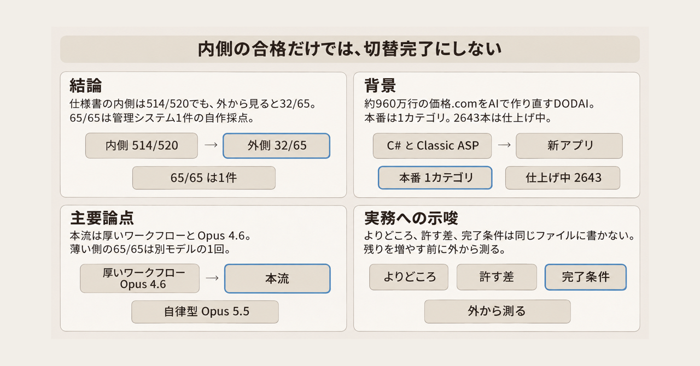
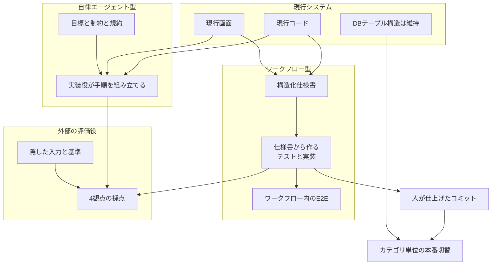

2026年11月26日、アーキテクチャConference 2026で、株式会社カカクコムの CTO 京和崇行氏と、AIシステム改革チームの時田充氏が、DODAI の現在地を話しました。資料は41枚で、Speaker Deck への公開は2026年11月27日です。DODAI は、約960万行の C# と Classic ASP で動く価格.comを、AI を使って作り直す社内プロジェクトです。Classic ASP は、.NET より前の Active Server Pages で書かれた画面側のコードです。数値は登壇者の自己報告であり、第三者による再現はありません。

この記事では、DODAI が何を作り直しているか、ワークフロー型と自律エージェント型の違い、半年後に残した技術と日程、資料が人に残した判断を順にまとめます。発注側とは、作り直したシステムを本番へ切り替えてよいかを決める側です。

*この記事の全体像。以下、順に解説します。*

## 価格.comのDODAIとは

DODAI は、価格.comのアプリケーションと、その実行に必要なインフラを新しく作り、データベースのテーブル構造と、既存機能と、ビジネスロジックは原則として維持するプロジェクトです。クラウド移行、データ移行、データベース製品を変えるかは、この書き直しの外に残る論点です。前回の発表は2026年6月8日です。そこから約半年が経ち、最初のカテゴリは本番に載り、生成物を人が仕上げる工程が中心になっています。

### 規模と、半年後の本番

資料が再掲する規模は、C# 約800万行、Classic ASP 約160万行、画面 1,353、URL 3,723 です。リリースの単位は約90カテゴリで、ユーザー向けが約60、管理画面が約30です。

2026年9月に、ユーザー向けの1カテゴリを本番リリースしました。2026年12月は、ユーザー向けの数カテゴリを出す見込みで、管理画面はありません。2027年3月は、ユーザー向け約7割、管理画面約3割の見込みです。全面完了の計画は2027年9月です。6月時点の目標は、30周年の2027年5月でした。

画面 URL のうち、ワークフローを流し終えて人が仕上げているものは 2,643、未着手は 1,080 です。合計は 3,723 です。ここでのワークフローは、AI に生成させる工程を細かく書いた手順です。2,643 は、その手順を最後まで実行し、人が仕上げている画面 URL の数です。

### 二つの作り方

ハーネスは、モデルの外側に置くプロンプト、スクリプト、エージェントのまとまりです。資料は、その厚さが違う二つの作り方を、社内の管理システム1つで比べています。

ワークフロー型は、工程を細かく書いたワークフローに沿って生成します。現行のコードと画面から構造化仕様書を作り、その仕様書からテストと実装を作ります。作る側と確かめる側が、同じ仕様を見られます。

自律エージェント型は、目標と制約と規約を渡し、手順は実装役が組み立てます。実装役は、手順を組んでコードを書くエージェントです。評価の基準は実装役に渡しません。実装役がその基準を見に行けば、違反として記録する、とスライドは書きます。

比べた対象は、社内向け管理システム1つ、19ページ、URL 21件、初期構築の全体です。組み合わせは各1回です。渡した方針は、移行で許す違いと、許さない違いです。

ワークフロー内の E2E は、そのワークフローの内側で、操作から結果までを通して確かめる自動テストです。外部の評価役が返すのは、観点ごとの合否の数、落ちた入力と短い理由、現行と新しい実装の振る舞いの違いです。評価役は、採点を返す別のエージェントです。返さないのは、評価役だけが持つ URL と要求の値、コードの場所、直し方の示唆です。要求の値は、隠した URL に付ける、評価役だけが持つ別の引数です。実装役が評価役へするのは、完了と判断した成果物の提出です。

採点の観点は4つです。見た目は、画面が現行と同じに見えるかです。隠した URL は、評価役だけが持つ別の引数でも、結果が現行と同じかです。送信値は、更新フォームで送る値が新旧で同じかです。この3つが、ふるまいの点数です。件数は、次の表のとおりです。1件がページなのか URL なのかは、資料に書いてありません。4つ目の遵守事項は、評価の中身を実装役が見に行っていないか、禁止された操作が無いか、を見る観点です。項目の一覧は資料に載っておらず、自律エージェント型の Opus 5.5 では違反なし、とだけ書かれています。Opus 4.6 と Opus 5.5 は、資料が生成に使ったモデルの名前です。ふるまいの分母 65 は、見た目 19、隠した URL 23、送信値 23 の合計です。見た目 12、隠した URL 5、送信値 15 の合計が、ワークフロー型の 32 です。表の「Opus 4.6 ベース」は、その列のワークフロー型を Opus 4.6 で実行した、という意味です。表のふるまいの点数は、最後まで流したあとの採点です。ループの途中で返した値とは違い、途中の評価表は公開されていません。

| 項目 | ワークフロー型（Opus 4.6 ベース） | 自律エージェント型（Opus 5.5） | 自律エージェント型（Opus 4.6） |
|---|---|---|---|
| ワークフロー内 E2E | 514/520（98.8%） | 資料は数を載せていない | 資料は数を載せていない |
| 外から見たふるまい | 32/65 | 65/65 | 評価できず |
| 見た目 | 12/19 | 19/19 | 評価できず |
| 隠した URL | 5/23 | 23/23 | 評価できず |
| 更新の送信値 | 15/23 | 23/23 | 評価できず |
| 遵守事項 | 資料は違反の数を載せていない | 違反なし | 資料は違反の数を載せていない |
| 時間 | 約66時間 | 約3時間56分 | 約2時間25分 |
| API 費用の概算 | 約$2,123 | 約$196 | 約$155 |

同じ Opus 4.6 の自律エージェント型は、データベースに接続できず、アプリケーションは動いていません。ワークフロー型に Opus 5.5 を載せる組み合わせは、コストが許容できず不採用で、この表では採点されていません。自律エージェント型の Opus 5.5 では、プロンプト約5千行、スクリプト約20本、エージェント2、という厚さでした。2体の内訳は、資料にありません。

本流のハーネスは、これとは別の厚さです。2026年6月から11月までに、プロンプトは約7.5万行から約12万行、スクリプトは約50本から約200本、エージェントは 71 から 110 になりました。今も使い続けるモデルは Opus 4.6 です。Opus 5.5 は全量に展開したあと、数日で切り戻しました。全量とは、本流のワークフロー全体へ載せることです。全量では API 費用が約1.4〜2倍になった、とスライドは書きます。

### 人が読み書きする前提で選んだ技術

後半は、人がコードを読み書きする前提で選んだ Python、FastAPI、htmx、Vertical Slices Architecture を、半年の実践で見直します。FastAPI は Python の Web フレームワークです。htmx は、サーバが HTML を返し、画面の一部を差し替えるライブラリです。Vertical Slices Architecture（以下 VSA）は、機能ごとの縦割りにコードを閉じる設計です。

言語とデータベースの別検証では、軽い SELECT を 26 本、直列に実行しています。Python + FastAPI + SQLAlchemy の p50 は 18.66 ms、データベース往復は 68.5 回でした。p50 は、所要時間を短い順に並べたときの中央付近の値です。SQLAlchemy は、Python から SQL を組み立てるライブラリです。自前で最適化したあとは 5.55 ms、26.1 回です。.NET + SQL Server は 4.44 ms、26.0 回です。参考の Python + PostgreSQL（非同期ドライバ）は 1.52 ms、27.0 回です。上の p50 とは別の負荷テストでは、Python + FastAPI + SQLAlchemy の新しい環境のクエリの方が重く、現行環境との差は2倍程度、と注記があります。

3カテゴリの VSA では、スライス内で閉じる import が 99%、100%、99% です。循環的複雑度が 10 以上の関数の本数は、そのうち1つのカテゴリで、書き直し前の 53 本から書き直し後の 91 本へ増えています。依存は tach、複雑度は lizard で数えています。tach は Python の import の依存を調べるツールです。lizard は、関数の循環的複雑度を数えるツールです。

1万を超えるテーブルの整理も、アプリケーションの書き直しの外に残る論点です。テーブル構造を維持する、は初期の制約です。往復が 68.5 回になったことは、人が実測した性能上の反省です。自前の最適化で、往復は 26.1 回まで減っています。

### 現行を入力にする二つの経路

資料が描く刷新は、現行システムを正解の入力にします。途中に仕様書を経由する経路と、経由しない経路に分かれます。本番の切替は、この実験の採点とは別の、カテゴリ単位の日程で進みます。データベースの構造は、アプリケーションの書き直しの外に残ります。

## 注意点

スライド31は、「現行システムが正解となるリプレイスにおいて、薄いハーネスは成り立った」と答えます。薄いハーネスは、目標と制約と規約だけを渡し、手順は実装役が組み立てる側の呼び方です。厚いワークフローは、約12万行の工程に沿って生成する本流の呼び方です。成り立ったと書いてあるセルは、管理システム1件、Opus 5.5、自作の外部評価、各1回です。同じ Opus 4.6 では、自律エージェント型は起動を確かめずに終わり、アプリケーションは動いていません。厚いワークフローに Opus 5.5 を全量で載せたときは、API 費用が増えて、数日で切り戻しています。今も使い続けるモデルは Opus 4.6 です。画面 URL の 2,643/3,723 は、厚いワークフローの生成物を人が仕上げる段階にあります。言語や SQL Server の選定を撤回した、とは書いてありません。

「より高い品質」は、この自作採点での 65/65 を指します。外部評価の見逃しと誤検出を、対象ごとにどう確かめるかは、未解決とされています。見た目の分母 19 はページ数と一致します。隠した URL と送信値の分母 23 は、ページ 19 とも URL 21 とも一致しません。何を1件にしたかは書いてありません。途中の評価表は公開されていません。発注側は、この 65/65 を再実行できません。

費用と時間の「1割未満」は、約$196 対 約$2,123、約3時間56分対 約66時間という、API 費用と稼働時間の比についての自己要約です。人の仕上げ工数は入っていません。月額440万円は、ワークフロー設計者の月額の AI 利用料として、6月発表が自己申告した金額です。11月のスライドはそれを再掲しており、この実験の費用ではありません。View 約7.8万は、6月資料の閲覧数の自己申告で、同じ種類の再掲です。直近1週間の AI への入力では、要件や評価への言及が、工程への言及の約3倍だった、という文が11月の資料にあります。いつの1週間かは、資料に日付がありません。どの入力を、どの工程として数えたかの分母も、資料にありません。

「約7割」は二つあります。2,643/3,723 は、ワークフローを流し終えた画面 URL です。ユーザー向け約7割は、2027年3月のカテゴリ見込みです。2026年11月の本番実績は、2026年9月の1カテゴリです。流し終えた約7割は、外部評価のあと直すか作り直すかが未決定のまま残っています。受け入れ済みの、新しい正本ではありません。正本とは、ふるまいが正しいと判断するときのよりどころです。

6月の資料は、失敗パターンを5つ挙げ、Anthropic が示したものと記しています。11月の資料はその対策の棚卸しです。この記事では、その5つの中身を Anthropic の原文に当たって確認していません。この棚卸しの中身は、この記事の判断には使いません。

画面の多い Web と、画面の無いバッチで、同じ採点になるかは、資料が未検証と書いています。コードレビューを人が読む運用が残るかは、議論中と書いています。認証、認可、画面権限をどう移行するかは、この41枚では確認できません。スライド30の「権限委譲」は、人が仕事を任せるときは監視を減らす、という比喩と、エージェントへ進め方を任せるほど結果の検証を厳密にする、という外部評価の対比です。認証、認可、画面権限の移行とは別の話です。隠した URL 23件と送信値 23件が、19ページと URL 21件のどれに対応するかは書いてありません。外部評価が、現行のどの不具合を「差」として落とすかも書いてありません。許す差の方針を、評価ハーネス以外のどの文書に残すかも書いてありません。評価ハーネスは、採点側に置くプロンプトとスクリプトのまとまりです。

## AIに渡した範囲と、人に残した判断

11月の列は「11月の判断 (5.5)」です。プログラム全体でモデルを差し替え済み、という意味ではありません。

| 層 | スライドが AI 側に置いたもの | スライドが人側に残した判断 |
|---|---|---|
| 要件 | 現行のコードと画面を入力にする。自律型は、仕様書を作るとコードの言い換えになる、と答えた。この回答は監査ではない | 現行を正解にする定義は、6月のおさらいからある。11月の判断（Opus 5.5 の列）では、その上の構造化仕様書は外す、としている。本流の Opus 4.6 の厚いワークフローから外したとは書いていない。設計の大枠の規約は入力として残る。許す差と許さない差は実験に渡した。その観点は、約7割を仕上げる途中で生まれ、外部評価の基準にもなった、と別のスライドが書く |
| 実装 | 薄い実験では、手順と、呼び出す補助エージェントの使い方を実装役が組み立てる。補助エージェントは、実装役が作業を分けるために呼ぶ別のエージェントです。厚い本流では、約12万行の工程に沿って生成する | モデルを本流に残すか、数日で切り戻すか。ハーネスを足すか、外す試行をするか。生成物を対話で仕上げるか。対象ごとに直すか、作り直すか。コードレビューを今後どうするかは議論中 |
| 検証 | 採点、返却、修正のループは上限まで自動。評価役が返すのは、落ちた入力、短い理由、振る舞いの差。直し方とコードの位置は返さない | 評価基準を対象ごとに人が作る。ワークフロー型では、不合格にするかの裁定と、ワークフローへ書いた定義を人が読み直す作業がある。読み直す手順は資料にありません。自律型で人が扱うのは、環境の不具合と、想定外の停止です。機械の完了ゲートは残します。機械の完了ゲートは、自動で完了を判定する条件です。内部ゲートは、仕様書から作ったワークフロー内の E2E で、表の 514/520 がそこの点数です。内部ゲートだけでは漏れを通した、とも書きます |

画面について、見た目が現行と同じであることは必要条件で、それだけでは足りません。ワークフロー型は、見た目 12/19 に対し、隠した URL は 5/23 でした。

移行の順について、資料の次の一手は、残り約3割を同じワークフローで流す前に、流し終えたものも含めて外から測り、対象ごとに直すか作り直すかを決める、です。カテゴリの順は、ユーザー向けが先で、管理画面は後にずれています。

## 混ぜずに置く3つの層

発注側が混ぜやすい層を、資料の記述の強さで分けると、次のとおりです。人が仕上げたコミットと、設計の規約は、入力に残ります。許す差を見分ける観点は、仕上げの途中で生まれ、外部評価の基準になりました。

| 層 | 資料が支持すること | 資料が支持しないこと |
|---|---|---|
| ふるまいのよりどころ | 現行システムを正解にする、は6月からある。仕様書経由のテストは、仕様書に無い差を見ない。この実験では、内部 98.8% に対し外部は 32/65 | 現行コードだけへ正本を差し替え終えたこと。現行のバグや、画面とコードの不一致を正解にするかは未記載 |
| 許す差の方針 | 実験では、許す違いと許さない違いを渡している。スライド31は、それを最初から要件として渡せた、と振り返る | 生成前に独立した文書へ固定したこと。評価ハーネスの外に正本を残したこと |
| 切替の合否 | 作る側に見せない入力で、動いている新旧を比べる、という方向。機械の完了ゲートは残すが、仕様書から作ったワークフロー内の E2E だけでは漏れを通した | 65/65 が全システムの切替完了であること。URL を流した割合や、2027年9月という日程が、この採点と同じキーであること。発注側が同じ採点を再実行できること |

現行仕様の正本をどの成果物に固定するかは、切替完了の判定キーとは別の層になります。切替完了の判定キーとは、本番へ切り替えてよいかを決める条件です。資料自身は、この分離を全社の成果物規則としては書いていません。実験の中では、許す差の方針が、非公開の採点基準へ入っています。分けるなら、評価器の外に、人が持つ文書として残す必要があります。評価器は、評価役が採点に使う仕組みです。判断支援者とは、発注側が切り替えを決めるための読みを、この記事が置く立場です。これは、その読みであり、登壇が終えた作業ではありません。

判断支援者として置くのは、3つを同じファイルに書かないことです。

1. ふるまいのよりどころは、生成した仕様書ではなく、動いている現行のコードと画面に置きます。人が本番前に足した仕上げは、現行コードと混ぜず、別の差分として残します。現行の既知の不具合を正解に含めるかは、資料が書いていないので、発注側が別に決めます。
2. 許す差と許さない差は、評価器の中だけに置きません。評価器へ渡す前の、人が持つ短い文書にします。この登壇は、その文書が最初からあったとも、仕上げの途中で生まれたとも読めます。どちらの記憶で進めても、外に残っていないなら、完了キーと再び一体になります。
3. 切替完了の判定は、仕様書から生成したテストの通過率にしません。作る側から隠した入力で、動いている新旧のふるまいを比べます。そのキーを、ワークフローを流した URL 数や、周年の日付と混ぜません。データ移行、権限、運用業務は、画面のふるまい採点の外に、別のキーを置きます。

移行の順は、残りの生成を増やす前に、すでに流した成果物も同じ外部の物差しで測り、直すか作り直すかを対象ごとに人が決めます。これは資料が「これから」と書いた手順であり、実施済みの全件結果ではありません。

3つを同じファイルに書かない、という読みをひっくり返す条件は、次が揃うときです。同じモデルで厚い方式と薄い方式がどちらも完走すること。評価表を第三者が再実行できること。画面の多い対象でも、画面の無いバッチでも、外から見た点数で厚い方式と薄い方式のどちらが高いかが同じであること。差の向きとは、その高低です。その条件は、この41枚にはありません。残りを生成する前に外から測る、という資料の手順は、この条件とは別です。

## どこまでがこの1実験の観察か

いま置ける観察は、次です。リプレイスの契約が「現行と同じように振る舞う」であるとき、現行から起こした仕様書をテストの親にすると、仕様書の漏れが内部合格になります。価格.comのこの1実験は、その形を 514/520 と 32/65 で見せています。

この観察を「薄いハーネスへ本流を切り替えよ」に伸ばす根拠は弱いです。残る反証は、モデルが違うこと、回数が1回であること、採点が自作で非公開であること、同じモデルの薄い側が起動していないこと、本流がまだ厚いワークフローであることです。2026年11月28日時点で、この11月資料の数値を登壇者以外が実測で否定した記事は、見つかっていません。公開の再現物も、検索の範囲では見つかっていません。見つからないことは、数値が正しい証明にはなりません。

6月資料を引いた解説は、71体や、別対象の実行時間の話であり、11月の比較表の検証ではありません。

## まとめ

DODAI は、価格.comのアプリケーションとインフラを新しく作り、テーブル構造と既存機能とビジネスロジックは原則として維持する刷新です。半年後の本番実績は、2026年9月のユーザー向け1カテゴリです。画面 URL の 2,643/3,723 はワークフローを流し終えて仕上げ中であり、全面完了の計画は2027年9月です。

管理システム1件の比較では、ワークフロー型の内側は 514/520、外から見たふるまいは 32/65 でした。自律エージェント型の Opus 5.5 は 65/65 で、遵守事項の違反はありません。同じ Opus 4.6 の自律型はデータベースに接続できず、本流は Opus 4.6 の厚いワークフローのままです。

ふるまいのよりどころ、許す差の方針、切替完了の判定キーを同じファイルに書かない、というのは、登壇が終えた作業ではありません。発注側の判断用に、この記事が置く読みです。残りを生成する前に、流し終えた成果物も外から測る、というのは、資料が「これから」と書いた手順です。実施済みの全件結果ではありません。

この記事が少しでも参考になった、あるいは改善点などがあれば、ぜひリアクションやコメント、SNSでのシェアをいただけると励みになります！

## 参考リンク

- [京和崇行、時田充「価格.comのAI駆動による全面刷新の現在地と振り返り」（2026-11-26登壇、Speaker Deck）](https://speakerdeck.com/tkyowa/kakaku-com-ai-driven-system-renewal-202611)
- [同資料の PDF](https://files.speakerdeck.com/presentations/9cf9a0552d5d4680bdec0fe2332f7a77/kakaku-com-ai-driven-system-renewal-202611.pdf)
- [6月資料「価格.comをAI駆動で全面刷新する」（AI Engineering Summit Tokyo 2026、2026-06-08）](https://speakerdeck.com/tkyowa/kakaku-com-ai-driven-system-renewal-0fc7e978-0e39-4bba-93eb-17cd56ecd1c1)
- [6月資料の PDF](https://files.speakerdeck.com/presentations/b0a3c6959e6e42dca3d8bc44e0037909/20260608_%E4%BE%A1%E6%A0%BC.com%E3%82%92AI%E9%A7%86%E5%8B%95%E3%81%A7%E5%85%A8%E9%9D%A2%E5%88%B7%E6%96%B0%E3%81%99%E3%82%8B_AI_Engineering_Summit_Tokyo_2026_%E6%8A%95%E7%A8%BF%E7%94%A8.pdf)
- [Findy「アーキテクチャConference 2026」](https://conference.findy-code.io/events/architecture-conference-2026/276)
- [セッションページ](https://conference.findy-code.io/conferences/architecture-con-2026/40/sessions/863)
- [京和氏の登壇予告](https://x.com/tkyowa/status/2125814516546183462)
- [同じスレッドの返信（6月資料の URL）](https://x.com/tkyowa/status/2125814517905215649)
