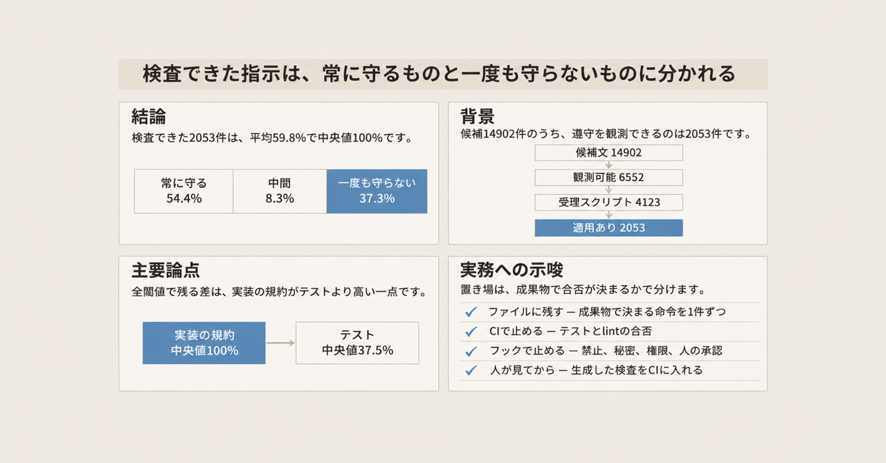
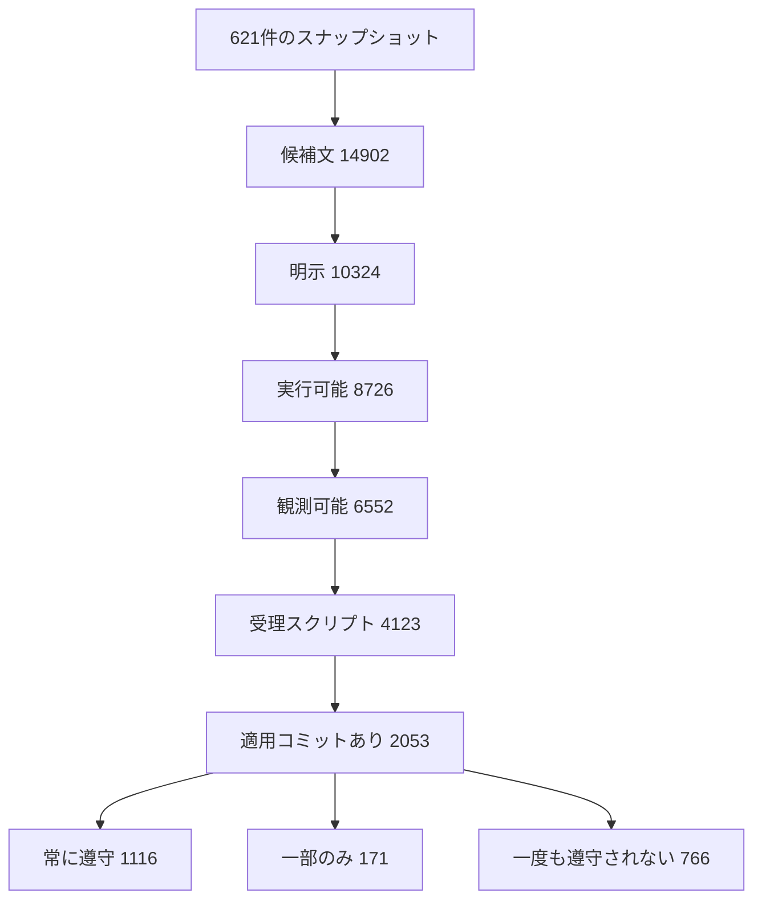

Gianmario Voria、Yutaro Kashiwa、Gemma Catolino、Fabio Palomba は、公開 GitHub の指示ファイルと、エージェントに厳格に帰属したコミットを結び、指示 1 件ずつが成果物に残るかを測りました。論文は [Do They Do as They Are Told?](https://arxiv.org/html/2611.13709)（arXiv:2611.13709v1、cs.SE、2026-11-10 提出、CC BY 4.0）です。cs.SE は、arXiv のソフトウェア工学の分類です。Voria、Catolino、Palomba は University of Salerno、Kashiwa は奈良先端科学技術大学院大学です。

この記事が読むのは arXiv:2611.13709v1 の HTML であり、採録済みの proceedings としては確認していません。

この記事では、Agent context file が何か、測定がどの段で絞られるか、遵守率がどう分布するかを説明します。そのあと、数値の読み方、指示の種類とエージェントごとの差、公式文書と隣接する研究、ファイルに残すものと外で止めるものの分け方をまとめます。

*この記事の全体像。以下、順に解説します。*

## Agent context fileとは

Agent context file（以下 ACF）は、コーディングエージェントへ渡す、プロジェクト単位の指示ファイルです。代表例は `AGENTS.md`、`CLAUDE.md`、`copilot-instructions.md`、`.cursor/rules` です。セッションのたびに期待を言い直さず、プロジェクト固有の振る舞いを渡すためのファイルです。

### 測定の単位

この論文の単位は、ファイル全体ではありません。指示 1 件です。ファイルから候補の文を取り、明示、実行可能、観測可能の 3 条件で絞ります。明示とは、ファイルに直接かつ明確に書いてあり、例や前後の文脈から推測しないことです。実行可能とは、ソフトウェアを変更するあいだに、エージェントが合理的に実行できる具体的な振る舞いを書くことです。観測可能とは、エージェントの意図や内部の推論を見ずに、生成または変更されたファイルを見て遵守を判定できることです。最終的な判定では、エージェントの推論、コマンドの実行、内部の作業状態に触れない、単純な検査関数を書けることも条件です。

遵守は、検査スクリプトが、その指示に関係するファイルを変えたコミットに対して返す真偽です。エージェントが従う気だったかは見ていません。遵守は二値です。

スナップショットとは、内容で一意にした ACF の版です。同じ内容は同じスナップショットになり、内容が変わると新しいスナップショットになります。各コミットには、そのとき有効だった版を結びます。

### コーパス

分析に使ったのは、空や壊れたファイルを除いた ACF スナップショット 621 件、厳格帰属のエージェントコミット 6,541 件、リポジトリ 268 件です。厳格帰属とは、ボットの識別子や曖昧でない著者情報など、強い手がかりだけでエージェントのコミットとみなすことです。帰属は AIDev の厳格な部分集合だけを使います。AIDev は、プルリクエストとコミットをコーディングエージェントへ帰属させるデータセットです。確度の低い「人間ではないらしい」コミットは、この論文の分析に入れません。対象エージェントは GitHub Copilot、Claude Code、OpenAI Codex です。

コミットの経路は、21,513 件から、文脈あり 8,600 件、ファイル変更あり 6,580 件、計画コミットとマージ 39 件を除いて 6,541 件です。文脈ありとは、そのコミットに ACF のスナップショットが結び付いていることです。計画コミットは、計画だけで、ファイル変更をほとんど持たないコミットです。計画コミットは全体で 3,149 件あり、その多くはファイル変更のフィルタで既に落ちています。除いた 39 件は、その残りとマージコミットです。ACF の大きさの中央値は 638 語（110 行）で、最大は 16,000 語を超えます。コミットの内訳は、ソース 62.2%、テスト 21.1%、文書 16.4% です。

### 候補から検査スクリプトまで

候補文は 14,902 件で、スナップショットあたり平均 24.0 件です。明示は 10,324 件（69.3%）です。明示かつ実行可能は 8,726 件（候補の 58.6%）です。3 条件をすべて満たす観測可能は 6,552 件（候補の 44.0%）です。観測可能な指示を 1 件以上持つスナップショットは 592 / 621（95.3%）です。明示かつ実行可能な指示を 1 件以上持つものは 615 / 621（99.0%）です。

明示性で候補の 30.7% が落ちます。実行可能性は、明示の 15.5%（検証サンプルでは 18.4%）を除きます。検証サンプルは、人手で確認したスナップショット 84 件です。明示かつ実行可能な集合から、観測可能性はコーパスで 24.9%、検証サンプルで 48.9% を除きます。この 48.9% は、そのサンプルで観測可能から外れた割合です。

観測可能な指示のうち、検査スクリプトを受理したのは 4,123 / 6,552（62.9%）です。エージェント別の受理率は、Copilot 2,367 / 3,729（63.5%）、Claude Code 1,520 / 2,449（62.1%）、Codex 236 / 374（63.1%）で、差は 1.4 ポイントです。受理した 4,123 件のうち、関係ファイルを触るコミットが 1 件以上あるのは 2,053 件（49.8%）です。残り 2,070 件はスクリプトにはなりましたが、該当するファイル種に一度も当たりません。遵守の観測になるのは、観測可能な指示の 31.3%（2,053 / 6,552）、候補文の 13.8%（2,053 / 14,902）です。観測ペアは 18,594 件です。観測ペアは、指示 1 件と、それに適用したコミット 1 件の組です。

注釈モデルは Qwen 3.5 9B（温度 0.1）です。スクリプト生成は Qwen2.5-Coder-14B-Instruct（温度 0.8）です。どちらもローカルの LM Studio で、文脈の長さは 32k、top-p は 0.85、形式は GGUF Q4_K_M です。LM Studio は、モデルを手元のマシンで動かす実行環境です。top-p は、次の語の候補を累積確率で絞る設定です。GGUF は、モデルを配るファイル形式です。Q4_K_M は、その形式の方式名です。生成を試みる本数は、指示あたりスクリプト 10 本とフィクスチャ 10 組です。フィクスチャとは、スクリプトの正しさを試す入出力の組です。最低正しさはフィクスチャ 2 件の通過です。裏取りは、別のスクリプトが、最良スクリプトの通ったフィクスチャのうち 60% 以上で同じ結果になることです。6,552 件のうち 6,223 件（95.0%）はスクリプト 10 本、5,786 件（88.3%）はフィクスチャ 10 組まで生成しました。受理群の合意サイズの平均は 6.3 / 10 です。合意サイズは、受理したスクリプトと、それに同意したスクリプトを合わせた本数です。全員一致は 825 件（20.0%）です。ちょうど 2 本の合意で受理されたのは 589 件（14.3%）です。

### 遵守率の分布

2,053 件の指示ごとの遵守率は、平均 59.8%、中央値 100.0% です。常に守られた指示は 1,116 件（54.4%）です。一度も守られなかった指示は 766 件（37.3%）です。その中間は 171 件（8.3%）です。適用コミット数の中央値は 3 です。ちょうど 1 件の指示は 540 件（26.3%）です。

測定の段は次のとおりです。

## 注意点

### 平均と中央値の分母

平均 59.8% は、コミットの 59.8% が指示に従う、という意味ではありません。分母は、検査できた指示 2,053 件について、指示ごとに出した遵守率です。中央値が 100% なのは、分布が常に守る側と一度も守らない側へ割れているためです。適用コミットが 1 件の指示は、遵守率が 0% か 100% にしかなりません。

適用コミット 3 件以上（1,144 件）と 5 件以上（819 件）でも、両端の割合は 91.7% から 87.3%、86.2% へ下がるだけです。中間は 8.3% から 12.7%、13.8% へ増えます。

### 観測可能というラベルの上限

候補文 14,902 件のうち、遵守の観測になるのは 13.8% です。観測可能性のラベル精度は 85.0%、採否の精度は 85.2% です。この 2 項目の不一致の 90% 超は、モデルの「はい / 含める」を人手で「いいえ / 除く」に直したものです。6,552 件は上限です。

検証はスナップショット 84 件（13.5%）で、候補 2,202 件（14,902 件の 14.8%）を含みます。記録された判定は 2,196 件、本物と確認された指示は 2,114 件です。抽出の精度は 96.3%、再現率は 99.9%（記録された欠落は 1 件）、F1 は 98.1% です。F1 は、精度と再現率を一つにまとめた値です。項目精度は、明示 95.5%、実行可能 97.3%、カテゴリ 96.6%、候補行動 97.5% です。候補行動は、指示から起こした、観測できる振る舞いの記述です。モデル間一致は、別のモデルが出したラベルとの一致で、全体 74.8%、採否 79.5%、観測可能 76.1% です。比べたモデルの名前は、この記事には書き出していません。注釈者は 1 人です。Codex のカテゴリ精度は 87.4% で、他の 2 エージェントの 96.7% から 98.0% より低いです。ただし Codex のスナップショットは 5 件です。

### 検査スクリプトのずれ

受理スクリプト 94 件の抜き取りでは、67 件（71.3%）だけが指示を正しく実装していました。約 3 件に 1 件は仕様と違います。多い誤りは、ACF 内の例をリテラルな要件として固定することです。この誤りは遵守率を下げる方向に偏ります。

一方、関係ファイルを触らないコミットに対して、根拠なしで True を返すスクリプトは 2,569 / 4,123（62.3%）あります。適用フィルタは、この楽観を除くためのものです。遵守を楽観的に見たとき、報告される非遵守は本当の非遵守の下限です。見かけの遵守が上がる方向にしかずれない、という意味です。例をリテラルに固定する誤りは、これとは逆に、遵守率を下げる方向です。この 2 つの偏りを相殺した純バイアスは、定量されていません。

スクリプトは、変更ファイルの変更前と変更後の全文を見ます。行差分は見ません。エージェントが触る前からあった違反を、そのコミットの非遵守に数えることがあります。逆に、元から守られていた箇所が、別の箇所の違反を隠すこともあります。

### 効果、範囲、再計算

指示が無いコミットとの比較はありません。遵守が ACF の効果であるとは言えません。エージェント差は、カテゴリ構成、リポジトリ、言語、帰属の偏りを統制していません。そのため、エージェント間の差は製品の優劣としては読めません。公開 GitHub と 3 エージェントに限ります。注釈とスクリプト生成に使った Qwen 3.5 9B と Qwen2.5-Coder-14B は、最上位のモデルではありません。コミットを書いた Copilot、Claude Code、Codex のモデルのことではありません。

HTML 先頭の `Journal: TOSEM`、`Volume: XXX`、`DOI: 10.1145/XXXXXXX.XXXXXXX`、`Received 5 June 2009` はテンプレートの残渣です。論文の識別子は arXiv:2611.13709v1 です。

論文が示す複製パッケージ https://github.com/gianwario/Agents-Context-Files-Analysis は、2026-11-12 に `gh repo view` で開けませんでした。著者アカウント `gianwario` は存在し、公開リポジトリ一覧に同名はありませんでした。別 URL は未確認です。数値の再計算はできません。

Gloaguen らの本文にあるコスト増 23% と、文書を除いた成功率の改善 2.7% は、該当節を突き合わせていないため、この記事では使いません。Yang らの開示と検証が戻る範囲として、この記事が使うのは導入と結論に書かれた 77% から 100% だけです。開示と検証は、手順を足す側の規則です。戻る割合の分母は、導入と結論のその範囲以外では使っていません。

### 別の数値と混ぜないこと

Gloaguen らの「指示そのものはよく守られる」と、一度も守られない 37.3% は、同じ文に畳めません。前者はタスク解決の実験です。後者は実コミットの成果物検査です。

Lulla らは、`AGENTS.md` がある方が中央値で時間とトークンが減る、と書きます。ファイルを厚くすると必ずコストが増える、とは言えません。Gloaguen らの平均 20% 超のコスト増は、別設定の平均です。

受理スクリプトの 28.7%（94 件中 27 件）は、指示を正しく実装していません。生成スクリプトをそのまま CI の正本にすると、誤った不合格を量産しえます。

フックは、無条件の安全策ではありません。PreToolUse は、ツール実行の前に走る Claude Code のフックです。[anthropics/claude-code#80697](https://github.com/anthropics/claude-code/issues/80697) は CLOSED / NOT_PLANNED（closedAt 2026-09-21T22:16:37Z）です。存在しない Python スクリプトを PreToolUse が起動すると、CPython の終了コード 2 がフックの拒否と衝突し、Bash が止まる、と本文は報告します。回避は、設定が指したままスクリプトを改名したり消したりしないことです。本文が言及する #77912 と #59643 は、個別には開いていません。

[CVE-2025-59536](https://github.com/advisories/GHSA-4fgq-fpq9-mr3g) は別件です。NVD と GHSA-4fgq-fpq9-mr3g（公開 2025-10-03）で確認しました。Claude Code 1.0.111 未満では、未信頼ディレクトリで起動すると、起動時の信頼ダイアログを受け入れる前にプロジェクト内コードが実行され得ました。1.0.111 で修正済みです。CWE-94 は、コードを注入される弱点の分類です。CVSS は脆弱性の重大度の点数です。NVD の CVSS 3.1 は 8.8、GitHub の CVSS 4.0 は 8.7 です。現行のフックが、常に未信頼のリポジトリ設定を実行する、という証拠ではありません。

## どの種類の指示が成果物に残るか

観測可能な指示の内訳では、Implementation Details が、明示かつ実行可能な段階の 42.8% から、観測可能の 50.0%（3,279 件）へ増えます。Implementation Details は、実装の具体的な規約です。Implementation Details、Testing、Documentation の合計は、観測可能な指示の 76.6%、コミット重みでは 83.2% です。コミット重みは、その指示を含むスナップショットに結び付いたコミットの数で件数を伸ばした割合です。Build and Run は 8.8% から 2.9% へ、Build は 3.8% から 2.5% へ減ります。Build and Run と Build、および後の表の Management と Project Management は、論文が別行にしたカテゴリ名です。この記事は、その境界の定義を置き場の判断に使いません。エージェント構成はほぼ変わりません。明示かつ実行可能では Copilot 55.4%、Claude Code 38.7%、Codex 5.9% です。観測可能では 56.9%、37.4%、5.7% です。

50 件以上のカテゴリで、スクリプト化率が高いのは Configuration and Environment 269 / 356（75.6%）、Maintenance 48 / 66（72.7%）、Architecture 95 / 131（72.5%）、Build and Run 130 / 189（68.8%）、Testing 626 / 927（67.5%）です。低いのは Management 31 / 65（47.7%）と Security 48 / 99（48.5%）です。Implementation Details は 2,008 / 3,279（61.2%）、Documentation は 505 / 810（62.3%）です。

スクリプト化できなかった 2,429 件（37.1%）の内訳は、1 件もフィクスチャを通らない 1,006 件（41.4%）、最良が 1 件だけ 386 件（15.9%）、正しさは通るが 2 本目が同意しない 997 件（41.1%）、有効なスクリプトが 2 本未満 40 件（1.6%）です。最低正しさで落ちるのは合計 1,392 件（57.3%）です。

遵守のカテゴリは次のとおりです。件数の小さい行は記述です。対比較の根拠にはしません。被覆は、受理スクリプトのうち適用コミットがある割合です。平均と中央値は、評価できた指示ごとの遵守率です。

| カテゴリ | スクリプト | 評価 | 被覆 | 平均 | 中央値 |
|---|---:|---:|---:|---:|---:|
| Implementation Details | 2,008 | 1,022 | 50.9% | 63.6% | 100% |
| Testing | 626 | 270 | 43.1% | 49.2% | 37.5% |
| Documentation | 505 | 340 | 67.3% | 60.2% | 100% |
| Configuration and Environment | 269 | 99 | 36.8% | 56.3% | 100% |
| Build and Run | 130 | 62 | 47.7% | 69.9% | 100% |
| Development Process | 130 | 50 | 38.5% | 34.0% | 0% |
| Architecture | 95 | 40 | 42.1% | 38.2% | 0% |
| Build | 95 | 48 | 50.5% | 67.5% | 100% |
| Quality | 76 | 37 | 48.7% | 63.5% | 100% |
| Maintenance | 48 | 15 | 31.2% | 85.3% | 100% |
| Security | 48 | 18 | 37.5% | 58.6% | 98.7% |
| Management | 31 | 24 | 77.4% | 44.6% | 0% |
| Debugging | 19 | 4 | 21.1% | 21.9% | 0% |
| Performance | 15 | 9 | 60.0% | 65.1% | 100% |
| General | 10 | 7 | 70.0% | 71.4% | 100% |
| Project Management | 8 | 3 | 37.5% | 93.3% | 100% |
| UI/UX | 7 | 3 | 42.9% | 91.7% | 100% |
| DevOps | 3 | 2 | 66.7% | 50.0% | 50% |
| 合計 | 4,123 | 2,053 | 49.8% | 59.8% | 100% |

AI Integration は観測可能 1 件、受理スクリプト 0 件で、この表に行がありません。

カテゴリ全体の Kruskal-Wallis は H = 59.13、p < .001 です。評価がある 18 カテゴリが対象です。Kruskal-Wallis は、複数グループの分布の差を順位で見る検定です。Bonferroni 補正後に全標本で残る対は次です。Bonferroni 補正は、対比較を何度もするときに有意水準を厳しくする手続きです。Cliff の δ は、2 群のどちらが大きいかを -1 から 1 で示す効果量です。

- Development Process（平均 34.0%、中央値 0%、n = 50）対 Build and Run（pBonf = .013、δ = -0.39）
- 対 Documentation（p = .037、δ = -0.29）
- 対 Implementation Details（p = .002、δ = -0.32）
- Implementation Details 対 Testing（p = .002、δ = 0.15）

Architecture の低さは記述にとどまります。対比較は Bonferroni を通りません。

適用コミットを 3 件以上、5 件以上に限っても、カテゴリ差そのものは残ります（H = 40.79 と 43.97、どちらも p < .001）。Development Process の対比較は、どちらの閾値でも Bonferroni を通りません。評価件数は 50、14、7 と減り、平均は 34.0%、25.0%、21.4% です。すべての閾値で有意なカテゴリ対は、Implementation Details 対 Testing だけです。

著者の実務上の読みは、1 指示につき 1 つの具体的で命令形の、成果物から検査できる振る舞いを書き、「when appropriate」のような留保を避ける、というものです。コミット形式やブランチのような作業手順は、フック、ブランチ保護、CI の方が散文より向く可能性がある、とも書きます。Development Process の対比較は感度分析で消えるため、著者自身がこの一点を暫定としています。感度分析とは、適用コミット数の閾値を上げて、少ないコミットの指示を外したときの再計算です。

種類ごとの切り分けは次のとおりです。

| 指示の型 | 論文で見えること | 文面 | 機械 |
|---|---|---|---|
| コードに残る規約 | 中央値 100%、平均 63.6%。Testing との差だけが全閾値で残る | 1 指示 1 振る舞いの命令形にする | 例をリテラル検査にしない。生成チェッカーは人が見てから CI に置く |
| テストの有無や実行 | 平均 49.2%、中央値 37.5%。唯一残るカテゴリ差の低い側 | 対象ファイルと期待するコマンドを具体化する | カバレッジと必須コマンドは CI で見る |
| 文書 | 被覆 67.3% と高く、中央値 100% | どのファイルのどの見出しかを書く | 必須節だけを検査する |
| 設定と環境 | スクリプト化 75.6% と高いが、被覆は 36.8% | ファイル名とキーを書く | 触られない期間は検査が走らない |
| 開発手順 | 平均 34.0%、中央値 0%。有意差は感度分析で消える | 短い命令にしてよい | 守らせたいコミット形式やブランチはフックかブランチ保護へ。有意差が消えたので、全面移管の根拠にはしない |
| 止める規則 | Security は評価 18 件、平均 58.6%。禁止の自発遵守は測っていない | 届ける文は残してよい | 拒否はフックか、クライアント側の拒否設定。Claude の `permissions.deny` はその一例。散文だけでは停止を保証できない、という隣接結果は次節 |

`permissions.deny` は、指定した操作をモデルの判断より前に拒否する設定です。

## エージェントごとの差

評価できた指示の平均遵守率は、Copilot 66.0%（中央値 100%、n = 1,137）、Claude Code 52.2%（中央値 66.7%、n = 799）、Codex 51.2%（中央値 100%、n = 117）です。Kruskal-Wallis は H = 41.58、p < .001 です。全標本では Copilot が Claude Code より高く（p < .001、δ = 0.15）、Codex より高い（p = .018、δ = 0.13）です。Claude Code と Codex は区別できません（pBonf = 1.0、δ = -0.0005）。

感度分析後も残るのは、Copilot 対 Claude Code だけです。pBonf は、全標本、適用 3 件以上、5 件以上の順に <.001、.002、.004 です。δ は 0.12 から 0.15 の範囲です。Copilot 対 Codex は、3 件以上で p = .165、5 件以上で p = .102 となり、Bonferroni を通りません。δ は 0.13、0.14、0.23 と増えますが、Codex の件数は 117、56、22 と減ります。Claude Code と Codex は、すべての閾値で区別できません。

被覆はエージェント間で近いです。Claude Code 799 / 1,520（52.6%）、Copilot 1,137 / 2,367（48.0%）、Codex 117 / 236（49.6%）です。差は、検査できるかどうかではなく、検査できた指示の遵守率にあります。カテゴリ構成は統制されていません。

## 公式の文書と隣接する研究は何と言うか

2026-11-12 に確認した一次の文書は、次のように言います。

[Claude Code の memory 文書](https://code.claude.com/docs/en/memory)は、`CLAUDE.md` を文脈として読み、強制設定ではない、と書きます。モデルの判断と無関係に止めたいときは、PreToolUse フックを使います。`CLAUDE.md` はシステムプロンプトのあとへユーザーメッセージとして入り、あいまいな指示や矛盾する指示では厳密な遵守を保証しません。1 ファイルの目安は 200 行未満で、長いファイルは遵守を下げます。4 MiB を超えるファイルは読み飛ばします。先頭 200 行または 25KB という上限は、自動メモリの `MEMORY.md` 側であり、`CLAUDE.md` 本体の上限ではありません。自動メモリは、`MEMORY.md` に置く別の記憶です。組織で止めたい規則は `permissions.deny` のような管理設定へ置きます。`permissions.deny` は、指定した操作をモデルの判断より前に拒否する設定です。複数ステップの手順や、コードベースの一部にしか要らない指示は、skill かパス限定ルールへ移す、とも書きます。skill は、手順をまとめてエージェントに渡す別の単位です。パス限定ルールは、指定したパスにだけ置く規則です。本論文は skill を測っていません。

[GitHub Copilot の response customization 文書](https://docs.github.com/en/copilot/concepts/prompting/response-customization)は、AI は非決定的なのでカスタム指示に常には従わない、と書きます。カスタム指示は、生成物が方針に従うことを保証しません。

[Codex の AGENTS.md のページ](https://learn.chatgpt.com/docs/agent-configuration/agents-md)は、2026-11-12 時点で `https://developers.openai.com/codex/guides/agents-md` から転送されます。作業前に `AGENTS.md` を読み、ルートから対象ディレクトリまで連結し、近いファイルが後から現れて優先される、と書きます。`project_doc_max_bytes` の既定は 32 KiB で、それを超える先のファイルは切れます。`project_doc_max_bytes` は、読み込む指示ファイルの合計サイズの上限です。通常の `AGENTS.md` の例は、プルリクエストの前に `npm run lint` を実行する、と書きます。コードレビュー規則の節は別で、規則は短くし、整形と lint の検査は CI に残す、と書きます。このページに「遵守を保証しない」という文は、2026-11-12 の取得では見つかりませんでした。

[Gloaguen ら](https://arxiv.org/html/2602.11988)（arXiv:2602.11988v3、2026-09-29 改訂）は、文脈ファイルがタスク成功率を一般には上げず、推論コストを平均で 20% 超増やす、と書きます。v3 の抄録では、開発者がコミットしたファイルは LLM が生成したファイルより平均約 7% 高く、文脈ファイル内の指示はよく守られる一方、リポジトリ概要は役に立たない、と書きます。この 7% がどの指標かは、この記事では特定できません。HTML の平均は、SWE-bench で解決率が 0.5% 下がり、CTXbench で 2% 下がり、両側検定の p 値は 0.87 と 0.37 で有意ではありません。SWE-bench と CTXbench は、課題を解けるかでエージェントを測るベンチマークです。これは「指示を増やせば成功する」を弱める結果であり、「散文は強制ではない」という Voria らの主張を取り消しません。設定が違います。Voria らは指示ごとの成果物遵守、Gloaguen らはタスク解決率です。

[Yang ら](https://arxiv.org/html/2607.26819v1)（arXiv:2607.26819v1、2026-07-29 提出）は、手順を足す規則と、作業を取り消す規則を分けて書きます。開示と検証は、手順を足す側の規則です。注意、条文の引用、検証器からの 1 回の指摘で、77% から 100% まで戻ります。この範囲は、導入と結論に書かれた戻りです。件数の分母は、そこに書かれた範囲の外では使っていません。自発的な拒否は全エージェント 0% です。禁止条項を引用しても 3 エージェントは 0% のままで、GPT-5.5 だけ 0% から最大 10% まで上がります。撤回を原文で指示されると、GPT-5.5 は 30 件すべてで貢献を残し、最も戻った Claude Sonnet 4.6 でも 7/30 です。著者の結論は、禁止と人の承認を本気で守るなら、マージを止める CI、必須の人のレビュー、AI 作成のプルリクエストを閉じるボットのように、エージェントの外へ制御を置く、というものです。

[Lulla ら](https://arxiv.org/abs/2601.20404)（arXiv:2601.20404v2、2026-03-30 改訂の抄録）は、10 リポジトリ、124 PR で、`AGENTS.md` があるとき実行時間の中央値が 28.64% 短く、出力トークンの中央値が 16.58% 少ない、と書きます。タスク完了の振る舞いは同程度です。見ているのはファイルの有無であり、指示ごとの遵守ではありません。意味的な正しさでもありません。Voria らが引用する 28.6% と 16.6% は、この抄録の丸めです。コストの向きは Gloaguen らと逆で、実験設定が違います。対象リポジトリで測る必要があります。

[SWE-CC](https://arxiv.org/abs/2610.06193)（arXiv:2610.06193 の抄録）は、機能的に正しいパッチでも適用されるプロジェクト方針の 43.1% に違反し、違反のほぼ半分は途中ステップで起きる、と書きます。これは ACF の指示の遵守とは別の構成概念であり、37.3% と混ぜません。

支える材料は、指示ごとの二極、Testing と Implementation Details の差が感度分析後も残ること、ベンダーが散文を非保証と書くこと、Yang らが止める規則は外で強制すると書くこと、です。

## ファイルに残すものと外で止めるもの

採用する分け方は、コードに残る規約、テストと lint、止める規則の置き場を分け、全部をフックへ移さないことです。判断は、成果物だけで合格と不合格が決まるか、モデルの判断と無関係に止めたいか、です。

1. 各指示を、成果物だけで合格と不合格が決まるかで分けます。決まらない文は、検査できる 1 振る舞いに割るか、強制の対象から外します。明示かつ実行可能でも、変更後のファイルに痕跡が残らなければ観測可能ではありません。プルリクエストの前に lint を実行する、という文は実行できても、コミット後のファイルだけでは実行したかが残らないことがあります。
2. コード規約は命令形で 1 件ずつ書きます。Implementation Details の中央値は 100% です。Testing は平均 49.2%、中央値 37.5% で、全閾値で残る唯一のカテゴリ差の低い側です。文面を具体化したうえで、カバレッジと必須コマンドは CI で見ます。
3. 禁止、秘密、権限、人の承認は、フックか `permissions.deny` に置きます。Claude の文書は、モデルの判断と無関係に止める手段として PreToolUse フックを書きます。Yang らでは、自発的な拒否は 0% で、禁止の引用でも拒否は最大 10% までです。撤回の指示を足しても、最も戻った例は 7/30 です。制御はエージェントの外に置きます。
4. 整形と lint の合否は CI に残します。Codex のコードレビュー規則は、その検査を CI に残すと書きます。同じページの通常の `AGENTS.md` の例は、プルリクエストの前に lint を実行すると書きます。実行の指示はファイルに残し、落ちた変更を止めるのは CI です。
5. ファイルは短くします。Claude は `CLAUDE.md` を 200 行未満に保つと遵守が落ちにくい、と書きます。Codex は 32 KiB を超える先を切ります。
6. 概要を足してタスク成功を上げる、という使い方はしません。Gloaguen らの v3 では、成功率の変化は有意ではなく、コストは平均 20% 超増えます。Lulla らではファイルの有無が中央値の時間とトークンを下げます。向きは設定依存なので、対象リポジトリで測ります。
7. 生成した検査スクリプトは、人が見てから CI に入れます。抜き取りの正しさは 71.3% です。例をリテラルな要件として固定したチェッカーは、遵守を実際より低く見ます。
8. エージェントを替えるときは測り直します。残る関連は、Copilot が Claude Code より高い、という一点で、原因は統制されていません。Codex との差は感度分析で消えます。
9. Agent Skills は本論文の標本外です。Claude の文書は、複数ステップの手順を skill へ移すよう書きます。移したあとも、skill の本文がフックと同じ強制になるとは、memory 文書だけでは言えません。止めたい動作はフック側に残します。

捨てる案は 2 つです。指示ファイルを書いて遵守をエージェントに任せる案は、二極とベンダーの非保証に合いません。重要な指示をすべてフックと CI へ移す案は、届ける文や戻す手順まで機械に載せ、壊れたフックがツールを止める余地を広げます。#80697 は、指した先のスクリプトが無いだけで Bash が止まる例です。

## まだ分かっていないこと

- 指示が無いコミットと比べたとき、ACF が遵守を上げているのか。
- 受理スクリプトの楽観と、例の固定による下方バイアスの、どちらが大きいか。
- 二極がモデルの既定動作なのか、指示の書き方なのか。
- Development Process の低さが、件数を増やしても残るか。現状の有意差は消えています。
- フックと CI が、一度も守られない 37.3% を実際に減らすか。本論文はそこを実験していません。
- 非公開リポジトリと、この 3 つ以外のエージェントで同じ分布になるか。
- 記載された複製パッケージを、別 URL で再計算できるか。2026-11-12 時点では未確認です。

## まとめ

ACF は、`AGENTS.md` や `CLAUDE.md` のように、プロジェクトの指示をエージェントへ渡すファイルです。Voria らは、公開 GitHub の 621 スナップショットと、厳格帰属の 6,541 コミットから、指示 1 件の成果物遵守を測りました。候補 14,902 件のうち観測になるのは 13.8% で、その 2,053 件は平均 59.8%、中央値 100% です。常に守る 54.4% と、一度も守らない 37.3% に割れ、中間は 8.3% です。

全閾値で残るカテゴリ差は、Implementation Details が Testing より高い、という一点です。エージェントでは、感度分析後に残るのは Copilot が Claude Code より高い、という一点で、原因は統制されていません。平均はコミットの遵守率ではなく、6,552 件は観測可能ラベルの上限です。

ファイルには、成果物で合否が決まる命令を 1 振る舞いずつ残します。テストと lint の合否、禁止、秘密、権限、人の承認は、CI かフックか `permissions.deny` に置きます。手順を skill へ移しても、止めたい動作はフックに残します。生成チェッカーは人が見てから CI に入れ、エージェントを替えたら測り直します。

この記事が少しでも参考になった、あるいは改善点などがあれば、ぜひリアクションやコメント、SNSでのシェアをいただけると励みになります！

## 参考リンク

- Voria, Kashiwa, Catolino, Palomba. Do They Do as They Are Told? arXiv:2611.13709v1, 2026-11-10. https://arxiv.org/html/2611.13709
- Claude Code memory. https://code.claude.com/docs/en/memory
- GitHub Copilot response customization. https://docs.github.com/en/copilot/concepts/prompting/response-customization
- Codex AGENTS.md. https://learn.chatgpt.com/docs/agent-configuration/agents-md
- Gloaguen et al. arXiv:2602.11988v3. https://arxiv.org/html/2602.11988
- Yang et al. arXiv:2607.26819. https://arxiv.org/html/2607.26819v1
- Lulla et al. arXiv:2601.20404v2. https://arxiv.org/abs/2601.20404
- SWE-CC. arXiv:2610.06193. https://arxiv.org/abs/2610.06193
- anthropics/claude-code#80697. https://github.com/anthropics/claude-code/issues/80697
- CVE-2025-59536. https://services.nvd.nist.gov/rest/json/cves/2.0?cveId=CVE-2025-59536
- GHSA-4fgq-fpq9-mr3g. https://github.com/advisories/GHSA-4fgq-fpq9-mr3g
- 論文が示す複製パッケージ（2026-11-12 に開けず）. https://github.com/gianwario/Agents-Context-Files-Analysis
