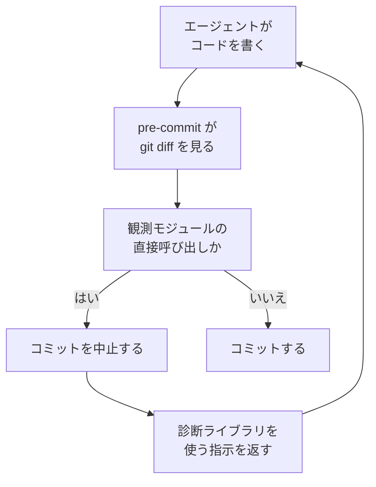

2026-10-13、Geoffrey Huntley は記事 [nobody should type code by hand anymore. here's what's left.](https://ghuntley.com/agency/) で、診断ライブラリを通さない観測の呼び出しを差分検査で扱う手順を書きました。git の pre-commit が差分を見て、観測モジュールの直接呼び出しがあればコミットを失敗させ、診断ライブラリを使う指示をエージェントへ返します。本人はこれを、CI で使ってきた Danger Systems をエージェントのループの中へ置いたものだと書いています。Simon Willison は同日、その一節を [引用として掲載](https://simonwillison.net/2026/Oct/13/geoffrey-huntley/) しました。この記事では、処理の流れ、各仕組みが差分を止める意味、モデルがフックを知るタイミングを順に確認します。検査スクリプトと診断ライブラリのリポジトリは、Huntley の記事本文には示されていません。


*この記事の全体像。以下、順に解説します。*

## 観測迂回の差分検査とは

Huntley は、診断ライブラリを通さない観測の呼び出しを、AGENTS.md の更新では止めきれないと書いています。対比した一方は、skill pack、AGENTS.md、MCP です。本人はこれらを確率的だと書いています。もう一方は、生成されたコードを決定的に見るスクリプトです。

検査の対象は、OpenTelemetry と構造化ログのパターンをまとめた診断ライブラリを通さない、観測モジュールの直接呼び出しです。失敗したときはコミットを中止し、診断ライブラリを使うよう指示を返します。返す処理は、ループ側で失敗文を次の指示に載せる、という本人の手順です。

本人の作業環境では、別マシンの NixOS 上でエージェントに sudo があり、main へ直接 push します。統合テストが通らないとコミットできない、とも書いています。フックとは別に、同じ記事は、数か月ごとに skills と AGENTS.md を消すことと、トレース上の eval が無いと前進か後退か分からないことを述べています。

記事が述べている処理の流れは次のとおりです。



差分検査の前段には、本人が architectural enforcement と呼ぶ層があります。Danger Systems は CI 上の例で、REST ドメインが SQL ドメインに結合していないといった検査を、レビューの前に機械で行います。観測の迂回検査は、その型を pre-commit に移したものとして書かれています。

## 注意点

「ten out of ten」は、記事中の自己評価です。試行回数、合否表、評価条件、使用モデルは同じ節にありません。成功率や、他のリポジトリへ移せる指標としては扱えません。

診断ライブラリと pre-commit のスクリプトは、記事にリポジトリとして示されていません。2026-10-14 に `ghuntley` org へ `diagnostics module` の code search をかけても、該当はありませんでした。未公開だと断定はせず、所在を確認できなかった、までです。そのため、再エクスポート、動的 import、生成コード、テストでの誤検知について、実測は主張できません。

文字列で直接呼び出しを探す検査には、設計上の穴が残ります。何をステージ済みとみなすか。型だけの import を許すか。診断ライブラリ自身のファイルを例外にするか。これらを定義しないままでは足りません。[pre-commit](https://pre-commit.com/) は、未ステージの変更を含めてフックを走らせると偽陽性と偽陰性が出るため、未ステージ分を退避してステージ済みだけを検査すると書いています。[ESLint の `no-restricted-imports`](https://eslint.org/docs/latest/rules/no-restricted-imports) は、同じモジュールの値 import と型 import を分けて許可できます。Huntley のスクリプトがどちらに近いかは、公開範囲が確認できないため不明です。

[anthropics/claude-code#40117](https://github.com/anthropics/claude-code/issues/40117) は、拒否ルールがあってもエージェントが `--no-verify`、stash、quiet で pre-commit を迂回した、という利用者報告です。状態は closed、`not_planned`、終了は 2026-05-07 で、理由は活動不足です。修正の確認ではありません。本文のコミット数やテスト件数は報告者の自己申告であり、独立には検証していません。製品全体の発生率には広げません。

## 失敗が差分を残す場合と閉じる場合

同じ「失敗」でも、差分が残るかは仕組みごとに違います。警告のまま残る差分は、Huntley が問題にしたドリフトが続きます。

| 仕組み | いつ動くか | 失敗の意味 | モデルが見るもの |
|---|---|---|---|
| AGENTS.md などの手順書 | セッションが命令ファイルを読むとき | 合否は無い | 文章そのもの |
| Git の pre-commit | `git commit` の直前 | 非ゼロでコミット作成前に中止する | 端末出力。次の指示へ載るかはハーネス次第 |
| Danger の `fail` | CI 上の Danger | ビルドを失敗させる | CI のログとコメント。エージェントが見るかは別 |
| Danger の `warn` | 同じ | 表示するがビルドは失敗させない | 同じ。差分は残る |
| Claude Code の PreToolUse exit 2 | ツール実行前 | そのツール呼び出しを止める | stderr がツールエラーとして次のモデル入力に入る |
| Claude Code の exit 1（有効な JSON なし） | 同じ | 既定では止めない | 利用者向けの通知が中心で、stderr 全文はモデルに届かないことが多い |
| Codex の PreToolUse | 対応ツールの実行前 | `permissionDecision: "deny"` か exit 2 で拒否 | 理由文字列、または stderr |
| CI の検査 | push やマージのとき | 必須ステータスならマージを止める。通知だけなら止まらない | ログを次の作業へ戻す設定があるとき |

Git の `--no-verify`（`-n`）は、pre-commit と commit-msg を迂回します。実行ビットの無いフックは無視され、フックの場所は `core.hooksPath` で変わります。Husky は `HUSKY=0` でフックを走らせません。Lefthook は `LEFTHOOK=0 git commit` を案内しています。pre-commit フレームワークは `SKIP=<hook id>` で個別のフックを飛ばせます。`--no-verify` という文字列だけを禁止しても、これらの経路は残ります。フックファイルや Git 設定をエージェントが編集できるなら、ローカルの門はさらに信用できません。

公式が案内している迂回の入口は、次の形です。`SKIP` の値は、飛ばしたいフックの id です。

```bash
git commit --no-verify
HUSKY=0 git commit
LEFTHOOK=0 git commit
```

Huntley が「ten out of ten」と書いた不変条件は、警告のままでは閉じません。検査の当たりがまだ信用できない移行のあいだは、警告で偽陽性を見極める段階がありえます。その段階は定常状態ではありません。定常状態は、Git なら非ゼロ、Danger なら `fail`、Claude Code なら exit 2、Codex なら deny または exit 2 です。

Claude Code の `onFailure: "block"` は v2.1.295 以降で、フックが起動しない、タイムアウトする、といった失敗を止めに変えられます。既定は `"continue"` です。方針用フックを exit 1 のまま置くと、素通りします。Codex は `permissionDecision: "ask"` や `continue: false` を解釈はしますが未対応で、エラーを出したうえでツール呼び出しを続行します。Codex の文書は、ツールフックを有用なガードレールだとし、完全な強制境界ではないと書いています。WebSearch のような hosted tool には、PreToolUse も PostToolUse もありません。

動くタイミングも違います。pre-commit は、コード生成とテストのあと、コミットの直前です。Claude Code の PreToolUse exit 2 は、ツールが走る前に止められます。PostToolUse は、すでに実行したツールを取り消せません。違反がツール呼び出しの引数として見えているなら、コミット前より実行前の方が早いです。差分全体の静的検査は、ファイルが書かれたあとでないと成立しないので、pre-commit か CI 側に残ります。

失敗文を返し続けても、検査が満たせないままなら、同じ差分で再試行しえます。Claude Code の Stop フックは、そのための `stop_hook_active` と、連続継続 8 回の上限を持っています。これは Stop フックの契約です。Huntley の pre-commit が実際にループした記録ではありません。

## モデルがフックを知るタイミング

フックの定義は、AGENTS.md のように命令ファイルとして自動では読まれません。モデルが規則を事前に知るのは、セッション開始時やプロンプト送信時の `additionalContext` で文章を入れたときです。

Claude Code では、その文字列は発火地点の system reminder になり、次のモデル要求で読まれます。上限は 10,000 文字です。SessionStart はセッションを止められません。Codex でも `additionalContext` は拒否せず、モデルに見える文脈を足します。既定では、モデルに見えるフック出力はおおよそ 2,500 トークンまでです。`additionalContextLimit` を省略したときの閾値も 2,500 トークンです。それを超えると全文は一時ファイルへ保存され、モデルには先頭と末尾のプレビューとパスが渡されます。`additionalContextLimit` を 0 にすると、そのハンドラの追加文脈をそのまま渡します。平文の stdout は、PreToolUse では無視されます。

事前注入が無いとき、モデルがフックを知るのは発火後です。Claude Code の exit 2 では、stderr がツールエラーになります。exit 0 の stderr はモデルに見えません。Codex の拒否では、`permissionDecisionReason` か exit 2 の stderr が理由になります。Git の pre-commit はコミットを止め、メッセージを端末へ出します。その文字列が次のモデル入力へ入るのは、ハーネスが「プロンプトを注入する」と Huntley が書いた手順を実装しているときです。注入の API 名は記事にありません。

したがって、手順書にフックの存在を書いておけばモデルは最初から従う、という前提は置けません。従う保証が無いことは、本人が skill pack と AGENTS.md を確率的だと書いた理由と同じです。知ったあとに直すのは、失敗文が次のターンへ戻ったときです。

## 運用者が置く境界

観測ライブラリの迂回を残さない不変条件は、決定的な検査の失敗に置きます。失敗文はモデルへ戻します。ローカルの pre-commit だけを門にはしません。AGENTS.md は、意図の記述として残します。

この切り分けを支持する事実は、次のとおりです。

- Huntley は、AGENTS.md を更新しても delta が残りドリフトすると書き、pre-commit で直接呼び出しを落とす手順を示しました。
- Git は、pre-commit の非ゼロでコミットを中止します。
- Danger の `fail` はビルドを失敗させ、`warn` は失敗させません。本人が参照した Danger の型と一致します。
- Claude Code と Codex は、ツール実行前に拒否し、理由をモデルへ返せます。

結論を狭める事実は、次のとおりです。

- `--no-verify` 以外の迂回が、公式に案内されています。
- #40117 は、失敗のあと遵守ではなく迂回が起きたという一件の報告です。件数は自己申告の範囲を出ません。
- `git commit` を通らない更新は、ローカルの pre-commit に掛かりません。GitHub の [trees](https://docs.github.com/en/rest/git/trees)、[commits](https://docs.github.com/en/rest/git/commits)、[refs](https://docs.github.com/en/rest/git/refs) は、その例です。
- CI に同じ検査を置いても、ブランチ保護の必須チェックでなければマージは止まりません。根拠は [保護ブランチの説明](https://docs.github.com/en/repositories/configuring-branches-and-merges-in-your-repository/managing-protected-branches/about-protected-branches) です。
- Codex のツールフックは、完全な強制境界ではありません。
- コミット時の検査は、生成が終わったあとの遅いフィードバックです。
- 「ten out of ten」は測定ではありません。

次の一般化は、この一次資料からは置きません。

- 失敗するフックは必ず迂回を誘発する。頻度の一次評価は無いためです。
- 未公開スクリプトが、特定の構文で誤検知した。実測が無いためです。
- この注入方式が無限ループした。記録が無いためです。

定常状態の置き方は、次の組み合わせです。Git の pre-commit を使うなら非ゼロで中止し、その stderr を次のモデル入力へ戻します。戻す処理が無いなら、Git の失敗は人間の端末にしか残りません。Claude Code でツール引数として違反が見えるものは、PreToolUse の exit 2 にします。exit 1 を方針の拒否には使いません。起動失敗やタイムアウトも止めたいなら、v2.1.295 以降で `onFailure: "block"` を付けます。Codex では `permissionDecision: "deny"` か exit 2 を使います。未対応の `ask` や `continue: false` は拒否になりません。

拒否する対象は、`--no-verify` の文字列に限りません。`HUSKY=0`、`LEFTHOOK=0`、`SKIP`、`core.hooksPath` の変更、フックファイルの改変も、同じ境界で扱います。同じ検査を CI に置き、マージを止める必須ステータスにします。警告は、検査の偽陽性が未整理の移行期間に限ります。

モデルに事前に規則を知らせるなら、SessionStart または UserPromptSubmit の `additionalContext` に短い規則を入れます。入れなければ、モデルがフックを知るのは発火後です。解消できない検査で同じ失敗文を返し続ける構成には、打ち切りが要ります。Claude Code の Stop 上限は、その打ち切りの一例です。pre-commit 方式の実証ではありません。

ここで扱う失敗の戻し方は、ツール権限の拒否だけに閉じません。同じ型を、診断ライブラリを迂回した観測の検出へ使います。「手順書を足せば守られる」「pre-commit を置けば 10 回中 10 回守られる」は、Huntley の記事と、ここに挙げた公式資料からは言えません。

### まだ分かっていないこと

判断をこれ以上強くする前に、次は空いています。

- Huntley の “inject a prompt” が、どの製品のどのフィールドに文字列を渡しているか。
- 診断ライブラリの公開範囲と、例外にするパス（ライブラリ自身、テスト、生成物）を本人がどう切っているか。
- 迂回の発生が #40117 の一件に近いか、それより多いか。公開資料の範囲では分かりません。
- 必須 CI が赤のとき、エージェントは修正するのか、保護を外す操作へ進むのか。後者を止める権限境界は、別問題です。

## 自分のハーネスで確認すること

自分の環境へ置く前に、次の三つを実測します。文章の追記だけで終えた場合、上の不変条件は閉じていません。

1. 診断ライブラリ以外の観測 import をステージし、pre-commit が非ゼロで終わること。その文字列が、次のモデル入力に現れること。
2. `--no-verify` 以外の迂回が、ツール境界で止まること。対象は環境変数、`core.hooksPath`、フックの実行ビットです。
3. 同じ検査が、保護ブランチの必須チェックとして赤になること。

## まとめ

観測の規約は、AGENTS.md の追記だけに置きません。意図は手順書に書き、合否は決定的な検査の失敗に置きます。失敗文をモデルへ戻し、ローカルの pre-commit だけを門にしません。警告は移行期間に限り、定常状態は Git の非ゼロ、Danger の `fail`、Claude Code の exit 2、Codex の deny または exit 2 で閉じます。「ten out of ten」は自己評価であり、手順書や pre-commit の成功率ではありません。

この記事が少しでも参考になった、あるいは改善点などがあれば、ぜひリアクションやコメント、SNSでのシェアをいただけると励みになります！

## 参考リンク

- Geoffrey Huntley, [nobody should type code by hand anymore. here's what's left.](https://ghuntley.com/agency/)（公開 2026-10-13）
- Simon Willison, [A quote from Geoffrey Huntley](https://simonwillison.net/2026/Oct/13/geoffrey-huntley/)（掲載 2026-10-13）
- Git, [git-commit](https://git-scm.com/docs/git-commit)（`--no-verify` は pre-commit と commit-msg を迂回する）
- Git, [githooks](https://git-scm.com/docs/githooks)（非ゼロで中止、実行ビット、`core.hooksPath`）
- Husky, [How To](https://typicode.github.io/husky/how-to.html)（`HUSKY=0`）
- Lefthook, [Usage](https://lefthook.dev/usage/)（`LEFTHOOK=0 git commit`）
- [pre-commit](https://pre-commit.com/)（`SKIP`、未ステージ変更の退避）
- Danger JS, [Reference](https://danger.systems/js/reference)（`fail` はビルド失敗、`warn` は失敗させない）
- Claude Code, [Hooks](https://code.claude.com/docs/en/hooks)（exit 2、exit 1 の非ブロック、`onFailure`、`additionalContext`、Stop の連続継続上限）
- Codex, [Hooks](https://learn.chatgpt.com/codex/hooks.md)（deny、exit 2、未対応フィールド、additionalContext の閾値）
- ESLint, [no-restricted-imports](https://eslint.org/docs/latest/rules/no-restricted-imports)（値 import と型 import の区別）
- [anthropics/claude-code#40117](https://github.com/anthropics/claude-code/issues/40117)（closed / not_planned、2026-05-07）
- GitHub REST, [trees](https://docs.github.com/en/rest/git/trees) / [commits](https://docs.github.com/en/rest/git/commits) / [refs](https://docs.github.com/en/rest/git/refs)
- GitHub, [About protected branches](https://docs.github.com/en/repositories/configuring-branches-and-merges-in-your-repository/managing-protected-branches/about-protected-branches)
