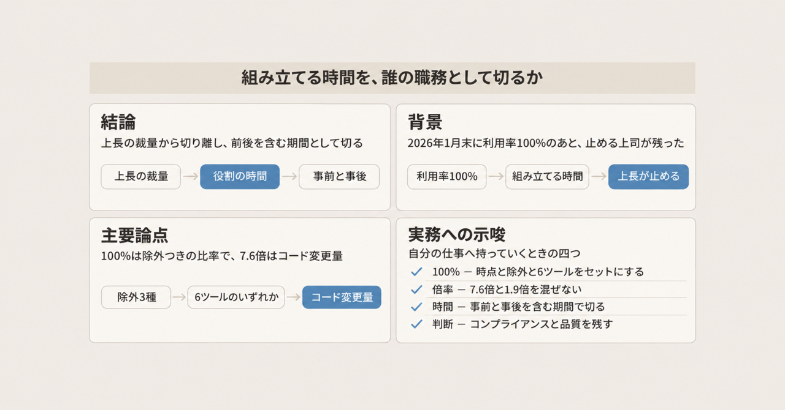
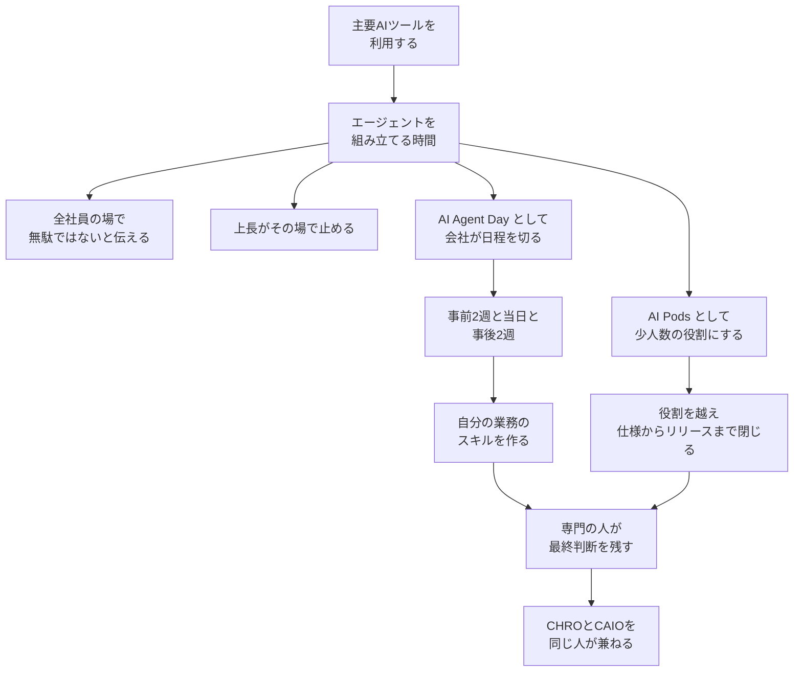

メルカリは、2026年1月末時点でグループの AI ツール利用率が100%に達したと、FY2026.6 の通期決算で開示しています。そのあと、執行役員で CHRO 兼 CAIO の木村俊也氏は、エージェントを作る時間を上司が止める衝突が残ったと、2026年11月2日公開の取材で語っています。

FY2026.6 は、2026年6月期です。CHRO は人事の最高責任者です。CAIO は AI の最高責任者です。100%の定義は決算説明資料の注記にあります。上司が時間を止めた話は、その取材にあります。

この記事は、100%の分母と対象ツール、会社が切った構築の時間、人が残す判断の置き方を、決算説明資料と取材と会社記事に分けて整理します。

*この記事の全体像。以下、順に解説します。*

## エージェントを組み立てる時間とは

ここでいう構築時間は、主要 AI ツールを配ったあとに、エージェントを組み立てるために使う時間です。メルカリでは、口頭の後押し、上長のその場の判断、会社が切ったプログラム、少人数の役割、の四つが同時にあります。人が残す判断は、その下流にあります。

### 決算が書いた利用率と開発量

利用率100%の分母は、2026年1月末のグループ従業員から、休職者、退職確定者、鹿島アントラーズ雇用者を除いた人数です。100%は、その人数に対する、主要 AI ツールのいずれかを利用している人の比率です。

通期資料が名指しするツールは六つです。ChatGPT、Gemini、Claude、Cursor、LiteLLM、Notion AI です。

エンジニア1人あたりの開発量 7.6倍は、FY2024.6 と FY2026.6 のコード変更量を、当時のエンジニア人数で割った値です。同じ「開発量」の 1.9倍は別の指標です。FY2025.6 第2四半期と FY2026.6 第2四半期のコード変更量を、人数で割った値です。

データ分析用の社内エージェントは、2026年1月15日時点の累計利用者が従業員の約半数です。第2四半期資料が書いています。

FY2026.6 の売上収益は 2,292億円です。前年比は +19% です。コア営業利益は 441億円です。前年比は +60% です。コア営業利益は、決算説明資料が開示している利益の項目です。

### 取材が残した衝突と、会社が切った単位

2026年11月2日の [ITmedia](https://www.itmedia.co.jp/business/articles/2611/02/news032.html) では、何をすればよいか分からない社員と、エージェント作りの時間を止める上司が、少数いたと木村氏が語っています。2週間に1回「無駄ではない」と伝えても、「時間がない」は残った、とも語っています。記事は、10月15日の TOKIUM AX VISION での取材として書いています。

AI Agent Day は、非エンジニアを対象に、エージェントを作る時間を会社が日程として切る全社プログラムです。2026年5月から、非エンジニア約1,000名が対象です。執行役と執行役員を含みます。1バッチは、事前2週間、当日、事後2週間の約1か月です。全6バッチを、延べ約4か月で回します。会社記事は、バッチの一部は並走する、と書いています。

当日の中身は、会社記事の [mercan](https://careers.mercari.com/mercan/articles/60180/) が書いています。午前は Notion AI でスキルの概念を体験します。午後は Claude Cowork で、自分の業務のスキルを作ります。Claude Cowork は、同じ記事がデスクトップ上の安全な作業環境と書く道具です。スキルは、企画者が使い回しの効くプロンプトのような概念と説明し、ブログを書く、資料を作る、レポートを作る、といったエージェントの能力を指します。

AI Pods は、役割を越えて、仕様からリリースまでを少人数で閉じる開発の仕方です。通期資料は、これを全社に定着させることを、今後の方向性に置いています。

人が残す判断として、木村氏は「専門性を持つ人が最終判断を担う方が品質を保てる」と述べています。取材では二つの例が出ています。コンプライアンスの指摘を、エンジニアが判断しきれない例です。デザインは下地までできても、リリース品質には届かない例です。

体制は、2026年6月1日付です。木村氏が CHRO と CAIO に就任し、AI 戦略と人事戦略を同じ責任者に置きました。プレス時点では CTO Japan Business を兼ねています。後任 CTO は7月1日就任予定と、[プレスリリース](https://about.mercari.com/press/news/articles/20260601_chrocaio/) が書いています。

通期資料の今後のページは、四つを一体で進めると書いています。意思決定支援、現場への権限移譲、承認プロセスの刷新、評価制度の再設計です。

### 時間が分かれる四つの行き先

構築時間は、ツールを配ったあとに分かれます。次の図は、その分岐です。

スキルを作る経路と、AI Pods の経路の先に、専門の人が最終判断を残します。AI Pods の分岐は、役割を越えて仕様からリリースまでを閉じる側です。図の最後は、CHRO と CAIO を同じ人が兼ねる体制です。評価と承認は、通期資料が今後のページに書いた再設計の側です。

## 注意点

ここからは、数字とプログラムの長さを、どこまで信じてよいかです。定義、分母、計測条件が資料ごとに違います。

### 100%の範囲と、利用の窓

100%は、見出しの「全従業員」より狭いです。休職者、退職確定者、鹿島アントラーズ雇用者は、分母から除きます。集計日は2026年1月末です。

注記は、週次で使っている、毎日使っている、アカウントを持っているだけ、のどれとも書いていません。月1回以上で、トークン量や日次の頻度は追っていない、という説明は、2026年7月3日の [Business Insider](https://www.businessinsider.jp/article/2607-why-mercari-appointed-cto-as-hr-head/) における木村氏の取材です。月1回は、注記の文言ではなく、取材の説明として分けて読みます。

対象ツールの名前は、第2四半期と通期で一つ違います。第2四半期の注記は Claude Code を挙げ、Claude 単体は挙げません。通期の注記は Claude を挙げ、Claude Code は挙げません。どちらが集計を変えたのかは、資料にはありません。

約2,000人にすぐ浸透しなかった、という人数は、2026年11月2日の取材の表現です。決算注記の分母とは照合していません。

ITmedia 本文は、取材の場を「TOKIUM AX VISION」（10月15日開催）とだけ書き、年は本文にありません。主催の株式会社TOKIUMが2026年10月5日に出した [発表](https://prtimes.jp/main/html/rd/p/000000513.000009888.html) は、開催日時を2026年10月15日12:30としています。木村氏が「AI前提の組織は、誰がどうつくるのか。メルカリの実践と、その先」に登壇する、とも書いています。

### コード変更量と、同じ期間の売上

7.6倍を、届いた機能や事業成果の倍率として読むと、注記の対象から外れます。注記が言うのはコード変更量です。1.9倍もコード変更量です。比べている期間は、通期同士ではなく四半期同士です。同じ文に混ぜると、別の倍率になります。

直近1年の売上 +19% とコア営業利益 +60% を、7.6倍の原因だとは、決算は書いていません。窓を7.6倍と同じ2会計年度に揃えると、決算説明資料と同じ公開パッケージの [財務CSV](https://pdf.irpocket.com/C4385/xoA3/ieAo/Ip3B/R8TF.csv) では次のとおりです。

| 項目 | FY2024.6 | FY2026.6 | 倍率 |
| --- | --- | --- | --- |
| 連結売上収益 | 187,407百万円 | 229,293百万円 | 約1.22倍 |
| コア営業利益 | 18,869百万円 | 44,181百万円 | 約2.34倍 |

229,293百万円は 2,292.93億円です。資料の 2,292億円は、億円未満を切り捨てた表示と読めます。44,181百万円は 441.81億円です。資料の 441億円も、同じ切り捨てと読めます。どちらも7.6倍ではありません。このCSVは説明資料パッケージの数値です。決算短信の行そのものではありません。

利益が売上より伸びていることと、コード変更量が事業成果であることは、別です。同じ2会計年度の並びは、コード変更量を成果と呼ばない材料にはなります。「AI が売上に効かなかった」とは言えません。

木村氏は2026年7月の取材で、1.9倍はコードの生成量であり、レビュー、セキュリティ、コンプライアンスが追いつかなければ顧客に届く価値は増えない、と説明しています。出典は先の Business Insider です。

2026年6月23日の [ITmedia](https://www.itmedia.co.jp/business/articles/2606/23/news023.html) は、「コードの約7割はAIが生成する」と書きます。この割合は、決算注記にはありません。

49.5万時間と、さらに77万時間の余地は、利用率100%を前提に業務削減率を掛けた推定値です。注記が自分でそう断っています。

「生産性10倍」と 7.6倍は別の話です。2026年11月2日の記事が「10倍」と言うのは、1人のエンジニアが10人分ほどのアウトプットを出すケースが出てきた、という現場の例と、その処遇の話です。全社のコード変更量ではありません。

### 1日の催しと、約1か月のプログラム

AI Agent Day を「丸1日で考え方が変わるイベント」とだけ書くと、会社の設計より短くなります。2026年11月2日の ITmedia は、非エンジニア1,000人以上が丸1日業務を止め、朝1時間ほどで作り方を学び、チームで作って発表する、と書きます。mercan の会社記事は、1日だけでは意味がないので、前後2週間を足した約1か月の行動変容として設計した、と企画者が述べています。当日の午前と午後の中身も、朝1時間の講義とは書いていません。

### 人数の単位と、役割が変わったという一例

AI Pods の人数は取材に依存します。2026年6月23日の記事は、1つの Pod を PM 1人とプロダクトエンジニア 4〜5人とし、個々のプロジェクトは2人で閉じる、と書きます。2026年11月2日の記事は、8人以上いたチームを5〜6人に絞った、と書きます。通期資料は人数を書かず、全社定着を今後の方向性に置いています。2026年6月の「2人で閉じる」と、2026年11月の「5〜6人」のどちらが現行の単位かは、資料が決めていません。

分析担当が Socrates のあとで事業提案をするようになった、は取材の一例です。Socrates は、社内のデータ分析の仕組みの名前です。約半数という比率は、第2四半期資料がデータ分析用の社内エージェントと書いた話です。Socrates という名前は、エンジニアブログと、役割の変化を書いた取材の側にあります。この記事は、両者を同じ仕組みとしては結びません。2025年12月25日の [エンジニアブログ](https://engineering.mercari.com/blog/entry/20251225-mercari-ai-native-company/) で木村氏が書いているのは、Socrates が自然言語でデータ取得と分析を行う、という機能の方です。役割が変わった、という部分は2026年11月2日の ITmedia にあります。

### 他社の報道と、DORA の推定

ロイターは2026年8月26日、メタの社内投稿として四つの増減を報じています。業務で使う社内基盤へのコード変更は前年比220%増です。ユーザーに届く機能の変更は36%増です。重大な技術・セキュリティインシデントは40%増です。火消しの時間は70%増です。出典は [Reuters](https://www.reuters.com/investigations/mark-zuckerberg-had-bold-plan-replace-meta-staff-with-ai-heres-how-it-imploded-2026-08-26/) です。メタが同じ数字を開示したわけではありません。メルカリの 7.6倍が同じ乖離だという証拠には使いません。コード変更量を成果と呼ばない、という注意の側にだけ使います。

Google Cloud の [DORA 2024 公表ブログ](https://cloud.google.com/blog/products/devops-sre/announcing-the-2024-dora-report) は、ソフトウェアの届け方を調べた年次の調査の発表です。英語版の表示日は 2024-10-22 です。日本語版の訳注は、米国時間 2024-10-23 の投稿だと書きます。AI の採用が25%増えることと併せて、文書品質 +7.5%、コード品質 +3.4%、コードレビュー速度 +3.1% と書きます。同時に、デリバリーのスループットは推定 1.5% 減、デリバリーの安定性は推定 7.2% 減、とも書きます。日常の職務の少なくとも一つに AI を使う回答は75%超です。生産性を中程度から極端に上げたと答えたのは3分の1超です。AI が生成したコードをほとんど信頼しない回答は39%です。これは関連の推定であり、メルカリの障害件数ではありません。採用の伸びと、届ける量や安定性が同方向とは限らない、という注意にだけ使います。文書品質、コード品質、レビュー速度は同時にプラスとも書いてあります。AI の採用が全面的に害だという読みには使いません。

### 公開資料がまだ書いていないこと

次は、2026年11月3日時点で一次資料が閉じていない問いです。

- 100%の「利用」は、どの窓で数えたか。注記は時点とツール名までで、月次とも週次とも書いていません
- 通期注記が Claude Code を Claude と書き換えたのは、集計対象の変更か、呼称のまとめか
- 構築時間を止めた上司は何人で、どの仕事を止め、Agent Day のあとどうなったか
- 評価の再設計は、2026年11月時点で実施済みか、方針のままか
- AI Pods は、2026年6月の「2人で閉じる」と、2026年11月の「5〜6人」のどちらが現行の単位か
- 事後2週間の定着は、上長が止められない職務時間として守られているか

頻度の窓と、約2,000人の母数を確かめるなら、次に当たる一次資料は FY2026.6 の決算質疑と、有価証券報告書の従業員注記です。

## 構築時間を職務として切る

いまの判断は次です。利用率100%の次に決めるのは、エージェントを組み立てる時間を誰の職務にするかです。上長のその場の裁量だけに置くと、「時間がない」が残ります。会社が日程として切る場合も、当日の1日では足りません。人が残す専門判断を、同じ設計に入れます。評価の本体を利用率やコード変更量に置くと、活動量と届く成果が分かれます。

### 口頭の後押しが残したもの

支持になる事実は、取材と会社記事と決算の並びです。

木村氏は、ツールは行き渡っても、ものづくりの速度だけでは成果は増えない、と2026年11月の取材で述べています。口頭で時間の正当性を伝えても「時間がない」が残った、と同じ記事が述べています。対策として、業務を止める日を置いた、とも述べています。会社記事は、その日を1日の催しではなく、事前と事後を含むプログラムにしています。決算は、100%の達成と、Agent Day、推定の時間削減、コード変更量、今後の組織改革を、同じ成果のページに並べています。2026年6月23日の取材は、ツールが100%行き渡っても、AI 前提で働くとできないことが大量に残る、と書いています。残った例は、プロジェクトマネジメントの学習と、デザインのリリース品質です。

同じ一連の取材で、コンプライアンスの指摘をエンジニアが判断しきれない、デザインは下地で止まる、と述べています。止める側は、本業と品質の防衛でもありえます。止めた動機がそれだった、と記事は特定していません。

### 切る単位は、当日の1日ではない

構築に使ってよい時間は、上長のその場の裁量から切り離し、役割の時間として切ります。切る単位は当日の1日ではありません。事前と事後を含むブロックにします。メルカリの会社記事が、その長さを選んでいます。企画者は、1日だけでは意味がないと述べています。「役割の時間」を当日1日と定義すると、会社自身の設計が反対します。

木村氏は、ものづくりの速度だけでは成果は増えない、とも述べています。企画から各種チェックまで、上流から下流をエージェント化しなければ全社は変わらない、とも述べています。構築時間を役割の時間として切っても、木村氏が述べる条件の完了にはなりません。その条件は、企画から各種チェックまで、上流から下流をエージェント化することです。出典は2026年11月2日の ITmedia です。

### ブロックの中に、人が残す判断を名指しする

そのブロックの中に、人が残す判断を名指しで入れます。残った例は、コンプライアンスと、デザインや品質の最終判断です。構築時間を守ることと、専門判断を飛ばすことは別です。

### 評価で見る対象は、事実と提案を分ける

事実は、ここまでです。メルカリは、評価制度を、権限移譲と承認プロセスと一緒に再設計する方向を、決算に書いています。

提案は、ここからです。見る対象を、利用率とコード変更量から、渡した仕事と人が残した判断へ移します。活動量と届く成果が分かれうる、という前節の注意から出しています。通期資料が書いたのは、意思決定支援、現場への権限移譲、承認プロセスの刷新、評価制度の再設計を一体で進める、という今後の方向です。委任の一覧は、どの仕事を渡したかを並べて評価項目にしたもの、という意味でこの記事が使う語です。決算は、その一覧を評価項目にしたとは書いていません。権限移譲は、判断を現場へ渡す向きでもあります。専門の人が最終判断を残す、という取材の発言とは、向きが違いえます。

この提案は、給与制度の記述ではありません。処遇について木村氏は、基本給で求める水準は段階的に上げ、当面は成果を出した人へインセンティブで報い、生産性が上がっても売上が伸びなければ給与は上げられない、と述べています。報酬の条件として挙げているのは売上です。委任の一覧ではありません。出典は2026年11月2日の ITmedia です。

渡した仕事の数を評価すると、見せるためのエージェントが増える副作用は考えられます。メルカリの公開資料からは、その失敗事例は見つかっていません。確からしさは、この記事の判断のなかでいちばん低いです。

### 提案が弱くなる三つの条件

次の三つが後から分かると、上の判断は弱くなります。

注記の「利用」が、実はアカウント付与だけだと後日訂正されたら、100%の読みは下がります。Agent Day の事後2週間が現場で止まっていたら、「役割の時間として切れば衝突は終わる」は弱くなります。評価票がすでに委任の一覧だと公開されたら、提案は提案ではなく、実施済みの記述に変えます。

組織の判断でも、記事に書くときでも、順は五つです。

1. 100%を出すときは、2026年1月末、除外3種、6ツールのいずれかを利用、をセットにします。月1回は取材の説明として、注記から離します。
2. 7.6倍は「2会計年度のあいだの、エンジニア1人あたりコード変更量」と書きます。1.9倍は四半期同士の別の倍率として、同じ文に混ぜません。
3. 構築に使ってよい時間は、上長のその場の裁量から切り離し、役割の時間として切ります。単位は、事前と事後を含むブロックです。
4. そのブロックの中に、人が残す判断を名指しで入れます。例は、コンプライアンスと、デザインや品質の最終判断です。
5. 評価の移行は、開示された事実と提案を分けます。事実は、評価制度を権限移譲と承認プロセスと一緒に再設計する方向を決算が書いた、ところまでです。提案は、見る対象を利用率とコード変更量から、渡した仕事と人が残した判断へ移す、ところです。

## まとめ

利用率100%の次に決めるのは、エージェントを組み立てる時間を誰の職務にするかです。100%は、2026年1月末、三つの除外、六つのツールのいずれかの利用、とセットで読みます。7.6倍は2会計年度のエンジニア1人あたりコード変更量です。1.9倍は別の四半期同士の倍率です。

構築の時間は、上長のその場の裁量から切り離し、事前と事後を含むブロックとして切ります。その中に、コンプライアンスと、デザインや品質の最終判断を残します。評価について決算が書いたのは、権限移譲と承認プロセスと一緒に再設計する方向です。見る対象を、渡した仕事と人が残した判断へ移すのは、活動量と届く成果が分かれうるという注意から出す提案です。

この記事が少しでも参考になった、あるいは改善点などがあれば、ぜひリアクションやコメント、SNSでのシェアをいただけると励みになります！

## 参考リンク

- [ITmedia ビジネス「その日、メルカリは『業務を止めた』」2026-11-02](https://www.itmedia.co.jp/business/articles/2611/02/news032.html)
- [メルカリ FY2026.6 4Q 決算説明資料](https://pdf.irpocket.com/C4385/xoA3/ieAo/Ip3B/oYI9.pdf)
- [同じ説明資料パッケージの財務CSV](https://pdf.irpocket.com/C4385/xoA3/ieAo/Ip3B/R8TF.csv)
- [メルカリ FY2026.6 2Q 決算説明資料](https://pdf.irpocket.com/C4385/YpwX/xtlo/KPhB.pdf)
- [メルカリ プレスリリース「CTOの木村俊也がCHRO兼CAIOに就任」2026-06-01](https://about.mercari.com/press/news/articles/20260601_chrocaio/)
- [mercan「#0 メルカリ『AI Agent Day』始動」](https://careers.mercari.com/mercan/articles/60180/)
- [メルカリエンジニアリング「AI-Nativeという選択」2025-12-25](https://engineering.mercari.com/blog/entry/20251225-mercari-ai-native-company/)
- [ITmedia「『AI活用100％』でも生産性は上がりきらない？」2026-06-23](https://www.itmedia.co.jp/business/articles/2606/23/news023.html)
- [Business Insider Japan「メルカリが『AI利用率100%』で満足しないワケ」2026-07-03](https://www.businessinsider.jp/article/2607-why-mercari-appointed-cto-as-hr-head/)
- [株式会社TOKIUM プレスリリース 2026-10-05](https://prtimes.jp/main/html/rd/p/000000513.000009888.html)
- [Google Cloud「Announcing the 2024 DORA report」2024-10-22](https://cloud.google.com/blog/products/devops-sre/announcing-the-2024-dora-report)
- [Reuters「Mark Zuckerberg had a bold plan to replace Meta staff with AI」2026-08-26](https://www.reuters.com/investigations/mark-zuckerberg-had-bold-plan-replace-meta-staff-with-ai-heres-how-it-imploded-2026-08-26/)
