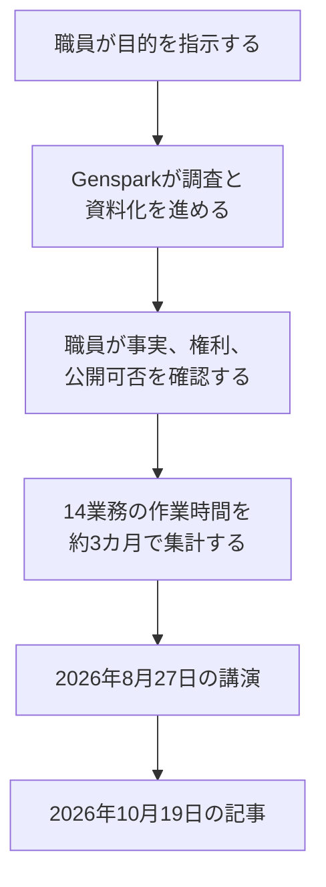

2026年8月27日、世田谷区の深山翔氏は、業務ツール Genspark の庁内試行について講演しました。ITmedia ビジネスオンラインは、2026年10月19日12時の記事で、その講演を伝えています。記事には、14業務・約3カ月で合計約2900時間の削減につながったことと、成果物の確認と修正の負担が増えていることが書かれています。この記事では、その時間数がどの公開資料にどう書かれているか、確認の負担が何を指すか、発注側が同じ種類の数字を使うときに並べる列を整理します。この時間数は、区が統計書として公表した数字ではなく、講演を報じた記事の数字です。

*この記事の全体像。以下、順に解説します。*

## 世田谷区の生成AI試行とは

世田谷区は、目的を伝えると調査から資料作成までを進める業務ツール Genspark を、令和8年4月から庁内の試行として使い始めました。2026年3月26日の Genspark株式会社のプレスリリースは、自治体として国内初のエンタープライズプラン導入だと書いています。試行の人数は70名です。内訳は、DX推進担当課10名と、その他の課60名です。日程の予定は、4月から7月に効果を測り、8月に取りまとめ、9月に評価する、というものです。令和9年度以降の全庁展開は、その評価のあとで判断する、と発表は書いています。

区は、それ以前から対話型の生成AIも使っていました。ITmedia の記事は、米 Microsoft のクラウドAI基盤 Azure OpenAI Service で独自の環境を作り、同社の業務AIツール Microsoft Copilot も導入していた、と書いています。利用にはばらつきがあり、初めて使う職員は、どのような指示を出せばよいか分からず戸惑うことも多かった、とも書いています。Genspark を選んだ理由として、同じ記事は、専門的な知識がなくても漠然とした指示から一定の成果物を作れるかを確かめるため、と書いています。検証の例は、他の自治体の計画や公開されている基準を読み込ませ、調査や計画策定にどこまで使えるかを見ることです。庁内向けの説明資料、チラシ、広報物も、資料作成の機能で作っています。

土台にした過去の実測は、対話型AI（単一モデル）で1人あたり週約36分の削減です。プレスリリースの「対話型AI（単一モデル）」は、人が一つの生成AIと都度対話する使い方を指します。週約36分は、その使い方の実測です。70名に伸ばした年間の見込みは約2,000〜2,600時間です。金額の見込みは約1,040万〜1,380万円で、導入コストの1.38〜1.82倍、と発表は書いています。この幅は「解決すると予想されること」の見出しの下にあり、本文は「見込まれ」と書いています。週約36分そのものは、直近の実測として置かれています。発表には、DX推進担当課の深山氏、下岡氏、川嶋氏のコメントがあります。区の公式アカウントは同日、この発表のURLを案内しています。

同じ発表は、将来の全庁展開の試算も置いています。約150課に各10名、合計1,500名が日常的に使う体制にした場合、年間約2.1万〜3.9万時間、金額で約1.1億〜2.1億円、導入コストの7〜13倍、という試算です。3月時点の将来試算として、70名の試行とは別に置かれています。

2026年8月27日12時20分から13時、深山氏は AI博覧会 Summer 2026 で講演しました。肩書は、セッション案内では DX推進担当部 DX推進担当課 システム支援／副係長です。相手は Genspark株式会社の中島隆行氏です。案内の題は「AIは自治体業務に根付くのか―職員伴走と効果検証―」です。伴走とは、担当課の職員が各課の困りごとに入り、使い方を提案する支援です。案内は、利用が進んだ場面と進みにくかった場面、成果物や仕事の進め方の変化を話す、と予告しています。時間数は案内にありません。ITmedia の記事は、8月26日から27日の開催を基に構成した、と冒頭で書いています。

記事が2ページ目に置く集計は、14業務、約3カ月、合計約2900時間です。本文は「世田谷区ではこれまでに14業務でAIを活用し、約3カ月間で合計約2900時間の削減につながったという」です。

一例は、複数の計画を参照して内容を整理する作業です。作業時間は240分から90分になりました。記事は、削減できた150分を、内容の検討や論点の洗い出しに充てられた、と書いています。深山氏は、区民により良いサービスを受けてもらうための検討に時間を使えた事例だった、と話しています。

職員が成果物で見る対象は、次のとおりです。事実が正しいか。数値が正しいか。権利関係に問題がないか。入力してよい情報か。対外的な表現に問題がないか。記事は、これらを職員が確認して品質を担保している、と書いています。

広げ方は2つです。1つは、DX推進担当課の職員が各所管課に入る伴走です。もう1つは、出来た資料を見た職員の口コミです。不安を持つ職員が多いなか、成果物が共有されると作り方を尋ねる会話が起き、そこから利用が広がった、と記事は書いています。

検証で確認した問いは3つです。職員個人の業務で使えるか。その業務で繰り返し使えるか。担当者が変わっても、課の業務として使えるか。

講演が話した時間は、次の流れの途中で集計されています。

3月のプレスリリースにある年間約2,000〜2,600時間と、講演で語られた約2900時間は、別の資料の別の集計です。

## 注意点

### 約2900時間を純減の空き時間とは読めない

約2900時間を、3カ月で純減した職員の空き時間として読む材料は、この記事で開いた ITmedia の記事、3月のプレスリリース、区のページとPDFにはありません。ここでの純減は、元の作業から減った時間から、確認や検討へ戻した時間を引いた残りです。

記事の見出しは「約2900時間削減した」と書きます。本文は「削減につながったという」です。14業務の名前、その集計の人数、起算日、自己申告か標準時間×件数かツールのログかは、記事にありません。

この記事では、2026年10月20日に次の公開資料を開きました。区の「DXの取組みの見える化」（ページ表示の最終更新日は2026年8月21日）です。令和8年3月30日の区長記者会見です。2026年9月16日の定例会会議録PDFです。これらのなかに、約2900時間と14業務はありませんでした。会議録は、検索で Genspark に当たった1本です。他の会期の会議録は、この記事の確認範囲に含めていません。会議録のテキストは文字認識が崩れており、答弁者の氏名は確定できません。読めた範囲では、DX推進担当部長が、庁内で利活用が進んでいる環境の名称として、秀樹（公開資料の表記は Hideki）と Genspark を並べています。秀樹がどの製品かは、開いた資料には書かれていません。約2900時間は、その答弁の成果指標になっていません。下半期から効果と課題の検証に着手する、とある文は、東京都が提供する生成AIプラットフォームについてのものです。

### 150分は整理作業から検討への移動

150分の例は、短縮と再投入が同じ段落にあります。240分が90分になり、空いた150分は内容の検討に充てた、と記事は書きます。この150分を削減時間に含めるなら、それは整理という作業から消えた時間です。その人のその案件の総労働時間が150分減ったこととは別です。150分が約2900時間の内数かどうかも、記事には書かれていません。約2900時間の全体が、この150分と同じルールで数えているかも、この記事で開いた記事と発表には書かれていません。

### 週36分の年間見込みは別の予想

週約36分からの年間見込みは、Genspark の利用ログではありません。発表は、区が直近で実施した対話型AIの実測を土台にした試算です。見出しは「予想」です。

検算すると、70人×週36分×52週は2,184時間です。発表の約2,000〜2,600時間の幅に入ります。記事の「約3カ月」を13週と置くと、同じ式では546時間です。約2900時間は、この546時間の約5.3倍です。両者が同じ70名で、同じ時間の定義であるとは、記事も発表も書いていません。桁が違うことだけを、約2900時間が誤りだという証拠にはできません。確認や再投入を引いたあとの時間として、同じ台帳に載っているわけでもありません。

### 金額を時間で割る単価は発表に無い

金額の約1,040万〜1,380万円を、時間の幅の両端（2,000時間と2,600時間）にそれぞれ対応させると、1時間あたり5,200円と約5,300円になります。13,800,000円÷2,600時間は約5,308円です。この端と端の対応は、発表には書かれていません。単価が職員給与か、別の換算かも、発表にありません。

### 別の媒体の業務時間は足し合わせられない

別の媒体の注記は、広報紙の校正が年間約54時間、研修アンケートの集計が年間40%減、と世田谷区の名で書いています。児童館の利用実績の分析は、時間の無い定性の一文です。この注記は区のPDFではなく、2026年6月17日の東洋経済オンラインの記事に埋め込まれた事例スライドです。約2900時間との足し引きはありません。14で割った1業務あたり約207時間（3カ月）と、年54時間（3カ月あたり約13.5時間）は桁が違います。同じ14業務の内訳だとは読めません。

### 確認と修正の負担増は時間になっていない

「確認と修正の負担は増えています」は、深山氏の発言として記事が引用しています。続きは「AIを使うと成果物がすぐに出てきますが、必ずレビューしなければなりません。そして、業務知識や自身の観点などがなければ、レビューしても良い資料はできません」です。増分の時間も、修正回数も、回答者数も、同じ記事にはありません。

近くにあるアンケートは、別の問いです。伴走として行った個別支援のあとで、指示の出し方と成果物の品質が上がった、という声です。個別支援は、各課に入って使い方を提案する伴走を、記事がアンケートの対象として呼んだ語です。「支援がなければより時間がかかった」という回答が多かった、とも書いています。確認時間の増分を集計した調査とは書かれていません。区の公開PDF「生成AI活用その4」は、紙の書類を読み取る別の手順について、最終確認は職員が行う、と書いています。これはその手順の留保であり、確認の負担が増えたという測定値ではありません。

### 自治体の削減時間は監査済みの全国統計ではない

総務省の「自治体における生成AI導入状況（令和7年度）」（令和8年4月24日版、調査時点は令和7年10月31日）は、自治体からの回答例を導入効果として並べています。文章作成が月190時間から月51時間になった例、広報で年間288時間程度の削減見込み、資料上の項目名「マクロ」での累計約4,250時間の削減見込み、データ分析の2カ月で103時間、が同じ頁にあります。見込みと並記された実績が混ざります。世田谷区の約2900時間は、この調査時点より後であり、この資料にはありません。自治体の「削減時間」は、第三者が式を監査した全国統計ではない、という読み方の先例にはなります。

### 講演で語られたことと、区が測り終えたこと

いま資料が支持するのは、次の範囲です。

- 記事は講演を基に構成したと冒頭で書き、14業務、約3カ月、約2900時間、240分から90分、150分の再配分、負担増の引用を2ページ目に置いています。
- セッション案内は、深山氏と中島氏が伴走と効果検証を話す、と予告しています。時間数は案内にありません。
- 導入の事実は、2026年3月26日の発表と、区の公式アカウントの同日の案内で辿れます。
- 9月16日の答弁は、Genspark を庁内で使っている環境として認めています。

次は、開いた資料からは認定できません。

- 開いた区の公文書は、約2900時間を公式の成果表にしていません。
- 3月30日の区長会見では、記者が、削減された時間を残業の短縮に充てるのか、別の業務に充てるのかを尋ねています。区長はその問いに答えていません。答弁は、区長自身の ChatGPT と Gemini の利用と、考えることを委ねるリスクです。
- 週36分の年間見込みは予想であり、約2900時間の内訳ではありません。
- 150分は、記事上は検討作業への付け替えです。
- 負担増を時間または件数で測った表は、この記事で開いた範囲にはありません。

残るのは、講演でその数字と負担増が語られた、という報道です。区が両方を測り終え、確認を引いたあとに約2900時間減った、という認定は残りません。

### 同じ「時間」でも表が違う

| 数字 | 期間 | 母数 | 資料上の位置づけ |
|---|---|---|---|
| 約2900時間 | 約3カ月 | 14業務。人数は記事に無い | 講演の報道 |
| 240分が90分、150分を再投入 | その作業の1回 | 計画の整理の一例 | 同じ記事。再投入つき |
| 週約36分、年間約2,000〜2,600時間 | 年間の見込み | 70名 | 単一モデルの実測を伸ばした予想 |
| 年間約2.1万〜3.9万時間 | 将来の年間 | 約150課×10名の1,500名 | 全庁展開の試算 |
| 校正 年間約54時間、集計 年間40%減 | 年間 | 個別業務。2900との対応は無し | ベンダー事例の注記 |

全庁1,500名の試算は、70名の試行結果ではありません。ここに約2900時間を掛け算しません。

### まだ資料に無い項目

次は、この記事で開いた資料には書かれていません。

- 約2900時間は、自己申告か、標準時間×件数か、ツールのログか。
- 14業務の一覧と、70名の試行との包含関係。
- 「約3カ月」の開始日と終了日。
- 確認、差し戻し、再生成に増えた時間が何時間か。ゼロに近いか、150分の再投入のように元の短縮を食い尽くすか。
- 登壇スライドの原本が残っているか。
- 9月16日以外の会議録に、同じ数字があるか。

## 発注側が効果の表に置く列

発注側がこの事例を使うときは、約2900時間を純減の実績として置きません。同じ表に、次の列を並べます。

1. 元の作業から減った時間。以下、グロスと呼びます。
2. 確認、修正、差し戻し、再生成、内容検討に再投入した時間。
3. グロスから再投入を引いた残り。以下、ネットと呼びます。
4. 定義。自己申告か、標準時間×件数か、ログか。
5. 期間、人数、業務名。

150分の例は、列1と列2が同じ案件に同時に立つ絵です。作成や体裁の整理は薄くなります。事実と論点を見る作業は厚くなります。ここで起きているのは、日常業務の中で、軽い作業が減り、判断の作業が残ることです。承認の段数を増やしても本番の事故は止まらない、という別問題とは違います。その別問題は、確認の手数を足しても欠陥そのものが残ることです。

この1件に列を当てると、次のとおりです。グロスは150分です。再投入も、記事の書き方では150分です。ネットは、この1件だけではゼロに見えます。ただし、150分が約2900時間に含まれているかは不明です。定義、人数、日付は記事にありません。したがって、この1件のネットを、14業務全体のネットに拡大しません。

区がこれから測るなら、2026年3月の発表がすでに置いた指標は「時間削減の実測」と「品質評価」です。列2は、その発表の指標名にはありません。品質評価を点数だけにすると、確認の時間はまたグロスの外に落ちます。列2を時間で持つか、少なくとも再投入の有無と件数で持つかを、効果測定の票に足します。

前の節で挙がった未記載は、約2900時間を見出しの成果にする判断を止めます。台帳の列を設計する判断は止めません。増分の大きさは、列を置いたあとに測る対象です。

逆転条件は2つあります。区または講演資料が、約2900時間の式と、確認時間を差し引いたネットを公開し、再投入を含まないと分かるなら、純減として扱えます。確認の増分がグロスに対してごく小さいと測られたなら、ネットはグロスに近い、と言えます。どちらも、この記事で開いた ITmedia の記事、3月の発表、区のページとPDFにはありません。

## まとめ

約2900時間は、2026年8月27日の講演を伝える記事が置く、14業務・約3カ月の合計です。確認と修正の負担が増えていることは、同じ講演の定性的な認識です。純減の時間も、確認の増分時間も、開いた公開資料だけでは計算できません。3月の年間約2,000〜2,600時間は、対話型AIの週約36分を70名に伸ばした予想であり、約2900時間の内訳ではありません。

発注側が同じ種類の数字を受け取るときは、グロス、再投入、ネット、定義、期間と人数と業務名を同じ表に置きます。150分の例は、整理が薄くなり判断が残る移動であって、総労働時間がそのまま減った証拠ではありません。式とネットが公開され、再投入を含まないと分かるまでは、約2900時間を純減の実績には置きません。

この記事が少しでも参考になった、あるいは改善点などがあれば、ぜひリアクションやコメント、SNSでのシェアをいただけると励みになります！

## 参考リンク

- [ITmedia ビジネスオンライン、濱川太一、2026年10月19日（1ページ目）](https://www.itmedia.co.jp/business/articles/2610/19/news064.html)
- [ITmedia ビジネスオンライン、同（2ページ目）](https://www.itmedia.co.jp/business/articles/2610/19/news064_2.html)
- [AI博覧会 Summer 2026 セッション案内](https://aismiley.co.jp/ai_hakurankai/summer2026_conf/2b-3/)
- [Genspark株式会社プレスリリース、2026年3月26日](https://prtimes.jp/main/html/rd/p/000000007.000176655.html)
- [せたがやDX、2026年3月26日](https://x.com/setagaya_dx/status/2037077126420279534)
- [世田谷区、区長記者会見（令和8年3月30日）](https://www.city.setagaya.lg.jp/02002/32072.html)
- [世田谷区、DXの取組みの見える化](https://www.city.setagaya.lg.jp/01000/18436.html)
- [世田谷区、生成AI活用その4](https://www.city.setagaya.lg.jp/documents/18436/ai-4.pdf)
- [世田谷区、2026年9月16日定例会の会議録](https://www.city.setagaya.lg.jp/documents/29172/20260916teireikaiud.pdf)
- [東洋経済オンライン、2026年6月17日](https://toyokeizai.net/articles/-/946376)
- [総務省、自治体における生成AI導入状況（令和7年度）、令和8年4月24日版](https://www.soumu.go.jp/main_content/001070295.pdf)
