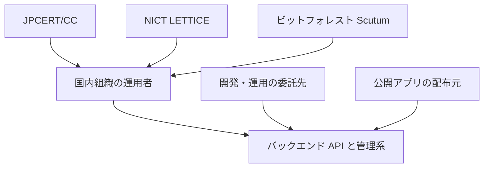
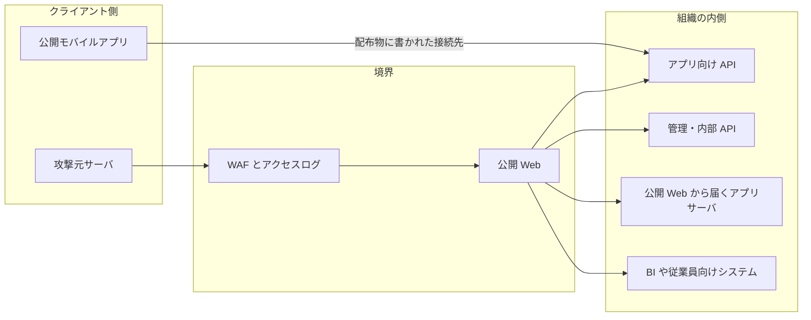
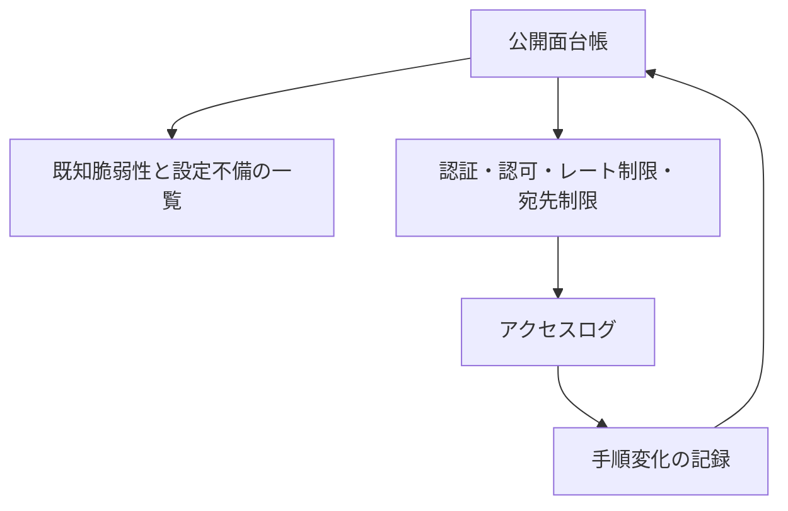
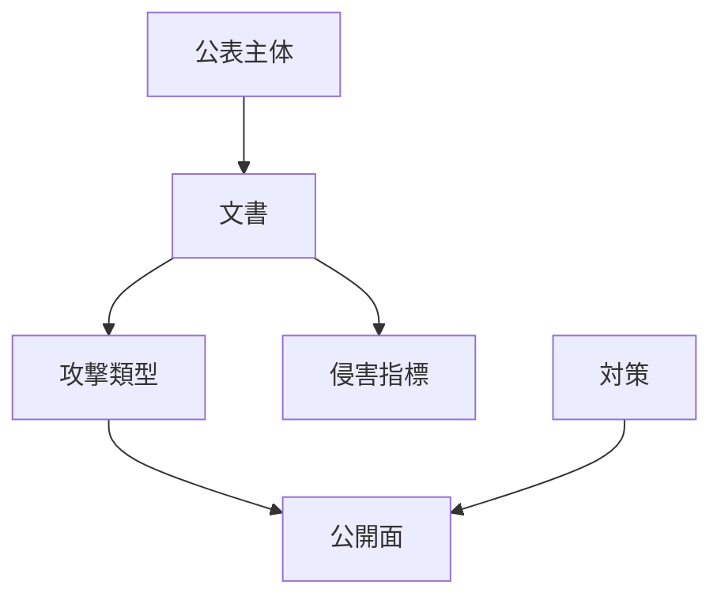
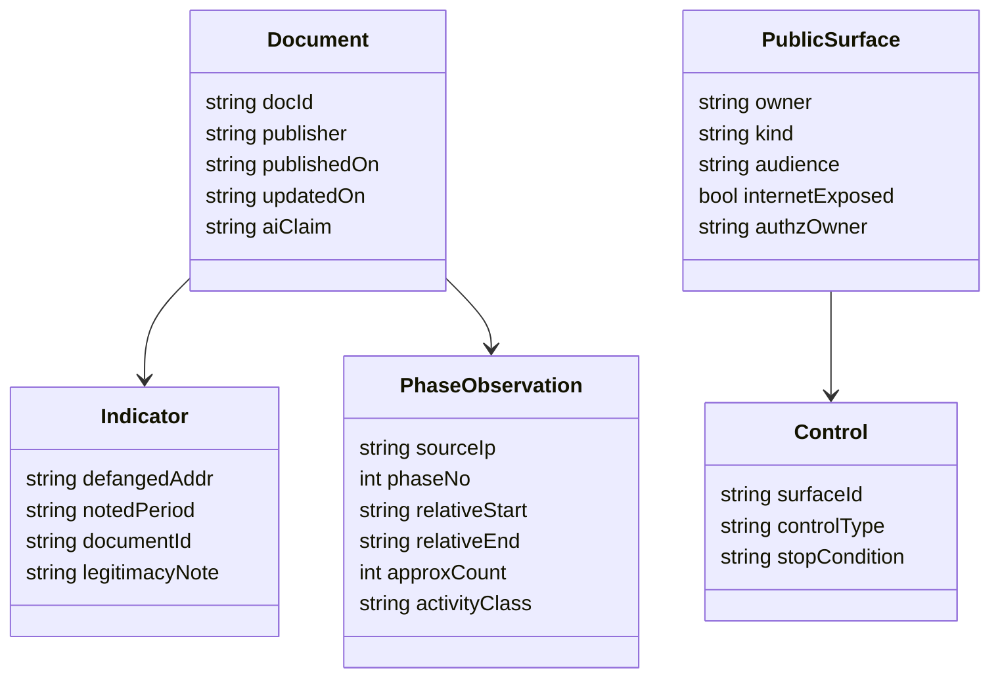

2026年10月8日、JPCERT/CC は注意喚起 [JPCERT-AT-2026-0030](https://www.jpcert.or.jp/at/2026/at260030.html) を公開し、翌9日に更新しました。2026年9月前後に国内組織で相次いだ不正アクセスと、個人情報などの漏えいについて、把握できている攻撃類型を断片のまま共有する内容です。2026年10月15日の Eyes 記事は、その注意喚起のあと、複数組織と連携して攻撃に使われた可能性のあるインフラを調べた結果を紹介しています。冒頭では、攻撃者が AI を利用し、既知の脆弱性のスキャンと API 経由の攻撃などを実施していたことを確認した、と述べています。判定に使ったモデル名は、その本文には載せていません。

この記事では、JPCERT/CC の注意喚起と Eyes、同じ週の NICT とビットフォレストを、別の話し手のまま読みます。厚く扱うのは、Eyes がインフラ上で確認した痕跡、資料ごとの IP の扱い、WAF 観測の時系列です。読者が持ち帰るのは、インターネットから届く公開面の台帳、公表された送信元を自社ログで照合する単位、レート制限と宛先制限とオブジェクト認可の置き場です。同週に NICT が名付けた A2B（App-to-Backend Attack）は、公開アプリの解析からバックエンドを狙う類型の名前です。Eyes の IP リストとは別の文書として扱います。


*この記事の全体像。以下、順に解説します。*

## 連続不正アクセス事案とは

注意喚起は、普段のランサムウェア事案とは別に、大量漏えいにつながっている恐れのある類型を取り上げる、と書いています。Eyes 記事が本文で具体的に示す痕跡は、Android アプリの配布ファイル（APK）の解析と、そこから特定した API への調査です。

1台目では、APK を解析し、関連 API に SSRF（Server-Side Request Forgery。サーバが、指定された宛先へ自分から接続してしまう欠陥）が無いかを調べた痕跡と、特定リクエストに HTTP 302 を返す HTTPS サーバとして動く Python スクリプトを確認した、とあります。2台目では、Flutter アプリの解析に使う Blutter、Android アプリの解析に使う jadx、APK 展開を示唆する `apk_extract/`、ネイティブライブラリから抽出した文字列の保存を示唆する `strings_libapp.txt` を確認した、とあります。3台目は「今回の攻撃とは直接関係しない」と明記され、MySQL、Jenkins、メールゲートウェイ、EDR 回避の痕跡、Web シェルが書かれています。

同じ週の別系統として、NICT の脅威情報分析チーム LETTICE は 2026年10月13日に、公開 Android アプリの解析結果でバックエンドを狙う手法を A2B と名付けました。ビットフォレストは、10月10日夜から10月14日までに、自社 WAF 上で AI エージェントと判定した 3 つの IP を WAF Tech Blog に書きました。ITmedia AI+ は 2026年10月15日にそのブログを要約しています。Eyes の 3 つの IP と、ビットフォレストの 3 つの IP は一致しません。

## 公開資料が分ける特徴

注意喚起は、単一製品の単一脆弱性が共通原因だとは書いていません。標的ごとに既知の脆弱性を探し、設定不備（設定ファイルやバックアップの取得）も試す、とケース A に書いています。

ケース B は API 経由の不正操作です。公開スマホアプリの解析でエンドポイントやキーを特定する、画面操作では届かない内部 API を叩く、他システムから盗んだ API キーを使う、の 3 系統を挙げています。Eyes がインフラ調査で名前を出したアプリケーション層の欠陥は SSRF です。注意喚起ケース B は、権限変更、不正アカウント作成、ヘッダや認証トークンの形式差の確認、NoSQL インジェクションによる探索を、手口の報告として挙げています。

ケース C は Metabase の SQL インジェクション CVE-2026-72898 です。API への不正リクエストとして悪用される、と注意喚起が書き、詳細は別紙 [JPCERT-AT-2026-0023](https://www.jpcert.or.jp/at/2026/at260023.html) に委ねています。

ケース D は 2026年10月9日の追記です。公開 Web サーバから到達できるアプリケーションサーバに WAR が置かれ、中の JSP が簡易 Web シェルとして動いた、と書いています。クエリパラメータをコマンドとして実行する機能を持つ、とまで書き、パラメータ名は書いていません。

NICT は、アプリ本体に脆弱性が無くても、バックエンドの認証・認可・入力検証の不備で漏えいし得る、と書いています。対象は Android に限らず、iOS アプリと Web サービスのバックエンド API でも起こり得る、とプレスリリースが広げています。

ビットフォレストは、AI エージェントかどうかで対策の大枠は変わらない、と書いています。有効な対策は、バックエンド API を含む既知の穴を塞ぐことと、シグネチャだけに依存しない WAF です。

停止条件の置き場は、既知の穴と公開 API がインターネットから届く状態です。注意喚起の対策節と、NICT の「公開アプリは解析される前提」が同じ場所を指します。

## 公開面の構造

観測は 1 本の攻撃キャンペーンにまとまりません。公開資料は少なくとも 4 つの話し手を持ちます。防御側が設計する単位は、公開面（アプリ、API、管理系、BI）と、そこへ届くリクエストの手順変化です。Eyes の脚注 1 は、APK 解析という特徴の参照先として NICT の CYNEX 記事を指します。Appendix B の IP と、この記事が採らない NICT PDF の IoC は、一つのリストにしません。

### システムコンテキスト

運用者、委託先、公開アプリ、バックエンド、そして 3 つの公表主体の関係は次のとおりです。



| 要素 | 役割 | この記事での位置 |
|---|---|---|
| 運用者 | 公開面の所有者。台帳と認可とログの責任を持つ | 読者 |
| 委託先 | 開発・運用を担い得る。NICT は診断の相談先として名指しする | 境界。侵害の原因とは断定されていない |
| 公開アプリ | 誰でも入手できるクライアント。接続先と認証の材料が入り得る | A2B の起点。Eyes の APK 解析と対応する |
| バックエンド | 画面の裏の API、従業員向け、BI を含む | 注意喚起が「不特定多数を想定していないシステムも被害に遭う」と書いた面 |
| JPCERT/CC | 注意喚起とインフラ調査の公表 | 2026-10-08 / 10-09 / 10-15 |
| NICT LETTICE | A2B の命名と事業者向け 3 対策 | 2026-10-13 |
| ビットフォレスト | 自社 WAF 上の別観測。判定ロジックは非公開 | 2026-10-10 夜から 10-14 |

### コンテナ

リクエストが届く面を、クライアント、境界、組織の内側に分けます。



| コンテナ | 公開資料が言うこと | 防御側が持つ記録 |
|---|---|---|
| 公開モバイルアプリ | 解析されるとエンドポイント、キー、署名処理が見つかり得る。Eyes Appendix A | ビルドに秘密を入れたかの台帳 |
| 攻撃元サーバ | APK、解析ツール、302 を返す HTTPS スクリプト。3 台目は別件 | 送信元 IP は資料ごとに別リスト |
| WAF とアクセスログ | ビットフォレストはここで手順の変化を見た。判定手法は非公開 | 自社ログの時系列 |
| アプリ向け API | 正規アプリ以外からのリクエストを想定する、と Appendix A | 認証・認可・レート制限 |
| 管理・内部 API | 画面から実行できない操作（権限変更、アカウント作成）が報告されている | メソッドと主体の許可表 |
| アプリサーバ | ケース D。公開 Web から WAR を置かれた | 配置経路とファイル整合 |
| BI・従業員向け | インターネット公開が被害面になった、と注意喚起 | 公開停止の対象 |

この矢印は、自社の境界に届くリクエストの見取り図です。Eyes の攻撃元サーバと、ビットフォレストが自社 WAF で見た送信元は、IP が一致しない別観測です。一つの通信経路だとは主張しません。

### コンポーネント

防御側の作業単位は次の 5 つです。段階の名前は、ビットフォレストが 1 つの IP について観測した「ツールが切り替わる」事実を、自社ログの見方へ写したものです。



| コンポーネント | 入力 | 出力 | 止めるもの |
|---|---|---|---|
| 公開面台帳 | OpenAPI、アプリの接続先、管理 URL、委託先の担当 | インターネットから届く面の一覧 | 台帳に無い API が本番で応答する状態 |
| 既知脆弱性一覧 | 利用バージョン、CVE、バックアップと設定ファイルの露出 | 未修正の穴 | ケース A が探す「既知の穴」と「設定不備」 |
| ゲート | 主体、操作、対象オブジェクト、宛先 URL、回数 | 許可または拒否 | 埋め込み鍵だけの通過、SSRF、過剰な回数 |
| アクセスログ | 時刻、送信元、パス、メソッド、ステータス、User-Agent | 検索可能な行 | 公表 IP の見落とし |
| 手順変化の記録 | 同じ送信元のツールとパスの切り替わり | 1 本の時系列 | 単発シグネチャだけで「終わった」と判断すること |

## 台帳に載せるデータ

公表主体、文書、攻撃類型、侵害指標、公開面、対策は、別の箱のまま持ちます。指標は文書にぶら下げ、自社ログとの照合結果だけを公開面の行へ付けます。

### 概念モデル



| 概念 | 定義 | 例 |
|---|---|---|
| 公表主体 | 文書の話し手。観測範囲が違う | JPCERT/CC、NICT、ビットフォレスト、ITmedia |
| 文書 | 日付と更新を持つ一次または二次 | AT-2026-0030、Eyes、CYNEX、WAF Tech Blog |
| 攻撃類型 | その文書が分けた手口。全事案で同一とは限らない | ケース A〜D、A2B、スキャンのみ、フォーム連投を含む 5 段階、10 段階の探索 |
| 侵害指標 | その文書が「この期間に不審だった」と書いた送信元や User-Agent | Eyes Appendix B の 3 IP、ビットフォレストの 3 IP。リストは文書ごとに別 |
| 公開面 | インターネットから届くアプリ、API、管理系、BI | 台帳の 1 行 |
| 対策 | その面を閉じる運用 | レート制限、認可、修正適用、公開停止 |

注意喚起は「すべての事案で同一の攻撃手法が使われていることを示すものではない」と、ケース節の前に書いています。概念モデルの「類型」は、共通キャンペーン ID ではありません。

### 情報モデル

文書側の指標・段階と、公開面側の対策は、クラス図では線でつなぎません。



| 型 | フィールドの意味 | 埋めてよい値の規則 |
|---|---|---|
| Document.aiClaim | その文書が AI について何を主張したか | Eyes は「確認した」。NICT は「効率化し得る」。ビットフォレストは「検知したらエージェントと断定できる」。ITmedia はブログの要約 |
| Indicator.notedPeriod | その IP が悪用されていたと書かれた時期 | 注意喚起は 8 月、9 月、10 月 7 日ごろを分けて書く。調査時点で正規利用の可能性あり、と注記された組がある |
| Indicator.legitimacyNote | 正規利用の注記の有無 | ケース B の 9 月組とビットフォレストの 3 IP には注記がある。Eyes Appendix B の 3 IP には同文が無い |
| PhaseObservation | 1 送信元の中の段階 | 件数と相対時刻を持つのは WAF Tech Blog だけ。Eyes は段階表を持たない |
| PublicSurface.audience | 想定利用者 | 一般利用者、従業員、管理者。注意喚起は BI や従業員向け管理システムも被害面だと書く。委託先は被害面ではなく、点検の相談先 |
| Control.stopCondition | その対策が「開いたまま」と判定する条件 | 未修正バージョン、台帳外のルート、レート無制限、宛先未検証、長期トークン |

Eyes Appendix B の IP を、本文の「サーバその 1〜3」へ割り当てる対応表は、記事内にありません。PhaseObservation の送信元は、ビットフォレストの 3 IP だけが段階を持ちます。2 つのリストを 1 つの攻撃元マスタに結合しません。

## 公開面台帳の構築

構築するのは、自社と委託先が共有する公開面の台帳です。注意喚起が推奨するレート制限、認可、トークン寿命、不要な公開の停止は、台帳の行が無いと適用先が決まりません。

### 公開APIの台帳を先に作る

台帳の 1 行は、インターネットから応答する面です。モバイルアプリの接続先、OpenAPI に載ったルート、画面にボタンが無い管理 API、従業員向け、BI、委託先がホストする同種の面を同じ表に入れます。NICT のプレスリリースは、Android 以外の iOS と Web API も同型だと書いています。

- 所有者は自社か委託先かを列にします。相談先と、修正を出す責任は別列にします。
- 想定利用者（一般、従業員、管理者）を書きます。注意喚起は、不特定多数を想定していないシステムも被害に遭う、と書いています。
- 認証の材料がアプリのバイナリに入っているかを書きます。Eyes Appendix A は、共通の秘密鍵や長期の認証情報をアプリへ埋め込まない、と推奨します。
- 外部 URL をサーバが取得するルートには、宛先制限の有無を書きます。SSRF の行です。

```yaml
surfaces:
  - id: member-profile
    owner: self
    operator: vendor-a
    kind: mobile-backend
    audience: customer
    internet_exposed: true
    secret_in_client: false
    fetches_remote_url: false
    authz: object-level
  - id: staff-bi
    owner: self
    operator: self
    kind: bi
    audience: employee
    internet_exposed: true
    secret_in_client: false
    fetches_remote_url: false
    authz: network-only
```

`internet_exposed: true` かつ `audience: employee` は、注意喚起が点検を求めた組み合わせです。`operator` が委託先でも、`owner` の台帳から消しません。

### 既知の穴を台帳へ突合する

ケース A は、共通の 1 つのソフトウェア脆弱性ではなく、標的ごとの既知脆弱性の探索と、脆弱性ではない設定不備（設定ファイルやバックアップの取得）だと書いています。台帳の各行に、利用中のバージョンと、修正済みかどうかと、設定ファイルやバックアップが同じホスト名の別パスに出ていないかを持たせます。

- バージョンは本番で応答しているものにします。リポジトリの宣言と本番がずれていれば本番を書きます。
- CVE は注意喚起が名指ししたものを優先して突合します。本文が番号まで書いたのは Metabase の CVE-2026-72898 です。他製品への横展開は、自社が実際に使っているものだけを足します。
- 設定不備の列は、脆弱性番号が無くても残します。ケース A が分けて書いているためです。

```text
surface_id,component,running_version,fixed_version,cve,config_or_backup_exposed
member-profile,api-gateway,自社の実バージョン,自社の修正版,,false
staff-bi,metabase,未棚卸,要確認,CVE-2026-72898,未確認
```

Metabase を使っていなければ 2 行目は作りません。番号があるから全社の必須項目になるわけではありません。2 行目は、自社で運用する Metabase を未棚卸のまま置いた例です。[JPCERT-AT-2026-0023](https://www.jpcert.or.jp/at/2026/at260023.html) は、Metabase Cloud では本脆弱性の対策はすでに実施済みだと Metabase が案内している、と書いています。Cloud の行を、同じ CVE の未確認のまま残しません。自社運用で使っているなら、詳細手順は JPCERT-AT-2026-0023 を正本にします。

### 委託先と自社の境界を台帳に載せる

NICT は、個別システムの診断には応じない、とプレスリリースに書いています。点検の相談先は社内担当、開発・運用の委託先、専門事業者です。境界を台帳に残す理由は、公開面の修正責任がどちらのリリースにあるかを、穴が開いた時点で言えるようにするためです。

- 委託先がホストする API も `owner: self` の行に残します。契約上の処理者であっても、利用者から見える面は自社の公開面です。
- 修正の出し手（自社リリース、委託先リリース、SaaS ベンダ）を列で分けます。
- ログの保管先を書きます。委託先の WAF にしかログが無い行は、公表 IP の照合が自社だけでは終わりません。

```yaml
boundaries:
  - surface: member-profile
    data_owner: self
    release_by: vendor-a
    logs_at: vendor-a-waf
    inquiry: vendor-a-csirt
  - surface: staff-bi
    data_owner: self
    release_by: self
    logs_at: self-lb
    inquiry: self-security
```

`staff-bi` の `release_by: self` は、直前の CVE 行と同じく自社運用の Metabase です。Metabase Cloud をこの行の例にしません。Cloud は、上に書いたとおり対策済みの案内があるためです。

## ログと設定への利用

ここでの利用は、公表資料の指標と対策を自社のログと設定へ当てることです。注意喚起は、API 経由の対策の詳細参照先として [OWASP API Security Top 10 2023](https://owasp.org/API-Security/editions/2023/en/0x11-t10/) と [REST Security Cheat Sheet](https://cheatsheetseries.owasp.org/cheatsheets/REST_Security_Cheat_Sheet.html) を挙げています。この記事が番号まで照合したのは API1 と API7 です。

### 公表された送信元を自社ログで探す

Eyes Appendix B は次の 3 つを挙げます。表記は公表と同じく、末尾のオクテットの前を角括弧で切ってあります。

- 210.149.87[.]120
- 118.26.36[.]16
- 69.10.51[.]162

このうち 210.149.87[.]120 と 69.10.51[.]162 は、注意喚起ケース B の「9 月ごろに悪用」リストにもあります。118.26.36[.]16 は、2026年10月9日時点の注意喚起本文にはありません。ビットフォレストが書いた 38.54.56[.]121、185.196.220[.]130、192.236.229[.]229 は、Eyes にも注意喚起の引用範囲にも出てきません。

ケース B の 9 月組には「調査時点では正規利用されている可能性もある」と付きます。Eyes Appendix B にはその文がありません。照合でヒットしても、その IP 単独で侵害確定にはしません。期間と User-Agent とパスをセットで見ます。

```python
import ipaddress

advisories = {
    "eyes-appendix-b": [
        "210.149.87[.]120",
        "118.26.36[.]16",
        "69.10.51[.]162",
    ],
    "bitforest-2026-10-14": [
        "38.54.56[.]121",
        "185.196.220[.]130",
        "192.236.229[.]229",
    ],
}

def needles(group: str) -> set[ipaddress.IPv4Address]:
    return {
        ipaddress.ip_address(item.replace("[.]", "."))
        for item in advisories[group]
    }

def source_in_group(group: str, source: str) -> bool:
    try:
        addr = ipaddress.ip_address(source.strip())
    except ValueError:
        return False
    return addr in needles(group)
```

`source_in_group` は、ログの送信元を IP アドレスとして解釈し、公表値と完全一致したときだけ真になります。`210.149.87.120` が `210.149.87.1200` の部分文字列になる照合は使いません。グループ名を残すのは、ヒットした指標がどの文書の、どの注記付きかを落とさないためです。

### レート制限を機能ごとに分ける

注意喚起は、API 全体の単位時間あたり件数に加え、ログイン、パスワード再設定、SMS 送信、検索のように悪用時の負荷が高い機能へ個別制限を付ける、と書いています。ビットフォレストの観測では、同じ IP の中でも段階ごとに件数が違います。全体の平均値だけを見ると、短い高速スキャンが埋もれます。

- ログインとパスワード再設定は、閲覧 API と別のカウンタにします。
- カウンタの鍵は、送信元だけではなく、アカウント作成や SMS のようにコストが利用者に出る操作では操作名を含めます。
- 拒否した回数もログに残します。成功だけを数えると、総当たりの途中経過が消えます。

```yaml
limits:
  - route: POST /login
    key: source_ip
    window_seconds: 300
    max_requests: 20
  - route: POST /password-reset
    key: source_ip
    window_seconds: 3600
    max_requests: 5
  - route: POST /messages
    key: account_id
    window_seconds: 60
    max_requests: 10
```

数値は注意喚起が指定したものではありません。注意喚起は「制限する」とだけ書き、閾値は出していません。上の数は、自社の正規利用を見て決める初期値です。

### 外部URLを取得するAPIの宛先を固定する

Eyes は、外部 URL の内容を取得する API ではアクセス先を制限し、リダイレクト後の宛先も検証する、と Appendix A に書いています。[OWASP API7:2023](https://owasp.org/API-Security/editions/2023/en/0xa7-server-side-request-forgery/) は、利用者から渡された URI を検証せずに取得する欠陥を SSRF と呼びます。API7 は、基本的な SSRF を、応答が攻撃者へ返る場合と書いています。Blind SSRF は、攻撃者が成否のフィードバックを得られない場合と、別に書いています。同じページは、応答が返らない場合を Blind SSRF とも呼びます。Eyes が 1 台目で見たスクリプトは、特定リクエストに 302 を返す HTTPS サーバだと書いています。リダイレクトを追う取得処理が点検対象になる、というところまでが一次情報です。

- 許可するホストは台帳の行ごとに固定します。利用者入力の URL をそのまま渡しません。
- リダイレクトを追うなら、追うたびに許可ホストを再判定します。最初の URL だけを見ません。
- 許可外は、接続する前に拒否します。

```python
import ipaddress
from urllib.parse import urlparse

ALLOWED_HOSTS = {"cdn.example.com"}
ALLOWED_ADDRS = {ipaddress.ip_address("203.0.113.10")}

def assert_allowed(url: str, connect_to: str) -> None:
    host = urlparse(url).hostname
    if host not in ALLOWED_HOSTS:
        raise PermissionError("destination is not on the surface allowlist")
    addr = ipaddress.ip_address(connect_to)
    if addr not in ALLOWED_ADDRS:
        raise PermissionError("connect address is not on the surface allowlist")
```

`assert_allowed` は、今から接続する 1 ホップの確認です。最初の URL にも、リダイレクトで得た次の URL にも、接続の直前に同じ関数を呼びます。`connect_to` は、その瞬間に接続しようとしているアドレスです。ホスト名だけを見て、別のアドレスへ接続する実装にはしません。`203.0.113.10` は文書用の例示アドレスであり、公表指標ではありません。許可アドレスは台帳の行ごとに持ちます。302 を生成する側の実装は、Eyes が攻撃元の痕跡として示した類なので書きません。

### オブジェクト単位の認可をサーバで決める

NICT は点検項目に IDOR / BOLA を挙げます。[OWASP の API1:2023](https://owasp.org/API-Security/editions/2023/en/0xa1-broken-object-level-authorization/) は、オブジェクト ID を受け取るエンドポイントごとに、ログイン利用者がそのオブジェクトへその操作をしてよいかを検証する、と書いています。同じページは、セッションの利用者 ID と、リクエストの ID パラメータを比べるだけでは不十分だ、とも書いています。注意喚起ケース B は、画面操作では実行できない内部 API に対して、ユーザー権限の変更と不正なアカウント作成が起きた、と列挙します。操作を誰に許すかと、どのオブジェクトに許すかは、その列挙を自社の点検へ落とすときの読み方です。注意喚起が「両方が要る」と一文で書いたわけではありません。

- アプリ内の署名や難読化は、サーバの認可の代わりにしません。Eyes Appendix A がそう書いています。
- トークンは必要最小限の権限と、有効期限を持ちます。漏えいが疑われたら失効できます。注意喚起の対策節です。
- 他システムから盗んだ API キーで通る、という報告があります。キーの所在は台帳の `secret_in_client` と失効手順に紐づけます。

```python
def authorize(subject: str, action: str, object_id: str) -> None:
    decision = policy.decide(subject=subject, action=action, object_id=object_id)
    if not decision.allow:
        raise PermissionError("object-level authorization denied")
```

`policy.decide` は、主体と操作と対象の 3 つを見ます。ID の文字列がセッションと一致するかだけを見る実装にはしません。

## 手順変化の運用

### 検知は手順の変化を1本の記録にする

ビットフォレストは、AI エージェントの見分け方そのものは公開しない、と書いています。公開すると回避される、が理由です。代わりに、見分けの前提を 5 つ書いています。エージェントは curl や sqlmap や自作のコードを使います。その結果とサーバの応答を読み、次の行動を修正します。柔軟で、目的を達成しようとし、判断が速い、という前提です。この前提に合わせ、従来の「決まったリクエストを連続で送る」ツールや、curl と sqlmap を単発で流すだけ、とは違う流れが出るように WAF の挙動を変えた、と書いています。

検知の主張は限定されています。試した 8 モデルすべてで検出できた、というものです。モデルが賢いほど仕掛けが効く、とも書いています。攻撃者が実際に使ったモデルは分かりません。検知した場合はエージェントだと断定できる（偽陽性はほぼ無い）、とも書いています。漏れなく列挙はできない（偽陰性はあり得る）、とも書いています。検証に名前が出たのは Qwen 3.8 Flash Next と GLM-5.3 Flash Next を含む 8 種で、残り 6 種の名前はブログにありません。これは検証に使ったモデルであり、攻撃者のモデルではありません。

同じブログは、検出した 3 IP の中身が互いに違う、とも書いています。1 つは約 1000 件のスキャンのみで段階が変わりません。1 つは問い合わせフォームへの連投を含む 5 段階です。1 つは 8 時間弱で 10 段階です。A2B で見られる「User-Agent にスマホアプリの文字列」はこの 3 IP には無かった、と明記しています。したがって、この 3 IP の観測を A2B の実例として結合しません。

```yaml
observation:
  source: waf-tech-blog-085
  window: "2026-10-10 night through 2026-10-14"
  detector_claim: "positive implies agent; negatives are not exhaustive"
  attacker_model: unknown
  lab_models_named:
    - "Qwen 3.8 Flash Next"
    - "GLM-5.3 Flash Next"
  lab_models_unnamed: 6
  addresses:
    - id: "38.54.56[.]121"
      shape: single-wave-scan
      approx_requests: 1000
    - id: "185.196.220[.]130"
      shape: five-phases
    - id: "192.236.229[.]229"
      shape: ten-phases
      duration: "under 8 hours, last mark T+7:46"
```

### しきい値は観測値を調査開始の目安にする

10 段階の IP `192.236.229[.]229` について、ブログの表を活動の種類へ要約します。入力文字列は転載しません。相対時刻とおおよその件数はブログの表どおりです。

| 段階 | 相対時刻 | 件数の約数 | 活動の種類 |
|---|---|---|---|
| 1 | T+0:00 〜 T+0:23 | 50 | 低速の探索。既知製品の欠陥を含む |
| 2 | T+0:50 〜 T+0:55 | 10000 | 高速スキャン。ブログは件数を約 10000、速度を毎分約 2100（毎秒約 35）と併記する。5 分に直すと約 10500 で、件数の約 10000 とは丸めが違う |
| 3 | T+0:58 〜 T+1:00 | 1200 | 高速スキャンの第 2 波。User-Agent が多様になる |
| 4 | T+1:15 〜 T+1:24 | 850 | ブログの段階名は「既知の脆弱性への攻撃」。入力文字列は転載しない |
| 5 | T+3:18 〜 T+3:21 | 15 | 別ツールへの切り替え。User-Agent に Nmap Scripting Engine |
| 6 | T+4:43 〜 T+4:58 | 20 | パスワード再設定や新規登録など正規フォーム |
| 7 | T+5:01 〜 T+5:03 | 15 | WebLogic 特有の URL |
| 8 | T+5:08 〜 T+5:41 | 250 | ログインの GET と POST の繰り返し |
| 9 | T+6:03 〜 T+6:41 | 40 | ブログの段階名は「既知の脆弱性への攻撃」。件数は約 40。入力文字列は転載しない |
| 10 | T+7:01 〜 T+7:46 | 10 | トップとログインフォームへの少数アクセス |

5 段階の IP `185.196.220[.]130` は、T+0:00 〜 T+14:18 に約 330、T+35:47 〜 T+39:25 に約 70（Range ヘッダ、ステータス 206）、T+44:46 〜 T+1:02:52 に約 800（毎分約 44）、T+1:30:46 〜 T+1:34:26 に約 30、T+1:39:30 〜 T+2:23:31 に約 210（問い合わせフォームへの POST）です。

ITmedia の「8 時間弱、10 段階、毎秒約 35 件で約 1 万件、既知脆弱性、約 250 件のログイン総当たり」は、10 段階の IP の段階 2 と段階 8 に対応します。問い合わせフォームの連投は別 IP の第 5 段階です。約 1000 件のスキャンのみ、は 3 つ目の IP です。1 つの攻撃に全部が同時に起きた、とはブログは書いていません。

自社の調査開始の目安は、この表の桁を借ります。固定の攻撃シグネチャにはしません。

```yaml
investigate_when:
  - name: short_burst
    window_seconds: 60
    status_404_at_least: 1500
    why: "10段階観測の段階2。ブログの段階名は高速スキャン第1波。毎秒約35件、5分間で約1万件"
  - name: tool_switch
    same_source_user_agents_at_least: 5
    window_minutes: 30
    why: "同じ送信元で User-Agent とツールが段階ごとに切り替わる"
  - name: auth_churn
    route: POST /login
    count_at_least: 100
    window_minutes: 40
    why: "第8段階は約33分間に約250件"
```

閾値を超えたら、その送信元の前後 8 時間を 1 本の時系列にして、パスの種類が変わった回数を数えます。1 種類の欠陥名でチケットを閉じません。

### 週次で公開面と既知脆弱性を突き合わせる

運用の周期は、注意喚起が「新たな情報が判明したらページを更新する」と書いたのに合わせ、週次で自社台帳を更新します。見る差分は 3 つです。

- 本番のルート一覧と台帳の差です。増えたルートは、認可とレート制限が空のまま公開されていないかを見ます。
- 本番バージョンと修正済みバージョンの差です。CVE-2026-72898 のように番号が付いたものは、使っている行だけを更新します。
- 公表 IP リストの差です。Eyes、注意喚起の追記、WAF 観測はリストが違います。グループ名を保持したまま追加します。

```python
from pathlib import Path

live = set(Path("live-routes.txt").read_text().split())
ledger = set(Path("public-routes.txt").read_text().split())
for route in sorted(live - ledger):
    print(route)
```

`live-routes.txt` は、自社のゲートウェイや OpenAPI から書き出した本番のルート一覧です。特定の製品コマンドは注意喚起が指定していません。差分の追加行は、その週に台帳へ無い公開面が増えたことを示します。

手順の記録は次の形で残します。1 送信元、1 ウィンドウ、段階ごとの活動種類です。

```text
source_group: self-log
source: 203.0.113.10
window_start: 2026-10-16T01:00:00Z
phases:
  - n: 1
    class: missing-path-burst
    count: 4200
  - n: 2
    class: login-post
    count: 180
```

`203.0.113.10` は文書用の例示アドレスであり、公表指標ではありません。

## ベストプラクティス

### 停止条件を侵入口の公開時点に置く

ケース A は、侵入の成功ではなく、既知の穴と設定不備を広く試す行為を類型として書いています。ビットフォレストも、対策はエージェント利用の有無で大きく変わらず、穴を無くすことが先だと書いています。停止条件は「台帳上の面が、未修正か、認可無しで、インターネットから応答している」時点に置きます。

- 週次の diff で増えたルートは、認可とレート制限が付くまで公開しません。
- 修正バージョンが存在する行を、未適用のまま残しません。
- 設定ファイルとバックアップの露出は、CVE が無くても停止条件に含めます。

### アプリ内の秘密を認可の根拠にしない

Eyes Appendix A の推奨は 4 点です。認証に使う秘密鍵と長期の認証情報をアプリへ埋め込まないこと。アプリ内の署名や難読化だけに頼らず、サーバで利用者を認証し、操作対象と操作内容に応じて認可すること。レート制限と異常リクエストの監視を行い、正規アプリ以外からのアクセスも想定すること。外部 URL を取得する API は宛先を制限し、リダイレクト後も検証すること、です。

- クライアントが秘密を知っていることは、その主体が正規利用者であることの証明にしません。
- キー漏えい時の失効を、台帳の行ごとにリハーサルします。注意喚起は、不要または漏えいが疑われるトークンを速やかに無効化できることを求めています。
- 地域が限定されるサービスは、アクセス元の地域制限も注意喚起の汎用対策に含まれます。

### 署名だけのクライアント制限をサーバ認可と別にする

Appendix A が参照する第三者記事は、Flutter のコンパイル済みコードからでも、埋め込まれた秘密や API の認証処理を特定し得た、と JPCERT/CC が要約しています。ツール名として Blutter を挙げ、GitHub の `worawit/blutter` を参照します。この記事はその抽出手順を転載しません。防御上の含意は、コンパイルと難読化を公開面の認可だと思わない、です。

- 署名検証に通ることと、その利用者にそのオブジェクトの操作を許すことを、別の判定にします。
- 正規アプリを経由しないクライアントを、レート制限の例外にしません。
- 解析され得ることを前提に、バックエンドの不備を点検します。NICT の依頼文と同じ順序です。

### 管理系とBIを公開面の棚卸しに含める

注意喚起は、一般利用者向けアプリに加え、BI や従業員向け管理システムのように、運用側が不特定多数を想定していないシステムも被害に遭い、内部の情報が漏えいする、と書いています。業務上不要な管理機能がインターネットに公開されていれば公開を停止する、とも書いています。

- 台帳の `audience` が employee または admin で、`internet_exposed` が true の行を、顧客向け API より先に見ます。
- 公開を続ける行は、認可、レート制限、トークン寿命、ログの所在が埋まっていることを条件にします。
- 保存期間を過ぎたデータを残さない、は注意喚起の汎用対策です。漏えい時の件数を増やす要因として台帳の隣に置きます。

## 注意点

今回の対象は、自社実装とドキュメントの差分ではありません。公表文書の中で、見出しと中身、要約と表がずれる箇所と、文書どうしの強さが違う箇所です。

### ドキュメントと実装の乖離

| 対象 | 資料の記載 | 実態 | 読者への影響 |
|---|---|---|---|
| Eyes 冒頭の AI | 「AI を利用して、既知の脆弱性のスキャンや API 経由の攻撃などを実施していたことを確認」 | 本文はその確認方法、モデル名、プロンプトの有無を書かない。具体的痕跡は APK 解析、SSRF 調査、302 を返す HTTPS スクリプト、Blutter、jadx、ディレクトリ名である | AI 利用は JPCERT/CC の確認結果として本文に書かれている。公開本文に判定手順とモデル名は無い。確認の文と、手順が無いことを、同じ強さの話として混ぜない |
| Eyes の図 4 | 本文は図 4 | 画像 URL は `ai_attacks_fig5-6a55b0cc.jpg`。取得した HTML に fig4 のファイル名は無い | 図番号でファイルを探すと欠番に見える |
| Eyes の 3 台のサーバ | その 1、その 2、その 3 | Appendix B の 3 IP は、どのサーバか対応付けられていない。その 3 は「今回の攻撃とは直接関係しない」 | IP を見ただけで A2B の発信元だと決められない |
| ITmedia の GLM | 「GLM-5.3 Flash」 | WAF Tech Blog は「GLM-5.3 Flash Next」。Qwen は両方とも「Qwen 3.8 Flash Next」。ITmedia は「中国Alibabaの Qwen 3.8 Flash Next」「中国Z.aiの GLM-5.3 Flash」とベンダー名を足す。ブログ本文にベンダー名は無い | モデル名の検証対象を ITmedia だけにすると、語尾とベンダー帰属の両方がずれる |
| ITmedia の 1 本の攻撃 | 8 時間弱の攻撃に、高速スキャン、既知脆弱性、約 250 件のログイン、と続けて書く | ブログの表では、それらは `192.236.229[.]229` の段階 2、4、8。問い合わせフォームは別 IP の 5 段階。約 1000 件は 3 つ目の IP | 3 つの観測を 1 つの手順だと思うと、検知の形を誤る |
| ビットフォレストの掲載日 | ITmedia は「10 月 14 日に技術ブログで報告」 | ブログ HTML の `blogDate` は「2026年10月14日」で、日付は食い違わない。時分は無い。本文の観測窓は 10 月 10 日夜から 10 月 14 日まで | 掲載日は 10 月 14 日。攻撃の時期は観測窓を正本にする |
| 検証モデルと攻撃者モデル | 8 種すべてで検出できた、とブログ | 攻撃者が使ったモデルは取得できない、と同じ段落に書く | 検証用の製品名を攻撃の帰属にしない |

### 資料間の食い違い

| 対象 | 資料 A | 資料 B | 読み方 |
|---|---|---|---|
| AI の確度 | Eyes は「確認した」と書く | CYNEX の HTML は「AIの活用によってアプリ解析や脆弱性探索が効率化され、こうした攻撃がより多くのシステムに及ぶ可能性」と書く。プレスリリースは「AIの活用によってアプリの解析や脆弱性の発見が効率化され、こうした攻撃がより多くのシステムに広がる可能性」と書く | 確認と可能性を同じ強さにしない。CYNEX の「探索」「及ぶ」と、プレスの「発見」「広がる」を混ぜて 1 つの引用にしない |
| AI の確度 | ビットフォレストは、自社の仕掛けで検知した場合に限りエージェントと断定できる、と書く | 同じ文章で、漏れはあり得る、手法の詳細は出さない、と書く | 他社のログへその判定を輸入できない |
| IP の重なり | Eyes Appendix B の 2 つはケース B の 9 月リストと重なる | 118.26.36[.]16 とビットフォレストの 3 IP は、注意喚起 10-09 版の本文に無い | リストを結合して件数を足さない |
| 正規利用の注記 | ケース B の 9 月 IP と、ビットフォレストの 3 IP には注記がある | Eyes Appendix B には同文が無い | 重なる 2 IP では、注意喚起の注記を落とさない |
| User-Agent | ケース B の例は `curl/7.88.1`、`python-requests/2.34.2`、Chrome/126 系 | ケース C の例は `python-requests/2.33.1`、`Metabase-GHSA-vwf4/2.0` | バージョン文字列は観測された User-Agent であり、パッケージの現行版だとは書かない |
| User-Agent | ビットフォレストの表は `curl/8.5.0`、`Fuzz Faster U Fool v2.1.0-dev`、`python-requests/2.32.3`、`curl/8.14.1`、`Nmap Scripting Engine` などを段階ごとに書く | ケース B / C の例とは一致しない | 別観測のクライアントである |
| スマホアプリの User-Agent | NICT の A2B はアプリ解析が出発点 | ビットフォレストは、検出 3 IP にスマホアプリの User-Agent は無かった、と書く | A2B と WAF 観測を同じ発信元の連続とは扱わない |
| プロトコル | Eyes が明示した転送は、302 を返す HTTPS サーバと、API への攻撃 | ビットフォレストの段階 9 は探索対象の一つに GraphQL を挙げる | GraphQL を Eyes の対象プロトコルだと書かない |

対象プロトコルを Eyes の本文に限ると、名前があるのは HTTPS と、その上の API（HTTP のメソッドとパスを持つもの）です。gRPC や特定のクラウド API の名前は本文にありません。注意喚起ケース B の User-Agent は HTTP クライアントです。ケース D は GET と POST です。HEAD、PROPFIND、OPTIONS は、ビットフォレストの表が `192.236.229[.]229` の段階 5 に書いたメソッドであり、Eyes の対象プロトコルではありません。GraphQL も同じ表の段階 9 の探索対象の一つであり、Eyes には出てきません。

### 2026年10月16日時点で本文に無い事項

| 項目 | 状態 | 理由 |
|---|---|---|
| Eyes が AI 利用と判断したログ、モデル、ツール出力 | 未記載 | 2026年10月16日時点の本文に、判定手順の節は無い |
| Appendix B の IP と 3 台のサーバの対応 | 未記載 | 対応表が記事に無い |
| NICT PDF の IoC と脆弱性ごとの確認手順 | 本文未採用 | CYNEX の HTML は、3 対策と、点検対象としての IDOR/BOLA、SSRF、RCE、SQL インジェクションまでを書く。PDF の確認手順と IoC は展開しない |
| ビットフォレストの判定アルゴリズム | 意図的に非公開 | ブログがそう書いている |
| 検証 8 モデルのうち名前の無い 6 つ | 未記載 | ブログは 2 つだけ名指しする |
| マクニカの記事の中身 | 根拠に未使用 | 注意喚起の参考リンクとしてのみ存在する。この記事の主張の根拠には使っていない |
| セキュアスカイ・テクノロジーの実践ガイドの中身 | 根拠に未使用 | ビットフォレストが関連情報としてリンクしている。手順の根拠には使っていない |
| `python-requests/2.34.2` などが PyPI の実在版か | 未確認 | User-Agent としての観測値に留める |

## トラブルシューティング

ここでの利用者は、自社の公開面を点検する運用者です。症状はログと設定に現れます。

### 画面に無い更新が残る

- 症状: 管理画面の操作履歴に無い権限変更やアカウントが増えています。
- 原因: 注意喚起ケース B が報告例として挙げる、画面操作では実行できない内部 API へのリクエストです。機能の認可がルート単位で無い状態です。
- 対処: そのルートを台帳に載せ、主体と操作の許可が無い組み合わせを拒否します。ID の一致だけを認可にしません。

### 短時間に存在しないパスへのアクセスが増える

- 症状: 同じ送信元から、存在しないパスへのアクセスが数分で数千件になります。その後、ログインや別の製品名のパスへ種類が変わります。
- 原因: ケース A の探索、またはビットフォレストが記録した段階の切り替わりです。単一の欠陥名では閉じられません。
- 対処: その送信元の 8 時間を 1 本の時系列にし、活動の種類が変わった回数を数えます。404 の波だけでチケットを完了にしません。

| 症状 | 原因の候補 | 対処 |
|---|---|---|
| 数分で 404 が数千 | 高速な面の探索 | 送信元の時系列を 8 時間分残す |
| 同じ送信元で User-Agent が何度も変わる | ツールの切り替え | シグネチャを 1 つ足して終わらせない |
| ログイン POST が短い窓に集中する | 認証の試行 | ログインだけのカウンタで拒否し、拒否件数も残す |
| 管理系や BI のホストに見慣れない送信元 | 公開の想定外 | `audience` が従業員の行の公開を止めるか、認可を足す |

### 埋め込み鍵だけでAPIが応答する

- 症状: アプリのバイナリに入れたキーや長期トークンを知っているだけで、顧客情報の API が成功します。利用者ごとの認可がログに残りません。
- 原因: クライアント内の秘密を、サーバの認証と認可の代わりに使っています。Appendix A が避ける構成です。
- 対処: 秘密をアプリから外します。サーバ側で主体を認証し、オブジェクトごとに認可します。漏えいが疑われるキーを失効します。

### 取得APIが内部アドレスへ自分から接続する

- 症状: 利用者向けの「URL の中身を取る」機能のログに、内部ホストやメタデータ用アドレスへの接続が自サーバ発信で残ります。直前のリクエストは別ホストへの URL です。
- 原因: 取得先の制限が無い、または最初の URL だけを許可してリダイレクト後を見ていない状態です。Eyes が点検を推奨した SSRF の形です。
- 対処: 許可ホストを台帳に固定し、リダイレクトのたびに再判定します。許可外には接続しません。

## まとめ

連続不正アクセスの公開資料は、JPCERT/CC の注意喚起、Eyes、NICT の A2B、ビットフォレストの WAF 観測という、少なくとも 4 つの話し手を持ちます。Eyes は AI の利用を確認したと書き、NICT は効率化され得る可能性を書き、ビットフォレストは自社の仕掛けで検知した場合に限ってエージェントと断定できると書いています。IP リストも段階表も、文書ごとに別です。

運用者が先に持つのは、インターネットから応答する面の台帳です。行には所有者、想定利用者、埋め込み秘密、外部 URL の取得、既知脆弱性と設定不備、ログの所在を載せます。停止条件は、未修正か認可無しの面がインターネットから応答している時点です。検知は、同じ送信元の手順変化を 8 時間の 1 本の時系列にします。

この記事が少しでも参考になった、あるいは改善点などがあれば、ぜひリアクションやコメント、SNSでのシェアをいただけると励みになります！

## 参考リンク

### 一次情報

- [JPCERT/CC Eyes「連続不正アクセス事案の攻撃手法に関する調査」（2026-10-15）](https://blogs.jpcert.or.jp/ja/2026/10/web_api_attacks.html)
- [JPCERT-AT-2026-0030 直近で相次いでいる国内組織における不正アクセスに関する注意喚起（公開 2026-10-08、更新 2026-10-09）](https://www.jpcert.or.jp/at/2026/at260030.html)
- [JPCERT-AT-2026-0023 Metabase の SQL インジェクション（CVE-2026-72898）](https://www.jpcert.or.jp/at/2026/at260023.html)
- [NICT プレスリリース「アプリ解析からのサーバ攻撃」（2026-10-13）](https://www.nict.go.jp/press/2026/10/13-1.html)
- [NICT CYNEX Library 同名の注意喚起（2026-10-13）](https://cynex.nict.go.jp/library/261013-01.html)

### 同じ週の別観測

- [ビットフォレスト WAF Tech Blog「AIエージェントによる攻撃を観測しました」](https://www.scutum.jp/information/waf_tech_blog/2026/10/waf-blog-085.html)
- [ITmedia AI+ の要約（2026-10-15 09:06 公開、14:39 更新）](https://www.itmedia.co.jp/aiplus/article/2610/15/2000002284/)

### 防御の基準

- [OWASP API Security Top 10 2023](https://owasp.org/API-Security/editions/2023/en/0x11-t10/)
- [OWASP API1:2023 Broken Object Level Authorization](https://owasp.org/API-Security/editions/2023/en/0xa1-broken-object-level-authorization/)
- [OWASP API7:2023 Server Side Request Forgery](https://owasp.org/API-Security/editions/2023/en/0xa7-server-side-request-forgery/)
- [OWASP REST Security Cheat Sheet](https://cheatsheetseries.owasp.org/cheatsheets/REST_Security_Cheat_Sheet.html)
- [注意喚起が参照するマクニカの記事](https://security.macnica.co.jp/blog/2026/10/web-incidents2026.html)
- [ビットフォレストが参照する実践ガイド](https://www.securesky-tech.com/2026/10/14/9506/)

### 解析ツールの所在

手順は転載しません。JPCERT/CC が Appendix A で参照している所在だけを残します。

- [Blutter](https://github.com/worawit/blutter)
- [IQCrafter の記事（JPCERT/CC が参照）](https://www.iqcrafter.com/blog/flutter-app-reverse-engineering-security-research)
- [NerdzLab の記事（JPCERT/CC が参照）](https://nerdzlab.com/reverse-engineering-a-flutter-app-how-secure-is-your-data-really/)
