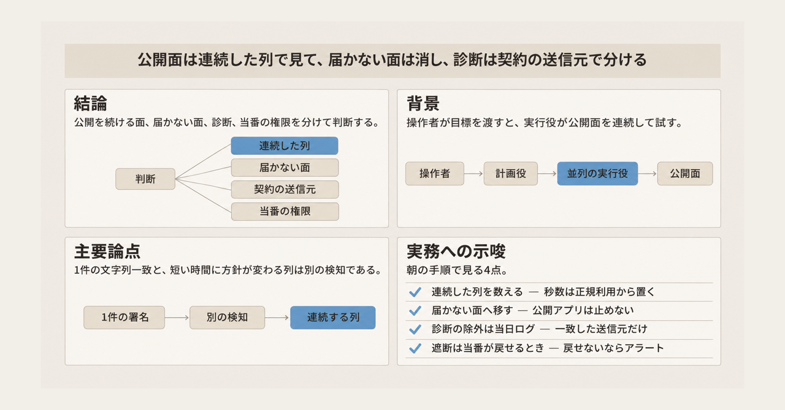
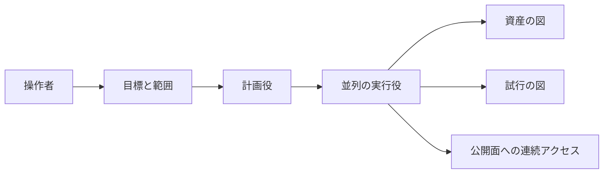
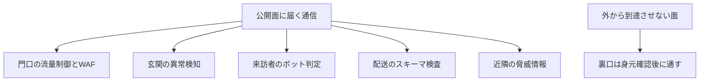

2026年11月13日、Cloudflare は、公開面へ向かう AI ペネトレーション試験のオーケストレータを観測した記事を公開しました。著者は Blake Darché、Myles Sloan、Jacob Crisp、Cloudforce One です。公開面とは、インターネットから直接到達できるアプリや API です。

この記事では、オーケストレータが何をする仕組みか、Cloudflare が何を数えたか、防御側が検知の単位、対策の置き場所、正規の診断との境界をどう分けるかを整理します。

数値は Cloudflare の公表値であり、通信量、IP アドレス、フレームワーク、リポジトリを別々に数えています。

*この記事の全体像。以下、順に解説します。*

## AIペネトレーション試験オーケストレータとは

オーケストレータとは、操作者が目標を渡し、計画役が試行を分け、複数の実行役が公開面を連続して試す仕組みです。診断の単位は、人が手順書に沿って進める形から、目標を渡したあとの連続実行へ移っています。

### 公表された観測

Cloudflare は、直近 3 日で 50 を超えるフレームワークのファミリーが、顧客の公開面を走査した、と書いています。フレームワークは、その走査に使われた枠組みの名前です。実行元の IP アドレスは数千に達し、日ごとに増えている、とも書いています。

2026年11月12日時点では、ARTEX とそのフォークが、同社が知っているオーケストレータの 60% 超を占める、と書いています。ARTEX は、その記事が名前を挙げたオーケストレータです。フォークは、元の公開物を複製して独自に続けたものです。元の公開リポジトリは、作者 Autumn-27 が 2026年10月8日に取り下げた、と Cloudflare は書いています。

取り下げのあとも、日次のリクエストは 2026年10月1日比で 30 倍超、2026年10月8日以降のトラフィックは 10 倍超、と書いています。10 倍超が、いつの何と比べた倍率かは、書かれていません。リポジトリは 12,000 超、系譜を引く独自フォークは数百、とも書いています。図のキャプションは、独自の変更がある公開リポジトリを 204 と数えます。

あるインシデントでは、期限のない広い API トークンが使われました。ここでいう広いトークンは、有効期限が無い API トークンです。観測は、1 分あたり 69 を超えるリクエストと、1 時間に 400 件のデータベースダンプ要求です。データベースダンプは、データベースの中身をまとめて取り出す要求です。

### 構成

オーケストレータは、操作者、計画、並列の実行、二つの図、公開面への連続アクセスでできています。

資産の図は、相手が何を持っているかの記録です。試行の図は、どこまで試したかの記録です。実行役はこの二つの図を更新しながら、次の試行を選びます。公開面から見える単位は、短い時間に方針を変えて続く列です。

Cloudflare の推奨は 6 本柱です。柱は、その列に対する制御の置き場所です。

門口は、流量制御と WAF です。WAF は、Web Application Firewall の略で、公開アプリへ届く通信をルールで検査する仕組みです。玄関は異常検知、来訪者はボット判定、配送はスキーマ検査、近隣は脅威情報です。スキーマは、API が受け付けるデータの形を書いた仕様です。裏口は、外から到達させない面について、身元を確認してから通す置き場所です。

## 注意点

ここまでの数は、そのまま自社の緊急度にはなりません。単位、数え方、他社の別の数、一件の観測を分けます。

### 単位を一つにまとめない

50 超はファミリーの数です。フレームワークが、オーケストレータと同一の単位かは、書かれていません。ファミリーを 1 件とする区切りも、書かれていません。数千は IP アドレスの数です。12,000 超はリポジトリの数です。60% は、Cloudflare が知っているオーケストレータに占める割合です。30 倍超と 10 倍超は、リクエスト量の倍率です。単位が違うので、一つの普及率にはできません。

判定方法、網羅性、派生版のまとめ方、正規の診断を除いたかどうかは、記事に書かれていません。60% や 30 倍超を、自社が今受けているリスクの大きさとしては読みません。判定の特徴が後から公開され、自社のログとその特徴が一致しなければ、他社の件数は自社の緊急度から外します。

図キャプションの 204 は、2026年11月14日にページ本文として読めました。同じ 204 は、プレーンテキストの抽出からは再読できませんでした。12,000 との比率には使いません。第三者が、リポジトリの一覧として 204 を再現できるかも、公開された情報だけでは確認できません。

### 他社が数えているもの

Censys は 2026年11月5日の記事で、公開されたコンソールを数えています。コンソールは、その記事が数えた操作画面です。このあとのパネルと公開インスタンスは、Check Point の呼び方であり、このコンソールの数と同じものではありません。エグゼクティブサマリは、2026年11月4日時点で 1,465 ホスト、似た設定の塊を除くと約 815、と書いています。同じ記事の本文は、同じ 1,465 を 2026年11月3日時点とも書いています。国別表の日本は 51 です。この数は公開コンソールであり、試行した人の人数でも、Cloudflare のリクエスト倍率でもありません。判定は、タイトルが ARTEX で始まり、ページに Next.js の静的なファイルがあることです。Next.js は、Web アプリを作る枠組みです。

Check Point Research は 2026年11月5日の記事で、パネルをホストしたことがあるシステムを 2,557、調査時点で公開されていたものを 1,608、と書いています。同じ記事の冒頭は、公開インスタンスを 1,800 超とも書いています。定義が Check Point の記事の中で割れています。閉鎖日も、本文の一箇所は 2026年10月8日、別の箇所は 2026年9月8日です。停止日は 2026年10月8日として読みます。根拠は、Cloudflare の本文、Censys の本文、Check Point の 10月8日の記述です。2026年11月14日に GitHub の API で `Autumn-27/ARTEX` を引くと HTTP 404 でした。404 は、その日にリポジトリが無いことまでしか示しません。

Cloudflare の記事にある「数週間前まで ARTEX だけだった」は、一般の公開物全体を指す文としては弱いです。Google の Threat Intelligence Group と Mandiant は、表示日 2026年10月31日の記事で、2026年8月下旬以降の対応で ARTEX、PentAGI、CAIRN を見たと書いています。PentAGI と CAIRN は、その記事が ARTEX と並べた別のオーケストレータの名前です。Cloudflare が自社の追跡集合だけを指している可能性は残ります。Cloudflare の記事は、その限定を定義していません。

### しきい値に写さない数

Cloudflare の記事が家にたとえて書いた「5 秒に 500 回叩けない」の 500 は、公式のレート制限ルールの件数ではありません。レート制限は、一定の期間に件数を超えた通信を止めるルールです。インシデントの「1 分あたり 69 超」と「1 時間に 400 件」も、1 件の事後調査の観測です。自社のしきい値には写しません。

日本語版の URL `https://blog.cloudflare.com/ja-jp/adapting-to-ai-penetration-testing-orchestrators/` は、2026年11月14日時点で 404 でした。別の URL に日本語訳があるかは、ここには含めていません。

国内で 2026年10月に約 20 社が標的だった、という件数は、報道にはあります。GMO の一次ページは、この記事の根拠に含めていません。判断の数値には使いません。

## 検知の単位

単一リクエストの署名は、既知の文字列と一致した 1 件を止めるものです。オーケストレータの実行役は、試行の図を見ながら、次の方針を変えます。止める単位の候補は、短い時間に方針が変わる列です。

Google が 2026年10月31日に書いた観測では、実行のまとまりがおよそ 2 秒から 25 秒で、一例では 23 秒のあいだに 27 件のイベントが続いていました。同じ記事は、人より記録がうるさい試行錯誤だと書いています。

公式のレート制限は、その列そのものを見る機能としては書かれていません。2026年8月25日更新のドキュメントでは、利用者が一致条件、集計の軸、期間、期間あたりの件数、遮断の長さを決めます。カウンタの更新には数秒の遅れがあります。集計はデータセンタ単位です。設計上、指定した件数だけを自社サーバーへ通す装置ではありません。Free プランはルール 1 本で、集計期間は 10 秒です。プランによって、ルールの本数と期間の上限が変わります。検証済みボットにレート制限を掛けると、検索の評価に影響し得る、と公式は注意しています。どの検索サービスかは、その注意には書かれていません。検証済みボットは、Cloudflare が身元を確認したボットです。

連続試行を種別に置くことと、レート制限のルールを 1 本足すことは、同じ作業ではありません。種別は「同じ発信元が、短い窓で、パスや結果を変えながら続く」です。レート制限は、そのうち件数で表せる部分だけを止めます。窓の秒数は、家の比喩からは採りません。自社の公開面で、正規の利用が何件続くかを見てから置きます。69 や 500 は使いません。

低速であること、送信元が分かれていること、表記が変わっていることが重なり、この WAF を実際に抜けた、という一つの一次事例は、引用した公開資料の範囲では見つかっていません。表記がリクエストのどの部分かは、その資料には書かれていません。仕様上の限界を、その被害の原因として結びつけません。一方で、件数と単一のパスの一致だけで、列全体を止められる、とも書きません。低速、送信元の分散、表記の変化が重なったとき、自社の現行ルールが、その列をばらばらの 1 件ではなく 1 本のまとまりとして残せるかは、自社ログの確認事項です。

## 到達する通信と到達させない面

記事の 6 本柱は、到達する通信を判定する作業と、到達させない作業が混ざっています。

到達する通信を判定する側は、次の 5 つです。

- 門口の流量制御と WAF のレート制限。公開を続けるアプリに対する件数と異常の制御です。ここでの異常は、流量と一緒に門口で扱う対象です。次の玄関の異常検知とは、置き場所が別です。
- 玄関の異常検知。記事は WAF の役割として書いています。同じ節には FIDO の鍵も置かれています。FIDO は、パスワードではなく暗号鍵で利用者を確認する方式の総称です。FIDO の鍵は、WAF のルールではありません。あとの 5 つの作業には入れません。
- ボットの識別。機械的なリズムを、人の利用と分けます。身元を公開したボットの扱いは、次の節の契約と接続します。ここでの身元を公開したボットは、次の節で述べる検証済みボットです。
- 配送物の検査。OpenAPI のスキーマと、既定で拒否する姿勢が書かれています。OpenAPI は、API の入出力を機械が読める形で書いた仕様です。
- 近隣の脅威情報。見えている試行を知り、監視リストを更新します。これ自体は遮断ではありません。

到達させない側は、裏口の除去です。管理画面、診断用のエンドポイント、遠隔の入口を、インターネットから扉として見せません。記事は、通す相手を身元と端末の状態で確認し、必要な部屋だけへ連れていく、と書いています。端末の状態が何を指すかは、その文では指定されていません。部屋のあいだの横断も、マイクロセグメンテーションで狭くする、と書いています。マイクロセグメンテーションは、部屋のあいだの通信を、必要な経路だけに狭くする分割です。これは WAF のルール追加ではありません。公開してはいけない面を、身元の確認とアクセス制御で到達できないようにする設計変更です。名前解決や経路の変更は、その手段の一つであり、記事が必須とは書いていません。

スキーマ検証は、到達する通信を判定する作業と、到達させない作業の境目にいます。2026年11月11日更新の公式ドキュメントでは、アップロードした OpenAPI は常時の検出を作ります。検出だけでは通信を緩和しません。強制するには、条件と動作を別に書く Custom Rules が要ります。Custom Rules は、Cloudflare の WAF で利用者が書く独自ルールです。「スキーマを有効にした」は、遮断が動いていることと同義ではありません。受け付ける意味論は OpenAPI 3.0 です。3.0 と同じ意味論だけを使う 3.1 のファイルはアップロードできます。3.1 固有の意味論は対象外です。3.1 だけが持つ書き方の中身は、その記述には書かれていません。ボディ検査の既定上限は、Free が 1 KiB（1024 バイト）、Pro と Business が 8 KiB、Enterprise が 128 KiB です。

2026年9月29日の別記事は、コードの奥の欠陥も、外から届かなければ突かれにくい、と書いています。同じ記事は、個別の警報だけでは一連の試行が見えず、行動を相関する、とも書いています。緩和の案は、人の承認にかける構想です。2026年11月13日の 6 本柱は、外から届かなければ突かれにくいことと、個別の警報を一連の行動へ相関することの二つを、製品の並びとして再掲している面があります。観測が新しいことと、推奨の部品が新しいことは、分けて読みます。6 本柱の一部は、Cloudflare の製品への導線と並んでいます。観測は、その製品を買う決定までは含みません。

Google の 2026年10月31日の記事も、防御として、制御面の隔離、短命の資格情報、最小権限、分割、振る舞いの検知を挙げています。制御面は、システムを動かす設定や資格情報の側です。長年の基本策だと、記事自身が書いています。資格情報がインターネットから広く使える形で残っていることと、公開アプリへの連続試行は、別の穴です。

## 正規の診断との境界

同じ種類のオーケストレータは、許可された試験にも、許可のない試行にも使われます。Censys は、公開コンソールのすべてが悪意とは限らない、と書いています。Cloudflare は 2026年9月29日の記事で、顧客が自前の LLM 診断ハーネスを作れる、と書いています。LLM は、文章や手順の生成に使う大規模言語モデルです。診断ハーネスは、そのモデルに診断の試行を連続して行わせる仕組みです。ツール名の一覧で「攻撃」と印を付けると、自社が頼んだ診断も、頼んでいない試行も、同じ印になります。

境界に使うものは、発信元についての契約です。

- 対象のホストと、試してよい範囲。
- 開始と終了の時刻。
- 送信元の識別子。IP アドレス、ASN、または事前に交換した身元です。ASN は、インターネット上のネットワークのまとまりを示す番号です。
- 依頼した相手の名前と、範囲を外れたときにインシデントへ切り替える条件。

契約に載った送信元の列は、診断の記録に残します。載っていない列は、オーケストレータ由来の候補として、止める判断へ回します。共有のプロキシや、委託先が当日に変えた送信元は、契約とログが一致しません。その場合は、契約があっても、当日の除外にはなりません。

Cloudflare の Verified bots は、検証済みボットの一覧です。最終更新 2026年11月12日のページで、行動分類の一つに Security Testing を置いています。Security Testing は、セキュリティ試験として分類された行動です。検証済みになる条件は、暗号署名、公開された IP アドレスと安定したユーザーエージェント、または逆引きで、誰であるかを一貫して示すことです。これは、公開された身元と行動の分類に使えます。個別の診断許可や、WAF とレート制限からの除外は、契約と当日のログで別途確認します。この一覧に無い委託先は、上の契約が残ります。検証済みであっても、レート制限の対象にすると検索評価へ影響し得る、という公式の注意は別です。

## 遮断と解除の権限

検知の種別を足しても、当番が遮断を出せなければ、制御にはなりません。NIST SP 800-61 Rev. 3 は 2025年4月3日公開で、インシデント対応の役割と、資産の切断や停止を誰が決めるかを文書化するよう求めています。NIST SP 800-61 は、インシデント対応の手順をまとめた米国の標準文書です。Cloudflare の 2026年11月13日の記事は、その権限者を指名していません。2026年9月29日の記事は、緩和案を人の承認にかける、と書いています。

朝の手順で確認することは、次の 3 点です。

1. 連続試行の種別を、誰がブロックへ変えられるか。別の承認が要るなら、朝の当番はその場でブロックへ変えられません。
2. 正規の顧客への影響を、誰がどの情報で見るか。レート制限はデータセンタ単位で、数秒遅れます。
3. どの条件で戻すか。戻す手順が無いブロックは、診断の停止と障害の区別が付きません。

この 3 点が手順に無い組織では、オーケストレータ由来の列はアラートです。止める対象と呼べるのは、当番がその場で遮断と解除を実行できるときだけです。

## まとめ

公開を続ける面では、短い時間に方針を変える列を、単一の署名とは別の種別に置きます。届いてはいけない面は、ルールを足す前に、インターネットから消します。診断と許可のない試行は、ツール名ではなく、契約上の送信元で分けます。当番に遮断と解除が無いなら、種別はアラートにとどめます。件数の大きさだけを根拠にした緊急度は、残しません。

朝の手順へ落とす作業は、次の 5 つです。

1. 公開アプリの検知に、連続試行の種別を足す。同じ発信元が短い窓でパスや結果を変える列を、単一の署名と分けて数えます。秒数と件数は、正規利用の実測から置きます。69 や 500 は使いません。
2. 管理画面、診断エンドポイント、有効期限が無く、かつ IP アドレスの制限も無いトークンを棚卸しする。この条件は、インシデントでいう有効期限の無いトークンに、IP アドレスの制限が無いことを加えたものです。遠隔の入口は、前の節のとおりインターネットから扉として見せません。朝の棚卸しの列は、管理画面、診断エンドポイント、トークンの三つです。管理画面と診断エンドポイントで残っているものは、WAF の前に、インターネットから到達できない側へ移します。トークンで残っているものも、インターネットから使えるままには置きません。トークンを無効にするのか、IP アドレスの制限を足すのかは、一つの手順としては書かれていません。この移しは、公開を続けるアプリを止める作業ではありません。
3. スキーマを出している API は、検出だけで終わっていないかを見る。遮断を強制する Custom Rule が無いスキーマ設定は、未遮断として数えます。
4. 診断の契約に、範囲、時間、送信元を必須項目として残す。当日のログと一致しない送信元は、診断の除外に使いません。
5. 朝の手順に、その種別をブロックへ変えられる権限者と、解除条件があるかを 1 行で書く。無いなら、アラートのまま運用します。

優先度が下がる条件は、次のとおりです。公開面がすでに、身元の確認なしには届かず、インシデントでいう有効期限の無いトークンも残っていないなら、連続試行の種別を足す優先度は下がります。ここでの届かないは、回線が繋がらないことではありません。身元の確認が無い相手には、その面の機能まで到達しないことです。当番が遮断を出せないなら、種別を止める対象とは呼びません。判定の特徴が公開され、自社のログがその特徴と一致しないなら、他社の件数の引用を自社の緊急度から外します。

この記事が少しでも参考になった、あるいは改善点などがあれば、ぜひリアクションやコメント、SNSでのシェアをいただけると励みになります！

## 参考リンク

- [Cloudflare, Adapting to AI penetration testing orchestrators: The Modern Security Model（2026年11月13日）](https://blog.cloudflare.com/adapting-to-ai-penetration-testing-orchestrators/)
- [Cloudflare, Adaptive application security for the AI era（2026年9月29日）](https://blog.cloudflare.com/ai-era-framework/)
- [Cloudflare Docs, Rate limiting rules（最終更新 2026年8月25日）](https://developers.cloudflare.com/waf/rate-limiting-rules/)
- [Cloudflare Docs, Schema validation（最終更新 2026年11月11日）](https://developers.cloudflare.com/api-shield/security/schema-validation/)
- [Cloudflare Docs, Verified bots（最終更新 2026年11月12日）](https://developers.cloudflare.com/bots/concepts/bot/verified-bots/)
- [Censys, ARTEX: Agentic Asbestos（2026年11月5日）](https://censys.com/blog/artex-agentic-asbestos/)
- [Check Point Research, Hacking on Autopilot: Inside ARTEX Cybercrime Campaigns（2026年11月5日）](https://research.checkpoint.com/2026/hacking-on-autopilot-inside-artex-cybercrime-campaigns/)
- [Google Cloud Blog, ARTEX and Friends: Enter Agentic Offensive Frameworks（表示日 2026年10月31日）](https://cloud.google.com/blog/topics/threat-intelligence/artex-and-friends-enter-agentic-offensive-frameworks)
- [NIST, SP 800-61 Rev. 3（2025年4月3日）](https://csrc.nist.gov/pubs/sp/800/61/r3/final)
