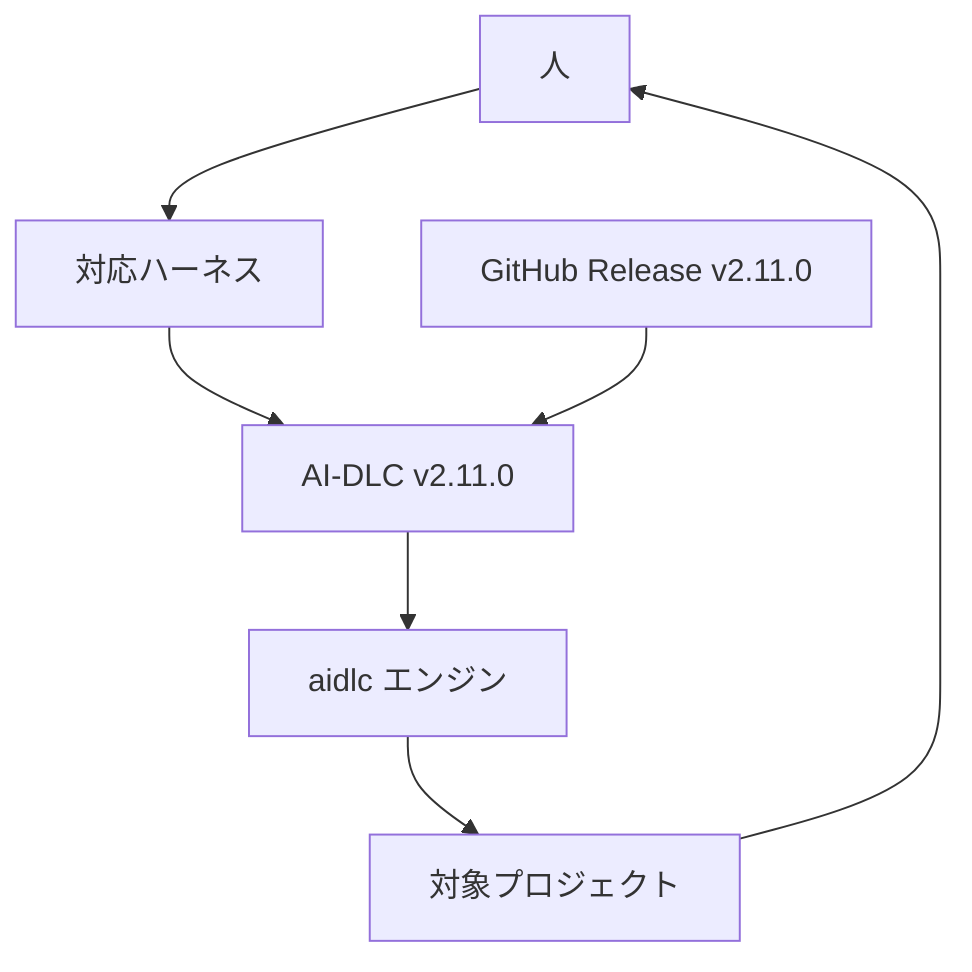
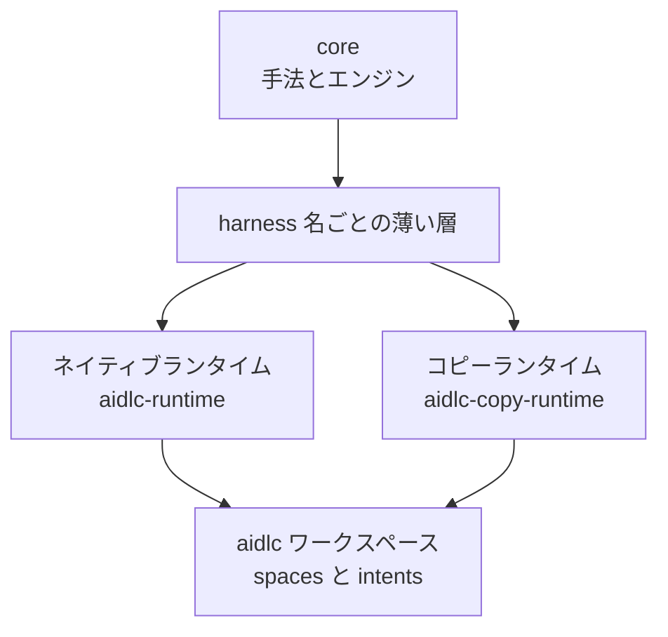
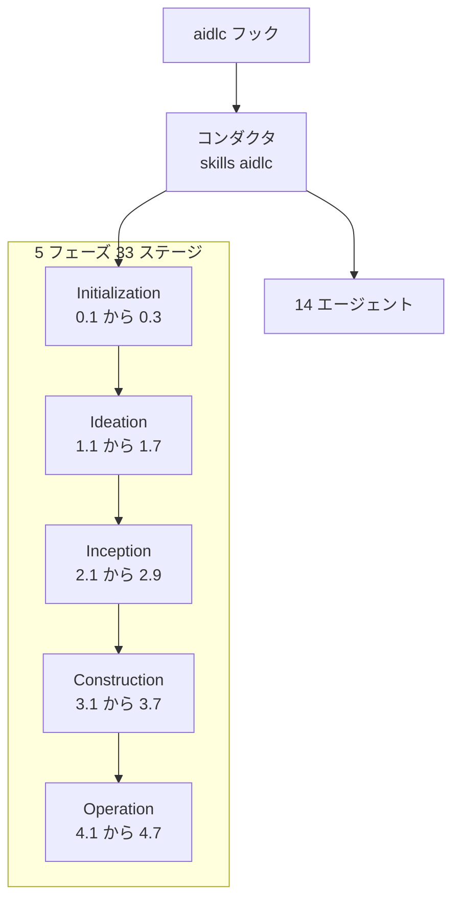
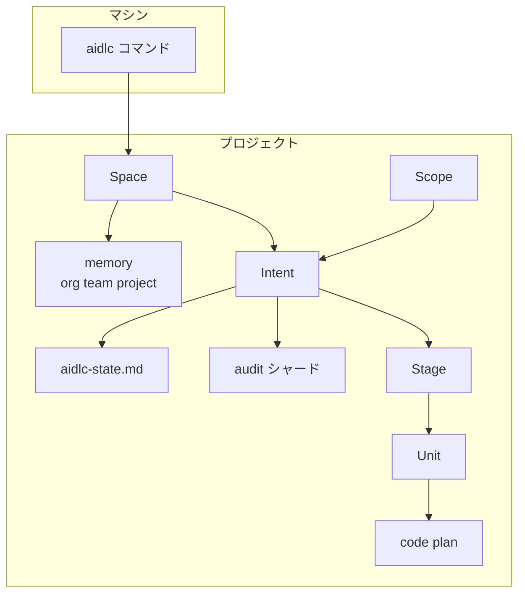
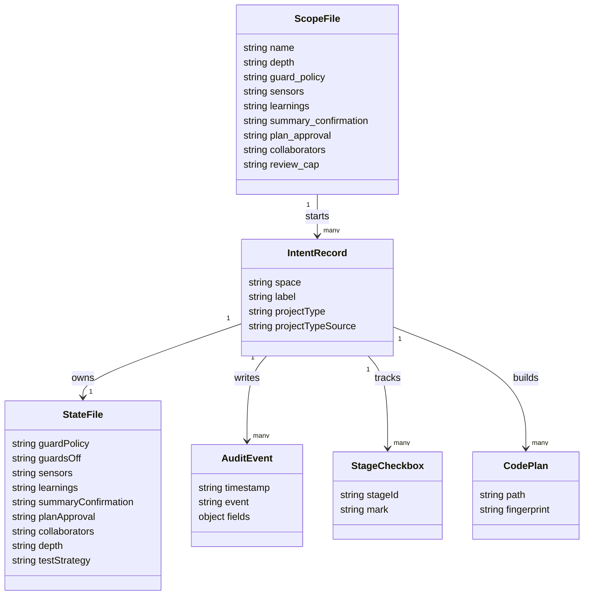

AI-DLC（AI-Driven Development Life Cycle）は、AI コーディング支援を「段階・承認・監査のあるソフトウェア提供ワークフロー」として動かすための方法論と、その実装リポジトリ [awslabs/aidlc-workflows](https://github.com/awslabs/aidlc-workflows) です。この記事では、2026-10-08 に公開された安定版 `v2.11.0` を対象に、構造（システム・コンテナ・コンポーネント）とデータ（概念モデル・情報モデル）を整理し、導入・利用・運用の具体的なコマンドまでをまとめます。

2026 年 8 月時点の [5 フェーズ・32 ステージの現行実装を読み解く - AI-DLC 2.0](https://zenn.dev/suwash/articles/ai-dlc_20260803) では、v2.5.34 を対象に、`v2` ブランチの `dist/<harness>/` からエンジンとワークスペースの殻を対象プロジェクトへ手動でコピーする導入方法を扱いました。`v2.11.0` では入口がネイティブコマンド `aidlc` に変わり、スコープ・Guard Policy・Plan Approval・Collaborators といった「式典（ceremony）」の設定でワークフローの重さを切り替える形になっています。本文のファイルパスとコマンドは、タグ `v2.11.0` のガイドと GitHub Release の記載に基づきます。


*この記事の全体像。以下、順に解説します。*

## AI-DLC 2.11.0 の概要

AI-DLC の起点は [AWS の AI-DLC ブログ](https://aws.amazon.com/blogs/devops/ai-driven-development-life-cycle/) です。`v2.11.0` の README は、ハーネス中立の 1 つの core が Claude Code、Kiro CLI、Kiro IDE、Codex CLI、Cursor、opencode、GitHub Copilot で動くと説明しています。

人はチャットで仕事を渡し、エンジンがスコープに応じたステージを進め、承認が必要な地点で止まります。配布の入口はネイティブコマンド `aidlc` です。インストーラが `aidlc` と各ハーネスのランタイムを入れ、プロジェクト側は `aidlc config` でそのランタイムから設定します。ネイティブ経路は Bun も Node.js も要求しません。ネイティブ実行ファイルを置けない環境では、Bun 1.3.8 以降とリリース資産 `aidlc-copy-runtime-2.11.0.tar.gz` の `runtime/<harness>/` をプロジェクトへコピーします。

README が数える同梱規模は次のとおりです。

| 項目 | 規模 |
|---|---|
| フェーズとステージ | 5 フェーズ 33 ステージ |
| エージェント | 14（ドメイン専門家 11、レビューア 2、適応コンポーザ 1） |
| ワークフロープロファイル | 11 |
| 監査イベント | 115 |
| エンジンとオーサリングツール | `core/tools/` の `aidlc-*.ts` が 87 本 |

開発用 `package.json` は `name` が `aidlc-workflows-dev`、`version` が `0.0.0`、`private: true` で、製品版の番号はリリースタグが担います。ガイドは、予定されている `aidlc setup`、npm パッケージ、パッケージマネージャの公式 formula はこのリリースでは未提供だと明記しています。

## 特徴

- ハーネス中立の core と、ハーネスごとの薄い層を分けています。チャットからの呼び出しは Claude Code などでは `/aidlc`、Codex CLI では `$aidlc` です。
- ネイティブ `aidlc` がインストール、設定、更新、診断、アンインストールを担います。ワークフローの決定的な操作は `aidlc engine ...` とチャット内の `/aidlc` に分かれます。
- 11 のスコープが、実行するステージの集合、深さ、テスト戦略、Guard Policy、式典の既定値を持ちます。キーワードもプロジェクト既定も無いときの解決既定は `classic` です。説明付きで始めた初回は、キーワード一致かコンポーザの提案が先に立ちます。
- Guard Policy は `strict`、`relaxed`、`off` の 3 値です。出荷スコープでは `enterprise` だけが `strict` で、残りは `off` です。
- Plan Approval は、コードプランをビルド前に人が承認する式典です。出荷スコープでは `express` と `poc` だけが既定 `off` で、他は `on` です。オフにできるのは人だけです。
- Collaborators は、ステージにサポートエージェントを連れてくる式典です。出荷時に `on` なのは `enterprise` だけで、オフのステージはリードエージェントだけで進みます（レビューアは別扱い）。
- 監査イベントは 115 種類です。通常の履歴は intent ごとの `audit/` シャードに残り、文書関連の 3 イベント（`DOCUMENT_INDEXED` など）は intent に関係する場合も space 単位のシャードに残ります。状態の正本は intent ごとの `aidlc-state.md` です。
- README 時点の推奨モデルは Claude Opus 4.8 です。モデルの供給はハーネス側で、手法自体はプロバイダに依存しません。

配布チャネルは 3 つあります。

| 配布 | 実行に要るもの | プロジェクトへの入り方 | 向く場面 |
|---|---|---|---|
| ネイティブ `aidlc` | ユーザー領域の実行ファイル。Bun も Node.js も不要 | `aidlc config --harness <name>` | 通常の導入と更新 |
| コピーチャネル | Bun 1.3.8 以降 | `aidlc-copy-runtime-2.11.0.tar.gz` の `runtime/<harness>/` を置き、そのハーネスの tools から config する。Claude の例は `bun .claude/tools/aidlc.ts config` | ネイティブ実行ファイルを置けない環境 |
| ソース開発 | Bun と `bun install --frozen-lockfile` | `bun scripts/package.ts` が `dist/<harness>/` を生成 | フレームワーク自体の変更 |

## 構造

### システムコンテキスト図

人はハーネス（Claude Code や Codex CLI など）を介して AI-DLC に仕事を渡し、AI-DLC のエンジンが対象プロジェクトを操作します。配布物の出所は GitHub Release です。



| 要素名 | 説明 |
|---|---|
| 人 | 意図、承認、Guard Policy と式典の引き下げを渡す |
| 対応ハーネス | Claude Code、Kiro CLI、Kiro IDE、Codex CLI、Cursor、opencode、GitHub Copilot |
| AI-DLC v2.11.0 | ルール、エージェント、ステージ、フックを 1 つの core から配る |
| aidlc エンジン | 状態遷移、監査、センサー、ガードを決定的に進める |
| 対象プロジェクト | アプリケーションのコードと `aidlc/` ワークスペースを置く |
| GitHub Release v2.11.0 | ネイティブインストーラと `aidlc-copy-runtime-2.11.0.tar.gz` の出所 |

### コンテナ図

core から各ハーネス向けの薄い層を生成し、それをネイティブランタイムまたはコピーランタイムとして配ります。どちらの経路でも、プロジェクト内の `aidlc/` ワークスペースに記録が残ります。



| 要素名 | 説明 |
|---|---|
| core | 手書きのハーネス中立な手法と `core/tools/` のエンジン |
| harness 名ごとの薄い層 | マニフェスト、フック、信頼設定の差分 |
| ネイティブランタイム | `dist-release/` 由来。利用者は通常インストーラ経由で受け取る |
| コピーランタイム | `dist/` の Bun 起動向け投影。`runtime/<harness>/` をプロジェクトへ置く |
| aidlc ワークスペース | `aidlc/spaces/<space>/` にメモリ、intent、CodeKB、知識を置く |

### コンポーネント図

ワークフローは 5 フェーズ 33 ステージで構成されます。コンダクタ（`skills/aidlc`）がセッションを進行させ、14 のエージェントへ委譲します。フックがハーネスのイベントをコンダクタへ接続します。



| 要素名 | 説明 |
|---|---|
| Initialization | 0.1 Workspace Scaffold、0.2 Workspace Detection、0.3 State Initialization。承認ゲート無しで `intent-create` がまとめて実行する |
| Ideation | 1.1 Intent Capture から 1.7 Approval and Handoff。`classic` では 7 段すべて SKIP |
| Inception | 2.1 Reverse Engineering から 2.9 Delivery Planning |
| Construction | 3.1 Functional Design から 3.5 Code Generation は Unit 単位。3.6 Build and Test は ALWAYS で末尾に 1 回。3.7 CI Pipeline は CONDITIONAL で末尾に 1 回 |
| Operation | 4.1 Deployment Pipeline から 4.7 Feedback and Optimization。すべて CONDITIONAL |
| コンダクタ | セッションの進行、委譲、承認の記録を行う。エージェント同士は呼び合わない |
| 14 エージェント | ドメイン 11、`aidlc-product-lead-agent`、`aidlc-architecture-reviewer-agent`、`aidlc-composer-agent` |
| aidlc フック | セッション開始、監査、Plan Approval、状態遷移、レビュー凍結などをハーネスへ接続する |

## データ

### 概念モデル

マシンには `aidlc` コマンドが入り、プロジェクトには Space（作業空間）と、その中の Intent（1 件の仕事）が並びます。Intent は状態ファイルと監査シャードを持ち、ステージと Unit を経てコードプランをビルドします。



| 要素名 | 説明 |
|---|---|
| aidlc コマンド | ユーザー領域に入るネイティブの入口。コピー経路では `bun .claude/tools/aidlc.ts` が同じ役割の一部を担う |
| Space | `aidlc/spaces/<space>/`。既定名は `default`。intent、メモリ、CodeKB、知識を共有する |
| memory | `org.md`、`team.md`、`project.md`。`Mode: strict` はスコープと intent に勝つ。`Mode: relaxed` と `Mode: off` はスコープ由来の値だけを置き換え、人が intent に書いた値は残す |
| Intent | `aidlc/spaces/<space>/intents/<YYMMDD>-<label>/`。1 件の仕事の記録 |
| aidlc-state.md | その intent の進行と式典の正本。コミットする |
| audit シャード | `audit/<host>-<clone>.md`。読み手は時刻でマージする |
| Scope | 編集の正本は `core/scopes/aidlc-<name>.md`。実行時の投影は `<harness>/scopes/`（Claude なら `.claude/scopes/`）。`scope save` で残した恒久レコードは `aidlc/scopes/<name>.md` |
| Stage | 33 段の 1 つ。チェックボックスで 6 つの状態を持つ |
| Unit | Construction の作業単位。`unit-of-work-dependency.md` が実行順の DAG |
| code plan | Code Generation がビルドする計画。Plan Approval の対象 |

### 情報モデル

スコープファイルが intent を開始し、intent が状態ファイル・監査イベント・ステージのチェックボックス・コードプランを持ちます。式典の値はスコープファイルで既定が決まり、状態ファイルに intent 単位で記録されます。



| 要素名 | 説明 |
|---|---|
| ScopeFile | スコープの識別子。`guard_policy` は `strict`、`relaxed`、`off`。式典キーは `on` または `off` |
| IntentRecord | ディレクトリ名は日付とラベル。説明本文は隣の `project-description.json` に 1 つの文字列で置く |
| StateFile | 新規 intent は Guard Policy の後に Sensors、Learnings、Summary Confirmation、Plan Approval、Collaborators を記録する |
| StageCheckbox | `[ ]` 未着手、`[-]` 進行中、`[?]` 承認待ち、`[R]` 改訂中、`[x]` 完了、`[S]` スキップ |
| AuditEvent | 25 カテゴリ 115 イベント。`aidlc engine audit history` が返す各イベントは `timestamp`、`event`、名前付きデータを入れた `fields` を持つ（自由記述の `NOTE` は `heading` と `text`）。絞り込みは `--event`。式典の変更は `CEREMONY_SET`、ポリシーの変更は `GUARD_POLICY_SET`、プランを承認せずにビルドした記録は `PLAN_APPROVAL_SKIPPED` |
| CodePlan | Construction の 3.1〜3.5 の成果物は Unit ごとに `construction/{unit-name}/{stage-name}/` へ置く。例: `aidlc/spaces/default/intents/260820-checkout/construction/<unit-name>/code-generation/code-generation-plan.md` |

11 スコープの式典の既定値は、タグ `v2.11.0` の `core/scopes/aidlc-*.md` の frontmatter で次のように定義されています。

| Scope | depth | guard_policy | sensors | learnings | summary_confirmation | plan_approval | collaborators | EXECUTE |
|---|---|---|---|---|---|---|---|---|
| enterprise | Comprehensive | strict | on | on | on | on | on | 33 / 33 |
| feature | Standard | off | on | on | on | on | off | 33 / 33 |
| mvp | Standard | off | on | on | on | on | off | 23 / 33 |
| poc | Minimal | off | on | on | on | off | off | 8 / 33 |
| bugfix | Minimal | off | on | off | off | on | off | 9 / 33 |
| refactor | Minimal | off | on | on | on | on | off | 10 / 33 |
| infra | Standard | off | on | on | on | on | off | 13 / 33 |
| security-patch | Minimal | off | on | on | on | on | off | 10 / 33 |
| classic | Standard | off | on | on | off | on | off | 18 / 33 |
| workshop | Standard | off | on | on | on | on | off | 26 / 33 |
| express | Minimal | off | off | off | off | off | off | 10 / 33 |

`workshop` だけは、depth とは別に `testStrategy: Minimal` を持ちます。

## 導入方法

### 前提

- ネイティブ対応 OS は macOS（x64 / arm64）、Linux（x64 / arm64、glibc と musl）、Windows x64 です。
- インストールはユーザー単位です。Unix では root と `sudo` を拒否し、Windows には全ユーザーモードがありません。
- Alpine では Bun の musl 要件に合わせ、事前に `libgcc` と `libstdc++` を入れます。インストーラ自身は `apk` を実行しません。
- オンライン実行には `curl` または `wget` と、`sha256sum` または `shasum` を使います。署名検証に対応した `gh` があれば検証に使い、無くてもインストールは止まりません。
- 版を再現したいときは `releases/latest` ではなく、タグ `v2.11.0` を指定します。

### ネイティブインストーラ

macOS と Linux では、スクリプトをいったんファイルに保存してから実行します。

```bash
tmp="$(mktemp -d)"
curl -fsSL \
  https://github.com/awslabs/aidlc-workflows/releases/download/v2.11.0/install.sh \
  -o "$tmp/install.sh"
sh "$tmp/install.sh" --version 2.11.0 --quiet --yes
rm -rf "$tmp"
export PATH="$HOME/.local/bin:$PATH"
aidlc version
```

- 実体は `${XDG_DATA_HOME:-$HOME/.local/share}/aidlc/versions/` に入り、既定では `$HOME/.local/bin/aidlc` が現行版へのリンクになります。
- シェルの起動ファイルは、`--profile <ホーム配下の絶対パス>` を渡したときだけ `BEGIN AI-DLC:PATH` ブロックを 1 つ更新します。

Windows PowerShell でも、ダウンロードしてから実行します。

```powershell
$download = Join-Path $env:TEMP "aidlc-install-$PID"
New-Item -ItemType Directory -Force $download | Out-Null
$installer = Join-Path $download install.ps1
Invoke-WebRequest `
  -Uri https://github.com/awslabs/aidlc-workflows/releases/download/v2.11.0/install.ps1 `
  -OutFile $installer
& $installer -Version 2.11.0
Remove-Item -Recurse -Force $download
```

- 各版は `%LOCALAPPDATA%\aidlc\versions\`、安定したシムは `%LOCALAPPDATA%\aidlc\bin\aidlc.cmd` に置かれます。
- 成功後、その bin を現在のアカウントの User PATH に登録します。Machine PATH は変更しません。
- 「管理者として実行」した UAC 昇格ウィンドウでは警告して確認を求めます。非対話で続けるには `-Yes` が必要です。インストーラは `AIDLC_ALLOW_ADMIN_INSTALL` を読みません。組み込み Administrator や UAC を切ったフルトークンのセッションでは警告なしで進みます。
- PATH を変えたくないときは `-NoModifyPath` を付けます。既定位置なら案内される直接コマンドは `& "$env:LOCALAPPDATA\aidlc\bin\aidlc.cmd" config` です。
- Git Bash 向けに、同じ bin へ拡張子無しの `aidlc` ランチャも書き出します。`aidlc.cmd` だけでは MSYS の `execvp` が名前を解決できないためです。

### バージョン固定とプロジェクト設定

```bash
cd /path/to/your-project
aidlc config --pin 2.11.0 --project-dir "$PWD" --quiet
aidlc config --project-dir "$PWD" --harness claude --mcp none --quiet
aidlc doctor --project-dir "$PWD" --quiet
```

- `--harness` に渡す名前は `claude`、`kiro`、`kiro-ide`、`codex`、`cursor`、`opencode`、`copilot` です。
- 複数のハーネスを入れたプロジェクトでは、更新のたびにハーネスごとに `aidlc config --harness <name> --yes` を実行します。
- ピンファイル `.aidlc-version` はリリース ID を 1 つだけ持ちます（例: `2.11.0`）。
- 進行中の仕事は、更新をまたいで継続します。

### ハーネス別の導入条件

| ハーネス | config | 起動 | 呼び出し | 版の条件 |
|---|---|---|---|---|
| Claude Code | `--harness claude` | `claude` | `/aidlc` | ガイドの表では版の下限を置いていない |
| Kiro CLI | `--harness kiro` | `kiro-cli chat` | `/aidlc` | Kiro CLI 2.6 以上。v2 エンジン |
| Kiro IDE と Kiro CLI v3 | `--harness kiro-ide` | IDE でエージェント `aidlc`、または `kiro-cli` | `/aidlc` | Kiro IDE 1.1.70 以上、または Kiro CLI 2.24.1 以上 |
| Codex CLI | `--harness codex` | `codex` | `$aidlc` | 0.145.0 以上。対象は Git リポジトリ。`/hooks` を開き `t` で全部信頼して Esc |
| Cursor | `--harness cursor` | Cursor または `agent` | `/aidlc` | git でないフォルダではプロジェクトフックを飛ばすことがあるため、先に `git init` |
| opencode | `--harness opencode` | `opencode` | `/aidlc` | 1.17 以上 |
| GitHub Copilot | `--harness copilot` | Copilot CLI または VS Code | `/aidlc` | Copilot CLI 1.0.74 以上、または VS Code 1.130 以上 |

- Kiro IDE の未信頼フォルダでは、初回に Trust Folder and Continue か Cancel を選びます。信頼すると `.kiro` のフックがコマンドを実行できるようになります。
- Release によれば、ワークフローコマンドは Claude Code、Cursor、VS Code の Copilot、Kiro CLI、Kiro IDE で権限プロンプト無しに走ります。マシン上の AI-DLC インストールを変更する操作は、エージェントが実行前に人へ確認します。

### コピーチャネル

ネイティブ実行ファイルを置けない環境では、署名とチェックサムを検証したうえでランタイムをプロジェクトへコピーします。

```bash
tag=v2.11.0
tmp="$(mktemp -d)"
runtime_asset="aidlc-copy-runtime-${tag#v}.tar.gz"
gh release download "$tag" --repo github.com/awslabs/aidlc-workflows --dir "$tmp" \
  --pattern "$runtime_asset" \
  --pattern "${runtime_asset}.sha256" \
  --pattern aidlc-release.intoto.jsonl
gh attestation verify "$tmp/$runtime_asset" \
  --bundle "$tmp/aidlc-release.intoto.jsonl" \
  --repo awslabs/aidlc-workflows \
  --signer-workflow awslabs/aidlc-workflows/.github/workflows/release.yml \
  --hostname github.com \
  --source-ref "refs/tags/$tag"
(cd "$tmp" && sha256sum -c "${runtime_asset}.sha256")
tar -xzf "$tmp/$runtime_asset" -C "$tmp"
cp -R "$tmp/runtime/claude/." /path/to/your-project/
cd /path/to/your-project
bun .claude/tools/aidlc.ts config --from "$tmp/runtime" --harness claude
```

- コピーする単位は `runtime/<harness>/` 一式です。ハーネスのディレクトリ、`aidlc/` ワークスペースの殻、そのハーネスが必要とするプロジェクト直下のファイルを欠かさず置きます。
- アーカイブには `.gitignore`、`AGENTS.md`、`opencode.json`、チームメモリ、`aidlc/active-space`、`.mcp.json`、Copilot 用の `.vscode/settings.json` は含まれません。
- Markdown 解析（サマリ確認、Plan Approval のタグ、claim-sources センサー）に Bun 組み込みの `Bun.markdown` を使うため、Bun 1.3.8 以降が必要です。
- ネイティブを使えるなら `aidlc config` を優先します。コピーしたフックには、GitHub Copilot 以外でエージェントからの呼び出しを事前承認する設定も同梱されています。

### ソースからの生成

```bash
bun install --frozen-lockfile
bun scripts/package.ts
bun scripts/package.ts --check
```

- `dist/<harness>/` は Bun 起動版、`dist-release/<harness>/` はネイティブ版です。どちらもコミットしません。
- `bun .../tools/*.ts` の直接実行は開発とデバッグ用で、ネイティブのライフサイクル操作の代わりにはなりません。

## 利用方法

### ワークフローの開始と再開

- 新しいセッションで `/aidlc` とだけ打てば、進行中の仕事を続けます。Release によれば、再開メニューは出しません。
- 説明を付けるとスコープを自動判定します。明示するときは `/aidlc --scope <name>` です。
- Codex CLI では、同じ動詞を `$aidlc` で書きます。
- 初期化の 3 段は `aidlc-utility intent-create` の 1 回のツール呼び出しで終わり、承認ゲートはありません。

```text
/aidlc Build a REST API for inventory management
```

```text
/aidlc --scope bugfix The checkout total ignores the empty cart
```

### スコープ、深さ、テスト戦略

- スコープは 11 個（enterprise、feature、mvp、poc、bugfix、refactor、infra、security-patch、classic、workshop、express）で、どのステージを EXECUTE にするかを決めます。深さは成果物の詳しさ、テスト戦略はテストの量で、この 2 つだけが `minimal`、`standard`、`comprehensive` の値を取ります。フラグは小文字で指定します。テスト戦略を指定しなければ depth に揃います。例外は workshop で、depth は Standard、`testStrategy` は Minimal です。
- スコープの識別子はスコープファイルが、ステージの所属は各ステージの `scopes:` が持ちます。人が見るための表は `aidlc engine gen scope-table` で生成します。`.claude/tools/data/scope-grid.json` はそのコンパイル結果で、有効なプラグインのスコープだけが入ります。
- プロジェクトの既定スコープは `.claude/settings.json` の `AWS_AIDLC_DEFAULT_SCOPE` で指定します。
- コンポーザは `/aidlc compose "<task>"` で呼びます。承認された計画は、その仕事用の計画として作られ、スコープファイルは自動では書きません。残したいときは人が頼み、エンジンが `aidlc engine scope save --name <name>` を実行します。

```text
/aidlc --scope express --project-type greenfield Add a health endpoint
```

```bash
aidlc engine scope save --name quick-fix
aidlc engine gen scope-table
```

### Guard Policy

| 値 | 振る舞い |
|---|---|
| `strict` | 承認済みの入力が変わると承認を開き直す。5 つのフェンスもすべて残す |
| `relaxed` | 変更を `CHANGE_ACCEPTED` で記録して 1 行で知らせ、プラン再承認とレビュー凍結を下げる |
| `off` | `relaxed` に加え、状態遷移とレビューアの読み取り範囲も下げる |

- 人の存在と、クレームしたチェックアウトでの Unit 書き込み所有は、どの値でも下げません。
- メモリの `Mode: strict` が `org.md`、`team.md`、`project.md` のいずれかにあれば、スコープ既定と intent の値に勝ちます。プラン承認のオフも拒否し、オンのままにします。より狭い層の `Mode: relaxed` または `Mode: off` は、スコープ由来の値だけを置き換え、人がその intent に書いた値は残します。狭い順は `project.md`、`team.md`、`org.md` です。
- 旧名の `change_control`、`Change Control`、`--change-control`、`change-control` はこのリリースでは読み取れますが、次のマイナーで外すとガイドに書かれています。新しい監査行は `GUARD_POLICY_SET` です。

```text
/aidlc --guard-policy relaxed
```

```text
/aidlc config get guard-policy
```

### Plan Approval

- オンのとき、各コードプランは要約とパスとともに Approve Plan、Request Changes、I'll edit the files の選択肢を示し、回答があるまでビルドしません。
- オフのとき、プランを書いたあと 1 行でパスを示して Code Generation を始めます。監査には `PLAN_APPROVAL_SKIPPED` と、そのプランのフィンガープリントが残ります。
- オフでも、人が「先にプランを見る」と言えば、そのプランはビルドを待って承認に回ります。設定自体はオフのままなので、次のプランは尋ねずにビルドします。すでにビルド中なら、そのビルドを終えてから建てたものと並べてプランを見せ、回答まで次を始めません。承認すれば建てたものを残し、変更依頼ならその Unit の承認ゲートへ戻ります。
- オフにする経路は、人の言葉、`/aidlc --plan-approval off`、`/aidlc config set plan-approval off` です。エージェントが自分でオフにすることはありません。メモリに `Mode: strict` があるときは、そのファイル名を示してオフを拒否します。
- 別名の `guard.plan-approval` は同じスイッチです。`/aidlc config set guard.plan-approval off` はプラン承認をオフにしますが、`Guards Off` 行は書きません。
- マシン全体で無効にするキルスイッチは `AIDLC_DISABLE_PLAN_APPROVAL_GUARD=1` で、メモリの strict よりも優先されます。
- 承認後にプラン本文が変わったときの再質問は Guard Policy が担います。`strict` は聞き直し、`relaxed` と `off` は 1 行で続けます。
- 「go back to the approved plan」と言えば、承認済みのプラン、テスト指示、承認を元に戻します。どのチャットからでも言えます。
- `aidlc engine testing-posture fingerprint --reapprove` は引退しました。プラン変更後の承認はエンジンの通常の `next` に従います。

```text
/aidlc --plan-approval off
```

```text
/aidlc config get plan-approval
```

### Collaborators

- オフだと各ステージはリードだけで進み、ブラインドなスポーク、モブのラウンド、パイプラインのサポートリンクは走りません。レビューアは対象外です。
- `enterprise` 以外の新しい仕事はリードだけで始まります。サポートを戻すには `/aidlc --collaborators on` を使います。
- 既存の intent は Plan Approval と Collaborators を intent 単位で記録していなかったため、アップグレード後はスコープの新しい既定値に従います。Guard Policy、センサー、ラーニング、サマリ確認の記録値は残ります。
- キルスイッチは `AIDLC_DISABLE_COLLABORATORS=1` です。`aidlc config flags --bypass <NAME>` でも記録できます。

```text
/aidlc --collaborators on
```

### 状態の読み方とエンジン操作

- ステージの通常の流れは `[ ]` → `[-]` → `[?]` → `[x]` です。差し戻しは `[R]` を経由して再び `[?]` に戻ります。
- 監査の一覧は `aidlc engine audit history` で、1 ステージに絞るときは `--stage <slug>` を付けます。
- 構築の検証コマンドは、人が Approve したレシートが無いと `state set-construction-verification-command` で書けません。フィールドがあるだけでは実行を許可しません。

```bash
aidlc engine audit history --stage code-generation
```

```text
/aidlc --status
```

```text
/aidlc --project-type brownfield
```

## 運用

### 更新

`v2.11.0` で既存スクリプトに影響する変更は 3 点です。

| 変更 | 影響 |
|---|---|
| `aidlc engine testing-posture fingerprint --reapprove` の引退 | コマンドは失敗し、プラン変更後は `next` を示す |
| 計画作成時にスコープファイルを書かない | 残すときだけ `aidlc engine scope save --name <name>` を使う |
| Windows インストーラが `AIDLC_ALLOW_ADMIN_INSTALL` を読まない | 管理者 PowerShell で非対話に続けるには `-Yes` を渡す |

- 引数なしの `aidlc update` は、動いている版より古いリリースを入れません。新しい preview のまま安定チャネルにいるときは何も変えず、安定版へ戻すのは `aidlc update --channel stable` です。`--version` と `--from` は指定したリリースを選びます。
- プロジェクト側への反映は `aidlc config --yes` と `aidlc doctor` です。
- 更新が中断したあと `aidlc version` が前の版のままなら、それはロールバック済みの安全な状態です。`aidlc doctor` を実行してから、同じ `aidlc update --version <version>` を再実行します。
- コピー済みのプロジェクトで足りないファイルがあるときは、`--download` がそのピンの `aidlc-copy-runtime-<version>.tar.gz` だけを取得し、チェックサムと（`gh` があれば）attestation を確認します。版を上げるときは、その tar の `runtime/<harness>/` 一式を置き換えます。
- ネイティブのインストーラとライフサイクルが使う別資産が `aidlc-runtime-2.11.0.tar.gz` で、利用者は通常これを直接ダウンロードしません。コピー経路でこのバイトを使うと、フックがネイティブコマンド呼び出しに置き換わります。ルール zip は `v2.11.0` の Release 資産にありません。

```bash
aidlc update --version 2.11.0
aidlc config --harness claude --yes
aidlc doctor
```

### doctor と診断の共有

- 最初の切り分けは、プロジェクトルートでの `aidlc doctor` です。
- 共有用には `/aidlc --doctor --export` を使います。トラブルシュートのガイドによれば、出力は機密情報を伏せた `.tar.gz` で、成果物そのものは含みません。
- ネイティブの doctor は、現行コマンドのポインタ、ロールバックの可否、ピンの完全性、放置されたトランザクション、プロジェクトとエンジンの版差、フックがネイティブコマンドを指しているかを確認します。
- コピー経路で doctor が Bun を求めるのは、そのプロジェクトのフックが Bun 経由だからです。ネイティブへ戻すには、インストーラを実行したあと `aidlc config --harness <name>` を実行します。

```bash
aidlc doctor
```

```text
/aidlc --doctor --export
```

### フックが信頼されていないとき

- フックが一度も動かないとき、セットアップと最初のメッセージが、そのハーネスの信頼手順を名指しします。
- Codex CLI は `/hooks`、Kiro IDE はフォルダの信頼と必要に応じて Developer: Reload Window です。Kiro CLI で別のエージェントを選んでいるときは `/agent` で `aidlc` を選びます。VS Code の Copilot は、信頼済みワークスペースで Chat: Use Hooks がオンになっている必要があります。
- Claude Code のマネージドポリシー `allowManagedHooksOnly` は、プロジェクト設定では上書きできません。
- AI-DLC のインストールディレクトリやホームディレクトリでセッションを始めると、フックは退いて AI-DLC はそのフォルダでは動きません。プロジェクトのフォルダでセッションを開きます。

### セッション、コンパクション、ジャンプ

- Release によれば、コンパクション後も、承認済みで変更されていないプランはエンジンが覚えています。
- 再開は `/aidlc` です。
- 特定のステージへ飛ぶのは `/aidlc --stage <slug>`、1 段だけ孤立して実行するのは `/aidlc --stage <slug> --single` です。
- Construction でスコープやプランを変更しても、終わった Unit の仕事は残ります。ジャンプとやり直しは、頼んだ仕事だけをやり直します。
- コード生成がプラン承認待ちのあいだも、他の依頼は進みます。

```text
/aidlc --stage requirements-analysis
```

```text
/aidlc park
```

### 複数ハーネスと所有権

- ハーネスごとのディレクトリでリリースが混在すると、doctor が `Harness trees on different releases` と報告し、ピンに揃えるコマンドを示します。
- `opencode` と `copilot` はエンジンディレクトリ `.aidlc` を共有するため、同じプロジェクトに同時には入れられません。`kiro` と `kiro-ide` は `.kiro` を共有し、`aidlc config --harness kiro-ide` がインストール済みの一方をその場で切り替えます。
- `.claude/settings.json` はエントリ単位でマージされます。AI-DLC のフックと許可を戻し、人が書いたフック、拒否ルール、ステータスライン、環境変数は残します。`--force` は不要です。
- 改行だけが CRLF に変わったファイルは、doctor の「このプロジェクトで変更された AI-DLC ファイル」に数えません。

### アンインストール

```bash
aidlc uninstall
aidlc uninstall --purge --yes
```

- 端末では、消すものと残すものを示してから進みます。`[y/N]` の確認は出しません。端末が無いときは `--yes` を付けます。
- 削除するのは、インストーラの所有と検証できたファイルだけです。空になったディレクトリだけを消し、プロジェクトツリーは残します。
- `--purge` はマシン設定、更新キャッシュ、ピン登録、既定ハーネスも削除対象に含めます。無関係なファイルにまで範囲は広がりません。
- Windows では `windows-path.json` に記録した User PATH エントリだけを外します。

### 監査とロック

- 長いプロジェクトで監査ファイルが大きくなるのは想定どおりです。エンジンは何を承認済みかを監査から読むため、移動や削除を急ぎません。
- ロックファイルは `.../.aidlc-transaction.lock` です。所有者が生きていれば待ち、所有状況は doctor が診断します。
- 更新後にプラグインのステージが消えたら `/aidlc plugin sync` を実行し、スキルの反映はハーネスの新しいセッションで行います。

```bash
aidlc engine audit history
```

```text
/aidlc plugin sync
```

## ベストプラクティス

### 再現する版をピンする

- 調査や CI では、`2.11.0` のような厳密な semver を `.aidlc-version` と `aidlc config --pin` に書きます。
- ガイドのオフライン手順はタグ `v2.5.45` をダウンロード例にしています。実際に使う版は例の数字ではなく、チームがピンしたリリースにします。
- doctor の説明によれば、同じベース版の preview はその安定版より前にソートされます。別の版番号より先に来るという意味ではありません。安定運用では prerelease をピンしません。

### 式典はスコープ既定から上げる

- 新しい仕事は `enterprise` 以外では Guard Policy `off`、リードのみで始まります。規制や監査が必要な仕事は、最初から `--scope enterprise` を選びます。
- チーム全員を strict とプラン承認オンに固定するときは、メモリの `## Guard Policy` に `Mode: strict` を 1 行書きます。
- プラン承認をオフにする決定は、人のターンで残します。エージェントに任せる文面は拒否されます。

### モデルと労力をホストの能力に合わせる

- 記録済みのモデルポリシーが無いとき、judgment と templated のティアはセッションのモデルと労力を継承します。balanced のレビューアは Claude Code では Sonnet の medium です。Codex と opencode はセッションのモデルを継承して medium の推論設定を使い、Kiro、Cursor、Copilot は全ティアがセッションを継承します。
- ウィザード既定の `balanced` プリセットは、Deciding、Reviewing、Writing up の労力を medium にします。Kiro IDE、Cursor、GitHub Copilot ではプリセットを記録せず、Kiro CLI ではセッション全体で労力が 1 つになります。
- Kiro IDE、Cursor、Copilot はエージェントごとにモデルや労力をピンできないため、ホスト側で選びます。doctor の Models 行は、それらのホストでは `[ok]` とホスト名を示します。

```bash
aidlc config models --preset balanced --project --yes
```

### コミットするものを分ける

| 区分 | 対象 |
|---|---|
| コミットする記録 | `aidlc-state.md`、`audit/*.md`、フェーズ成果物、`verification/`、学習がオンのときの `memory.md` |
| gitignore するフレームワーク状態 | intent 内の `.aidlc-engine/` と `runtime-graph.json` |
| アプリケーションコード | `aidlc/` の外、ワークスペースのコードリポジトリ |

`.gitignore` に `aidlc/` 全体を書くと、共有すべき `memory/**`、`codekb/**`、`intents.json`、`aidlc-state.md`、`audit/*.md` がチームに届きません。config は完了後、その行に注記を付けます。

### Construction の単位を残す

- Unit 分解がある新しいソロの仕事では、unit-major の直列実行と、検証済み Unit のチェックポイントが既定です。
- スコープや Construction の設定を変えても、終わった Unit は残り、頼んだ Unit だけをやり直します。
- レビューが未完でも、チームメモリが Guard Policy を strict に固定していなければ、人は承認して先へ進めます。

## 注意点

### ドキュメントと実装の乖離

| 対象 | 資料の記載 | 実態 | 読者への影響 |
|---|---|---|---|
| 以前の導入手順 | v1 系はルール zip（`ai-dlc-rules-vX.Y.Z.zip`）を展開して `.kiro/steering/` や `CLAUDE.md` へコピーする。2026 年 8 月時点の v2 は `v2` ブランチの `dist/<harness>/` を手動でコピーする | タグ `v2.11.0` の README と Install and Lifecycle は、ネイティブ `aidlc` か `aidlc-copy-runtime-2.11.0.tar.gz` の `runtime/<harness>/` を入口にする。ルール zip は Release 資産に無い | 旧来のコピー手順のまま 2.11.0 を入れると、ピン、doctor、更新とロールバックの仕組みが使えず、ルール zip ではエンジン、フック、式典スイッチもプロジェクトに乗らない |
| 状態ガイドの節一覧 | State Tracking の表は Scope Configuration を Guard Policy、Guards Off、Guards On、Sensors、Learnings、Summary Confirmation までで終える | Customization は、新規 intent が Plan Approval と Collaborators も Guard Policy の後へ書くと説明する | 状態ファイルを表だけで読むと、2 つの式典フィールドを見落としやすい |
| Construction の Key behaviors | 「Plan Approval remains mandatory for each Unit」と書き、グループ化しても個別レシートは残るとする | 式典の章は `express` と `poc` の `plan_approval: off` を明示する。`express` は Units Generation を SKIP する | Unit が無いスコープやプラン承認オフのスコープでは、この文を全スコープ必須の承認と読まない |
| インストーラが同梱するハーネス名 | Install 章の 1 文は `claude`、`kiro`、`kiro-ide`、`codex`、`opencode` の 5 つを挙げる | README は every harness runtime と書き、表は Cursor と GitHub Copilot を含む 7 つ。ガイドには `aidlc config --harness copilot` と `--harness cursor` がある | 同梱集合は README の 7 ハーネス表を正とする |
| 開発用 package.json | `version` が `0.0.0` | 製品版はタグ `v2.11.0` と `aidlc version` | package.json の版をプロダクト版としない。npm 公開も未提供 |
| オフライン手順の例示タグ | `gh release download v2.5.45` | 2026-10-14 時点の最新安定版は `v2.11.0` | 例示タグを現在の安定版と読まない |

### 資料間の食い違い

| 対象 | 資料の記載 | 実態 | 読者への影響 |
|---|---|---|---|
| `main` とタグ | リポジトリの先頭は 2026-10-14 時点で preview の `v2.11.1-preview.20261013.1` を含む | 最新の安定版は Release 一覧の非 prerelease で `v2.11.0` | 手順のファイルパスは `blob/v2.11.0/` で開く |
| 旧 Change Control | 状態に `Guard Policy` と `Change Control` が別の語で同居すると strict を適用する | 一致すれば `Guard Policy` 行を使い、ポリシー行を書き込むと旧行は消える | 移行中の intent は `/aidlc --status` の出典表示を確認する |
| リポジトリ指標 | README バッジは version 2.11.0 と MIT-0 | stars 5173、forks 939 は 2026-10-14 時点の API の値で、固定の仕様値ではない | 採用規模を比較するときは最新の数を取り直す |

### この記事の前提

- 記事中のコマンドは、タグ `v2.11.0` のガイドと Release の Upgrade 節の記載に基づきます。ネイティブインストーラのバイナリを実際に実行した結果ではありません。
- `main` にだけありタグには無いファイルは、`v2.11.0` の機能説明に含めていません。

## トラブルシューティング

### aidlc が見つからない

- Unix では、インストーラが示した bin を PATH に足します。既定は `export PATH="$HOME/.local/bin:$PATH"` を実行して新しいシェルを開くことです。
- Windows では新しい端末を開きます。`-NoModifyPath` を付けたときは、表示された `aidlc.cmd` のフルパスを使います。
- Git Bash で、PowerShell では動くのに裸の `aidlc` が解決できないときは、インストーラまたは `aidlc use <version>` で bin の拡張子無しランチャを書き直します。
- `aidlc.cmd` が終了コード 4 を返すときは、インストーラを再実行します。`%LOCALAPPDATA%\aidlc\active-executable` は手で編集しません。

### フックが動かない

- doctor の行が名指しする信頼手順を実行します。Codex はプロジェクトフックの信頼、Kiro はフォルダの信頼とウィンドウの再読み込みです。
- Kiro CLI で承認のたびに人の返信が無いと言われるときは、配布とエンジンの世代を確認します。`kiro` は Kiro CLI の v2、`kiro-ide` は v3 向けです。
- Kiro IDE が `.kiro/` の読み取りを `deny fs_read matching` で拒否するときは、`/aidlc --doctor` が示す無視ファイルから `.kiro/` のルールを外します。
- コピーインストールで監査が空のときは、フック実行時の PATH に `bun` があるかを確認します。

### Plan Approval と承認ゲート

- 同じプランで Plan Approval が二度来るときは、Guard Policy が `strict` でプランの差分を聞き直している可能性があります。`relaxed` と `off` なら 1 行で続けます。
- Cursor で承認が記録されないプロジェクトは、git リポジトリでないことが多いです。`git init` のあと Cursor を再起動し、フォルダを信頼します。
- ゲートで止まったら、その場で回答します。先へ進むジャンプは `/aidlc --stage <target>` です。
- 終わった段のファイルを手で直したあとは、その内容がそのまま使われます。承認し直したいときは `/aidlc --stage <name>` でその段以降を開き直します。

### 設定と版の不一致

- `project runtime <version> is incompatible with selected engine <version>` は、`aidlc use <version>` か、意図した `aidlc config` で解消します。
- `this project requires <version>, which is not installed completely` は `aidlc config --pin <version>` で解消します。ディスパッチャがマシンの現行版へ黙ってフォールバックすることはありません。
- `.aidlc-version` が 1 つのリリース ID でないとき、config とディスパッチャは中身を表示せずに拒否します。
- `aidlc setup` が未知のコマンドと言われる、または npm インストールができないのは、そのチャネルが未出荷だからです。インストーラと `aidlc config` を使います。
- Homebrew や Nix が既存の `aidlc` を所有しているときは、その所有者で更新します。別にネイティブを置くなら、空のユーザー所有ディレクトリを `AIDLC_BIN_DIR` に指定します。このリリースは Homebrew と Nix の formula を同梱していません。

### 症状と対処

| 症状 | 原因 | 対処 |
|---|---|---|
| `command not found: aidlc` | PATH が bin を含まない | Unix は `$HOME/.local/bin` を足して新しいシェル。Windows は新しい端末か `aidlc.cmd` のフルパス |
| チェックサム不一致 | 取得物が欠けているか混ざっている | そのディレクトリを再利用せず、同じリリースの資産一式と `checksums.txt` を取り直す |
| 管理者 PowerShell の警告 | ユーザー単位インストールに UAC 昇格は不要 | 通常の PowerShell でやり直す。続けるならインストーラに `-Yes` |
| doctor が Bun を求める | プロジェクトがコピーチャネル | ネイティブを入れ直し `aidlc config --harness <name>` |
| ハーネスのリリースが違う | 複数ハーネスを別リリースで入れた | 表示された `aidlc config --harness <name>` を実行し、ピンがあればピンに揃える |
| 状態ファイルが壊れている | 手編集や不完全な書き込み | `/aidlc --doctor` と状態テンプレートを比べる |
| ステータスラインが ready のまま | `aidlc-state.md` に `**Lifecycle Phase**` が無い | そのフィールドを doctor とテンプレートで確認する |
| サブエージェントがタイムアウト | 委譲が戻らない | `/aidlc` で再試行するか、その段をインラインで進める |
| プラグインのステージが消えた | 更新後に合成結果が古い | `/aidlc plugin sync` のあと新しいセッション |
| Windows でアンインストール後も PATH が残る | `windows-path.json` に所有記録が無いエントリ | 所有記録があるエントリだけが削除対象。事前からあった PATH は残る |

- 共有前の診断には `/aidlc --doctor --export` を使います。
- ロック待ちが続くときは、doctor でトランザクションの所有者を確認し、生きている所有者の作業完了を待ちます。
- Alpine で `libstdc++.so.6` や `libgcc_s.so.1` が無いときは、`apk add libgcc libstdc++` のあとインストーラかコマンドを再実行します。

## まとめ

- AI-DLC 2.11.0 は、ハーネス中立の core を Claude Code、Kiro CLI、Kiro IDE、Codex CLI、Cursor、opencode、GitHub Copilot の 7 ハーネスへ配り、5 フェーズ 33 ステージのワークフローを決定的なエンジンで進めます。
- 入口は `dist/<harness>/` の手動コピーからネイティブコマンド `aidlc` に変わりました。`aidlc config --pin` と `--harness` でプロジェクトを設定し、`aidlc doctor` で診断します。Bun でのコピーチャネルは、ネイティブを置けない環境向けの代替です。
- ワークフローの重さは 11 のスコープと、Guard Policy、Plan Approval、Collaborators などの式典で決まります。`enterprise` 以外は Guard Policy `off`・リードのみで始まるため、統制が必要な仕事は最初から `enterprise` を選ぶか、メモリに `Mode: strict` を書きます。
- 状態は intent ごとの `aidlc-state.md`、履歴は主に intent ごとの `audit/` シャードに残り、どちらもコミットしてチームで共有します。
- 2.11.0 では `testing-posture fingerprint --reapprove` の引退、計画作成時にスコープファイルを書かない変更、Windows インストーラの `AIDLC_ALLOW_ADMIN_INSTALL` 廃止が既存スクリプトに影響します。

この記事が少しでも参考になった、あるいは改善点などがあれば、ぜひリアクションやコメント、SNSでのシェアをいただけると励みになります！

## 参考リンク

### リリースとリポジトリ

- [AI-DLC 2.11.0 Release](https://github.com/awslabs/aidlc-workflows/releases/tag/v2.11.0)
- [v2.10.0...v2.11.0 Full Changelog](https://github.com/awslabs/aidlc-workflows/compare/v2.10.0...v2.11.0)
- [README at v2.11.0](https://github.com/awslabs/aidlc-workflows/blob/v2.11.0/README.md)
- [awslabs/aidlc-workflows](https://github.com/awslabs/aidlc-workflows)
- [AWS AI-DLC ブログ](https://aws.amazon.com/blogs/devops/ai-driven-development-life-cycle/)

### ガイド

- [Introduction](https://github.com/awslabs/aidlc-workflows/blob/v2.11.0/docs/guide/00-introduction.md)
- [Install and Lifecycle](https://github.com/awslabs/aidlc-workflows/blob/v2.11.0/docs/guide/18-install-and-lifecycle.md)
- [Scopes, Depth, and Test Strategy](https://github.com/awslabs/aidlc-workflows/blob/v2.11.0/docs/guide/05-scopes-and-depth.md)
- [Customization](https://github.com/awslabs/aidlc-workflows/blob/v2.11.0/docs/guide/13-customization.md)
- [CLI Commands](https://github.com/awslabs/aidlc-workflows/blob/v2.11.0/docs/guide/12-cli-commands.md)
- [Phases and Stages](https://github.com/awslabs/aidlc-workflows/blob/v2.11.0/docs/guide/04-phases-and-stages.md)
- [State and Audit](https://github.com/awslabs/aidlc-workflows/blob/v2.11.0/docs/guide/10-state-and-audit.md)
- [Artifacts](https://github.com/awslabs/aidlc-workflows/blob/v2.11.0/docs/guide/14-artifacts-reference.md)
- [Troubleshooting](https://github.com/awslabs/aidlc-workflows/blob/v2.11.0/docs/guide/15-troubleshooting.md)
- [Agents](https://github.com/awslabs/aidlc-workflows/blob/v2.11.0/docs/guide/06-agents.md)
- [Architecture](https://github.com/awslabs/aidlc-workflows/blob/v2.11.0/docs/reference/01-architecture.md)

### ハーネス

- [Harness index](https://github.com/awslabs/aidlc-workflows/blob/v2.11.0/docs/guide/harnesses/README.md)
- [Codex CLI](https://github.com/awslabs/aidlc-workflows/blob/v2.11.0/docs/guide/harnesses/codex-cli.md)
- [Kiro IDE](https://github.com/awslabs/aidlc-workflows/blob/v2.11.0/docs/guide/harnesses/kiro-ide.md)
- [Kiro CLI](https://github.com/awslabs/aidlc-workflows/blob/v2.11.0/docs/guide/harnesses/kiro-cli.md)
- [GitHub Copilot](https://github.com/awslabs/aidlc-workflows/blob/v2.11.0/docs/guide/harnesses/copilot.md)
- [Cursor](https://github.com/awslabs/aidlc-workflows/blob/v2.11.0/docs/guide/harnesses/cursor.md)
- [opencode](https://github.com/awslabs/aidlc-workflows/blob/v2.11.0/docs/guide/harnesses/opencode.md)

### スコープ定義

- [enterprise](https://github.com/awslabs/aidlc-workflows/blob/v2.11.0/core/scopes/aidlc-enterprise.md)
- [classic](https://github.com/awslabs/aidlc-workflows/blob/v2.11.0/core/scopes/aidlc-classic.md)
- [express](https://github.com/awslabs/aidlc-workflows/blob/v2.11.0/core/scopes/aidlc-express.md)
- [poc](https://github.com/awslabs/aidlc-workflows/blob/v2.11.0/core/scopes/aidlc-poc.md)
- [bugfix](https://github.com/awslabs/aidlc-workflows/blob/v2.11.0/core/scopes/aidlc-bugfix.md)
- [feature](https://github.com/awslabs/aidlc-workflows/blob/v2.11.0/core/scopes/aidlc-feature.md)
