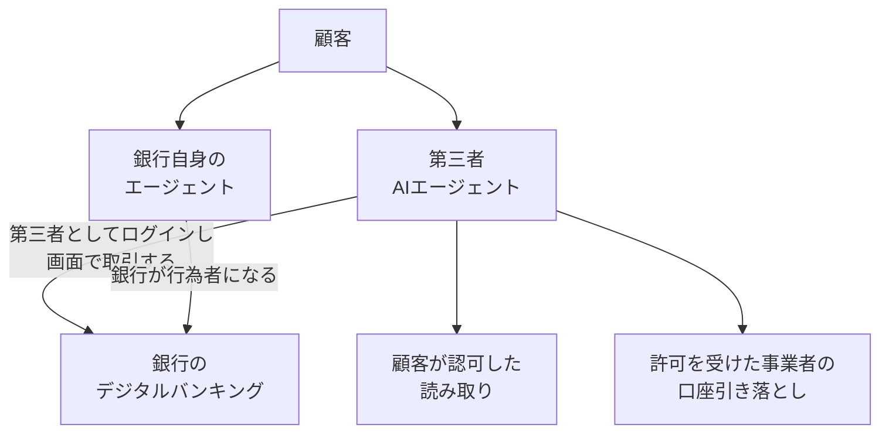

2026年10月16日、Financial Times は、シティグループが米銀として新たに、顧客のデジタルバンキングへの AI エージェントのアクセスを制限した、と報じました。同じ週に、JPMorgan Chase と Charles Schwab も、顧客の認証情報を使って外から入ってくるエージェントを取り上げています。

この記事では、その制限がどの経路を対象にするかを整理します。あわせて、口座を持つ金融機関の拒否を、社内の権限表のどの列へ置くかを示します。

Financial Times の記事本文は購読壁の内側にあり、シティの言質として置けるのは、同紙の公式投稿（2026-10-16 20:40 UTC）に載った引用までです。

*この記事の全体像。以下、順に解説します。*

## 第三者AIエージェントの口座アクセス制限とは

口座に触る経路は、行為者と入口で分かれます。シティが言葉にした拒否は、第三者が銀行の画面へログインし、その画面で取引する経路です。

### シティが言葉にした範囲

Financial Times の公式投稿は、シティの方針を次の一文で伝えています。

> Citigroup said it would not permit ‘third-party AI agents or assistants to log into a customer’s account or transact directly within our digital banking platforms'.

日本語にすると、第三者の AI エージェントやアシスタントが、顧客の口座へログインすること、および同行のデジタルバンキングの中で直接取引することを、許さない、という範囲です。引用には、認証方法の条件がありません。

二次報道では、一部のオープンバンキング提供者を通じた限定的な読み取りは残す、と伝えられています。提供者の名前、開始日、対象口座は、この引用の外です。

シティは別に、従業員が作るエージェントを Arc という統制層で動かします。消費者のデジタルバンキングへ第三者がログインする話とは、行為者が違います。

### 同じ週に並んだ他行の発言

JPMorgan Chase の 2026-10-13 の決算コールでは、CEO の Jamie Dimon が次のように述べています。文字起こしは AlphaStreet の記録です。純利益 153 億ドル、1株 5.57 ドルは、同行の決算リリースと一致します。

> In the meantime, we’re not going to allow just any outside agent to come inside the company because that’s just too risky for clients and for JPMorgan.

同じ返答で、Dimon は、社内ではエージェントを使っており、今後も続ける、と述べています。顧客向けにも使う、とも述べています。エージェントを賛否の対象ではなく道具として置き、顧客が害を受けないようにする防御側もある、とも述べています。責任の移転と、データの誤用を、利用者が理解すべきだ、とも述べています。

CFO の Jeremy Barnum は、Smart Cash について、数週間前から稼働しており、ごく初期の、対象を絞った試験運用だと述べています。個人向けエージェントを巡る競争の話では、全体の中の小さい部分だ、とも述べています。

顧客のバンキング認証情報を取得して代理ログインする第三者を検知したら入れない、という説明は、同行の広報について二次報道が伝える範囲です。安全な形でのエージェント接続を将来可能にする、とも伝えられています。

Charles Schwab の CEO は、顧客がパスワードを Muse に渡し、Muse が顧客に代わって操作する状態を拒む趣旨を、Bloomberg のテレビで述べた、と転載されています。これも二次情報です。

Bank of America については、The Verge（2026-10-15）が、CEO の Brian Moynihan の立場を伝えています。エージェントの取引で誤りが起きたときに、人々が銀行へ向かう状態を望んでいない、という内容です。エージェントの能力がさらに伸びて誤りのリスクが下がるまでは、人が支払いを認可する方向で AI 業界と作業している、とも同記事は書きます。Moynihan の逐語は、その記事には出ていません。

### 口座に触る経路

読み取りと口座引き落としは、銀行の画面ログインとは別の入口です。銀行自身のエージェントでは、行為者は銀行です。拒否の主体は、その口座を持つ金融機関です。

2026-10-17 時点の公開情報は、経路ごとに次のとおりです。

| 経路 | 行為者 | 銀行の画面へログインするか | 公開情報 |
|---|---|---|---|
| 第三者としてデジタルバンキングへログインし、画面で取引する | 第三者エージェント | 入る | シティはログインと直接取引を拒む、と FT が引用。引用に認証方法の条件は無い。JPM は外部エージェントを会社の中へ無条件には入れない、と CEO が述べた。Schwab はパスワードを渡して代行させる状態を拒む趣旨が転載されている |
| 顧客が認可したオープンバンキングの読み取り | 認可されたデータ接続 | 銀行画面のパスワード共有とは別、と各社が説明する | シティは限定的な読み取りを残す、と二次報道。Plaid は Muse 向けに残高や取引の共有を説明する |
| 銀行自身のエージェント | 口座を持つ銀行 | 銀行の内側 | JPM は社内と顧客向けにエージェントを使う、と CEO が述べた。Smart Cash は対象を絞った試験運用。シティの Arc は従業員向けの統制層 |
| 許可制の ACH・即時払い | 承認を受けた事業者 | 入らない | Plaid Transfer がリンク済み口座から ACH、RTP、即時払いを作る。入口は 2026-10-16 の拒否文が対象にした画面ログインとは別 |
| 支払いに必要な識別子の取得 | 認可されたデータ接続 | 入らない | Akoya の Payments API は口座番号とルーティング番号を返す。役割は識別子の返却まで |
| 英国の支払い開始 | 認可事業者。支払人が同意 | 銀行が認証する別経路 | Payment Services Regulations 2017 の regulation 69。入口は米国の消費者向け画面ログインとは別 |

Akoya の該当エンドポイントは `GET /payments/{version}/{providerId}/{accountId}/payment-networks` です。返すのは、ACH や RTP に必要な識別子（口座番号、ルーティング番号、識別子の種別）です。製品ページは、その識別子で口座間の支払いを可能にする、と書いています。

## 注意点

ここからは、引用や数字をどこまで信じてよいかです。経路の説明そのものは前節にあります。

### 引用より狭い読み

「取引先の残高が動く行為かどうかで可否が決まる」という要約は、シティの引用より狭いです。引用は、残高が動く取引に加えて、ログインそのものを拒みます。

「顧客の認証情報で入った操作だけをエージェントとみなす」も、シティの引用より狭いです。認証情報を取得して代理ログインする、という言い方は、JPM の広報と Schwab のテレビ発言の転載にあります。シティについて、どの認証で入った操作をエージェントとみなすかは、引用にありません。

残高移動そのものを、金融機関が一律に拒んでいるわけでもありません。JPM は、自社が行為者になって顧客向けにエージェントを使う、と決算コールで述べています。Smart Cash は、その文脈で語られた試験運用です。

### 実装手段

約款の改定か、API の停止か、ログインの検知か。シティについては、この三つを分ける一次情報が見つかっていません。公開されている [Client Manual](https://www.citi.com/content/dam/cfs/mobile/assets/JRS/popups/ao/CDAA.pdf) には、AI エージェントを名指しする条項が見当たりません。追加の検索でも、改訂告知やプレスリリースは見つかっていません。

契約上読めるのは、パスワードを人に渡さないという既存の文言と、デジタルアクセスの停止権です。セキュリティ手続を通った資金移動依頼は、認可されたものとして扱う、とも書かれています。JPM の「検知したら入れない」は、シティの文言ではありません。

手段が未確認であることは、相手が拒む行為を権限表に書くこととは別です。表に書けるのは行為の範囲です。検知を避ける手順は、公開情報からは書けません。

### 預金の大きさと利息の仮計算

預金の数字は、起きた流出と、残高の大きさを分けて読みます。単位は million ドルです。時点は 2026-09-30 の期末です。無利息預金です。

| 主張 | 2026-10-17 時点で置けるもの |
|---|---|
| 三行の無利息預金は約 1.6 兆ドル | JPM 676,015（米国内 636,070、米国外 39,945。Financial Supplement）、Wells Fargo 365,666（earnings supplement）、Bank of America 548,674（米国内 534,129、米国外 14,545。Exhibit 99.3）を足すと 1,590,355。約 1.59 兆ドル。報道の約 1.6 兆ドルは、この残高の概数として桁が合う |
| 負債の約 16% | 三行の負債合計では検算していない |
| 3% を払うと年約 470 億ドル | 1.59 兆ドルの 3% は約 477 億ドル。観測された利息費用ではない |
| 利益の半分近く | 同じ四半期の報告純利益は、JPM 153 億ドル、Wells Fargo 59.51 億ドル、Bank of America 6,933 million ドル（約 69 億ドル）。合計約 282 億ドル。477 億ドルはこの四半期合計より大きい。年換算して半分と比べる話し方であり、決算の費用項目ではない |
| 当座預金の平均金利は 0.1%、移動先は 3.3% から 5% | FDIC の全国金利（2026-09-21）は、interest checking 0.07%、savings 0.37%、money market 0.63%。0.1% と 3.3% から 5% は、Slok 氏の発言の転載 |

同じ決算では、預金残高そのものは前年比で増えています。JPM の消費者・コミュニティ銀行の預金は、決算コールで前年比 4% 増です。Wells Fargo のリリースは、平均預金が前年比 11% 増で、無利息預金だけが前年比で小幅に減った、と書いています。Bank of America の期末預金は 2,038,758 million ドルで、前年同期の 2,002,208 million ドルから約 2% 増です。同行の無利息預金は、2025-09-30 の 524,898 million ドル（米国内 510,208 と米国外 14,690 の合計）から、2026-09-30 の 548,674 million ドルへ増えています。

エージェントによる取り付けが、この週の決算に数字として出ている、とは読めません。資金コストが無利息預金の残高に感応する、という経済の話は、流出が起きたという話とは別に成り立ちます。数字を、列を作る緊急度の説明に使うときは、仮計算だと書きます。

### 同週の他行

拒否を「同週の大手行一般」や「資金を動かすエージェントはどこでも拒まれる」に広げません。Wells Fargo、PNC、U.S. Bank が同週にブロックした、または撤回した、という一次情報は見つかっていません。

JPM の広報は、安全な形での接続を将来可能にする、とも伝えられています。2026-10-16 の発言は、恒久の技術的不能としては読めません。

### 画面の外のレールと、読み取りの下流

英国では、認可された支払い開始事業者が、支払人の明示の同意のもとでオンラインの支払口座へ入る経路があります。根拠は Payment Services Regulations 2017 の regulation 69 の見出しです。各号の全文は未確認です。入口は、米国の消費者向け画面ログインとは別です。

米国では、Plaid Transfer がリンク済み口座から送金を作ります。Akoya の Payments API は識別子の取得であり、送金の作成ではありません。CFPB の 2024 年規則（Federal Register、2024-11-18、文書 2024-25079）の §1033.211(c) は、Regulation E の口座について、支払い開始情報を covered data に含めます。ACH に使える口座番号とルーティング番号を含みます。前文は、covered data を出させることが、消費者向け画面で支払いを開始させる義務には当たらない、と読めます。

この規則の執行は、2025-10-29 の仮差止で、再検討が終わるまで止まっている、と dockets の文書説明にあります。事件は Forcht Bank v. CFPB、E.D. Ky. No. 5:24-cv-00304、Doc. 90 です。命令の主文は未確認です。

公式の読み取りは、銀行の外の次の操作を起動できます。読み取りを「資金が動かない列」とは扱いません。別欄は、その下流を止めません。

### 損失負担の線

「誰が損を負うか、契約上は空白だ」は強すぎます。Regulation E（12 CFR §1005.2(m)）は、消費者がアクセス手段を渡した person が起こした電子資金移動を、その person をもはや認めないと金融機関へ通知するまで、無権限の定義から外します。公式解釈は、権限を超えた分も、通知までは消費者の全額負担とします。person には法人が含まれます。

AI エージェントと、モデルには資格情報を見せない保管方式が、この「渡した」に当たるかの判例は、見つかっていません。ワイヤーは Regulation E の外にあり得ます。シティのマニュアルは、セキュリティ手続を通った資金移動依頼を、認可されたものとして扱います。

### 金融安定理事会の健全実務

金融安定理事会は 2026-10-15 に、金融機関向けの 12 の非拘束的な健全実務を公表しました。本文は、エージェントは人間のようには推論せず、事前の目標を予期しない形で解釈し得る、と書いています。人間の承認を求める契機の例に、一定額を超える金融取引の承認前を挙げています。重要度やリスクが高いエージェントには、より厚い人間の監督が必要になり得る、とも書いています。これはシティの約款ではありません。

### まだ埋まっていない点

- 読み取りの提供者名、開始日、対象口座は、二次報道の範囲です。
- シティの実装手段は未確認です。どの認証をエージェントとみなすかも、引用にはありません。
- Moynihan の逐語は、The Verge の記事には出ていません。JPM 広報の検知の説明は、二次報道の要約にとどまります。
- 1033 の仮差止の主文と、英国 regulation 69 の各号は未確認です。
- 資格情報をモデルに見せない設計が、「アクセス手段を渡した」に当たるかは、見つかった判例がありません。
- ニューヨーク州のオープンバンキング法案は、2026-10-17 時点で法律になっていません。成立すれば、読み取り側の列が変わり得ます。

## 権限表の四つの列

社内の権限表では、行為の種類と行為者を同じ表に置きます。口座を持つ金融機関が拒む行為は、自社の承認者の列とは別です。列は次の四つで足ります。

1. 社内のハーネスが許すか。エージェントを、次の状態の提案までに限るなら、ここへ書きます。
2. 口座を持つ金融機関が、第三者としての口座ログインと、その画面での直接取引を拒むか。シティの引用は、認証方法を条件にしていません。JPM と Schwab については、顧客の認証情報で外から入ることを拒む趣旨が二次情報にあります。送金、口座開設、残高移動は、この画面に乗るかぎり、ここへ「相手が拒む」と書きます。拒否の主体の欄は、自社の承認者ではなく、その金融機関の名前にします。
3. その金融機関が認める読み取りか。認めても、資金が動かない保証とは書きません。下流の操作は別行にします。
4. 銀行自身のエージェントか、許可制の引き落としなど画面の外のレールか。ここは「金融機関が資金移動を一律に拒む」には入れません。

2026-10-16 時点で、列 2 に言質を置ける相手は次のとおりです。

| 金融機関 | 表に書けること | 手段 |
|---|---|---|
| シティグループ | 第三者の AI エージェントやアシスタントによるログインと、デジタルバンキング上の直接取引を拒む。認証方法の条件は引用に無い | 空欄のまま。約款改定、API 停止、ログイン検知のどれかは未確認 |
| JPMorgan Chase | 外部エージェントを会社の中へ無条件には入れない、と決算コールの CEO 発言。認証情報での代理ログインを検知して入れない、は広報の二次情報 | 検知は二次情報。将来の安全な接続にも言及がある |
| Charles Schwab | 顧客がパスワードを渡し、相手が代わりに操作する状態を拒む趣旨。テレビ発言の転載 | 二次情報 |
| Bank of America | 人が支払いを認可する方向で AI 業界と作業している、と The Verge。遮断済みとは書かない | 二次情報 |

直近の初期値は、この四列で作ります。シティのマスだけ、手段を空欄のままにします。Financial Times の本文が読めたら、読み取りの提供者名と対象口座を埋めます。

具体例を一つ置きます。社内のエージェントに、シティの法人口座から仕入先へ送金する案を出させる場合です。

| 列 | この例での書き方 |
|---|---|
| 1. 社内ハーネス | 次の状態の提案までに限るなら、ここを可にする |
| 2. シティが拒む画面経路 | そのエージェントがシティの画面へログインして送金するなら、主体はシティ、結論は拒む、手段は空欄 |
| 3. シティが認める読み取り | 残高を見る接続を使うなら、提供者名が埋まるまで未確認とする。読めたことは、送金の許可にしない |
| 4. 画面の外のレール | 画面に乗せず、許可を受けた事業者の口座引き落としで送るなら、列 2 には入れない |

Plaid Transfer のような許可制の引き落とし、Akoya のような識別子の取得、英国型の支払い開始は、列 2 の「画面で直接取引する」には入れません。識別子の取得は、送金の作成でもありません。

## 列を更新する条件

列の有無は、手段が未確認でも止めません。止めているのは、検知を避ける手順を書けるかどうかであり、それは公開情報の外です。列の中身を移す条件は、次の三つです。

1. シティが約款か技術資料で、ログイン検知または API 遮断を公表したら、手段の欄を空欄からその資料へ差し替えます。
2. 1033 の仮差止が解け、支払い開始情報の提供が義務になったら、読み取りの列に口座番号が入り得ます。
3. 英国型の支払い開始を、米国の相手が契約で認めたら、その相手の資金移動は列 2 から列 4 へ移します。

## まとめ

シティについて権限表に置けるのは、第三者の AI エージェントやアシスタントが顧客の口座へログインすること、およびデジタルバンキングの中で直接取引することです。認証情報を共有したときだけ、という条件は、引用にありません。

読み取り、銀行自身のエージェント、許可制の引き落としは、別の列です。読み取りは、資金が動かない保証にはしません。預金の大きな数字は残高の話であり、この週に流出が起きた記録ではありません。

実装手段は、シティについて空欄のままにします。言質のある相手だけを列に入れ、言質の無い銀行へは広げません。

この記事が少しでも参考になった、あるいは改善点などがあれば、ぜひリアクションやコメント、SNSでのシェアをいただけると励みになります！

## 参考リンク

- [Financial Times の投稿（2026-10-16 20:40 UTC）](https://x.com/FT/status/2111195504503595051)
- [Financial Times 記事（本文は購読壁の内側）](https://www.ft.com/content/f49c8e39-f07f-4177-9948-aabe55e5ed91)
- [シティ Client Manual（CDAA）](https://www.citi.com/content/dam/cfs/mobile/assets/JRS/popups/ao/CDAA.pdf)
- [JPMorgan Chase 3Q26 決算リリース（2026-10-13）](https://www.jpmorganchase.com/content/dam/jpmc/jpmorgan-chase-and-co/investor-relations/documents/quarterly-earnings/2026/3rd-quarter/6c1f8114-1be4-4174-8292-f75bbb59bc21.pdf)
- [JPMorgan Chase 3Q26 Financial Supplement](https://www.jpmorganchase.com/content/dam/jpmc/jpmorgan-chase-and-co/investor-relations/documents/quarterly-earnings/2026/3rd-quarter/c89c7479-82df-4c9f-a7be-957956430abd.pdf)
- [Wells Fargo 3Q26 earnings supplement](https://www.wellsfargo.com/assets/pdf/about/investor-relations/earnings/third-quarter-2026-earnings-supplement.pdf)
- [JPMorgan Chase 3Q26 決算コール文字起こし（AlphaStreet）](https://news.alphastreet.com/j-p-morgan-chase-co-jpm-q3-2026-earnings-call-transcript/)
- [Bank of America 3Q26 Supplemental Information（Exhibit 99.3）](https://investor.bankofamerica.com/regulatory-and-other-filings/select-sec-filings/content/0000070858-26-000481/bac-09302026ex993.htm)
- [Bank of America 8-K（2026-10-14）](https://investor.bankofamerica.com/regulatory-and-other-filings/select-sec-filings/content/0000070858-26-000481/bac-20261014.htm)
- [FDIC National Rates and Rate Caps（2026-09-21）](https://www.fdic.gov/national-rates-and-rate-caps)
- [Federal Register、2024-11-18、文書 2024-25079](https://www.govinfo.gov/content/pkg/FR-2024-11-18/pdf/2024-25079.pdf)
- [Forcht Bank v. CFPB の dockets](https://www.govinfo.gov/content/pkg/USCOURTS-kyed-5_24-cv-00304/pdf/USCOURTS-kyed-5_24-cv-00304-1.pdf)
- [金融安定理事会の最終報告 PDF（2026-10-15）](https://www.fsb.org/uploads/P151026-1.pdf)
- [Regulation E、12 CFR §1005.2](https://www.consumerfinance.gov/rules-policy/regulations/1005/2/)
- [UK Payment Services Regulations 2017](https://www.legislation.gov.uk/uksi/2017/752/contents)
- [Plaid Transfer](https://plaid.com/docs/transfer/)
- [Akoya Payments API](https://docs.akoya.com/reference/payments)
- [Plaid の Muse 説明（2026-09-08）](https://plaid.com/blog/meta-muse/)
- [The Verge（2026-10-15）](https://www.theverge.com/ai-artificial-intelligence/1011767/bank-of-america-wants-a-human-in-the-loop)
