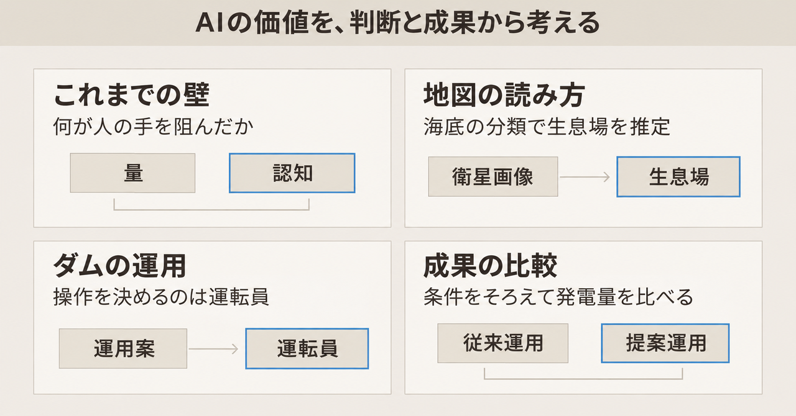

オーストラリアとインドネシアの浅瀬のサンゴ礁は、従来の地図でも総面積が同程度だと分かっていました。では、サンゴが生息できる場所の広さも同じでしょうか。衛星画像から海底を同じ基準で分類すると、推定面積はオーストラリアの約9,400平方キロメートルに対し、インドネシアは約18,000平方キロメートルでした。[Lyonsらの論文、表1](https://doi.org/10.1016/j.crsus.2024.100015)

安宅和人さんが提案した「4つの壁と8つの価値創造」を使って、AIが仕事を速めた先で、誰が何を新しく判断できるようになったのかを考えます。

## 「4つの壁と8つの価値創造」とは

安宅さんはAIの用途を考えるときに、二つの問いを置いています。一つは、人間がこれまでできなかった理由を問います。もう一つは、それが可能になると社会にどんな変化が起きるかを問います。前者を四つの壁に分けています。[安宅和人「AIでしか生み出せない価値とは何か」](https://kaz-ataka.hatenablog.com/entry/2026/11/28/085335)

| 壁 | 仕事のどこで困るか |
|---|---|
| 量 | 対象が多く、必要な範囲を人手で調べきれない |
| 認知 | データがそろっていても、要素の組み合わせが複雑で規則性を読み取れない |
| 知の分断 | 問いに答える知識が分野や担当者をまたいで散らばっている |
| 経済性 | 方法は知られていても、利用者に届ける費用をまかなえない |

壁を越えた先の価値には、**発見する、複雑な系を回す、先回りする、一人ひとりに合わせる、未知の世界を地図にする、試してから決める、知をつなぎ継ぐ、小さな需要にも応える**、という八つの方向があります。「複雑な系を回す」は、たとえば上流と下流のダムを一緒に運用することです。最後のものを安宅さんは「ロングテールを成立させる」と呼びます。個別化は、同じ授業を受ける生徒にも別々のヒントを出せること。ロングテールは、希望する生徒が少なくて開けなかった授業にも提供のめどが立つことです。

四つと八つは自由に組み合わせます。サンゴ礁の例なら、世界中の画像を調べる「量の壁」と、「未知の世界を地図にする」という価値が交わります。その先には、地図を手にした人がどう使うかという問いが残ります。

## 注意点

**地図の広さを読むには、色が何を表すかを先に確かめます。** Lyonsらが2024年に発表した研究は、衛星画像を機械学習で分類し、浅瀬のサンゴ礁を5メートルの解像度で地図にしました。水深約15メートルまでの地形を分類して得た約34.8万平方キロメートルという面積には、礁内の砂地や海草のある場所も入ります。一方、水深約10メートルまでの海底を分類し、岩と「サンゴ・藻類」の区分を合計して推定したサンゴの生息場は約8.0万平方キロメートルです。面積の推定には幅があり、その不確かさを表す95%信頼区間は約4.6万〜10.6万平方キロメートルです。濁りの強い場所は対象から除かれています。個々のサンゴが今も生きているかを知るには、別の観測が必要です。[Lyonsらの全球サンゴ礁地図の論文](https://doi.org/10.1016/j.crsus.2024.100015)

同じ読み方は設備の運用にも使えます。北陸電力とJFEエンジニアリングが2022年に運用を始めたシステムは、神通川水系の五つのダムについて33時間先までの流入量を予測し、運用案を示します。ゲートを操作するのは運転員です。発表の「1％程度」は、検証で見込んだ水系全体の発電電力量の増加です。導入後にいくら増えたかを評価するには、実際の運転記録と比較条件が要ります。[北陸電力・JFEエンジニアリングの発表](https://www.rikuden.co.jp/press/attach/22101901.pdf)

## 自分の企画では何を確かめるか

ダムの企画を例にすると、「複雑な系を回す」という価値を、実際に評価できる問いに書き換えられます。

| 企画で決めること | ダムでの具体的な問い |
|---|---|
| 比較する相手 | 運転員が従来の情報だけで五つのダムを運用した場合、どんな結果が見込めるか |
| AIが渡すもの | 流入量の予測を、運転員が比較できる運用案にできるか |
| 判断する人 | 運転員は提案の前提を確認し、現場の状況に合わせて採否を決められるか |
| 測る成果 | 同じ過去の出水を使い、開始時の水位、流入の時間変化、運用規則、終了時の貯水量をそろえて模擬したとき、水系全体の発電電力量にどれだけ差があるか |

経済性が壁なら、もう一つ、提供するたびに残る費用を書き出します。たとえば予約に合わせて走るバスでは、AIが効率のよい配車を提案できても、乗客を運ぶには車両と運転手が要ります。国土交通白書は、需要に応じた運行で利便性や効率の向上を期待できるとしています。その地域で少人数向けの路線を続けられるかを判断するには、実際の利用者数と運行費用を照らし合わせます。[国土交通白書2023](https://www.mlit.go.jp/hakusyo/mlit/r04/hakusho/r05/html/n1111000.html)

## まとめ

AIの企画を一つ選び、「これまで何が壁だったか」「誰がどんな判断を新しくできるか」を一文ずつ書いてみてください。次に、その判断が役立ったと確かめる観測を一つ決めます。ダムなら、予測が当たったかは途中の評価です。たとえば終了時の貯水量が少なければ、蓄えた水を先に使った分だけ発電量は増えます。模擬運転で見込んだ改善が実際の運転でも続くかを、貯水量や放流条件を含めて追います。そこまで決めると、試作で確かめるべきことが具体的になります。

この記事が少しでも参考になった、あるいは改善点などがあれば、ぜひリアクションやコメント、SNSでのシェアをいただけると励みになります！

## 参考リンク

- [安宅和人「AIでしか生み出せない価値とは何か」](https://kaz-ataka.hatenablog.com/entry/2026/11/28/085335)
- [Lyonsらによる浅海サンゴ礁の全球マッピング](https://doi.org/10.1016/j.crsus.2024.100015)
- [北陸電力・JFEエンジニアリングによるダム運用支援の発表](https://www.rikuden.co.jp/press/attach/22101901.pdf)
- [国土交通白書2023「暮らしを支える生活サービス提供機能の維持・向上」](https://www.mlit.go.jp/hakusyo/mlit/r04/hakusho/r05/html/n1111000.html)
