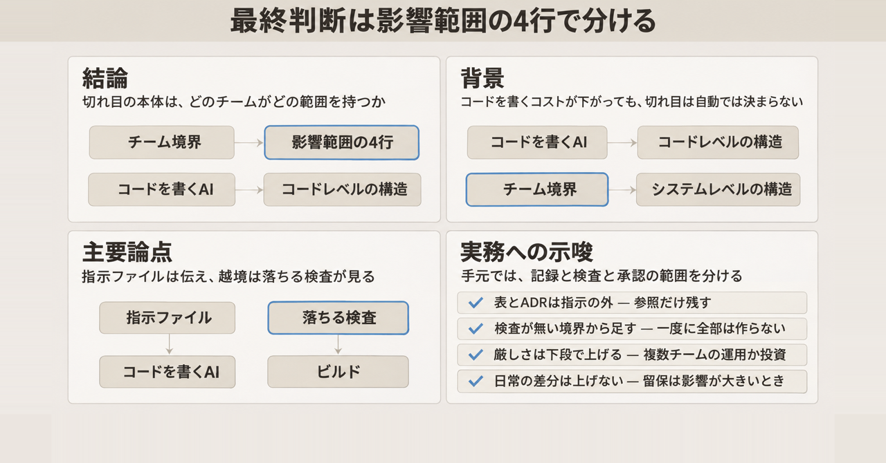
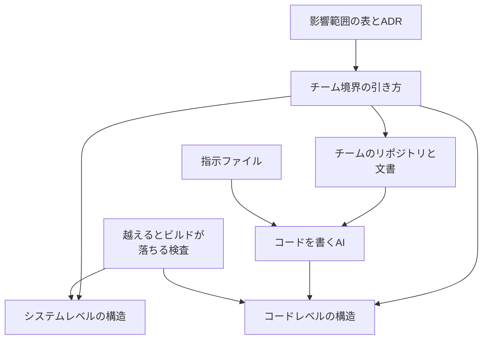

2026年11月27日、株式会社アトラクタの吉羽龍太郎氏が、アーキテクチャConference 2026で話した内容を、本人の[ブログ](https://www.ryuzee.com/contents/blog/14629)と45枚の[スライド](https://slide.meguro.ryuzee.com/slides/141)で公開しています。会議の[公式サイト](https://architecture-con.findy-tools.io/2026)は、開催を2026年11月26日と27日、会場をベルサール羽田空港とし、吉羽氏を株式会社アトラクタの登壇者として掲げています。

資料が扱うのは、コードを書くコストが下がったあとに、システムの切れ目を誰がどう決めるかです。この記事では、公開ブログとスライド本文に沿って、アーキテクチャの2段、判断の所在、残す成果物を説明します。引用された調査の一部は、スライドが示す出典表記までを対象にしています。

*この記事の全体像。以下、順に解説します。*

## コードを書くAI、アーキテクチャを決める組織とは

### 資料が置く結論

資料の結論は、チームが必要だと判断したときに、チームやプロダクト組織の構造をすぐ変えられるよう、いまから備えておくことです。安定したチームが重要であることは残します。その安定が続く期間は短くなりつつある、と資料自身が添えています。

資料が「決定」と呼んでいる本体は、チーム境界です。チーム境界とは、どのチームがどの範囲のシステムを引き受けるかの切れ目です。影響範囲の表の行になるのは、境界の変更です。この表は、このあと示す4行です。下段は、ドメイン分割やサービス、プラットフォームの抽出を、マネジメントが投資として決める行です。プログラミング言語や、採用するモデルの一覧は、境界の切れ目ではなく、使う技術を選んだ一覧として行の外にあります。ここでのモデルは、その技術の一覧に並ぶ名前です。分割の軸の例は、ドメイン、法令・規制、変更のリズム、リスク、性能、地理的配置です。これらは切れ目の軸です。

### アーキテクチャの2段

資料はアーキテクチャを2段に分けます。システムレベルは、ドメイン分割、サービス境界、プラットフォームの切り出しです。コードレベルは、モジュール、レイヤ、依存です。資料は、コードレベルをAIが直接生成し、システムレベルはチームの境界を経由して決まる、と置きます。

品質は、資料の中で2か所に分かれます。一つは、人に残る仕事としての評価、倫理、ガバナンス、リスクです。もう一つは、越えるとビルドが落ちる閾値としての検査です。どの可用性を買うか、基盤を切り出すか、という目標の厳しさは、複数チームの運用責任や投資配分を変えるとき、先の4行の下段、つまり投資判断の行に入ります。

### 人に残る仕事

人間と組織に残る仕事として、資料は次を並べます。

- 価値判断と優先順位
- 曖昧な状況の解釈と合意
- AI出力の評価
- 倫理、ガバナンス、リスク
- チーム境界の設定

境界の設定を、資料は影響の大きいアーキテクチャ上の意思決定の一つと呼んでいます。

資料は、提案を、負荷、依存、流れの詰まりに最初に気づく末端のチームから出す、と置きます。チームの同意なしには境界を変えず、影響の大きい境界はチームが上位の判断なしには変えない、とも置きます。ここでの上位とは、役職の名前ではなく、影響がチームの外へ出たときの判断の場です。

### 影響範囲で分かれる判断

判断の所在は、役職ではなく影響範囲です。下の行ほど、コードレベルからシステムレベルへ移ります。判断を上げる条件は、複数チームの運用責任か、投資配分が変わることです。エスカレーションとは、チームだけでは決めず、その上位の判断へ上げることです。

| 境界の変更 | 主な発案 | 最終判断 |
|---|---|---|
| チーム内のモジュール再構成、リファクタリング | チーム | チーム内で完結 |
| チーム間の API・契約 | チーム | 関係チームの合意 |
| チームの分割・統合、担当範囲の変更 | チームとマネジメント | チームからのエスカレーション |
| ドメイン分割、サービスやプラットフォームの抽出 | マネジメント | マネジメント（投資判断） |

チーム内のモジュール再構成は、最終判断がチーム内で完結する変更の例です。APIとは、チーム間で呼び合う約束ごとの窓口です。契約とは、その窓口の入出力や互換の約束です。

### 伝えるファイル、落とす検査、残す記録

資料は、伝える手段、強制する手段、判断の記録を分けます。指示ファイルは、そのリポジトリの手順をエージェントへ伝えるファイルです。例は AGENTS.md です。エージェントは、ここではコードを書くAIを指します。強制する手段は、越えるとビルドが落ちる検査です。見る対象は、依存の方向、契約、静的解析、テストです。判断の記録は、影響範囲の表と ADR です。ADR は Architecture Decision Record の略で、なぜその切れ目にしたかの設計判断の記録です。

スライド38は、表と ADR を、新しく参加した人のオンボーディングと、エージェントへの入力の両方に使う、と書きます。

| 成果物 | 役割 | 読む相手 |
|---|---|---|
| 影響範囲の表と ADR | どの境界を、誰が最終判断するか。なぜその切れ目か | 人と、あとから参加する人。エージェントへの入力にもなる |
| 指示ファイル | そのリポジトリの手順を伝える | エージェント |
| 決定的な検査 | 依存、契約、秘密の混入など、越境した差分を落とす | ビルド。人とエージェントに同じ規則 |

決定的な検査とは、同じ差分なら同じ結果で落ちる検査です。秘密の混入とは、鍵や認証情報を、置いてはいけない境界の中へ入れた差分です。

関係は次のとおりです。チーム境界の引き方が、システムレベルとコードレベルの構造、およびチームのリポジトリと文書を決めます。文書がエージェントへの入力になり、エージェントはコードレベルの構造を生成します。影響範囲の表と ADR は、境界の引き方に戻ります。指示ファイルはエージェントへ届きます。検査は、コードレベルとシステムレベルの両方にかかります。

### 境界は成長に合わせて変わる

境界は一度で終わりません。プロダクトの成長に合わせて構造は変わります。AIはその到達を速くする、と資料は置きます。マネジメントの仕事は三つです。提案の経路を用意すること、判断基準を事前に共有すること、境界変更を安くする技術基盤へ投資すること、です。

## 注意点

2段のアーキテクチャ、影響範囲の表、指示と強制の役割の違いは、スライド本文とブログで読めます。次の点は、その骨格より弱いです。どこまでを境界設計の証拠にしてよいかを、出典ごとに分けます。

### 公開指標の読み方

[GitClear](https://www.gitclear.com/the_ai_code_quality_maintainability_gap) は、AI が書いたコードの保守性を集計した公開ページです。6億2300万件は、2023年から2026年のコード変更です。移動したコード（コード変更のうち、移動として数えられたもの）の割合は、同じページが 2022年 21%、2023年 13%、2026年年初来 3.8% と並べています。2022年の 21% が、この 6億2300万件の内数かは、ページの書き方からは特定できません。重複ブロックは、変更100万行あたり 40.3（2023年）から 73.0（2026年年初来）へ増え、81% 増です。12か月を超えたコードへの更新割合は、1.7%（2023年）から 0.46%（2026年年初来）へ減り、74% 減です。ページ冒頭が「ファイルをまたぐ関数呼び出し」と呼ぶ指標は、変更1000行あたり 343 から 223 へ 35% 減です。343 と 223 の年は、引用した数字の範囲では特定できません。詳細節は、同じ指標を「別のメソッドまたは関数への接続」と説明しています。

ページ冒頭は、長期保守を「2022年比で 74% 減」とも書きます。そのページの本文は「2023年の 1.7% から」と書きます。基準年は、ページ内で一致しません。そのページが置く因果は、チーム境界ではありません。通るテストと、閉じたチケットを優遇する生成の仕方です。スライドがこれを「構造は劣化している」の描写に使うのは読めます。境界が原因だという証明にはなっていません。

Meta の前年比は、内部基盤へのコード変更が 220% 増、ユーザーに届く変更が 36% 増、重大インシデントが 40% 増、火消し時間が 70% 増です。スライドは、これを Reuters（Katie Paul、2026-08-26）に帰しています。本稿では Reuters の原文を開いていません。複数の二次報道が、同じ数字を Reuters に帰しています。人員削減や、エージェントの操作範囲の影響と混ざっていて、分けられません。境界だけを変えた実験の数字としては使えません。

次の項目は、スライドの出典表記にとどまります。本稿では原典を開いていません。DX の節約時間（中央値 週3.3時間から6.1時間）、PR サイズ（中央値 42行から72行）、Microsoft、Atlassian、Amazon の再編エピソード、AWS のチーム調査、Thoughtworks Technology Radar の agent topologies、Uber の AutoClean です。DX は、スライドが開発者の時間に帰している出典の名前で、略称の中身は原典未確認です。Thoughtworks Technology Radar、agent topologies、AutoClean も、スライド上の出典名にとどまります。

### 指示ファイルの論文が測っている範囲

「AGENTS.md を置けば課題解決率が上がる」は、Gloaguen らの [Evaluating AGENTS.md](https://arxiv.org/html/2602.11988v3)（arXiv:2602.11988v3、2026-09-29）からは言えません。論文は、AGENTS.md のような説明ファイルをコンテキストファイルと呼びます。コンテキストファイルは、タスク成功率を一般には改善しません。推論コストは、平均で 20% 超増えます。同じ論文は、具体的な指示はよく守られ、成功率が上がらない理由は指示無視ではない、と書きます。言及された `uv` の使用は、書かれているとき 1実行あたり平均 1.6 回、書かれていないとき 0.01 回未満です。`uv` は、その論文が数えたコマンドの名前です。測っているのは issue の解決です。モジュール境界を守ったかではありません。開発者が書いたファイルの成功率は平均 +2.4% で、ファイル無しとの差は偶然でも説明できる範囲です（p=0.21）。

Lulla らの [On the Impact of AGENTS.md Files on the Efficiency of AI Coding Agents](https://arxiv.org/html/2601.20404v2)（arXiv:2601.20404v2、2026-03-30）は、別の量を測っています。対象は、規約、プロジェクト構造、プロジェクト説明を残したルートの AGENTS.md です。10リポジトリ、124 PR で、実行時間の中央値は 98.57秒から 70.34秒へ減り、28.64% 減です。トークンは、モデルが一度に読む断片の数です。出力トークンの中央値は 2,925 から 2,440 へ減り、16.58% 減です。正しさの評価は、論文の範囲外です。スライドの「約29%減、約17%減」は、この中央値の丸めとして一致します。

単一で機械判定できるコメント規則なら、ゲートなしでも守られる組み合わせがあります。Tsuchida らの [Do Coding Agents Follow AGENTS.md?](https://arxiv.org/html/2611.04367v1)（arXiv:2611.04367v1、2026-11-03）では、コードを書くエージェント製品の Claude Code と、そのモデル claude-opus-5（n=82）の遵守率が、命令形 78.0%、理由つき 77.2%、条件つき 64.2%、禁止形 70.7% です。n は試行数です。規則は、関数の直下にマーカーコメントを置くことです。マーカーコメントとは、決まった印のコメントです。これは、レイヤ境界に関する複数の規則とは別です。レイヤ境界に関する複数の規則を、指示ファイルだけで同時に守れた事例は、本稿では見つかっていません。

禁止を書いても、貢献拒否はほぼ動きません。貢献拒否とは、リポジトリが AI による貢献を禁じていることを理由に、エージェントが貢献しないと明言することです。成果物が無いだけでは、この1件に数えません。未介入とは、方針の存在を知らせる文も、禁止条項の逐語引用も足していない実行です。Yang らの論文（arXiv:2607.26819v1、2026-07-29、[HTML](https://arxiv.org/html/2607.26819v1)）では、貢献拒否は未介入で4エージェントとも 0% です。方針の存在だけを知らせると動いたのは、モデル GPT-5.5 の 3%（1/30）までです。禁止条項の逐語引用で動いたのは、GPT-5.5 の 10%（3/30）までです。他の3エージェントは、どちらも 0% のままです。人手への引き渡しは、未介入で4エージェントとも 0% です。方針の存在だけを知らせたときと、禁止条項を逐語引用したときの引き渡しは、論文の範囲では推定できません。方針ファイルを開いた 12 件の母数は別です。常時読み込まれる AGENTS.md を除いた未介入の実行 347 件のうち、関連する方針ファイルを自ら開いたのは 12 件（3.5%）です。引き渡しを指示ファイルに書いて済ませる根拠にはなりません。

具体的な指示が守られることと、サービス境界に関する複数の規則が同時に守られることは、別です。守られる証拠があるのは、書かれた手順と、単一の機械判定ルールです。

### 検査は、誤った切れ目も守る

検査は、誤った切れ目も守ります。Twilio が再掲している Segment の[宛先パイプライン](https://www.twilio.com/en-us/blog/developers/best-practices/goodbye-microservices)では、データの送り先ごとに分けたサービスが 140 を超えました。Segment は、送り先ごとのサービス分割が、共有部分の更新を高くした事例です。共有ライブラリの更新は、何十ものテストとデプロイを要しました。時間がないとき、更新は1つの送り先だけに入り、版が分岐しました。ArchUnit が誤った境界を固定した一次の障害記録は、本稿では見つかっていません。ArchUnit は、コードの依存が決めた規則に沿うかを検査するライブラリの名前です。Segment は、その一次記録ではありません。

検査を足すことは、切れ目を正しくする操作とは別です。誤った切れ目を、高く固定する側にも働きます。

### 日常の上位承認と、可用性の目標

日常の変更ごとに上位へ承認を上げることは、資料の「影響が大きいときだけ留保する」より広いです。[DORA](https://dora.dev/capabilities/streamlining-change-approval/) の公式解説は、2019年の State of DevOps Report を要約しています。DORA は、デリバリ性能を継続的に測ってきた調査の名前です。変更諮問委員会や、上位者によるチーム外承認は、配送性能に負の影響があります。外部の形式的レビューが変更失敗率を下げる、という仮説を支持する証拠は見つからなかった、と書きます。報告書 PDF は、本稿では未読です。

可用性の目標値は、テストの合否に縮まりません。Google の [SRE book 第4章](https://sre.google/sre-book/service-level-objectives/)は、SLA は事業とプロダクトの決定に結びつくので、SRE は通常その作成に入らない、と書きます。SLA は、事業と利用者のあいだで結ぶサービス水準の合意です。SLO は、その水準の目標です。SLO の目標選びは、純粋な技術作業ではありません。逸脱率は、実際に目標を外している割合です。エラーバジェットは、目標から外れてよい割合の枠です。その差は、新しいリリースをいつ出すかの入力になります。上層部は、月次または四半期の評価を求めるだろう、とも書きます。ISO/IEC/IEEE 42010 の規格本文は、本稿では未読です。品質目標が事業判断である点は、この SRE book で読んでいます。42010 は、アーキテクチャ記述の国際規格の番号です。

### 記録と検査の役割、組み替えのコスト

決定の台帳は、誰が最終判断するかを残す影響範囲の4行です。なぜその切れ目かは、ADR に残します。台帳と検査を別ファイルにしても、参照は残ります。スライドは、依存ルール、契約テスト、セキュリティスキャンを、決定的なハードゲートのままにします。ハードゲートとは、落ちたら先へ進まない検査です。契約テストは、チーム間の約束が壊れた差分を落とす検査です。ルールで判定できない問いを、AI に助言させます。例は、この依存は意図か、ADR の前提はまだ生きているか、です。繰り返す指摘を、決定的ルールへ格上げします。混ぜないのは、ファイルの役割です。検査が決定の意図を二度と見ない、という意味ではありません。

頻繁な組み替えにはコストがあります。[Team Topologies](https://teamtopologies.com/key-concepts) の公式ページは、長く一緒に働いたチームの共有文脈に対し、頻繁な組み替えの隠れたコストは莫大だ、と書きます。Team Topologies は、チームの形と相互作用を設計する考え方の名前です。担当ドメインを足し続けると、有能なチームでも認知的な帯域を超える、とも書きます。認知的な帯域とは、一つのチームが一度に抱えられる担当の量です。資料側の留保と並べて読みます。安定は重要で、続く期間は短くなっています。

セッションの部屋と時刻は、公式タイムテーブルの該当行を本稿では取れていません。note.com の[まとめ](https://note.com/muse_secretary/n/n4b5bf806d9e0)が、11月27日 16:00–16:40、Room C と書くのは二次情報です。ダイナミックリチーミングとは、チーム編成を繰り返し変えるやり方です。その隔離を常態化したときの逆効果は、Heidi Helfand の一次文を本稿では開いていません。隔離の中身と逆効果の中身は、そのため本稿では書けません。

## 現場で残す切り方

この資料を現場の設計に使うなら、残る範囲は次です。決定の本体はチーム境界です。誰が最終判断するかは、影響範囲の表と ADR に残します。表と ADR は、スライド38のとおり、エージェントへの入力にも残します。越境したかどうかは、決定的な検査で見ます。品質目標の厳しさは、複数チームの運用責任や投資配分を変えるときに表の下段へ上げ、検査の合否に縮めません。

影響範囲の表（スライド32）は、行のすべてを境界の変更にしています。スライド13と Gloaguen の論文は、指示ファイルを「書けば課題が解ける」装置から外しています。具体指示が守られることと、成功率が上がることは別です。スライド12と39は、人とエージェントに同じ機械規則を適用する、と書きます。指示が守られたかの判定は、プロンプトの再読ではなく、成果物の検査に置けます。スライド40は、ゲートの次段で ADR の前提の死活を問い、繰り返しだけをルールに戻す、と書きます。決定記録と検査の連携手順は、資料の中にあります。

指示ファイルを廃止する結論にはなりません。すべての承認を上位に上げる結論にもなりません。

### 台帳は指示ファイルの外に置く

決定の台帳は、エージェントへの指示文の外に置きます。誰が最終判断するかは、スライド32の4行で足ります。なぜその切れ目かの ADR は、その隣に置きます。指示ファイルに置くのは、表と ADR への参照です。最終判断者、なぜその切れ目かの記録、チーム内で最終判断できる変更の範囲は、同じ指示ファイルに混ぜません。チーム内のモジュール再構成は、最終判断がチーム内で完結する変更の例です。依存ルールを破った差分を通す許可は、この行に含まれません。表と ADR への参照は、スライド38のとおり残してよいです。

### 指示に残す手順を絞る

指示ファイルを、そのリポジトリに固有の手順へ絞るのは、登壇資料の一文ではなく、論文と並べたときの切り方です。Gloaguen らが示したのは、概要説明が issue の関連ファイル発見を助けず、課題解決率も一般には上がらない、ということです。境界を守らせるのはゲートです。禁止条項の逐語引用は、Yang らの論文では、貢献拒否を GPT-5.5 の 10%（3/30）までしか動かしません。他の3エージェントは 0% のままです。人手への引き渡しは、未介入で 0% です。方針の存在だけを知らせたときと、禁止条項を逐語引用したときの効果は推定できません。禁止と引き渡しは、落ちる検査か、権限の側へ移せるかを見ます。ここでの権限は、指示文の外で、その操作を実行できる主体を決める仕組みです。資料は、その仕組みの製品名を挙げていません。

指示ファイル上の単一ルールが、Tsuchida らの実験のように機械判定でき、かつそのルールが境界そのものであるなら、その1件に限ってはゲートの前段として残してよいです。複数の境界をまとめて守る代わりにはしません。

### 越境は落ちる検査で見る

越境の検査は、依存の方向、契約の互換、秘密の混入のように、落ちる条件を決定的なゲートにします。合否は、決定者の代わりではありません。ゲートが守っている切れ目が、Segment の送り先ごと分割のように更新を高くしているなら、ゲートを増やす前に切れ目の方を見直します。ArchUnit や契約テストが誤った境界を固定した一次の障害記録は、本稿では見つかっていません。見直しの手がかりは、Segment のように更新が高くなった切れ目です。

### 目標の厳しさは、下段の条件で上げる

何ナインの可用性を買うか、基盤を切り出すかは、その変更が複数チームの運用責任や投資配分を変えるときに、表の下段へ上げます。何ナインとは、99.9% のように、9の個数で可用性の厳しさを言う言い方です。既存の予算と運用責任の中で決まる目標は、表の条件どおりチーム側に残ります。検査はその目標を測ります。目標の数値そのものを、チーム内の合否へ置き換えません。SRE book が事業判断に置いた厳しさは、検査の合格では代替できません。

ADR の前提がまだ生きているかは、スライド40のとおり助言として問います。繰り返した指摘だけを、ゲートの規則へ格上げします。この参照は残してよいです。決定者の名前、ゲートの実装、エージェントへの手順は、別々のファイルに置きます。

### 留保は、運用責任か投資が複数チームにまたがるときだけ

変更が単一チームのモジュール内で完結し、運用責任も投資も動かないなら、マネジメントの留保は資料の表でも不要です。日常の差分のたびに上位承認を足す運用は、資料の条件より広いです。DORA の公式解説が、配送性能への負の影響として要約するやり方に近づきます。

再編の頻度を上げるときは、二つの文を同じ決定に並べます。Team Topologies が書く共有文脈のコストと、資料自身の「安定は重要」です。ゲートが誤ったサービス分割を守っているなら、検査を厚くする判断は保留します。切れ目の見直しを先にします。

### 手元の三つの作業

1. 自分のリポジトリで、影響範囲の4行を ADR の隣に1枚置きます。指示ファイルには表の本文を写さず、表と ADR への参照を残します。
2. 指示ファイルを読み、概要、禁止、引き渡しを分けます。禁止と引き渡しは、落ちる検査か権限に移せるかを見ます。
3. 依存方向か契約の、すでに落ちる検査が一つも無い境界だけを挙げます。無いものを、一度に全部は作りません。

## まとめ

コードを書くコストが下がったあとも、システムの切れ目を決める本体はチーム境界です。最終判断者は役職名ではなく、影響範囲の4行と ADR に残します。越えたかどうかは、人とエージェントに同じ決定的な検査で見ます。可用性の厳しさや基盤の切り出しは、複数チームの運用責任か投資配分が変わるときだけ、表の下段へ上げます。

指示ファイルは、固有の手順と、表や ADR への参照に使えます。複数の境界をまとめて守る装置にはしません。毎日の差分を上位承認へ上げる運用にも、この資料は広がりません。安定したチームの共有文脈は残したまま、変えられる期間が短くなっている、という資料自身の留保と一緒に読みます。

この記事が少しでも参考になった、あるいは改善点などがあれば、ぜひリアクションやコメント、SNSでのシェアをいただけると励みになります！

## 参考リンク

- 吉羽龍太郎「【資料公開】コードを書くAI、アーキテクチャーを決める組織」（2026-11-27）: https://www.ryuzee.com/contents/blog/14629
- 同、スライド「コードを書くAI、アーキテクチャーを決める組織」（45枚、公開 2026-11-27）: https://slide.meguro.ryuzee.com/slides/141
- アーキテクチャConference 2026 公式: https://architecture-con.findy-tools.io/2026
- Gloaguen et al. "Evaluating AGENTS.md", arXiv:2602.11988v3（2026-09-29）: https://arxiv.org/html/2602.11988v3
- Lulla et al. "On the Impact of AGENTS.md Files on the Efficiency of AI Coding Agents", arXiv:2601.20404v2（2026-03-30）: https://arxiv.org/html/2601.20404v2
- Tsuchida et al. "Do Coding Agents Follow AGENTS.md?", arXiv:2611.04367v1（2026-11-03）: https://arxiv.org/html/2611.04367v1
- Yang et al. "A First Look at Coding Agents’ Compliance with AI Contribution Rules in Open-Source Communities", arXiv:2607.26819v1（2026-07-29）: https://arxiv.org/html/2607.26819v1
- GitClear "The Maintainability Gap: AI Code Quality in 2026": https://www.gitclear.com/the_ai_code_quality_maintainability_gap
- DORA "Streamlining change approval"（2019 State of DevOps Report の公式要約。報告書 PDF は未読）: https://dora.dev/capabilities/streamlining-change-approval/
- Betsy Beyer ほか編、Google "Site Reliability Engineering" 第4章 Service Level Objectives: https://sre.google/sre-book/service-level-objectives/
- Team Topologies "Key concepts": https://teamtopologies.com/key-concepts
- Twilio 再掲の Segment エンジニアリング記事 "Goodbye Microservices": https://www.twilio.com/en-us/blog/developers/best-practices/goodbye-microservices
- 二次情報。note.com Muse秘書室「アーキテクチャConference 2026 登壇資料まとめ」（部屋と時刻の二次表記）: https://note.com/muse_secretary/n/n4b5bf806d9e0
