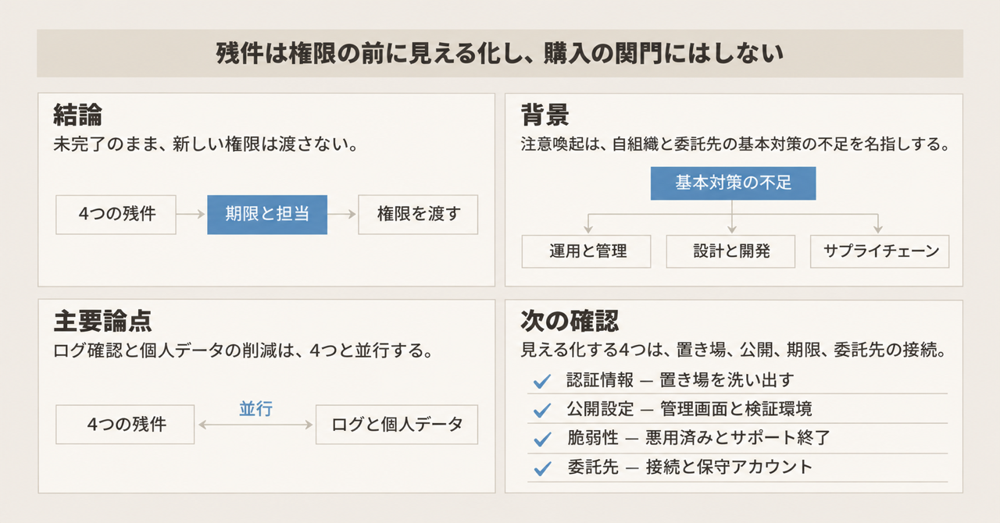
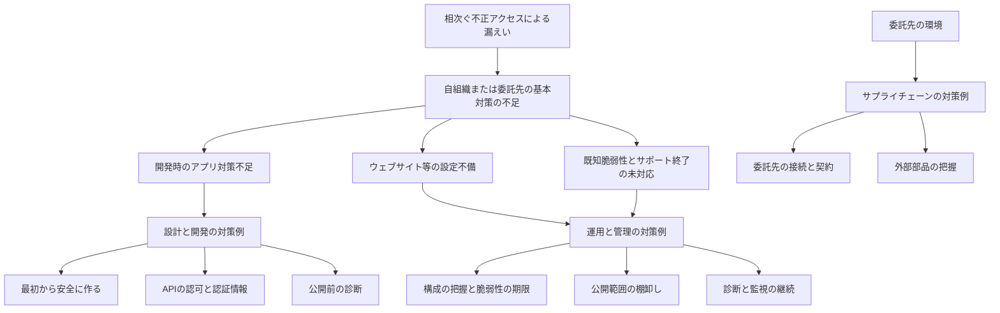

内閣官房国家サイバー統括室は、2026年11月5日、ウェブサイトやモバイルアプリで個人情報を扱う事業者向けに注意喚起を公表しました。総務省は翌日の11月6日、同じ文書を所管事業者と関係団体へ伝える[ページ](https://www.soumu.go.jp/menu_kyotsuu/important/kinkyu02_000683.html)を出しました。統括室の本文は[PDF](https://www.cyber.go.jp/pdf/press/261105_taiou.pdf)です。

統括室のPDFは、原因とみられる事例を「複数確認」と書き、社名、件数、割合は示しません。

この記事を読むと、注意喚起の3本柱と、文書が基本対策の不足と結びつけた残件が分かります。残件とは、その未対応です。到達範囲とは、自組織のAIエージェントに新たに渡す権限と、その権限で触れるシステムの範囲です。その残件を、到達範囲を広げる前にどこまで見える化するかも整理します。ここでいうエージェントは、社内のシステムやデータへアクセスするAIエージェントです。

*この記事の全体像。以下、順に解説します。*

## 国家サイバー統括室の注意喚起とは

この注意喚起は、個人情報の漏えい等につながる不正アクセスへの対策を、事業者向けにまとめた文書です。読者は二層です。経営層向けに状況と基本の考え方を書き、ITとセキュリティの担当者向けに対策例を書きます。

文書の柱は、運用・管理、設計・開発、サプライチェーンの3つです。冒頭は、モバイルアプリ開発時の対策不足、ウェブサイト等の設定不備、サポート終了や既知脆弱性の未対応を、自組織または委託先の基本対策が十分でなかった原因として複数確認した、と書きます。サポート終了は、EOLとも呼ばれます。主体は自組織と委託先の両方です。

標的の調査や侵害にAIを使っている可能性も高い、とも書きます。文書がここで書くAIは、攻撃側が調査や侵害に使う可能性の話です。前に定義した到達範囲は、自組織がエージェントへ渡す権限の範囲です。

### 3本柱の中身

運用・管理の中身は、次のとおりです。

- ソフトウェア構成の把握
- 悪用が確認された脆弱性の優先と期限
- 緩和策と是正の管理
- 公開範囲の棚卸し
- 継続的な診断とログ監視

設計・開発の中身は、セキュリティ・バイ・デザイン、実装時の静的検査と構成解析、公開前の動的検査、APIの認可、認証情報の置き場、レート制限です。セキュリティ・バイ・デザインは、後の図が「最初から安全に作る」と書く考え方です。構成解析は、ソフトウェアの部品構成を調べる検査です。レート制限は、短時間の呼び出し回数を抑える対策です。

APIの節は、NICTが注意喚起したA2B攻撃を参照します。A2B攻撃は、公開アプリの解析から、バックエンドの認可不備や脆弱性を特定する型です。NICTは、情報通信研究機構です。

認証情報の対策例は、APIキー、トークン、秘密鍵、データベース接続情報を、ソースやアプリのパッケージへ埋め込まない、と書きます。サーバー側ではシークレットマネージャーで管理し、権限を最小にし、期限とローテーションを置く、とも書きます。シークレットマネージャーは、秘密情報を預ける仕組みです。ローテーションは、秘密を期限で交換することです。

サプライチェーンの中身は、委託先のVPN、リモートデスクトップ、保守回線とアカウント、契約上の通知とデータ消去、OSSと外部部品の把握です。OSSは、ソースが公開されたソフトウェアです。

個人情報の委託については、個人情報の保護に関する法律第25条により、委託先への必要かつ適切な監督が求められる、と文書が書きます。委託先へ対策を求めるときは、費用負担と実施方法を協議し、地位を使った一方的な負担の押し付けにしない、とも書きます。

防御側のAIは、診断と監視の効率化として「積極的に検討」する対象です。評価結果の最終判断は人が行う、と運用の対策例が書きます。

文書の末尾は、インターネット上に露出したネットワーク機器、標的型メール、DDoS、AI悪用の今後の高度化についても、別途対策が必要だ、と書きます。DDoSは、大量の通信でサービスを止める攻撃です。実施の主体は、経営トップの下でのリスク評価です。システムの特徴と保有情報に応じて対策を選ぶ、と末尾が書きます。

### 原因から対策例への広がり

漏えいの原因として文書が並べるのは、開発時の不足、公開設定、既知脆弱性とサポート終了です。3本柱の対策例は、その原因の先に、診断、API、契約、外部部品まで広がります。委託先の環境は、原因の3項目と別に、サプライチェーンの対策例へつながります。

## 同じ時期の関連文書が書くこと

統括室のPDFと同じ週に、政府のパッケージと、それ以前の技術的な注意喚起が並びます。ここは、各文書が書いている事実です。

### 緊急対策パッケージ

内閣官房は、2026年11月6日、関係閣僚会議決定として[サイバーセキュリティ緊急対策パッケージ](https://www.cas.go.jp/jp/seisaku/cybersecurity_kakuryokaigi/pdf/countermeasure.pdf)を出しています。同じ3要因について「多くみられる」と書き、漏えい事案の多くは基本対策で防止・軽減が可能、とも書きます。

パッケージは、発注者、委託先、経営層がそれぞれ責任を持つ、と書きます。統括室の3本柱の注意喚起を、施策として位置づけています。侵入後の被害を小さくするため、個人情報を必要以上に保有しない対応も、基本の側に置きます。

パッケージは、個人情報保護委員会が10月7日に、保有個人データの必要性の確認と不要データの消去を注意喚起した、と書きます。安全管理措置のガイドライン改正については、令和9年1月中の施行を目指す、と書きます。令和9年1月は、2027年1月です。

### NICTの注意喚起

NICTの脅威情報分析チーム LETTICEは、2026年10月13日に[注意喚起](https://cynex.nict.go.jp/pdf/library/lettice/261013-01.pdf)を出しています。版は Rev 1.1 です。Androidアプリ自体に脆弱性がなくても、バックエンドの認証、認可、入力検証の不備で漏えいしうる、と書きます。

主対象として名指しするのは、SSRF、RCE、SQLインジェクション、IDORです。SSRFは、サーバーに意図しないリクエストを送らせる不備です。RCEは、遠隔からコードを実行させる不備です。IDORは、オブジェクト単位の認可が欠ける不備です。同様の問題は、iOSアプリとWeb APIでも起こりうる、とまとめが書きます。

ログの優先期間は2026年8月以降です。可能ならそれ以前も見る、と書きます。公開API、旧API、検証環境の列挙と併せて、アクセスログ、APIログ、認証ログの確認を優先的に求めます。IoCとの一致だけでは侵害を断定できない、とも書きます。IoCは、侵害の痕跡として照合する指標です。

AIによる解析と探索の効率化は「懸念」です。個別システムに合わせた攻撃がより多く行われる「可能性」と書きます。

### JPCERT/CCのケース

JPCERT/CCは、[JPCERT-AT-2026-0030](https://www.jpcert.or.jp/at/2026/at260030.html)で、直近の国内組織における不正アクセスを注意喚起しています。組織上の役割は、この注意喚起の記述では特定できません。公開は2026年10月8日、最終更新は2026年10月23日です。技術情報が限定的かつ断片的であり、すべての事案が同じ手法ではない、と明記します。

ケースは5つです。手順の詳細とIPアドレスは、この記事には書きません。ウェブシェルは、サーバー上に置いて遠隔操作に使うプログラムです。ペネトレーションテストは、侵入を試す検査です。

| ケース | 文書が書く内容 |
|---|---|
| A | 既知脆弱性の探索と、脆弱性以外の管理不備 |
| B | 公開アプリの解析からのAPI悪用と、他システムで盗んだAPIキーの使用 |
| C | MetabaseのCVE-2026-72898 |
| D | 公開ウェブから到達するアプリサーバーへのウェブシェル設置 |
| E | AIを用いたペネトレーションテスト基盤を悪用した攻撃試行 |

ケースEは、2026年10月23日追記です。Cairn、CyberStrikeAI、ARTEXなどの基盤を悪用した攻撃試行を確認した、と書きます。

BIや従業員向けなど、不特定多数を想定しないシステムも対象だと書きます。BIは、社内の数値を集計して見る仕組みの呼び方です。

対策として並べるのは、レート制限、最小権限、期限付きトークン、既知脆弱性の更新、不要な管理機能の公開停止、保存期間を過ぎたデータの消去です。

### CVE-2026-72898

CVE-2026-72898は、NVDで2026年11月7日に確認した脆弱性です。Metabaseの製品の種別は、この記述では特定できません。NVDは、米国が公開する脆弱性データベースです。状態は Analyzed（分析済み）です。公開は2026年8月10日、最終更新は2026年8月12日です。

説明は、遠隔の未認証の攻撃者が `/reset_password` の database endpoint（データベース接続の入口）で任意のSQLを注入し、接続されたMetabaseの管理者権限を得る、です。CVSSは、脆弱性の深刻度スコアです。v4.0 と v3.1 はいずれも 10.0 で、区分は CRITICAL（最も深刻）です。

影響は、OSSの0.58系から0.63系で、修正版の直前までです。0.58.24、0.59.21、0.60.17、0.61.11、0.62.9、0.63.5 の各版は影響範囲に含みません。各系統では、その版より前が影響を受けます。MetabaseのEnterprise版は1.58系から1.63系です。1.58.24、1.59.21、1.60.17、1.61.11、1.62.9、1.63.5 は影響範囲に含みません。各系統では、その版より前が影響を受けます。参照には、Metabaseのセキュリティアドバイザリと、ベンダーの更新記事があります。

## 注意点

前の節は、文書が書いている内容です。ここからは、表現の強さ、確度、粒度、この記事の残件例では覆えない範囲です。

### 「複数」と「多く」は強さが違う

統括室PDFは「複数確認」と書きます。翌日のパッケージは、同じ3要因について「多くみられる」と書きます。どちらも割合の数値はありません。「複数」と「多く」は、同じ政府の中で強さが違う定性表現です。

### 攻撃側のAIは文書ごとに確度が分かれる

統括室は「標的の調査や侵害にAIを使用している可能性も高く」と書きます。これまでの診断で比較的低いとされたリスクが組み合わさり、侵入の原因となった可能性のある事例もみられる、と続けます。どのリスクかは、その文では特定されていません。

NICTは、AIによる解析と探索を「懸念」と「可能性」で書きます。JPCERT/CCのケースEが確認したのは、AIを用いたペネトレーションテスト基盤による攻撃試行です。統括室が挙げる個々の漏えいについて、AI利用が確定した、とはどの文書も書いていません。

### 見出しに足された語は一次のPDFに無い

日経クロステックの見出しは「ブラックオクトーバー」後の対策です。この語は統括室PDFにはありません。無料で読める範囲では、この語が何を指すかは特定できません。同じ記事の無料リード（有料記事のうち、無料で読める範囲）は、S&Jの三輪信雄氏が「できそうにないことが、普通に書いてある」と述べたと書きます。S&Jの説明と、三輪氏の役職は、無料リードの範囲では特定できません。写真キャプションは、注意喚起を13ページとします。出典は、2026年11月6日の[無料リード](https://xtech.nikkei.com/atcl/nxt/column/18/00001/12157/)です。

有料本文は、ここでは未取得です。発言が開発、運用、委託のどの柱を指すかは、無料で読める範囲では特定できません。次ページの見える書き出しは、攻撃へのAI利用に触れるところで切れています。

2026年11月6日のパッケージ本文を検索しても、重要インフラからの報告件数が前月の10倍という数値はありません。別報道の数値は、本文を再取得していないため、ここには転載しません。

### 「基本」と対策例は同じ粒度ではない

SBOMは「必要に応じて」であり、継続的な照合と修正までを一連の運用にする、と注記があります。SBOMは、ソフトウェアの部品表です。ゼロトラストは、設計と委託先アクセスの考え方として書かれます。移行で何を変えるかの中身は、この記述では特定できません。SCS評価制度は、委託先評価の制度として書かれ、申請受付は2027年3月開始予定です。何をどう評価するかは、この記述では特定できません。

SOC、SIEM、EDR、SOAR、ASMは、監視と棚卸しの対策例として登場します。SOCは監視の体制、SIEMはログの集約と分析、EDRは端末の検知、SOARは対応手順の自動化、ASMは外から見える攻撃面の把握、を指す呼び方です。これらを、認証情報の置き場や公開設定と同じ「すぐ終わる基本」と呼ぶ根拠は、文書にありません。

### 4つの残件例では文書の射程を覆えない

ここでいう4つの残件例は、認証情報の置き場、管理画面・デバッグ・検証環境の公開、インターネットから到達する既知悪用脆弱性とサポート終了の期限、委託先の接続経路と保守アカウントです。

末尾が別途とする露出機器、標的型メール、DDoS、今後のAI悪用は残ります。パッケージが基本の側に置く、個人情報を必要以上に保有しない対応も残ります。NICTが優先するログ確認と、IoCだけでは侵害を断定できないという留保も残ります。

JPCERT/CCのケース分けは、開発、運用、委託の3柱と完全には重なりません。原因の全体像は断片的だ、とも書いています。4つの残件へ全件を帰す根拠は弱いです。

「まず4項目だけ行い、検知はその後」という順序は、これらの文書から導けません。NICTの優先的なログ確認と、パッケージの情報集約・脅威ハンティングと両立しないためです。脅威ハンティングは、侵入の痕跡を能動的に探す活動です。同時に、新しいSOCやEDRやSIEMの購入を、残件確認より先にすべきだという証拠も、今回の一次資料にはありません。

### 原文を確認できていない箇所

委員会サイトの、10月7日の注意喚起のページは、2026年11月7日時点で本文を取得できていません。パッケージにある記述の有無は確認できます。委員会サイトの原文は未確認です。

ガイドライン改正の令和9年1月中の施行は、予定です。現行の第25条を改正済みとは書いていません。改正で作業の何が変わるかは、パッケージのこの記述にはありません。

## 柱ごとに先に見える残件

三輪氏の発言は、無料リードでは注意喚起全体の評価です。柱への割当は、一次の文言で分けます。

| 柱 | 文書が基本不足と結びつけたこと | 担当者向け対策例の水準 | 残件として先に見えるもの |
|---|---|---|---|
| 開発 | アプリ開発時の対策不足。API経由の不正操作。公開前診断の対象に、自社または委託先の固有実装を含める | 最初から安全に作る、構成解析、公開前の動的検査、サーバー側の認可、認証情報の分離、レート制限 | 秘密の置き場、オブジェクト単位の認可、公開前に直したかの確認 |
| 運用 | ウェブサイト等の設定不備。サポート終了と既知脆弱性の継続使用。管理画面、デバッグ、検証環境の公開 | 構成管理、悪用済み脆弱性の優先と期限、公開範囲の棚卸し、診断とログの継続。SOCやEDRは例 | 公開設定、インターネットから到達する既知悪用脆弱性とサポート終了の期限、是正が終わるまでの記録 |
| 委託 | 委託先や保守の環境を足がかりにした侵入。影響は発注元が負う | 法第25条の監督、接続経路とアカウント、契約、費用の協議。SCSは2027年3月申請受付開始予定。SBOM提出は契約事項の例 | 委託先VPNと保守アカウントを、自社の完了条件に入れる |

右列は、柱ごとに先に見える残件です。オブジェクト単位の認可、公開前に直したかの確認、是正が終わるまでの記録は、この右列の項目です。権限を渡す前に見える化する4つの例には含めません。

## 残件の確認を購入条件にしない

現在の結論は、エージェントに新しい到達範囲を渡す前の確認を、新しい防御製品の導入より先の購入条件にはしない、です。購入条件とは、その製品を買う前に必ず終える関門です。一次資料は、確認と購入のどちらを先にするかを決めていません。未完了のまま止めるのは、新しい権限を渡す方です。

確認する残件の例は、次の4つです。

- 認証情報の置き場
- 管理画面、デバッグ、検証環境の公開
- インターネットから到達する既知悪用脆弱性とサポート終了の期限
- 委託先の接続経路と保守アカウント

ログの確認と、保有する個人データの最小化は、その横で並行します。

支持は、次のとおりです。

- 統括室の冒頭は、開発時の不足、設定不備、既知脆弱性とサポート終了を、自組織または委託先の基本不足として挙げています
- 設計・開発の対策例は、認証情報の埋め込みと、公開前に是正してから本番へ出すことを書いています
- 運用の対策例は、管理画面、デバッグ、検証環境の公開点検と、悪用済み脆弱性の期限を書いています
- サプライチェーンは、委託先の接続を発注元の被害として書き、法第25条の監督を引用しています
- パッケージは、発注者、委託先、経営層がそれぞれ責任を持つ、と書きます

反証は、次のとおりです。

- JPCERT/CCは、原因の全体像を断片的だとしています。4つの残件へ全件を帰す根拠は弱いです
- 検知を後回しにする順序は、NICTの優先的なログ確認と、パッケージの情報集約・脅威ハンティングと両立しません
- 4つの残件が解消しても、保有データ量と、末尾が別途とする手口は残ります
- 統括室文書は、4つの残件と新製品の先後を比較していません
- 三輪氏の「できそうにない」は、どの柱が過重かを一次資料では特定できません

結論は、残件例として残す範囲では維持します。「これだけやれば十分」「検知は後」という拡張は維持しません。

## 文書からは決まらないこと

公開の一次資料からは、次が決まりません。

- 個々の漏えいが、開発、運用、委託のどれにどの割合で分かれるかは、一覧がありません
- 三輪氏の発言がどの対策例を指すかは、有料本文を読むまで分かりません
- パッケージが書く10月7日の委員会注意喚起は、原文未確認です
- 統括室が「可能性」と書いた事案のどれで、AI利用が後から確定するかは、この文書の範囲外です
- 2027年3月に申請受付を開始する予定のSCS評価制度が、委託先選定の実効ある基準になるかは、受付開始前には判断できません

## 到達範囲を広げる前に行う確認

エージェントへ渡す到達範囲を広げる前に、次の4つを残件として見える化します。この4つは、注意点で挙げた残件例と同じです。2番目は、データベース管理機能がインターネットから到達するかの確認を含みます。購入の前提にはしません。期限と担当を付けて、未完了のまま新しい権限を渡さない、が確認の置き方です。

1. アプリ、リポジトリ、パイプラインにあるAPIキー、トークン、秘密鍵、接続情報の置き場を洗い出します。
2. 管理画面、デバッグ用エンドポイント、検証環境、データベース管理機能が、インターネットから到達するかを確認します。
3. インターネットから到達する資産について、悪用が確認された脆弱性とサポート終了の期限を切ります。直らない間は、緩和策とログ確認を残します。
4. 委託先のVPN、リモートデスクトップ、保守回線、常時付与の管理者権限を棚卸しし、自社の完了条件に含めます。費用負担と実施方法は十分に協議し、一方的な負担の押し付けとならないようにします。

並行して行うものは、次のとおりです。

- NICTが求める、2026年8月以降を優先したアクセスログ、APIログ、認証ログの確認です。一致だけでは侵害と断定しません。
- JPCERT/CCが求める、レート制限、最小権限、期限付きトークン、不要な管理機能の公開停止、保存期間後のデータ消去です。
- パッケージが求める、必要な範囲を超えた個人データの削減です。

防御側のAIや新しい監視基盤は、文書が検討対象として書く水準に留めます。AIの評価を残件の自動判定にする場合は、人が最終確認します。これは、評価結果の最終判断は人が行う、という統括室の書き方に合わせた置き方です。

SBOMの継続運用、ゼロトラストへの移行、SCSによる委託先評価は、残件の棚卸しが終わったあとの別計画にします。

## まとめ

2026年11月5日の統括室の注意喚起は、運用・管理、設計・開発、サプライチェーンの3本柱で、自組織と委託先の基本対策の不足を名指しします。総務省は翌日、同じ文書を所管事業者へ伝えています。攻撃側のAI利用は「可能性」であり、個々の漏えいでの確定とは書かれていません。

到達範囲を広げる前に見える化する残件例は、認証情報の置き場、管理画面等の公開、インターネットから到達する既知悪用脆弱性とサポート終了の期限、委託先の接続と保守アカウントです。ログ確認と個人データの最小化は並行です。この確認は、新しい防御製品の購入条件ではありません。4項目だけで十分、検知は後、とも導けません。

SBOMの継続運用、ゼロトラスト、SCS評価制度は、残件の棚卸しのあとの別計画です。割合、三輪氏の発言の対象、委員会サイトの原文、個々の事案でのAI利用の確定は、公開の一次資料からは未確定です。

この記事が少しでも参考になった、あるいは改善点などがあれば、ぜひリアクションやコメント、SNSでのシェアをいただけると励みになります！

## 参考リンク

- [総務省「個人情報の漏えい等につながる不正アクセスへの対策について（事業者向け注意喚起）」（2026年11月6日）](https://www.soumu.go.jp/menu_kyotsuu/important/kinkyu02_000683.html)
- [内閣官房国家サイバー統括室「個人情報の漏えい等につながる不正アクセスへの対策について」（2026年11月5日）](https://www.cyber.go.jp/pdf/press/261105_taiou.pdf)
- [内閣官房「サイバーセキュリティ緊急対策パッケージ」（関係閣僚会議決定、2026年11月6日）](https://www.cas.go.jp/jp/seisaku/cybersecurity_kakuryokaigi/pdf/countermeasure.pdf)
- [NICT 脅威情報分析チーム LETTICE「相次ぐ情報漏洩、その原因の一つはアプリ解析からのサーバ攻撃」（2026年10月13日、Rev 1.1）](https://cynex.nict.go.jp/pdf/library/lettice/261013-01.pdf)
- [JPCERT/CC「直近で相次いでいる国内組織における不正アクセスに関する注意喚起」JPCERT-AT-2026-0030](https://www.jpcert.or.jp/at/2026/at260030.html)
- [NVD「CVE-2026-72898」](https://services.nvd.nist.gov/rest/json/cves/2.0?cveId=CVE-2026-72898)
- [日経クロステック「政府が国内の情報漏洩事例を分析、『ブラックオクトーバー』後の対策を提示」（2026年11月6日、無料リード）](https://xtech.nikkei.com/atcl/nxt/column/18/00001/12157/)
