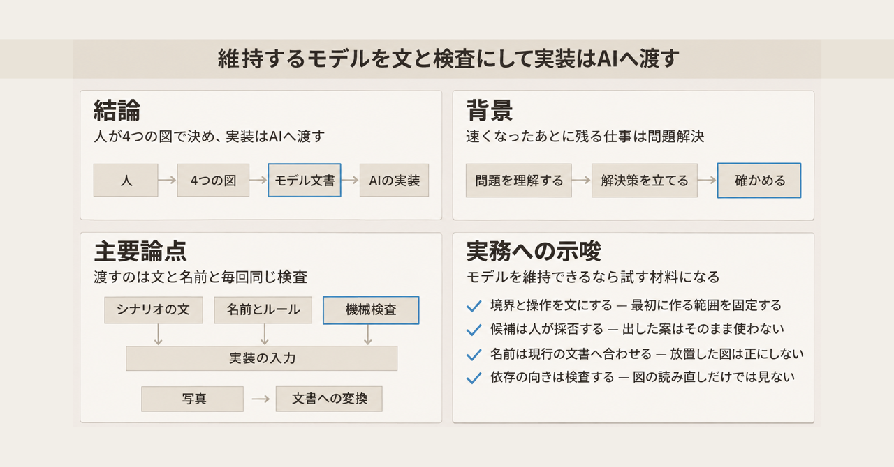
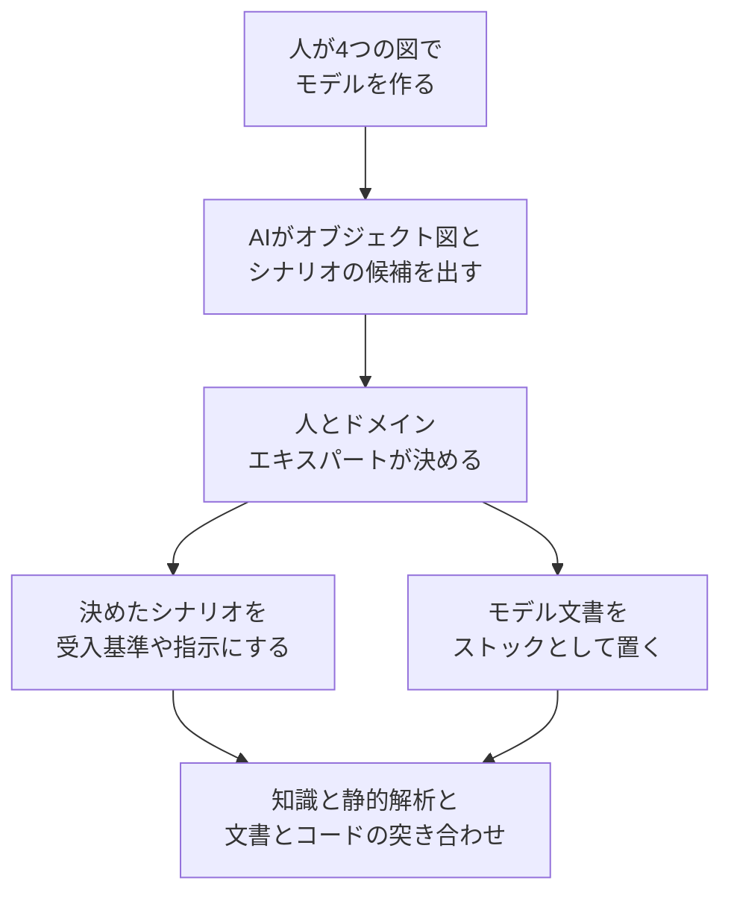

2026年11月25日の 17:00 から 17:50 まで、UMTP モデリングフォーラム 2026 で、株式会社ログラスの松岡幸一郎氏が登壇しました。UMTP は、特定非営利活動法人 UMLモデリング推進協議会です。公式プログラムの題は「モデルを『AIとの共通言語』に ― 問題解決力を高めるDDD」で、公開された資料は [Speaker Deck の54枚](https://speakerdeck.com/littlehands/umtp-suraido-20261125) です。Speaker Deck 側の題は「AI使って開発するなら、モデリングするんだよ - 4つの図で始めるモデリングと、AIにモデルを実装させるアーキテクチャ」です。DDD は Domain-Driven Design（ドメイン駆動設計）の略で、公式プログラムが「モデルと実装をつなぐ手段」と呼んでいる設計のやり方です。

実装が速くなったあとに人へ残る仕事を、資料は、問題を理解し、解決策を立て、確かめる問題解決に置きます。入り方として本人が勧めるのは、4つの図です。この記事では、その4つの図が何を決めるか、決めたシナリオをエージェントへどう渡すか、モデル文書とコードをどこまで揃えるかを説明します。記述は、公開された登壇資料と、同じ主張を突き合わせた公開文献に基づきます。

*この記事の全体像。以下、順に解説します。*

## 4つの図で始めるモデリングとは

登壇資料が勧める入り方は、sudo モデリングと呼ぶ4つの図です。4つの図は、システム関連図、ユースケース図、オブジェクト図、ドメインモデル図です。sudo モデリングは、発表者自身が現場から抽出した、この4つの最小のラインナップで、資料は「どんな時にもやると良い最低限」と置きます。業務フロー図、状態遷移図、シーケンス図、ER 図は、必要なら足します。2022年6月1日の本人ブログは、ドメインモデル図とオブジェクト図のどちらから描いてもよい、と書いています。

4つの図でモデルを作ったあと、AI には具体シナリオの展開と、モデルと同じ形の実装を、ハーネスの中で任せます。ハーネスは、エージェントの周りに置く知識、検査、突き合わせです。

### 4つの図が決めること

採用管理を例に、各図が先に固定する決定は次のとおりです。

システム関連図は、誰がこのシステムにログインし、どの外部システムとつながるかを先に固定します。アクターは、そのシステムに対する操作の主体です。採用管理の例では、応募者がログインするかで、作る機能が変わります。

ユースケース図は、アクターごとの操作と、漏れと優先順位を議論する図です。実演範囲は「採用選考を登録する」「面接を設定する」付近です。

オブジェクト図は、値の入った具体例で矛盾と漏れを探す図です。選考中と不合格、採用ポジションの名前、同一人物の二応募、などを並べます。

ドメインモデル図は、その具体例を概念、多重度、集約、吹き出しのルールへ抽象化した図です。多重度は、概念どうしが何個ずつつながるか、という数の制約です。集約は、まとめて扱う範囲を示す印です。吹き出しは、ルールを図の中へ書き添える欄です。例のルールは、面接を追加できるのは選考中のときだけ、です。日本語名に対する英語名は、ユビキタス言語のマスタにします。ユビキタス言語は、議論とコードで同じ名前を使うための語彙です。

| 図 | その図が固定する決定 | 採用管理の例 |
|---|---|---|
| システム関連図 | ログインする主体と、外部システムとの境界 | 応募者がログインするかで、作る機能が変わる |
| ユースケース図 | 操作の一覧と、どこから作るかの優先 | 採用選考を登録する、面接を設定する |
| オブジェクト図 | 具体値での矛盾と漏れ | 選考中と不合格、ポジション名、同一人物の二応募 |
| ドメインモデル図 | 概念、多重度、集約、ルール、日英の名前 | 面接を追加できるのは選考中のときだけ |

### 候補を足してから、人が決める

資料が描く流れは、人が4つの図でモデルを作り、AI が具体シナリオとオブジェクト図の候補を足し、人とドメインエキスパートが決める、という順です。ドメインエキスパートは、その業務を知っている人です。決めたシナリオは、プロトタイプへの指示と、Given / When / Then の受入基準になります。Given / When / Then は、受入基準を前提、操作、期待する結果に分けて書く形式です。モデルの文書は、常に最新にするストックとして置き、ハーネスが知識、静的解析、文書とコードの突き合わせを担います。

AI に頼む作業として資料が名指しするのは、シナリオの洗い出し、オブジェクト図を何パターンも描くこと、穴の候補を挙げることです。挙げた事例は、ドメインエキスパートとの意思決定材料であり、そのまま採用しません。スライド 36 は、放っておくと AI はシナリオ洗い出しをしないことも多い、と書きます。

決めたシナリオの使い道は二つです。プロトタイプへは「このパターンを反映して」と頼みます。受入基準へは Given / When / Then にします。例は、不合格の採用選考に面接を追加しようとすると、追加できない、です。

コードは極力、モデルと同じ形にします。モデルの言葉が変わったら、クラス名、メソッド名、モジュール名をモデルに合わせます。エージェントは今あるコードを手本にするため、同じ言葉で書いておきます。

### ストックの文書と、ハーネスの検査

ドキュメントは二種類です。モデル文書は、常に最新にするストックです。エピックやバックログ項目は、作る仕事を区切った項目です。それらは書いた時点の断面で、後から最新化しないフローです。モデルを更新したらコードと同期する、をハーネスで実現します。

知識のテキストは、エージェントが従わないことがあります。依存の向きのテストや lint は、毎回同じ結果になります。モデル図や ADR を AI が読んで照合すると、結果が揺れます。ADR は Architecture Decision Record の略で、設計判断とその理由を残す文書です。機械で照合できれば、毎回同じになります。資料はこの二つを分けます。

新規に図を描く経路と、既存コードを後からモデル化する経路の両方を、資料は有効だとしています。後者から前者へつなぐこともできる、とスライド 15 にあります。

見通しが立たないときの描き方も、資料は分けます。スライド 29 は、全体の見通しが立たないときは手描きにし、形が見えたらドキュメントに起こし、写真を AI に投げると変換できる、と述べます。

## 注意点

4つの図は、登壇資料が勧める最小の入り方です。更新していない図をコードより上の正に置く、写真を渡せば実装の仕様になる、成功したテストで正しさが閉じる、という読みには、資料と公開文献の側に別の文があります。

### 揃える対象は、維持すると決めたモデル文書

「図とコードがずれたら、正を図側に固定する」という読みは、資料からの引用ではありません。スライド 42 の「極力」と、スライド 20 の「ホワイトボードのように扱う」に、一部が重なる解釈です。スライド 20 は「モデル図は仕様書ではなく、ホワイトボードのように扱う」と書き、続けて「メンテするものは明確に決めて最新化する」と書きます。同期の対象は、維持すると決めた現行のモデル文書です。放置した図や、会場の写真ではありません。

Martin Fowler の ["UmlAsSketch"](https://martinfowler.com/bliki/UmlAsSketch.html)（2003年5月28日）は、スケッチの要点を選択とホワイトボードに置き、全部を描くことは分かりやすさの敵だ、と書きます。設計図としての UML は別のモードです。この一文が支えるのは、スライド 20 の「ホワイトボードのように扱う」と重なる範囲です。

### 写真から文書への変換は、完全ではない

スライド 29 の写真の一文は、変換できる、という述べ方です。変換の完全性を測った記録は、そのスライドとは別の論文で、時点は 2024年6月です。Aaron Conrardy と Jordi Cabot の [arXiv:2404.11376v2](https://arxiv.org/abs/2404.11376)（2024年6月18日）は、手描き UML クラス図 4 枚を、GPT-4V、Gemini、CogVLM に PlantUML へ変換させました。PlantUML は、UML をテキストで書く記法です。GPT-4V、Gemini、CogVLM は、その論文が画像の読み取りに使ったモデルです。最も詳しいプロンプトは、関連を保ち、多重度を変えるな、と指示しています。それでも、構文が通った出力でも、要素の欠落、誤読、幻覚が起きました。本文は、最良の結果は忠実だった、とも書きます。

表 2（各モデル 36 試行）では、PlantUML 構文の誤りが、GPT-4V で 0/36、Gemini Pro で 16/36（44.4%）、Gemini Ultra で 16/36（44.4%）、CogVLM で 20/36（55.6%）です。本文の "more around 50% of cases" は、GPT-4V 以外の構文誤りの話であり、多重度の脱落率ではありません。GPT-4V は、意味の通らない継承（Human が Spaceship を継承）を、よりありそうな "uses" の関連へ書き換えた試行があります。著者は、人が途中で確認する手続きがまだ必要だとし、図は小さく描き手は 1 人で、他のモデルや大きな図へ一般化しない、とも書きます。2026年11月のエージェントが同じ率だ、とは読めません。論文 HTML の掲載先欄は LLM4MDE 2024 です。proceedings としての独立確認は、ここには含めていません。

### 緑のテストは、機能の正しさを閉じない

Given / When / Then と、成功して緑になるテストだけで「確かめる」が閉じる、とも資料は言っていません。緑のテストは、その成功したテストを指します。Birgitta Böckeler は 2026年4月2日の ["Harness engineering for coding agent users"](https://martinfowler.com/articles/exploring-gen-ai/harness-engineering.html) で、アプリケーションが求める機能的な振る舞いをどう導き、どう検知するかを "the elephant in the room"（その場にありながら、正面から扱われていない問題）と呼びます。続けて、現行の実践として、機能仕様、生成テストの成功とカバレッジ、手動テストの併用を挙げ、生成テストへの信頼には限界があり、監督を減らせる段階にはまだない、と述べます。この論が当たるのは、機能の正しさです。資料が「毎回同じ」と言う、依存方向のテストや lint までは取り消しません。

### 同じ日のプログラムは、別の入り口を並べている

同じ日の[公式プログラム](https://umtp-japan.org/event-seminar/mf2026/78668)（ページの日付表記は 2026年9月26日、会期は 2026年11月25日）は、4つの図以外の入り口を並べています。比較は、各登壇の概要までです。しょぼちむ氏、鈴木雄介氏、葉山悟氏、安次富大介氏のスライド本文は、ここでは読んでいません。

| 登壇者 | 公式プログラムの概要が置く入り口 |
|---|---|
| 鈴木雄介氏 | 実装から、スペックとハーネスへ |
| しょぼちむ氏 | イベントストーミングと、仕様駆動 |
| 成瀬允宣氏 | イベントストーミングと、具体モデリングの不変条件 |
| 葉山悟氏 | 動くモデル |
| 安次富大介氏 | 単一の Git リポジトリ |

成瀬氏のスライド PDF の副題は形式仕様で、これはプログラム概要の文言ではありません。4つの図が、フォーラム全体の必須手順だ、という読みにはなりません。成瀬氏 PDF のテキストとして取れた範囲では「イベントストーミング」は 5 回で、sudo、ユースケース、オブジェクト図、ドメインモデル図は各 0 回でした。図の中の文字が画像のままだと、取りこぼし得ます。

### 更新しない図は、参照が止まることがある

shinoda 氏の [Zenn 記事](https://zenn.dev/dress_code/articles/34f18afe1464e8)（公開 2026年8月10日）は、SUDO（登壇資料の sudo モデリング）を約 5 年、個人で使い、チームの正式採用ではない、と書きます。ドメインモデル図とオブジェクト図は、誰かが直さない限り古くなり、最新でないかもしれないと思われた時点で参照が止まり、数ヶ月で遺物になる、とあります。著者の対処は、図にコードを合わせることではありません。TypeScript の型から図を描き、型が変わるとモデリング側がコンパイルエラーになる、という逆方向です。範囲は 1 人の報告であり、業界の頻度ではありません。

### 古い文書を直すとき、基準がコードの振る舞いである例

OpenAI の ["Harness engineering"](https://openai.com/index/harness-engineering/)（Ryan Lopopolo、2026年2月11日）は、リポジトリ内の `docs/` を system of record とし、短い索引以外の巨大なマニュアルは腐る、と書きます。system of record は、実行中のエージェントが参照する記録の置き場です。定期の doc-gardening は、実コードの振る舞いと一致しない古い文書を探して、修正のプルリクエストを出す作業です。直す対象は文書で、基準はコードの振る舞いです。リポジトリの外、つまりチャット、人の頭、会場のホワイトボードは、実行中のエージェントからは存在しないも同然だ、とも書きます。これは、「古い図に合わせて、正しいコードを壊した」事故の記録ではありません。そのような公開された事故は、確認した公開文献の範囲では特定できていません。無い、とは断定しません。

### モデルとコードの向きは、片方だけではない

Eric Evans の *Domain-Driven Design Reference*（2015年3月）を、PDF 本文から読んだ範囲では、向きは片方だけではありません。スライド 9 には、DDD 側のモデル定義と、UMTP 側のモデル定義が並びます。DDD 側と、スライド 9 のドメインの説明は、Evans をもとにした発表者の要約です。スライド 27 のユビキタス言語も、同じ文献の発表者訳です。UMTP 側は「UMTPシン・モデリング宣言」④（2025年）を出典にします。宣言の文言そのものは、ここには引きません。ユビキタス言語の節は、モデルが技術者向けの UML 図を描くためだけに使われるなら、DDD の中心である共同作業に寄与していない、と書きます。同じ節は、日々の議論の用語がコードに埋め込まれた用語と切れている、という文の括弧で、コードをソフトウェアプロジェクトの最も重要な成果物と呼びます。言語が変わったらそれはモデルの変更であり、クラスやメソッドやモジュールの名前を新しいモデルに合わせて直す、とも書きます。同時に、コードの変更はモデルの変更であり得る、とも書きます。Building Blocks と題した導入は、モデルと実装を互いに揃え、互いを強める、と読めます。Building Blocks は、その文献の導入につけられた名前です。ここまでの読みは、開いた PDF の範囲の要旨であり、発表者訳の再構成ではありません。

### UML の公式図種との対応

UML の公式図種との対応は、UML の公式仕様である OMG UML 2.5.1 の Annex A です。印刷ページ 684 は図の枠の名前、685 は図 A.5 と図種の一覧、そして図種の混在を許す注記です。列挙に、システム関連図とドメインモデル図はありません。Use Case Diagram と Object Diagram はあります。分類は混在を禁止しないため、「UML がシステム関連図を禁止している」とは読めません。

### 初学者への実験は、2026年のエージェント評価に使わない

2024年6月10日の Wang ほか [arXiv:2404.17739v2](https://arxiv.org/abs/2404.17739) は、要求モデリング科目の学部生 45 人を対象に、LLM の支援があっても関係の正しさと完全性は保証されず、初学者が十分に正しい UML を作れる保証にはならない、と本文が書きます。第 VI 節は、訓練期間の短い参加者から得た結論が、知識と経験のある実務者に当てはまるとは限らない、と限定します。2026年のエージェントへの適用は、その節には書かれていません。この結果は、2026年のエージェントの性能評価には使いません。

### 4つの図への反対が、日付つきで1本ある

2025年4月12日のブログ（Ameba id hotbrain、`datePublished` は 2025-04-12T23:05:11+09:00、本文から実名は取れていません）は、sudo モデリングが画面や帳票のグルーピングに戻っており、DDD と矛盾する、という意見を公開しています。記事中に、失敗件数の集計は示されていません。反対意見が日付つきで 1 本ある、という範囲に留めます。

### 公開資料から特定できないこと

次は、公開された登壇資料の本文と、今回突き合わせた文献からは特定できていません。

- 4つの図のそれぞれを、画像、Mermaid、制約の箇条書き、テストコードのどれでリポジトリに置くか
- エージェントへ渡したプロンプト全文と、それに対応する出力差分。スライド 29、37、44 にあるのは、写真変換、依頼文の例、具体例入りプロンプトへの言及です
- シナリオを先に洗うことで、手戻りがどれだけ減るかの測定
- 2026年のモデルで、多重度や吹き出しが画像からどれだけ残るかの一次測定
- テキストにすると、誰がアクターかというレイアウト上の決定が落ちる、という測定。Wang ほかは、LLM の簡易ワイヤーフレーム、PlantUML、人が出力を直して作った図を比べており、既存の図を文章へ移したときの保存率は測っていません
- 動いているコードが正しいのに、エージェントが古い図へ合わせてそのコードを壊した、という公開された事故

## エージェントへ渡す入力

資料は、図種ごとに「画像を渡せ」「このスキーマで渡せ」とは書いていません。54枚の文字から読めることと、実装の入力として読む案は次のとおりです。右列は、発表者が指定したファイル形式ではありません。

| 図 | その図が強制する決定 | 資料がエージェントとの関係で書いていること | 実装の入力として読む案 |
|---|---|---|---|
| システム関連図 | ログインするアクターと、外部システムとの境界 | 図種ごとのファイル形式は、文字からは特定できない | 境界と「ログインするか」を文にする |
| ユースケース図 | 操作の一覧と、どこから作るかの優先 | 図種ごとのファイル形式は、文字からは特定できない | 操作名と優先を文にする。受入の Given / When / Then はシナリオ側 |
| オブジェクト図 | 具体値での矛盾と漏れ | AI に何パターンも描かせる（スライド 34）。人が採否を決める | 採用した具体シナリオを文にする |
| ドメインモデル図 | 概念、多重度、集約、吹き出しのルール、日英の名前 | モデル文書はストック。更新したらコードと同期する（スライド 50）。AI が図を読む照合は揺れる（スライド 47） | 名前、多重度、ルールをテキストにし、コードの言葉を合わせる |

図そのものを渡すと資料が明示しているのは、ホワイトボードの写真を文書へ変換する場面（スライド 29）です。別例として、AI エージェント機能の企画では、フローチャートの各段と、具体例入りのプロンプトを並べて見せた、とスライド 44 にあります。これは、4つの図の画像を実装の入力にした手順ではありません。

## 維持するモデルを実装の入力にする

人が先に描き、維持すると決めたモデルを、シナリオの文、名前、ルール、層、機械検査として実装の入力にします。層は、4つの図が決める項目とは別に、コードの依存の向きや配置を指します。これも機械検査へ載せます。写真は、文書化の変換です。画素そのものを、実行する仕様にはしません。ずれを直すときは、放置した図ではなく、現行のモデル文書へコードの名前を極力合わせます。既存コードからモデルを起こす経路は、資料の上では残っています。

手順は4段です。

1. システム関連図とユースケース図で、ログイン、外部システム、最初に作る操作を文にします。
2. オブジェクト図は、AI に具体パターンを出させて、業務を知る人と穴を決めます。採用したパターンだけを、Given / When / Then と、プロトタイプへの指示の文にします。
3. ドメインモデル図の名前、多重度、集約、吹き出しのルールを、コードと同じ言葉のテキストとしてストックに置きます。画像を使うなら、スライド 29 のとおり、ホワイトボードをそのテキストへ起こす変換に限ります。
4. 依存の向きや層の配置は、ArchUnit や lint で毎回同じ結果にします。ArchUnit は、依存の向きをテストとして書くライブラリです。名前、多重度、業務ルールとの一致は、それぞれを検査する規則や受入テストがある範囲で確かめます。AI が図を読み直す照合だけには任せません。モデルの言葉を変えたら、コードの名前をその現行モデルへ合わせます。放置した図を、動いているコードより上の正にはしません。

効果の数値、プロンプト全文、2026年の画像からの脱落率は、公開スライドの本文からは特定できていません。それらを書くなら、自前の測定だと明示する必要があります。この記事では、測定値を足していません。

## 資料が支える範囲

上の手順が、どの文に乗っているかをまとめます。読みの範囲は、公開資料の強さであり、効果の測定値ではありません。

| 読み | 向き | 出典 | 読みの範囲 |
|---|---|---|---|
| 残る仕事は問題解決で、4つの図はその最小の入り方 | 支持 | スライド 5、17–18。ブログ 2022年6月1日 | 登壇資料の主張。標準手続ではない |
| 実装へ渡す実体は、シナリオの文、Given / When / Then、名前、ハーネス | 支持 | スライド 26、34、37、43、47、50 | 登壇資料の主張。図種ごとのスキーマは未記載 |
| 維持するモデルの言葉に、コードの名前を合わせる | 支持 | スライド 42、43、50。Evans 2015 の改名の段 | 「極力」であり、古い図の無条件の勝利ではない |
| 写真を文書へ変換できる | 限定 | スライド 29 は変換できる、と述べる。arXiv:2404.11376v2 は欠落と、人の確認 | 一次資料どうしの緊張。率は 2024年6月 |
| 鮮度を疑われた図は、参照されなくなることがある | 限定 | スライド 20 と 50 は維持を勧める。Zenn 2026年8月10日は放置で遺物化した個人の観察 | 更新すれば参照が続く、という測定ではない |
| 文書が古ければ、コードの振る舞いへ文書を直す | 逆向きの修理 | OpenAI 2026年2月11日の doc-gardening | 事故の記録ではない |
| 機能の正しさは、仕様の文と緑のテストで閉じる | 弱い | Böckeler 2026年4月2日 | 構造の機械検査は別 |
| 既存コードからモデルを起こすことは否定される | 棄却 | スライド 15 が両方を有効とする。Zenn は型から図を駆動する | 登壇資料は両方を残す |

## まとめ

2026年11月25日の登壇資料は、実装が速くなったあとに人へ残る仕事を問題解決に置き、入り方を4つの図にします。AI には、シナリオとオブジェクト図の候補、そしてモデルと同じ形の実装を、ハーネスの中で任せます。

渡す実体は、採用したシナリオの文、名前、多重度、ルール、そして毎回同じ結果になる検査です。写真は文書への変換に使い、維持すると決めたモデル文書へ、コードの名前を極力合わせます。放置した図を、動いているコードより上の正にはしません。既存のコードからモデルを起こす経路も、資料は残しています。

この記事が少しでも参考になった、あるいは改善点などがあれば、ぜひリアクションやコメント、SNSでのシェアをいただけると励みになります！

## 参考リンク

- 松岡幸一郎「AI使って開発するなら、モデリングするんだよ - 4つの図で始めるモデリングと、AIにモデルを実装させるアーキテクチャ」Speaker Deck、2026年11月25日。https://speakerdeck.com/littlehands/umtp-suraido-20261125
- 同 PDF。https://files.speakerdeck.com/presentations/cc2d10c25b46460d81edae537df1bcc9/UMTP_%E3%82%B9%E3%83%A9%E3%82%A4%E3%83%88%E3%82%99_20261125.pdf
- UMTP「MF2026プログラム（本会）」。ページの日付表記は 2026年9月26日、会期は 2026年11月25日。https://umtp-japan.org/event-seminar/mf2026/78668
- 松岡幸一郎「簡単にできるDDDのモデリング」2022年6月1日。https://little-hands.hatenablog.com/entry/2022/06/01/ddd-modeling
- Eric Evans, *Domain-Driven Design Reference*, 2015年3月。https://www.domainlanguage.com/wp-content/uploads/2016/05/DDD_Reference_2015-03.pdf
- Ryan Lopopolo, "Harness engineering: leveraging Codex in an agent-first world", OpenAI、2026年2月11日。https://openai.com/index/harness-engineering/
- Birgitta Böckeler, "Harness engineering for coding agent users", martinfowler.com、2026年4月2日。https://martinfowler.com/articles/exploring-gen-ai/harness-engineering.html
- shinoda「ドメインモデル図がすぐ古くなるので、Storybookっぽくコードと関連付けて見れるようにしてみた」Zenn、2026年8月10日。https://zenn.dev/dress_code/articles/34f18afe1464e8
- Aaron Conrardy, Jordi Cabot, "From Image to UML: First Results of Image-Based UML Diagram Generation using LLMs", arXiv:2404.11376v2、2024年6月18日。https://arxiv.org/abs/2404.11376
- Beian Wang, Chong Wang, Peng Liang, Bing Li, Cheng Zeng, "How LLMs Aid in UML Modeling: An Exploratory Study with Novice Analysts", arXiv:2404.17739v2、2024年6月10日。https://arxiv.org/abs/2404.17739
- OMG, *Unified Modeling Language* 2.5.1。Annex A、印刷ページ 684–685。https://www.omg.org/spec/UML/2.5.1/PDF
- Martin Fowler, "UmlAsSketch"、2003年5月28日。https://martinfowler.com/bliki/UmlAsSketch.html
- 成瀬允宣「観測者から当事者へ、AI 時代にドメインへ深入りする知識と技術」PDF。https://files.speakerdeck.com/presentations/c7d6bfd3d20047c484707eb001e51684/From_Observer_to_Practitioner__Going_Deep_into_Domains_in_the_Age_of_AI.pdf
- 熱脳しゃちょ（Ameba id hotbrain。実名は本文から未確認）「DDDは帳票・画面駆動開発のアンチテーゼなのだから、sudoモデリングは矛盾じゃないか？」2025年4月12日。https://ameblo.jp/hotbrain/entry-12893640414.html
