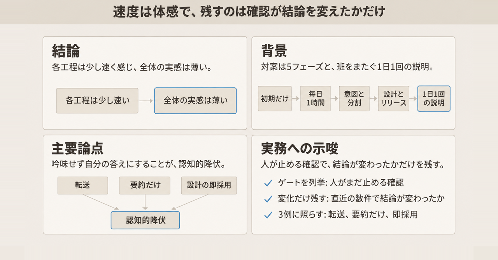
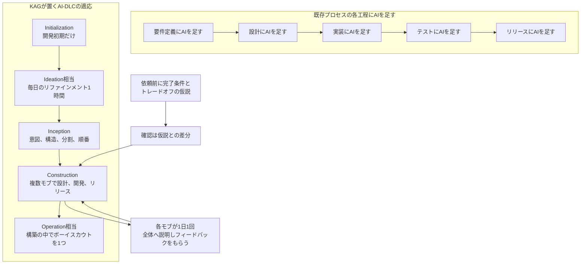

2026年11月25日、AWS AI Builders Community で、KDDIアジャイル開発センター（KAG）の Principal Engineer 吉田祐樹氏が「AI-DLC最前線の Cognitive Surrender に陥らないチーム作り」を話しました。資料は34枚です。話の起点は、要件定義、設計、実装、テスト、リリースの各工程に AI を足すと、どの工程も少しずつ速くなる一方、全体が速くなった実感は薄い、という整理です。対案として置かれるのは、AI-DLC Workflow v2 などを自社向けに変えた5フェーズと、モブをまたいで1日1回説明する運用です。AI-DLC は、AWS が AI-Driven Development Life Cycle と呼ぶ開発の進め方です。Workflow v2 は、資料の5フェーズ名と一致する、公開リポジトリの版です。モブは、設計、開発、リリースを一緒に進める人の班です。

この記事では、その5フェーズ、認知的降伏（AI の出力を、ほとんど吟味しないまま自分の答えとして採用してしまうこと）、速度の文をどこまで読んでよいかを順にまとめます。これは一チームの実践の語りです。

*この記事の全体像。以下、順に解説します。*

## 認知的降伏に陥らないチームの置き方とは

AI-DLC は、AWS が AI-Driven Development Life Cycle と呼ぶ開発の進め方です。資料の5フェーズの名前は、公開リポジトリ [awslabs/aidlc-workflows](https://github.com/awslabs/aidlc-workflows) の Workflow v2 と一致します。資料は、フェーズ名はそのままで、運用を自社向けに変えたものを独自スキルと呼んでいます。

### 各工程に AI を足した直線

資料が対比するのは、既存の工程に AI を足した直線です。要件定義、設計、実装、テスト、リリースのどれも、少しずつ速くなる、と書きます。全体が速くなった効果は感じづらい、とも書きます。資料がこの範囲で言っている文は、「どの工程も少しずつ速くなる。でも効果は感じづらい」までです。

### 自社向けの5フェーズ

KAG が置く流れは5フェーズです。中心は Inception と Construction です。

Initialization は、開発の初期だけに置きます。Ideation に相当するのは、毎日1時間のリファインメントです。Inception が扱う題目は、意図、構造、分割、順番です。Construction では、複数のモブが設計、開発、リリースを進めます。モブは、この資料では、その作業を一緒に進める人の班です。説明し、フィードバックをもらう主体は、この班です。

Operation に相当するのは、Construction の中のボーイスカウトルールです。来たときよりきれいにして帰る、という置き方で、プロダクトオーナーが切らない非機能、運用、改善を、構築のたびに少なくとも1つ行います。

継続の言い方は、「（個人として）チームを跨いで AI-DLC を1年以上」です。2025年のチームAは、スクラム7か月のあと AI-DLC を8か月です。2026年のチームBは、AI-DLC を6か月で、新規チームの構築経験を含みます。

次の図は、資料が対比している二つの流れと、説明のループ、依頼前の仮説です。

説明のループは、資料の中では認知的降伏への対策になっています。仮説は依頼の前に置き、AI の出力はその差分として読みます。

### 認知的降伏と呼ばれる行動

認知的降伏は、この資料の中では「AI の出力を、ほとんど吟味しないまま自分の答えとして採用してしまうこと」です。英語の Cognitive Surrender は、その呼び方です。

例は3つです。

- AI が書いたものを、そのまま他者へ転送する。資料はこれをミートプロキシーと呼びます。
- 原文を開かず、要約だけで判断する。
- AI が出したアーキテクチャを、そのまま採用する。

### 人のゲートと、1日1回の説明

開発フローには、人のゲートが並びます。ユーザーストーリー、画面、全体構造、分割、順番、受入試験項目、設計、開発、自動テスト、リリースです。Inception の題目のうち、全体構造、分割、順番は、この列に出ます。その横で、レビュー用のエージェントと対話しながら進めることを、資料は敵対的レビューと呼びます。俯瞰すると人が多く見える、と資料自身が問います。

対策は、各モブが最低1日1回、モブをまたいでチーム全体に説明し、フィードバックをもらうことです。Working Agreement は、この資料ではチームが守る項目を書く場所です。そこに「必ず1日1回は全体に情報共有する」と書きます。これとは別に、全員の朝会（30分以内）、リファインメント（1時間）、2週間ごとの振り返りがあります。1日1回の説明は、朝会とリファインメントの上に足す枠です。

### 依頼の前に置く仮説

依頼の前に、完了条件とトレードオフの仮説を立てます。確認は、仮説との差分に寄せます。ずれたら、仮説と AI のどちらが違うかを突き止めます。

情報漏えいやコスト超過のとき、設計の説明責任は開発者にあります。「AIに薦められたからです」は答えにならない、と資料は書きます。AI は選択肢を出し、作業をします。開発者は選び、理由を説明します。

### クラフトマンシップとして置く到達点

目指す姿は、クラフトマンシップのチームです。出典は、2009年の Manifesto for Software Craftsmanship です。英語の4対は、次のとおりです。

- Not only working software, but also well-crafted software
- Not only responding to change, but also steadily adding value
- Not only individuals and interactions, but also a community of professionals
- Not only customer collaboration, but also productive partnerships

資料は、この4対を日本語で言い換えます。さらに、「次に手を入れる人（やAI）も、設計と意図、振る舞いを理解し安全に変更できる」と書きます。

## 注意点

### 速度の文は体感である

速度の文は、体感です。slide 5 に、リードタイム、サイクルタイム、手戻り件数、速度比はありません。「どの工程も少しずつ速くなる。でも効果は感じづらい」までが、この資料の範囲です。工程のあいだの手戻りや、確認が儀式になった箇所を測れ、という読みは、この資料の指標ではありません。

「情報共有を頻繁に行うことで Cognitive Surrender を防いでいる」というまとめと、slide 30 の「ほとんどの場合、仮説が正しい」には、降伏の発生率も、前後の比較もありません。期待する場の質は、鋭い質疑、緊張した受け答え、脳がフル回転していることです。その質が起きているかを数える手続きは、この34枚にはありません。Working Agreement の「必ず1日1回」は、説明の回数は満たせても、中身がミートプロキシーのままかは別です。

### 図の「ここ」と、1年以上の単位

slide 23 は、「実はここボトルネックではありません」と書きます。「ここ」は、順番を決めたあとのレビューの近くに置かれます。どの箱を指すかは、図のどこを強調しているかに依存し、文字だけでは特定できません。

ボルトは、AI-DLC の進め方で、スプリントに当たる区切りの名前として使われます。ボルト図に印として置かれた 1、2、3、4.8 には、単位がこの資料にありません。計画上の印であり、成果を測った値としては読めません。

「1年以上」は、話者個人がチームを跨いだ継続です。同一チームの通年の計測ではありません。

### 引用が落としている条件

Anthropic の記事（Addy Osmani、Morgan Westlee Lunt、Qing Wang、2026年10月15日）への参照は、方向は合います。圧縮で落ちている条件があります。記事が人に残すとするのは、作るべきかの決定、リスクの高いコード、他が真似するアーキテクチャ、証拠を読むこと、結果の所有です。

"You land it, you own it" は、変更を着地させた人がその結果を持つ、という別の規範です。着地がマージか本番への反映かは、引用の範囲では分かれていません。条件は、小さい変更であること、数分で戻せること、影響範囲に応じた人手、テレメトリ、犯人探しをしないことです。記事が追跡すると書く人の時間は、PR あたりの人の承認数（中央値と95パーセンタイル）、人のコメント、人を待った時間です。中央値そのものの数値は、記事本文にはありません。ガードレールは、revert 率とインシデント率です。

目標として書かれるのは、Claude Code のリポジトリでは、大半の PR が、確認に入る人を最大1人（書いた人自身でもよい）にしてマージされ、revert とインシデントは増やさない、ということです。Claude Code は、引用した記事の書き手たちが、自分たちのリポジトリとして扱うプロダクトです。分類器は、人なし、1人、2人から段を選びます。記事が敏感だとする経路では、人を外しません。経路がコード上の道筋か、変更の種類かは、この34枚には分かれていません。どの名前を敏感とするかも、この34枚にはありません。ゼロ人のマージをさらに広げる前に、数値が動いたら承認を締める回路は、まだ無い、とも書きます。

資料の「見る数字はマージ関与人数やインシデント」は、承認数、コメント、待ち時間を落とした短縮です。記事は、知識共有の正式なプロセスは無く、必要な断片は Claude に解説させる、とも書きます。資料の対策は、毎日の人間同士の説明です。記事の知識共有の置き方とは違います。

記事の速度の自己申告は、2026年6月から9月に、Claude Code のマージされた PR が2倍を超え、revert された割合が40%超下がった、というものです。Claude が Claude Code のコードの約90%を書く、とも書きます。モノレポで1日に着地した変更の件数は、5月の約2,500から9月の3万超です。着地の時点がマージか本番への反映かは、引用の範囲では分かれていません。記事は、Claude Code がそのモノレポとは別のリポジトリだと分けます。いずれも Anthropic の自己申告です。認知的降伏は測っていません。

この数字は、既存の工程に AI を足したときに全体が速くなった実感が薄い、という KAG の体感を、直接には覆しません。覆すのは、「工程に AI を足しても全体は速くならない」を、開発組織一般の測定結果として読む読み方です。

### 73.2% はパズル課題の参加者の数字である

用語の測定定義は、この34枚にはありません。Steven D. Shaw と Gideon Nave の working paper（PDF ヘッダ v20260111、DOI [10.31234/osf.io/yk25n_v1](https://doi.org/10.31234/osf.io/yk25n_v1)、査読誌の採録は未確認）は、cognitive surrender を、流暢で摩擦が低い System 3 の出力へ、判断、努力、責任を委ねる行動傾向とします。System 3 は、この論文が AI の出力を置く呼び方です。offloading は、道具で自分の推論を助けることです。論文は、surrender をその offloading と分けます。

操作的には、System 3 を使い、かつ AI が誤っている試行で、誤った出力に従ったものを surrender、覆して正答したものを offloading とします。実施前に手続きを登録した3つの実験の合計は、抄録で参加者 1,372、試行 9,593 です。

| 数字 | 条件 |
|---|---|
| surrender 73.2% | System 3 を使い、かつ AI が誤っている試行で、誤出力に従った割合 |
| offloading 19.7% | 同じ分母で、覆して正答した割合 |
| 覆したが依然誤答 7.1% | 同じ分母で、覆したあとも誤答のままの割合 |
| surrender 57.9% / offloading 37.1% | 正確さの報酬と、項目ごとのフィードバックを足したあと。surrender は残る |
| 79.8%（95%信頼区間 75.9-83.4） | Study 1 で、AI を使った試行に限った、誤った助言への追従。73.2% とは分母が違う |
| 時間圧力のオッズ比 3.19（95%信頼区間 1.03-9.88） | surrender が増える方向。区間は 1 より大きい。毎日の共有会そのものの効果ではない |

論文は、統計的に優れた系への委任は、非合理とは限らない、とも書きます。対象は、適応した Cognitive Reflection Test です。ソフトウェアの設計判断ではありません。

Addy Osmani のブログ（2026年5月5日）は、この論文を受けて「AI が間違っている試行の73%」と書きます。73.2% の丸めです。論文が分母を「使い、かつ誤っている試行」に限るうち、「使った」側を落としています。「間違っている」は、ブログ側にも残ります。これは二次情報です。資料は、Shaw、Nave、Osmani を引用していません。定義の近さは、資料の上では出典関係が不明なままの言い換えです。

### 5フェーズの1行は、33ステージの短縮である

`awslabs/aidlc-workflows` のガイド（2026年11月26日に main の `docs/guide/04-phases-and-stages.md` を取得）は、5フェーズ33ステージです。Initialization 以外の各ステージは、承認ゲートで終わります。Construction の "Continue automatically" は、通常の完了チェックポイントを外して先へ進む選択肢です。外しても、文面から意味が取れる残りは、失敗、検証コマンドの選択、計画の承認（その作業でオフにしていない場合）です。ほかにも、ガイドが名指しで残す確認があります。スコープによって、ステージはスキップできます。

資料の5フェーズ名は、この v2 と一致します。各フェーズの1行は短縮で、33ステージの仕様そのものではありません。Initialization の1行が書くのは、置く時期が開発の初期だけだ、ということです。Inception の1行のうち、意図がどの成果物を指すかは書かれていません。star は約6,300です（2026年11月26日時点の stargazerCount は 6,251）。

2025年7月31日の AWS DevOps Blog は、より古い3フェーズ（Inception、Construction、Operations）です。計画や会議を、開発の中核ではない儀式と呼び、AI を助手として後付けするだけでは古いやり方が強まる、とも書きます。この後付けの文は、吉田氏の「後付けだけでは実感が薄い」と同じ方向です。ブログが弱めるのは、毎日の全体説明を、AI-DLC の公式の態度として読む読み方です。ブログは、認知的降伏も、吉田氏の Working Agreement も扱っていません。

### 2009年の4対と、資料が足した一文

クラフトマンシップの4対は、2009年のマニフェストの構造に沿います。公式サイトは、2026年11月26日時点では本文テキストが取れていません。英語の4対は、Wikipedia が公式サイトから引く形と、InfoQ（2009年3月12日、Mark Levison）で確認しています。「次に手を入れる人（やAI）」は、資料の追加です。2009年の文面にはありません。

## この34枚から分けて置く三つの文

読み方は、次の3つに分かれます。

1. 速度の文は、工程の中が少し速くなり、全体の実感は薄い、という体感の整理です。測定結果としては読めません。
2. 資料は、認知的降伏を3つの行動例で定義し、毎日の横断説明と、仮説を先に置くことを、対策として置きます。発生率や、判定の手続きは定義していません。
3. 持ち出せる問いは、人の確認のうち、判断を変えているものと、AI の答えを運んでいるだけのものを分けることです。資料は、その分け方の測定法は渡していません。

支えになるのは、資料が速度を体感だと自分で限っていること、降伏の例が「転送」「要約だけで判断」「設計の即採用」と行動で書かれていること、仮説を先に置くには経験が要るとまとめ自身が留保していることです。

## 別の自己申告は、この体感を上書きしない

同じ話者の 2025年10月30日「Beyond Scrum」は、小規模なプロダクトなら「2-3日」かかるものが「2-3時間」になった、と書きます。同じ枚で、Claude Code に任せた方が速いことが多い一方、ハマると人がやる方が速く、そのムラで見積もりの精度が落ち、ベロシティが安定しない、とも書きます。計測の手順と件数はありません。手戻りが少なく、実装が着実に前に進んでいる感覚（早いとは感じづらい）、とも書きます。計画と実装の体感比は、「平均 8:2 くらい」（以前は 2:8 くらい）です。別資料の自己申告であり、今回の34枚の数値ではありません。

2026年7月31日「AI時代の強いチームの作り方」は、「開発のリードタイムが極小」の理由を、開発ブランチを main に直接 push し、PR のレビュー待ちが無いこと、と書きます。時間の数値はありません。合意は、「No と言う人がいなければ合意」です。声の小さい人の意見が通りづらい、とも書きます。毎日の説明が鋭い応酬である、という読みは、この前の資料が弱めます。

隣の実践として、福田龍氏（株式会社カンリー）の 2026年11月20日「AI-DLCでソフトウェア開発の速さは上がったのか？」（13枚）は、「数字はなく、実感と振り返りの声」としたうえで、設計の停止が前に寄り、実装は縮む実感がある一方、実装中の確認は消えない、と書きます。1スプリントだけ見ると、AI-DLC のほうが遅く見える、とも書きます。あるチームで、着手からマージを同規模の案件と比べると、短縮は小さく、比べた相手より長引いた案件もありました。社内の感覚の声は、「トータルはトントンか、少し長い」です。「まだ決め切れていない」は、どこまで測れば届いたと言えるか、という別の欄です。スライドの帯に書かれた「実装の縮み」も、測った範囲ではまだ小さい、とします。スライドの見出しは、「トータルで速くなったかは、まだ言えない」です。KAG のチームの反証ではありません。全体の速度が未確定だ、という隣接の自己申告として、上の1を狭く支えます。

Anthropic の自己申告は、読みの大半を機械に移した条件で、マージの増加と revert の減少が同時に起きた、と報告します。条件は、小さい変更、可逆性、リスクの階層、テレメトリです。毎日人が説明する、という KAG の対策が、その速度の条件だとは読めません。

## ゲートが結論を変えたかを残す

毎日の共有と、仮説を先に置くことは、上の問いへの KAG の答えの候補です。効果が測られた対策ではありません。KAG が、工程のあいだの手戻りを測った、とは読めません。

自分の現場で見るなら、自動化の範囲を決める前に、人がまだ止めているゲートを列挙します。直近の数件について、「そのゲートが結論を変えたか」だけを残します。変えていないゲートが、3つの例のどれに近いかを見ます。転送、要約だけで判断、設計の即採用です。そこまでが、この資料から持ち出せる手順です。

人がゲートに多いことと、そのゲートが判断を変えていることは、別です。ガイドは、Initialization 以外のステージを承認ゲートで終えます。"Continue automatically" は、一部のチェックポイントを外すための選択肢です。資料が人の介在をボトルネックではないと言うのは、slide 23 の「実はここボトルネックではありません」です。読める範囲は、順番を決めたあとのレビュー付近にある、文字だけでは特定できない一つの箱についての発言です。人の確認のすべてが遅れの原因ではない、という一般の文としては読めません。この文と、ガイドにゲートを減らす機能があることは、互いを打ち消す関係にはありません。

仮説を、AI の出力のあとで書くと、資料が防ぎたい状態と区別がつきません。slide 2 は、「やってから考えようぜ！」を好きな言葉として置きます。slide 30 は、考えることを依頼の前に置きます。資料は、両方が両立不能だとは書いていません。34枚は、どちらが現場の既定かを測っていません。まとめは、仮説を先に立てることが大事だとしつつ、仮説はある程度の経験がないと立てられない、と留保します。slide 30 の「ほとんどの場合、仮説が正しい」は、件数の無い宣言です。差分の確認が、AI の答えを棄てて仮説を転送する手続きになる余地は、文面の上にすでに開いています。

## 説明の回数は、場の質を決めない

日次の共有をルールにすると、それ自体が状態報告の儀式になり得ます。Stray、Sjøberg、Dybå（Journal of Systems and Software、114巻、2016年、101-124頁、DOI [10.1016/j.jss.2016.01.004](https://doi.org/10.1016/j.jss.2016.01.004)）の抄録は、12チーム、60人への面接、79回の観察で、日次スタンドアップへの前向きさを、情報共有と問題解決の議論から来るものとして書きます。後ろ向きさは、管理者への状態報告と、頻度が高すぎる、時間が長すぎると感じられることから来ます。確認できたのは抄録までです。認知的降伏は測っていません。KAG の共有が状態報告になるか、鋭い質疑になるかは、この研究からは決まりません。

Shaw と Nave では、正確さの報酬と即時のフィードバックを足しても、誤った出力への surrender は 57.9% 残ります。毎日の共有会は、論文が試した介入ではありません。時間圧力は surrender を増やすので、説明を時間の枠へ押し込むと、論文の方向では降伏を増やし得ます。

## まとめ

吉田氏の34枚は、各工程に AI を足すと工程は少しずつ速くなるが、全体が速くなった実感は薄い、という体感から始まります。置くのは、自社向けに変えた5フェーズと、モブをまたぐ1日1回の説明、依頼前の仮説です。認知的降伏は、転送、要約だけで判断、設計の即採用という3つの行動で定義されます。速度も、防いだ率も、この資料の測定結果ではありません。

持ち出せるのは、人が止めているゲートについて、結論を変えたかだけを残すことです。毎日の説明と仮説先行は、その問いへの一つの答えの候補です。Anthropic のマージ倍増も、Shaw と Nave の 73.2% も、79.8% も、このチームの速度や降伏率ではありません。

この記事が少しでも参考になった、あるいは改善点などがあれば、ぜひリアクションやコメント、SNSでのシェアをいただけると励みになります！

## 参考リンク

- [吉田祐樹「AI-DLC最前線の Cognitive Surrender に陥らないチーム作り」](https://speakerdeck.com/yuukiyo/building-teams-that-resist-cognitive-surrender-in-ai-dlc)（AWS AI Builders Community、2026年11月25日）
- [公開投稿](https://x.com/yshd/status/2125535421769937387)（2026年11月25日 10:21 UTC）
- [資料 PDF](https://files.speakerdeck.com/presentations/26d2a0f6b0194f31a97a355c1588ca6e/building-teams-that-resist-cognitive-surrender-in-ai-dlc.pdf)
- [吉田祐樹「Beyond Scrum」](https://speakerdeck.com/yuukiyo/beyond-scrum-ai-driven-team-transformation)（AI駆動開発Conference Autumn、2025年10月30日）
- [Addy Osmani, Morgan Westlee Lunt, Qing Wang. "How the Claude Code team does code review."](https://claude.dev/blog/solving-code-review-at-anthropic)（2026年10月15日）
- [Steven D. Shaw, Gideon Nave. working paper, PDF v20260111](https://doi.org/10.31234/osf.io/yk25n_v1)
- [Addy Osmani. "Cognitive Surrender."](https://addyosmani.com/blog/cognitive-surrender/)（2026年5月5日、二次情報）
- [AWS. "AI-Driven Development Life Cycle."](https://aws.amazon.com/blogs/devops/ai-driven-development-life-cycle/)（DevOps Blog、2025年7月31日）
- [awslabs/aidlc-workflows](https://github.com/awslabs/aidlc-workflows)
- [福田龍「AI-DLCでソフトウェア開発の速さは上がったのか？」](https://speakerdeck.com/rfdnxbro/ai-dlc-de-sofutowea-kaihatsu-no-hayasa-ha-agata-no-ka-pptx)（第6回 AIエージェントソフトウェア開発勉強会、2026年11月20日）
- [Viktoria Stray, Dag I. K. Sjøberg, Tore Dybå. "The daily stand-up meeting: A grounded theory study."](https://doi.org/10.1016/j.jss.2016.01.004)（Journal of Systems and Software 114 (2016): 101-124）
- [Manifesto for Software Craftsmanship](https://manifesto.softwarecraftsmanship.org/)（2009）
