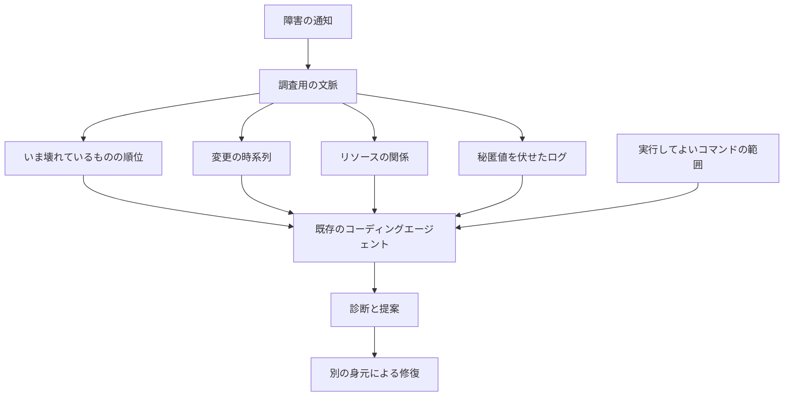

2026年10月21日、CNCF（Cloud Native Computing Foundation）のブログで、Radar の最高製品責任者である Roy Libman が、Kubernetes の障害調査を専用の AI SRE から始めない手順を公開しました。Radar は Skyhook の製品で、クラスタの状態をエージェントに渡すための文脈を返します。AI SRE とは、障害の調査をモデルに任せる製品や手順のことです。公開者は Radar の開発者で、数値は各故障 1 回の自己申告です。

この記事では、既存のコーディングエージェントへ先に渡す材料、記事が置いた測定の条件、その数値がどこまで言えるか、専用製品を見る行をどう残すかを整理します。

*この記事の全体像。以下、順に解説します。*

## クラスタ文脈を渡す手順とは

対象のエージェントは、Claude Code、Codex、Cursor です。Libman の記事は、スキルやサブエージェントの置き場を決める前に、製品を買わず権限とランブックを渡した状態を比較の起点に置く、と案内しています。ランブックは、障害のときに実行してよい手順を書いた文書です。

渡す文脈は、次の材料です。

- いま壊れているものの順位
- 変更の時系列
- リソース同士の関係
- エラーに絞り、秘匿値を伏せたログ
- 実行してよいコマンドの範囲

記事は製品の働きを 5 行に分けています。

| 行 | 役割 |
|---|---|
| Trigger | アラートで調査を始める |
| Context | 生きた状態、直近の変更、現在の障害 |
| Reasoning loop | モデルと、次にどのツールを呼ぶかを選ぶ仕組み |
| Delivery | Slack やチケットへ届ける |
| Governance | 誰の身元で、何を変えてよいか、何が記録されるか |

Context の中身は 4 点です。順位付きの現在の障害、Kubernetes の Event が消えたあとの変更タイムライン、関係付きのリソース、エラーに絞ったログです。Event は、クラスタが短時間だけ残す出来事の記録です。記事は、この 4 点を返す MCP なら Radar 以外でも同じ測り方ができる、と書いています。MCP は、モデルが外部のツールを呼ぶための接続です。実行してよいコマンドの範囲は、この 4 点とは別の入力です。記事の例は、Kubernetes 組み込みの ClusterRole `view` です。ClusterRole は、クラスタ全体に付く権限の束です。`view` は、多くのオブジェクトを読めて、Secret は読めない組み込みの権限です。

測定は、同じ Claude Code に同じモデルを載せ、条件を 2 つに分けた比較です。以降、この条件の片方を腕と呼びます。SREGym の 50 故障を、ライブの 3 ノード EKS で 1 回ずつ診断させています。SREGym は、Kubernetes 上の障害をエージェントに診断させる公開ベンチマークです。EKS は、Amazon が管理する Kubernetes です。片方は shell と kubectl です。もう片方は Radar の読み取り専用 MCP で、kubectl を塞いでいます。判定は、最初に提出した診断です。判定モデルの temperature は 0 です。temperature は、出力のゆらぎを決める設定で、0 はそのゆらぎを切った状態です。記事が書くモデル名は、エージェント側が「Claude Sonnet 5」（Amazon Bedrock 上）、判定側が「Claude Opus 5」です。Bedrock は、AWS 上でモデルを呼ぶサービスです。

測定の表とは別に、読者が試すときに記事が示す身元は、次のとおりです。ServiceAccount `ai-eval` を組み込み ClusterRole `view` に結びます。ServiceAccount は、人ではない主体の身元です。有効期限 8 時間のトークンで kubeconfig を作ります。kubeconfig は、クラスタへ接続する設定ファイルです。管理者ユーザーは消します。確認コマンドは `kubectl auth can-i get secrets` で、結果が no であることを見ます。採点の対象は診断だけです。修復は別の段です。

記事が案内する公開リプレイは [mcp-vs-kubectl](https://radarhq.io/benchmark/mcp-vs-kubectl) です。OSS の Radar は Apache-2.0 で、[skyhook-io/radar](https://github.com/skyhook-io/radar) にあります。

記事が置く境界は、障害の通知のあと、調査用の文脈と実行範囲を既存のコーディングエージェントへ渡し、診断と提案までを出させ、修復の実行は別の身元が持つ、という分け方です。文脈の 4 点は、エージェントが kubectl を連ねて集める代わりに、先に渡す材料です。

図の「実行してよいコマンドの範囲」は、4 点の箱には入っていません。`view` のような権限は、材料とは別に渡します。

## 注意点

記事の表は、専用製品がコーディングエージェントより賢い、という順位ではありません。同じエージェントに、文脈の有無を変えて診断だけを 1 回ずつさせた自己申告です。

### 正解数と時間

記事本文の表（同じ 50 故障、最初の診断）は次のとおりです。

| 指標 | shell と kubectl | 読み取り専用のクラスタ文脈 |
|---|---|---|
| 正解 | 45 | 46 |
| 判定スコアの平均（0 から 1） | 0.905 | 0.936 |
| 2 分以内の正解 | 60% | 86% |
| 5 分以内の正解 | 78% | 90% |
| 平均時間（正解も不正解も含む） | 191 秒 | 64 秒 |
| 中央値 | 87 秒 | 44 秒 |
| 90 パーセンタイル | 632 秒 | 94 秒 |
| 故障あたりの平均ツール呼び出し | 16.3 | 9.8 |

90 パーセンタイルは、遅い方から数えて 10% に入る境目の時間です。判定スコアは、判定モデルが最初の診断に付けた 0 から 1 の点です。2 分以内の 86% は、故障のうち 2 分以内に正解した割合です。shell 側の 60% も、同じ故障の集合です。5 分以内の行も、表では同じ形です。同じ故障で両方が正解だったのは 44 件、と記事は書いています。両方が外した 3 件も同じです。内訳は、mutating webhook が memory limit を書き換えた件、PriorityClass が全体の既定として preemption を起こした件、無関係な設定不備を DNS 故障の代わりに報告した件です。mutating webhook は、リソースが保存されるときにマニフェストを書き換える仕組みです。PriorityClass は、Pod の追い出し順を決めるオブジェクトです。preemption は、優先度の高い Pod が低い Pod を追い出す動作です。

Pod は Ready なのにアプリが壊れている 14 件では、平均が shell 側 326 秒、文脈側 79 秒でした。Astronomy Shop の 1 例では、shell が 58 呼び出し・701.6 秒で、Helm release の Secret をデコードして終わっています。MCP 側は 7 呼び出し・34.8 秒で、issues、get_changes、get_resource、logs、diagnose という名前のツールを呼んでいます。この 5 つの名前が、文脈の 4 点のどれに対応するかは、記事のこの例には書かれていません。この例の diagnose が、あとで書く変更を伴う `in_cluster` だったかも、書かれていません。Astronomy Shop は、このベンチマークが使うサンプルの店アプリです。Helm は、Kubernetes へまとめて入れるパッケージの仕組みです。Helm release の Secret は、そのリリース情報を入れる Secret です。

リプレイページは、同じ系列の時間予算を先まで書いています。左が文脈側、右が shell 側です。10 分で文脈側 92%、shell 側 82% です。15 分と 30 分では、文脈側 92%、shell 側 90% です。30 分の 92% と 90% は 46/50 と 45/50 に相当し、記事の正解数と一致します。長い予算では精度が寄ります。この 1 回の測定で差が大きいのは、正解数より、2 分と 5 分の時間です。別の環境でも同じ差が出るかは、このページからは分かりません。

同ページは、文脈側が外した 4 件のうち、shell だけが正解だったのは 1 件だと書いています。Valkey のメモリの件で、場所は当たり、機構の説明が静的な上限不足になりました。Valkey は、Redis 互換のインメモリのストアです。残り 3 件は両方外れです。内訳は、両方正解 44、文脈側だけ 2、shell だけ 1、両方外れ 3 です。

### もう一つの比較ページ

[ai-sre-tools](https://radarhq.io/benchmark/ai-sre-tools) は別の実験です。ページは 2026年9月20日公開、2026年10月1日更新と書いています。合格は、SREGym の composite が 0.7 以上で、各故障 1 試行です。composite は、故障ごとに付く合成点です。前の表の「正解」や判定スコアと同じものかは、ページが書いていません。合成の中身も書いていません。この 0.7 はページと配布 JSON の meta にあり、CNCF の記事本文にはありません。JSON の meta は、配布ファイルの先頭にある実験条件の記録です。エージェント 5 腕のモデル名は「claude-sonnet-5」で、AWS の腕は非公開モデルです。Radar の版は 1.13.1 です。GitHub のタグ `v1.15.0` は 2026年9月27日、`v1.13.1` は 2026年9月11日に公開されています。ページの脚注は、新しい Radar 1.15 の平均 64 秒を別ページへ譲っています。46 正解・平均 64 秒の 2 腕と、44/50・平均 79 秒の 6 製品表は、別の版の別の比較です。

6 製品表の自己申告は次のとおりです。

| 腕 | 合格 | 平均 | 中央値 | 故障あたり費用 |
|---|---|---|---|---|
| Claude Code + Radar MCP 1.13.1 | 44/50 | 79 秒 | 55 秒 | 0.27 ドル |
| kubectl-ai 0.0.31 | 41/50 | 288 秒 | 184 秒 | 1.67 ドル（prompt caching なし、上限） |
| HolmesGPT 0.41.0 | 38/50 | 176 秒 | 116 秒 | 0.37 ドル |
| OpenSRE 0.1.2026.9.12 | 38/50 | 151 秒 | 137 秒 | 2.07 ドル |
| kagent 0.10.2 | 38/50 | 181 秒 | 91 秒 | 2.26 ドル |
| AWS DevOps Agent（GA 2026年3月31日） | 33/50（5 件は安全フィルタが拒否） | 123 秒 | 99 秒 | 1.27 ドル（agent-time。トークンではない） |

prompt caching は、同じプロンプトの再計算を省く課金上の仕組みです。agent-time は、トークン数ではなくエージェントが動いた時間で数えた費用です。kubectl-ai、HolmesGPT、OpenSRE、kagent は、このページが比べた別の調査エージェントです。

ページ自身が、次の条件を書いています。1〜2 件の差は再現しないことがあります。故障の注入はデプロイの数分後なので、直近の変更を見る腕に有利です。故障を注入した namespace は、AWS と kagent にだけ見えていました。見えていた腕と見えていない腕が混ざっています。kagent は cluster-admin ではなく、読み取り専用の ClusterRole でした。cluster-admin は、クラスタ全体を変更できる組み込みの権限です。

実行後にベンダーが付けた分類では、自分から見える 28 件の合格差は 3、Ready だが壊れている 14 件の差は 7、とページは書いています。「自分から見える」がどの故障か、3 と 7 がどの腕とどの腕の差かは、ページが書いていません。この 2 つの数は、誰が上かの根拠には使いません。名前が付くのは、controller、Job、webhook の 8 件です。controller は他のリソースを作り続ける制御で、Job は終わりのある処理です。この 8 件では、kubectl-ai、HolmesGPT、OpenSRE、kagent が 6/8、Radar が 5/8、AWS が 4/8 です。文脈付きの腕がすべてのクラスで上、とはこの表は言っていません。

配布 JSON を 2026年10月22日に再集計した個別故障も、すべて 1 試行の自己申告です。

| 故障 | 結果 |
|---|---|
| `cronjob_sidecar_blocks_completion_hotel_reservation` | Radar の composite は 0.0 で不合格。kubectl-ai、HolmesGPT、OpenSRE、kagent は 1.0。AWS は 0.0。クラス差の 5/8 対 6/8 はこの 1 件 |
| `mutating_webhook_resource_limits_social_network` | 合格は AWS の 0.78 だけ。kubectl-ai は 0.67。Radar と kagent は 0.33。HolmesGPT と OpenSRE は 0.0 |
| `priority_preemption_cascade_hotel_reservation` | 6 腕とも 0.7 未満。最高は kagent の 0.34。Radar と OpenSRE は 0.23 |
| `astronomy_shop_ad_service_manual_gc` | 6 腕とも 0.0。AWS は refused |
| `secret_rotation_stale_env_credentials_astronomy_shop` | OpenSRE が 1.0、AWS が 0.78 で合格。Radar は 0.56。kubectl-ai、HolmesGPT、kagent は 0.45。誰が Secret の中身を読めたかは JSON に無い |

別ページにある「5 つの Kubernetes MCP を 25 故障で比べ、Radar が次点の 2.3 倍速」は、この 50 件の実験ではありません。ここの判断には使いません。

### 2つの腕の権限

記事は、shell だけが書けた、と書いています。文脈が無かった腕は、全故障で最初の呼び出しが `kubectl get pods` と `kubectl get events` でした。24 件では、その後に更新の履歴を探しています。記事が数えた探索先は、ReplicaSet、rollout、Helm の履歴です。ReplicaSet は同じ Pod を揃えるオブジェクトで、rollout はその更新の進み具合です。文脈があった腕は、50 件すべてで現在の障害が最初の呼び出しで、35 件で変更タイムラインが 2 番目でした。

shell 側の件数も記事が数えています。13 件で自分の Pod を起動し、21 件で exec、cp、port-forward、または debug を使い、4 件で Secret を取り込み、うち 3 件でデコードしています。Social Network は、記事が挙げる別の故障場面の名です。その 1 件では、起動した Pod が MongoDB のコレクション 2 つに `drop()` しています。MongoDB は文書を入れるデータベースで、コレクションはその入れ物です。`drop()` は、そのコレクションを消す呼び出しです。消したあとに、誤った診断を出しています。記事は、SREGym のプロンプトが修復段を前提にし、kubectl に調査と変更を許し、確認を求めるな、と書いていた、と述べています。`view` だけのエージェントが同じ `drop()` をした、という公開された一次の記録は、ここまでの資料にはありません。

したがってこの 2 腕は、「文脈の種類のどれが効いたか」を分離していません。記事自身がそう書いています。注入がデプロイの数分後であることも、変更タイムラインを持つ腕に有利です。時間差を出した腕は、Radar の読み取り専用 MCP が 4 点の文脈を返した状態です。組み込みの `view` とランブックだけを渡して同じ時間になる、とは記事は示していません。

### SREGym論文の数字

論文は arXiv:2605.07161v3 です。提出は 2026年5月8日、改訂は 2026年7月30日です。HTML の著者所属は、University of Illinois Urbana-Champaign と University of Toronto です。CNCF の記事、Radar のベンチページ、配布 JSON の meta が書く「Microsoft + UIUC」は、論文の著者行にはありません。会議への採録は確認していないので、会議名は書きません。UIUC は、イリノイ大学アーバナ・シャンペーン校の略です。

この節の数字は、ベンダーの 50 件の合格率と並べて優劣を付けるためのものではありません。判断に使うのは、問題数が 90 であること、モデル名が記事の「Claude Sonnet 5」とは別であること、EKS の 50 件が OS とハードウェアの故障を含まないことです。frontier、ノイズの中身、移植問題、特性化の採点項目は、論文の数を残すために置きます。語の定義は、論文のこの範囲からは展開できません。

次の百分率は、購入判断には使いません。論文の現時点の問題数は 90 です。abstract は、frontier と呼ぶエージェントの end-to-end に最大 40% の差がある、と書いています。緩和は、診断のあとで障害の影響を下げる段です。40% がどのエージェントとどのエージェントの差かは、abstract のこの文からは特定できません。end-to-end は、診断から緩和までを通した成功率です。本文の Table 3 で、Claude Code と Sonnet-4.6、ノイズなしは、診断 72.6%、緩和 75.6%、end-to-end 60.7%、診断までの平均 292.5 秒、緩和までの平均 702.0 秒、1.47M tokens です。ノイズありは、診断 62.6%、緩和 76.3%、end-to-end 53.7%、診断まで 314.0 秒です。Table 4 の新しい故障 n=13、ノイズなしの Claude Code は、診断 38.5%、緩和 74.4%、end-to-end 28.2% です。移植問題 n=34 のノイズなしは、診断 74.5%、end-to-end 60.8% です。`latent_sector_error` は、Stratus と Claude Code の各 3 回で、集約した診断が 0.22 を超えず、故障の特性化は全回 0 で、dmesg も smartctl も出ていません。Stratus は、論文が比べた別のエージェントです。dmesg と smartctl は、OS とディスクの状態を見るコマンドです。

この Sonnet-4.6 は、記事が書く「Claude Sonnet 5」とは別の名前です。Sonnet 5 と Opus 5 のモデルカードは照合していません。同じモデルだとは扱いません。論文評価の GPT-5.4、Kimi K2.5 とも別名です。

README は、管理された Kubernetes では OS 層の故障をそのまま走らせず、ノードへの SSH と root が要る、と書いています。記事の 3 ノード EKS の 50 件は、論文の OS とハードウェアの故障を含みません。付録は、ノイズのモデルは単純化されており、結果は数千サービスの規模へ直線では伸びない、と注意しています。論文の診断率を、ベンダーの 50 件の合格率の隣に置いて優劣にはしません。

リポジトリ [SREGym/SREGym](https://github.com/SREGym/SREGym) は MIT です。2026年10月22日時点の star は約 360 で、アーカイブではありません。`pushedAt` は任意のブランチへの push なので、その日に default ブランチが進んだことまでは意味しません。Lite は、リポジトリが用意する小さい問題集で、17 問、kind、8 vCPU、16 GB です。kind は、手元で Kubernetes を動かす仕組みです。`--stages diagnosis` は診断の段、`--agent claudecode` は Claude Code、`--n-attempts` は試行回数の指定として、リポジトリにあります。`--use-external-harness` は外部の実行役を使う指定で、`--suite`（問題集の一括）とは併用できず、`--problem`（個別の問題）と使います。

### 読み取り専用の指す範囲

Kubernetes 公式の user-facing roles は、組み込み `view` について、多くのオブジェクトを読める一方で、roles と role bindings は見えず、Secrets は見えない、と書いています。理由は、Secret を読むと、その名前空間の ServiceAccount になりすまして権限を上げられるからです。ルール実体では、`view` は `aggregate-to-view` を集約します。その core のルールには、pods、pods/log、pods/status、events、configmaps などの get、list、watch があります。secrets と pods/exec はそのルールにありません。`aggregate-to-edit` には、pods/exec、pods/attach、pods/portforward の create と、secrets があります。exec を「公式の散文が禁止と書いている」と読むのは強すぎます。散文が明示するのは Secret の除外で、exec はルール一覧からの読み取りです。名前が read-only の自作ロールが、Secret や exec を含むことはあります。

Event の保持は、kube-apiserver の `--event-ttl` の既定が `1h0m0s` です。Kubernetes の 2025年6月10日のブログも、既定の保持は 1 時間と書いています。Event API は best-effort で、保持は有限です。フラグを変えたクラスタは 1 時間ではありません。「多くの変更は Event を出さない」は、フラグのページには無く、記事と Radar の主張です。

Radar の MCP 文書（main、2026年10月22日に raw を取得）では、MCP は既定で有効、ポートの既定は 9280、トランスポートは状態を持たない Streamable HTTP です。`radar --mcp-read-only` または環境変数 `RADAR_MCP_READ_ONLY=1` は、読み取り用のエンドポイントだけを出し、書き込みツールと `diagnose` の `in_cluster` を拒みます。`in_cluster` は、短時間だけ probe 用の Pod を立てる診断です。同じ節は、この設定は Radar の UI と REST API の書き込みを止めない、と書いています。診断は既定で読み取り専用ですが、フルの `/mcp` では `in_cluster` が変更を伴います。Secret のデータは出さず、環境値は伏せる、と概要は書いています。Available Tools の表は、Read が 25 行、Write が 7 行でした。これは main の行数であり、記事の実験がこの表だった保証ではありません。`diagnose` は Read の表にあり、その `in_cluster` だけが変更を伴います。

したがって「読み取り専用にした」は、次のどれを指すかで別物になります。組み込み `view`、MCP の read-only フラグ、UI と REST、調査のプロンプトが変更を許すか、です。記事は、実験に `--mcp-read-only` を使ったとは書いていません。"read-only MCP tools" と "kubectl blocked" とだけ書いています。

調査用の身元と一緒に、製品 UI のターミナルを開かない、という運用上の注意は残します。UI のターミナルが調査身元と同じ権限でコマンドを実行できるかは、フラグ 1 つでは決まりません。

### モデル名と料金

記事とベンダーページの「Claude Sonnet 5」「Claude Opus 5」は、そのページの表記です。Anthropic のモデルカードとは照合していません。

Radar Cloud の料金は、ベンダーページの 2026年10月22日時点です。購入時に月額と年額を読み直してください。

| プラン | 内容 |
|---|---|
| OSS | 無料 |
| Cloud Free | 0 ドル。クラスタ 3 つまで。MCP あり。ホストされた調査はワークスペースあたり月 100。100 が回数か金額かは、料金ページのこの文言では単位がありません。イベントタイムラインの保持は 24 時間。監査ログの保持は無し。稼働率の SLA は無し |
| Team | クラスタあたり月 149 ドルから。年払いで 20% 引き。調査はクラスタあたり月 100 のあと 1 ドルのオプトイン。月 100 の単位は、ページが明記していません。超過分が 1 ドルであることはページにあります。タイムライン 3 日。監査 30 日。稼働率の SLA は無し |
| Enterprise | クラスタあたり月 299 ドル。調査は月 200 のあと 1 ドル。月 200 の単位も、ページが明記していません。タイムライン 30 日。監査 1 年と SIEM。セルフマネージドあり。稼働率の SLA は無し |
| Custom | 99.9% の稼働率 SLA はこの行にある |

SLA は、稼働率の約束です。SIEM は、監査ログを集約して調べる仕組みです。SOC 2 Type 2 は、クラウドの各列で Yes とページが書いています。SOC 2 Type 2 は、一定期間の運用を第三者が見た報告書の種別です。

HolmesGPT の star は、2026年10月22日時点で約 3,700 です。リポジトリは robusta-dev/holmesgpt、Apache-2.0、アーカイブではありません。CNCF のプロジェクトページは、2025年10月8日に Sandbox として受理したと書いています。Sandbox は、CNCF がプロジェクトを置く初期の受理段階の名です。実行環境の隔離のことではありません。Insights に出る 2,246 star は、CNCF の画面に残る古い star 数で、その日の GitHub より古いので使いません。Radar の star は、同日時点で約 3,900 です。

### ページから決まらないこと

次は、公開ページを読んでも決まっていません。

- 記事の実験が `--mcp-read-only` だったか。UI や REST が同時に開いていたか。
- 「Claude Sonnet 5」「Claude Opus 5」が、どのモデルカードのどの ID か。
- 自分のクラスタの `--event-ttl` と、変更が Event を出す割合。
- secret rotation 型の故障で、合格した腕が Secret のバイトを見ていたか。
- アラートで起こしたコーディングエージェントに対して、HolmesGPT Operator がどれだけ早く届けるか。公開の勝率はありません。

50 件の時間と精度は、開発者自身の 1 回の測定です。6 製品の個別 composite も、n=1 の自己申告です。独立した再現や、方法への公開された批判は、ここまでの探索では見つかっていません。見つかっていないことと、存在しないことは別です。

## 専用製品は空いた行だけ見る

記事の 5 行を、文脈を渡したコーディングエージェントと、専用製品を見る理由に分けると次のとおりです。

| 行 | 文脈を渡したコーディングエージェント | 専用製品を見るとき |
|---|---|---|
| Reasoning loop | Claude Code、Codex、Cursor がすでに持つ | ループそのものの買い替えが目的のとき |
| Context | 障害の順位、Event の期限後の変更、関係、伏せたログ。許可コマンドは 4 点の外 | その 4 点を自前で渡せないとき |
| Trigger | 人が起動する | 人が気づく前に調査を始めたいとき |
| Delivery | チャットに返す | インシデントのチャネルへ、起きた時点で残したいとき |
| Governance | 調査身元を `view` に限り、呼び出しを記録する | 身元、変更範囲、記録が製品側にしか無いとき |

許可コマンドは、前半のとおり 4 点の外です。それが空なのは、調査してよい範囲を渡していない、という権限の問題です。4 点が空なときだけ、Context の行で製品を見ます。

46 対 45 は、製品差として買う理由にはしません。6 製品の順位も、独立した証明にはしません。確信度は中で、条件付きです。言ってよいのは、比較の起点を「文脈を渡した同じエージェント」に置くことと、短い時間で測ることです。

HolmesGPT の公式ドキュメントは、組み込みの Kubernetes toolset を既定で kubectl の読み取り専用とし、Secret を外す、と書いています。書き込みは別の Remediation MCP で、変更ツールは人の承認を要します。remote MCP は、現行ドキュメントで streamable-http を推奨し、SSE は非推奨です。streamable-http は、応答を流しながら返す HTTP の接続です。SSE は、サーバーから一方的にイベントを送る古い方式です。2025年6月の Robusta の文書が、remote MCP を tech preview かつ SSE のみと書いた記述は、現行ドキュメントが置き換えています。

人が起動しない Trigger に近い公式の形は、HolmesGPT Operator です。ドキュメントは、多くのエージェントは人が気づいて起動する必要があり、Operator は 24 時間動いて Slack へ修正案つきで書く、と述べています。推奨経路は、GitHub MCP で PR を開くことです。状態は alpha で、壊れる変更がありえます。ヘルスチェックのたびに、少なくとも 1 回 LLM を呼びます。対象は Kubernetes に限らず、Prometheus、Datadog、AWS、データベースも含む、とページは書いています。コーディングエージェントをアラートで起こした場合に対する勝率は、公開されていません。Operator を文書の推奨どおり入れると、同じ主体が修正案の PR を開きえます。PR を開くことと、その PR を承認して本番へ適用することは、別の操作です。修復の適用まで分けるには、レビューとマージの権限をその主体に渡しません。

自分の障害に Secret の中身が要るなら、`view` のままでは埋まりません。そのときだけ、Secret を読む別手順を製品評価の対象に足します。独立した再現が公開されていないことは、ベンダーの測定値だけで購入を決めない理由になります。文脈を渡して測ること自体は、止めません。

## 自分の障害では時間と診断を残す

専用の AI SRE を比べる前に、今のコーディングエージェントへ、調査と提案までに限ったクラスタ権限とランブックを渡します。渡すリストが空なら、購入理由は精度以外にあります。

検討する順は、次の 3 つです。

1. 文脈を渡す前に、製品の比較表を作る。
2. 文脈を渡し、短い時間予算で自分の障害を測ってから、空いた行だけ製品を見る。
3. 専用製品を既定にし、コーディングエージェントは補助にする。

採るのは 2 番です。見る基準は 4 つです。

- 同じエージェントで、材料を渡した条件と渡さない条件の時間差が、自分の障害で出るか。記事が 64 秒と 191 秒を出した 2 条件は、shell と kubectl と、Radar の読み取り専用 MCP が 4 点を返した状態です。`view` とランブックだけで、その秒数が再現するとは記事は示していません。自分で残す時間は、自分の障害の記録です。
- 調査身元が、Secret と exec を持たないか。
- 修復の実行が、別の身元に残るか。
- 無人の起動、届け先、記録が、文脈を渡したあとも空か。

手順は次のとおりです。

1. 本番の kubeconfig とは別の `ai-eval` を、組み込み `view` に結びます。`kubectl auth can-i get secrets` が no であることを確認します。Secret と exec を含む自作の read-only は使いません。ランブック、つまり実行してよい手順の文書も、そのエージェントへ渡します。文書に何を書くかの項目は、記事が手順としては書いていません。残すのは、許可コマンドの範囲が空だったかどうかです。
2. 修復の実行権限は、その ServiceAccount に付けません。
3. 直近の障害を 2〜3 件、staging で再生します。staging は、本番ではない確認用の環境です。文脈を渡した条件と、渡さない条件を、同じエージェントで比べます。2 分と 5 分の時間だけを見ます。試行は 3 回です。記事の測定では、別のモデルが最初の診断を判定しています。自分の障害で何を正解にするか、3 回をどう集計するかは、記事が書いていません。残すのは、各回の時間と出した診断です。
4. 渡した材料のうち、現在の障害、Event の期限後の変更、関係、伏せたログ、許可コマンドのどれが空だったかを残します。4 点が空なら Context の行、許可コマンドが空なら権限の問題です。この空欄を、Trigger の購入理由にはしません。
5. 別に、Trigger（人が気づく前の起動）、Delivery（起きた時点の届け先）、記録される身元が、文脈を渡したあとも空なら、その行だけ製品を比べます。精度の 1〜2 件差では始めません。

リスクは 4 つです。

- 管理者の kubeconfig を調査エージェントに残すと、記事が数えた Pod の起動と Secret のデコードが再現しえます。Social Network の `drop()` は、コレクションを消す呼び出しが、変更を許すプロンプトの下で起きた例です。文脈を渡すこと自体が、安全になるわけではありません。
- MCP の read-only は、UI と REST を止めません。読み取り専用は、フラグ 1 つで終わりません。
- Operator を文書の推奨どおり入れると、同じ主体が修正案の PR を開きえます。修復の適用を分けるなら、レビューとマージの権限は別の身元に残します。
- 30 分まで待てる障害では、記事系列の精度は 90% と 92% まで寄ります。時間に困っていないなら、文脈を買う理由は薄いです。

次のときは、精度の表から始めません。

- 自分の障害を、`view` と変更履歴とログを渡したエージェントが、固定の短い時間予算で繰り返し外し、外し方が Trigger や Delivery では説明できない。
- 故障の本体が、Secret の中身、ノードの OS、または論文の `latent_sector_error` のように、`view` と kubectl の外にある。
- 人が起動するまでの待ちが、調査時間より長い。製品比較は Trigger の行から始めます。

## まとめ

AI SRE の比較表を作る前に、既存のコーディングエージェントへ、4 点の材料（障害の順位、Event の期限後の変更、関係、伏せたログ）と、Secret も exec も含まない組み込み `view` を渡します。MCP の read-only フラグは、UI と REST の書き込みを止めません。測るのは 2 分と 5 分の時間で、試行は複数回、対象は自分の障害です。修復の実行は別の身元に残します。専用製品の評価は、その状態でも空のままの手順、まず無人の起動、届け先、記録される身元について始めます。正解数の 1 件差と、別実験の 6 製品表は、購入の起点にしません。

この記事が少しでも参考になった、あるいは改善点などがあれば、ぜひリアクションやコメント、SNSでのシェアをいただけると励みになります！

## 参考リンク

- [Roy Libman, “Before you evaluate an AI SRE, give your existing agent context,” CNCF Blog, 2026-10-21](https://www.cncf.io/blog/2026/10/21/before-you-evaluate-an-ai-sre-give-your-existing-agent-context/)
- [Radar の公開リプレイ（ベンダー。記事が案内する同じ系列）](https://radarhq.io/benchmark/mcp-vs-kubectl)
- [Radar の 6 製品比較（ベンダー。別実験）](https://radarhq.io/benchmark/ai-sre-tools)
- [SREGym 論文 HTML](https://arxiv.org/html/2605.07161v3)
- [SREGym リポジトリ](https://github.com/SREGym/SREGym)
- [Kubernetes の RBAC user-facing roles](https://kubernetes.io/docs/reference/access-authn-authz/rbac/)
- [kube-apiserver の `--event-ttl`](https://kubernetes.io/docs/reference/command-line-tools-reference/kube-apiserver/)
- [Radar の MCP 文書（main）](https://github.com/skyhook-io/radar/blob/main/docs/mcp.md)
- [Radar の料金（ベンダー）](https://radarhq.io/pricing)
- [HolmesGPT の CNCF プロジェクト](https://www.cncf.io/projects/holmesgpt/)
- [HolmesGPT の remote MCP](https://holmesgpt.dev/dev/data-sources/remote-mcp-servers/)
- [HolmesGPT Operator](https://holmesgpt.dev/latest/operator/)
