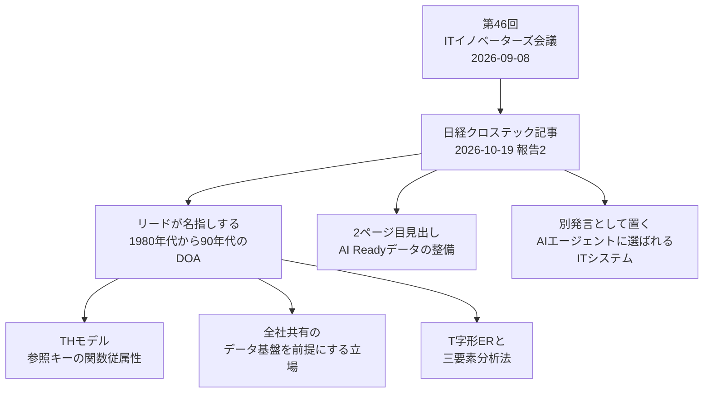

2026年10月19日、日経クロステックは、同年9月8日の「ITイノベーターズ会議」を報じました。公開された1ページ目は、生成AIを前提にしたレガシー刷新の要点として、1980年代から90年代に広まったデータ中心アプローチ（DOA）が再び求められる、という意見を伝えています。読み手は、現行システムの逆解析や刷新を発注する人です。有料の2ページ目は未読のため、誰が何を発言したかの割り当ては、公開1ページ目だけではできません。

ここでは、公開1ページ目、公式プログラム、手法の公開定義から、DOA が何を指すかと、発注の受入条件に足せる一行の範囲を整理します。

*この記事の全体像。以下、順に解説します。*

## データ中心アプローチとは

### 報道が置いている手法名

鈴木慶太氏の記事の題は「AI前提のレガシー刷新、データ中心アプローチが意外な復活　CIOらが議論」です。肩書きは「ITイノベーターズ会議2026年9月」報告（2）です。公開日時は 2026-10-19T05:00:00+09:00 です。連載名は「データとAIエージェントで変わる『レガシー刷新』の勝ち筋」です。

公開リードは、会議の日付を2026年9月8日とし、日本を代表する企業の CIO・CDO が生成AI時代のレガシー刷新を議論した、と書いています。リードが手法名として置くのは「データ中心アプローチ（DOA）」です。別の発言として挙げるのは「AIエージェントに選ばれるITシステム」です。

記事は2ページです。次ページリンクの見出し断片は「『AI Ready』データの整備が鍵に、AIに...」です。タグは、ITイノベーターズ、AIエージェント、AIフレンドリーです。会議日は2026年9月8日です。記事の公開日は2026年10月19日です。

### 会議の公開プログラム

第46回の公式プログラムは、2026年9月8日（火）13:00〜17:30、オンライン開催、主催は日経クロステックです。名称は「『2025年の崖』を越えた企業の実践知 / AIエージェント時代のレガシー刷新、変革の勘所」です。前文は「本ウェビナーでは」と書いています。

公開テキストが並べている題は、次のとおりです。

- 東京ガスの基幹系刷新と、組織・風土
- ワークスアプリケーションズの「進化し続けられるシステムアーキテクチャ」
- Scalar のシステム分析・再設計
- アクセンチュアの「現行を等価なJava実行系へ移す」手順（LIFT、TWIN、SHIFT）
- リミニストリートの「既存システムをAI-Ready化する」という題

アクセンチュア（中野恭秀氏、15:50〜16:00）は、いきなり作り直すのではなく、現行を等価な Java 実行系へ移し、ログ・文書・有識者知識を結び付けた 4D 業務デジタルツインを作る、と書いています。

ワークスアプリケーションズ（外村卓也氏、14:00〜14:10）は、現場業務のカスタマイズとスクラッチを課題にし、AIエージェント時代にも進化し続けられるアーキテクチャを解にする、と書いています。

Scalar の公式概要は、AI によるシステム分析・再設計と、常石造船の事例です。同社の登壇資料（Speaker Deck、2026年9月11日公開、当日資料と記載）は、手順の先頭に既存コードの理解とロジック抽出を置いています。ビジョンの一文には「今後はデータ中心の社会になっていき」ともあります。

東京ガス基調の公開要約は、基幹系の全面刷新、体制、オクトパスエナジーとの合弁、組織・風土・ビジネスモデルです。

### 日本の DOA に含まれる流儀

日本の DOA は、データを先に置いてから機能を導く分析・設計手法の総称です。公開説明に含まれるのは、次の流儀です。

- 参照キーの関数従属性で表す TH モデル
- 全社共有データ基盤を前提にする立場
- T字形ER
- 三要素分析法

関数従属性は、ある項目の値が、別の属性の組から一意に決まる、という関係です。

ITmedia の用語解説（2011年9月9日）は、DOA を「データを先に明確化し、それに従ってシステム機能を導出する方法」としています。全社共有を前提にする立場もある、とも書いています。

情報処理安全確保支援士試験のシラバス追補版（科目 A-2、Ver.4.0、2023年）は、企業データモデルや概念データモデルと DOA を用語例として並べています。関数従属は、別の箇所にあります。

### 記事と手法の関係

リードが「ポイント」と呼ぶのは、1980年代から90年代の DOA です。下の図は、その DOA と、日本でその名にまとめられてきた流儀と、公開されている見出し断片を並べたものです。

## 注意点

公開テキスト、隣接する用語、隣の回の数値は、別々に読みます。

### 有料本文と発言の割り当て

記事本文の2ページ目は、会員壁の向こうにあります。誰が何を発言したかの割り当ては、公開1ページ目だけではできません。「AIフレンドリー」の定義も、本文未読です。

公開リードに、マスタ、語彙、系統、切替日、という語はありません。これらを、CIO や CDO の合意として発注書へ写す根拠にはなりません。

「AI Ready」データは、2ページ目の見出し断片です。定義は本文未読です。リミニストリートの題も AI-Ready 化ですが、概要文はありません。見出しを、マスタや系統の定義として使いません。

未解決のまま残す問いは、次の4つです。

- 2ページ目で、発言者は「AI Ready」データを、マスタ、用語、系統、切替条件のどれとして話したか
- ディスカッションで、データ項目の決定項や正本に触れた発言があるか。公開1ページ目と公式プログラムには、その転載がありません。無かったと断定はしません
- 「AIフレンドリー」は本文で定義されているか
- リミニストリート講演の「AI-Ready化」は、見出しの「AI Ready」データと同じ対象か。概要文がありません

### 日付、人数、会場

会議日は2026年9月8日です。記事の公開日は2026年10月19日です。報告の日付を、議論の日付にしません。

開催ページの開催形式は「オンライン開催」です。前文も「本ウェビナーでは」と書いています。日経BPの協賛募集 PDF は、9月8日の会場欄に赤坂インターシティと書き、同じ資料がオンライン視聴の事前登録とも書いています。PDF の「300名前後」は、保証しないリード見込みです。当日の参加人数ではありません。会場は、この二つを両方残し、一つに決めません。

公式プログラムの「約40名」は、ディスカッションの案内文です。記事リードの人数ではありません。

プログラムは「経済産業省が2018年に警鐘を鳴らした『2025年の崖』」と書いています。DXレポート本文は、ここでは照合していません。

### 隣の回と隣の記事の数値

同連載の2026年10月15日の記事は、肩書きが「ITイノベーターズ会議2026年9月」報告（1）です。東京ガスが先進的な IT と、速く事業を広げる組織風土を取り込んだ、というリードです。著者は鈴木慶太氏、公開日時は 2026-10-15T05:00:00+09:00 です。次ページリンクの断片に「約900人のDX人材」とあります。本文未読のため、この人数は使いません。

2026年6月3日の第45回（花王、データドリブン経営）は、別の回です。そこの数値や発言は、9月の会議の内容にしません。

Scalar の Speaker Deck は、現行モノリスを 7,061 プログラム、458 テーブル、AIエージェント実行を約4時間、と書いています。これは登壇資料の自己記載です。監査済みの実績ではありません。

### DOA と英語の data-centric

Wikipedia は、DOA を日本生まれの手法の総称とし、用語の初出は1988年の堀内一『データ中心システム設計』だといわれる、と書いています。ITmedia の用語解説も、会議の発言録ではありません。どちらも二次的な解説です。

英語の data-centric は、日本の DOA と同じ指示対象ではありません。

Andrew Ng 氏の data-centric AI は、学習データセットを体系的に作る規律です。IEEE Spectrum の文は、"Data-centric AI is the discipline of systematically engineering the data needed to successfully build an AI system." です。DeepLearning.AI（2021年5月26日）は、データドリフトと概念ドリフトへの継続対応を課題に数えています。対象は、学習データの分布とラベルです。業務項目の関数従属性ではありません。一度決めて固定する、という読みは、この枠では維持されません。

Semantic Arts の data-centric は、アプリケーションが共有データに合わせる、という企業アーキテクチャです。同社の別ページは、中核モデルを通常6カ月未満、概念は通常500未満（classes と properties の合計）、とも書いています。これは二次的な記述です。

Gartner の説明ページにおける MDM は、公式な共有マスタの均一性、正確性、意味の一貫性を、事業と IT が保つ規律です。

OpenLineage は、実行中ジョブの run、job、dataset を測るメタデータ標準です。日本の DOA の公開定義には、ジョブ実行の系統は出てきません。

データメッシュ（Zhamak Dehghani 氏、Martin Fowler、2020年12月3日）は、変化をほとんど許さない全社の単一表現を、脆さの原因として退けます。

データベーススペシャリストのシラバス Ver.4.1 にある「マスターデータの統合」は、データ定義の標準化の文です。DOA という語の定義文ではありません。

試験対策サイトの「DOA は世界を実体と ER で捉える」という説明は、公式の試験 PDF としては、ここでは確認していません。

### 失敗事例として使わない論

エンタープライズ・オントロジーを先に全体定義すると、定義争いで納品が止まる、という実務寄りの論があります（Kurt Cagle 氏、LinkedIn、2026年4月18日）。これは二次的な論です。日本の DOA の失敗事例ではありません。

企業名つきで「DOA の企業データモデルが刷新を止めた」と書いた公開事例は、ここで参照した資料の範囲では確認していません。確認できないことを、失敗が無いことの証明にはしません。

## 発注の一行に入れる範囲

公開本文は、会議の「データ中心」を、マスタ統合、語彙、系統のどれかには分けていません。分けられるのは、公開定義の側です。

| 読み | 公開テキストとの関係 | 発注の一行に入れるか |
|---|---|---|
| 古典的 DOA（データを先に置き、機能を後から導く） | 記事リードが手法名と年代を明示している | 入れる。ただし流儀は一つに限定して書く |
| マスタ統合 | IPA の別項目と、DOA の「全社共有」を前提にする立場には隣り合う。記事リードには語がない | 入れない。全社マスタの完成を、この会議の指定にしない |
| 語彙（人と AI が同じ名前で参照する項目名） | DOA の関数従属性は「何が値を決めるか」であり、用語集そのものではない | 項目名は受入条件の一部にする。全社用語集の完成にはしない |
| 系統（lineage） | 日本の DOA の公開定義には、ジョブ実行の系統は出てこない。OpenLineage は別物 | 入れない |
| 「AI Ready」データ | 2ページ目の見出し断片。定義は本文未読。リミニストリートの題も AI-Ready 化だが、概要文はない | 見出しを、マスタや系統の定義として使わない |

公開情報の範囲では、2026年9月8日の会議は、マスタ統合、語彙、系統のどれかを「データ中心」の中身として採択した、とは読めません。記事が手法名として置いているのは、1980年代から90年代の DOA です。

## 同じ日の手順は一つに畳まない

リードが DOA を再浮上の名として置いている、という読みは残ります。それを、マスタ完成、語彙完成、系統グラフ、切替前の永久凍結、会議の唯一解、に広げる読みは、公開プログラムと用語定義が止めます。

アクセンチュアの公開概要は、実行系への移設を先に置き、結ぶ対象としてログ、文書、有識者知識を挙げます。関数従属性でもマスタでもありません。この一行を「会議の共通手順」にはできません。

ワークスアプリケーションズの公開概要は、進化し続けるアーキテクチャを解にしています。切替前に意味を凍結し、その後変えない、という読みとは別の向きです。

Scalar の登壇資料は、手順の先頭がコード解析です。ビジョン文の「データ中心」は、手順が意味の凍結だと示す文ではありません。

データメッシュの公開論は、変化をほとんど許さない全社の単一表現を脆さの原因とします。対象を全社規範に広げると、この論が反対側に回ります。

RAG の原論文は、外部記憶を Wikipedia 本文のベクトル索引に置いています（Lewis ほか、arXiv:2005.11401）。業務マスタの正規形が、エージェントの前提だ、という証明にはなりません。

推奨の確度は、有料本文を読んでいない分だけ、中程度に留めます。有料本文が、マスタ統合または lineage を DOA の中身として明示していた場合、下の一行は「会議の要旨」ではなく「発注者の限定」だという注記を強めます。本文が関数従属性や正本に触れていた場合でも、同じ日の移設先行と進化継続の講演は残ります。会議の唯一解にはしません。

## 受入条件として固定する一文

発注範囲に足す一文は、次で足ります。

> 対象ユースケースに限り、画面とバッチの切替日とは別の受入条件として、人と生成AIが同じ名前で参照するデータ項目について、項目名、その値を決める属性、その値の正本となるシステムを、切替判断に使う文書として固定する。全社のマスタ統合、全社の用語集、ジョブ実行の系統グラフ、意味をその後変えないことは、この受入条件に含めない。

この文は、2026年9月8日の登壇者の引用ではありません。DOA のうち、参照キーの関数従属性に近い読みと、正本を一つ指す範囲だけを、発注者が選んだものです。全社共有を前提にする流儀、T字形ER、三要素分析法は、範囲外です。

同じ会議の公開プログラムには、実行系を先に移す手順と、進化し続けるアーキテクチャと、コード解析から入る手順があります。上の一文は、それらの手順を禁止しません。移設やコード解析と並行して、切替判断のチェック項目を一つ増やす、という置き方にします。

採らない置き方は、次の3つです。

- 公開リードに無い語を、CIO や CDO の合意として発注書へ写す
- 切替の前提を、全社の MDM、全社の用語集、OpenLineage の系統グラフの完成にする
- 有料本文が未読であることを理由に、受入条件を一行も足さない

直近でやることは、次の3つです。

1. 会員で記事の2ページ目を読み、発言者がマスタ、用語、系統、切替のどれに触れたかを、この一文の注記に追記する
2. 発注書では、対象ユースケースの名前を空欄のままにしない。ユースケースが決まってから、項目名と正本を書く
3. ベンダー提案が「データ中心」と言うときは、DOA、MDM、用語集、lineage、学習データの data-centric AI のどれかを、提案側に書かせる

次のときは、この一行だけでは足りません。

- 記事本文が、系統または全社マスタを、この会議の「データ中心」の中身だと明示している
- 対象が一つのユースケースに収まらず、ドメインをまたぐ正本の衝突が切替の障害になっている。そのときは、マスタ統合の検討が別行で要る
- エージェントが参照する主材料が、項目の正本ではなく、ログと手順書である。そのときは、アクセンチュア概要が挙げるログ、文書、有識者知識を、正本と同じ受入条件の別行に置く

## まとめ

2026年10月19日の日経クロステックは、2026年9月8日の ITイノベーターズ会議を報じ、生成AIを前提にしたレガシー刷新の要点として、1980年代から90年代の DOA を置いています。公開1ページ目は、その DOA を、マスタ統合、全社用語集、ジョブの系統グラフのどれかには指定していません。有料の2ページ目は未読です。

発注に足すなら、対象ユースケースに限ります。画面とバッチの切替日とは別に、項目名、値を決める属性、正本のシステムを、切替判断の文書として固定します。全社マスタ、全社用語集、系統グラフ、意味の永久凍結は、その受入条件に含めません。同じ日の移設、進化継続、コード解析は、禁止しません。

この記事が少しでも参考になった、あるいは改善点などがあれば、ぜひリアクションやコメント、SNSでのシェアをいただけると励みになります！

## 参考リンク

- [鈴木慶太「AI前提のレガシー刷新、データ中心アプローチが意外な復活　CIOらが議論」日経クロステック、2026-10-19](https://xtech.nikkei.com/atcl/nxt/column/18/03788/100700002/)
- [同、2ページ目（本文未読）](https://xtech.nikkei.com/atcl/nxt/column/18/03788/100700002/?P=2)
- [連載扉「データとAIエージェントで変わる『レガシー刷新』の勝ち筋」](https://xtech.nikkei.com/atcl/nxt/column/18/03788/)
- [日経BP「ITイノベーターズ会議」第46回プログラム](https://events.nikkeibp.co.jp/event/2026/nxt2026itiall/)
- [日経クロステック、東京ガスを扱う同連載記事、2026-10-15（公開リードのみ）](https://xtech.nikkei.com/atcl/nxt/column/18/03788/100700001/)
- [日経BP 協賛資料 PDF](https://www.nikkeibp.co.jp/ad/atcl/material/25/11/17/03169/260325_ki_NXT_itinnovators2026.pdf)
- [Scalar Speaker Deck「【2026/9/8】ITイノベーターズ会議」（2026-09-11 公開。数値は自己記載）](https://speakerdeck.com/scalar/20260908_itinnovetors_scalar)
- [IPA「情報処理安全確保支援士試験 シラバス追補版（科目 A-2）」Ver.4.0](https://www.ipa.go.jp/shiken/syllabus/nq6ept00000014i5-att/syllabus_sc_am2_tsuiho4_0_henkou.pdf)
- [IPA データベーススペシャリスト シラバス Ver.4.1](https://www.ipa.go.jp/shiken/syllabus/nq6ept00000014bm-att/syllabus_db_ver4_1.pdf)
- [Wikipedia「データ中心アプローチ」（二次情報）](https://ja.wikipedia.org/wiki/%E3%83%87%E3%83%BC%E3%82%BF%E4%B8%AD%E5%BF%83%E3%82%A2%E3%83%97%E3%83%AD%E3%83%BC%E3%83%81)
- [ITmedia「データ中心アプローチ」2011-09-09（二次情報）](https://www.itmedia.co.jp/im/articles/1109/09/news134.html)
- [IEEE Spectrum, Andrew Ng on data-centric AI](https://spectrum.ieee.org/andrew-ng-data-centric-ai)
- [Andrew Ng, DeepLearning.AI, 2021-05-26](https://charonhub.deeplearning.ai/data-centric-ai-development-a-new-kind-of-benchmark/)
- [Semantic Arts, data-centric](https://www.semanticarts.com/data-centric/)
- [Semantic Arts, data-centric transformation（二次情報）](https://www.semanticarts.com/semantic-arts-future-proofs-the-enterprise-with-data-centric-transformation-programs/)
- [Gartner, Master Data Management](https://www.gartner.com/en/data-analytics/topics/master-data-management)
- [Zhamak Dehghani, Data Mesh Principles and Logical Architecture, Martin Fowler, 2020-12-03](https://martinfowler.com/articles/data-mesh-principles.html)
- [OpenLineage README](https://github.com/OpenLineage/OpenLineage/blob/main/README.md)
- [Lewis ほか, arXiv:2005.11401](https://arxiv.org/abs/2005.11401)
- [Kurt Cagle, LinkedIn, 2026-04-18（二次情報）](https://www.linkedin.com/pulse/ontology-problem-technical-kurt-cagle-zwpyc)
