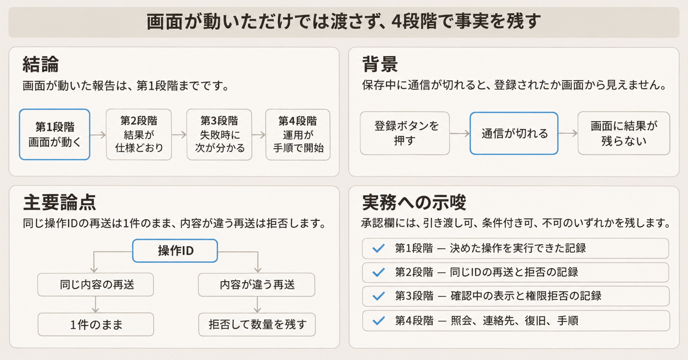
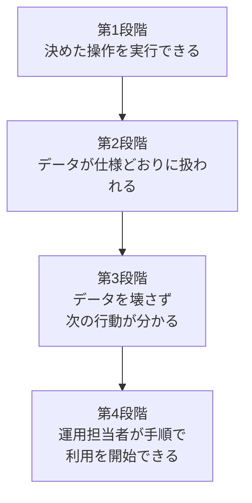
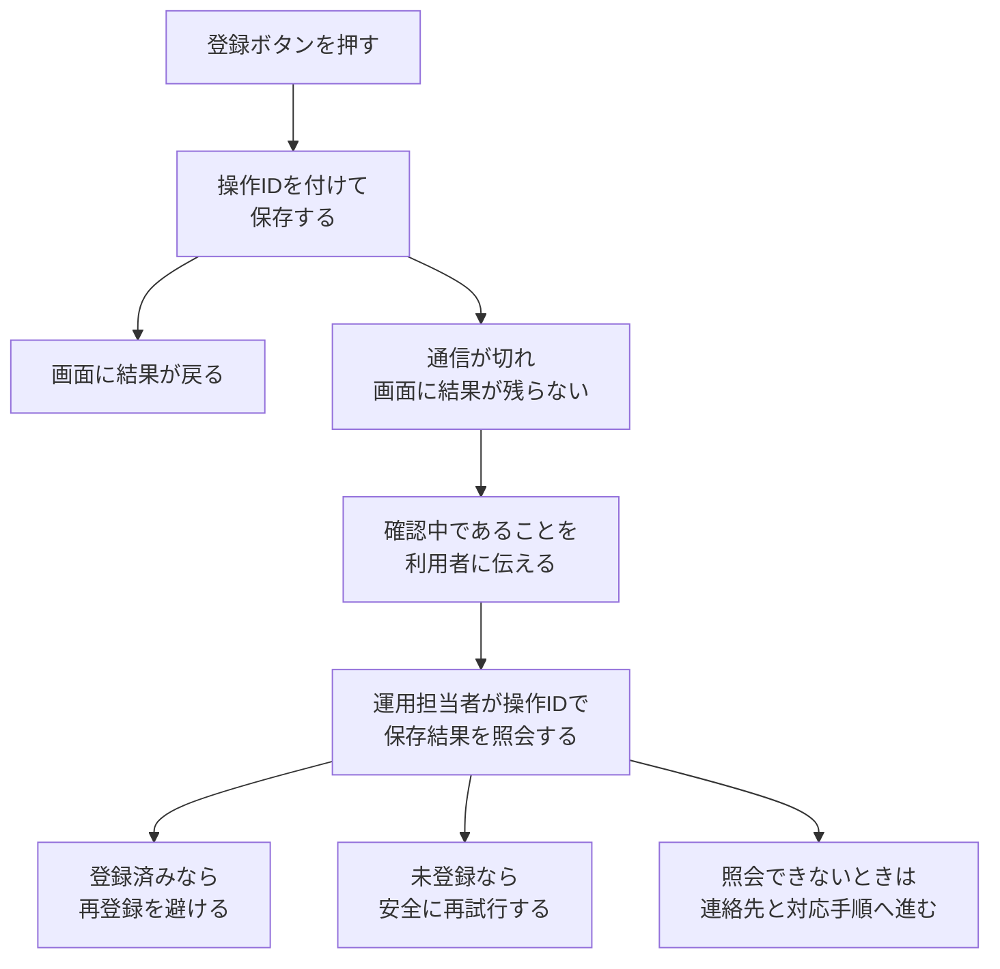

TechStudioLab が 2026年11月8日に公開した「[AIで作ったアプリ、画面が動いたら完成？引き渡し前の4段階](https://zenn.dev/techstudiolab/articles/ai-generated-app-four-levels-of-done)」は、AIで作った備品管理アプリを利用者へ渡す前に、完成を4つの段階で記録する提案です。段階の名前は「画面が動く」「期待した結果になる」「失敗したときに扱える」「利用者に渡せる」です。著者の手順案であり、導入件数や障害件数の測定報告ではありません。

受け取る側は、各段階で残す事実、掲載されている操作IDの扱い、承認欄に書くことを、この順で確認できます。操作IDは、登録操作ごとに付ける一意の識別子です。再送が同じ操作だと分かるようにするためのものです。


*この記事の全体像。以下、順に解説します。*

## 引き渡し前の4段階とは

### 例にする備品管理アプリ

例のアプリは、備品の名前と数量を登録し、一覧から検索します。管理者は登録内容を修正できます。一般利用者は閲覧だけができます。

保存の途中で通信が切れると、画面に結果が残りません。登録されたかどうかは、利用者から見えません。

TechStudioLab の記事は、通常の登録が成功したあとに、次の3つの場面を追加で見るとしています。

1. 登録ボタンを2回押した場合です。画面上でボタンを無効にすれば、連続クリックは防げます。通信の再送や、複数画面からの操作までは防げません。1回の登録操作につき1件だけ作る仕様なら、サーバー側でも重複を防ぎます。
2. 保存中に通信が切れた場合です。サーバーでは保存が終わっているのに、画面には結果が戻っていないことがあります。「保存に失敗しました」とだけ出すと、利用者は再登録してよいかを判断できません。
3. 一般利用者が管理者の更新処理を呼んだ場合です。画面で編集ボタンを隠しても、APIの呼び出し自体を制限していなければ、画面を通さずに更新を送れる可能性があります。一般利用者の認証情報で更新を呼び、サーバーが拒否することと、拒否したときにデータが変わっていないことを確認します。

### 4つの段階

完成を一つの語で扱うと、開発者と利用者の認識がずれやすくなります。TechStudioLab の記事は、備品管理アプリの完成条件を4段階に分けます。各段階を通過したと言うには、確認した事実を残します。

| 段階 | 確認すること | 通過の判断 |
| --- | --- | --- |
| 1. 画面が動く | ログイン、登録、検索、画面遷移 | 決めた操作を実行できる |
| 2. 期待した結果になる | 保存内容、重複登録、検索結果 | データが仕様どおりに扱われる |
| 3. 失敗したときに扱える | 通信失敗、権限外操作、再試行 | データを壊さず、利用者が次に取る行動が分かる |
| 4. 利用者に渡せる | 権限設定、復旧手順、操作説明 | 運用担当者が決めた手順で利用を開始できる |

記事は、第3段階まではアプリの振る舞いを確認する、としています。第4段階では、運用担当者が実際に問題へ対応できるかを確認する、としています。

記事は、通信が切れて保存結果が分からなくなったときを例にしています。開発者がデータベースを直接調べれば、成否は分かるかもしれません。その方法しかない状態で渡すと、同じ問題のたびに開発者の対応が必要になります。この例では、運用担当者が操作IDから登録結果を確認できることを、第4段階の判定条件にしています。

そのときに目指す状態は、次の4つです。

- 利用者が、問題の起きた登録操作を特定できる
- 運用担当者が、操作IDを使って保存結果を照会できる
- 登録済みなら再登録を避け、未登録なら安全に再試行できる
- 結果を確認できない場合の連絡先と対応手順が決まっている

引き渡し判定では、手順書があることに加えて、運用担当者がその手順で結果を確認できた事実を残します。記事は、開発者が修正できることと、運用担当者が問題に対応できることを分けて確認する、と冒頭に書いています。後半では、開発者が復旧できる状態と、運用担当者が復旧できる状態を分けて判定することが大切だ、としています。

4段階は、次の順で並びます。



### 登録から照会までの流れ

画面の成功のあと、記事が引き渡しの判断に使う流れは、操作IDを手がかりに保存結果を見ることです。



掲載の Python が実装しているのは、一つのプロセスの中で、同じ `request_id` の再送と、同じ ID で内容が違う再送の拒否です。`request_id` は、操作IDを受け取る引数の名前です。上の図にある照会、確認中の表示、連絡先への引き渡しは、文章側の目標です。

### 操作IDをテストに書いた例

完成条件が「登録機能が正常に動く」だけだと、テストを書く人によって確認内容が変わります。記事は、操作の前の状態、実行する操作、期待する結果を文章にすると、確認内容を揃えられる、としています。備品登録では、4段階を次の文章にしています。

1. 備品名と数量を入力し、登録すると一覧に表示される。
2. 同じ操作IDと登録内容を再送しても、登録件数は1件のままになる。
3. 保存中に通信を切っても、操作IDから保存結果を確認できる。
4. 運用担当者が照会手順を使い、登録結果を確認して利用者に案内できる。

この4つは、第1段階から第4段階の順です。

第2段階の条件を、記事は Python 3.12 の標準ライブラリでテストできる形にしています。データベースと通信処理は省いています。確認するのは、登録操作の再送と、同じ操作IDで異なる内容が届いた場合です。掲載コードに、3.12 固有の構文はありません。

```python
# Python 3.12
import unittest

class Inventory:
    def __init__(self):
        self.items = {}
        self.requests = {}

    def register(self, request_id, name, quantity):
        payload = (name, quantity)
        if request_id in self.requests:
            saved_payload, item_id = self.requests[request_id]
            if payload != saved_payload:
                raise ValueError("同じ操作IDで登録内容が異なります")
            return item_id

        item_id = len(self.items) + 1
        self.items[item_id] = payload
        self.requests[request_id] = (payload, item_id)
        return item_id

class InventoryTest(unittest.TestCase):
    def test_retry_does_not_duplicate(self):
        inventory = Inventory()
        first = inventory.register("req-001", "マウス", 3)
        second = inventory.register("req-001", "マウス", 3)
        self.assertEqual(first, second)
        self.assertEqual(len(inventory.items), 1)

    def test_changed_payload_is_rejected(self):
        inventory = Inventory()
        inventory.register("req-001", "マウス", 3)
        with self.assertRaises(ValueError):
            inventory.register("req-001", "マウス", 5)
        self.assertEqual(inventory.items[1], ("マウス", 3))

if __name__ == "__main__":
    unittest.main()
```

`register` は、`request_id` と名前と数量を受け取ります。同じ `request_id` が既にあれば、保存済みの内容と比べます。内容が同じなら、以前の備品IDを返します。内容が違うなら、代入の前に `ValueError` を上げます。メッセージは「同じ操作IDで登録内容が異なります」です。新しい `request_id` なら、備品IDを `len(items) + 1` とし、備品と操作結果を辞書へ入れます。

テストの値は `req-001` です。1件目は、マウスを数量 3 で二度登録しても、備品IDが同じで、件数が 1 のままであることを見ます。2件目は、同じ ID で数量 5 を送ると拒否され、数量 3 が残ることを見ます。この2テストは、2026年11月9日に Python 3.14.6 で実行して成功しました。

記事は、この例を単一プロセスで順番に処理するものだと書いています。本番では、操作IDの一意性をデータベースで保証し、登録データと操作結果を一つのトランザクションで保存する必要がある、としています。トランザクションは、関連する更新をまとめて成功させるか、まとめて取り消す仕組みです。

記事は、第3段階では通信を途中で切るテストを、第4段階では運用担当者による照会手順の確認を、それぞれ追加する、としています。AIにテストコードを生成させる場合も、この完成条件を先に渡し、生成されたテストが何を確認しているかを確かめる、と書いています。

### チェックリストと承認欄

引き渡し前に、各段階の確認結果を記録します。合格した項目だけを数えると、未確認の問題や、利用開始を妨げる不具合を見落とします。判定の根拠も残します。

各項目に残すのは、判定、確認環境、確認日、確認結果の記録先、対象外の理由です。判定は、未確認、合格、不合格、対象外の4つです。

| 段階 | チェック項目 |
| --- | --- |
| 画面が動く | 必要な画面へ移動できる |
| 画面が動く | 主要な操作を最後まで実行できる |
| 画面が動く | 入力エラーを利用者が理解できる |
| 期待した結果になる | 保存したデータを再取得して確認できる |
| 期待した結果になる | 同じ操作の再送で意図しない重複が起きない |
| 期待した結果になる | 同じ操作IDで内容の違う登録を拒否できる |
| 期待した結果になる | 検索・更新・削除の結果が仕様と一致する |
| 失敗したときに扱える | 通信が切れたときの保存結果を確認できる |
| 失敗したときに扱える | 再試行してもデータが壊れない |
| 失敗したときに扱える | 権限のない操作はサーバー側で拒否される |
| 失敗したときに扱える | 失敗後に利用者が取る行動が分かる |
| 利用者に渡せる | 利用者ごとの権限を確認した |
| 利用者に渡せる | バックアップからの復旧手順を確認した |
| 利用者に渡せる | 運用担当者が保存結果を照会できる |
| 利用者に渡せる | 障害時の連絡先と対応担当が決まっている |
| 利用者に渡せる | 利用者に必要な操作手順を渡した |

第4段階の5項は、権限、バックアップからの復旧手順、照会、連絡先と対応担当、操作手順です。

承認欄には、承認者、承認日、判定、残る問題・条件を残します。判定は、引き渡し可、条件付き可、不可です。残る問題があるときは、影響、回避方法、対応予定を書いて、承認者が判断します。

すべてのアプリで同じ項目を使う必要はありません。データを保存しない試作用アプリと、日々の業務データを扱うアプリでは、復旧に求める条件が違います。対象外にする場合も、理由を記録し、確認漏れと区別します。

## 注意点

ここからは、段階の合格線と、操作IDの例が効く範囲を、記事の文より広く読まないための境界です。

### 第4段階に並ぶ複数の文

第4段階について、記事は同じ節に複数の文を置いています。一つにまとめると、他の文が落ちます。

| 記事の文 | 見ていること |
| --- | --- |
| 表の通過の判断「運用担当者が決めた手順で利用を開始できる」 | 利用を開始できるか |
| 「第4段階では、運用担当者が実際に問題へ対応できるかを確認します」 | 問題のあとに対応できるか |
| 「運用担当者が操作IDから登録結果を確認できるかを判定条件にします」 | 操作IDで照会できるか |
| 冒頭「開発者が修正できることと、運用担当者が問題に対応できることを分けて確認します」 | 修正できる人と、対応できる人を分ける |
| 「開発者が復旧できる状態と、運用担当者が復旧できる状態を分けて判定することが大切だと考えています」 | 復旧できる人を分ける |
| 承認欄「引き渡し可 / 条件付き可 / 不可」 | 5項が全部合格でなくても、条件を書いて渡す判断がある |

### 第2段階と第3段階の確認範囲

第3段階の表の通過判断は、「利用者が次に取る行動が分かる」まで含みます。直後の要約「第3段階まではアプリの振る舞いを確認します」より、表の文の方が広いです。

第2段階のチェックには、「同じ操作IDで内容の違う登録を拒否できる」があります。失敗の扱いは、第3段階の箱だけには収まっていません。

掲載の2テストは、4つの文章のうち2番目と、第2段階の別の項目に分かれます。同じ内容の再送で件数を1件に保つテストは、4つの文章の2番目だけを見ます。内容が違う登録を拒否するテストは、4つの文章には無く、第2段階の「同じ操作IDで内容の違う登録を拒否できる」を見ます。1番目の一覧表示、3番目の通信断、4番目の照会案内は、この2テストの外にあります。

### 操作IDの例が扱う条件

この例で言えるのは、次の範囲です。

- 同じオブジェクトへ、処理が重ならない順で、同じ `request_id` と同じ名前と数量を再送したとき、備品は1件のままです。
- 同じ `request_id` で数量だけ変えた再送は、代入の前に例外になり、最初の数量が残ります。
- 著者は、単一プロセスで順番に処理する例なので、同時リクエストとサーバー停止は未確認だと書いています。
- 著者は、本番では操作IDの一意性をデータベースで保証し、登録データと操作結果を一つのトランザクションで保存する必要があると書いています。

この例から言えないこともあります。

- 掲載コードは、IDを誰が作るかを持っていません。ボタンを押すたびに新しいIDを付ける呼び出し方では、二度押しをこの関数は止めません。
- プロセスが終わると辞書は消えます。同じIDは、新しい登録になります。
- 同時に二つの新規登録が `len(items)` を読むと、同じ備品番号を書き得ます。
- 利用者へ `request_id` を見せる処理と、読み取り専用の照会メソッドは、掲載コードにありません。`register` が返すのは備品IDだけです。

### 5項と担当の分離

第4段階の5項を記録しても、開発者と運用担当者の分離が成立したことにはなりません。

照会の項目は「運用担当者が保存結果を照会できる」です。開発者がデータベースを開き、運用担当者が横で一度見た記録でも、文言は満たせます。連絡先を開発者本人にしても、「連絡先と対応担当が決まっている」は満たせます。

バックアップの項目は、復旧手順を確認した事実です。リストアを実行したことや、所要時間は含みません。

必要な操作記録は、TechStudioLab の記事が照会の手段の例として、管理画面や問い合わせ用の照会機能と並べて挙げている語です。アプリログの保管場所を指す語ではありません。

5項が具体化している範囲と、書いていない範囲は次のとおりです。

| 見る語 | 本文にあるもの | 本文に無いもの |
| --- | --- | --- |
| 当番 | 障害時の連絡先と対応担当 | 輪番、時間帯、応答時間、呼び出し手段 |
| ログの場所 | 判定メモ欄の「確認結果の記録先」。手段の例としての「必要な操作記録」 | アプリログや監査ログの保管場所、見方、保持期間 |
| 戻し方 | バックアップからの復旧手順を確認したこと。登録済みなら再登録を避け、未登録なら安全に再試行すること | 誤った1件だけを取り消す手順。デプロイを戻す手順。リストアの所要時間 |

戻し方のうち、全体のバックアップから戻す手順の確認は項目にあります。1件の取消は項目にありません。記事の「トランザクション」の説明は、関連する更新をまとめて成功させるか、まとめて取り消す仕組み、という語の説明です。運用担当者が誤登録1件を戻す手順ではありません。

### 完成判定でAIに触れている文

AIが完了したと出した報告について、記事は書いていません。AIに触れる完成判定の文は、次の一文です。

> AIにテストコードを生成させる場合も、この完成条件を先に渡し、生成されたテストが何を確認しているかを確かめます。

完了報告が第1段階で止まる、という読みは、TechStudioLab の記事には書かれていません。

### 引用していない外部の定義

TechStudioLab の記事は、Scrum Guide、Stripe の Idempotency-Key、IETF の Idempotency-Key ドラフト、Google の Site Reliability Engineering（SRE）の on-call を引用していません。比較は、読み手側の整理です。揃っているとは、記事からは言えません。

Idempotency-Key は、再送を同じ操作として識別するキーです。冪等とは、同じ要求を繰り返しても、結果が一度だけ適用された状態からずれない性質です。掲載コードと Stripe の API v1 が重なるのは、次の二点までです。同じキーと同じ内容の再送では、前の結果を返します。同じキーで内容が違うと、拒否します。

Stripe の API v1 には、掲載コードに無い振る舞いがあります。実行開始後のステータスコードと本文を保存し、再送時に返します。500 の応答も保存します。キーは、少なくとも 24 時間で削除され得ます。削除後の同じキーは、新しいリクエストになります。同時実行中の衝突では、冪等の結果を保存しません。

IETF の draft-ietf-httpapi-idempotency-key-header-08 は、2026年10月22日公開の Internet-Draft です。RFC ではありません。このドラフトは、再送時に保存済みの応答を再生するとは書いていません。元のリクエスト完了後の再送には、利用者の意図どおり完了したことと矛盾しない応答を返すのが望ましい（SHOULD）、としています。違うペイロードでのキー再利用には HTTP 422、処理中の再送には HTTP 409 を返すのが望ましい（SHOULD）、と書きます。掲載コードの拒否は `ValueError` です。処理中という状態はありません。

Scrum Guide（2020年11月）は、Definition of Done を、Increment が品質基準を満たした状態の形式的記述だと書いています。Increment は、それまでの増分に加わり、利用できる成果です。未達の Product Backlog item（作る項目）はリリースできず、Sprint Review（期間末に成果を確認する場）にも出せません。TechStudioLab の承認欄は、条件を書いて渡す判断を含みます。このガイドの「未達なら出せない」と、同じ規則だとは記事から言えません。

SRE Book 第11章は、合意した応答時間の中で本番操作ができる on-call を書いています。on-call は、その当番です。典型値は、ユーザー向け、または時間的制約が強いサービスで 5 分、時間的制約がより緩いシステムで 30 分です。24 時間 365 日、常時 2 人（一次と二次）、1 週間交代、オンコールは労働時間の 25% 以内、という前提から導いた単一拠点の最低人数は 8 人です。備品管理アプリの完成条件へ、この人数と応答時間を足すのは、記事の規模と合いません。記事に輪番が無いことと、SRE の輪番を満たしていないことは、別の文です。

### 公開記事が書いていない点

次は、TechStudioLab の記事からは決まりません。

- 操作IDを誰が発行し、利用者のどの画面に出すかです。記事は「利用者が問題の起きた登録操作を特定できる」と書きます。掲載コードは備品IDを返すだけで、`request_id` を画面に出しません。
- 照会も失敗したとき、未登録としての再試行へ進む条件です。記事は、確認できないときは連絡先と対応手順へ進む、とまで書いています。
- 条件付き可に入れてよい残件の境界です。記事が対比しているのは、検索結果の表示順の軽微な問題と、一般利用者が他人のデータを更新できる問題です。その中間は書いていません。
- このチェックリストで実際に引き渡したアプリの件数です。公開記事は、導入実績を書いていません。

## 判定メモに残すこと

画面が動いたという報告、変更したコード、テスト結果を受け取ったあとに、引き渡しの可否をこの4段階で残します。確認を終えた条件と、利用者へ渡したあとの失敗を誰が受けるかは、別の欄にします。

### 段階ごとに残す記録

1. 第1段階は、決めた操作を最後まで実行できた記録です。ログイン、登録、検索が動いたという報告は、ここまでです。
2. 第2段階は、同じ操作IDと同じ内容を再送しても件数が増えない記録と、同じIDで内容が違う登録を拒否した記録です。IDを再送のたびに新しく発行する実装は、この段階の証拠にしません。
3. 第3段階は、通信が切れたときに成功とも失敗とも表示せず、確認中だと利用者に伝えた記録です。権限の無い更新をサーバーが拒否し、データが変わらなかった記録も、ここに残します。
4. 第4段階は、通過の判断と5項を分けて書きます。通過の判断は、利用開始の手順を運用担当者が実施できたことです。5項は次の5つです。操作IDで保存結果を照会し、登録済みなら再登録を避け、未登録なら安全に再試行できたこと。連絡先と対応担当の名前。バックアップからの復旧手順を確認したこと。利用者ごとの権限。利用者へ渡した操作手順。

### 5項の外に足すとき

当番の輪番、アプリログの保管場所、誤登録1件の取消が必要なら、5項の外に項目を足します。足した理由を残します。TechStudioLab の記事に無いことを、このチェックリストの不合格にはしません。

### 承認の三択

未確認と不合格は隠さず、承認は引き渡し可、条件付き可、不可のいずれかを書きます。記事は、一般利用者が他人のデータを更新できる場合、そのまま引き渡すべきではないと書きます。これは、前に書いた確認が外れ、一般利用者の更新で他人の備品データが変わってしまう状態です。TechStudioLab の記事は、承認欄の三択のうち不可を選べとは書いていません。受け取る側は、承認欄の判定に不可と書きます。

生成したテストを受け取るときは、どの段階のどの文を確認しているかを、テストごとに書きます。掲載の2テストは、第2段階の再送と拒否です。第3段階の通信断でも、第4段階の照会でもありません。

### 対象外にできる条件

データを保存しない試作なら、バックアップ、照会、障害連絡先は対象外にできます。記事が求めるのは、対象外の理由を残すことです。

運用担当者がおらず、開発者本人が唯一の受け手であるなら、第4段階の「担当を分ける」は成立しません。そのときは、受け手が開発者本人であることを承認欄に書きます。分離できたとは書きません。

同時実行やプロセス再起動のあとでも1件を保証する必要があるなら、掲載の辞書の例は証拠にしません。記事が本番に求めている、データベース上の一意性と、トランザクションで保存した記録を見ます。

## まとめ

TechStudioLab の提案は、画面が動いたあとに、同じ操作の再送、結果が不明なときの利用者への伝え方、運用担当者が操作IDで結果を見られるかを、別の段階として記録する枠です。

操作IDの例は、同一プロセスで順に再送する範囲では、同じ内容の重複を増やしません。同じIDで内容が違う再送は拒否し、最初の数量を残します。新規IDの二度押し、同時実行、プロセス再起動は、この例が防ぎません。

第4段階の項目は、連絡先と対応担当、バックアップからの復旧、照会、権限、操作手順の5つです。輪番、ログの保管場所、1件の取消は、項目になっていません。5項を合格にしても、開発者の立ち会いや、開発者本人を連絡先にする状態は排除できません。

判定メモには、段階ごとの記録と、承認の三択を分けて残します。対象外には理由を書き、担当を分けられないときは、受け手が誰かを書きます。

この記事が少しでも参考になった、あるいは改善点などがあれば、ぜひリアクションやコメント、SNSでのシェアをいただけると励みになります！

## 参考リンク

- TechStudioLab「[AIで作ったアプリ、画面が動いたら完成？引き渡し前の4段階](https://zenn.dev/techstudiolab/articles/ai-generated-app-four-levels-of-done)」（Zenn、2026年11月8日）
- Ken Schwaber, Jeff Sutherland「[The Scrum Guide](https://scrumguides.org/scrum-guide.html)」（November 2020）
- Stripe「[Idempotent requests](https://docs.stripe.com/api/idempotent_requests)」
- Jayadeba Jena, Sanjay Dalal, Dmitrii Tishkin「[The Idempotency-Key HTTP Header Field](https://www.ietf.org/archive/id/draft-ietf-httpapi-idempotency-key-header-08.html)」（draft-ietf-httpapi-idempotency-key-header-08、2026年10月22日。Internet-Draft）
- Andrea Spadaccini「[Being On-Call](https://sre.google/sre-book/being-on-call/)」（Site Reliability Engineering）
