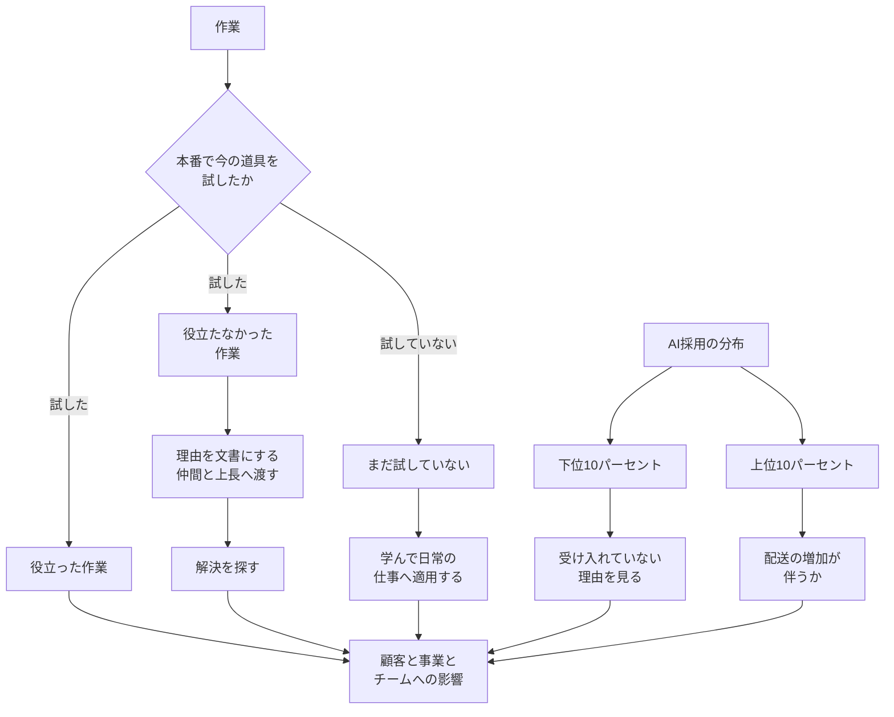

2026年10月27日、About Amazon は「An update from Amazon engineering leadership on the role of the developer in the age of AI」を公開しました。筆者は、Worldwide Amazon Stores の VP / Distinguished Engineer である Terk Terkowitz です。導入のあとに、ソフトウェア開発エンジニア（Software Development Engineer。以下、SDE）とマネジャーへ共有したメモを載せています。

この記事では、そのメモが残している記録の種類と、それぞれに書いてあること、書いていないことを整理します。公開ページに、等級表や評価票の原本は付いていません。Simon Willison は 2026年10月28日、メモの一節を引用しました。日経クロステックは 2026年10月30日、同じ公開ページを報じました。

*この記事の全体像。以下、順に解説します。*

## Amazonの開発者メモとは

役割ガイドラインは、これまで技術の名前を明示しない方針だった、とメモは書きます。クラウド、マイクロサービス、サーバーレスでも同じだった、としています。今回は、AI がこれまでの潮流より速く、より根本的にソフトウェア工学を変える、と判断したうえで、実践の定義は書かない、としています。

SDE の役割ガイドラインを更新するとき、すぐ古くなる「良い AI 実践」の定義は書かない、とメモは書きます。焦点は、顧客、事業、チームへの影響です。将来のベストプラクティスが何であれ、AI はソフトウェア工学の実践の中心にある、とも書きます。まだ使っていなければ、できるだけ早く学び、日常の仕事へ適用する、と続きます。既に使っている人は、より良い実践を探し続けます。学ばなければ取り残されるリスクがある、とも書きます。

プロダクトと事業に近いエンジニアとマネジャーが、AI とエージェント的な開発を最も活かせる、とメモは書きます。エージェント的な開発が何を指すかは、公開メモには書かれていません。全レベルの個人貢献者は、顧客と、チームまたは組織のプロダクト方向につながる方法を見つける、と書きます。個人貢献者は、メモがマネジャーと並べて書く役割の呼び方です。範囲は上位ほど広がる、とも書きます。

AI を最も受け入れたチームを、メモは frontier teams と呼びます。frontier teams では、生産性と配送が増えている、とメモは書きます。ここでの配送は、顧客と事業へ成果を届けることです。件数、比率、期間は付いていません。

### 入力指標と、分布の両端

長期の成果で測るのが最善だ、とメモは書きます。成果は遅れ、他の潮流から分けにくい、としています。その代わりに使ってきた入力は、トークン使用量、AI ツールの採用、コードの変更、レビューです。

これらの入力を標的にすると深く欠陥がある、とメモは書きます。tokenmaxxing は Frugality と衝突します。行数を測ることは Invent and Simplify と衝突します。tokenmaxxing は、同じ段落がトークン使用量の標的化の例として挙げる語です。公開メモは、この語の定義文は置いていません。Frugality と Invent and Simplify は、メモが衝突の相手として名指しする名前です。公開メモは、それぞれの定義文は載せていません。入力を標的にすると深く欠陥がある、という文は、この二つの名前の中身がなくても読めます。

同じ段落は、入力は重要な出力とよく相関するので、注意と判断とともに、キャリアと組織の成績を考えるときに使うのは適切だ、と続けます。より良い指標と、より賢い目標は、これから一緒に見つける、と書きます。

見る場所は、AI 採用の下位10%と上位10%です。下位は、効果的に受け入れていないチームを見つけ、なぜかを理解します。上位は、重く使っているチームを見つけ、配送の増加が伴うかを理解します。分母が人か、チームか、週次の利用率かは、メモに定義がありません。

### 所見と、リーダーの理解

今の AI 道具が自分の仕事の役に立たないとき、メモはそれを失敗ではなく所見だと書きます。中核の段落は、次のとおりです。

> If your work does not benefit from current AI tooling, that is a finding, not a failing. Document why, share it with your community of peers, bring it to your manager, and work to find solutions. An engineer who can explain where AI does not yet help their work is demonstrating the judgement we are asking for.

この段落の主語は、今の道具を試した作業のうち、役立たなかったものです。理由を文書にします。仲間のコミュニティと上長に渡します。解決を探します。どこでまだ役立たないかを説明できるエンジニアは、メモが求める判断を示している、と書きます。まだ試していないことは、この文の主語ではありません。

リーダーの仕事の一部は、チームが顧客と事業への配送を良くするために、AI を最善の効果で使っていることを確かめることです。十分な理解とは、本番の仕事で道具を使ったことがあり、役立った作業を1つ、役立たなかった作業を1つ説明でき、その判断をチームに説明できることです。

### 引いている二つの言葉

引用は二つあります。一つは、Jeff Bezos が 2012年に Werner Vogels へ話した、「何が変わるか」より「何が変わらないか」です。

もう一つは、Jeff Bezos の 2016年株主への手紙です。メモが引用した文は、Resist Proxies の節にあります。Resist Proxies は、調査の平均を顧客の代理にすることを戒める節の名前です。原文は次のとおりです。

> Good inventors and designers deeply understand their customer. They spend tremendous energy developing that intuition. They study and understand many anecdotes rather than only the averages you’ll find on surveys.

直前の例は、ベータテストの満足が 55% で、最初の調査の 47% から上がった、という平均です。Bezos は、この種の平均は解釈が難しく、意図せず誤導しうる、と書きます。調査とベータテストに反対ではありません。所有者は顧客を理解し、ビジョンを持ち、提供物を愛したうえで、調査は盲点を見つける、と書きます。

メモは後者を、リーダーは逸話を理解し、出力を注意深く追え、と言い換えています。言い換えの英語は "study and understand many anecdotes, and carefully track outputs, rather than only surface-level metrics" です。

### 三つの記録の分かれ方

公開メモが分けている記録は三つあります。作業についての所見、まだ試していない人への学習、採用の分布の両端です。図の「まだ試していない」は、試したあとの結果ではありません。まだ試していない人の学習です。顧客と事業への影響は、三つの外にある成果の軸です。評価票の欄名は、この図には出てきません。公開ページが欄名を載せていないからです。

所見の提出先は、仲間のコミュニティと上長です。様式、期限、台帳の名前は、公開メモにありません。顧客側の単位も、公開メモにありません。問い合わせ、欠陥、継続利用は、メモが選んだ単位ではありません。

## 注意点

ここでの一次は、2026年10月27日の公開メモです。二次は、そのメモを報じた記事です。一次が戒めているのは、入力指標を標的にすることです。同じ一次は、注意して見るのは適切だ、と残しています。二次の見出しは、これより強い読みを置いています。これとは、入力を標的にしないことと、注意して見ることは適切だという二つの文です。

### 日経クロステックと Business Insider

日経クロステックの中田敦は、2026年10月30日の記事で、理想の開発者は AI を積極的に活用する開発者ではない、と同社が活用度を目標にすることを戒め、顧客の声を聞くよう促し始めた、と書きます。最大のニュースは、活用度によって開発者を評価することのデメリットを公式に認めたことだ、とも書きます。第1ページの末尾は、新しい定義に従えば、Kiro や仕様駆動開発を採用せよと定めることや、活用度で順位付けすることもなくなった、と読んでいます。ここまでが、2026年10月30日に本文を確認できた第1ページです。Kiro と仕様駆動開発が何を指すかは、公開メモには書かれていません。公開メモは、どちらにも言及しません。

次のページへのリンク文言は「ただしAI活用度を計測すること自体は、今後も続け」で始まります。第2ページの本文は会員登録の壁の向こうにあり、この記事では確認していません。

Business Insider は 2026年10月27日、エンジニアは顧客と事業への影響で判断されるべきで、AI をどれだけ使ったかだけではない、と書きます。同じ記事は、更新されたガイドラインは、AI 採用をエンジニアとマネジャーの評価の一部にする取り組みを反映している、とも書きます。前者の not simply も、後者の評価の一部も、公開メモの文面にはありません。この記事は、成果を優先する読みと、採用を評価に含める読みを、両方置いています。日経第1ページの「順位付けすることもなくなった」と、こちらの「評価の一部」は、同じメモから別の箇所を強調しています。

Human Resources Director Canada は、同じ指標はキャリアとチームの成績を見るレンズとして残る、と書きます。正式な人事評価や昇進に使うかどうかは、メモが書いていない、と注意しています。削除した、とは書いていません。

### 2026年5月の報道は、10月のメモに出てこない

2026年5月末の報道は、従業員が作った KiroRank を止めたことと、開発者の週次 AI 利用の目標を分けて伝えています。KiroRank は、その報道が従業員の作ったランキングとして伝えるものです。目標の字面は、2026年5月末の報道の間で異なります。heise は 80 percent、Storyboard18 は more than 80 per cent、The Decoder は more than 80 percent、Human Resources Director Canada は more than 80% と書きます。代わりの指標を normalised deployments または normalized deployments と呼ぶ、と伝える記事もあります。何を数えるかは、10月27日の公開メモには書かれていません。KiroRank について、声明はそのダッシュボードが正式な承認ツールではなかった、と伝えられます。deprecated と no longer supported で字面が異なります。Financial Times の原文は、この記事の根拠にしていません。

10月27日のメモに、80、KiroRank、normalised deployments は出てきません。10月以降に、その目標を廃止した、または同じ数値で維持した、という Amazon の一次も、この記事が根拠にした公開ページにはありません。

### 社内へ送った日は、公開日からは決まらない

IT Pro がメモの社内送付を September と書いた箇所は、公開ページに対応する日付がありません。ページの公開日は 2026年10月27日です。これは社内へ送った日を決めません。社内送付日は一次で確認できないので、この記事は September を採用しません。

### 増えた、に付く数値はない

frontier teams の生産性と配送が増えた、という文に、件数も比率も期間もありません。2025年11月25日の Werner Vogels の予測、2026年6月24日の Matt Garman のインタビュー、2026年10月29日の第3四半期決算の記事にも、同じ主張の数値はありませんでした。決算にある売上や成長率は、開発チームの配送ではありません。

### 手紙の段落に無い言い換え

メモが足した "carefully track outputs, rather than only surface-level metrics" は、2016年の手紙のその段落にはありません。outputs の単位は、手紙にもメモにもありません。

### まだ閉じていない問い

公開メモだけでは、次は確定しません。

- 社内の役割ガイドライン原本で、評価票の項目が消えたか、残ったか
- 所見を、どの様式で、いつまでに、どこへ蓄積するか
- 顧客側の出来事を、問い合わせ、欠陥、継続利用のどれで残すか。メモは選んでいません
- 下位10%と上位10%の分母
- 2026年5月の報道が伝えた週次の利用目標が、2026年10月27日以降も同じ数値で残っているか。一次は沈黙しています
- 日経クロステック第2ページが、計測の継続をどの指標で書いているか
- frontier teams の生産性と配送が、どの期間で、何に対して増えたか。公開された数値はありません

## 三つの記録を混ぜずに残す

評価の設計では、個人の使用回数を成果そのものとして扱いません。公開メモに、評価票の欄を消したという文はありません。名前を付けている記録は次の三つです。混ぜると、別々である数える対象の集まりを、一つにすることになります。

| 記録 | 対象 | 公開メモが指定していること | 公開メモが指定していないこと |
|---|---|---|---|
| 所見 | 今の道具を試した作業のうち、役立たなかったもの | 理由を文書にする。仲間と上長に渡す。解決を探す。説明できることを、求める判断の実演とみなす | 様式、項目、期限、台帳 |
| 学習 | まだ日常の仕事に適用していない人 | できるだけ早く学ぶ。学ばなければ取り残されるリスクがある | 完了の数え方。下位10%との境界 |
| 採用の端 | 分布の下位10%と上位10% | 下位は、なぜ効果的に受け入れていないか。上位は、配送の増加が伴うか。入力を標的にしない | 分母。個人の回数を成果点にするか。正式な人事評価に載るか |

所見に入れてよいのは、試したあとに役立たなかった作業です。まだ試していないことは、学習の記録です。同じ欄に置くと、数える対象の集まりが混ざります。リーダー側の十分な理解は、役立った作業と役立たなかった作業の両方を、本番の経験から説明できることです。片方だけでは、メモの定義を満たしません。

顧客側は、影響という軸としてはあります。観測単位としてはありません。単位を選ぶなら、その作業のあとで顧客側に起きた出来事を1件残します。問い合わせの内容、欠陥、継続して使っているか、はその候補であり、メモが選んだ単位ではありません。満足度の平均だけを成果欄に置くと、手紙が代理と呼んだものに戻ります。前の節の 55% と 47% は、その例です。平均は、盲点を探す側に置きます。

採用の端は、個人の成果欄とは別の、組織の見方です。下位を見た結果の理由は所見に近く、上位を見た結果の「配送が伴わない」は、tokenmaxxing や行数の増加に近いです。両端を見るとき、利用率の平均だけで理由と配送の対応を判断しません。メモは平均を禁じていません。

同じチームの週次の利用率が下位10%でも、それだけでは個人の成果点にしません。見るのは、なぜ効果的に受け入れていないかです。上位10%でも、利用率だけでは配送が増えたことにはしません。見るのは、配送の増加が伴うかです。

## まとめ

公開メモが名前を付けて残す記録は、所見、学習、採用の端の三つです。顧客と事業への影響は、その外側にある成果の軸です。入力指標を標的にすることは深く欠陥がある、とメモは書きます。同じメモは、注意と判断とともに、キャリアと組織の成績を考えるときに使うのは適切だ、とも書きます。評価票の欄を消したという文は、公開メモにはありません。

所見に入れるのは、試したあとに役立たなかった作業です。まだ試していないことは、学習の側です。採用の端は、個人の成果欄とは別の、組織の見方です。

分母、様式、顧客側の単位、2026年5月の週次目標がその後どうなったかは、公開メモだけでは閉じていません。

この記事が少しでも参考になった、あるいは改善点などがあれば、ぜひリアクションやコメント、SNSでのシェアをいただけると励みになります！

## 参考リンク

- [Terk Terkowitz, "An update from Amazon engineering leadership on the role of the developer in the age of AI", About Amazon（2026-10-27）](https://www.aboutamazon.com/news/company-news/amazon-software-engineer-role-guideline-ai)
- [Jeff Bezos, "2016 Letter to Shareholders", About Amazon](https://www.aboutamazon.com/news/company-news/2016-letter-to-shareholders)
- [Jeff Bezos, 2012 interview with Werner Vogels（メモの脚注）](https://www.youtube.com/watch?v=O4MtQGRIIuA&t=248s)
- [Simon Willison, "A quote from Terk Terkowitz"（2026-10-28）](https://simonwillison.net/2026/Oct/28/terk-terkowitz/)
- [中田敦「顧客の声を聞け、AI活用度による技術者評価の弊害をAmazonが公式に認める」, 日経クロステック（2026-10-30、第1ページまで）](https://xtech.nikkei.com/atcl/nxt/column/18/03079/102900047/)
- [Eugene Kim, Ana Altchek, "Amazon Tells Software Engineers to Prioritize Results Over AI Usage", Business Insider（2026-10-27）](https://www.businessinsider.com/amazon-software-engineers-prioritize-results-over-ai-usage-2026-10)
- [Dexter Tilo, "Amazon admits AI metrics are flawed but says they still count", Human Resources Director Canada（2026-10-27 表示）](https://www.hcamag.com/ca/news/general/amazon-admits-ai-metrics-are-flawed-but-says-they-still-count/595193)
- [Storyboard18（2026-05-31）](https://www.storyboard18.com/how-it-works/amazon-shuts-down-internal-ai-leaderboard-after-employees-inflate-usage-driving-up-costs-99782.htm)
- [heise（2026-05-29）](https://www.heise.de/en/news/Too-much-tokenmaxxing-Amazon-stops-internal-AI-ranking-11311902.html)
- [The Decoder（2026-05-29）](https://the-decoder.com/amazon-kills-internal-ai-leaderboard-after-employees-gamed-it-with-pointless-tasks/)
