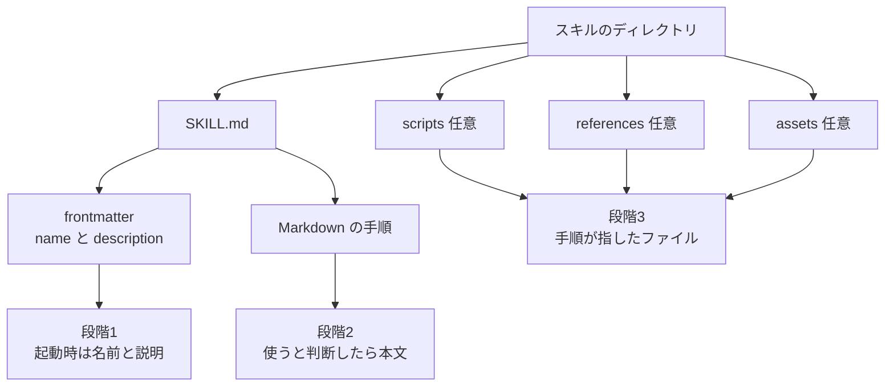
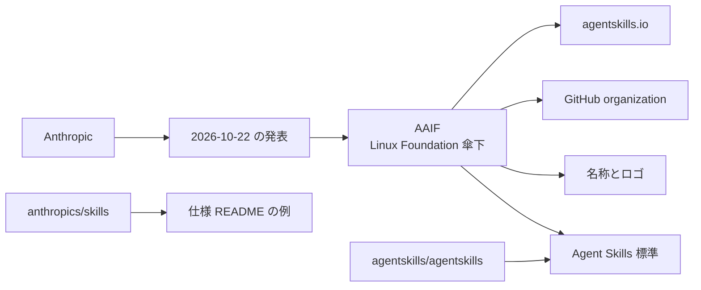

2026-10-22、Anthropic は Agent Skills を Linux Foundation 傘下の Agentic AI Foundation（AAIF）へ寄贈すると発表しました。

**Agent Skills** は、AI エージェントに仕事の手順を渡すフォルダ形式です。
この記事では、フォルダの中身とエージェントが読む順番、発表が列挙した寄贈物、同じ週に確認できる公開記録、形式の確認と実行権限の確認を順に説明します。

*この記事の全体像。以下、順に解説します。*

## Agent Skillsとは

Anthropic は 2025-10-16 に、この形を Claude の製品機能として公開しました。
2025-12-18 の更新では、同じ形をクロスプラットフォームのオープン標準として公開したと告知しています。
2026-10-22 の一次発表が名指しした寄贈物は、標準に加え、名称とロゴ、GitHub organization、`agentskills.io` ドメインです。

### フォルダと SKILL.md

スキルはディレクトリです。
必須ファイルは `SKILL.md` です。
先頭の YAML（frontmatter）に名前と説明を書き、その後ろに Markdown の手順を置きます。
任意の慣例ディレクトリは三つです。
`scripts/` は実行するコード、`references/` は追加の文書、`assets/` はテンプレートや画像などの静的ファイルを置く場所です。
三つは、スキルのディレクトリの中に置くときの慣例です。
スクリプトや参照資料は、同じフォルダに置けます。

`name` は必須です。
1〜64 文字で、小文字、数字、ハイフンだけを使います。
親ディレクトリ名と一致させます。
連続したハイフンは使えません。

`description` も必須です。
1〜1024 文字で、何をするかと、いつ使うかを書きます。

任意項目は次のとおりです。

- `license`
- `compatibility`（最大 500 文字。想定する製品、必要なシステム上のパッケージ、ネットワーク接続など、動かす環境の条件）
- `metadata`（文字列から文字列への写像）
- `allowed-tools`（実験的。空白区切りのツール名）

**allowed-tools** は、仕様上は実験的な任意項目です。
実装ごとに対応が違ってよい、と仕様は書いています。
製品ごとの意味は、後の節で Claude Code の現行ドキュメントに沿って分けます。
Claude Code は、Claude にスキルを足して使う Anthropic の製品です。

仕様は、`SKILL.md` を 500 行未満、本文を 5000 トークン未満に収めることを推奨しています。
**統合ガイド** は、Agent Skills の文書 "How to add skills support to your agent" です。
そこには、起動時に読む名前と説明の分量が、スキルあたりおよそ 50〜100 トークン、という目安があります。

### 段階的な読み込み

**段階的な読み込み** は、エージェントがスキルの全文を最初から読まない方式です。
起動時は名前と説明だけを読みます。
スキルを使うと判断したときに本文を読みます。
参照ファイルとスクリプトは、手順がそれらを指したときに読みます。

### ライセンスと検査コマンド

仕様リポジトリ `agentskills/agentskills` のコードは Apache License 2.0 です。
ドキュメントは CC BY 4.0 です。

**skills-ref** は参照ライブラリです。
その `validate` は、frontmatter と命名を検査します。

### 寄贈すると発表されたもの

2026-10-22 の発表は、版付きリリース、正式な提案手続き、スキルを書く人と入れる人向けのセキュリティ手引き、からロードマップを始める案を置いています。

発表は、Anthropic、Google、OpenAI ほかのエンジニアが個人として標準を保守し、Lead Maintainers は David Soria Parra と Mahesh Murag だと書いています。
**Lead Maintainers** は、その発表が標準の保守者として名指しした役です。

発表は、AAIF への参加なしで、標準の利用と貢献を続けられる、と書いています。

### 中身と読む順番

スキルの中身と、エージェントがそれを読む順番は次のとおりです。

発表が述べた関係は次のとおりです。
箱は、発表文が割り当てた役割です。

## 注意点

発表の「寄贈した」は、公開記録が同じ日に書き換わったことまでは意味しません。
2026-10-23 に確認した記録は次のとおりです。

| 発表の文言 | 同じ週に見えた公開記録 |
|---|---|
| GitHub organization を寄贈する | `agentskills/agentskills` の default branch 最終 commit は 2026-08-09（`69ef37e`、client showcase へ掲載名 OpenClaw を追加）。README は AAIF に触れず、例は `github.com/anthropics/skills` を指す。`CONTRIBUTING.md` はロゴ審査を Anthropic チームが行うと書く。公開メンバーは `maheshmurag` のみ。org の owner 権限が法人として誰にあるかは API では未確認 |
| `agentskills.io` を寄贈する | 2026-10-23 の WHOIS（ドメインの登録情報）で、Registrant Organization（登録者の組織名）は Anthropic PBC。Registry の Updated Date は 2026-08-12。作成は 2025-10-16、満了は 2027-10-16。`clientTransferProhibited` はレジストラロックであり、移転拒否の証拠ではない |
| コミュニティが次を決める | 氏名のある Lead Maintainers は発表が名指しした 2 名。David Soria Parra は PR Newswire で、Anthropic の MCP（AAIF 発足時に寄贈された別プロジェクト）の共同作成者、Lead Maintainer と紹介されている。Mahesh Murag は、2025-12-08 に公開された動画「Don't Build Agents, Build Skills Instead」（Barry Zhang との共演、YouTube）で Anthropic 側の作成者として立っている（二次情報）。この日付は動画の公開日であり、登壇日そのものは確定していない。Agent Skills の保守者としての Google と OpenAI の個人名は、Anthropic 発表、AAIF ブログ、PR Newswire には無い。PR Newswire は別プロジェクト Open Responses の発言者として Steve Coffey（Member of Technical Staff, OpenAI）を名指ししている |
| 70 以上のプラットフォームが組み込んだ | 仕様リポジトリの client showcase（上記 commit）は 46 件。掲載は申請制で、70 の全件リストは発表に無い |
| 100 万スキルが公開され、約 2.8 億回入れられた | 同日の AAIF ブログは、この数字を skills.sh の掲載とインストールに帰属し、Vercel の 2026-09-25 記事へリンクする。Anthropic 本文は登録先を書かない |

**client showcase** は、仕様リポジトリに申請制で載る、スキルを組み込んだ製品（クライアント）の一覧です。
**skills.sh** は、AAIF ブログがその件数の帰属先とした掲載先の名前です。
`clientTransferProhibited` は、レジストラが掛けるロックです。
移転を拒否した証拠としては読めません。

件数の読み方は、Vercel 記事の注記に従います。
対象は skills.sh の集計です。
ここでのカタログは、skills.sh の掲載を重複なく数えた件数です。
起動時に読む名前と説明の分量とは別です。
インストールはレジストリの延べ回数であり、人数でも独立した選択でもありません。
Vercel 記事のグラフの説明は、2026 年 1 月の開設から 8 月までです。

375 件（レジストリの 0.04%）がインストールの 62% を占めます。
上位 1.2% が 94% を占めます。
ほぼ半数は、ちょうど 1 回だけ入れられています。

分類サンプルでは、掲載の過半がソフトウェア工学、エージェント手順、データ、インフラ、セキュリティに寄ります。
一方、インストールはソフトウェア工学 18%、エージェント手順 15%、業務オペレーションと文章がそれぞれ約 11% です。
業界をまたぐスキルは、分類済み掲載の 66%、インストールの 87.5% です。
業界特化の掲載より、1 件あたり 3.6 倍入れられています。

これらは 2026-09-25 時点のレポートの数字です。
寄贈日の再計測ではありません。

Simon Willison は 2026-10-22 18:09（ページ表記 6:09 pm）に、発表から「オープン、コミュニティ主導、ベンダー中立」の文を引き、2025-12-19 に AAIF へ入ると書いた自分の予測を記しています。
寄贈物の一覧と件数は、その記事では照合されていません。

AAIF のプロジェクト一覧（2026-10-23 取得）は、Agent Skills を 10 プロジェクトの 1 つとして載せます。
画面に出る GitHub リンクは `anthropics/skills` です。
同じ HTML に埋め込まれたプロジェクトデータの `githubUrl` は `https://github.com/agentskills/agentskills` です。
公開ページの中で、見えるリンクとデータの URL が食い違っています。

MCP の見えるリンクは `modelcontextprotocol` を指します。
goose の見えるリンクは `aaif-goose` を指します。
それらと比べると、Agent Skills のボタンだけが例示リポジトリを指しています。
MCP と goose は、後の日付表にある、AAIF 発足時の寄贈プロジェクトです。

AAIF ブログは、仕様が Apache 2.0 と CC BY 4.0 であり、複数組織の個人からなる Technical Steering Committee が導く、と書きます。
**Technical Steering Committee** は、そのブログが標準を導く委員会として書いた名前です。
発表が名指しした Lead Maintainers と、この委員会が同じ役かは、委員会の名簿が公開ツリーに無いので未確認です。
委員会の名簿と、提案を採択する手順の文書は、2026-08-09 以降 commit のない仕様リポジトリの公開ツリーには見当たりません。
発表自身が、その手順とセキュリティ手引きを「始める案」と呼んでいます。

## 寄贈物と日付の記録

一次発表が列挙したのは、標準、名称、ロゴ、GitHub organization、`agentskills.io` です。
発表は、参照実装の全クライアント、商標登録簿の移転完了、Anthropic 組織に残る例示リポジトリ `anthropics/skills` の移管までは書いていません。
この参照実装は、frontmatter を検査する参照ライブラリ skills-ref とは別です。
どのリポジトリが参照実装かは、発表の列挙にはありません。
仕様 README は今も例を `anthropics/skills` に置きます。

歴史の区切りは次のとおりです。

| 日付 | 一次に近い記録 |
|---|---|
| 2025-10-16 | Claude の製品発表「Introducing Agent Skills」。同日、`agentskills.io` が作成されている（WHOIS） |
| 2025-12-09 | Simon Willison が AAIF 発足を記録。発足時の寄贈として MCP、AGENTS.md（別の文書）、goose を挙げる |
| 2025-12-15 | GitHub organization `agentskills` 作成 |
| 2025-12-18 | Anthropic のエンジニアリング記事と Claude の製品記事が、オープン標準として公開したと更新 |
| 2026-08-09 | 仕様リポジトリ main の最終 commit |
| 2026-09-25 | Vercel「State of agent skills」。skills.sh の 100 万掲載と約 2.8 億インストール |
| 2026-10-22 | Anthropic と AAIF が Agent Skills の寄贈を発表。同日、Open Responses、OpenEnv、OpenSandbox も加わり、AAIF は発足時 3 プロジェクトから 10 になったと PR Newswire が書く |

Open Responses、OpenEnv、OpenSandbox は、同日の PR Newswire が AAIF への新しい参加として名指しした、Agent Skills 以外のプロジェクトです。
AGENTS.md は、発足時の寄贈として MCP と goose のあいだに挙げられた、別の文書の名前です。

## 形式と実行権限

仕様に合うことと、そのスキルをどの権限で動かしてよいかは、仕様の文面上は別です。

仕様が必須にするのは、フォルダ、`SKILL.md`、`name`、`description` です。
本文の章立ては自由です。
スキルをどのディレクトリから発見するかは、仕様が決めません。

同じ統合ガイドは、クライアント固有の場所に加えて `.agents/skills/` を横断利用の慣例としてスキャンすることを勧めています。
プロジェクト配下のスキルは、信頼チェックを経てから読むよう書いています。
これは統合ガイドの推奨です。
Claude Code の `-p` の記述は、これとは別の、製品の現行の挙動です。

Claude Code の現行ドキュメントは、Agent Skills 標準に沿うと書いたうえで、読み込み場所を次のように列挙します。

- enterprise。組織が配るスキルの置き場所
- personal（`~/.claude/skills/`）。そのマシンの自分のプロジェクトで読む場所
- project（`.claude/skills/`）。そのリポジトリのセッションで読む場所
- plugin。有効にしたプラグインが持つスキル
- claude.ai 同期。claude.ai のアカウントで有効にしたスキル

`.agents/skills/` はその表にありません。

Claude Code の `allowed-tools` は、そのスキルを起動したターンのあいだ、列挙したツールを確認なしで使えるようにする許可です。
列挙外のツールを禁止する欄ではありません。
許可は、次の利用者メッセージで消えます。

`-p` は、Claude Code を対話せずに実行するときのフラグです。
ドキュメントは、ワークスペースを信頼していないフォルダでの `-p` 実行でも、project のスキルの `allowed-tools` が適用される、と書いています。
この記述の対象は project のスキルです。
同じ節には、リポジトリに入ったスキルが自分へ広いツール権限を与えられる、という警告があります。
組織が managed permission rules だけを許す設定では、この欄は無視されます（Claude Code v2.1.282 以降、と同ドキュメント）。
**managed permission rules** は、そのドキュメントが「この欄を無視する」条件として書いた組織側の設定です。

配置の差は、未完了の提案としても残っています。
`agentskills/agentskills#513` は open です（起票 2026-08-20、2026-10-23 時点で open）。
起票者は、多くのクライアントが `~/.agents/skills` を受け付け、Claude Code は例外だと書き、XDG のパスを仕様化する提案をしています。
XDG は、Unix 系でユーザーのデータや設定を置く場所を決める XDG Base Directory です。
起票が候補にしているのは `$XDG_DATA_HOME/agents/skills` で、その変数が無いときは `$HOME/.local/share/agents/skills` です。
これは起票者の記述であり、46 クライアントの再テスト結果ではありません。

セキュリティ手引きが財団文書としてまだ無い一方、製品側の警告は 2025-10-16 のエンジニアリング記事にあります。
悪意あるスキルは、実行環境へ脆弱性を持ち込むか、データを外へ出すよう Claude に指示しえます。
信頼できる出所だけから入れ、それ以外はファイルを読んでから使う、と同記事は書いています。

Snyk は 2026-02-05 に、ClawHub と skills.sh から集めた 3984 スキルの自社スキャンを公開しました（二次情報）。
**ClawHub** は、その記事が skills.sh と並べて母集団に挙げた掲載先です。
critical が 534 件（13.4%）、何らかの指摘が 1467 件（36.82%）、人の確認で悪意ある payload（実行される不正な中身）が 76 件です。

同じ記事の表では、skills.sh 上位 100 の Prompt Injection と Malicious Code は 0.0% です。
Credential Handling は 5.0% です。
Third-Party Content は 9.0% です。
Prompt Injection、Malicious Code、Credential Handling、Third-Party Content は、その表が付けた指摘区分の名前です。

記事本文は、母集団を「ClawHub and skills.sh の 3984」とも「ClawHub の 3984」とも書いています。
この件数は Snyk の自己申告であり、仕様の欠陥件数ではありません。
Agent Skills 仕様自体を対象とする CVE は、2026-10-23 時点で一次レコードを確認できていません。

## 判断に使う記録

2026-10-22 の発表は、仕様の変更主体をベンダーの更新履歴から財団のプロジェクトへ移す宣言です。
公開された台帳は、宣言の当日には移管完了の形へ更新されていません。
分ける日付は二つです。
一つは発表日、もう一つは公開記録が変わった日です。
分ける審査も二つです。
一つは形式、もう一つは実行権限です。

発表を財団プロジェクトの宣言として読める記録は、次のとおりです。

- Anthropic のニュース（2026-10-22）が、寄贈物を名称、ロゴ、GitHub organization、ドメインと列挙している。
- AAIF のブログと同日の PR Newswire が、Agent Skills を Anthropic からの貢献プロジェクトとして掲載している。
- 仕様本文は短く、フォルダと `SKILL.md` と段階的な読み込みに収まっている。権限のモデル、署名、スキルを発見するパスは必須条項ではない。
- ライセンス（Apache-2.0 と CC BY 4.0）と `skills-ref validate` は、寄贈前からリポジトリにある。

判断を弱める事実は、注意点の表と件数の条件に加えて、次の五点です。

- ドメインの Registrant は 2026-10-23 も Anthropic PBC である。
- 仕様リポジトリの公開文面は 2026-08-09 で止まっている。ロゴ審査の文は Anthropic チームのままである。
- 氏名のある保守者は、公開資料の範囲では Anthropic 側の 2 名である。複数社の個人が保守する、という文の個人名は、Google と OpenAI については未掲載である。
- 100 万と約 2.8 億は、skills.sh の 2026 年 8 月までの延べ回数である。プラットフォーム 70 以上は、公開 showcase 46 件とは別のベンダー集計である。
- Claude Code では、仕様の実験的欄 `allowed-tools` がファイル内からツール許可を足す。形式が合っているファイルが、権限の審査を終えていることにはならない。

## 未解決の問い

次の問いは、2026-10-23 時点では空欄のままです。

- GitHub organization `agentskills` の owner 権限は、いつ、どの法人アカウントへ移るか。2026-10-23 の公開 API では未確認です。
- 名称とロゴの商標が、どの管轄で誰の名義か。一次の登録簿は未確認です。
- Technical Steering Committee の名簿と、提案を採択する文書は、いつリポジトリに置かれるか。
- `anthropics/skills` は例示のまま残るのか。AAIF 一覧の見える GitHub リンクはこちらを指し、同じページの `githubUrl` は `agentskills/agentskills` を指します。
- 70 プラットフォームの定義は、showcase への掲載か、実装の有無か、製品の宣言か。
- skills.sh の 9 月以降の件数は、寄贈発表の本文にはありません。

## 台帳に残す行

スキルの件数や置き場所を数える前に、仕様の所有者を 1 行置きます。
その行は 2 つの日付を持ちます。

宣言の日付は 2026-10-22 です。
公開記録が宣言と一致した日付は、空欄のまま開始します。
空欄を埋める条件は三つです。
ドメインの Registrant が移った日、仕様リポジトリが AAIF に言及した日、財団ページの GitHub リンクが `agentskills/agentskills` を指した日、です。

審査は 2 段にします。

1. 形式。`skills-ref validate` が見る frontmatter と、`SKILL.md` が 500 行未満、本文が 5000 トークン未満という推奨に収まるか。発見パスは仕様外なので、使うクライアントのドキュメントで別に書く。Claude Code なら `.claude/skills/` と `~/.claude/skills/`。
2. 権限。そのファイルがシェル、ファイル、ネットワークのどれを、確認なしで使わせるか。`allowed-tools` が実験的であること、Claude Code ではそれが許可であって禁止ではないこと、未信頼のフォルダで `-p`（対話せずに実行するフラグ）を使っても project のスキルに効くことを、形式の確認とは別に見る。

採用数として 100 万と約 2.8 億を使うときは、skills.sh、2026 年 8 月まで、延べインストール、上位 1.2% が 94%、とセットで書きます。
プラットフォーム数は「Anthropic が 70 以上と書き、公開 showcase は 2026-08-09 時点で 46」とします。

次に見るものは、仕様リポジトリの main が 2026-08-09 より新しい commit で、AAIF、提案手続き、セキュリティ手引きのどれをファイルにしたか、です。
それまでは、変更主体を「AAIF へ移すと発表された標準で、公開文面の保守手続きは寄贈前のまま」と書きます。

## まとめ

Agent Skills は、`SKILL.md` を必須とするフォルダです。
エージェントは、名前と説明、本文、手順が指したファイル、の順に読みます。

2026-10-22 の発表は、標準、名称、ロゴ、GitHub organization、`agentskills.io` を AAIF へ寄贈すると列挙しました。
同じ週の WHOIS、仕様リポジトリの最終 commit、財団ページの見えるリンクは、その列挙とまだ一致していません。

台帳には発表日と、公開記録が一致した日を分けて残します。
形式の `validate` と、`allowed-tools` が足す実行権限は、別の審査にします。
100 万と約 2.8 億を書くときは、skills.sh の 2026 年 8 月までの延べ回数として書きます。

この記事が少しでも参考になった、あるいは改善点などがあれば、ぜひリアクションやコメント、SNSでのシェアをいただけると励みになります！

## 参考リンク

- Anthropic, [Donating Agent Skills to the Agentic AI Foundation](https://www.anthropic.com/news/donating-agent-skills-to-the-agentic-ai-foundation), 2026-10-22.
- Agentic AI Foundation, Angie Jones, [Agent Skills: Sharing Team Expertise Across AI Agents](https://aaif.io/blog/agent-skills-sharing-team-expertise-across-ai-agents), 2026-10-22.
- [AAIF projects index](https://aaif.io/projects), retrieved 2026-10-23.
- PR Newswire, [Agentic AI Foundation Announces Four New Projects](https://www.prnewswire.com/news-releases/agentic-ai-foundation-announces-four-new-projects-agent-skills-open-responses-openenv-and-opensandbox-302916689.html), 2026-10-22.
- [Agent Skills specification](https://agentskills.io/specification).
- Agent Skills, [How to add skills support to your agent](https://agentskills.io/integrate-skills).
- [agentskills/agentskills](https://github.com/agentskills/agentskills) README and CONTRIBUTING, commit `69ef37e` (2026-08-09).
- [agentskills/agentskills#513](https://github.com/agentskills/agentskills/issues/513), open, opened 2026-08-20.
- Claude, [Introducing Agent Skills](https://claude.com/blog/skills), 2025-10-16.
- Anthropic Engineering, [Equipping agents for the real world with Agent Skills](https://www.anthropic.com/engineering/equipping-agents-for-the-real-world-with-agent-skills), published 2025-10-16, update 2025-12-18.
- Claude Code Docs, [Extend Claude with skills](https://code.claude.com/docs/en/skills), retrieved 2026-10-23.
- Vercel, Amelia Charles, Andrew Qu, Jonathan Hefner, [State of agent skills](https://vercel.com/blog/state-of-agent-skills), 2026-09-25.
- Simon Willison, [Donating Agent Skills to the Agentic AI Foundation](https://simonwillison.net/2026/Oct/22/donating-agent-skills/), 2026-10-22.
- Simon Willison, [Agentic AI Foundation](https://simonwillison.net/2025/Dec/9/agentic-ai-foundation/), 2025-12-09.
- Snyk, [ToxicSkills](https://snyk.io/blog/toxicskills-malicious-ai-agent-skills-clawhub/), 2026-02-05.
- WHOIS for agentskills.io via whois.nic.io, retrieved 2026-10-23. Registrant Organization: Anthropic PBC. （URL なし）
