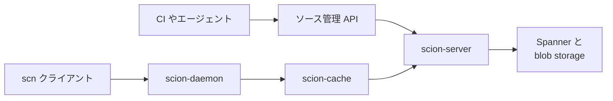
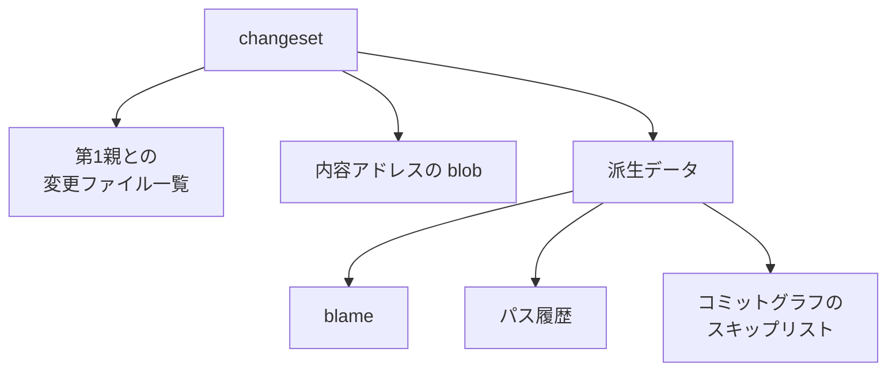

Anthropic は 2026年10月13日のエンジニアリング記事で、社内モノレポ用のバージョン管理システム Scion を説明しています。常時接続のクライアントがサーバへ問い合わせ、コミット、マージ、履歴、blame をサーバ側で計算する集中型のソース管理です。同記事は、このモノレポを git から Scion へ 5 カ月で移し終えたと述べています。件数と倍率は同社の記事に書かれた自己申告であり、計測手順は公開されていません。

ここでは、Scion の作業単位と読み取り経路、公表数値の定義、git を残す公開設計との対照、コード生成を増やす前に数える四項目を整理します。

*この記事の全体像。以下、順に解説します。*

## Scionとは

Scion の読み取りは、クライアントが欲しいツリーと blob だけを名前で取りにいく形です。クライアントは常時つながっています。サーバ間で「相手が何を持っているか」を交渉しません。オブジェクトは内容アドレスで、一度書いたら変わりません。だから各段はキャッシュとして水平に増やせる、という構造です。

### changeset

作業単位は changeset です。write-ahead log の 1 エントリで、git のコミットに近い内容を持ちます。git のようにツリー全体へのポインタは持たず、第1親に対して変わったファイルの一覧と、圧縮した中身への内容アドレスを持ちます。

changeset の作成、マージ、rebase、blame、差分、merge base はサーバが行います。クライアントが持つのは、上限のあるオブジェクトキャッシュ、作業ツリー、ファイル変更の監視です。

参照（ブランチやタグ）は、main とリリースブランチ以外は使わない方針です。参照の移動は changeset の作成とは別で、Spanner の 1 行に対する compare-and-swap です。changeset の作成自体はロックしません。

第1親だけを記録するのは流儀の選択です。モノレポのトランク開発では、main 上の履歴と blame しか気にしない、と記事は脚注で書いています。

### 読み取りの段

取得の経路は、scn クライアント、ノード上の scion-daemon、リージョンの scion-cache、権威の scion-server です。scion-daemon、scion-cache、scion-server は、このプロトコルについて同じ RPC に答えます。daemon は定期的に更新されるスナップショットから始まり、同じノードのジョブがオブジェクトを再利用します。daemon が話す相手はリージョンの scion-cache です。cache にオブジェクトが無いとき、cache が権威の scion-server に聞きます。

チェックアウトは疎です。必要なディレクトリだけを取ります。仮想化チェックアウトは、読んだファイルだけを実体化します。差分だけが要る CI は、作業ツリーを作らず API で足りる、と記事は書いています。

リポジトリのどこにも、git の packfile に相当する全体の実体は置かない、と記事は書いています。サーバも含みます。packfile は、git がオブジェクト群をまとめて圧縮した実体です。Scion はその全体コピーを正本に置きません。

### 派生データ

changeset は差分の記録です。それだけでは「この行を最後に触った人」には答えられません。その問いには派生データが答えます。

派生データは、blame、パス履歴、コミットグラフのスキップリストです。親の値から再帰的に計算します。先に計算するか、後回しにするかは、種類ごとに選べます。

### 同じ期間に隣へ置いたもの

同じ期間に、コードレビュー面の Antique、コード検索、ディレクトリ単位の権限、承認条件を意味で分けるレビューを出荷した、と記事は書いています。説明の中心は Scion です。権限はディレクトリ単位です。履歴に答えるのはサーバで、トランクが正本です。

## 注意点

記事の数値は、すべて Anthropic の自己申告です。生データ、分母の定義、測定窓は付いていません。二次記事は、記事に無い数字や、記事が使っていない倍率を足しています。

| 記事の文言 | 読み方 |
|---|---|
| 2026年5月は 1 日あたり約 2,500 件の平均。9月は 1 日 30,000 件超 | 5月だけが average。9月が平均か、ある日か、ピークかは未記載。30,000 / 2,500 = 12 は読み手の割り算。記事の語は “more than tenfold” と “increased by 10x” |
| main の履歴はほぼ 100 GB。圧縮した作業コピーは 25 GB 超 | 大きさの自己申告。履歴に何を数えるかは未記載 |
| CI のチェックアウトは 1 日あたり 2,500 万回程度。素朴に取ると git の転送は 1 日 600 PB 超 | “Fetched naively, that would be” であり、実測の転送量ではない。25 GB × 2,500 万回 = 625 PB で、記事の桁と合う。開発者環境、エージェントのサンドボックス、研究ジョブは、この 2,500 万回に含まれないと記事が先に断っている |
| ピーク時は内部 git ミラーが数百台 | “several hundred”。整数ではない |
| 基盤の CPU とメモリは、以前の git ミラー基盤の 200 倍小さい | 比較相手は以前のミラー基盤。開発者マシン全体ではない。期間と計上範囲は未記載 |
| CI と研究ジョブのチェックアウトは二桁速く、分単位から秒単位 | 二桁は “two orders of magnitude”。分布は未記載 |
| CI だけで 25% の CPU 余力 | “CI alone realized a 25% CPU capacity win”。フリート全体の 25% とは書いていない |
| 各段のキャッシュヒット率は 99% 超 | 測定窓は未記載 |
| 取り込みパイプラインを社内の Mythos Preview に書き直させ、メモリ 20 倍減、速度 4 倍 | 1 本の書き直しの逸話。ベンチマーク付録は無い |
| 7 人が 5 カ月で Scion と Antique と関連システムを作り、移行した | 起算日は未記載。署名は Nick G. と、ソース管理チームとして 7 名（S.G.、R.K.、Dan C.、Garrett H.、Ben L.、Colin M.、Joe P.）。支援の Vilas J. と Sergiu D.、Antique 初期の Amir O. は別に並ぶ。「7人」が誰を数えるかは定義されていない |
| 今後 6 から 12 カ月で同種の問題が広がる | 予測。結論の根拠には使わない |

10 倍は、リードでは負荷の導入です。1 日のマージが 10 倍超に増えたので、ソース管理が最大のボトルネックになった、と書かれています。7 人の節でも、移行のあいだにマージ量が 10 倍増えた、と書かれています。成果指標としては置かれていません。

二次情報が足したものを、Anthropic の記事の事実として扱いません。

- The Register（2026年10月13日）は地の文で “Work on Scion started in January” と書いています。Anthropic の本文は、Claude Mythos Preview と Claude Tag が社内で使えるようになった頃に作り始めた、とだけ書いています。1月から9月なのは、モノレポのマージ件数の図と、Scion と Antique への週次マージの図です。開始月を 1 月とは確定しません。
- OfficeChai の記事（ページ表示は 2026年10月14日）は “twelvefold” と書いています。一次の語は tenfold と 10x です。
- CryptoBriefing の別記事（2026年10月13日）は、Scion の説明の途中に 388 件の pull request と約 46% のマージを置いています。2026年10月13日の Scion 記事に、この二つの数字はありません。出典 URL は確認できていません。
- Claude Tag の公開記事（2026年6月23日）は、プロダクトチームのコードの 65% が社内版 Tag による、と書いています。母集団はプロダクトチームであり、モノレポの 1 日のマージ件数ではありません。

記事自身の到達範囲も限定されています。“Scion is by no means a suitable replacement for git for general use.” と書かれ、ここで示した考え方は、数万人規模のエンジニアがいるか、エージェントが大量にコードを書いている、本当に巨大なモノレポでしか意味を持たない、と続いています。社内のトークン支出は、他の事業が現実に払いたい額を超える、とも書いています。2026年10月14日時点の公開情報では、一般利用向けの料金、SLA、公式リポジトリは見当たりません。

まだ分かっていないことも残っています。

- 9月の「30,000 件/日超」は平均か
- 5 カ月は何月何日から何月何日か
- レビュー待ち時間、人が見た割合、Antique が自動で通した割合。記事は書いていない
- “the system” の全件レビューは Scion だけか。段落は Scion、Antique、関連システムを話したあとなので、Scion だけとは確定できない。モノレポ側の、意味による承認とは別の文である
- git ミラーはゼロになったか。200 倍小さい、としか書いていない
- ディレクトリ権限の強制を、外部が監査できる材料はあるか。記事の記述のみである
- この件に紐づく CVE は、公開情報の探索では見つからなかった
- 日本語の独立した報道は、2026年10月14日の探索では見つからなかった

## 公表された完了は正本の移動である

完了の判定を、スループットなのか、レビューコメントの残りなのか、エージェントのマージ権限なのか、で分けると次になります。

| 役割 | 記事が置いているもの | 置いていないもの |
|---|---|---|
| 負荷 | 5月の平均約 2,500 件/日から、9月に 30,000 件/日超。表現は 10 倍超と 10 倍 | この倍率を Scion の合格値とは呼ばない |
| 完了の宣言 | モノレポを git から 5 カ月で移し終えた。引用は “fully migrated our monorepo from git in five months”。Scion、Antique、検索、権限も同じ期間に出荷した | 切替日、二重書きの終了日、git ミラーの停止台数 |
| 結果の自己申告 | ミラー基盤比で CPU とメモリが 200 倍小さい。チェックアウトは秒単位。CI の CPU が 25%。各段のヒット率が 99% 超 | レビューコメントの残数、待ち時間、差し戻し率 |
| 業界標準どおりではない、と自分で書く箇所 | マージキューのリポジトリ全体ロックは再現できなかった。試験はマージ後とデプロイ前に寄せた。同時の変更は衝突しうるが、Claude は人が気づくより速く直すことが多い | 「メインは常に緑」という完了 |
| レビューの残り方 | 開発チームは “the system” の変更要求を今も全部見て、行ではなく意図を見る、と書く。別に、モノレポのレビューはコメントだけの変更と意味のある変更を分け、人は影響の大きいものに寄る、と書く | エージェントへマージ権限を渡したこと自体を完了条件にする文 |

したがって、公表された完了は「書き込みと読み出しの正本を git から Scion に移した」ことです。スループットの 10 倍は、その移行のあいだに増えた負荷です。レビュー残数とマージ権限は、完了の指標としては書かれていません。

正しさの手順は、マージ前の全体ロックから、マージ後とデプロイ前の試験へ移っています。以前の git 運用に同じロックがあったかは、記事からは確認できません。グローバルロックを再現できなかった一文は、git からの移行完了を否定しません。移行は完了したと報告したうえで、業界標準とするマージ前の全体ロックは再現できていない、と自分で分けています。ここを「メインは常に緑になった」と読むと、記事の範囲を超えます。

成果として並んでいるのは、200 倍、秒単位、CI の 25%、ヒット率 99% 超です。30,000 件はその列に入っていません。9月の 30,000 件が平均でなければ、10 倍超の倍率自体が揺れます。記事は 9月を平均とは書いていません。200 倍、25%、99%、20 倍、4 倍に再現手順はありません。

未確認の項目は、10 倍を「自前のバージョン管理へ移れ」という指示と読まなければ、移行判断そのものを止める未知ではありません。レビュー待ちだけは記事が答えを持っていないので、自組織のキューで別に測ります。

## 同じ圧力への三つの答え

エージェントが変更を増やす、という圧力への公開された答えは、少なくとも三つあります。時点が違うので、件数を一つのランキングにしません。

| 基準 | Scion（Anthropic、2026年10月13日） | GitHub の新しい Git 基盤（2026年10月6日） | Piper と Sapling |
|---|---|---|---|
| 正本 | git を降り、自前の changeset に移し終えたと書く | git を残す。Spokes の「ディスク上の完全コピーが耐久と読み取りを兼ねる」形をやめる設計 | Piper は自前の集中リポジトリ。Sapling は Meta のシステムで、CLI は Git も扱える |
| 本番を止めるか | 移行完了は書く。サービス無停止とは書いていない | “while GitHub keeps running”。メンテナンス窓は置かない、と書く | 2016 年論文は、Perforce から Piper へスケールのために移した、と書く |
| クライアント | 常時オンライン。オフラインの完全クローンは前提にしない | 開発者のブランチ、レビュー、マージ、履歴は残す、と書く | CitC はクラウド上の作業ツリー。論文は、ツールチェーンの利点にはオンラインが要る、と書く |
| 書き込みの合意 | 参照の移動だけが Spanner 上の compare-and-swap。changeset 作成はロックしない | 合意が要るのは参照の更新だけにし、オブジェクト保存や検査は並行させる、と書く | レビュー完了後に中央へ commit する。トランクは直列 |
| 公表されている数 | 前節の自己申告 | 内部ベンチマークで書き込みスループットが最大 35 倍。本番の切替完了とは書いていない。続報で設計を書く、と結ぶ | 2015年1月時点の表を含む 2016 年論文。典型的な就業日に人間 16,000 changes、自動 24,000。開発者 25,000 人超。約 86 TB。現在値ではない |
| 公開して使えるか | 一般利用の git 代替ではない、と記事が書く | GitHub 上の git として使える前提で、基盤を入れ替える途中 | Sapling の公式導入は、サーバーと仮想ファイルシステムを未公開と書く。CLI は公開 |

GitHub が同じ記事で負荷として書いている数は、Anthropic の 1 モノレポのマージ件数とは母集団が違います。

- 2025年9月から 2026年8月にかけて、月間の Git イベントは 2,182 億から 4,733 億になり、2 倍超です。
- 投稿日 2026年10月6日の記事は “In September alone” にコミット 73.8 億、1 年前の 5 倍超、と書いています。年は本文に明記されていません。直前の記述から、2026年9月と読むのが自然です。
- push は前年比 4.9 倍で、月間 6.9 億から 33.5 億です。
- pull request のマージは約 4 倍です。
- GitHub Actions は 9 月に 32.6 億回で、1 年前の 4 倍超です。
- 2026年8月、最も忙しいリポジトリは約 10 億リクエスト、と書いています。

GitHub 側の完了は、まだ書かれていません。最大 35 倍は内部ベンチマークです。Scion の “fully migrated” と並べて、どちらが終わったかは言えません。本番を止めずに Git の基盤を作り替える、という側の公開された対応物は、この 2026年10月6日の記事（更新は 2026年10月7日）です。耐久ストレージは Azure Blob Storage、読み取り計算はそれと分け、参照の更新だけを合意のクリティカルパスにする、と書いています。

記事は、巨大モノレポの先行事例として Google の Piper と Meta の Sapling を挙げ、その教訓を踏まえて Scion を作ったと書いています。Piper（2016）は、エージェント無しで、1 日数万 changes の集中型モノレポを運用していました。サーバが履歴に答え、トランクを正本にし、ファイルより粗いディレクトリ権限を持つ、という形は、2016 年の Piper と CitC がすでに書いています。Scion の新規性を「集中型にしたこと」だけに置くと過大です。Scion の記事がエージェント前提として強調するのは、次の四点です。

- クライアントの大半がエージェントとジョブである
- コミットのたびに push しない
- グローバルな参照を増やさない
- 作業ツリーを省略できる

## 先に数える四つの量

コードを書くエージェントを足す前に、次の四つを数えます。Anthropic の記事は、このうち三つを負荷として書き、四つ目は「マージ前の全体ロックは諦めた」と書いています。

1. ホスティング。履歴の大きさ、1 日のチェックアウト回数、ミラーやシードが tip からどれだけ遅れるか。同社は履歴ほぼ 100 GB、圧縮作業コピー 25 GB 超、CI だけで 1 日 2,500 万回程度、ミラー数百台、と書いています。
2. 履歴の問い合わせ。部分クローンのままで diff と blame が落ちないか。同社は、ここがミラー運用の限界だった、と書いています。
3. CI の起動点。マージ前に全体をロックして試すのか、マージ後とデプロイ前に試すのか。同社は前者を再現できず、後者に投資した、と書いています。衝突は残り、エージェントが直す、という運用になります。
4. レビュー待ち。同社はこの待ち時間を公表していません。代わりに、コメントだけの変更と意味のある変更を承認ルールで分け、人は後者に寄る、と書いています。開発チームは “the system” の変更要求を今も全件見て、意図を見る、と書いています。対象が Scion だけかは記事が確定していません。待ち時間は、自組織のキューの件数と滞留で取ります。

git を降りる側の完了条件として、この記事から転用してよいのは次の三つまでです。

- 正本の書き込みが git を通らない（“fully migrated” の文）
- チェックアウトと履歴の問いが、git ミラーの維持を必要としない（200 倍と秒単位は、その自己申告）
- マージ前に保証する範囲を、自分の言葉で書き直している（全体ロックは再現できず、試験はマージ後とデプロイ前）

転用しないものは、1 日 3 万件、5 カ月、7 人、レビューコメントが残っていないこと、エージェントがマージできることです。前の三つは同社の規模とトークン支出の自己申告であり、目標値ではありません。後ろの二つは、完了条件として記事にありません。

記事自身は “Scion is by no means a suitable replacement for git for general use.” と書いています。来期に一般の組織が git を捨てる根拠にはなりません。

## 前提が外れるとき

上の読みが逆になるのは、次のときです。

- クライアントがオフラインで完全な履歴を必要とする。記事は、そのとき git の設計が正しい、と書いています。
- リリースブランチ以外の長期ブランチや、第1親以外のマージ履歴が必要である。changeset はその問いを捨てています。
- 社内でトークンを潤沢に使えない。記事は、その支出が他社の現実的な範囲を超える、と書いています。5 カ月の話はそこが前提です。
- GitHub の新しい基盤が、本番の書き込みと CI のファンアウトを git のまま解消した、と続報が示した場合。2026年10月14日時点の一次は、設計と内部ベンチマークまでです。

## まとめ

負荷、完了、結果は三列に分けます。10 倍超は、移行のあいだに増えた負荷です。完了は、モノレポの書き込みと読み出しの正本を git から Scion へ移したことです。結果として自己申告されているのは、以前の git ミラー基盤に対する CPU とメモリの縮小、チェックアウトが秒単位になったこと、CI の CPU 余力、各段のキャッシュヒット率です。

正しさのゲートは、マージ前の全体ロックから外れています。レビュー待ち時間は、どちらの一次資料にも無いので、自組織のキューで取ります。git を残したまま基盤を分ける側の公開設計は GitHub の 2026年10月6日の記事であり、本番切替の完了はまだ書かれていません。

この記事が少しでも参考になった、あるいは改善点などがあれば、ぜひリアクションやコメント、SNSでのシェアをいただけると励みになります！

## 参考リンク

- [Redesigning source control at Anthropic](https://www.anthropic.com/engineering/redesigning-source-control)（Anthropic、2026-10-13）
- [Introducing Claude Tag](https://www.anthropic.com/news/introducing-claude-tag)（Anthropic、2026-06-23）
- [Claude Mythos](https://www.anthropic.com/claude/mythos)（Anthropic）
- [Building Git infrastructure for agent-scale development](https://github.blog/engineering/architecture-optimization/building-git-infrastructure-for-agent-scale-development/)（GitHub Blog、2026-10-06、更新 2026-10-07）
- [Why Google Stores Billions of Lines of Code in a Single Repository](https://cacm.acm.org/research/why-google-stores-billions-of-lines-of-code-in-a-single-repository/)（Rachel Potvin, Josh Levenberg, Communications of the ACM、2016）
- [Sapling Introduction](https://sapling-scm.com/docs/introduction/)
- [Anthropic reinvents source control as Claude floods the world with code](https://www.theregister.com/devops/2026/10/13/anthropic-reinvents-source-control-as-claude-floods-the-world-with-code/5302943)（The Register、2026-10-13）
- [OfficeChai の記事](https://officechai.com/ai/anthropic-builds-in-house-version-of-git-called-scion-after-code-merges-rise-12x-in-4-months/)（ページ表示 2026-10-14。本文は “twelvefold” と書く）
