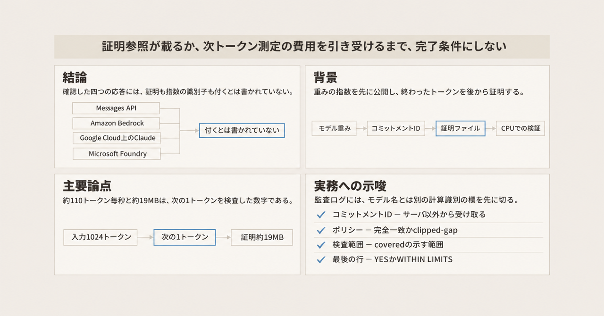
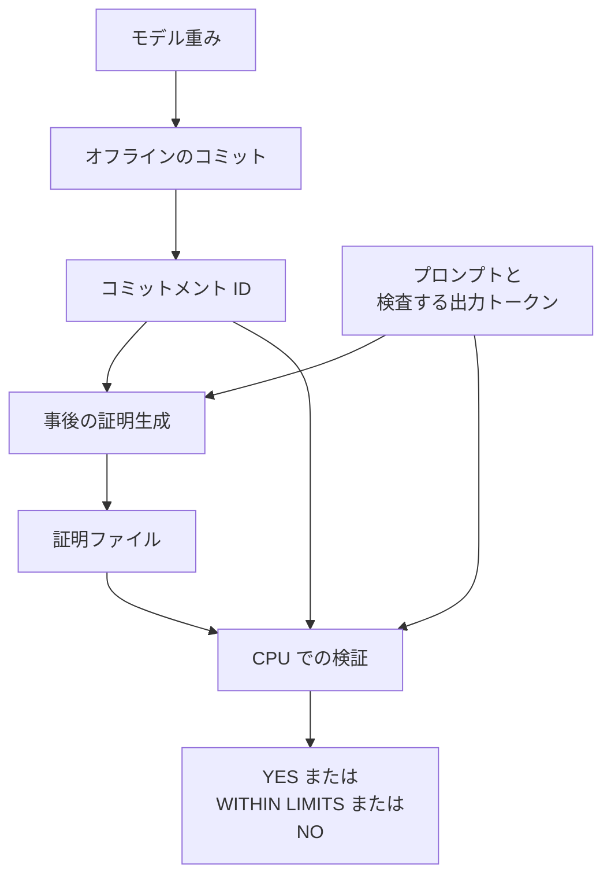

Anthropic は 2026-11-02 公開の研究ブログで、モデル提供者が重みの短い指紋を公開し、その後の応答について、その重みのモデルが指定した入力から指定したトークンを出したことを、証明ファイルで示す方式を公開しました。方式の名前は FlashProve です。証明ファイルは zkSNARK です。ここでいう zkSNARK は、証明が短く、CPU で検査でき、証明から重みも中間値も漏れない、と研究ブログが説明する証明方式です。

この記事では、証明が何と結び付くか、公開された速度とサイズがどの条件の数字か、ホスト済み API の応答に今何が残るかを整理します。

研究ブログは、完成した研究計画の報告ではなく、途中経過の共有だと書いています。

*この記事の全体像。以下、順に解説します。*

## FlashProveとは

FlashProve は、モデル提供者（証明する側）と利用者（検証する側）の二者で動きます。オフラインで重みのコミットメントを一度作り、オンラインでは依頼ごとに証明ファイルを作ります。コミットメントは、後から「この重みだった」と照合するための、重みの短い指紋です。

発表の主体として研究ブログが名指ししているのは、Anthropic の Frontier Red Team です。検証者は重みを持たず、GPU も要りません。

### 公開されたもの

公開物は、研究ブログ、テクニカルレポート、プロトコル仕様、実行コード、Lean による上位の性質の証明です。Lean は、その性質を機械検査した証明支援系です。

研究ブログは、コードと Lean の証明と文書を Apache 2.0 で出すと書いています。その文が名指ししているのは、この三つです。研究ブログ本文とテクニカルレポートは、その文の対象の外です。

ページ上の公開表示は 2026-11-02 です。`time` の `dateTime` は 2026-11-02、`dateModified` は 2026-11-03T19:10:19.000Z です。

測定に使ったモデルは、第三者公開の 4bit 変換版 Llama 4 Maverick です。総パラメータは 4000 億で、トークンあたり約 170 億が動く MoE です。MoE は、全体の重みのうちトークンごとに一部の専門家だけが動く構成です。ここでの専門家は、その動く部分を指します。

### 四つの性質

研究ブログが挙げる四つの性質は、次のとおりです。

- 完全性。正直な証明は受理されます。
- 健全性。偽の主張の証明は、事実上作れません。
- ゼロ知識。証明から、重みも中間値も、どの専門家が動いたかも漏れません。
- 簡潔性。証明は短く、CPU で検査できます。

研究ブログは、あわせて、アーキテクチャは隠さない、と書いています。健全性、完全性、ゼロ知識は、Lean 上のプロトコルについて機械検査されます。高速な C++ の検証器と CUDA の証明器は、同じプロトコルに合わせて書かれ、テストされています。

### 事後にまとめて証明する

証明は事後です。終わったテキストをまとめて読み、バッチで証明します。

研究ブログの主測定は、次の条件です。GPU は NVIDIA の H100 が 1 枚、CPU は 24 コアです。対象は 4bit の Llama 4 Maverick で、1024 トークンの窓を、整数演算の prefill として読みます。この prefill は、速度表が「1024 トークンのプロンプト、各証明は次の 1 トークンを述べ、生成はしない」と書く段階です。モデルは、greedy に相当する整数モデルです。greedy に相当する、とは、各位置で整数モデルの第一候補を選ぶことです。整数モデルは、整数演算で動かすそのモデルです。

バッチ 24 件で約 223 秒、約 110 トークン毎秒、証明は 1 件あたり 18.78 MB です。検証は 24 スレッドで 17 秒、1 スレッドで 21 秒です。この時間は、オフライン段階の検査を含みます。コミットメントのダウンロードは約 6.5 MB、オフライン作業は約 39 分です。研究ブログは、そのコミットメントが約 1600 万リクエスト分だと書いています。

### リポジトリの公開状態

リポジトリの説明は、「Version 0.16.0。研究物であり、保守せず、貢献も受け付けない」です。公開コミットは 1 件で、コミッター日付は 2026-10-30T20:56:11Z、メッセージは `Initial public release (FlashProve 0.16.0-rc.26)` です。コミットは `9e2bdd8ff5bf9c62f18263d7dac189b0400b260c` です。star は約 780（2026-11-05 時点）です。`isArchived` は false です。`pushedAt` は 2026-10-30T21:00:23Z で、default ブランチのそのコミットと揃います。

### 証明が結ぶもの

証明が結ぶ対象は、事前に公開したコミットメント ID と、検査対象として名指ししたトークン列です。コミットメント ID は、オフラインで作った指紋の識別子です。検証の最後の行は、YES、WITHIN LIMITS、NO のいずれかです。YES は、検査した各トークンが整数モデルの第一候補であることです。WITHIN LIMITS は、定めた限度を満たすことです。NO は、図が並べる三つ目の結果名です。NO が不合格なのか、検査不能なのかは、確認した文書には書かれていません。

検証者が自分で持つ必要があるのは、信頼できる別経路で受け取ったコミットメント ID、設定ファイル、自分で組み立てた依頼ファイル、トークンファイル、証明ファイルです。

研究ブログの評価節は、「各依頼は 1024 トークンの窓で、各証明は 1 トークンを検査する」と書いています。リポジトリの `guide/performance.md` は、速度表の条件を「1024 トークンのプロンプト、各証明は次の 1 トークンを述べ、生成はしない」と書いています。

### 覆う範囲

覆うのは、名指しした出力位置について、コミットメントから読み取れる重みの上で、選んだポリシーが成り立つことです。証明ファイルは平均 18.78 MB の実体で、応答本文を代表する短い値 1 個とは別です。

`guide/known-limits.md` は、短い返答は短いものとして検証される、検査していない位置は覆わない、証明は依頼者も時刻も名指ししない、と書いています。プロンプト側のトークンは、clipped-gap では採点されません。clipped-gap は、完全一致より緩く、定めた限度を満たせば受理されるポリシーの名前です。受理の二段は、後の注意点で分けます。

`guide/known-limits.md` は、フルサイズの既定では各リーフ表が 688,127 バッチを処理すると書いています。リーフ表は、そのガイドがバッチ数の上限を置いている表です。同じ 688,127 を、Lean の文書は 1 リクエスト 1 返答の個数として使います。ガイドの読みはバッチ数、Lean の読みはリクエスト数です。

## 注意点

見出しの速度とサイズは、長い返答の全文を 1 証明が覆った測定ではありません。

### 速度とサイズの数え方

`guide/performance.md` は、24 件バッチの定常レートを 111.23 ± 0.92 トークン毎秒とし、そのトークン数に 1024 個のプロンプトトークンを数え、生成トークンは数えないと書いています。証明サイズの「平均 18.78 MB」も、この測定の証明についてです。同ページは、1 MB を 10^6 バイトと定義しています。

研究ブログの要約「1024 トークンの依頼あたり約 19 MB」は、「1024 トークンのプロンプトに対する次トークンの証明」と並べて読む必要があります。並べないと、生成 1024 トークン全体のサイズに見えます。

保存済み返答のトークンも検査した別条件では、プロンプト 524、返答 31 から 500 です。1024 位置のすべてを数えると 108.67 ± 2.8 トークン毎秒、返答トークンだけ数えると 39.1 ± 1.0 トークン毎秒です。エンジンは動かしておらず、限度を満たすと見込んだ返答を選んでいます。

合成重みの保存例 `examples/full-size/` は、1 証明が 1001 トークンを覆います。内訳は、1024 の依頼のうち 1000 と、その次の 1 トークンです。この例は、リリースされたプログラムが作ったものではありません。公開 4bit 重みでの速度表が測っているのは、この約 1000 トークンを 1 証明が覆う形ではありません。

### GPU 時間の倍率

GPU 時間の倍率も、一文にまとめた範囲と、条件付きの実測がずれています。比較対象は、研究ブログが名指ししている推論エンジン vLLM です。表のデコードは、同じガイドが prefill の倍率とは別に置いた比較の名前です。20.1 倍がどの作業とどの作業の比かは、ガイドの比較名以上には書かれていません。その比較についてガイドは、「1 パスは 1 トークンを検査するので、生成した返答を証明するコストではない」と書いています。

| 出典 | 24 件を一度に処理する比較 | 試した最高負荷 | デコードとの比較 |
|---|---|---|---|
| 研究ブログの要約 | vLLM に対して約 70 から 95 倍 | 同じ要約の範囲に含まれる | 要約には無い |
| 研究ブログの本文 | GPU あたり約 72 倍（実行により 66 から 77） | 約 94 倍 | 本文のこの対比には無い |
| `guide/performance.md` | 71.4 倍（65.2 から 76.4） | 93.0 倍（92.2 から 94.1） | 20.1 倍（19.7 から 20.5） |

下限 65.2 は、ブログ要約の 70 の外にあります。ベースラインが低いと証明器が良く見える、とも書いています。実行記録はリポジトリに無く、読者はそのページの数値を記録と突き合わせられません。

### 整数モデルと公開モデルの差

整数モデルと公開モデルの一致は、証明の一部ではありません。ここでいう公開モデルとの差は、整数モデルのトップトークンが 16bit モデルと 6.81% の位置で違った、という測定です。16bit モデルは、その比較の相手としてガイドが名指ししているモデルです。16bit モデルが、第三者公開の 4bit 版そのものだとは書かれていません。公開モデルという語を、ガイドは 16bit モデルの定義としては使っていません。この節の公開モデルは、整数モデルとの一致が証明の外にある、という論点の名前です。主測定の 4bit の Llama 4 Maverick は、速度を測った対象です。6.81% は、その速度測定の重みが証明の対象から 6.81% ずれる、という意味ではありません。この測定は Python 実装で、リリースされたプログラムではなく、タスクのベンチマークはありません。ガイドの印は、リリースされたプログラム上の結果ではないことを示します。

### 受理は二段ある

完全一致の `YES` は、検査した各トークンが整数モデルの第一候補であることです。研究ブログの制限節は、証明が整数モデルの greedy についてだと書いています。

`guide/known-limits.md` は、提供が使う見込みのポリシーはより緩い clipped-gap で、`WITHIN LIMITS` は「そのポリシーの限度を満たす」ことしか言わない、と書いています。緩い限度や平坦な重みなら、ほぼ任意の出力が通り得ます。同ページは、二つの既存エンジンからの正直な返答 96 件ずつは、どれも完全一致を通らなかった、と書いています。採点は整数モデルの Python 実装であり、証明されておらず、リリースされたプログラム上ではありません。

`YES` と `WITHIN LIMITS` は、どちらも終了コード 0 です。最後の行を読まないと、区別できません。検証結果の最後の行には `NO` もあります。

### 二次報道が引き継ぐ要約

ITmedia AI+（2026-11-04 10:40 公開）は、名称を FlashProve、方式を zkSNARK、位置づけを研究の途中経過、測定モデルを Llama 4 Maverick、速度を毎秒約 110 トークン、1024 トークン依頼あたり約 19 MB、24 コアで約 17 秒、通常推論の約 70 から 95 倍、対象を整数化した greedy、証明を事後、と伝えています。これらは研究ブログの要約と一致します。

17 秒は、研究ブログではオフライン段階の検査を含む検証時間です。同記事が「コンテキストは 1024 トークンまで」と書くのも、研究ブログの制限節と一致します。約 110 トークン毎秒と約 19 MB は、生成全文の証明コストとしては読めません。

### リクエスト数の積は一次資料に無い

ブログの「約 1600 万リクエスト」と、リーフ表の 688,127 バッチは、同じ数としては書かれていません。Lean の 688,127 は 1 リクエスト 1 返答であり、バッチ数ではありません。688,127 に研究ブログのバッチサイズ 24 を掛けると 16,515,048 になり、ブログの「約 1600 万リクエスト」と同じ桁にはなります。この積は、一次資料には書かれていません。バッチサイズを変えると、リクエスト数は変わります。

### まだ固定されていない点

次は、2026-11-05 時点で一次資料が文章として固定していない点です。

- テクニカルレポート PDF の式を、今回は再導出していません。そのため、`guide/known-limits.md` が「公開でも査読でもなく、どのサイズの完全なパラメータも条件を満たすと知られていない」と書く留保を、その式がどこまで埋めるかは未確認です。条件と完全なパラメータが何を指すかは、確認したガイドのその文以上には書かれていません。
- 顧客テナントから、後述の RSP 更新が言う内部トークン交通の署名を取得できるか。更新文は、内部の署名と、本番推論上の試作までです。RSP は Responsible Scaling Policy の更新ページを指します。
- Vertex と Azure の Claude 応答に、思考用 `signature` が Messages API と同じ形で乗るか。Claude は、Anthropic が API で応答を返すモデルの名前です。Vertex と Azure は、この問いだけが名指ししている応答先です。Messages API、Amazon Bedrock、Google Cloud 上の Claude、Microsoft Foundry、Claude API、AWS 上の Claude と同一だとは、確認した文書は書いていません。Messages API は、Claude の応答を返す公式 API です。Claude API は、`signature` の相互利用の文が名指しする API の名前で、Messages API と同一だとは書かれていません。`signature` は、思考ブロックが運ぶ、完全な思考過程の暗号化した写しです。Thinking は、その思考ブロックを返す機能の文書上の名前です。Thinking の対応表記は、Vertex と Azure を含みます。`signature` の相互利用の文が名指しするのは、Claude API、Amazon Bedrock、Google 管理の Claude です。応答例の再取得は、今回は Claude API の文書側で止めています。
- 688,127 バッチと「約 1600 万リクエスト」の対応を、バッチ 24 以外の設定で公式が固定しているか。

機械検査の範囲にも、読み飛ばせない限定があります。C++ の検証器と CUDA の証明器自体は、証明されていません。研究ブログは、Lean、論文、実行コードの三者が一致する保証はない、と書いています。

## ホスト済み API の応答に何が付くか

2026-11-05 時点で確認した範囲では、Claude の Messages API、Amazon Bedrock、Google Cloud 上の Claude、Microsoft Foundry の応答に、FlashProve の証明ファイルやコミットメント ID が付くとは書かれていません。Messages API は、Claude の応答を返す公式 API の名前です。付く暗号材料は、別物です。

### 思考ブロックの signature

公式の Thinking 文書は、思考ブロックが `signature` を運び、それは完全な思考過程の暗号化した写しで、複数ターンやツール利用のとき改変せず返す、と書いています。`signature` の値はプラットフォームをまたいで使えると書き、名指しするのは Claude API、Amazon Bedrock、Google Cloud 上の Claude（Google 管理）です。

Thinking 機能そのものの対応表記は、Claude API、AWS 上の Claude、Google Cloud 上の Claude（Anthropic 管理と Google 管理）、Amazon Bedrock、Microsoft Foundry を stable とします。これは機能の対応表記であり、`signature` の相互利用の文ではありません。相互利用の文が名指しする Claude API と、Messages API を、確認した文書は同一だとは書いていません。対応表記では、AWS 上の Claude と Amazon Bedrock は別の項目です。AWS 上の Claude は、相互利用の文には入っていません。Google 管理と Anthropic 管理は、Google Cloud 上の Claude について、対応表記が分けている二つの管理主体です。Microsoft Foundry は対応表記に入り、相互利用の文は Foundry を名指ししていません。

この署名が失敗するのは、思考ブロックを改変して再送したときです。重みの集合が応答を計算したことの証明ではありません。テキストブロックに同種の欄は、確認した応答例にはありません。

### 別プロジェクトで達成した目標

Anthropic は、2026-09-30 までの目標を、別の試作で達成したと書いています。Responsible Scaling Policy の更新ページ（2026-11-05 に取得）は、2026-10-19 の記述として、「本番の推論上で動く試作を作り、出力が特定の重み集合から来ることを検査する。その過程で内部のトークン交通すべてに署名を入れ、ごく稀な無害な整合性の不具合を 1 件捉えた」と書いています。用語は、研究ブログの題にある provable inference から、更新ページの inference verification に変えた、とも書いています。

研究ブログは、その目標を「推論交通に署名し、信頼できるサーバで推論を再計算する別プロジェクト」で達成し、FlashProve は同じ目的の別手法だと書いています。顧客向け API の応答ボディにその署名が入る、とは、どちらにも書いていません。

### 自前の証明器を横に置く場合

リポジトリには、vLLM 向けの例があります。これは、自分でモデルを出しているオペレータが証明器を横に置くためのもので、Anthropic や他社クラウドのホスト済み API が証明を保管する記述ではありません。`guide/known-limits.md` は、出荷している vLLM 統合だけでは、重み秘匿（検証者に重みを見せないこと）の判断対象外だと書いています。第三者のルータが証明を残すには、コミットした重みで証明器を動かす必要があります。API のモデル名を転送するだけでは、証明は生まれません。

## 監査ログに先に切る欄

重要操作の記録では、出来事の日付、応答に書かれたモデル名、どの計算の結果かを分けます。証明が結ぶのは、応答に書かれたモデル名の文字列ではありません。結び付くのは、コミットメント ID と、名指ししたトークン列です。モデル名は、ルーティングや改ざんが起きると、計算した重みと別物になり得ます。研究ブログがその状況を、コストのための差し替えと、トークン列の改ざんと、評価したモデルと提供モデルの不一致として挙げています。

証明を置く欄は、今は空でよいです。入れるなら、証明バイトそのものではなく、次を指す参照です。

- コミットメント ID。サーバや証明ファイル同梱の値は使いません。検証ガイドは、検査対象のサーバ以外から受け取る、と書いています。
- ポリシー。完全一致か clipped-gap かです。後者なら、限度のパラメータも残します。
- `covered` が示す検査範囲。`covered` は、証明が名指しした範囲を示す欄の名前です。
- 証明ファイルの保管先。
- 検証結果の最後の行。`YES` か `WITHIN LIMITS` かです。

`signature` をこの欄へ流し込みません。思考の再送用であり、重みの指紋ではありません。

エージェントの出力を残すときも同じです。出来事の日付は「いつ残したか」であり、「どの重みのどのトークン範囲の計算か」ではありません。日付の隣に、モデル名とは別の計算識別の層を先に切っておきます。中身が空でも、後から証明参照を足す場所が、ログの形に残ります。

## 検証成功を今の完了条件にするか

FlashProve の検証成功を、今の本番の完了条件にはしません。研究ブログが途中経過と書き、リポジトリが非保守と書き、測定が Claude でもホスト済み API でもなく、期待される受理が完全一致ではないからです。

独立したセキュリティ監査は無い、と `guide/known-limits.md` が書いています。同ページは、ソフトウェア、Lean の証明、文書のほぼ全部を、人間の指示の下で AI が書いた、と書いています。この「書いた」の対象に、テストは入っていません。報告されたテストは、同じ条件で AI が実行した、と書いています。テストがリポジトリに無い、とは書いていません。

Fiat-Shamir 変換への二つの公開攻撃（IACR ePrint 2025/118 と 2026/1838）は、このプロトコルにもこのプログラムにも未検討だと、同ページが書いています。Fiat-Shamir 変換の中身は、確認した研究ブログとガイドの範囲には定義がありません。両論文が FlashProve の突破を主張しているわけではありません。この攻撃が検証の YES をどう変えるかは、この記事の材料では判断できません。

自前で公開重みの MoE を出す実験では、リポジトリの検証器と保存例で、「欄に何を残すと後から検査できるか」を確認できます。その実験の成功を、Claude API や Bedrock 経由の業務完了の代理にはしません。ホスト済み API の利用者に残る一次情報は、応答の `model` と、思考を使った場合の `signature` と、自分のプロンプトの控えです。どれも、計算した重みの証明ではありません。

判断を変える条件は、次のいずれかです。

ホスト済み API が、コミットメント ID と検査範囲と証明参照を、応答または取得可能な台帳に載せる。

または、使うモデルとポリシー（完全一致か clipped-gap か）について、その証明を自分の証明器で残し、検証の最後の行を完了記録に含める運用を、コスト込みで引き受ける。ここでいうコストの桁は、1024 トークンのプロンプトに対する次の 1 トークンを検査した測定の、証明 1 件あたり十 MB 級、GPU 時間が推論の数十倍です。長い返答を 1 証明で覆う費用は、この測定とは別です。

## まとめ

FlashProve は、公開した重みのコミットメント ID と、名指ししたトークン列を、事後の zkSNARK で結びます。主測定は 4bit の Llama 4 Maverick で、1024 トークンのプロンプトに対する次トークンの証明です。約 110 トークン毎秒と約 19 MB は、その条件の数字です。

受理には、整数モデルの第一候補である `YES` と、限度を満たす `WITHIN LIMITS` があります。どちらも終了コード 0 です。確認した Claude の Messages API、Amazon Bedrock、Google Cloud 上の Claude、Microsoft Foundry の応答には、証明ファイルもコミットメント ID も付くとは書かれていません。思考ブロックの `signature` は、思考の再送用です。

検証成功を今の本番の完了条件にするのは、ホスト済み API が証明参照を載せるか、自前の証明器でコスト込みの運用を引き受けるときです。それまでは、監査ログに計算識別の欄だけ先に切っておけます。

この記事が少しでも参考になった、あるいは改善点などがあれば、ぜひリアクションやコメント、SNSでのシェアをいただけると励みになります！

## 参考リンク

- Anthropic, "Progress on provable inference for large language models", [研究ブログ](https://www.anthropic.com/research/provable-inference)（2026-11-05 に HTML を取得。ページ表示は Published Nov 2, 2026 で、`time` の `dateTime` は 2026-11-02。`dateModified` は 2026-11-03T19:10:19.000Z。ITmedia は掲載を 2026-11-02 現地時間と書き、自社の公開表示は 2026-11-04 10:40）
- Anthropic, Responsible Scaling Policy updates, [更新ページ](https://www.anthropic.com/responsible-scaling-policy/updates)（2026-11-05 に HTML を取得。内部トークン交通への署名は 2026-10-19 の記述としてページ内にある）
- anthropics/FlashProve, [リポジトリ](https://github.com/anthropics/FlashProve)（`gh repo view` は 2026-11-05。コミット `9e2bdd8ff5bf9c62f18263d7dac189b0400b260c`）。ガイドは `guide/performance.md`、`guide/known-limits.md`、`guide/what-is-proved.md`、`examples/README.md`、`README.md`（raw を 2026-11-05 に取得）
- Anthropic, "Thinking", [Thinking](https://platform.claude.com/docs/en/build-with-claude/thinking)（`signature` の説明。相互利用の文は Claude API、Amazon Bedrock、Google 管理の Claude。機能の supportedPlatforms はそれより広い）
- ITmedia AI+, "Anthropic、AIの応答が「本当にそのモデルによるものか」を暗号技術で証明する「FlashProve」を公開", 2026-11-04 10:40, [記事](https://www.itmedia.co.jp/aiplus/article/2611/04/2000002863/)
- IACR ePrint 2025/118, [2025/118](https://eprint.iacr.org/2025/118)
- IACR ePrint 2026/1838, [2026/1838](https://eprint.iacr.org/2026/1838)
