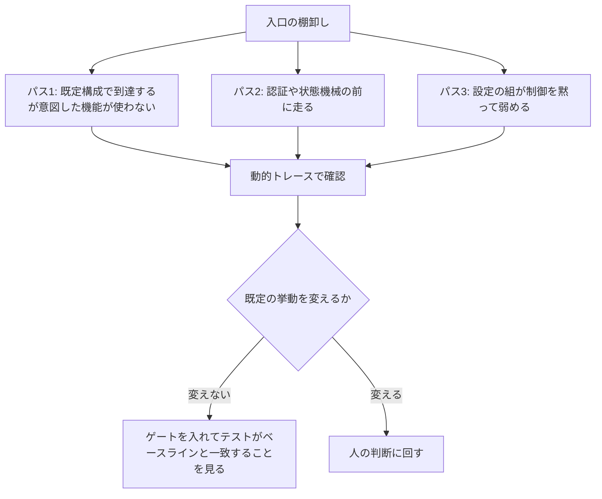
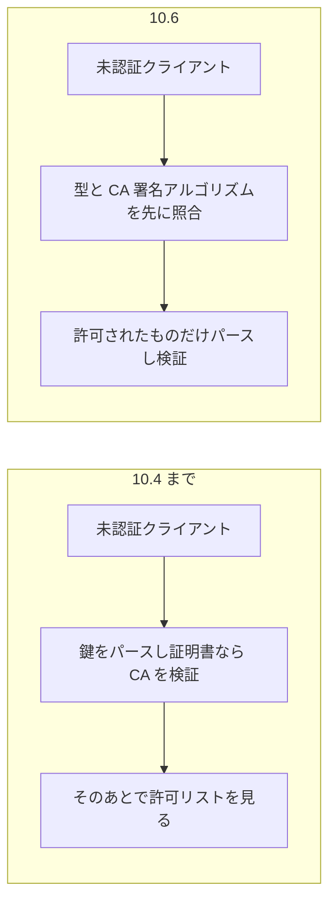

Anthropic の Frontier Red Team の Chris Rohlf が、2026-10-20 に研究投稿「Using Claude to reduce the attack surface of code」を公開しました。Claude に大規模な OSS の「到達できるコード」を地図にさせ、そのデプロイが晒す必要のない部分をゲートの後ろへ動かす初期研究です。この記事では、手法の中身、OpenSSH での実例、数字をどこまで信じてよいか、自分の現場で試すかどうかの判断材料を整理します。対象はセキュリティに関心のある開発者で、OpenSSH や攻撃面の用語は初めてでも読めるようにしています。

なお、この投稿は研究のプレビューです。数字の大半は Anthropic 自身が一つの投稿で述べた測定で、第三者の再計測はまだ見つかっていません。

*この記事の全体像。以下、順に解説します。*

## Claudeによる攻撃対象領域の削減とは

### 何をする研究か

個別の脆弱性を一つずつ直す代わりに、未知の欠陥も含めて「そもそも攻撃者がそのコードに到達しにくい」状態を作る、という防御の置き方を示す研究です。ここで言う**攻撃面**(攻撃対象領域)とは、外部の入力が到達して実行されうるコードや設定の範囲のことです。**ゲート**は、認証や明示的な設定など、そのコードへ進むための関門を指します。

対象は C、C++、Java、PHP、Python を含む 25 の OSS で、合計 500 万行超です。投稿によれば、手法をまとめた Claude skill は、Anthropic が提供する、OSS のメンテナが参加を申し込む形の脆弱性発見サービス「OSS Scanner」へ統合する作業中です。

### 見ているもの

欠陥の有無ではなく、次の三つの「晒す必要のない到達」を探します。

- 既定の構成で到達できるが、意図した機能は使わないコード
- 認証やプロトコルの状態を確かめる前に走る、複雑なコード
- 同時に有効にすると、制御が黙って弱まる設定の組(例: 逆引き DNS をオフにすると、ホスト名が得られなくなり、ホスト名による拒否ルールが IP との文字列比較になって発火しなくなる)

ゲートの動かし方として、投稿は次の移動を挙げています。

- 認証前から認証後へ
- 0-click(操作なしで到達)から 1-click(利用者が一度操作して初めて到達)へ
- 既定オンから、明示的に有効にする opt-in へ
- プロトコルの最初のメッセージから、セッション状態の奥へ

### 作業の流れ

作業は、入口の棚卸しから始め、三つの問いのどれかに当たる到達をゲートの後ろへ動かす流れです。再利用できる手順は三つのパスで、Claude を別々に三回実行する形です。各パスは前の実行の会話履歴を持たない空の状態から始まり、前のパスが残した短いメモだけを受け取ります。

- 発見は動的トレース(実行時に実際に通るコードを記録すること)で確認します。
- 既定の構成に影響しないゲートは、プロジェクトのテストとブラックボックスの回帰テストがベースラインと同一であることを条件にします。
- 非既定の挙動を変えるゲートは、人の判断に回します。

### 数字で見る結果

| 項目 | 値 |
|---|---|
| 対象プロジェクト | 25(Public 10、Gated 11、Private 4) |
| 洗い出した設定項目 | 17,000 超 |
| うちセキュリティに関係する制御や機能の設定 | 3,842 |
| 三つの分析で数えた件数 | 493 |
| Gated での、既定構成では不要な認証前に到達できるコード | 93 |
| Gated で認証前にコードが動く、または状態が残る箇所 | 37 |
| Gated で認証前の制御を黙って弱める設定の組 | 61 |
| 全タイプで、警告も文書もない設定の組 | 162(制御を黙って切る 94、同じ機構の不整合 68) |

プロジェクトの分類は次のとおりです。

- Public は、誰でも到達できるもの
- Gated は、認証後に機能を出すもの
- Private は、運用者の私設環境で動くもの

図の横軸は 1 から 25 の番号だけで、プロジェクト名は示されていません。

また、無関係な 4 プロジェクトで、同じ型の問題が繰り返されたとあります。ホスト名やワイルドカードの deny(拒否ルール)が、逆引き DNS をオフにすると IP との文字列比較になり、発火しなくなる、という型です。

### OpenSSH での実例

最も具体的な事例は OpenSSH の sshd です。OpenSSH 10.4 では、既定で無効な ML-DSA-44(ポスト量子の署名方式)の実験的な署名処理およそ 4,500 行が、認証前の未認証クライアントから到達できました。投稿はこれを、既定の sshd の認証前コードの約 16% としています。許可リストの検査が、鍵のパース(届いた鍵データを読み解く処理)と CA(証明書を発行する認証局)の署名検証の後ろにあったためです。鍵を読み解くには、その鍵タイプ用の処理コードを動かす必要があるので、許可リストで弾く前に、無効なはずの機能のコードが未認証の相手の入力で実行されていました。

メンテナの対応は二段階でした。

- **10.5(2026-08-11)**: 公開鍵タイプを許可アルゴリズムと照合する処理を、接続相手が送った鍵のパースより前へ移しました。
- **10.6(2026-10-06)**: 鍵のパース中に、鍵タイプと CA 署名タイプを許可リスト(`PubkeyAcceptedAlgorithms` など)とできるだけ早く照合するようにしました。クライアントとサーバの両方が対象です。

投稿は、10.5 の検査には二つの隙間が残っていたと書いています。相手が名乗ったアルゴリズム名と、鍵データの中に書かれた型がずれうること、証明書の CA 署名が設定の前に検証されうることです。10.6 でパーサ内の照合になり、この隙間が閉じました。

注意したい点があります。10.6 のリリースノートは「パースの中で鍵タイプと CA 署名タイプをできるだけ早く照合する」と書いていて、パースそのものを許可後だけに限るとは書いていません。

## 注意点

### 数字の出どころ

OpenSSH のリリースノートが独立に裏づけているのは、「検査を前へ動かした」という機構と、クレジットの範囲です。数字は、次の表のとおり一投稿の自己申告です。

| 主張 | どこまで一次情報か |
|---|---|
| 25 プロジェクト、500 万行超、設定 17,000 超、うち 3,842、発見 493 | 本文と図の副題のみ。プロジェクトの名簿、再集計、偽陽性率は公開されていない |
| Gated の 93、37、61 | 本文のみ。三つの問いとの対応や、162 との包含関係は明示されていないので、対応づけたり足し合わせたりしない |
| 約 4,500 行、約 16%、およそ 5 分の 1 | 投稿のみ。10.5 のノートは "at least some"(少なくとも一部)と書き、10.6 のノートは割合を書かない |
| 衝突が 21 年 | 投稿のみ。対象の名前、版、コミットは示されていない |
| economically(経済的に) | 定性的な一語で、トークン量も金額も示されていない |

493 は、脆弱性の件数ではなく、到達に関する問題(issue)の件数です。投稿は、Gated の当該の件は単独では直ちに悪用可能ではない、と書いています。

### 二次情報の見出し

二次の見出しには、"493 flaws" や「コードの 5 分の 1 を削除」といった表現があります。投稿が数えているのは到達の問題であり、削除した行数でも CVE(共通脆弱性識別子)の件数でもありません。英語の解説記事は投稿の数字の再掲で、独立した再計測は見つかっていません。

### AI 由来の報告の受け止め方

OpenSSH の 10.5 と 10.6 のリリースノートの前文は、AI 由来の報告の多くは現実的な脅威モデルでは影響が無い、と述べています。歓迎するのは、人間によるトリアージ、分析、テスト、とくに修正案が付いた報告です。今回の事例は、パッチ付きで取り込まれた側に入ります。ただし、この取り込みの事実を、AI による報告一般の精度に延長することはできません。

### 同じ時期の別件を混ぜない

同じ時期の OpenSSH の変更を、4,500 行の話に足さないよう注意してください。次の三件は、公開鍵タイプの前倒しとは別の変更です。

- 10.6 の別の箇条は、`AuthorizedPrincipalsFile` などの `"none"` が、Match による上書きの際にファイル名として扱われる不具合です。公開鍵タイプの前倒しとは別件です(コミット `526fd277`)。
- 10.5 の double free は、ノートが「テストハーネスの外からは到達不能」と書いています(コミット `05000bc5`)。
- 10.6 の新機能として、ハイブリッド署名 `ssh-mldsa44-ed25519` が、実験を示す接尾辞なしで有効化されました。到達を閉じた話と、アルゴリズムを正式に有効にした話が、同じリリースにあります。

公開鍵タイプの前倒しには、リリースノートの該当箇条に CVE 番号が書かれていません。ただし、番号が無いと断定できる材料はありません。

### 手法自体の限界

投稿が自分で置いている限界は次のとおりです。

- 未知の脆弱性は残り、到達を難しくするだけである
- 一部の設定の組は非標準かもしれないが、管理者がそう配備することは妨げられない
- この投稿が扱うのは、攻撃面削減のごく一部である

## OSS Scannerとの関係

OSS Scanner のローンチは 2026-10-08 で、FAQ の追記は 2026-10-13 です。攻撃面の投稿は 2026-10-20 で、skill を OSS Scanner に統合しようとしていると書いています。

公開リポジトリ `anthropics/oss-scanner` の main(2026-10-24 時点)には、その skill のファイルは見当たりませんでした。公開されているのは、登録用の `project.yaml`、Dockerfile、任意の脅威モデル、検証用の `tools/validate.py` です。

登録の実装には、FAQ の表記との小さなずれがあります。

- FAQ は必須フィールド名を `Dockerfile` と書いていますが、`validate.py` の常時必須キーは `repo` と `primary_contact` で、Dockerfile のキー名は `dockerfile` です。
- `projects/<name>/Dockerfile` を横に置く場合は、キーを書きません。
- 横置きファイルは 64 KiB、`project.yaml` は 128 KiB を超えると検証が拒否されます。
- `budget` や `cadence` は、メンテナが書けない operator 専用のキーです。

運用面は FAQ と利用条件にこう書かれています。

- スキャン報告は人間がレビューしない。サインアップがメンテナ本人のものか、Dockerfile が当該リポジトリだけを向くかは人間が見る
- ビルドはネットワーク可、その後の監査はネットワーク無し
- 未検証の自動報告には 90 日の開示期限が無い
- 利用条件は、無償、現状有姿、責任上限 1,000 米ドル、いつでも停止できる、というもの

ローンチ投稿の別の自己申告(候補 29,000 超、人手で見た約 6,000 など)は、調べた対象が攻撃面の 493 とは別なので、数字を並べて比較できません。なお、研究投稿は使ったモデル名を書いていません。

## 自分の現場で試すか判断する

### 採用してよい結論

言えるのは、次の一点です。

> 「到達の順序を前にずらす」手法は、監査済みの C の sshd で、メンテナがパッチとして受け取った。件数と削減割合は、まだベンダー一投稿の測定である。

### 使い方の判断

- 個別の CVE を潰す作業をやめる理由にはなりません。投稿自身が未知の欠陥の残存を認めています。
- 足しになるのは、「認証の前」「既定で無効な機能のパーサ」「設定の組で黙って落ちる制御」といった、晒す必要のない到達がレビューから漏れやすい、という注意です。OpenSSH はその注意が、最も監査されたコードの一つでも当てはまった事例として強い一方、「5 分の 1」という量の根拠としては弱いです。
- OSS Scanner の登録プロジェクトに対して、この skill をオンにすることは今日はできません。公開ツリーに無く、投稿も作業中と書いています。
- 手順を自社のコードや依存している OSS に自前で試すなら、投稿の三つの問いに分けます。既定挙動を変えないゲートだけを、テストスイートで同値確認します。非既定の挙動を変える変更は、人が見る差分として残します。
- モデル名、費用、偽陽性率が非公開なので、493 を自組織の期待値には使わないでください。

### 判断が変わる条件

次のいずれかが起きたら、評価を見直す価値があります。

- メンテナや第三者が、分母つきで到達行数を再計測し、5 分の 1 が再現した
- 25 プロジェクトの名簿と判定基準が公開された
- skill が `anthropics/oss-scanner` の main に入り、同じ三つのパスだと確認できた

### 未解決の点

- 4,500 行と 16% の分母(どのオブジェクトを認証前コードと数えたか)は非公開
- 21 年続いた設定衝突の対象は非公開
- 493 件のうち、メンテナが取り込んだ数は OpenSSH 以外は非公開
- 公開鍵タイプの前倒しに CVE が割り当てられているかは、全件の照合をしていない
- 実行時ログと設定を突き合わせて未使用のパーサを切る、という拡張は一文のみで、手順は無い

## まとめ

- Anthropic の研究は、Claude で「晒す必要のない到達」を見つけ、ゲートの後ろへ動かすという防御を示しています。
- OpenSSH 10.5 と 10.6 で、認証前のパースより前に許可リストを見る修正が実際に取り込まれました。
- 25 プロジェクト、493 件、約 16% といった数字は、現時点では一投稿の自己申告です。再計測の結果が出るまでは、期待値として使わないでください。
- OSS Scanner への skill 統合は作業中で、公開ツリーにはまだ見当たりません。試すなら、三つの問いと、既定挙動を変えないゲートの同値確認に絞るのが現実的です。

この記事が少しでも参考になった、あるいは改善点などがあれば、ぜひリアクションやコメント、SNSでのシェアをいただけると励みになります！

## 参考リンク

- [Using Claude to reduce the attack surface of code(Anthropic、2026-10-20)](https://www.anthropic.com/research/attack-surface-reduction)
- [OpenSSH Release Notes(10.4、10.5、10.6)](https://www.openssh.org/releasenotes.html)
- [openssh-portable コミット 52154c2(公開鍵タイプ検査の前倒し)](https://github.com/openssh/openssh-portable/commit/52154c2d232de1d5a161cb900bdb0792043ae142)
- [openssh-portable コミット 65666f4(パース中の許可リスト照合)](https://github.com/openssh/openssh-portable/commit/65666f4e820051da00c4a8ef0b1555a9f881050a)
- [openssh-portable コミット 526fd277(`"none"` の別件)](https://github.com/openssh/openssh-portable/commit/526fd2771342f36142099bec82c49ce0457c5016)
- [An opt-in vulnerability-finding service for open-source software(Anthropic、2026-10-08)](https://www.anthropic.com/research/launching-opt-in-vuln-finding-service-for-open-source)
- [OSS Scanner FAQ](https://red.anthropic.com/oss-scanner/)
- [anthropics/oss-scanner](https://github.com/anthropics/oss-scanner)
