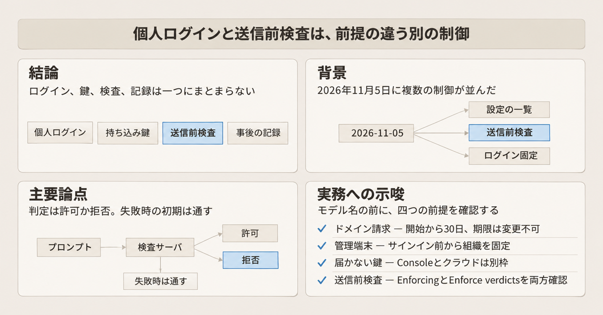
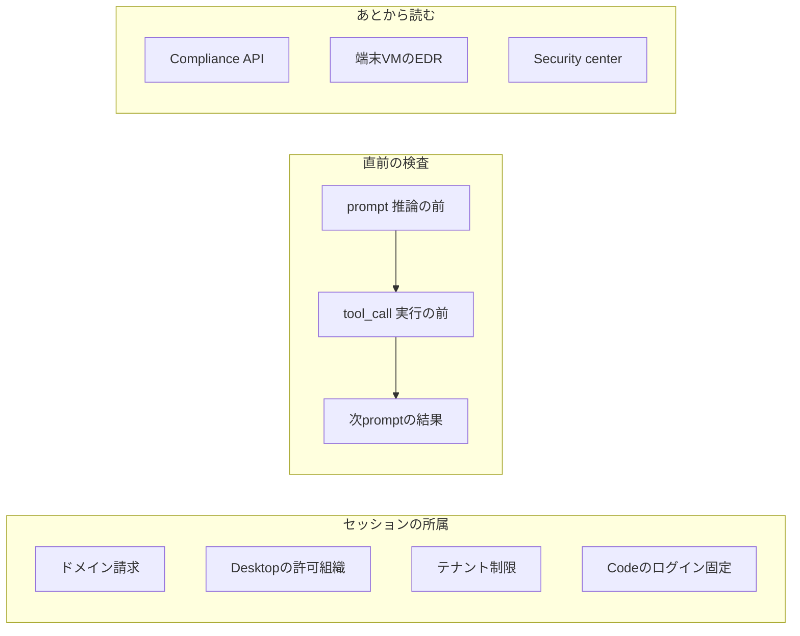

2026年11月5日、AnthropicはClaude Enterprise向けに、設定の一覧、推論前の検査、組織をまたぐ管理、アクセス制御、端末上の観測をまとめて公開しました。
この記事は、コーディングエージェントの権限を設計する人が、ログイン、持ち込みの鍵、送信、ツール、ファイルの出口を、公開文書の制御ごとにたどれるようにします。
数値と境界はAnthropicの公開文書を正とします。
2026年11月12日7時のキーマンズネット記事は、その入口です。

*この記事の全体像。以下、順に解説します。*

## Claude Enterpriseの個人アカウント遮断とDLP連携とは

2026年11月5日の発表は、並んだ複数の制御です。
検査の本体は **inference hooks** です。
組織か、その委託先が、公開HTTPSの **AI security server** を持ちます。
Anthropicが署名付きの会話をそのサーバへPOSTし、allowかdenyが返るまで待ちます。
同じ日の発表には、Security center、admin.claude.comの集中管理、Admin APIのサインアウト、セルフサービスのIP許可リスト、Claude Desktopの組織設定、Coworkの仮想マシン内のEDRが並びます。
Coworkは、Claude Desktopの中のセッションとクラウドのタスクがあり、端末側では利用者のコンピュータ上の仮想マシンで動きます。
EDRは、その仮想マシンに組織のセンサーを入れる機能です。

制御は、セッションがどの組織に属するかと、そのセッションの中身を誰が直前に止めるかに分かれます。
inference hooksは、後者の直前検査です。
ドメイン請求、Desktopの許可組織、テナント制限、Claude Codeの `forceLoginOrgUUID` は、前者です。
`forceLoginOrgUUID` は、サインイン前から組織を固定する設定です。
DesktopのMDMと、Claude Codeのmanaged settingsの両方に置きます。
Compliance APIとEDRは、あとから読む側に置かれます。

### Security center

**Security center** は、Organization settingsの1ページです。
2026年11月13日時点のヘルプではbetaです。
chat、Cowork、Claude Codeの設定を、Anthropicの推奨値と比べます。
各項目には現在値、推奨値、変更リンクがあります。
新しい設定と、最近変わった設定も示します。
ページを開くたびに再チェックします。
Compliance APIは、同じ結果を読めます。
状態の変化はactivity feedに出ます。
activity feedは、その変化の記録です。
設定のグループは、組織、チャット、Cowork、Claude Codeです。
MDMやClaude Codeのmanaged settingsなど、ページから読めない項目は手動確認です。
managed settingsは、管理者の設定が、条件を満たすClaude Codeのセッションへ届く仕組みです。
Ownerが、手動確認したことを記録します。
文書の語はattestです。
Security centerの共有ワークスペースには、現状記録、リスク受容、課題のフラグを残せます。
PDFは、自動チェックとOwner確認を分けて印します。
閲覧できるのはOwnerとPrimary Ownerです。

### inference hooks

2026年8月5日の製品記事は、inference hooksをbetaと書いていました。
2026年11月5日のEnterprise記事は、prompt hooksとpre-tool-call hooksの両方をgenerally availableとしています。

イベントは二つです。
`prompt` は、推論の前です。
`tool_call` は、**Validate tool calls** がオンのとき、ツール実行の前です。
新規設定では、このスイッチの既定はオンです。
1つのverdictが、その応答に含まれるツール呼び出し全体を覆います。
このまとまりを、以下ではフレームと呼びます。

AnthropicはStandard Webhooksで署名します。
User-Agentは `anthropic-dlp/1` です。
判定はallowかdenyです。
対象はClaude Enterprise組織の会話です。
claude.ai、Cowork、Claude Code、Claude for Microsoft 365、Claude Tag、Claude in Chromeを含みます。
Claude Tagは、その対象面の一つで、Slackの会話を含みます。
面はWeb、Desktop、モバイル、CLI、Slackにわたります。

エンドポイントは、公開IPv4のHTTPSです。
ポートは443です。
証明書は公的CAです。
リダイレクトはありません。
送信元は `160.79.106.0/24` です。
カスタムヘッダは最大16です。
署名時刻のずれは5分です。
Verdict timeoutは1から10,000ミリ秒で、既定は5,000ミリ秒です。
この時間は、接続から応答までを含みます。
再送は、接続失敗のときだけ、100ミリ秒後に1回です。
リクエスト本文のプロトコル上限は64MiBです。
文書は、実運用ではコンテキスト窓によりおおよそ10MB未満、と書きます。
応答は非圧縮で最大64KiB、HTTP 200です。
`deny_reason` は最大500文字です。
Custom blocked messageも最大500文字です。
`reference_id` は最大50文字で、文字種は `[A-Za-z0-9._:/-]` です。
Rolloutは0から100%で、会話のターンごとに抽選します。
設定できるのは、`organization:manage` を持つOwnerとPrimary ownerです。
Enforce verdictsは、判定を強制する設定です。
この設定を変えてから反映されるまでは、おおよそ1分です。
最小サンプルは、本文を読み捨てて `{"action":"allow"}` を返すサーバです。
言語はPython、TypeScript、C#、Go、Java、PHP、Rubyです。

`prompt` でdenyになると、その内容はモデルに届きません。
`tool_call` でdenyになると、そのフレームのツールは、Claude Codeが実行する前に止まります。
フレームより前に届いたテキストは、取り消されません。
ローカルMCPとの往復そのものはAnthropicを通りません。
結果テキストは、次の `prompt` の `tool_result` に載ります。

### 集中管理とサインアウトとIP許可リスト

**集中管理** は、親組織がadmin.claude.comで置く管理です。
2026年11月5日の記事ではbetaです。
配下のClaude Enterprise組織とClaude Platform組織にまたがり、SSO、SCIM、ドメイン検証、グループ、Compliance APIキーを置きます。
このグループは、Security centerの設定グループとは別です。
ロールはparent organization ownerとparent organization adminです。
IdPは複数接続できます。
各組織のメンバー、ロール、IP許可リスト、テナント制限、セッション時間は、組織側に残ります。
親ロールは、既定では配下組織の中へのアクセスを与えません。
親で作ったCompliance APIキーは、組織をまたいで読めます。
セットアップは、いずれかの子組織の管理者が親管理者を提案し、他組織が承認し、最後の承認で完了します。
完了後は取り消せません。

**Admin APIのサインアウト** は、`POST /v1/organizations/users/{user_id}/sign_out` です。
2026年11月5日の記事ではbetaです。
その人のClaudeアカウントのサインインセッションを、他組織と個人プランを含めて終わらせます。
Primary ownerは対象外で、エラーは `cannot_sign_out_primary_owner` です。
2026年11月5日の記事は、Claude Codeのようなアプリには再サインインが要る、と書きます。
同じ記事は、APIキー、すでに走っているクラウドセッション、スケジュールされたルーチンは終わらせない、と続けます。
本人は直後に再サインインできます。

**IP許可リスト** は、Enterprise管理者が、Anthropicを介さず自分で設定します。
2026年11月5日の記事ではbetaです。
許可したIPに、ほとんどのClaude製品のアクセスを限ります。

### セッションがどの組織に属するか

**ドメイン請求** は、検証済みの企業メールドメイン上にある個人のFree、Pro、Max、Ultraを、組織へ移す機能です。
対象契約は、直接契約またはAWS MarketplaceのEnterpriseです。
トグル名は「Migrate accounts using your domain」です。
バナーはWebとClaude Desktopに出ます。
前提は、組織作成の制限、DNSでのドメイン検証、SSOの強制、JITまたはSCIMです。
SCIMが優先されます。
移行窓は、請求開始から30日です。
請求ごとに期限は一つで、変更はできません。
有効化後は不可逆です。
個人のGmailなど、企業ドメインでないメールのアカウントは、請求を受けた側のヘルプでは対象外です。
何が移り、何が残るかは、後の節で一覧にします。

**Desktopの許可組織** は、MDMなしで置ける組織設定の一つです。
反映にはClaude Desktop 4.29.0以降が要ります。
シャドーITのトグル「Limit Claude Desktop to allowed organizations」は、そのコンピュータでメンバーが組織へサインインしたあと、次回起動から個人アカウントと許可していない組織を止めます。
文書が書く制御は、Desktopアプリです。
このトグルは永続ではありません。
そのコンピュータで組織を30日使わないと終わります。
コンピュータの利用者は外せます。
許可組織が複数なら、各組織に同じリストを置きます。
サインイン前から止める設定は、MDMの `forceLoginOrgUUID` です。
ポリシーの置き場所は、Desktopでは `com.anthropic.claudefordesktop`、Windowsでは `HKLM\SOFTWARE\Policies\Claude`、それにClaude Codeのmanaged settingsです。
UUIDが1つなら、その組織を事前選択します。
JSON配列なら、事前選択せず、列挙した組織だけを許します。
列挙した組織にアカウントが無ければ、ログインは失敗します。
managedソースの空や不正な値は、v2.1.282以降、直すまでどの組織もログインできません。

**テナント制限** は、EnterpriseプランとConsole組織の、ネットワーク側の制御です。
Console組織は、claude.aiのTeamやEnterprise組織とは別の、Claude Console側の組織です。
TLSインスペクションするプロキシが、`anthropic-allowed-org-ids` を付けます。
値はカンマ区切りのUUIDで、空白はありません。
続きは `anthropic-allowed-org-ids1` 以降です。
`;n=K` のKは10以下です。
UUIDは合計500までです。
対象ホストは、claude.ai、api.anthropic.com、claude.com、anthropic.comです。
認証は、Web、Desktop、APIキー、OAuthを含みます。
ArtifactsとClaude Docsも含みます。
許可外はHTTP 403で、`error_code` は `tenant_restriction_violation` です。
ヘッダ不正は400です。
プロキシ例は、Cato、Cloudflare Zero Trust、Netskope、Palo Alto Prisma Access、Zscaler ZIA、汎用のHTTPSヘッダ注入です。
ヘルプの更新マーカーは2026年10月16日です。
未管理ネットワークでは、標準認証が続きます。
ヘッダが無いときの既存APIキー認証は、変わりません。
公式のsecurity benefitsは、企業ネットワーク上で個人アカウントを止めるという意味で、これをDLPと呼びます。

**検証済みドメインのコネクタ制限** は、対応コネクタの新規接続を、そのEnterpriseのClaudeアカウントに限る機能です。
前提はEnterprise、Identity and AccessのManage、検証済みドメインです。
親組織で有効なら、子組織にも及びます。
2026年11月13日に読んだページの対応名は、Airtable、Asana、Atlassian、Box、Canva、Figma、Gmail、Google Calendar、Google Docs、Google Drive、Google Sheets、Google Slides、HubSpot、Linear、Microsoft 365、Miro、Notion、Slack、Smartsheet、Tableauです。
現行リストは、Organization settingsのOrganization and accessにも出ます。
ヘルプの更新日は2026年11月7日です。
既存接続は切りません。
Enterpriseの利用者が個人のGmailへつなぐ逆方向は、制限しません。
サービスがアカウントの身元を渡さないときは評価できず、接続は進みます。
例は、一部のCanva Educationの.eduです。
評価できない場合は、ブロックせず許可します。
ドメイン請求とは別で、不可逆ではありません。
失敗メッセージは、接続を試みた本人だけが見ます。
文言は次のとおりです。

> This corporate identity belongs to an Enterprise that manages access through their own Claude account. Sign in to your organization's Claude account to use this connection.

**Claude Codeのmanaged settings** は、`api.anthropic.com` へ直接つながり、かつ次のどれかで認証したセッションに届く設定です。
TeamまたはEnterpriseのOAuth、`CLAUDE_CODE_OAUTH_TOKEN`、直接設定したAPIキー、Anthropic APIを向く `user_oauth` プロファイル（v2.1.257以降）です。
起動時と、セッション中は1時間ごとに更新します。
ログイン強制のキーは `forceLoginMethod` と `forceLoginOrgUUID` です。
`forceLoginMethod` は、ログイン方式を固定するキーです。
これらをmanaged settingとして置くと、`ANTHROPIC_API_KEY`、`ANTHROPIC_AUTH_TOKEN`、`apiKeyHelper` のセッションは起動時に止まります。
`apiKeyHelper` は、戻り値をAPIキーとして使う認証です。
届く条件と届かない条件の詳細は、後の節にまとめます。

### あとから読む経路

**Compliance API連携** は、2026年11月5日更新のヘルプでは、会話のあとからログを渡す連携として書かれています。
ブロック経路としては書かれていません。

**CoworkのEDR** は、利用者のコンピュータ上の仮想マシンに、組織のセンサーを入れる機能です。
2026年11月13日時点のヘルプではbetaです。
起動のたびに、ベンダーパッケージの署名を検証してからインストールします。
対象OSはmacOSとWindowsです。
対象は、Claude TeamとEnterprise、およびAmazon Bedrock、Google Cloud Vertex AI、Microsoft Foundry上のClaude Desktopを、MDM経由で含みます。
センサーは検知モードで活動を報告します。
ベンダー一覧は、CrowdStrike、Evoke Security、Neo、Palo Alto Networks、Pluto Security、SentinelOne、Taniumです。
センサーは、Coworkのネットワーク許可リストの外へテレメトリを出せます。

### 三つの置き場所

`prompt` から `tool_call` へ進み、ローカルツールの結果テキストは次の `prompt` で見えます。

## 注意点

キーマンズネットのリードは、設定の一覧、DLP連携、個人アカウントの遮断を、企業テナントとシャドーITを分ける一続きとして伝えています。
2026年11月5日のAnthropic記事の本文は、機能を分けて書いています。
リードの圧縮より、本文の方が公式の一覧に近いです。
その記事の本文は、生成AIを使った記事であることも書いています。
価格、利用者割合、画像の「13 of 16 controls passed」は、製品指標として採用しません。
ベンダーブログのシート単価や侵害統計も採用しません。

### DLPと呼ばれるものが二つある

公式が「DLP」と呼んでいるのは、組み込みのDLP製品名ではありません。
組織が用意するAI security serverへのinference hooksです。
2026年11月5日の記事は、prompts and tool callsをデータセキュリティツールへ渡す、と書きます。
テナント制限のヘルプがsecurity benefitsでDLPと書く箇所は、企業ネットワーク上で個人アカウントを止める別機能です。

Compliance APIのパートナー一覧を、hooksが止めるベンダー一覧として読まないでください。
一覧にあるのは、監視のみのNightfall AI、CrowdStrike、Palo Alto、プライベートプレビューのNetskope、Noma、Reva.aiです。
Reva.aiの紹介文がpre-tool hooksとinference hooksに触れても、それはベンダー側の文です。

### 一次情報の範囲を超える読み替え

| 読み替え | 公式が書いている範囲 |
|---|---|
| 個人ログインを止めれば、個人環境が業務データから切れる | ドメイン請求、Desktopの許可組織、テナント制限、Claude Codeのログイン固定は、対象と前提が別々 |
| 持ち込みAPIキーも同じスイッチで止まる | サインアウトAPIはAPIキーを終わらせない。Claude Codeの `forceLoginOrgUUID` は、managed settingsとして置いたときに `ANTHROPIC_API_KEY`、`ANTHROPIC_AUTH_TOKEN`、`apiKeyHelper` のセッションを起動時に止める。クラウドプロバイダのセッションは、それらの資格情報か、以前のConsoleログインで保存したAPIキーが同時に無い限り対象外 |
| DLPがファイル書き出しだけを出口として止める | 公式のイベントは `prompt` と `tool_call`。ファイル書き出し専用イベントの有無は、2026年11月13日時点のhooks文書と追加検索では確認できなかった |
| 検知したら送信もツールも加工して通す | 判定はallowかdeny。書き換えと伏字はできない。画像だけのスクリーンショットと、ファイルや画像の生バイトは送られない |
| Security centerの緑が準拠の証明 | ページもPDFも、認証でも法令準拠の保証でもない、とヘルプが書く |
| EDRが持ち出しを止める | 2026年11月5日の記事は、センサーは検知モードで報告し、ブロックしない、と書く。クラウドのCoworkにはセンサーを入れられない |

### hooksが送り、送らないもの

inference hooksが届ける中身は、利用者が見る文字、ツール呼び出しとその結果、添付から抽出したテキストです。
システムプロンプト、ツール定義、隠れた推論は送りません。
claude.ai組み込みの一部ツールは、`tool_call` から外れ、次の `prompt` に戻ります。
該当は、コネクタやスキルの一覧、Web検索の候補、モデル切替、チャット終了、ローカル時刻、過去チャットとメモリです。
ホストされたClaude Securityのスキャン、GitHub Code Review、smart-reportのモデル呼び出しは対象外です。
利用者が指摘を直すセッションや、ローカルの `/code-review` は対象です。
コード実行ツールの入れ子呼び出しは、別の `tool_call` フレームになります。
`source.application` は助言であり、信頼境界ではありません。
Voiceでは、多くのpromptとツールが送られます。
一部のツール呼び出しは送られません。
denyは、理由を出さずに通話を終わらせることが多いです。

画像と生バイトは送られません。
スクリーンショットだけの文書は検査されません。
抽出テキストがある添付は、そのテキストが対象です。
ローカルのbash、read_file、ファイル書き込み、ローカルMCPは、`tool_info` のtypeが `client` です。
denyは、Claude Codeが実行する前に止めます。
WriteやEditの `input` にファイル全文が常に含まれる、とは書かれていません。
hooksのendpoint文書にあるread_fileの例は、パスを示します。

### 検査が抜ける既定

失敗時の初回保存の既定は、**Allow the request**（fail open）と5,000ミリ秒です。
fail openは、検査側の失敗時にリクエストを通す扱いです。
ModeはOff、Shadow、Enforcingです。
Enforcingでは、denyが送信とツールを止めます。
Shadowは、denyを受けても止めません。
文書は、ModeのEnforcingとEnforce verdictsの両方を書きます。
両者が同じスイッチかは、読んだ文書では一つの文になっていません。
Allow for your organizationは、文書上はこの名前のスイッチです。
何を許可するかは、Enforce verdictsがオフのまま、以外は特定できません。
Allow for your organizationをオンにしただけでは、Enforce verdictsはオフのままです。
Rolloutで抽選されなかったリクエストは、fail closedでも検査をスキップします。
fail closedは、検査側の失敗時にリクエストを止める扱いです。

除外できるのは、自作のカスタムロールだけです。
組み込みロールは、除外候補に出ません。
「Only selected roles」は、Custom rolesに置かれ、かつ選んだロールを持つメンバーだけを検査します。
このモードのあいだ、メンバーが背後にいないAPIキーのリクエストと、メンバーのいないClaude TagのSlack会話は検査されません。
この文は、ロール制限をオフにしたすべてのAPIキーセッションまで非検査だとは書いていません。

HTTP 200以外、解釈できないverdict、64KiB超は、失敗であり、denyではありません。
持続する自サーバ側の失敗でcircuit breakerが開くと、開いている間は検査対象のすべてにfailure handlingを適用します。
その間、サーバへは連絡しません。
何件で開くかは「Sustained」とあるだけで、回数は未記載です。
回復は、サーバを直してEnforce verdictsを入れ直すか、tripの10分後から最大おおよそ1分に1回の `config-test` です。
設定を変えると、この自動試験は止まります。
Shadowのエラーはbreakerに数えません。
数えるのは、timeout、非200、不正または過大な200、禁止アドレスです。
transport、URL形式の不正、Anthropic内部のrelayは数えません。
表示名は `DlpWebhookTimeoutError`、`DlpWebhookStatusError`、`DlpWebhookResponseError`、`DlpWebhookTransportError`、`DlpWebhookDisallowedAddressError`、`DlpWebhookBlockedError`、`DlpWebhookRelayError` です。

nginxの1MBやExpressの100kBは、それらの製品の既定であり、Anthropicの上限ではありません。
本文がそこで拒否されると、fail openの組織では、プロンプトが未検査のまま進みうると、endpoint文書が注意します。
この1MBと100kBは、Anthropicの制約値としては数えません。

### 対象外と、別機能との取り違え

Claude Platform組織（Platform経由のAPI）は、hooksの対象外です。
inference hooksのAvailabilityは、Amazon BedrockとGoogle Cloudでは使えない、と書きます。
Microsoft Foundryという語は、hooksの対象外リストにはありません。
対象かどうかは未確認です。
EDRの対象にはFoundry上のDesktopが含まれますが、それは別機能です。

Agent SDKのhooksは別物です。
SDK文書は、`PreToolUse` で `Write` と `Edit` を選び、入力を書き換えて拒否できる例を出します。
これはクライアント側のコールバックです。
Enterpriseのinference hooksのallow/deny Webhookと同じイベントではありません。
公開文書の最小サンプルは、本文を読み捨てて常時allowを返すサーバです。
ポリシー実装ではありません。

請求を受けた側の案内は、移行窓を「少なくとも30日」とも書きます。
管理者向けの請求ページは、窓を請求開始から30日と定め、期限の変更を非対応にしています。
設計に使う期限は、管理者向けページの「30日、変更不可」です。

### 確認できていない範囲

次は、読んだ文書の範囲では閉じていません。
本番の適用範囲を、ここから広げる根拠にはしません。

- inference hooksのSLA、処理リージョン、中継データの保管地域。読んだhooksの3文書と2026年11月5日の記事にはありませんでした。
- この一式の追加料金の有無。読んだ発表とヘルプには整数がありませんでした。価格ページは未読です。
- Microsoft Foundry上の会話がinference hooksの対象か。対象外リストに語がありません。
- IP許可リストが「ほとんどの製品」から外す例外の全文。ヘルプの全文は読んでいません。
- 集中管理ヘルプ（記事18232924）の全文。集中管理の説明は2026年11月5日の記事に依ります。
- circuit breakerが開く失敗回数。
- Only selected rolesをオフにしたとき、APIキーセッションをhooksが検査するか。非検査の例は、そのモードの節に書かれています。
- `forceLoginMethod` と `forceLoginOrgUUID` のどちらが、APIキーセッションの起動停止を担うか。表は両方の行に同じ文を置きます。
- v2.1.282がどの製品の版か。空や不正なmanagedソースの文にだけ出ます。Desktopの版として名指しされるのは4.29.0です。
- WriteとEditの `input` にファイル全文が入るか。
- identity management permissionを、どの組み込みロールが持つか。

ファイル書き出しだけを独立イベントで止める、または止めないと明記した一次文は、見つかっていません。
EDRベンダーごとのブロック能力を、Anthropicが保証する文も見つかっていません。
ベンダー製品が独自にブロックできることを、Anthropicの保証として扱わないでください。

## 個人ログインと持ち込み鍵は別の制御である

2026年11月5日の一式は、個人環境を業務データから切る単一スイッチではありません。
2026年11月5日の記事が「blocking personal and other outside Claude accounts in Claude Desktop on managed computers」と書く対象は、管理されたコンピュータ上のClaude Desktopです。
個人ログイン、持ち込みAPIキー、ファイル出口の検査は、前提の違う別制御です。

### 企業ドメインの個人アカウント

ドメイン請求で移るものと、移らないものは、自分で移す場合と管理者が請求する場合の両方に同じ、と移動のヘルプが書きます。
次の一覧は、その通常の移行です。

移るものは次です。

- チャット
- チャット内アーティファクト
- Artifactsタブのコピー（新しい非公開リンク）
- 新バージョンbeta以外のプロジェクト
- アップロードファイル
- プロジェクトの同期設定
- 組織メモリがオフでなければ、メモリ
- 組織側に値がある場合を除く、Claude Codeのメモリと個人設定、指示
- 2026年8月14日以降のClaude Design

移らないものは次です。

- カスタムスキル。移行経路は無く、事前にダウンロードします
- Claude Docs、Claude Sheets
- Claude Dataのアーティファクトと、一部の他アーティファクト
- 新バージョンのプロジェクト（beta）とそのチャット
- 大きすぎるチャット
- アプリとサービスへの接続。オフになり、移った先で再接続します
- 個人の財務、カスタムコネクタ
- 公開済みの旧アーティファクトと、ほとんどの公開共有リンク
- クラウドのCoworkタスク。スケジュールされたものを含みます。2026年10月6日以降にPro、Max、Ultraで始めたタスクは、Desktopからでもクラウドで動きます
- コンピュータ上だけのCoworkタスク。そのコンピュータには残りますが、移りません
- Claude Codeのクラウドセッション
- 2026年8月14日より前に移したClaude Designのシステムとプロジェクト

個人メールのアカウントは、この請求では残ります。
HIPAA対応またはCMEKの組織でも、請求はできます。
CMEKは、顧客が管理する暗号鍵（Customer-Managed Encryption Keys）を使う組織を指す、文書上の名前です。
個人データは受け取れず、その人は新規開始になります。
上の一覧は、この組織には当てはまりません。

### 管理されたコンピュータのDesktop

Desktopのトグルは、初回サインインの前を覆いません。
ブラウザのclaude.aiタブまで止めるとは、文書は書いていません。
ブラウザ側は、テナント制限の範囲です。
サインイン前から止めるのは、MDMの `forceLoginOrgUUID` です。
30日未使用のあとと、利用者が外したあとも、トグルだけでは空きます。

### 企業ネットワーク

テナント制限は、ヘッダを付けた通信に、Web、Desktop、APIキー、OAuthを含めてかかります。
ヘッダを注入する管理ネットワークの外では、標準認証が続きます。
公式は、この制御を企業ネットワーク上の個人アカウント遮断という意味でDLPと呼びます。
inference hooksのDLPとは、止める時点が違います。
テナント制限は通信の入口で403を返し、hooksは推論の前とツール実行の前にallowかdenyを返します。

### サインアウトが終わらせないもの

ユーザー管理のページは、サインアウトの残りを次のように書きます。
APIキーは、Admin APIキーを含めて動き続けます。
消すなら、claude.aiのOrganization settingsのAPIで削除します。
他組織のOAuthトークンと、組織に紐づかないアカウントトークンは動き続けます。
Claude Codeのクラウドセッション（Webとセルフホスト環境）は動き続けます。
本人が再度サインインしなくても、新しい資格情報を得ます。
スケジュールされたルーチンは、新しいセッションを起動し続けます。
Coworkに紐づいたコンピュータは、紐づいたままです。
進行中のサインインは、最大5分後まで完了しえます。
この組織に限って終わるのは、OAuthトークンです。
サインアウトは、個人アカウントの持続的な遮断ではありません。

### ローカルCLIの持ち込み鍵

`forceLoginOrgUUID` または `forceLoginMethod` をmanaged settingとして置くと、`ANTHROPIC_API_KEY`、`ANTHROPIC_AUTH_TOKEN`、`apiKeyHelper` で認証したセッションは起動時に止まります。
admin-setupの表は、この文を両方のキーの行に置いています。
どちらか一方だけに限る分離は、その表の文面からは読めません。
クラウドプロバイダのセッションは、それらの資格情報か、以前のClaude Consoleログインで保存したAPIキーが同時に無い限り、影響を受けません。
組織の確認は、端末、VS Code、Agent SDKのclaude.aiアカウントログインに対して行います。
Claude Consoleのログインと、gatewayのサインインでは確認しません。
このgatewayのサインインは、文書の語のままです。
後に出るClaude apps gatewayと同じものとは書いていません。
v2.1.212より前は、どちらのキーも端末ログインにだけ適用されました。
対話の `/login` 画面は方式を事前選択しますが、方式の強制はしません。
`allowedProviders`（v2.1.285以降）は、一覧に無いプロバイダのセッションを、起動、ログイン、次のAPI接触で拒否します。
ログイン系のキーは、ポリシーキーがあるとき、MDMまたはmanaged settingsファイルがリモート設定より先に読まれます。
managed settingsファイルと、endpoint-managed settingsが同じ置き場所かは、読んだ文書では一つの文になっていません。
ポリシーキーは、ログイン強制のキーがポリシーとしてある状態です。
全クライアントがv2.1.299以降になるまでは、server-managed settingsにも同じキーを置きます。
server-managed settingsは、`api.anthropic.com`、またはクラウド側のClaude apps gatewayから取得するmanaged settingsです。

server-managed settingsが届くのは、`api.anthropic.com` への直接接続に加え、次のどれかで認証したセッションです。
TeamまたはEnterpriseのOAuth、`CLAUDE_CODE_OAUTH_TOKEN`、直接設定したAPIキー、Anthropic APIを向く `user_oauth`（v2.1.257以降）です。
`apiKeyHelper` が返すキーとWorkload Identity Federationは、設定の取得自体を起こしません。
Claude ConsoleのAPIキーはConsole組織のもので、claude.aiのTeamまたはEnterprise組織とは別です。
そのため、claude.aiの管理設定は、そのキーを使うCIジョブに届きません。
届かせるには、Enterpriseが認可した `CLAUDE_CODE_OAUTH_TOKEN` か、端末上のendpoint-managed settingsです。
endpoint-managed settingsは、端末上に置くmanaged settingsです。
`CLAUDE_CODE_OAUTH_TOKEN` は、`--bare` では読まれません。
CoworkをClaude Desktopの中で動かすセッションは、claude.aiからserver-managed settingsを取得しません。
`CLAUDE_CODE_USE_BEDROCK`、`CLAUDE_CODE_USE_MANTLE`、`CLAUDE_CODE_USE_VERTEX`、`CLAUDE_CODE_USE_FOUNDRY`、`CLAUDE_CODE_USE_ANTHROPIC_AWS`、または既定でない `ANTHROPIC_BASE_URL` を出すと、取得をスキップします。

公式は、集中強制ではあるがクライアント側の制御であり、セキュリティ境界ではない、と書きます。
管理されていない端末は、管理者権限なしに迂回できます。
キャッシュの改ざんは、次の取得まで効きます。
差し控えたキーは例外です。
どのキーが差し控えられるかは、この文では特定できません。
改変バイナリと、機能より前の版は迂回します。
Bedrock、VertexまたはAgent Platform、Foundry、AWS上のClaude Platformのゲートウェイクライアントは、`api.anthropic.com` ではなく、自前のClaude apps gatewayから取得します。
起動時の失敗は、キャッシュを使わず終了します。
1時間ごとの更新は、両経路ともfail openです。
server-managed settingsが選ばれたソースのとき、MDMやファイルの `apiKeyHelper` は効きません。
クラウドプロバイダがオン、またはどこかのソースがAnthropic以外のAPIアドレスを置き、かつserver-managed settingsが `apiKeyHelper` を置かずAnthropicのAPIアドレスも指名しない場合、保存済みのclaude.aiログインセッションではプロンプトを拒否します。
これにはv2.1.314以降が要ります。

コネクタ制限は、個人ログインの遮断とは別です。
対応コネクタの新規接続を、EnterpriseのClaudeアカウントに限ります。

## 検知したときに止まる操作

連携先は、組織が指定する公開HTTPSのAI security serverです。
Anthropicがホストする名前付きDLP製品が、2026年11月5日の記事やhooks文書に製品として並んでいるわけではありません。
ベンダーは、そのサーバを実装できます。

| 操作 | 公式の止まり方 |
|---|---|
| 送信（推論へ渡すプロンプト） | Enforcingで `prompt` がdenyなら、モデルに届かない |
| ツール | Validate tool callsがオンで `tool_call` がdenyなら、そのフレームのツールはすべて実行前に止まる。一部だけの許可はできない。フレームより前に届いたテキストは取り消さない |
| ローカルのbash、read_file、ファイル書き込み、ローカルMCP | `tool_info` のtypeが `client`。denyはClaude Codeが実行する前に止める。ローカルサーバとの往復はAnthropicを通らない。結果テキストは次の `prompt` の `tool_result` で初めて見える |
| ファイル書き出し専用の出口 | hooks文書に独立イベントとしては見当たらなかった。WriteやEditの `input` にファイル全文が常に含まれる、とも書かれていない |
| 画像と生バイト | 送られない。スクリーンショットだけの文書は検査されない。抽出テキストがある添付は、そのテキストが対象 |
| 事後のログ | Compliance API。ブロック経路としては書かれていない |
| 端末内VMの観測 | EDRは報告する。2026年11月5日の記事はブロックしないと書く |

Desktopのワークスペース「Read only」は、Claudeのファイルツールに適用されます。
Codeタブのコマンド、MCPサーバ、hooksは、そのフォルダも他の場所も変更できます。
Claude Desktop自身のデータがあるフォルダでは、無視されます。
WindowsへのSSH越しにはかかりません。
フォルダ制限時は、WSLとlocalhost SSHが止まります。

判断の基準は、止めたい出口がこの表のどの行かです。
送信とツールフレームは、Enforcingのhooksでallowかdenyを待てます。
ファイルと画像の生バイトは、このWebhookの検査対象として書かれていません。
事後のログと端末内VMの報告は、止める行ではありません。

## 全社で揃える前に確認する四点

コーディングエージェントを全社で揃えるとき、先に見るのはモデル名より、次の4点が文書どおり有効かです。
全社共通化の制御面は、モデル選択の前に、これらの前提を満たしているかを見る側にあります。

1. 企業ドメインの個人アカウントを、請求開始から30日の窓で請求する。期限は変更できない。移らないスキル、Docs、Sheets、接続、クラウドCoworkを、請求の前に棚卸しする。個人メールのアカウントは、この請求では残る。
2. 管理端末では、サインイン前から `forceLoginOrgUUID` をMDMに置く。Desktopのトグルだけにすると、初回サインインの前と、30日未使用のあとと、利用者が外したあとが空く。ブラウザのclaude.aiは、このDesktop設定の文書範囲の外なので、テナント制限をプロキシに足す。
3. Claude Codeでは、managed settingsのログイン固定と、`ANTHROPIC_API_KEY` や `apiKeyHelper` の持ち込みを同時に設計する。ConsoleのAPIキー、Workload Identity Federation、Bedrock、Vertex、Foundry向けの環境変数、既定でない `ANTHROPIC_BASE_URL` は、claude.aiの管理設定が届かない経路として別枠にする。
4. DLPは、組織のHTTPSサーバをEnforcing、fail closed、Rollout 100%、Validate tool callsオンで置く。ModeのEnforcingとEnforce verdictsが同じスイッチかは、文書上は未確定です。Enforcingだけを入れて、Enforce verdictsがオフのまま、という読みは確定できません。両方の名前を設定画面で確認します。プロンプトとツールフレームをallowかdenyで止める。ファイルと画像の生バイト、画像だけの内容は、このWebhookでは検査できない。抽出テキストとツールの入力・結果は送られる。WriteやEditの入力にファイル全文が常に含まれるかは未確認。ローカルMCPの結果は次のプロンプトで見る。EDRは端末内VMの報告として置き、ブロック装置としては置かない。Security centerは設定の一覧として使い、監査の合格証としては使わない。

この4点を狭める一次情報は、次のとおりです。

- Desktopの遮断は、サインイン後であり、30日の未使用で終わり、利用者が外せる。文書の対象はDesktopである。
- 企業ドメインでない個人メールは、ドメイン請求の対象外である。移行はスキル、Docs、Sheets、接続、クラウドCoworkタスクなどを残す。HIPAA対応とCMEKの組織は、個人データを受け取れない。
- コネクタ制限は、DLPの代替ではない。既存接続を切らず、身元が渡らない接続は許可する。
- サインアウトはAPIキーを残す。クラウドのClaude Codeセッションは新しい資格情報で続き、ルーチンは新しいセッションを起動し続ける。
- テナント制限は、ヘッダを注入する管理ネットワークの外では標準認証が続く。
- hooksは画像と生バイトを見ない。redactしない。Platform API組織とBedrockとGoogle Cloudを覆わない。初回既定はfail openである。Shadow、Rollout、ロール除外で未検査が残る。
- ローカルMCPの結果は、次のpromptまで見えない。`tool_call` のdenyはフレーム単位である。
- DesktopのRead onlyは、Codeタブのコマンド、MCP、hooksを止めない。
- EDRは端末内VMの検知で、クラウドCoworkには入らない。
- Security centerは認証ではない。
- ConsoleのAPIキーには、claude.aiのserver-managed settingsが届かない。`apiKeyHelper` とWorkload Identity Federationは取得自体を起こさない。第三者プロバイダの環境変数や既定でないベースURLは取得をスキップする。公式は、クライアント側の制御であり、管理されていない端末から迂回できると書く。

逆転条件は次です。
Anthropicが、ファイル書き出しを独立イベントにし、生バイトを送り、既定をfail closedに変え、Consoleキーとクラウドプロバイダセッションへ同じログイン固定を伸ばしたときは、この切り分けを引き直します。

## まとめ

2026年11月5日のClaude Enterprise向けの一式は、個人ログイン、持ち込みの鍵、送信前の検査、事後の記録を、別の制御として公開しています。
企業ドメインの請求、管理端末の `forceLoginOrgUUID`、プロキシのテナント制限、Claude Codeのmanaged settings、組織側のinference hooksは、前提が揃ったときだけそれぞれの出口に届きます。
既定の失敗時動作はfail openです。
画像と生バイト、ファイル書き出し専用のイベント、SLA、追加料金、Microsoft Foundry上のhooks対象は、読んだ文書の範囲では閉じていません。
モデル名の前に、四点の前提が文書どおり有効かを見てください。

この記事が少しでも参考になった、あるいは改善点などがあれば、ぜひリアクションやコメント、SNSでのシェアをいただけると励みになります！

## 参考リンク

- [More visibility and control over Claude Enterprise for security teams（2026-11-05）](https://claude.com/resources/articles/claude-enterprise-security-updates)
- [上記発表の日本語ミラー](https://claude.com/ja/resources/articles/claude-enterprise-security-updates)
- [Inference hooks（2026-08-05、当時betaと記載）](https://claude.com/resources/articles/claude-enterprise-inference-hooks)
- [Inference hooks 概要](https://platform.claude.com/docs/en/manage-claude/inference-hooks)
- [Inference hooks 設定](https://platform.claude.com/docs/en/manage-claude/inference-hooks-configuration)
- [Inference hooks エンドポイント](https://platform.claude.com/docs/en/manage-claude/inference-hooks-endpoint)
- [Inference hooks overview（ヘルプ 16059458）](https://support.claude.com/en/articles/16059458-inference-hooks-overview)
- [Security center](https://support.claude.com/en/articles/18246629-review-your-organization-s-security-posture-with-the-security-center)
- [ユーザー管理とサインアウト](https://platform.claude.com/docs/en/manage-claude/user-management)
- [TeamとEnterpriseのメンバー管理（サインアウトのアンカー）](https://support.claude.com/en/articles/13133750-manage-members-on-team-and-enterprise-plans#h_3cba7d14e5)
- [IP許可リスト](https://support.claude.com/en/articles/13200993-restrict-access-to-claude-with-ip-allowlisting)
- [テナント制限](https://support.claude.com/en/articles/13198485-enforce-network-level-access-control-with-tenant-restrictions)
- [Claude DesktopのEnterprise設定](https://support.claude.com/en/articles/12622667-enterprise-configuration-for-claude-desktop)
- [ドメイン請求](https://support.claude.com/en/articles/14625619-claim-and-migrate-accounts-on-your-domain)
- [請求を受けた側](https://support.claude.com/en/articles/14625626-respond-to-an-enterprise-domain-claim-on-your-claude-account)
- [個人アカウントの移動で何が移るか](https://support.claude.com/en/articles/9267400-move-your-personal-claude-account-to-a-team-or-enterprise-organization)
- [検証済みドメインのコネクタ](https://support.claude.com/en/articles/15402193-restrict-verified-domain-connectors-to-your-enterprise)
- [CoworkのEDR](https://support.claude.com/en/articles/17828685-run-your-endpoint-detection-and-response-edr-sensor-in-claude-cowork-on-claude-desktop)
- [Compliance API連携](https://support.claude.com/en/articles/15167101-get-started-with-claude-compliance-api-integrations)
- [Claude Code server-managed settings](https://code.claude.com/docs/en/server-managed-settings)
- [Claude Code admin setup](https://code.claude.com/docs/en/admin-setup)
- [Agent SDK hooks（別機能）](https://platform.claude.com/docs/en/agent-sdk/hooks)
- [集中管理のヘルプ（記事18232924。本文の集中管理は2026-11-05の発表に依る）](https://support.claude.com/en/articles/18232924)
- [キーマンズネット（2026-11-12 07:00）](https://kn.itmedia.co.jp/kn/article/2611/12/2000003082/)
