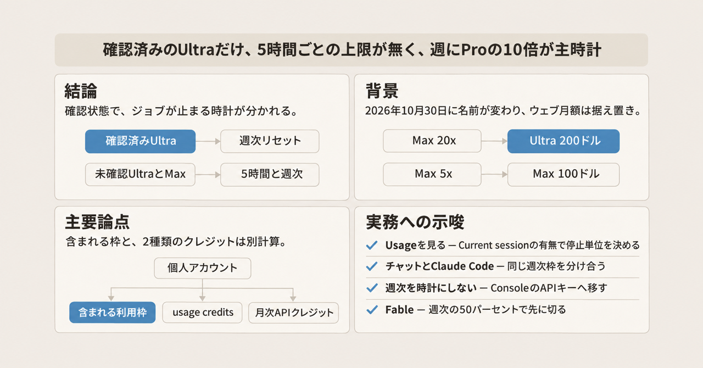
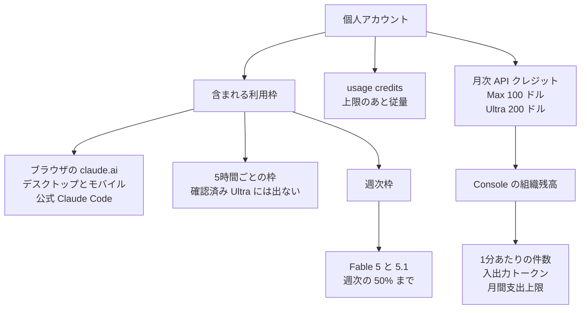

Anthropic は 2026-10-30 に、個人向けの最上位プラン Max 20x を Ultra へ、その下の Max 5x を Max へ改名しました。ウェブ表示の月額は Ultra が 200 ドル、Max が 100 ドルのままです。同日の公式 X `@claudeai` は、改名と価格据え置きとともに、既存契約者の手続きは不要、と告知しています。

この記事では、2026-11-03 に開いた公式ページの金額と倍数をもとに、含まれる利用枠、週次のリセット、usage credits、月次の API クレジットを整理します。公式の Claude Code は、ターミナルで使う公式のコーディング用クライアントです。個人アカウントで動かすとき、ジョブが止まる時計を読む材料になります。

金額と倍数は、その日に開いた公式ページの表示です。価格は変更されえます。

*この記事の全体像。以下、順に解説します。*

## Ultra プランとは

Ultra は、それまで Max 20x と呼ばれていた個人向け最上位プランの新しい名前です。Max は、それまで Max 5x と呼ばれていたその下のプランの新しい名前です。倍数の基準になる Pro は、料金ページが Ultra と Max を比べるときの個人向け有料プランです。

### 月額と契約の単位

2026-11-03 の料金ページでは、Ultra のウェブ月額は 200 ドル、Max のウェブ月額は 100 ドルです。どちらも月額のみで、税別です。Pro と Team には年額があり、Enterprise は年額のみです。Team と Enterprise は、個人の Max や Ultra とは別に料金ページが並べているプラン名です。

同じ日の Ultra の購入リンクは `https://claude.ai/upgrade/max?plan=max_20x` です。画面上の名前は Ultra でも、URL のプラン識別子は旧名の max_20x のままです。

### 含まれる利用枠

含まれる利用枠は、ブラウザの claude.ai、デスクトップ、モバイル、公式の Claude Code で分け合います。公式の Claude Code とは、ヘルプが Pro、Max、Ultra のログイン手順を書いている Anthropic 公式のクライアントです。料金ページの FAQ は、固定のメッセージ数を置いていません。

確認の状態で、5 時間ごとの枠の有無が分かれます。確認済みとは、アカウントと支払い履歴などを材料に、自動で判定される状態です。Ultra のヘルプは、Settings > Usage に Current session のバーが無ければ確認済み、と書いています。Current session は、5 時間ごとの枠を示すその画面のバーです。

確認済みの Ultra には、5 時間ごとにリセットされるセッション上限がありません。週ごとの上限は残ります。公開されている週次は、Pro の 10 倍です。未確認の Ultra には、一時的な 5 時間上限があります。その一時的な上限が Pro の何倍かは、開いた Ultra ヘルプには書かれていません。週次の Pro の 10 倍は、確認の有無で変わらないプランの週次です。

Max は、5 時間ごとと週ごとの両方が Pro の 5 倍です。ウェブ月額は 100 ドルです。

5 時間枠は、最初のメッセージから 5 時間後に満額へ戻るローリング枠です。週次のリセットは、アカウントに割り当てられた固定の曜日と時刻です。契約を始めた日には連動しません。次の時刻は Settings > Usage に出ます。

Max と Ultra では、Fable 5 と Fable 5.1 が週次上限の 50% まで含まれます。Fable 5 と Fable 5.1 は、その 2 プランに含まれるモデル名です。消費は通常の週次枠の中で進み、他のモデルより速くその 50% に達します。

含まれる上限のあとは、有効化した usage credits が標準 API 料金の従量で作業を続けます。usage credits は、サブスク料金とは別請求の従量クレジットです。月次の支出上限か残高で止まります。リセット時刻は変えません。

### 月次の API クレジット

Max には月 100 ドル、Ultra には月 200 ドルの Claude Platform の月次クレジットがあります。これは Claude API を自分のアプリに組み込むためのクレジットで、含まれる利用枠とは別計算です。Claude Console の組織残高に入ります。Claude Console は、Claude API を契約する組織側の管理画面です。新規契約では、加入から 7 日後に、この月次 API クレジットを請求できます。ここでいう請求は、そのクレジットを受け取れるようになる時点を指します。usage credits には充当されません。

usage credits の記事は、月次 API クレジットは Claude、Claude Code、Cowork の usage credits には適用されない、と書いています。Cowork は、その記事が Claude と Claude Code と並べて名指ししている製品名です。中身の定義は、2026-11-03 に開いた範囲の文書にはありません。

モバイルのアプリ内契約でも、usage credits の有効化と購入はウェブです。多くの地域では期限がありません。日本を含む一部では、2026-09-10 以降に買った分が購入から 6 か月で失効し、7 日前にメールが来ます。

### 1 つのアカウントの中の枠

個人アカウントの中には、含まれる利用枠と、名前が似ていて別計算のクレジットがあります。

含まれる利用枠のリセットは、5 時間枠なら最初の送信から 5 時間、週次ならそのアカウントの固定時刻です。Console 側の組織支出上限は、到達すると翌月 1 日 00:00 UTC まで止まりえます。usage credits を買っても、含まれる枠のリセット時刻は変わりません。

API 側の RPM は 1 分あたりのリクエスト数です。入力 TPM と出力 TPM は、1 分あたりの入力トークン数と出力トークン数です。組織のティアは Start、Build、Scale、Custom です。新規の組織は、Start より低い Evaluation のことがあります。

### プランごとの公開されている上限

2026-11-03 時点の公開文面です。倍数は Pro 比です。トークン数そのものの公開値は、この表にはありません。

| 基準 | Max | 確認済み Ultra | 未確認 Ultra | Claude API（Console） |
|---|---|---|---|---|
| ウェブ月額 | 100 ドル | 200 ドル | 200 ドル（同じプラン） | 従量。サブスク月額とは別 |
| 5 時間枠 | Pro の 5 倍。最初の送信から 5 時間 | 5時間ごとの上限は無い。Current session も無い | 一時的に残る。Pro 比の倍数はヘルプに無い | サブスクの 5 時間枠は別文書 |
| 週次枠 | Pro の 5 倍 | Pro の 10 倍 | Pro の 10 倍。確認の有無では変わらない | 公開された週次倍数は無い |
| リセット | 5 時間はローリング。週次はアカウント固定 | 週次はアカウント固定 | 5 時間はローリング。週次はアカウント固定 | ティア支出上限は翌月 1 日 00:00 UTC |
| Fable 5 / 5.1 | 週次の 50% まで含まれる | 同左 | 同左 | API 料金とティアの RPM / TPM |
| 上限のあと | usage credits（有効時） | 同左 | 同左 | 支出上限と残高 |
| 月次 API クレジット | 100 ドル。加入 7 日後から請求できる | 200 ドル。加入 7 日後から請求できる | 同左 | Console 残高。usage credits には入らない |
| 契約 | 消費者向け利用規約 | 同左 | 同左 | Commercial Terms |

Pro は、5 時間セッションあたり Free の少なくとも 5 倍、と料金 FAQ が書いています。Free は、その FAQ が Pro の比較先にしている無料プランです。Ultra の「週に Pro の 10 倍」は、この Free 比とは別の比較です。

消費者向け利用規約は、claude.ai などの個人プランに適用される契約です。Commercial Terms は、Claude API 側の商用契約です。

## 注意点

見出しだけが先に広がりやすい箇所を、2026-11-03 に読んだ文書の範囲で切り分けます。

### 確認の状態と 5 時間枠

5 時間制限が外れる、は確認済みの Ultra に限ります。公式 X の `@claudeai` は 2026-10-30 17:29:07 GMT に、確認済み Ultra から外し始め、対象は most existing subscribers、新しいアカウントは確認まで一時制限、外れたらメール、週次は unchanged、と書いています。

2026-11-03 に開いた Ultra ヘルプは、「most」もメールも繰り返していません。判定に使っているのは、Current session バーの有無です。チェックアウト時の電話番号確認は別手続きです。それだけでは 5 時間制限は外れない、とヘルプが書いています。確認を急がせる申請手順、所要日数、共有カードの扱いは、開いたヘルプにはありません。

解除が初日に全員へ一斉だった、とは公式 X が書いていません。ヘルプの判定文と告知文は、この点で一致していません。Current session が無いのに、ヘルプが書いていないセッション上限が残る、という日付付き報告は未確認です。

### 週次上限は残る

確認済み Ultra の公開されている主時計は、週に Pro の 10 倍です。Ultra ヘルプは、容量と公平性のため、週次、月次、モデル、機能の追加上限を裁量で掛けうると書いています。中断の無いサービスは保証しません。

2026-11-03 に取得した消費者向け利用規約は、可用性を AS IS / AS AVAILABLE としています。容量制限の増減と、別契約が無いときの停止も書いています。数値の SLA は、消費者プランの取得範囲にはありませんでした。

Fable 5 と Fable 5.1 は、週次全体の 50% で先に止まりえます。週次 unchanged は公式 X の文です。前後のトークン量を並べた公式の表は見つかっていません。絶対量が 2026-10-30 に減っていない証明にはなりません。絶対量が同日に変わったかどうかは未確認です。

### 改名前の料金ページに書かれていた倍数

「20 倍の週が 10 倍に削られた」は、改名前の公式ページの書き方と合いません。2026-10-06 の料金ページ保管は、Max を「5x or 20x the usage of Pro per 5-hour session」と説明しています。カード名は Max 5x と Max 20x のままです。週次の 20 倍という文は、その取得テキストにありません。

現行料金ページは、Ultra を週 10 倍、Max を 5 時間ごとと週ごとに 5 倍と書いています。公式 X は、週次は unchanged と言っています。検索結果に残る古い「セッション 20 倍」の文は、この取得では生きた料金 URL 上では再現しません。10 月 6 日の保管に残っています。

Mike Overell は同日の投稿で、自分が Claude のサブスクリプション製品を率いていると書いています。2025-04 の最上位は 5 時間制限だけが Pro の 20 倍で、週次を足したときに週次は 10 倍、5 時間側は 20 倍のままだった、と説明しています。これはヘルプではなく、本人の自己申告を含む個人アカウントの説明として扱います。

2025-04-09 の Max 発表の仏語版は、表が 20 倍を 5 時間窓とは書いていません。2026-11-03 の直接取得は HTTP 404 で、本文はそれ以前の取得です。

### 2026 年 5 月の制限変更

「20 倍」は、2026 年 5 月から 10 月まで測り直されていない定数としては扱いません。2026-05-06 の公式発表は、その日をもって Claude Code の 5 時間レート制限を Pro、Max、Team、シート課金の Enterprise で 2 倍にしました。Pro と Max の Claude Code では、ピーク時間帯の制限引き下げを外した、と書いています。引き下げ幅は、その発表には書かれていません。本文は “effective today” です。公開日はページのメタデータが 2026-05-06 です。

10 月 6 日の「セッションあたり 20 倍」が、この 2 倍化の前の数字か後の数字かは、どちらのページも書いていません。未確認です。セッション倍数の履歴は、この 2 倍化があるため一本ではありません。

### 購入リンクと旧プラン名

2026-11-03 に、`https://claude.com/pricing/max` と `https://www.anthropic.com/max` の着地は、Max 20x を現売する別ページにはなっていませんでした。

### ヘルプと規約の食い違い

利用上限の記事は、有料プランには 5 時間のセッション制限と週次制限がある、と書いたあとに、確認済み Ultra を例外にしています。冒頭だけを総称として読むと、確認済み Ultra まで 5 時間制限があるように広くなります。

同記事の Ultra へのリンク先は、Ultra の定義の記事ではなく、月次 API クレジットの記事になっています。消費者規約の冒頭は Claude.ai と Claude Pro を名指ししています。Ultra の名は、2026-11-03 に取得した本文にはまだ出ていません。規約が Ultra の名をいつ本文へ入れるかは未確認です。

### API のレート制限は別の文書にある

API のレート制限は、サブスクの 5 時間枠や週次枠とは別の文書にあります。2026-11-03 のレート制限文書では、月間支出上限の例は Start が 500 ドル、Build が 1,000 ドル、Scale が 200,000 ドルです。表の値は上限であり、自分の組織の保証値ではありません。

この支出上限に達すると HTTP 429 です。retry-after が無く、翌月 1 日 00:00 UTC まで止まりえます。retry-after は、再試行までの待ち時間を示す応答ヘッダです。RPM や TPM を超えたときの 429 は別で、retry-after が付くことがあります。自分で設けた支出上限は HTTP 400 です。

RPM のモデル別の例は、自分のジョブの上限として写しません。サブスク枠とこの API 枠が同一プールだとする記述は、開いた文書には見当たりませんでした。

### ログイン利用と自動化の境界

消費者規約第 3 節 7 は、API キー経由か、明示的に許された場合を除き、ボットやスクリプトなどの非人間の手段でのアクセスを禁じています。Claude Code を Pro、Max、Ultra のログインで使う手順はヘルプにあります。ヘルプが手順にしていないクライアントまで、同じログインで許されるとは読みません。消費者規約第 2 節は、ログインと資格情報を他人が使える状態にしない、と書いています。

旧「5 倍 / 20 倍」の見せ方をめぐる報道も、ジョブの現行上限の根拠にはしません。2026-09-08 付の二次記事は、訴状が 5 倍と 20 倍の表示を 5 時間単位のもので、週次上限の下にある、と主張している、と伝えています。訴状側の別の倍数や事件番号は、開いた一次文書に無いので、この記事の上限には使いません。

### 円価格とコンテキスト長

円の店頭価格は、開いた一次ページにはありませんでした。ウェブはドル建てです。モバイルはプラットフォームで異なりうる、と Ultra ヘルプが書いています。円換算の報道値はここには置きません。日本の App Store と Google Play の Ultra 価格は未確認です。

コンテキスト長は、利用量とは別の制限です。利用上限の記事は、有料プランの新しいモデルは最大 100 万トークン、ほかは 50 万または 20 万、と書いています。どれが新しいモデルかは、その記述だけでは特定できません。長いチャットは利用枠を速く消費しえます。メッセージ本数の目安は、現行 FAQ が固定数を置いていないので採用しません。

### 文書がまだ答えていないこと

次は、2026-11-03 に開いた文書の範囲では閉じていません。

- 確認に何日かかるか。共有カードやバーチャルカードで遅れるか。2026-10-30 の “most existing subscribers” が 2026-11-03 までに終わったか
- Current session バーが無いアカウントに、ヘルプが書いていないセッション上限が残るか
- 2026-05-06 の 2 倍化が、2026-10-06 の「セッション 20 倍」に含まれていたか
- 週次の絶対トークンが 2026-10-30 に変わったか
- 日本のアプリストアの Ultra 価格
- 消費者規約が Ultra の名をいつ本文へ入れるか
- Claude Code の記事 11145838 と 17040437 の全文。中核に置いたのは料金ページと Ultra ヘルプです

## 公式 Claude Code を載せるときの判断

確認済みの Ultra で公式 Claude Code を常駐させるとき、設計の単位は 5 時間枠から、Settings > Usage に出る週次リセットへ移せます。未確認の Ultra と Max は、5 時間のローリング枠が残ります。プラン名が同じでも、確認状態とリセット時刻と共有プールはアカウントごとに違います。共有ログインと個人ログインで、同じジョブが同じ時刻まで走る前提は置きません。

週次のサブスク枠の外で走らせるなら、Console の API キーに切り替えます。

### アカウントごとに見ること

1. ジョブを載せるアカウントの Settings > Usage を見ます。Current session が無い Ultra だけ、停止単位をそこに出ている週次リセットにします。バーがある Ultra と、すべての Max は、5 時間のローリング枠と週次の両方を見ます。
2. 1 つの Ultra に、対話のチャットと常駐の Claude Code を同時に厚く載せません。同じ週次枠を分け合うためです。
3. ログインの共有は、消費者規約第 2 節の禁止と、1 つの週次メーターの混線が重なります。個人と共有で同じジョブが通る前提は置きません。
4. 週次のサブスク枠を時計にしたくないジョブは、Console の API キーへ移します。こちら側の契約は Commercial Terms、ティアの RPM と TPM、月間支出上限です。Max の月 100 ドルも、Ultra の月 200 ドルも、Claude Code の usage credits は埋めません。
5. Fable 5 と Fable 5.1 を主にするジョブは、週次全体の 50% で先に計画を切ります。
6. 上限後も続けるなら、usage credits をウェブで有効化し、月次の支出上限を決めます。日本では 2026-09-10 以降に買った分が 6 か月で失効します。
7. 使うクライアントが、公式 Claude Code のログイン手順の範囲か、第 3 節 7 の API キー側かを、ジョブごとに決めます。

次のいずれかでは、週次満額まで 5 時間単位を無視して走り続ける設計は成り立ちません。自分の Usage に Current session が出ていること。Anthropic が週次やモデル別の追加上限をそのアカウントへ掛けたこと。Fable の 50% に先に達したこと。

## まとめ

Max 20x は Ultra、Max 5x は Max へ改名され、ウェブ月額は 200 ドルと 100 ドルのままです。確認済みの Ultra では、Settings > Usage に Current session が無く、公開されている主時計は週に Pro の 10 倍です。未確認の Ultra と Max には、5 時間のローリング枠が残ります。

含まれる枠は、対話の画面と公式 Claude Code で分け合います。usage credits と月次 API クレジットは別計算です。週次のサブスク枠を時計にしたくないジョブは、Console の API キー側の契約で見ます。

この記事が少しでも参考になった、あるいは改善点などがあれば、ぜひリアクションやコメント、SNSでのシェアをいただけると励みになります！

## 参考リンク

- [公式 X `@claudeai`（2026-10-30 17:29:07 GMT）](https://x.com/claudeai/status/2116220869479428500)
- [Mike Overell の投稿（2026-10-30。肩書は本人の投稿にある自己申告）](https://x.com/mboverell/status/2116221457252659275)
- [料金ページ（2026-11-03）](https://claude.com/pricing)
- [料金ページの 2026-10-06 保管](https://web.archive.org/web/20261006200211/https://claude.com/pricing)
- [Ultra とは](https://support.claude.com/en/articles/17728952-what-is-the-ultra-plan)
- [Max とは](https://support.claude.com/en/articles/11049741-what-is-the-max-plan)
- [利用上限と長さ制限](https://support.claude.com/en/articles/11647753-how-do-usage-and-length-limits-work)
- [usage credits](https://support.claude.com/en/articles/12429409-manage-usage-credits-for-paid-claude-plans)
- [月次 API クレジット](https://support.claude.com/en/articles/17154008-monthly-api-credits-for-max-ultra-and-team-plans)
- [Fable](https://support.claude.com/en/articles/15424964-claude-fable-models-on-your-plan)
- [消費者向け利用規約（2026-11-03 取得）](https://www.anthropic.com/legal/consumer-terms)
- [API レート制限（2026-11-03 取得）](https://platform.claude.com/docs/en/api/rate-limits)
- [Claude Code の 5 時間制限の 2 倍化（本文は effective today。公開メタデータ 2026-05-06）](https://www.anthropic.com/news/higher-limits-spacex)
- [Max 発表の仏語版（2025-04-09。2026-11-03 の直接取得は HTTP 404）](https://claude.com/fr/resources/articles/max-plan)
- [起点の二次記事（ITmedia）](https://www.itmedia.co.jp/news/article/2611/02/2000002777/)
- [旧倍数の表示に関する報道（二次情報）](https://www.theverge.com/ai-artificial-intelligence/990313/anthropic-class-action-lawsuit-pricing-subscription-plans)
