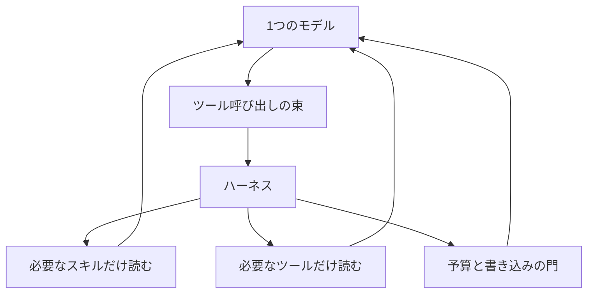
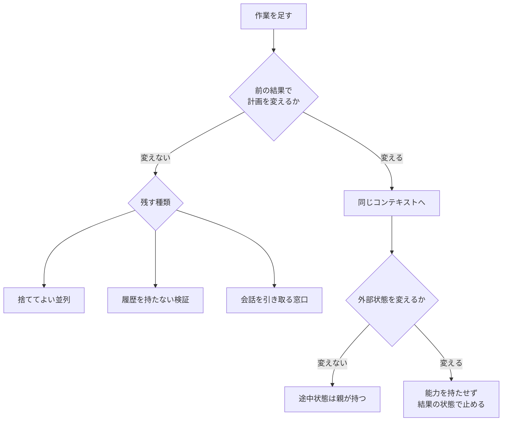

2026-10-22、Anthropic は Claude Platform 上のエージェント設計として [Building agents: When to fold subagents into your main agent loop](https://claude.com/resources/articles/building-agents-when-to-fold-subagents-into-your-main-agent-loop) を公開しました。
**Claude Platform** は、この設計記事がエージェントを組む場所として名指しした製品です。
英語版が正本です。
同じスラッグの日本語パスもあります。

**サブエージェント**は、自分のコンテキスト、ツール、指示を持ち、調整役から呼ばれるエージェントです。
**コンテキスト**は、そのモデルが同じ会話の中で読める、これまでの発話とツール結果のまとまりです。
この記事は、依頼を担当へ振り分けるルーター、手順を先に書く計画係、ドメイン別のサブエージェントを、メインのツールループへ戻す条件を整理します。
すでに複数の担当エージェントを本番で動かしていて、次の変更を品質、費用、遅延のどれで判定するかを決めたい組織向けです。
企業比較の生データは公開されていません。

*この記事の全体像。以下、順に解説します。*

## サブエージェントをメインループへ畳むとは

**畳む**とは、ルーター、計画係、ドメイン別のサブエージェントを、メインのツールループへ戻すことです。
**メインループ**は、1 つのモデルと 1 つのコンテキストが、ツール呼び出しを繰り返す循環です。

戻したあとの形は、次のとおりです。
1 つのモデルと 1 つのコンテキストが、終わりをあらかじめ固定しないツールループを回します。
各ターンで次の呼び出しを選ぶのは、モデルです。
**ハーネス**は、モデルの外側でツールを実行し、ターン数と費用の上限、書き込みの許可を持つ実行基盤です。
各ターンで、モデルはツール呼び出しを束にして出します。
ハーネスがそれを実行し、生の結果を同じモデルへ返します。
モデルは次に、別の束、ユーザーへの質問、回答のどれかを選びます。
計画を書くモデルと、結果を見て計画を書き換えるモデルは同一です。
結果が来たターンで、計画を変えられます。

**スキル**は、手順、判断、チームのやり方を置く文書です。
専門担当のプロンプトが持っていた中身が、ここに移ります。
**ツール**は、動作、ライブデータの読み取り、決まった形の結果、承認、会話の途中で要るメモリ参照です。
**メモリ参照**は、保存してある記憶を、会話の途中で読みにいくことです。
ほぼ毎回要る安い処理と、ペイロード組立のような機械的処理は、ループが呼ぶツールの中のコードに残してよい、と設計記事は書いています。

**段階的開示**は、スキルとツールの短い説明だけを先に見せ、本文とスキーマは必要になったときに読む方式です。
設計記事はこれを progressive disclosure と呼んでいます。
停止は、モデルが答えたとき、またはターン数か費用の予算に当たったときです。
回答のあとで、目標の確認や検証を足してもよい、と設計記事は書いています。

ユーザーと直接話す必要があるときだけ、サブエージェントが会話を引き受けます。
これを**ハンドオフ**と呼びます。
それ以外でサブエージェントを残すときは、メインがツールとして呼びます。
各ツールが、呼び出しているユーザーに何が見えて何ができるかを検査し、モデルが読める平文で拒否します。

評価は二つに分けます。
**端到端の評価**は、依頼から最終回答までを中央のチームが持つセットです。
スキルごとの小さいセットは、そのスキルを持つチームが添えます。
**ゴールデン例**は、正解の目安がある代表タスクです。
10 例あれば開始できる、と設計記事は書いています。
畳む単位は 1 担当ずつです。
前後を同じ評価で比べます。
最終点だけでなく、合否が入れ替わったタスクを見ます。

**門**は、ターン数と費用の上限と、書き込みの許可です。
設計記事が描くループは、1 つのモデル、ツール呼び出しの束、ハーネス、そしてハーネスが必要なときだけ読むスキルとツールと門です。

**書き込みの門**は、門のうち、書き込みツールを動かす前にハーネスが許可を確認する部分です。

作業の置き場は、設計記事の中では次の対応です。

| 置き場 | 中身 |
|---|---|
| システムプロンプト | 声と、常に要る規則。中央の小チームが持つ |
| スキル | 手順、判断、専門担当のプロンプトだったもの |
| ツール | 動作、ライブデータ、決まった形の結果、承認、途中で要るメモリ参照 |
| 知識 | たまにしか要らない方針、指標の定義、製品仕様。検索か、スキル内の参照ファイル |
| サブエージェント | 設計記事が残す 3 条件。原則はツールとして呼び、会話の引き受けは例外 |

ツールは、ユーザーの意図ごとにまとめます。

設計記事がサブエージェントを残す条件は、次の 3 つです。

- 1 つのループが、コンテキストの肥大で測れる性能低下に当たる
- 終わったら捨ててよい、新しいコンテキストでの並列作業がある
- 1 つのエージェントが適切なツールを選べない、またはシステムプロンプトの指示が衝突する

3 つ目の「選べない」は、載っている定義の個数とは別です。
1 つのループのまま、適切なツールを選べない場合です。
個数が原因のときは、ツール定義を最初から全部載せず、必要なものだけを後から読みます。
この仕組みが **tool search** です。

**コンテキストの肥大**は、同じ窓に載る情報が増え、性能が測れる形で落ちることです。

付属の [single-agent-loop-kit](https://github.com/anthropics/single-agent-loop-kit) は、監査、計測、統合、畳み込み、ツールとして残す、という手順をスキルにしたものです。
保守も、貢献の受付もしていない参照実装です。
既定ブランチは `release` です。

## 注意点

設計記事の比較文は、公開された実験計画ではありません。

設計記事は、複数の企業導入の比較として、スキルを持つ単一エージェントが全部入りのプロンプトとサブエージェント設計の両方より品質で勝つことが多く、タスクあたりの費用と遅延もしばしば低い、と書いています。
英語の副詞は frequently です。
2026-09-02 の [commerce エージェントの解剖](https://claude.com/resources/articles/the-anatomy-of-effective-commerce-agents) は、同じ趣旨を consistently と書いています。
社数、課題セット、効果量は、どちらの記事にもありません。

遅延の「およそ 2 倍」は、1 顧客が、マルチエージェントのハーネスと単一ループの実行時間を比べた値です。
同じ commerce 記事は、保持やカートサイズを動かしたのは、わずかな遅延の改善より、回答の関連性とタスク完了だった、とも書いています。
ここでの保持は、その記事がカートサイズと並べた成果の指標です。
指標の中身の定義は、記事にはありません。
速度の 2 倍を、品質が 2 倍になったという意味には読めません。

Claude Code のシステムプロンプトを 80% 超削った、は別記事です。
2026-08-27 の [Claude 5 世代のコンテキスト工学](https://claude.com/blog/the-new-rules-of-context-engineering-for-claude-5-generation-models) が書いています。
原文は、Claude Opus 5 や Claude Fable 5 のようなモデルで、自社のコーディング評価に測定できる損失は無かった、というものです。
設計記事はこれを「より進んだモデル」と言い換え、削減にはスキルとツールの段階的開示が含まれる、と接続しています。
分母は Claude Code のシステムプロンプトです。
**Claude Code** は、その記事が分母にした、Anthropic のコーディング用エージェントです。
削減前後の絶対量と、段階的開示が何割を占めるかは、どちらの記事にもありません。

研究システムの 90.2% は、畳む側の数字ではありません。
2025-06-13 の [マルチエージェント研究システム](https://www.anthropic.com/research/multi-agent-research-system) は、Claude Opus 4 をリードにし、Claude Sonnet 4 をサブエージェントにした構成が、単一の Claude Opus 4 を社内の研究評価で 90.2% 上回った、と書いています。
**リード**は、その記事でサブエージェントの結果を読み戻す調整役です。
**ワーカー**は、リードから呼ばれるサブエージェント側のモデルです。
問数は記事にありません。
ワーカーのモデルが違うので、同一モデルのまま担当を分けた効果とは読めません。
同じ記事は、BrowseComp の性能のばらつきの 95% を 3 因子が説明し、トークン使用量だけで 80% を説明する、とも書いています。
**BrowseComp** は、その記事が性能のばらつきを分解した評価の名前です。
ここでの 80% は、システムプロンプト削減の 80% とは別物です。

トークン量の公式記述は、少なくとも 3 系統あります。
母集団が違います。

| 出典 | 比べているもの | 読み方 |
|---|---|---|
| 研究システム（2025-06-13） | チャットとの比 | エージェントがおよそ 4 倍、マルチエージェントがおよそ 15 倍。自社データ |
| [いつマルチエージェントを使うか](https://claude.com/resources/articles/building-multi-agent-systems-when-and-how-to-use-them)（2026-01-23） | 同等タスクでのマルチと単一 | 典型的に 3 倍から 10 倍。社内データとは書いていない |
| commerce 記事（2026-09-02） | ハンドオフのたび | トークンが数倍になり得て、秒単位の遅延が足される |

ツール選択が落ちる 30 個から 50 個は、設計記事と Platform の [tool search](https://platform.claude.com/docs/en/agents-and-tools/tool-use/tool-search-tool) が同じ閾値で書いています。
**tool search** は、先に書いた、必要な定義だけを後から読む仕組みです。
後者は、GitHub、Slack、Sentry、Grafana、Splunk のような複数サーバーで定義がおよそ 55k トークンになり、tool search で 85% 超減って、必要な 3 個から 5 個だけが載る、とも書いています。
SDK の [別ページ](https://platform.claude.com/docs/en/agent-sdk/tool-search) は、50 個のツールで 10k から 20k トークン、およそ 10 個未満なら全部先に載せる方がたいてい速い、と書いています。
55k と 10k から 20k は、同じ主張を二通りに測ったものではありません。

スキルの段階的開示は、2026-01-22 の [Building agents with skills](https://claude.com/blog/building-agents-with-skills-equipping-agents-for-specialized-work) が桁で示しています。
メタデータがおよそ 50 トークン、`SKILL.md` の全文がおよそ 500、参照ファイルは 2,000 以上です。
`SKILL.md` は、スキル本文を書くファイルです。

記憶の書き手を別プロセスにすると、社内の commerce 記憶評価で事実の想起が 13% 高かった、は件数の出ていない社内の評価セットです。
権限プロンプトのおよそ 93% 承認は、[Claude を製品横断で閉じ込める記事](https://www.anthropic.com/research/how-we-contain-claude) のテレメトリです。
承認が増えるほど、1 件あたりに向く人の注意が落ちる、と続きます。
**overeager** は、その記事が言う、やりすぎの動作です。
本文は、auto mode が overeager のおよそ 83% を実行前に捕まえる、と書いています。
**auto mode** は、実行前にそのやりすぎを止めるモードです。
脚注 01 は、通ってしまう overeager がおよそ 17% だ、と書いています。
17% は脚注の記述であり、83% からこちらで補数を計算した数字ではありません。

リードが受け取る 50 から 100 トークン、注文履歴が 2,000 トークンを超えて残る、は測定値ではありません。
2026-01-23 の記事の中の例示です。
サブエージェントが数万トークンを使い、しばしば 1,000 から 2,000 トークンだけを返す、という記述は often です。
実験の件数ではありません。

キットの実モデル実行は、1 人、1 モデル、2 本です。
モデル名は `claude-opus-5` です。
1 本目は 2026-10-08、当時 12 タスク、2 反復です。
2 本目は 2026-10-09、当時 17 タスクで、診断用のツール diagnostics を呼びました。
測定値と所見は、解説から削除されています。
点数と遅延の整数は、ここに転記しません。
統合の merge、維持の upkeep、完成版の単一ループ、例以外のシステムは、README が実モデル未実施と書いています。
書き込みの門を必須にした変更は、両ランのあと、オフラインだけで確認したものに含まれます。
スター数は 2026-10-25 時点の GitHub API を概数化し、およそ 80 です。
アーカイブはされていません。
GitHub が返す最終 push 日時 `pushedAt` の 2026-10-21 は、任意のブランチへの push 日時です。
既定ブランチ `release` の最新コミット日とは限りません。

「Opus 4.5 以降、単一ループで扱える量が増えた」「Opus 5.5 と Fable 5.1 では thinking を切れない」は、設計記事の文言です。
何の量かは、この文言には書いてありません。
判定の手順には使いません。
**thinking** は、モデルが回答前に推論の過程を出す機能の、設計記事での呼び方です。
製品ドキュメントとの一致は、ここでは未確認です。

2026-10-24 から 2026-10-25 の日本語の紹介は、公式の 3 条件を再掲しています。
独立した測定は、公開範囲には見当たりません。

次の 2 件は、公開 Issue の報告です。
Anthropic が再現を認めた記録は、Issue の状態からは確認できません。
どちらも closed（閉じた状態）で、not_planned（対応しない、として閉じた理由）です。

- [claude-code#59968](https://github.com/anthropics/claude-code/issues/59968)（2026-06-16）は、サブエージェントから、先に書いたスキルを呼ぶと、呼び出した側（この報告での親）に付いた実行の許可が継がれなかった、という報告です。同じ報告は、複数の担当が同一コンテキストの自己肯定に潰れた、とも述べています。自己肯定は、同じコンテキストの中だけで出力を正しいものとして通すことです。
- [claude-code#57751](https://github.com/anthropics/claude-code/issues/57751)（2026-08-08）は、サブエージェントが親のプロンプトキャッシュ（同じ前文を再利用するための保存）を継ぎ、幻覚した禁止文を親が計画に書き、後続が指示として読んだ、という報告です。

## 途中状態を親が読む作業は同じコンテキストに載せる

切る基準は、担当の人数ではありません。
この節の**親**は、メインループのモデルです。
リードとオーケストレータは、引用先でサブエージェントを呼ぶ調整役の名前です。
畳んだあとの親とは、同じ役ではありません。
次の節の残す条件に当たる作業は、ここに載せません。
当たらない連鎖のうち、親が計画を書き換えるために途中状態を読むものは、同じコンテキストに載せます。

設計記事は、長いエージェントほど、前段の結果が同じ窓にある方が、サブエージェントの要約を受け渡すより洞察が厚い、と書いています。
機構は、計画の書き手と実行者が同じなので、結果が来たターンで計画を変えられることです。

commerce 記事は、購買の会話では複数の意図が 1 セッションに密に結びつき、カート、好み、履歴をオーケストレータが持つ、と書いています。
**オーケストレータ**は、複数の担当を呼び分ける調整役です。
ドメインごとに切ると、返品が注文履歴とカートとカタログを同時に要る、という形で境界が割れます。

2026-01-23 の記事は、問題の種類で分けると電話ゲームになる、と書いています。
役割別（計画、実装、テスト、レビュー）の実験では、調整のトークンが実作業を超えた、と書いています。
有効な分け方として挙げるのは、独立した探索の経路、契約がきれいな部品、テストを流して合否だけを返す検証です。
最後の検証は、作った経緯を渡さず、結果だけを返します。
同じ記事は、隔離が効く例として、サブタスクが 1,000 トークンを超えて生成し、大半が本題に不要で、抽出基準が明確な場合を書いています。

畳み方の手順は、設計記事とキットで一致します。
端到端の評価を先に作ります。
同時に呼ばれる担当から統合します。
1 つずつスキルとツールへ移します。
同じ評価の前後を比べます。
残すなら、メインがツールとして呼び、入力を削り、結論を実データでメインが確認します。
フルのハンドオフは、その担当がユーザーと直接話すときだけです。

## 探索と検証と専用の会話は残す

残す条件は、前の節の「計画を変えるなら載せる」より先です。
設計記事の 3 条件（測れた肥大、捨ててよい並列、ツールを選べないか指示の衝突）と、専用の会話窓口に当たるなら、計画を変える作業でも別コンテキストに残します。
検証を別コンテキストに残すのは、常時ではありません。
残すのは、合否だけを返すテスト、同じスレッドでの自己レビュー、調整役が弱いとき、検証が専用ツールを要するとき、明示のチェックポイントを置くときです。
これらに当たらないとき、Opus 4.5 級では別検証なしで評価できることが増えた、と 2026-01-23 の記事は書いています。
3 つ目の「選べない」は、定義の個数とは別です。
個数が原因なら、サブエージェントを残す前に tool search で後から読みます。
肥大は、ループの性能低下が測れてから残す理由です。
測れる前は、同じ窓に載せる側です。
生のトークンが親の注意を落とすと測れた場合も残します。
**親の注意**は、メインループが該当する情報を拾う度合いです。
承認に向く人の注意とは別です。

「前の結果を親が読めるなら畳む」は、検証には使えません。

2026-01-23 の記事は、検証者は成果物が基準を満たすかだけを見ればよく、なぜそう作ったかを知らなくてよい、と書いています。
別検証が残る価値は、オーケストレータの能力が低いとき、検証が専用ツールを要するとき、明示のチェックポイントを置きたいときです。

[Claude Academy](https://academy.claude.com/courses/introduction-to-subagents/using-subagents-effectively) は、同じスレッドに長く作らせたあとで、そのスレッドにレビューさせると、フィードバックが弱くなる、と書いています。
レビュー用のサブエージェントは、書かれた経緯を持たずに差分を読みます。

キットの README が残す理由に数える独立検証は、設計記事の 3 条件にはそのまま入っていません。
キット内の参照ループでは、検証役（verifier）がメインと同じメッセージ列を受け取ります。
回答を 2 回拒否した場合、その回答は呼び出し元へ返しません。
これは、別のコンテキストで中身を見ずに合否だけを返す検証ではありません。

研究システムは、リードが結果を読み戻す構成のまま、サブエージェントの別々の探索が、経路依存を減らす、と書いています。
**経路依存**は、先に選んだ探索の筋に、結果が引っ張られることです。
幅を優先する例は、IT セクターの S&P 500 の取締役を全部挙げる問いです。
単一は遅い逐次検索のまま見つからず、マルチは分解して見つけた、というものです。
2026-01-23 の記事は、並列の主な利益は速度ではなく徹底さだ、と書いています。
マルチは総計算が増えるので、単一より全体時間が長くなることが多い、とも書いています。

2025-09-29 の [コンテキスト工学](https://www.anthropic.com/engineering/effective-context-engineering-for-ai-agents) は、窓が広がっても、トークンが増えると思い出しが落ち、汚染は残る、と書いています。
**汚染**は、不要な情報がその窓に残ることです。

親に戻さない作業は、次のとおりです。
**専用の会話窓口**は、その担当がユーザーと直接話し、会話の所有者になる経路です。

- 終わったら捨ててよい、並列の探索
- テストを流して合否だけが要る検証、および自分で書いたものを同じスレッドにレビューさせる仕事
- 薬局や金融のように、専用の会話窓口がユーザーとの会話を引き取る仕事

薬局や金融の例は、commerce 記事が、専用エージェントが自分のコンプライアンス規則を持つ会話窓口でユーザーと直接話す場合はハンドオフが残る、と書いたものです。

## 書き込みは担当の分割では狭まらない

外部の状態を変える能力は、担当を分けるかどうかでは決まりません。
その能力を、ループに持たせるかどうかで決まります。

書き込みの門は、ツールを持たないことと同じ到達範囲にはなりません。
閉じ込めの記事は、失敗の確率は下がっても、理論上の被害範囲は能力とアクセスとともに広がる、と書いています。
同記事の推奨は、何をするかをその都度監督することではありません。
何ができるかを、サンドボックス、VM、出口の制御で監督することです。
読み取り専用のデータベースアクセスは、本番へ書くエージェントより広く配備できる、とも書いています。

commerce 記事は、プロンプトは安全の開始点であり、強制点ではない、と書いています。
消費者側では、エージェントが呼ぶバックエンドに課金メソッドがありません。
モデルの最も危ない動作は提案です。
適用は、人が使う既存の確認画面を通ります。
**確認画面**は、人が押して適用を確定する、既存の場所です。
書き込みが受け付ける ID は、そのセッションでサーバが渡したものだけです。
上限は、依頼の文面ではなく、書いたあとの状態に対して掛けます。
1 ターンの並列が合算で超えないよう、カートの書き込みは直列化します。
分析のサブエージェントはデータを読みますが、書いてよい ID の集合は増やしません。

記憶は、会話中のツール保存が注意を奪って記憶漏れになった、と書いています。
別スレッドの書き手が、13% 高い想起だった、と続きます。
この 13% の母数は、注意点のとおりありません。

同じ記事は、エージェントにはサービスのようなモジュール境界が無く、価格チームの変更がチェックアウトと同じ窓に入る、と書いています。
担当を増やす修正は、品質のためには勧めません。
代わりに、スキルとツールの所有者、隣の境界ケースを含む評価、カナリア、スキル単位の停止スイッチを書いています。
**カナリア**は、全体の前に一部のトラフィックだけで変更を見る出し方です。

参照実装は、書き込みが有効なツールがあると、承認関数（approve）なしでは起動しません。
読みは並列です。
書きは、読みのあと 1 件ずつです。
approve に常時許可の関数を渡せるので、門があることは、能力が消えたことを意味しません。

外部への書き込みを畳むとき、減るのは担当の数ではありません。
減るのは、そのループから課金や適用のメソッドを消し、サーバが発行した ID だけを書かせ、上限を書いたあとの状態で見るときです。
都度の承認は、能力の代わりにしません。

## 1つずつ畳み、裏返ったタスクを見る

サンプルのサポートエージェントでは、あるサブエージェントを、別の担当サブエージェントの側へまとめました。
メインのツールループへ戻した例ではありません。
遅延は下がりました。
ただし、通っていた手順が落ちました。
メインが注文参照のツールを持ったまま、残っていた配送担当に配送日を聞かずに答えました。
この壊れは、2 ラン中 1 ランにだけ出ました。
この落ちは、合否が入れ替わったタスクの例です。
設計記事は、本番で同時に走る連鎖のすべてと、破ってはいけない規則のすべてにタスクを置き、各タスクを複数回走れ、と続けています。
2 回では、この例のように 1 回だけ落ちる退行を見落とします。

10 例は開始に足ります。
統計的な検出力の主張ではありません。
最終点が同じでも、合否が入れ替わったタスクがあれば、その畳み込みは採用しません。
**裏返ったタスク**は、この合否の入れ替わりです。
配送日の例は、これに当たります。
遅延が下がっても、通っていた手順が落ちていれば採用しません。

次の 3 つは、残す条件の一部です。
途中状態を読む基準だけだと、親に入ってしまいます。
捨ててよい並列と、ツール選択の失敗または指示の衝突は、設計記事の 3 条件に既にあります。

- 途中状態を親が読まなくても、成果物の合否だけで判定できる
- 生のトークンが親の注意を落とすと測れた
- 専用の会話窓口が会話の所有者である

ツール定義を、常時 30 個から 50 個を超えてシステムプロンプトに並べません。
この個数で選択が落ちるときは、サブエージェントを残す前に、tool search で遅延読み込みします。
およそ 10 個未満なら、SDK の文書は先に全部載せる方がたいてい速い、と書いています。

設計記事が名指しする Claude API のスキルは、次のとおりです。
いずれも、上記の比較と削減を手で進めるための手順書です。

- `build-eval` は、中央の端到端セットか、スキルに添える小さいセットを作る
- `prompt-audit` は、古いモデル向けの指示を、プロンプト、スキル、ツール説明から探して差分にする
- `hillclimb` は、既存の評価に対して、畳んだ版が担当を残した版に並ぶかを反復する
- `cost-optimize` は、呼び出しの行き先を見て、キャッシュ、トークン、推論の労力（effort）、モデル選択を 1 変更ずつ提案する

スキルの乱立を防ぐ名前は、`skill-creator` と `skill-doctor` です。
前者は、新しいスキルを形の整った状態で書き、既存のものを削って重複を除きます。
後者は、各スキルの費用と実際の使用頻度を見て、使われないものを消します。

単一がマルチに勝つ、という一般化の確信度は、中のままにします。
密に結びついた会話では単一が有利、という公式の定性比較と、幅を優先する研究ではマルチが有利、という別の公式比較が、両立しています。

判断の流れは、次のとおりです。

図の「変える」は、残す条件に当たらないときだけ同じコンテキストへ進みます。
残す条件は、測れた肥大、捨ててよい並列、ツールを選べないか指示の衝突、条件に当たる検証、会話を引き取る窓口です。
図に箱が無いものも、この条件に当たれば残します。

## まとめ

境界は、担当の人数では切りません。
残す条件に当たる作業は、前の結果で計画を変えても、別コンテキストに残します。
残す条件は、測れた肥大、捨ててよい並列、ツールを選べないか指示の衝突、会話を引き取る専用窓口、そして条件に当たる検証です。
検証を残すのは、合否だけを返すテスト、同じスレッドでの自己レビュー、調整役が弱いとき、専用ツールが要るとき、明示のチェックポイントを置くときです。
どれにも当たらない連鎖だけを、スキルとツールとして同じコンテキストに載せます。
合否が入れ替わったタスクは、最終点が同じでも採用しません。
これは、最初から残す条件とは別の、評価上の合図です。
外部への書き込みは、担当を残しても到達範囲は減りません。
課金や適用をループから外し、サーバが発行した ID だけを書かせ、書いたあとの状態で上限を見ます。
変更は 1 つずつです。
およそ 2 倍は、1 顧客の実行時間です。
80% は二つあります。
システムプロンプトの削減と、BrowseComp のばらつきの説明です。
90.2% は、ワーカーのモデルが違う研究システムの比較です。
13% は、件数の無い記憶評価です。
93% は、承認プロンプトのテレメトリです。

この記事が少しでも参考になった、あるいは改善点などがあれば、ぜひリアクションやコメント、SNSでのシェアをいただけると励みになります！

## 参考リンク

- Anthropic. Building agents: When to fold subagents into your main agent loop. 2026-10-22. https://claude.com/resources/articles/building-agents-when-to-fold-subagents-into-your-main-agent-loop
- Anthropic. A guide to the anatomy of effective commerce agents. 2026-09-02. https://claude.com/resources/articles/the-anatomy-of-effective-commerce-agents
- Anthropic. The new rules of context engineering for Claude 5 generation models. 2026-08-27. https://claude.com/blog/the-new-rules-of-context-engineering-for-claude-5-generation-models
- Anthropic. When to use multi-agent systems (and when not to). 2026-01-23. https://claude.com/resources/articles/building-multi-agent-systems-when-and-how-to-use-them
- Anthropic. How we built our multi-agent research system. 2025-06-13. https://www.anthropic.com/research/multi-agent-research-system
- Anthropic. Effective context engineering for AI agents. 2025-09-29. https://www.anthropic.com/engineering/effective-context-engineering-for-ai-agents
- Anthropic. Building agents with skills. 2026-01-22. https://claude.com/blog/building-agents-with-skills-equipping-agents-for-specialized-work
- Anthropic. How we contain Claude across products. https://www.anthropic.com/research/how-we-contain-claude
- Anthropic. Tool search tool. https://platform.claude.com/docs/en/agents-and-tools/tool-use/tool-search-tool
- Anthropic. Scale to many tools with tool search. https://platform.claude.com/docs/en/agent-sdk/tool-search
- Anthropic. single-agent-loop-kit. https://github.com/anthropics/single-agent-loop-kit
- Claude Academy. Using subagents effectively. https://academy.claude.com/courses/introduction-to-subagents/using-subagents-effectively
- anthropics/claude-code#59968. https://github.com/anthropics/claude-code/issues/59968
- anthropics/claude-code#57751. https://github.com/anthropics/claude-code/issues/57751
