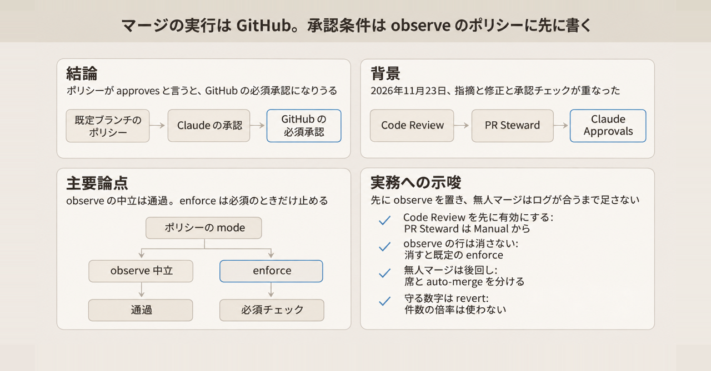
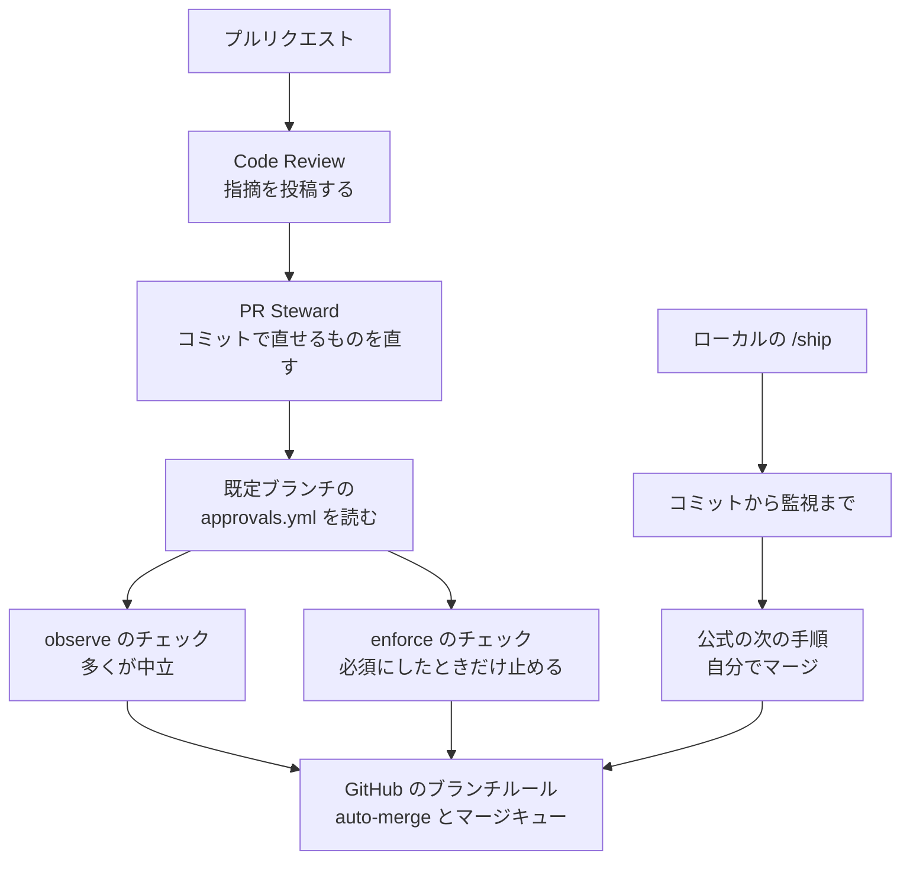

2026年11月23日（米国時間）、Anthropic は Claude Ship を公開しました。対象は Team と Enterprise です。Team と Enterprise は、Anthropic の組織向け有料プランの名前です。動かす対象は、GitHub リポジトリのプルリクエストです。発表は、プルリクエストをレビューし、直し、チームのポリシーからマージしてよいかを決める、と書いています。チームは、どこで動かすかと、どの変更に人が要るかを決めます。発表は、Claude Ship は AI を使い、バグを見逃しうる、とも書いています。この記事では、公開ドキュメントに書かれた構成と、同じ日に出た手元のコマンドの手順を順に追います。製品ドキュメントは生きた文書で、同日以降に文面が動きえます。


*この記事の全体像。以下、順に解説します。*

## Claude Ship とは

クラウドの Claude Ship は、指摘、修正、承認チェックの三段です。一般提供済みの Code Review に、パブリックベータの PR Steward と Claude Approvals を重ねたものです。マージするかどうかは、そのあとの GitHub のブランチルール、auto-merge、マージキューが決めます。auto-merge は、条件が揃うと人がボタンを押さずにマージする GitHub の機能です。マージキューは、マージ前のコミットを並べて検査する GitHub の機能です。

同じ日、Claude Code のローカルコマンド `/ship` が CLI とデスクトップへ出ています。`/ship` は、手元のクローンでコミットから監視までを 1 セッションにまとめるコマンドです。クラウドセッションには `/ship` も `/steward` もありません。`/steward` は、手順の前半を飛ばして監視から始めるローカルコマンドです。ローカルの `/ship` は、同じプルリクエストを手元のセッションで用意し、監視する別の経路です。

承認の条件は、既定ブランチの `.claude/approvals.yml` に書きます。そのファイルが無ければ `.yaml` を読みます。プルリクエスト側にある写しは、壊れていないかの検査に使い、適用しません。

Code Review の research preview は 2026年3月9日です。対象は Team と Enterprise です。一般提供は 2026年10月15日です。research preview は、一般提供の前に限られた範囲へ出した段階の名前です。

### Code Review

Code Review は、複数の観点で差分を見て、指摘を別の確認にかけ、プルリクエストへ投稿するエージェントです。深さは Quick、Standard、Deep です。既定は Standard です。指摘の印は Important、Nit、Pre-existing です。Important は重要、Nit は細部、Pre-existing は今回の差分より前からある指摘、という印です。チェックの結論は中立かスキップで、失敗にはしません。終わったレビューだけでは、必須チェックを落としません。

### PR Steward

PR Steward は、Claude の GitHub App 上のクラウド作業です。失敗した CI、マージコンフリクト、レビューコメント、コミットで直せる Approvals のチェックを対象にします。CI は、変更を自動で検査する仕組みです。レビューコメントの対象は、Code Review の Important と、他のボットの lint やバグです。人待ちだけのチェックでは始めません。push のたびに、何を変えたかと戻し方をコメントします。`@claude` で向きを変えられます。`@claude stop` か、ラベル `claude-pr-steward-watching` の削除で止まります。

下書き、fork のプルリクエスト、ボットが開いたプルリクエスト、書き込み権限の無い作者は、Owner が設定を変えない限り対象外です。開始は、オープン時の On か、手動の Manual です。課金は組織の利用クレジットで、プランに含まれる利用量とは別です。Owner が上限を置くまで、単独の支出上限はありません。

Anthropic がホストするセッションの設計では、サービスが拒否すると列挙している操作があります。approve、ブランチ保護や ruleset や status の変更、check run の書き込み、ブランチ削除、tag の push です。merge、auto-merge の有効化、force-push は、GitHub のブランチルールに委ねます。その前段には、コマンド文字列への権限ルールと、合わないコマンドへのモデル判定があります。

### Claude Approvals

Claude Approvals は、誰の承認が残っているかをチェックで出す仕組みです。`version: 1` が必須です。`rules` も必須です。`mode` は `observe` か `enforce` です。省略したときの既定は `enforce` です。`observe` は、チェックの結論を多くの場合中立にするモードです。`enforce` は、GitHub 側でそのチェックを必須にしたときだけマージを止めるモードです。ファイル上限は 448 KiB です。

席は、承認が残っている人数の枠です。人数だけなら 0 から 16 です。席の組は、人数と、誰から数えるかを 1 件にしたもので、8 組までです。席の数 `N` は、人から N 人、という意味です。書き込み権限のある作者は、承認ボタンを押さなくても席を 1 つ埋められます。`seats: 1` は作者だけで足りえます。作者を外すときは `from: [humans, "!pr/authors"]` と書きます。`humans` には機械ユーザーが含まれます。機械ユーザーは、スクリプトやエージェントが動かすユーザーアカウントのことで、人に数えます。`claude` というアカウントは含みません。ボットは、席の組の `from` に `bots` があるときだけ席に数えます。席の組がボットを認め、全部のルールが `approves` なら、そのプルリクエストを開いて最新コミットを push したボットが席を埋めます。Claude が承認する前に席が埋まり、人なしでチェックが通りえます。

`verdict.claude` は、Claude がそのルールで何をするかの値です。取りうる値は `approves`、`comments`、`blocks` です。`approves` は、チェックが通り、適用中の全部のルールがそう言い、変更ファイルが全部覆われているとき、approving review を 1 回投稿できます。覆われているとは、verdict を持つルールの paths に、その変更ファイルが当たっていることです。paths は、ルールが対象にするファイルの指定です。`comments` は承認を出しません。`blocks` はチェックを失敗にします。

セットアップ文書のスタータは `mode: observe` です。広いパスでは Claude が `comments` で、席は 2 です。`claude/code_review = pass` の override では、Claude が `approves` になり、席は 1 になります。override は、条件が合ったときだけ verdict を差し替える記法です。その 1 人は作者でありえます。`.claude` 配下は override が無く、席は 2 のままです。この掲載例に `findings` キーはありません。`findings` は、指摘を閉じた人を承認の根拠に含めるかの指定です。`mode: observe` の行を消すと、省略時の既定である `enforce` になります。

observe のチェックは、多くの場合中立です。GitHub は通過として数えます。タイトルは「(observe mode)」で始まります。Claude は承認しません。例外として、ポリシーや分類器のファイル変更は人 1 人を待ちます。その 1 人は作者でありえます。ファイルが壊れていれば失敗します。既定ブランチのポリシーが使えないときも失敗します。既定ブランチ以外がベースのプルリクエストには、ポリシーや分類器のファイルが変わらない限りチェックを出しません。分類器は、プルリクエストの文章や差分を分類し、ルールの条件が読む仕組みです。定義は既定ブランチから来ます。

enforce のチェックがマージを止めるのは、GitHub 側でそのチェックを必須にしたときです。人を要しないポリシーと、auto-merge またはマージキューを併用すると、誰も操作せずマージしえます。マージキューが作ったコミットは再評価しません。通常は「Stamped for merge queue」として通過扱いにします。observe だけで評価したプルリクエストは、この通過扱いを受けません。enforce へ切り替えたあと、そのプルリクエストをキューへ入れる前に、チェックをやり直します。最新コミットがポリシーの下で通るまで、そのキュー側のコミットは通常チェックが無く、チェックが必須ならそこで待ちます。キューへの入場は GitHub 側で、チェックの実行中でも起きえます。チェックが必須なのに App に Merge queues 権限が無いと、キュー側のコミットがチェック無しで待ちえます。

GitHub は、Claude の approving review を必須承認 1 件に数ええます。ドキュメントは、Approvals のチェックを必須にするなら GitHub の必須承認は 1 件までにし、追加の人は席で求める、と書いています。古いレビューを破棄するか、最新の push へのレビューを要する設定を勧めています。

保護ファイルは、ポリシー、`.claude/classifiers/`、ルートの `REVIEW.md`、`.gitmodules`、`.gitattributes`、シンボリックリンク、サブモジュールポインタ、`CODEOWNERS` です。覆われているとき、通常は書き込み権限のある人 1 人が要ります。その人は作者でよく、ボットではありません。機械ユーザーはその 1 人になりえます。適用中の全部のルールが `approves` なら、Claude は保護ファイルを変えるプルリクエストを承認しえます。`.gitattributes`、シンボリックリンク、サブモジュールポインタは、ルールが何と言っても Claude は承認しません。`.github/`、`CLAUDE.md`、`AGENTS.md`、`.mcp.json`、`.claude` の残りは、組み込みの保護対象ではありません。

ポリシーファイルを既定ブランチに置くと Approvals が始まります。組織の Owner は止められます。推奨の順は、Code Review、次に PR Steward、次に observe の Approvals です。PR Steward は最初 Manual です。observe も課金します。ポリシーが Claude のレビューを使うと、observe でも課金される Code Review が走ります。Approvals に基本料金はありません。分類器はトークン課金です。`/ship` は通常の Claude Code 利用量です。Code Review と PR Steward は組織の利用クレジットで、プランに含まれる利用量とは別です。利用クレジットを切ってもエージェントは止まりません。止めるのはエージェント自体です。Approvals は Code Review より先に止めます。ポリシーが、Code Review を切ったあとも課金レビューを始めうるためです。`/ship` と `/steward` は、その操作では止まりません。止めるには、skill の上書きで `ship-local` と `steward` を切るか、Claude Code v2.1.331 以降で `CLAUDE_CODE_DISABLE_SHIP=1` を置きます。

ゼロデータ保持、HIPAA 構成、顧客管理の暗号鍵では、Code Review、PR Steward、Claude Approvals は使えません。ゼロデータ保持は、プロンプトや出力を学習や保持の対象にしない契約上の構成です。HIPAA 構成は、米国の医療情報の取り扱い要件に合わせた構成です。対象になる有料の Enterprise は、Claude Ship のクレジットを 1 回請求できます。額は請求の時点で 1 万ドルから 5 万ドルで、組織で有効な Claude Code の席数によります。この席数は、承認ポリシーの席とは別です。請求から 30 日、または使い切るまでの短い方で使えます。請求の期限は 2027年1月15日 23:59 UTC です。クレジットは Code Review、PR Steward、Approvals に使えます。Anthropic 側の問題で失敗または停止した Code Review は課金せず、残高にも数えません。この例外は PR Steward と Claude Approvals には及びません。条項は、その 2 つの失敗した実行も実費で残高に数える、と書いています。利用者が止めた Code Review と、新しい push で止まった Code Review は、止まるまでの費用を数えます。この数え方の節の主語は Code Review です。クレジットを使い切ることや 30 日が終わることは、それだけではレビューを止めません。そのあとは通常の支出上限の中で課金され、上限や課金が止めるレビューは走りません。条項は [プロモーションクレジット](https://support.claude.com/en/articles/17603594-free-code-review-promotional-credits-for-claude-enterprise) です。

機能表では、Code Review、PR Steward、Claude Approvals は Pro、Max、Ultra では不可、Team と Enterprise では可です。Pro、Max、Ultra は、同じ表が Team と Enterprise と分けているプラン名です。`/ship` の行は、その表にありません。ship-command の文書にプラン条件の記載はありません。

### ローカルの /ship

`/ship` は Claude Code v2.1.330 以降です。手元のクローンで、コミット、push、プルリクエスト、ローカルの `/code-review`、監視までを 1 セッションにまとめます。公式の次の手順は、準備ができたら自分でマージすることです。

GitHub の監視には、原則 `gh` 2.63 以降が要ります。`gh` は GitHub の公式 CLI です。それより古い `gh` では監視は始まりません。v2.1.331 より前は、古い `gh` でも監視が始まり、修正の push ができません。新しいコミットを自分のブランチへ取り込むには、git 2.38 以降が要ります。それより古い git では、その取り込みは利用者に残り、別ホストの監視は始まりません。

公開リポジトリでは未コミットの変更をコミットしません。`.env` のような秘密らしいファイル名がある非公開リポジトリでは、何もコミットも push もしません。既定ブランチ上では新しいブランチを切り、既定ブランチへは push しません。確認はほとんど無く、数秒の Esc で取り消せます。監視は最大 7 日です。bypassPermissions では監視しません。bypassPermissions は、権限の確認を飛ばす Claude Code のモードです。プランモードは、Claude Code がファイルを読んで計画を書き、ソースは編集しない権限モードです。Team や Enterprise などの有料プラン名とは別の語です。v2.1.331 以降、プランモードでは `/ship` は始まりません。それより前は、プランモードでも監視が続きます。組織の PR Steward がすでに見ているときは、ローカルの監視は始まりません。リポジトリの `.claude/skills/steward/SKILL.md` は、ローカル監視と PR Steward の両方が読みます。

### 三段と手元の経路



図の observe と enforce は、ポリシーの mode の一方ずつです。

ポリシーの `if` や override が `claude/code_review` を読むと、レビュー結果が席の数と、Claude が承認を出すかどうかに入ります。Important の指摘が全部閉じているとき、`claude/code_review` は `pass` になりえます。人の resolve だけで重要度を下げるには、そのルールの `findings` が閉じた人を認めている必要があります。リストが無いあいだは、resolve だけでは重要度は下がりません。閉じてもコードは変わらない、と公式は警告しています。Code Review 自身は、後のレビューで直ったと判断した指摘を閉じえます。

## 注意点

発表と日本語の二次記事は、条件を落として読めます。ここは、一次ドキュメントが残している条件です。

「人手を介さず反映できる」は、人を要しないポリシーに加え、GitHub の auto-merge かマージキュー、そして必要なチェック、が揃ったときの話です。[CNET Japan（2026-11-24）](https://japan.cnet.com/article/35255329/) のリードは、この条件を落とします。CNET の本文は自動取り込みと、人の承認が不要なことと、必要なチェックまで戻します。マージキュー、席 0、作者が席を埋めること、チェックを必須にしていないこと、分類器の答えの誘導は、CNET の本文にも戻っていません。これは二次情報です。

「PR Steward は承認もマージもしない」は、Anthropic がホストするセッションの設計説明です。公式は、別の書き方のコマンドは権限ルールとモデル判定の両方を通りうる、と書いています。レビューの dismiss は拒否一覧にありません。セルフホストは、PR Steward を自分のランナーで動かす構成です。Anthropic 管理の git を使わない場合、ランナー自身の資格情報で push します。セッションが読める GitHub 資格情報で承認すると、Anthropic のサービスは拒否できません。GitHub はその承認を必須数に数ええます。

`/ship` が merge や approve を止めるのは、利用者メッセージが無いあいだに Claude が動くときです。アイドル中にメッセージを打つと、その応答中と、そのあいだに届いたバックグラウンド結果では制限が外れます。auto mode では、そのとき merge が許されえます。フックや権限ルールも制限を通しえます。監視が起動したテストやプログラムは、起動コマンドだけが検査され、中で資格情報を使って merge や force-push しえます。ブランチルールが監視者のアカウントだけでマージできるなら、監視自身がマージしえます。すでに有効な auto-merge は、チェックとレビューが許したときにマージします。v2.1.331 より前は、レビュー中や監視中にセッションをバックグラウンドへ送ると監視は終わりますが、進行中の作業はこれらの制限なしに続きえます。ネイティブ Windows と、一部のバックグラウンドでは監視自体がありません。ベースへマージできる人、またはブランチへ push できる人は、監視者のコンピュータで、その資格情報付きのプログラムを走らせえます。

2026年10月15日の Claude Code チームの記事は、「エージェントの承認は人の席に数えない」「製品は指摘を出し、承認は出さない」と書いています。2026年3月9日の research preview も「プルリクエストは承認しない。それは人の判断のまま」と書いています。2026年11月23日の製品は、ポリシーが `approves` と言うとき Claude が approving review を出し、GitHub がそれを必須承認 1 件に数ええます。10月の文章を、11月の製品仕様として読まないでください。

同じ 10月15日の記事にある「2026年6月から9月に、マージしたプルリクエストが 2 倍を超え、revert した割合が 40% 超減った」は、Claude Code リポジトリの自己申告です。絶対件数はありません。Ship の公開より前です。11月23日の発表は同じ文を再掲し、Claude のレビューはより広い工程の一層である、と範囲を書いています。Ship 単体の効果ではありません。「Claude が Claude Code のコードの約 90% を書く」は「以前に言った」で、測定方法はこの記事にありません。1日約 2,500 件（2026年5月）から 3 万件超（2026年9月）はモノレポの件数で、Claude Code リポジトリではありません。いずれも自己申告です。

「中身のあるレビューコメントが付いた割合が 16% から 54%」は、research preview 開始時の内部プルリクエストについてです。任意のコメントではありません。母数はありません。大きいプルリクエスト（1,000 行超）は 84% に指摘があり平均 7.5 件、50 行未満は 31% で平均 0.5 件、誤りと印が付いた指摘は 1% 未満、平均費用はおおむね 15 から 25 ドル、と 2026年3月9日のページは書いています。レビュー時間は、一般提供の記事が「preview と比べ、ほとんどのレビューが約 3 倍速い。約 20 分から 6 分から 10 分」と書いています。対象は Code Review で、Ship ではありません。標本サイズはありません。いずれも自己申告です。

「指摘を閉じると承認の根拠になる」は、`findings` がその閉じた人を認めるときです。人が重要度を下げ、何も直さず失敗したレビューを pass にすることも、リストがあるときの話です。掲載スタータには `findings` がありません。スタータのままでは、resolve だけでは pass になりません。

分類器の定義は既定ブランチから来ます。それでもプルリクエストの文章は、分類器の答えを誘導しえます。`reuse` は、差分が変わる push のあと、前の承認や分類器の答えをまだ数えるかを書く指定です。ルールの `if`、override の `if`、`reuse` がその答えを読むと、要る承認が下がりえます。公式の対抗策は、分類器を読まないルールで、作者以外の人を全部のパスに要ることです。`claude/code_review` を本文の特定の文言だけで pass にする再現条件は、公開ドキュメントの範囲では確認できません。`claude/code_review` への文章の誘導が、`repo/` 分類器の節と同じ範囲かは、二つの一次ページで言い切りが揃いません。

ドキュメントが、人のレビュー無しでマージしうる、と書く経路は次です。チェックを必須にしていない。席が 0。席 1 を作者が埋める。`from` がボットを認める。機械ユーザー。席を再利用する（`reuse` が、前の承認を席に残します）。覆われていないファイル（どのルールの paths にも当たらず、中立のチェックは通過に数えます）。分類器の答えをプルリクエストの文章が誘導する。

[ITmedia（2026-11-24）](https://www.itmedia.co.jp/aiplus/article/2611/24/2000003404/) の「3月に提供を始めた」のリンク先は、2026年3月5日の auto mode の記事です。Code Review の research preview ではありません。開始日は、2026年3月9日の [Code Review の research preview](https://claude.com/blog/code-review) を使ってください。

[Zenn の peoplex の記事（2026-11-24）](https://zenn.dev/peoplex_blog/articles/claude-code-ship) は、Claude Code 2.1.330 から読んだ `/ship` のプロンプトの解読です。著者は公式ドキュメントではないと書いています。プロンプトが merge を禁じる、という読みは二次情報です。公式の抜け道は、メッセージ中、フック、子プロセス、既にオンの auto-merge です。この解読にはほとんどありません。同記事は既にオンの auto-merge には触れます。「github.com 以外は非対応」は 2.1.330 時点の解読です。ship-command は、v2.1.331 以降の監視が GitLab 等も対象と書いています。別の Zenn 記事にある自作の `/ship` は、この製品ではありません。

ZDNET（2026-11-23）は、担当者の説明として、Pro、Max、Ultra は `/ship` を使え、Team と Enterprise は GitHub 上の Claude Ship を使う、と書いています。これは二次情報です。機能表に `/ship` の行は無く、ship-command にプラン条件はありません。Free で `/ship` が使えるとは、一次にもこの記事にも書いてありません。Free プランで `/ship` が使えるかは、一次ドキュメントにありません。

GitHub の Copilot code review は、Auto-approval を有効にすると approving review を出せます。別の設定でマージ要件に数ええます。既定はオフです。Agent Merge を有効にしても auto-merge は有効にならない、と Agent Merge のページは書いています。Copilot のクラウドエージェントが作ったプルリクエストでは、依頼者自身の承認は必要数に数えません。「Copilot は自分のプルリクエストを承認できない」というその文は、参照した GitHub Docs では見つかっていません。Claude Ship だけが承認権限を動かした、とは読めません。

公開のレート制限（RPM や TPM）の数値は、公式ドキュメントでは確認できませんでした。支出上限は Code Review と PR Steward にあります。この機能を主題とする CVE と、approve や merge が実際に起きた公開 Issue の番号は、公開資料の範囲では特定できませんでした。番号は書きません。公開の地域と SLA の数値も、確認できませんでした。

Approvals には、ゼロデータ保持、HIPAA、顧客管理鍵以外の追加制限があるとドキュメントは書いています。項目の全文は、参照した文書の範囲では列挙されていません。10月15日の記事が目標にした「revert やインシデントが増えたら承認を締める回路」は、当時まだありませんでした。11月23日の製品がその回路を持つかは、参照した文書にはありません。

## マージを実行するのは GitHub である

最終判断は、ポリシー単体でも `/ship` 単体でもありません。GitHub のブランチルールがマージの門です。既定ブランチのポリシーは、Claude が approving review を出すかと、Approvals のチェックが通るかを決めます。`/ship` は、プルリクエストを用意して監視するローカルセッションです。

| 層 | 何を決めるか | マージとの関係 |
| --- | --- | --- |
| ローカル `/ship` | コミット、push、プルリクエスト、ローカルレビュー、最大 7 日の監視 | 無人のターンでは merge、approve、auto-merge 有効化、force-push を止める。例外は前節。公式の完了は自分でマージ |
| ホストされた PR Steward | 失敗した CI、コンフリクト、直せる指摘へのコミット | approve の API はサービスが拒否する。merge 系はブランチルールとコマンド検査に残る |
| セルフホストの PR Steward | 同じ種類の修正。push はランナーの git 資格情報 | Anthropic の拒否は届かない。読める資格情報での承認は、GitHub が必須数に数えうる |
| Claude Approvals | 既定ブランチの YAML から、席と Claude の verdict | チェックを必須にしたときだけマージを止める。`approves` のレビューは GitHub の必須承認 1 件になりうる |
| GitHub | ブランチ保護、必須レビュー、必須チェック、auto-merge、マージキュー | ここがマージの実行である。キューに入ったあとのコミットは、Approvals が席を再評価しない |

組織の PR Steward とローカル監視が両方かかるときは、ローカル監視は始まりません。

条件を足すと、次の読みは一次ドキュメントと合います。

- 2026年11月23日のベータで、既存の Code Review に PR Steward と Claude Approvals が重なります。対象は Team と Enterprise の GitHub です。
- チームのルールが認めるとき、Claude は承認まで進みえます。変わるのは、マージしてよいかの表示だけではありません。GitHub が Claude の approving review を必須承認に数えると、権限の所在が動きます。
- 許す変更種別と、人が拒否する変更種別は、先にポリシーへ書けます。成果物は既定ブランチの YAML です。
- 同じ主体が指摘の修正と承認を兼ねると、指摘の消化が承認の根拠になりえます。これは `findings` が閉じた人を認めるときで、掲載スタータそのものの動作ではありません。
- `/ship` はセッション内の準備です。製品の承認ポリシーと、セッションが「準備できた」と言うことは、別の判断です。

次の読みは、条件を落とすと公式より強くなります。

- observe のまま、またはチェックを必須にしていないあいだは、チェックは判断の表示に近く、GitHub は observe の中立を通過に数えます。権限が動くのは、`enforce` と、チェックの必須化と、`approves` と、席の埋まり方と、GitHub の必須レビューが揃ったときです。省略時の既定も `enforce` です。
- ホスト環境の「承認しない」を、セルフホストや、言い換えコマンドによる merge にまで広げると、公式より強いです。
- 6月から9月の 2 倍と revert 減を、Ship の効果として使うと、時期とリポジトリが違います。

## 承認してよい差分はポリシーに先に書く

記事の実践で固定する成果物は、承認してよい差分の条件を書いたポリシーです。`/ship` の監視が「準備できた」と言うことと、GitHub がマージすることとは、別の行に置きます。

次の順が、ドキュメントのセットアップと、省略時 `enforce` の足元を同時に満たします。

1. Code Review を先に有効にします。PR Steward は Manual から始めます。
2. `.claude/approvals.yml` を `mode: observe` で既定ブランチに置きます。この行を消しません。消すと既定の `enforce` になります。
3. observe のログが意図と合うまで、Approvals のチェックを必須にしません。人を要しない席と、auto-merge やマージキューを、その前に組み合わせません。
4. 認証、課金、CI、リリース、ポリシー、分類器のパスは、Claude を `comments` にし、作者以外の人を席に要ります。`humans` には機械ユーザーが含まれます。除外するログインは明示します。
5. `findings` は、閉じた人を短く明示したときだけ足します。掲載スタータにはありません。足すと、スレッドを閉じたことが、コードが直ったことの代わりに pass の根拠になりえます。
6. セルフホストのランナーを使うなら、Claude GitHub App かランナーの身元を、ブランチルールの bypass 一覧に入れません。古いレビューの破棄か、最新 push のレビュー必須を有効にします。
7. 守る数字は、マージ件数の倍率ではなく、revert とインシデントの割合です。10月15日の記事が使ったのはこちらで、件数の倍率に絶対数はありません。

掲載スタータは observe です。`findings` はありません。先頭ルールの `paths: ["**"]` は、そのルールが全ファイルに当たります。`nested: inherit` は、下のディレクトリのポリシーでもそのルールを残します。

```yaml
version: 1
mode: observe
rules:
  - purpose: "A change takes two people. When Claude's review passes, one is enough and Claude approves."
    paths: ["**"]
    verdict: { claude: comments, seats: 2 }
    override:
      - { if: "claude/code_review = pass", verdict: { claude: approves, seats: 1 } }
  - purpose: "A change to the review rules takes two people."
    paths: ["**/.claude/**"]
    nested: inherit
    verdict: { claude: comments, seats: 2 }
```

作者以外を要する例です。`mode` を書かないと既定は `enforce` です。`advisory` は、分類器を走らせるだけで、verdict も席も変えません。

```yaml
version: 1
rules:
  - purpose: "A change takes one person who isn't an author."
    paths: ["**"]
    nested: inherit
    verdict:
      claude: comments
      seats: [{ count: 1, from: [humans, "!pr/authors"] }]
    advisory: [claude/code_review]
```

fork のプルリクエストでは、`pr/authors` を除いた組に、どの承認も入りません。

判断の基準は、次の 3 点が同時に見えるかどうかです。ポリシーの `mode` が observe のままか。Approvals のチェックを GitHub が必須にしているか。席を作者、機械ユーザー、ボット、Claude の approving review のどれが埋めるか。この 3 点が揃う前に、auto-merge やマージキューを足すと、誰も操作せずマージしえます。

## まとめ

Claude Ship は、Code Review の指摘、PR Steward の修正、Claude Approvals の席と verdict を、Team と Enterprise の GitHub に重ねます。マージの実行は GitHub のブランチルールです。手元の `/ship` は、プルリクエストを用意して最大 7 日監視する別の経路で、公式の完了は自分でマージすることです。

先に既定ブランチへ置くのは、`mode: observe` を消さない承認ポリシーです。observe のログが意図と合うまで、チェックの必須化と、人を要しない席と、auto-merge やマージキューは組み合わせません。10月15日までの「承認は出さない」は、11月23日の `approves` には当てはまりません。6月から9月の倍率は、Ship の効果としては使いません。

この記事が少しでも参考になった、あるいは改善点などがあれば、ぜひリアクションやコメント、SNSでのシェアをいただけると励みになります！

## 参考リンク

- [Claude Ship の発表（2026-11-23）](https://claude.com/resources/articles/introducing-claude-ship)
- [Claude Ship の製品ドキュメント](https://code.claude.com/docs/en/claude-ship.md)
- [`/ship`](https://code.claude.com/docs/en/ship-command.md)
- [PR Steward のセキュリティ](https://code.claude.com/docs/en/pr-steward-security.md)
- [PR Steward のセットアップ](https://code.claude.com/docs/en/pr-steward-setup.md)
- [ポリシー](https://code.claude.com/docs/en/approvals-policy.md)
- [GitHub ルールとの関係](https://code.claude.com/docs/en/approvals-github-rules.md)
- [分類器と claude/code_review](https://code.claude.com/docs/en/approvals-classifiers.md)
- [トラブルシュート](https://code.claude.com/docs/en/approvals-troubleshooting)
- [機能のプラン表](https://code.claude.com/docs/en/feature-availability)
- [Code Review research preview（2026-03-09）](https://claude.com/blog/code-review)
- [Code Review 一般提供（2026-10-15）](https://claude.com/resources/articles/code-review-is-now-generally-available)
- [10月15日の内部運用の記事](https://claude.dev/blog/solving-code-review-at-anthropic/)
- [プロモーションクレジット](https://support.claude.com/en/articles/17603594-free-code-review-promotional-credits-for-claude-enterprise)
- [ITmedia（2026-11-24、二次）](https://www.itmedia.co.jp/aiplus/article/2611/24/2000003404/)
- [CNET Japan（2026-11-24、二次）](https://japan.cnet.com/article/35255329/)
- [gihyo.jp（2026-11-24、二次）](https://gihyo.jp/article/2026/11/claude-ship)
- [Zenn peoplex（2026-11-24、二次）](https://zenn.dev/peoplex_blog/articles/claude-code-ship)
- [Copilot code review の設定](https://docs.github.com/copilot/how-tos/copilot-on-github/set-up-copilot/configure-code-review)
- [Copilot の Agent Merge](https://docs.github.com/copilot/how-tos/copilot-on-github/use-copilot-agents/get-pull-requests-ready-to-merge)
