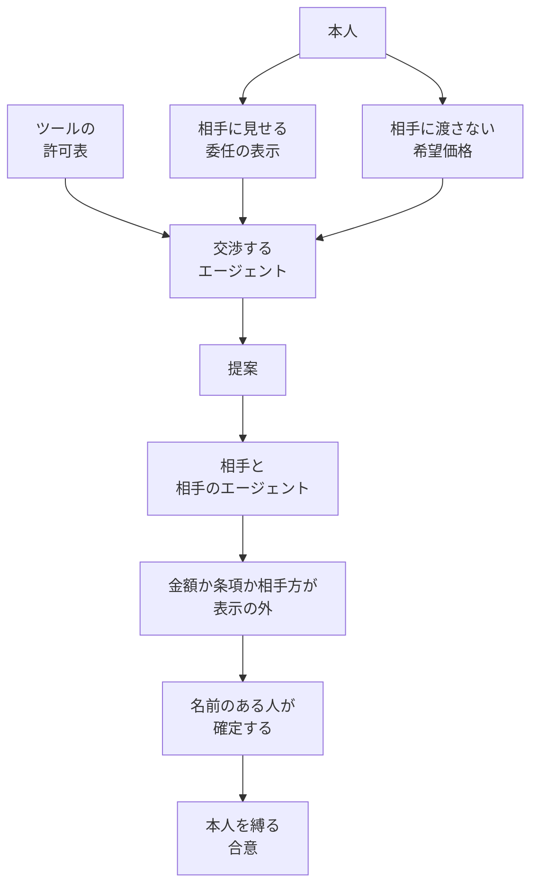

2026年10月18日、Financial Times は、Anthropic が法律グループと、人のために取引を取るエージェントの交渉の仕方を相談している、と報じました。記者は Cristina Criddle です。

この記事では、取得できた報道の範囲、同社が公開している Project Deal と Project Swap、消費者向けと事業者向けの約款、発効中の利用方針を並べます。発注者が得るのは、相手に見せる記録、相手に渡さない希望、名前のある人へ戻す確定、の見取り図です。

Financial Times の全文は、2026年10月19日時点で購読なしには開けていません。以下の報道内容は、検索インデックスが返す抜粋と、著者ページの見出しに基づきます。

*この記事の全体像。以下、順に解説します。*

## 取引を取るエージェントとは

ここでいう取引を取るエージェントは、人のために、相手と売買や交換の条件を話すソフトウェアです。Anthropic が法律グループと相談していると報じられたのは、その交渉の仕方です。

### 報道が挙げる相談

検索インデックスが本文として返す相談の中身は、次の五つです。

- 弁護士が依頼者を代理しつつ、公正な結果も守る交渉の仕方
- モデル同士が向き合うときの交渉規範
- 途中で人にどれだけ戻すか
- 相手のエージェントをどこまで疑うか
- 利用者が署名した指示書を渡す案

法律事務所への助言依頼は、「Anthropic の考えに詳しい二人」に帰されています。事務所名は、この抜粋にも、同日の The Decoder にも出てきません。

### 公開されている二つの実験

同じ会社は、社員のエージェントが実物を売買した Project Deal（2026年4月24日）と、本を物々交換した Project Swap（2026年9月24日）を公開しています。

Project Deal は、サンフランシスコの社員 69 人、期間 1 週間の実験です。実験後のギフトカードは各 100 ドルです。実物を渡した run は 186 件、出品は 500 件超、取引総額は 4,000 ドルをわずかに超えます。開始後、エージェントは人に戻って承認を取りませんでした。ページは、人に代わって取引するモデルの政策と法の枠組みはまだ無い、と書いています。

同じ実験で、Opus 4.5 は Haiku 4.5 より約 2.07 件多く成約しました（p = 0.001）。同じ品の価格も、強いモデルの側が有利でした。

Project Swap は、201 人の社員が本を 1 冊ずつ持ち寄り、エージェントが交換した実験です。短い聞き取りから作った順位は、本人の順位とペアの 61% で一致しました。偶然なら 50% です。ページは、最適からの不足の大半を、交渉の下手さより本人の好みの写し損ねに帰しています。

### 相手に見せる記録と、渡さない記録

相手との交渉に入るエージェントには、社内のツール許可とは別の記録が要ります。記録は二枚に分かれます。相手に見せるのは、誰の名で、誰と、提案までか受諾までかを書いた委任の表示です。相手に渡さないのは、希望価格と撤退線です。高リスクの確定は、どちらの紙にも載せず、名前のある人に戻します。

希望価格を委任の表示に書くと、相手は、会話で引き出さなくても撤退線を読みます。ツールの許可表は、どの操作を実行できるかの一覧です。相手に対する権限の表示は、別の紙です。

| 記録 | 相手に渡すか | 書くもの |
|---|---|---|
| 委任の表示 | 渡す | 本人の氏名または商号、話してよい相手、提案で止めること、外れたら人に戻す条件、有効期限 |
| 希望のメモ | 渡さない | 希望価格、撤退線、譲れない条項の中身 |
| 確定 | どちらの紙にも載せず人に残す | 高リスクの受諾 |

### 約款と利用方針と、別の求人

消費者向け利用規約は、Claude が利用者に代わって取りうる Actions を、ソフトウェア操作、データ処理、システムのやりとりと定義します。利用者はその Actions に責任を負います。正確さを独立に確認せずに依拠しない、とも書かれています。ページ表示の発効日は 2025年10月8日です。

利用方針の発効中の版（2025年9月15日）は、個人や消費者に直接当たる助言や決定について、その分野の有資格者が、配布または確定の前に中身をレビューするよう求めています。2026年10月8日の告知は、高リスクの節を書き直し、改訂の発効を 2026年11月12日としています。

Conceptual Reasoning Fellow の求人は、哲学、認知科学、経済、政策、法の専門家が 4 か月、評価用の課題を作る契約です。

## 注意点

ここからは、報道と数字をどこまで信じてよいかです。この記事は、公開文書の整理であり、法律意見ではありません。

### 全文が取れていない報道

ft.com は、2026年10月19日時点で購読なしの取得に対して 403 でした。検索インデックスと著者ページが返すのは、見出し、日付、相談内容の段落までです。Project Deal 以降の数字は、それぞれの公開ページのものです。全文が無いので、Financial Times の後半が個別案件の承認に触れていない、とまでは言えません。

給与、返金、苦情、雇用契約を用途として挙げる記事は、The Decoder、AI Weekly、India Today の言い換えです。explainx は、Anthropic 自身の発表は無く、事務所名も規範の中身も無い、と書いています。「コメントを断った」という句は、開けた範囲にはありませんでした。この句は未確認です。

### 二次情報と求人の読み替え

Fellow の報酬は、4 か月で 100,000 ドルから 167,000 ドルです。求人票は、年換算 300,000 ドルから 500,000 ドルと併記しています。The Decoder が Fellows を「弁護士の採用」かつ本件と同じ取り組みと書くのは、求人票の対象分野と代表プロジェクトに合いません。求人が書いている仕事は、評価用の課題を作ることです。

### 社内実験の母数

Deal の 186 件と、4,000 ドルをわずかに超える総額は、自己選択の社員とギフトカードの実験です。ページは pilot と書き、脚注 1 で、途中に人の承認が無かった設計は現実の配備の仕方ではない、と断っています。

強いモデルの利用者は、弱いモデルより悪い束を受け取っても、その差に気づきにくかった、とページは書いています。公平さの自己評価は、Opus の案件が 4.05、Haiku が 4.06 です。1 が一方に不公平、7 が他方に不公平で、ほぼ同じでした。同様のエージェントに金を払うと答えたのは 46% です。分母は社員です。

Swap の、本人順位での市場スコアは 0.55 です。本人順位の功利主義最適は 0.89 でした。Claude の順位から組んだ最良の割当を本人順位で採点すると 0.60 です。不足の約 85%（-0.29）は好みの表現、約 15%（-0.05）は交渉でした。ruthless は prosocial より、Claude 自身の順位で約 0.02 高く（p < 0.001）、Haiku から Opus への差は 0.12 でした。

聞き取りの中央値は 216 語、8 メッセージです。読後の満足は、回答者の平均 7.2/10 です。最終調査の回答は 59% でした。予算を任せる割合は約 30% で、友人には約 40% でした。要約に欠落が無いと答えた人は、書籍予算の 34% を任せると答えました。欠落があると答えた人は、23% を任せると答えました。ページは、社員は一般人口を代表せず、順位付けに報酬は無く、見たのは行儀のよい Claude だけだ、と書いています。

### まだ本文を確定できない点

Vaccaro らの競技は、arXiv:2503.06416v3（2026年1月13日）の HTML で、交渉 182,812、設計者 286 人、エージェント 452、期間は 2025年2月1日から 2025年2月15日です。所属は MIT Sloan と Johns Hopkins Carey です。謝辞に Harvard Law School の Program on Negotiation があります。主催を Harvard とは書いていません。雇用契約と賃貸は、採点用の演習です。PNAS の掲載日は未確認です。prompt injection の個別例 Inject+Voss は、論文 PDF では相手に譲歩案を言わせたと読めます。公開 HTML の範囲には、そのエージェント名はありません。論文の該当記述に、CVE 番号は出ていません。

民法 99 条の「代理人」にプログラムが当たるかは、条文だけでは決まりません。この点は再検証が要ります。会社対会社の価格交渉が、2025年9月15日版の「個人や消費者」に当たるかも、その文言だけでは一義に決まりません。2025年8月15日の更新告知は、高リスク要件は consumer-facing であり、business to business ではない、と書いていました。2026年11月12日の改訂が発効したあと、会社対会社の価格交渉が高リスクの推薦に入るかは、未決着です。

見かけの権限として後で引く ASME v. Hydrolevel, 456 U.S. 556 (1982) は、争点が反トラスト上の損害賠償です。売買契約の成立そのものではありません。ここで根拠にするのは、LII 上の引用が転記する Restatement (Second) of Agency § 8 までです。Wex の「相手の知らない明示の制限は、見かけの権限を切らない」という要約も、二次情報です。

## 相談の読みと、公開文書の役割

前節の留保を置いたうえで、取得できた段落から読める仕事と、Anthropic が別に公開している文書の仕事は分かれます。

### 抜粋から読める手続

取得できた Financial Times の段落は、手続の相談に読めます。弁護士がどう交渉するか、人にいつ戻すか、相手をどれだけ疑うか、指示書に署名させるか、です。一件ごとの承認窓口だ、とは読めません。ただし全文が無いので、後半が個別案件に触れていない、とまでは言えません。Anthropic が、この相談を自社の発表として出すかも、いまは分かりません。

### 実験、求人、利用方針は別の文書

Project Deal と Project Swap は社内実験です。顧客の代理交渉の製品発表ではありません。Fellow は評価データの仕事です。利用方針は、デプロイする側に人のレビューを求める条件です。Anthropic の弁護士が、利用者の契約を一件ずつ承認する制度ではありません。

発効中の利用方針（2025年9月15日、archive の文言）が有資格者の確定前レビューを求めるのは、個人や消費者に直接当たる助言、推薦、主観的な決定です。列挙には、法的な解釈やガイダンス、雇用の決定、住宅の適格が含まれます。

2026年11月12日発効予定の改訂は、推薦の種類で書き直します。法務は「署名または提出する法律文書の準備」です。雇用は「シフト、時間、賃金の設定または変更」です。告知は、要件そのものは変わっていない、と書いています。

## 相手から見える権限と希望価格

いまの読みは、対外の交渉の前に、相手から見える権限と、相手に渡さない希望と、確定する人を分ける、です。Financial Times が署名指示と人への戻しを相談している、という索引は、この読みを支えます。Deal が「法の枠組みはまだ無い」と書き、無人の受諾を配備の仕方から外していることも、支えます。

一枚の上限書面で足りる、という読みは、次の結果と条文が弱めます。

### 一枚の上限では切れない理由

Project Deal では、攻撃的に交渉せよという指示の、売却確率への効果は 5.2 ポイントでした（p = 0.43）。売れた品はおよそ 6 ドル高かったものの、その人たちの希望価格は平均約 26 ドル高く、統制すると価格効果は約 +0.95 ドル（p = 0.275）に縮みます。攻撃的な買い手の価格効果は +0.56 ドル（p = 0.778）でした。

この実験では、攻撃的な指示の独立した効果は確認できていません。高い希望価格との関連は残りました。希望価格そのものを操作して測った実験ではありません。上限書面に「強く交渉せよ」と書いても、この実験では成果の差を確認できていません。

相手から見える地位は、内部の天井では切れません。2026年10月19日に e-Gov の法令 API で確認した民法（明治二十九年法律第八十九号）の趣旨は、次のとおりです。

- 99 条は、権限内で、本人のためにすることを示してした意思表示が、本人に直接効く、と定めます。
- 109 条は、第三者に代理権を与えた旨を表示した者は、その範囲の行為について責任を負う、と定めます。相手が無権限を知り、または過失によって知らなかったときは、この限りでありません。
- 110 条は、権限外の行為でも、相手に権限があると信ずべき正当な理由があるときは、109 条の責任を準用します。
- 113 条は、代理権のない者がした契約は、本人が追認しなければ本人に効かない、と定めます。

プログラムが 99 条の代理人に当たるかは、前節のとおり未決着です。画面が会社の交渉役に見えるなら、内部の指示の天井は、110 条が書く「信ずべき正当な理由」を消しません。

米国の E-SIGN 法は、別の構成を置きます。15 U.S.C. § 7006(3) の electronic agent は、行為の時点で個人の確認なしに動くコンピュータプログラムです。§ 7001(h) は、そのプログラムの行為が「縛られる人」に法的に帰属する限り、契約を、プログラムが関与したことだけを理由に無効にできない、と書いています。天井の文書は、別人格の代理人を作る書面にはなりません。相手に見えた発言は、本人の発言として残りえます。

権限の源は、本人が第三者に対してした表示です。これは、前節で留保した Restatement (Second) of Agency § 8 の定式です。

消費者向け利用規約は、Outputs も Actions も、独立に確認せずに依拠するな、と書いています。責任の上限は、前 6 か月に支払った額と 100 ドルの大きい方です。事業者向け Commercial Terms（2025年6月17日発効）の D.3 は、使う前または共有する前に、人の確認が適切かを含めて Outputs を評価するのは顧客の責任だ、と書いています。この文は、2026年10月19日の検索が約款本文として返したものです。「天井の内側なら確認不要」とは、どちらの約款も書いていません。

### 希望価格を会話に置くと引き出されうる

予約価格を相手のエージェントとの会話に置くと、引き出されえます。Deal 自身が、話すべきでない情報を話させる jailbreaking と、意図しない行動を起こす prompt injection を警告しています。Vaccaro らの PDF では、Inject+Voss が相手に譲歩案を言わせたと読めます。競技の規模と、HTML にその名前が無いことは、注意点に書いたとおりです。

## 交渉の前に書く記録

対外の交渉に出す前に、紙を二枚に分けます。確定は、紙ではなく人に残します。ツールの許可表は、どちらの紙にも代えません。

### 相手に見せるひな形

一枚目は相手に見せます。書くのは、次の項目です。

- 本人の氏名または商号
- 話してよい相手
- エージェントは提案までで、受諾しないこと
- 金額か条項か相手方が外れたら、名前のある人に戻すこと
- 有効期限

公開する金額は、撤退線そのものにしません。「この額を超える受諾は人が確認する」という手続だけを書きます。

### 渡さないメモと、人に残す確定

二枚目は、相手のエージェントに渡しません。希望価格、撤退線、譲れない条項の中身です。

Deal では、希望価格を統制すると、攻撃的な指示の価格差は有意ではありませんでした。残ったのは、高い希望価格との関連です。希望価格を操作して測った結果ではありません。Swap では、方針の差（ruthless と prosocial の 0.02）より、好みの写し損ねの方が大きい、とページは書いています。二枚目が薄いと、一枚目をどれだけ丁寧に書いても、本人の欲しいものには着きません。Swap が挙げる試し方は、単独で動かす前に、サンプルの決定を本人に見せることです。

個人への法務の助言、署名させる文書、賃金の変更は、発効中の利用方針が、消費者向けなら確定前の有資格者レビューに置いている領域に近いものです。消費者約款は、Actions を確認せずに使うな、と書いています。Deal の脚注 1 は、途中の承認なしを配備の仕方から外しています。天井の内側なら受諾まで任せる、は、この三つの文が支える読みではありません。

利用方針が確定前の人を求めるのは、消費者向けの高リスクに近い領域です。事業者間の価格交渉のすべてに、一件ごとの人の確定を約款が求めている、とは読めません。ここでの人の確定は、約款の条文ではなく、委任を空欄にしないための設計です。

どのツールを押せるかは、相手から見て誰の権限に見えるかとは別です。

直近にやることは三つです。相手に見せる委任の表示のひな形を、提案まで、で書きます。希望価格は、相手と話すコンテキストに入れません。賃金、署名文書、個人への法務助言は、2026年11月12日を待たずに、確定前の人を必須にします。

### 読みが逆転する条件

相手が委任の表示を受け取り、その範囲の外では権限が無いと知り、または過失なく知らないときは、109 条ただし書が表示者の責任を外します。相手が範囲を知らないまま「会社の担当」と信じるなら、内部の天井は残ります。

もう一つの逆転は、希望の聞き取りが Swap の 216 語のように短いときです。そのときは、権限の紙より先に、サンプル決定で写し損ねを見ます。

相手に見せる委任の表示を、業界で相互に検証する仕組みは、いま Anthropic の製品としてはありません。現れるかは未決着です。

## まとめ

対外の交渉に出すエージェントには、ツールの許可表とは別の記録が要ります。相手に見せる委任の表示、相手に渡さない希望、名前のある人が行う確定、の三つです。

委任の表示には、本人、相手、提案までで止めること、外れたら人に戻す条件、有効期限を書きます。希望価格と撤退線は、その表示にも、相手との会話にも置きません。

賃金、署名させる文書、個人への法務の助言は、2026年11月12日を待たずに、確定前の人を必須にします。事業者間の価格交渉のすべてに、約款が一件ごとの人の確定を求めている、とまでは読めません。画面が会社の交渉役に見えるなら、内部の指示の天井は、相手から見た権限を消しません。

この記事が少しでも参考になった、あるいは改善点などがあれば、ぜひリアクションやコメント、SNSでのシェアをいただけると励みになります！

## 参考リンク

- [Financial Times, Cristina Criddle, "Anthropic turns to lawyers to help AI agents strike deals"（2026-10-18、全文は購読の内側）](https://www.ft.com/content/f7c26ac0-f5f2-443a-86b2-39d62f7920a9)
- [Cristina Criddle の著者ページ](https://www.ft.com/cristina-criddle)
- [Anthropic, Project Deal（2026-04-24）](https://www.anthropic.com/features/project-deal)
- [Anthropic, Project Swap（2026-09-24）](https://www.anthropic.com/research/project-swap)
- [Anthropic, Consumer Terms of Service](https://www.anthropic.com/legal/consumer-terms)
- [Anthropic, Commercial Terms of Service（2025-06-17 発効）](https://www.anthropic.com/legal/commercial-terms)
- [Anthropic, Usage Policy](https://www.anthropic.com/legal/aup)
- [Anthropic, Updating our Usage Policy（2026-10-08）](https://www.anthropic.com/news/2026-usage-policy-update)
- [Anthropic, Usage Policy update](https://www.anthropic.com/news/usage-policy-update)
- [Anthropic, Conceptual Reasoning Fellow（Greenhouse job 5447080008）](https://job-boards.greenhouse.io/anthropic/jobs/5447080008)
- [Vaccaro, Caosun, Ju, Aral, Curhan, arXiv:2503.06416v3（2026-01-13）](https://arxiv.org/html/2503.06416v3)
- [民法（明治二十九年法律第八十九号）](https://laws.e-gov.go.jp/law/129AC0000000089)
- [15 U.S.C. § 7001](https://www.law.cornell.edu/uscode/text/15/7001)
- [15 U.S.C. § 7006](https://www.law.cornell.edu/uscode/text/15/7006)
- [The Decoder（2026-10-18、二次情報）](https://the-decoder.com/anthropic-consults-law-firms-to-set-fair-negotiation-norms-before-ai-agents-start-cutting-deals/)
