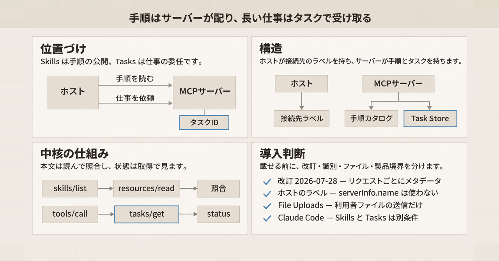
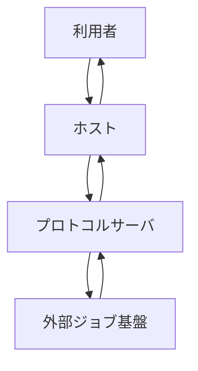
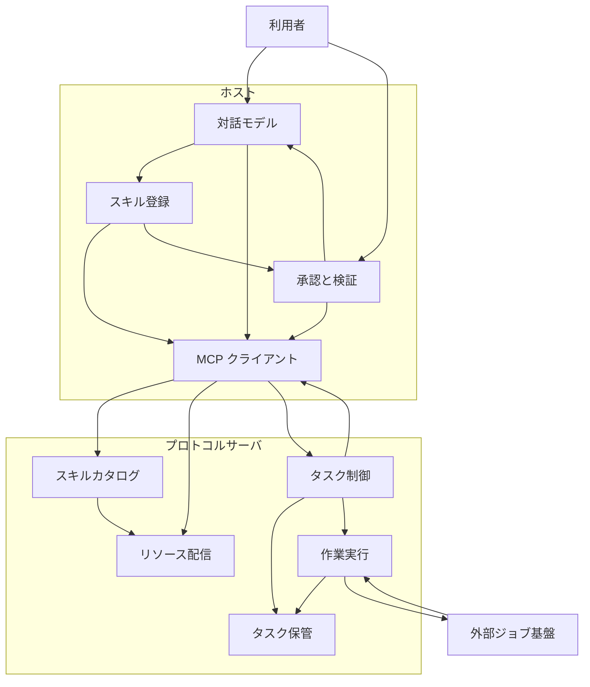
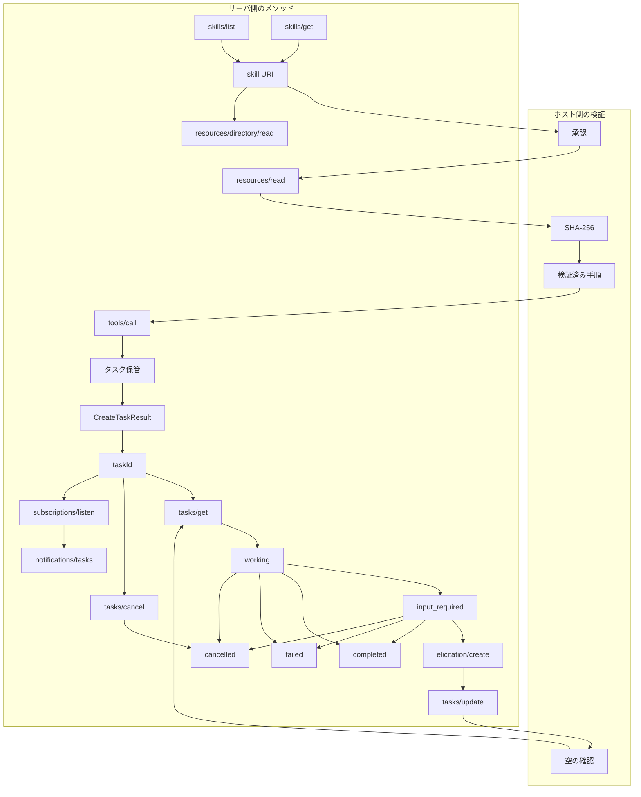
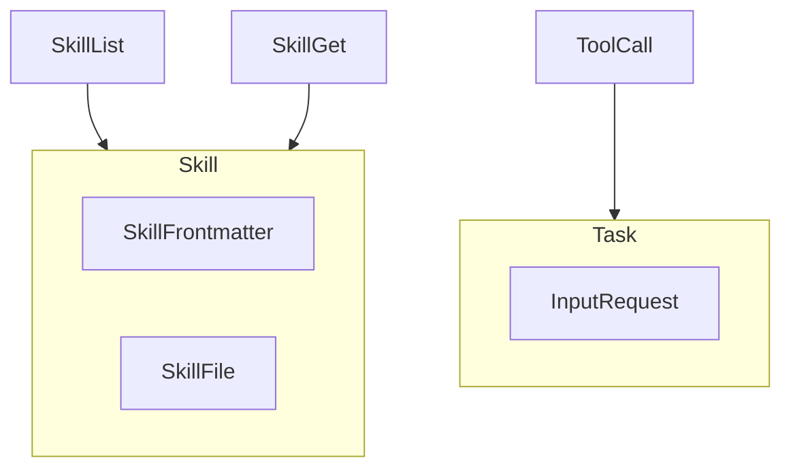
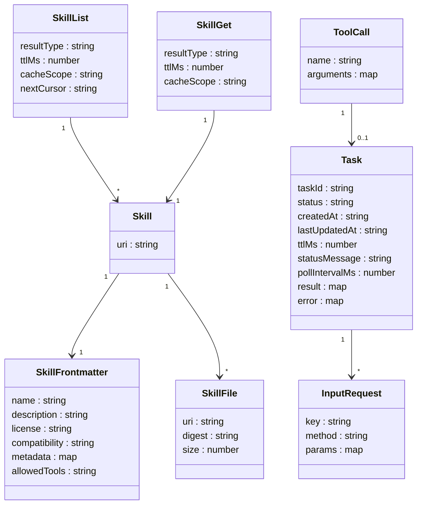
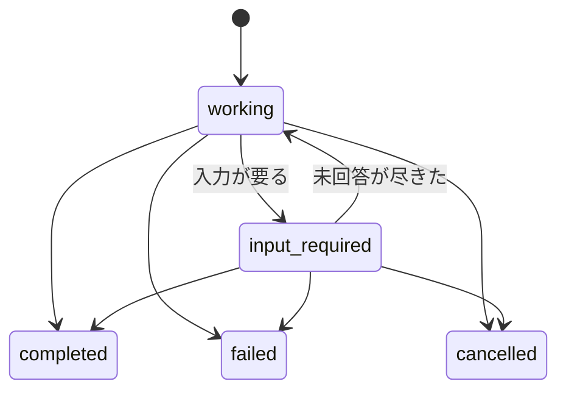

この記事は、MCP（Model Context Protocol。対話アプリであるホストと、ツールやデータを持つサーバーがやり取りする手順）の Skills 拡張と Tasks 拡張を、発見から状態の見方、障害時の切り分けまで説明します。時点は基底プロトコル 2026-07-28 と、2026-11-24 の Claude および Claude Code への掲載です。Claude は Anthropic の対話製品です。Claude Code は、端末や IDE から使うコーディングエージェントです。この記事の作業調整は、二つの向きに分かれます。Skills over MCP では、サーバーが作業手順を公開し、ホストが必要なときに読みます。Tasks では、ホストが依頼した仕事をサーバーが引き受け、先にタスクの識別子を返します。

読者は、拡張の識別子、ワイヤ上の JSON、ホストとサーバーの責任分界、Claude Code の版とプランの境界を、実装と導入の判断に使えます。


*この記事の全体像。以下、順に解説します。*

## MCPのSkillsとTasksとは

2026-11-24、Anthropic は Claude と Claude Code に、Skills over MCP、Tasks、Elicitation、File Uploads を載せる記事を公開しました。MCP 開始から 2 年にあたり、この発表は、ツールとデータへの接続を、エージェント同士の通信と作業調整の標準へ広げる局面として述べています。起点の告知は [ClaudeDevs の投稿](https://x.com/ClaudeDevs/status/2125289794871963935) です。

Skills over MCP は、サーバーがツールと一緒に作業手順を配る仕組みです。手順の形は Agent Skills 仕様のディレクトリです。Agent Skills は、名前と説明、手順本文、参照ファイルをディレクトリに置く技能パッケージの形式です。中心ファイルは `SKILL.md` です。発見は拡張の `skills/list` と `skills/get`、本文の取得は既存の `resources/read` です。MCP Resources は、サーバーが URI で本文やファイルを渡す機能です。ホストは、使う skill の本文を必要な時点で読みます。

同じ記事は、接続基盤のうち tool search と 2026-07-28 の仕様を、この拡張の土台として並べています。tool search は、複数サーバーの構成でツール定義を必要なときだけ読む仕組みです。減らすコンテキストは、モデルへ渡すツール定義の量で、85% 超削減し得ます。2026-07-28 の仕様はステートレスです。各リクエストは、以前の接続で交渉した状態に依存しません。Tasks を複数のサーバーインスタンスで出すときは、Task Store を共有するか、`taskId` で状態を持つインスタンスへ振り分けます。同じ TCP 接続へ戻る必要はありません。Claude の各製品がこの仕様に対応しています。

2 周年のブログは、Enterprise-Managed Authorization を安定版の拡張とし、管理者が認可したサーバーへ利用者が自動で接続する、と書きます。同じブログは、MCP Apps を最初の公式拡張と書きます。MCP Apps は、会話の横または全画面に操作できる画面を出す拡張です。その表示位置は Claude の記事の記述です。仕様を預かる団体は [Agentic AI Foundation](https://aaif.io/) です。

エージェント間の残る調整は、Agents Interest Group が評価しています。同グループは、Tasks を補う Agents Extension（まだ要否を決めていない拡張案）を、本番の利用と試作から判断します。この記事の手順には、その拡張案は入りません。

Skills over MCP の Claude と Claude Code での提供は public beta です。Pro、Max、Ultra では既定でオンです。Team では管理者が有効化します。Enterprise は告知上 coming soon です。認証方式ごとのオンオフは、このプラン表とは別で、注意点にまとめます。拡張 ID は `io.modelcontextprotocol/skills` です。拡張 ID は、基底仕様に足すオプション機能の名前です。SEP-2640 は Final です。SEP の Final は仕様提案の状態です。Claude の public beta や、拡張ライフサイクルの Beta とは別です。差の詳細は注意点にまとめます。SEP は Specification Enhancement Proposal、つまり MCP の仕様提案です。仕様の正本は、基底プロトコル 2026-07-28 に対する ext-skills（Skills 拡張の仕様文書）の `specification/beta/skills.mdx` です。

Tasks は、サーバーが時間のかかる処理やエージェントのループを、完了を待たないタスクとして進める拡張です。ホストは自分の作業を続け、結果の準備後に受け取ります。Tasks と Elicitation の Claude と Claude Code での提供は GA です。対象プランは Pro、Max、Ultra です。Team と Enterprise は rolling out です。Tasks の拡張 ID は `io.modelcontextprotocol/tasks` です。対応する提案は SEP-2663 で、状態は Final です。

Elicitation は、進行中の操作に利用者の入力を挟み、その後の処理を続けるクライアント機能です。入力の形はフォーム、または外部の URL です。

File Uploads は、PDF、表計算、画像などのバイトを、モデルの文脈の外の経路でサーバーへ渡す拡張です。Claude では rolling out soon です。対象は Pro、Max、Ultra と、対象となる Team および Enterprise です。プロトコル側の草案の拡張 ID は `io.modelcontextprotocol/files` で、状態は Draft です。リポジトリ名は `modelcontextprotocol/experimental-ext-file-uploads` です。

Events は別の拡張です。エージェントは、誰も問い合わせていない出来事へ反応できます。発見は `events/list` です。拡張 ID は `io.modelcontextprotocol/events` で、SEP-3415 は Final、拡張のライフサイクルは Beta です。2026-11-24 の Claude 記事が並べた 4 機能には含まれません。

公式ブログの図は、2026-11-23 までの直近 30 日で MCP SDK のダウンロードが 7 億超だと示します。Anthropic は、Claude 向けの MCP コネクタが 1 万超だと述べます。MCP コネクタは、Claude に登録して使う MCP サーバー接続です。製品名の例は、Skills が Shopify、HubSpot、Atlassian、Carta（coming soon）、Tasks が ZoomInfo、Elicitation が Supabase、Railway、GitHub です。

プロトコルの段階、Claude への掲載日、ホスト実装のカバー範囲は別の軸です。資料ごとの差は後の注意点にまとめます。

## 特徴

Skills over MCP のサーバーは、`resources` と拡張 `io.modelcontextprotocol/skills` を同時に宣言します。一覧で先に届くのは、名前、説明、ファイルの目録です。本文は選択後に読みます。

マニフェスト（各ファイルの URI、SHA-256、バイト数を並べた目録）がファイル列のとき、ホストは `SKILL.md` のサイズと SHA-256 を検証します。`resources` が文字列 `dynamic` のときも、取得した `SKILL.md` の frontmatter は照合してからモデルへ載せます。`dynamic` は、ファイルごとの安定した digest を含む目録が無く、内容が生成されることを示します。frontmatter は、`SKILL.md` 先頭の YAML です。補助ファイルは、作業中に要求されたものから読みます。

skill の識別子は、ホストが接続先に割り当てたラベルと、URI の組です。サーバーが自己申告する `serverInfo.name` は識別に使いません。スキルの `name` は表示用のラベルで、一意ではありません。

製品側の例は次のとおりです。Shopify は店舗の設計と更新を支えます。HubSpot は顧客の初期設定を支えます。Atlassian は組織の文脈を使った分析を支えます。Carta は、アップロードした文書からの持分の起票と発行を coming soon で予定しています。

Tasks では、サーバーが時間のかかる処理やエージェントのループをタスクとして進めます。状態は `working`、`input_required`、`completed`、`failed`、`cancelled` です。終端は後の 3 つです。タスクを作る判断はサーバーが持ちます。クライアントは、リクエストの `params` 内にあるメタデータオブジェクト `_meta` に、拡張の宣言を載せます。タスク化できるメソッドは、2026-07-28 では `tools/call` だけです。途中で入力が要る作業は `input_required` に移り、Elicitation などで回答を受けます。ZoomInfo は、アカウントと連絡先の深い調査を Tasks で実行します。

Elicitation の製品例は次のとおりです。Supabase は、有料プロジェクトの作成前と、破壊的な SQL の実行前に費用を確認します。Railway は、サービスの削除のような破壊的変更の前に確認します。GitHub は、リポジトリ削除の前にリポジトリ名の入力を受けます。

拡張に対応したサーバーは、同じ拡張を実装したクライアント全般で動作します。製品のオンオフはホストごとに異なります。

比較表の `allowed-tools` は、事前承認するツール名を空白で区切った実験フィールドです。参照ファイルを読む承認とは別です。

次の表は、届け方の違いです。

| 手段 | 届けるもの | 読み込み単位 | 権限が残る場所 | 成熟度 |
| --- | --- | --- | --- | --- |
| ホストローカルの Agent Skills | `SKILL.md` と、参照・スクリプト・素材 | 起動時は全 skill の名前と説明。選択時に本文。参照ファイルは必要時 | 配置と実行は、読み込むホスト。`allowed-tools` は実験的な事前承認 | Agent Skills の形式仕様として公開 |
| Skills over MCP | サーバー上の同じ Agent Skills。利用者や組織向けの手順をツールと同時に配布 | 一覧は frontmatter と目録。選択後に `SKILL.md`。補助ファイルは作業中に検証して読む | 内容の出所はサーバー。読み込みの承認とホスト上の実行許可は skill ごとにホスト | SEP-2640 は Final。SDK とホスト対応は実装中。Claude は public beta |
| 同期 `tools/call` | 1 回のツール実行の結果 | 呼び出しの完了とともに結果が戻る | 操作の実行はサーバー。呼び出しの認可はそのリクエストの MCP 認可 | MCP の基本のツール呼び出し |
| MCP Tasks | 長時間ジョブのハンドル、途中状態、完了結果 | 作成時はハンドル。その後は状態の確認。完了時に結果 | 生成と状態の保持はサーバー。確認と途中入力はクライアント | SEP-2663 Final。Claude では GA。Team と Enterprise は rolling out |
| MCP Elicitation | フォームの入力、または外部 URL への誘導 | 進行中リクエストに入る 1 件の入力依頼。回答後に元の処理が続く | 利用者の判断はクライアントの画面。フォームの値はクライアントを通る。URL mode の機微な入力は外部画面 | 2026-07-28 仕様のクライアント機能。Claude では GA。Team と Enterprise は rolling out |
| MCP Prompts | 引数付きのプロンプトテンプレートと、ロール付きメッセージ | 一覧は定義。取得時は 1 件分のメッセージ列 | 選ぶ操作は利用者。文面の定義はサーバー | 2026-07-28 仕様のサーバー機能 |
| MCP Events | 問い合わせが無いときに届く出来事 | `events/list` で型を知り、購読して payload を受ける | サーバーが拡張を広告する。クライアントの能力宣言は任意。`events/*` は広告の無いサーバーへ送らない | SEP-3415 は Final。拡張は Beta。2026-11-24 の Claude 記事の 4 機能には含まれない |
| File Uploads | PDF、表計算、画像などのバイト | モデルの文脈を通さず移す | インラインは `tools/call` にバイトを載せる経路で、クライアント側の宣言を省けます。帯域外は、サーバーが示した転送先へバイトを置く経路です。転送先は MCP サーバー自身とは限りません。どちらの宣言を省くかの手順は、この記事では書きません | プロトコルは Draft（`io.modelcontextprotocol/files`）。Claude は rolling out soon |

次の表は、仕事の種類ごとの向き先です。

| ユースケース | 向き先 |
| --- | --- |
| 接続先の業務手順を、ツールと同時に配る | Skills over MCP |
| 自分の環境に置いた手順を、起動時のメタデータから使う | ホストローカルの Agent Skills |
| 短時間で終わる参照や更新を、その場の結果として受け取る | 同期 `tools/call` |
| 調査、バッチ、完了まで時間のかかる仕事を渡す | MCP Tasks |
| 課金、削除、破壊的変更の直前に利用者の確認を挟む | MCP Elicitation |
| 利用者が明示して選ぶ定型の指示文を受け取る | MCP Prompts |


## 構造

利用者、ホスト、プロトコルサーバー、外部ジョブ基盤の 4 つが境界です。対話モデルはホストの内側にあり、プロトコルサーバーへ直接話しません。

### システムコンテキスト図



| 要素名 | 説明 |
| --- | --- |
| 利用者 | スキルを明示的に選ぶ人です。ホストが求めたとき、対象スキルのファイル一覧に対して承認します。タスクが人の判断を要する場合は、その応答者にもなります。 |
| ホスト | 対話モデル、カタログの提示、承認、内容の検証を内側に持ちます。モデルはプロトコルサーバーへ直接話しません。対話モデルの箱はコンテナ図に置きます。 |
| プロトコルサーバー | スキルの所在と本文を配ります。ツール呼び出しに対しては、完了を待たせずタスクの状態を返すことがあります。 |
| 外部ジョブ基盤 | 長時間処理や待ち行列を持つ外側の仕事の仕組みです。プロトコルサーバーが必要に応じて作業を委譲します。 |

### コンテナ図

ホストの内側は、対話モデル、スキル登録、承認と検証、MCP クライアントです。プロトコルサーバーの内側は、スキルカタログ、リソース配信、タスク制御、タスク保管、作業実行です。



| 要素名 | 説明 |
| --- | --- |
| 利用者 | 対話モデルへ仕事を頼みます。ホストが読み込みの承認を求めるときは、示す一覧へ承認を返します。 |
| 対話モデル | ホストの中で推論します。スキル候補の選択と、ツールを使いたいという意図を出します。未検証の本文は載りません。 |
| スキル登録 | どのサーバーのどのスキルかを組にして候補を覚えます。同じ名前でも、別のスキルとして黙って置き換えません。 |
| 承認と検証 | 承認を、そのときのファイル一覧と内容の指紋へ結び付けます。一覧に無いファイルは読まず、一致しない内容はモデルへ渡しません。 |
| MCP クライアント | ホストからプロトコルサーバーへ要求を送ります。タスクは、サーバーが示した間隔に従って状態を問い合わせます。 |
| スキルカタログ | スキルの説明とファイル一覧を渡します。一覧に出ていなくても、所在を指定した取得には応えます。 |
| リソース配信 | 手順の本文と支援ファイルを渡します。ディレクトリの子の列挙は、サーバーがそれを宣言したときだけ行います。 |
| タスク制御 | ツール呼び出しをタスクにするかを、要求のたびに決めます。保管から状態を読めるようにしてから、タスクであるという結果を返します。途中の入力と、協調的な取り消しを受けます。 |
| タスク保管 | 作業担当や接続が消えても問い合わせできる、タスクの永続状態です。 |
| 作業実行 | 計算を進め、進捗と、最終結果または誤りを保管へ書きます。 |
| 外部ジョブ基盤 | 作業実行が長時間の仕事を預け、完了を受け取る外側の仕組みです。使わないタスクもあります。 |

### コンポーネント図

読み込みは `skills/list` または `skills/get` から skill URI を決め、承認のあと `resources/read` し、SHA-256 を照合して検証済み手順にします。長いツール呼び出しはタスク保管を経由し、`CreateTaskResult` の `taskId` で `tasks/get` を繰り返します。`CreateTaskResult` は、通常のツール結果の代わりに返す、タスクであるという結果です。



| 要素名 | 説明 |
| --- | --- |
| `skills/list` | スキルの候補をページ単位で得ます。各候補は所在、前文（`SKILL.md` の frontmatter）、ファイル一覧まで含み、追加のメタデータ取得は要りません。 |
| `skills/get` | 所在だけ分かっているスキルを、一覧を経ずに取得します。不明な所在はここで止まり、内容は読みません。 |
| skill URI | スキルの手順ファイルの所在です。身元は、ホストが接続先に割り当てたラベルと、この所在の組です。サーバーが自己申告する `serverInfo.name` は識別に使いません。 |
| 承認 | 読み込み前の利用者承認は、ホストが選んでよい関門です。承認を残すときは、ファイルの所在と指紋の組に結び付き、ファイルの追加、削除、変化で無効になります。ホスト側のコード実行、`allowed-tools`、ネストしたスキルの起動は、それぞれ明示の承認が要ります。ネストした起動は、別スキルの `SKILL.md` を参照として読むこととは別で、新しい同意が要ります。承認は、本文を先に取らなくても、マニフェストに対して行えます。 |
| `resources/read` | 手順ファイルと、モデルが必要とした支援ファイルだけを読みます。ホストが承認を求めるときは、読み込みはその承認のあとです。一覧に無い所在は読みません。 |
| SHA-256 | ホストが、受け取ったバイト数と SHA-256 を一覧の指紋と照合します。手順ファイルの前文も項目ごとに比べ、一致しない内容は使いません。 |
| `resources/directory/read` | サーバーがディレクトリ読取を宣言したときだけ、直接の子を見る任意の要求です。その場の列挙結果で、保持しているファイル一覧を広げてはなりません。 |
| 検証済み手順 | 検証を通った手順を、出したサーバーが分かる形で対話モデルへ載せます。読み込み自体はタスクではありません。 |
| `tools/call` | クライアントがツールの実行を頼む要求です。タスクにできるのは、現行の対応メソッドではこの要求だけです。サーバーが通常の結果を返すこともあります。 |
| タスク保管 | タスクの永続状態です。作成結果は、この `taskId` がここから取得できるまで返しません。 |
| `CreateTaskResult` | 通常のツール結果の代わりに返す、タスクであるという結果です。`taskId`、初期状態、生存期間、問い合わせ間隔を含みます。フィールドは結果オブジェクトに平らに並びます。 |
| `taskId` | サーバーが作る、推測しにくいタスクの識別子です。以後の取得、入力、取り消しはこれを指定します。 |
| `tasks/get` | `taskId` の現在状態を返す問い合わせです。`pollIntervalMs` は、サーバーが希望する継続ポーリング間隔のミリ秒です。指定値まで必ず空く保証ではありません。購読が無いクライアントは、終端まで取得を繰り返します。 |
| `working` | 処理が進んでいる状態です。ここから入力待ち、または終端へ移ります。 |
| `input_required` | サーバーがクライアントの入力を待っている状態です。未回答の要求は `inputRequests` に入ります。一部だけ答えても、残りがある間はこの状態のままです。 |
| `elicitation/create` | `inputRequests` が運び得る要求の一つです。ホストは要求元サーバーを利用者に明示し、回答、拒否、キャンセルを受け付けます。フォームは送信前に利用者が確認できます。モデルへの生成依頼は `sampling/createMessage` です。 |
| `tasks/update` | `inputRequests` への回答を `inputResponses` として送ります。応答は空の確認です。`working` へ戻ったかは、次の `tasks/get` で見ます。 |
| `completed` | 終端です。`result` には、元の要求が同期なら返したであろう結果が入ります。ツール自身の誤りを示す結果も、プロトコル上の失敗ではなくこの状態です。 |
| `failed` | 終端です。実行中のプロトコル誤りが `error` に入ります。 |
| `cancelled` | 終端の一つです。取り消しが実際に反映された状態であり、取り消しを送っただけで必ずここへ来るわけではありません。 |
| `tasks/cancel` | クライアントが取り消しの意図を伝える要求です。確認は空で、処理は協調的です。先に仕事が終わっていれば `completed` や `failed` になり得ます。 |
| `subscriptions/listen` | クライアントが、関心のある `taskId` について状態通知を受け始めるための購読です。 |
| `notifications/tasks` | 購読した `taskId` へ、その時点の完全なタスク状態を載せて送る任意の通知です。購読していれば、最終結果まで通知だけで受け取れます。`tasks/get` の併用は任意です。 |

## データ

Skills（`io.modelcontextprotocol/skills`）と Tasks（`io.modelcontextprotocol/tasks`）は別の拡張です。図の名前は両方で同じエンティティを指します。

### 概念モデル

所有は枠、利用は矢印です。枠の名前もエンティティです。



| 要素名 | 説明 |
| --- | --- |
| Skill | `SKILL.md` を指す skill エントリです。frontmatter と、マニフェストがあるときのファイルを所有します。識別子は発信サーバーと `uri` です。名前はラベルであり一意ではありません。 |
| SkillFrontmatter | `SKILL.md` の YAML frontmatter をそのまま持ちます。本文は含みません。 |
| SkillFile | マニフェストに載るファイルです。`resources` が文字列 `dynamic` の skill もファイルは取得できます。省略されるのは、各ファイルの安定した digest を含むマニフェストです。digest は、内容の指紋です。Skills では `sha256:` に続く SHA-256 です。 |
| SkillList | `skills/list` の結果です。掲載された skill を利用します。未掲載の skill もあり、一覧は skill を所有しません。 |
| SkillGet | `skills/get` の結果です。`result.skill` として skill を 1 件利用します。 |
| Task | `tools/call` の代わりに返す耐久ハンドルです。未応答の入力要求を所有します。作成応答は詳細ペイロードを持ちません。 |
| InputRequest | `input_required` のあいだだけ存在する、サーバーからクライアントへの要求です。 |
| ToolCall | タスク化できる `tools/call` です。タスクになるとは限りません。 |

### 情報モデル

属性の並びは、常にあるもの、任意のもの、状態が揃ったときだけ付くものの順です。



| 要素名 | 説明 |
| --- | --- |
| Skill | `uri` は `SKILL.md` のリソース URI です。ワイヤ上の `resources` は `SkillFile` の全列か、文字列 `dynamic` のどちらかです。クラス図の `SkillFile` への関連は、ファイル列のときだけです。`dynamic` のときファイル関連は空です。親ディレクトリ名の末尾は frontmatter の `name` と一致します。サーバーは 1 skill あたり 512 ファイルまたは 16 MiB を超えないことが望ましいです。ホストはそこまで扱えなければなりません。段階開示では、起動時に各スキルの `name` と `description` を載せます。目安は 1 スキルあたりおおよそ 100 トークンです。本文はスキルを有効にしたときに読み、5000 トークン未満が推奨です。参照ファイルは必要時です。`SKILL.md` は 500 行未満が推奨です。 |
| SkillFrontmatter | 必須は `name` と `description` です。`name` は 1 から 64 文字の小文字、数字、ハイフンです。前後のハイフンと連続ハイフンは不可です。`description` は 1 から 1024 文字です。任意の `license` があります。任意の `compatibility` は、想定する製品や必要なパッケージ、ネットワークなどの環境要件で、1 から 500 文字です。任意の `metadata` は文字列から文字列です。図の `allowedTools` は、仕様上の実験フィールド `allowed-tools` です。空白区切りの文字列です。 |
| SkillFile | `uri`、`digest`（`sha256:` に SHA-256）、`size`（バイト）です。マニフェストは `SKILL.md` と全補助ファイルを含み、ページをまたいで分割しません。 |
| SkillList | `resultType` は `complete` です。`skills` は skill の列です。`ttlMs` と `cacheScope` は一覧の鮮度と共有の範囲であり、内容の完全性ではありません。`public` は利用者固有のデータを含まず、共有ゲートウェイが別の利用者へ再利用してよい範囲です。`private` は同じ認可コンテキストの中だけで再利用し、アクセストークンをまたいで共有しません。アクセス制御そのものは、このフィールドとは別に行います。一覧の `ttlMs` は、応答を受け取ってからの鮮度のミリ秒です。タスクの `ttlMs` とは別です。`nextCursor` があるときだけ次ページを `params.cursor` で取ります。 |
| SkillGet | `result.skill` が skill 1 件です。`resultType` は `complete` です。`ttlMs` と `cacheScope` を伴います。`nextCursor` は無いです。一覧に無くても、配信する skill には応答しなければなりません。 |
| Task | `taskId`、`status`、`createdAt`、`lastUpdatedAt`、`ttlMs` が常にあります。`status` は `working`、`input_required`、`completed`、`cancelled`、`failed` です。`ttlMs` は数値または `null` で、作成からのミリ秒です。これはスキル一覧の鮮度ではなく、タスクの寿命です。`null` は無期限で、寿命中に変わり得ます。`statusMessage` と `pollIntervalMs` は任意で、後者も寿命中に変わり得ます。`completed` のとき `result` は、元の `tools/call` が同期で返した形です。`isError` が true のツール結果も `completed` です。`failed` のとき `error` は JSON-RPC エラーです。JSON-RPC エラー以外は `failed` にしません。`input_required` のときだけ `InputRequest` を持ちます。作成応答は `resultType` が `task` です。この値は Task の `status` ではなく、結果の種別です。仕様の `ResultType` は `"complete"`、`"input_required"`、`"task"`、および任意の文字列です。`"input_required"` は基底の複数往復の結果種別であり、`status` の `input_required` とは別です。Tasks は、タスク作成と複数往復を併用するとき、`CreateTaskResult` の前に同期の往復を終えることを推奨します。その用途に限りません。作成応答には `inputRequests`、`result`、`error` は付きません。終端は `completed`、`failed`、`cancelled` です。未知の skill、ファイル、ディレクトリ、`taskId` は `-32602` です。内部障害は `-32603` です。クライアントが拡張を宣言していないのにタスクが必要なら `-32021` です。 |
| InputRequest | `key` は `inputRequests` のマップキーであり、要求オブジェクトのフィールドではありません。タスクの生存中は一意で、再利用しません。`method` と、多くの要求では `params` があります。schema の method は `sampling/createMessage`（処理の途中で、クライアントに言語モデルの生成を頼む要求。2026-07-28 では非推奨）、`elicitation/create`、`roots/list`（クライアントが関連とみなすディレクトリやファイルの一覧を求める要求。同じく非推奨）です。`roots/list` の `params` は任意です。部分応答は受けられます。未応答が残るあいだ status は `input_required` です。 |
| ToolCall | タスク化の対象は `tools/call` です。`name` と、任意の `arguments` があります。サーバーがタスクにするとき関連は 1 件です。しないときは関連が無いです。 |

## 構築方法

サーバー側で先に揃えるものは次です。

- プロトコル改訂 `2026-07-28` の `server/discover` を実装します。`server/discover` は、サーバーが自分の能力を返すメソッドです。
- Skills を出すなら `resources` と `io.modelcontextprotocol/skills` を同時に宣言し、`skills/list` と `skills/get` を実装します。
- Tasks を出すなら `io.modelcontextprotocol/tasks` を空オブジェクトで宣言し、返す前に Task Store へ書きます。Task Store は、タスクの永続状態を置くサーバー側の保管です。

### 前提

現行のプロトコル改訂は `2026-07-28` です。サーバーは `server/discover` を実装します。基本仕様では、クライアントが先に呼ぶことは任意です。この構築例では、Skills の宣言を確認するため先に呼びます。

Skills を出すサーバーは、`server/discover` の `capabilities` に `resources` と拡張 `io.modelcontextprotocol/skills` の両方を宣言します。`directoryRead` は `resources/directory/read` への対応を示す任意項目で、既定は `false` です。空の拡張オブジェクトは、ディレクトリ読みなしの対応を意味します。次は公式例で、ディレクトリ読みありの宣言です。

```json
{
  "capabilities": {
    "resources": {},
    "extensions": {
      "io.modelcontextprotocol/skills": {
        "directoryRead": true
      }
    }
  }
}
```

この拡張を宣言したサーバーは `skills/list` と `skills/get` を実装します。スキルのファイル本体は `resources/read` で渡します。クライアントは、この宣言を見てから `skills/list` と `skills/get` を送ります。`directoryRead` が `true` でない限り、クライアントは `resources/directory/read` を送りません。

改訂 `2026-07-28` では、リクエストの `params._meta` に次が必須です。掲載例がこれらを省いている扱いは注意点を参照してください。

| キー | 必須 |
| --- | --- |
| `io.modelcontextprotocol/protocolVersion` | 必須。例は `"2026-07-28"` |
| `io.modelcontextprotocol/clientCapabilities` | 必須 |
| `io.modelcontextprotocol/clientInfo` | 任意。クライアントは入れるべき、と基本仕様は書きます |

欠けたリクエストは不正で、サーバーは JSON-RPC `-32602`（Invalid params）を返します。HTTP ではステータス `400` にします。

### スキルをサーバーへ載せる

現行 TypeScript SDK の案内は、フォルダを `loadSkills` で一度読み、`attach` でサーバーに載せます。`attach` は experimental です。SDK 文書は、拡張の配線がマイナーリリースで変わり得ると書いています。

```typescript
import { McpServer } from '@modelcontextprotocol/server';
import { loadSkills } from '@modelcontextprotocol/server/ext/skills/node';

const skills = await loadSkills('./skills');

const server = new McpServer({ name: 'team-skills', version: '1.0.0' });
skills.attach(server);
```

`SKILL.md` を含む各フォルダが 1 スキルになります。それ以外のフォルダは URI 上のグループにすぎません。`SKILL.md` は YAML frontmatter で始まり、`name` はスキルのフォルダ名と一致します。`description` も frontmatter に置きます。案内が示す並びは次です。

```text
skills/
├── git-workflow/
│   ├── SKILL.md
│   └── references/REVIEW.md
└── acme/billing/refunds/
    └── SKILL.md
```

この並びの公開 URI は `skill://acme/billing/refunds/SKILL.md` と `skill://git-workflow/SKILL.md` です。プロトコル側でも、`SKILL.md` の frontmatter には `name` と `description` が必須で、親ディレクトリパスの最後の部分は `name` と一致しなければなりません。

同じカタログを、ハンドラが作る各サーバーへ付ける公式例は次です。

```typescript
import { createMcpHandler } from '@modelcontextprotocol/server';

const handler = createMcpHandler(() => {
  const mcp = new McpServer({ name: 'team-skills', version: '1.0.0' });
  skills.attach(mcp);
  return mcp;
});
```

カタログが持つのはパス、ダイジェスト、サイズ、frontmatter です。読み出しのたびにフォルダへ行き、公開済みダイジェストと一致するバイトだけを返します。`skill://` に自分でリソースを登録しません。同じ URI の登録がスキルファイルより優先され、クライアントの検証が失敗する、と SDK 文書は警告します。

`loadSkills` の第 2 引数として文書が効果まで書くのは `onWarning`、`limits`、`prefix`、`pageSize`、`strict` です。`onWarning` は警告の出力先です。`limits` は 512 ファイルと 16 MiB の警告しきい値で、既定では超えても警告付きで公開します。`prefix` は公開 URI の接頭辞です。`pageSize` の既定は 100 です。`strict: true` では問題を列挙して `SkillCatalogError` を投げます。`cacheHint` も同じオプションにあり、ワイヤ上の `ttlMs` と `cacheScope` として効くのはプロトコル `2026-07-28` だけです。`directoryRead` をこの関数の引数として文書は書いていません。ディレクトリ読みの既定 `false` は、上のプロトコル宣言の話です。

SDK の版は、ext-skills の implementations.md の記載だけを写します。SDK 案内ページ自体には版番号が無いです。

| 実装 | 区分 | 言語 | 文書上の状態 | 文書の記載 |
| --- | --- | --- | --- | --- |
| TypeScript SDK | official | TypeScript | beta | v2.4.0 の `ext/skills`。サーバーは `loadSkills` と `skills.attach`、クライアントは `SkillsClient` |
| C# SDK | official | C# | beta | v2.4.0 の実験的パッケージ `ModelContextProtocol.Extensions.Skills` |
| Rust SDK (rmcp) | official | Rust | beta | v3.9.0。ディレクトリローダ `skills-fs` は 3.10.0 から |
| Ruby SDK | official | Ruby | beta | v1.9.0。ディレクトリまたはハンドラからサーバーを作り、クライアントは列挙、読み、検証をする |
| Python SDK | official | Python | beta | 導入文は、マージ済みでまだリリースされていない、と書く |
| FastMCP | 文書の導入文 | Python | beta | v4.2.0 |
| Go SDK | official | Go | in progress | リリース版の記載は無い |
| Java SDK | official | Java | in progress | リリース版の記載は無い |
| Kotlin SDK | official | Kotlin | planned | リリース版の記載は無い |
| PHP SDK | official | PHP | in progress | リリース版の記載は無い |

それ以前の実装は、`skills/list`、`skills/get`、`resources/directory/read` をカスタムのリクエストハンドラとして登録する、とも文書は書いています。表の FastMCP は公式 SDK の行ではなく、文書の導入文に載る Python 実装です。

### タスクを返せるサーバーにする

拡張識別子は `io.modelcontextprotocol/tasks` です。タスク化できるメソッドは、この改訂では `tools/call` だけです。タスクを作るかどうかはリクエストごとにサーバーが決めます。クライアントはリクエストの能力で対応を示すだけで、タスクを要求する別フラグは無いです。

`server/discover` の応答で、サーバーは次を宣言します。拡張固有の設定は現時点で定義されておらず、空オブジェクトが対応を意味します。

```json
{
  "result": {
    "capabilities": {
      "extensions": {
        "io.modelcontextprotocol/tasks": {}
      }
    }
  }
}
```

この JSON は、Tasks 仕様が拡張部分だけを示した抜粋です。ツールを提供するサーバーは `capabilities.tools` も宣言します。基底の discovery 応答は `resultType`、`supportedVersions`、`ttlMs`、`cacheScope` も必須です。Skills と Tasks を同時に出す構築例です。`ttlMs` と `cacheScope` の値は、基底仕様の discovery 応答例に合わせています。

```json
{
  "jsonrpc": "2.0",
  "id": "discover-1",
  "result": {
    "resultType": "complete",
    "supportedVersions": ["2026-07-28"],
    "capabilities": {
      "tools": {},
      "resources": {},
      "extensions": {
        "io.modelcontextprotocol/skills": {
          "directoryRead": true
        },
        "io.modelcontextprotocol/tasks": {}
      }
    },
    "ttlMs": 3600000,
    "cacheScope": "public"
  }
}
```

`serverInfo.name` は表示用の自己申告です。スキルの識別には使いません。

そのリクエストの `clientCapabilities` にこの拡張が無いクライアントへは、`CreateTaskResult` を返してはなりません。タスクなしでは処理できないとき、サーバーは `-32021`（Missing Required Client Capability）を返します。

```json
{
  "jsonrpc": "2.0",
  "id": 1,
  "error": {
    "code": -32021,
    "message": "Missing required client capability",
    "data": {
      "requiredCapabilities": {
        "extensions": {
          "io.modelcontextprotocol/tasks": {}
        }
      }
    }
  }
}
```

`message` の文面は例であり、規範ではありません。`-32021` が必須になるのは次の 3 つです。タスクを返さずには処理できない `tools/call`。拡張を宣言しないクライアントの `tasks/get`、`tasks/update`、`tasks/cancel`（新しいタスクを作らなくても拒否します）。タスク通知を要求した `subscriptions/listen`。購読そのものは他の通知にも使えます。関心タスクは `params.notifications.taskIds` です。受諾は `notifications/subscriptions/acknowledged` です。

`resultType` が `"task"` の結果が `CreateTaskResult` です。`resultType` は JSON-RPC 結果の種別であり、仕事が終わったかどうかではありません。仕様の `ResultType` は `"complete"`、`"input_required"`、`"task"`、および任意の文字列です。`"input_required"` は基底の複数往復の結果種別であり、`status` ではありません。Tasks は、タスク作成と複数往復を併用するとき、`CreateTaskResult` の前に同期の往復を終えることを推奨します。実行中の入力は、そのあと `tasks/get` の `inputRequests` です。仕様の応答例は、フィールドが `result` の直下に並びます。ネストした `task` オブジェクトではありません。

```json
{
  "jsonrpc": "2.0",
  "id": 1,
  "result": {
    "resultType": "task",
    "taskId": "786512e2-9e0d-44bd-8f29-789f320fe840",
    "status": "working",
    "statusMessage": "The operation is now in progress.",
    "createdAt": "2025-11-25T10:30:00Z",
    "lastUpdatedAt": "2025-11-25T10:40:00Z",
    "ttlMs": 60000,
    "pollIntervalMs": 5000
  }
}
```

`CreateTaskResult` を返す前に、Task Store からその `taskId` を `tasks/get` で解決できる状態にしておきます。結果整合の環境では、応答の前に整合が取れるまで待ちます。この結果を返した時点で、タスクは見つけて取り出せなければなりません。上の公式例は、`createdAt` に `ttlMs` の 60000 を足した時刻より `lastUpdatedAt` が後です。TTL は最終更新から延びません。期限後もサーバーはタスクを保持してよい一方、削除してもよい状態です。

## 利用方法

改訂 `2026-07-28` の各リクエストは、クライアントが送ります。`params._meta` の `io.modelcontextprotocol/protocolVersion` と `io.modelcontextprotocol/clientCapabilities` は、下表のどのメソッドでも必須です。

| メソッド | 必須フィールド | 送信者 |
| --- | --- | --- |
| `skills/list` | `method`。`params._meta` の `protocolVersion` と `clientCapabilities` は必須です。初回に省略できるのは `cursor` だけです | クライアント |
| `skills/get` | 上に加え `params.uri` | クライアント |
| `resources/read` | 上に加え `params.uri` | クライアント |
| `tools/call` | `params.name`。タスクとして受けてもらうには `params._meta` の `clientCapabilities.extensions` に `io.modelcontextprotocol/tasks` が空オブジェクトで入っていること。`arguments` は例にはあるが、この表では必須としない | クライアント |
| `tasks/get` | `params.taskId` と、上の必須 `_meta` | クライアント |
| `tasks/update` | `params.taskId` と `params.inputResponses`、および必須 `_meta` | クライアント |
| `tasks/cancel` | 型定義上は `params.taskId`。JSON のリクエスト例は仕様ページに無かった | クライアント |

Streamable HTTP の各 POST は、`MCP-Protocol-Version` を本文の `io.modelcontextprotocol/protocolVersion` と一致させます。`Mcp-Method` は JSON-RPC メソッド名です。`tasks/get`、`tasks/update`、`tasks/cancel` では `Mcp-Name` を `params.taskId` にします。いずれかが欠ける、または本文と一致しないときは HTTP 400 と `-32020`（`HeaderMismatch`）です。Streamable HTTP は、MCP を HTTP で運ぶトランスポートです。

```http
POST /mcp HTTP/1.1
MCP-Protocol-Version: 2026-07-28
Mcp-Method: tasks/get
Mcp-Name: 786512e2-9e0d-44bd-8f29-789f320fe840
```

上の `tasks/get` では、本文の `protocolVersion` も `2026-07-28`、`params.taskId` も同じ ID です。

### スキルを列挙して読む

`skills/list` の公式リクエストです。出典は正本 `specification/beta/skills.mdx` です。Skills の overview（概要ページ）は brevity のため、同じメソッドの例から `_meta` を省いています。省いた例は、そのまま送る形ではありません。

```json
{
  "jsonrpc": "2.0",
  "id": 4,
  "method": "skills/list",
  "params": {
    "_meta": {
      "io.modelcontextprotocol/protocolVersion": "2026-07-28",
      "io.modelcontextprotocol/clientInfo": {
        "name": "ExampleClient",
        "version": "1.0.0"
      },
      "io.modelcontextprotocol/clientCapabilities": {}
    }
  }
}
```

正本の公式レスポンスです。ファイル列と、文字列 `"dynamic"` の両方が同じ結果に並びます。

```json
{
  "jsonrpc": "2.0",
  "id": 4,
  "result": {
    "resultType": "complete",
    "skills": [
      {
        "uri": "skill://git-workflow/SKILL.md",
        "frontmatter": {
          "name": "git-workflow",
          "description": "Follow this team's Git conventions for branching and commits"
        },
        "resources": [
          {
            "uri": "skill://git-workflow/SKILL.md",
            "digest": "sha256:b95a384300adeea2d902f7d19cd7c04b378ef58e09759107b9c7db4dcacbaa25",
            "size": 190
          }
        ]
      },
      {
        "uri": "skill://acme/billing/refunds/SKILL.md",
        "frontmatter": {
          "name": "refunds",
          "description": "Process customer refund requests per company policy",
          "license": "Apache-2.0"
        },
        "resources": [
          {
            "uri": "skill://acme/billing/refunds/SKILL.md",
            "digest": "sha256:ae7bc7e45f44a6381977ef1f772cbad6e38d8ec78903ea7b87abb373815a8f89",
            "size": 175
          },
          {
            "uri": "skill://acme/billing/refunds/examples/email.md",
            "digest": "sha256:a724fa5ed3b9e39c0e731fe1f0e866eb46d23969af25ecf0d5f41982e3e36bea",
            "size": 58
          }
        ]
      },
      {
        "uri": "skill://reports/daily/SKILL.md",
        "frontmatter": {
          "name": "daily",
          "description": "Assemble today's operational report from live data"
        },
        "resources": "dynamic"
      }
    ],
    "ttlMs": 300000,
    "cacheScope": "public"
  }
}
```

各エントリは `uri`（そのスキルの `SKILL.md`）、`frontmatter`（YAML をそのまま）、`resources`（全ファイルの URI、SHA-256、バイト数。生成内容は `"dynamic"`）を持ちます。`skills/list` の各エントリはそれだけで完結し、追加のメタデータのために `skills/get` は要りません。`nextCursor` があるときは、次のリクエストの `params.cursor` に渡します。list と get の結果は `resultType: "complete"`、`ttlMs`、`cacheScope` を含みます。

`skills/get` の公式リクエストと公式レスポンスです。どちらも正本にあります。overview はこのメソッドのレスポンス JSON を載せていません。

```json
{
  "jsonrpc": "2.0",
  "id": 5,
  "method": "skills/get",
  "params": {
    "_meta": {
      "io.modelcontextprotocol/protocolVersion": "2026-07-28",
      "io.modelcontextprotocol/clientInfo": {
        "name": "ExampleClient",
        "version": "1.0.0"
      },
      "io.modelcontextprotocol/clientCapabilities": {}
    },
    "uri": "skill://pdf-processing/SKILL.md"
  }
}
```

```json
{
  "jsonrpc": "2.0",
  "id": 5,
  "result": {
    "resultType": "complete",
    "skill": {
      "uri": "skill://pdf-processing/SKILL.md",
      "frontmatter": {
        "name": "pdf-processing",
        "description": "Extract, fill, and assemble PDF documents"
      },
      "resources": [
        {
          "uri": "skill://pdf-processing/SKILL.md",
          "digest": "sha256:99b737495721155ece826d57521e2d66141ebdc1344a400487481ea2642ab19e",
          "size": 151
        },
        {
          "uri": "skill://pdf-processing/templates/invoice.md",
          "digest": "sha256:61f4ea6d2c75fde1b4977219e7e3107d491c3c26aefb6686e84d6281c088d9ee",
          "size": 29
        },
        {
          "uri": "skill://pdf-processing/templates/purchase-order.md",
          "digest": "sha256:f2ff774b1737ff3dec81c47946f9976f18a1a9f69dda0a81f22eabd95173c158",
          "size": 35
        }
      ]
    },
    "ttlMs": 300000,
    "cacheScope": "public"
  }
}
```

`resources/read` の公式リクエストと公式レスポンスです。正本の本文は `pdf-processing` です。

```json
{
  "jsonrpc": "2.0",
  "id": 3,
  "method": "resources/read",
  "params": {
    "_meta": {
      "io.modelcontextprotocol/protocolVersion": "2026-07-28",
      "io.modelcontextprotocol/clientInfo": {
        "name": "ExampleClient",
        "version": "1.0.0"
      },
      "io.modelcontextprotocol/clientCapabilities": {}
    },
    "uri": "skill://pdf-processing/SKILL.md"
  }
}
```

```json
{
  "jsonrpc": "2.0",
  "id": 3,
  "result": {
    "resultType": "complete",
    "contents": [
      {
        "uri": "skill://pdf-processing/SKILL.md",
        "mimeType": "text/markdown",
        "text": "---\nname: pdf-processing\ndescription: Extract, fill, and assemble PDF documents\n---\n\n# PDF processing\n\nChoose the matching template from `templates/`.\n"
      }
    ],
    "ttlMs": 300000,
    "cacheScope": "public"
  }
}
```

`resources/read` で `SKILL.md` を読んだだけでは、スキルは有効になりません。ホストがスキル読み込み経路に通し、内容を検証し、必要な利用者の承認を取ってからモデルの文脈へ載せます。

### 長時間のツール呼び出しをタスクにする

スキルの読み込みと、タスクにするかは別の判断です。次の例は公式のメッセージフローに合わせた `hello_world` であり、直前の `pdf-processing` の続きではありません。

クライアントは、`tools/call` の `params._meta` にある `clientCapabilities.extensions` へ拡張を入れます。仕様のメッセージフロー例は次です。この例は `protocolVersion` を含みません。送るときは、上の必須 `_meta` も一緒に入れます。フォームの `elicitation/create` まで受けるときは、`extensions` と同じ階層に `"elicitation": {"form": {}}` も宣言します。宣言していない入力要求を `inputRequests` へ含めることは、基底仕様が禁止しています。

```json
{
  "jsonrpc": "2.0",
  "id": 2,
  "method": "tools/call",
  "params": {
    "name": "hello_world",
    "arguments": {},
    "_meta": {
      "io.modelcontextprotocol/clientCapabilities": {
        "extensions": {
          "io.modelcontextprotocol/tasks": {}
        }
      }
    }
  }
}
```

公式フロー例は `protocolVersion` を含みません。そのままでは送れません。フォームの `elicitation/create` まで受ける送信形は次です。`hello_world` は公式フローのツール名であり、直前の `pdf-processing` の続きではありません。

```json
{
  "jsonrpc": "2.0",
  "id": 2,
  "method": "tools/call",
  "params": {
    "name": "hello_world",
    "arguments": {},
    "_meta": {
      "io.modelcontextprotocol/protocolVersion": "2026-07-28",
      "io.modelcontextprotocol/clientCapabilities": {
        "elicitation": {
          "form": {}
        },
        "extensions": {
          "io.modelcontextprotocol/tasks": {}
        }
      }
    }
  }
}
```

サーバーの応答は 3 通りです。`resultType` が `"complete"` なら同期のツール結果です。`"input_required"` ならタスク作成前の入力で、`taskId` はまだありません。クライアントは新しい JSON-RPC ID で元の `tools/call` を再送し、回答と、サーバーが渡した `requestState` があればそれを付けます。`"task"` なら作成後です。そのあとの入力待ちは `tasks/get` の `status` が `input_required` のときで、回答は `tasks/update` です。

サーバーがタスクにするとき、`CreateTaskResult` を返します。フロー例です。

```json
{
  "jsonrpc": "2.0",
  "id": 2,
  "result": {
    "resultType": "task",
    "taskId": "786512e2-9e0d-44bd-8f29-789f320fe840",
    "status": "working",
    "createdAt": "2025-11-25T10:30:00Z",
    "lastUpdatedAt": "2025-11-25T10:50:00Z",
    "ttlMs": 3600000,
    "pollIntervalMs": 5000
  }
}
```

この拡張を宣言したクライアントは、対応メソッドの応答が通常の `CallToolResult` でも `CreateTaskResult` でも処理できなければなりません。拡張が無いリクエストへ `CreateTaskResult` を返すのは不正です。

`tasks/get` の公式リクエスト例です。仕様例は `_meta` を省いています。送るときは `protocolVersion` と `clientCapabilities` を入れます。このメソッドでは、`clientCapabilities.extensions` に `io.modelcontextprotocol/tasks` の空オブジェクトも要ります。メタデータが欠けると `-32602` です。能力オブジェクトがあっても、`tasks/get`、`tasks/update`、`tasks/cancel` で Tasks を宣言していない要求は `-32021` です。

```json
{
  "jsonrpc": "2.0",
  "id": 3,
  "method": "tasks/get",
  "params": {
    "taskId": "786512e2-9e0d-44bd-8f29-789f320fe840"
  }
}
```

`working` の公式レスポンス例です。`resultType` は `"complete"` です。これは JSON-RPC 結果の種別であり、仕事が終わったという意味ではありません。

```json
{
  "jsonrpc": "2.0",
  "id": 3,
  "result": {
    "resultType": "complete",
    "taskId": "786512e2-9e0d-44bd-8f29-789f320fe840",
    "status": "working",
    "createdAt": "2025-11-25T10:30:00Z",
    "lastUpdatedAt": "2025-11-25T10:50:00Z",
    "ttlMs": 3600000,
    "pollIntervalMs": 5000
  }
}
```

入力が要るとき、同じ `tasks/get` の結果は `input_required` と `inputRequests` を含みます。公式例です。キー `name` はマップのキーです。

```json
{
  "id": 4,
  "jsonrpc": "2.0",
  "result": {
    "resultType": "complete",
    "taskId": "786512e2-9e0d-44bd-8f29-789f320fe840",
    "status": "input_required",
    "createdAt": "2025-11-25T10:30:00Z",
    "lastUpdatedAt": "2025-11-25T10:50:00Z",
    "ttlMs": 3600000,
    "pollIntervalMs": 5000,
    "inputRequests": {
      "name": {
        "method": "elicitation/create",
        "params": {
          "mode": "form",
          "message": "Please enter your name.",
          "requestedSchema": {
            "type": "object",
            "properties": {
              "name": { "type": "string" }
            },
            "required": ["name"]
          }
        }
      }
    }
  }
}
```

`tasks/update` の公式リクエスト例です。この例も `_meta` を省いています。送る条件は、直前の `tasks/get` と同じです。公式例の回答は `content.input` です。フォームの `required` は `name` です。この不一致は仕様例のままです。スキーマに合わせる実装では、値を `content.name` に置きます。

```json
{
  "jsonrpc": "2.0",
  "id": 6,
  "method": "tasks/update",
  "params": {
    "taskId": "786512e2-9e0d-44bd-8f29-789f320fe840",
    "inputResponses": {
      "name": {
        "action": "accept",
        "content": {
          "input": "Luca"
        }
      }
    }
  }
}
```

成功時の公式応答は空の確認です。

```json
{
  "jsonrpc": "2.0",
  "id": 6,
  "result": {
    "resultType": "complete"
  }
}
```

完了時の `tasks/get` は、元の `tools/call` が同期で返したであろう結果を `result` に入れます。公式例です。

```json
{
  "jsonrpc": "2.0",
  "id": 8,
  "result": {
    "resultType": "complete",
    "taskId": "786512e2-9e0d-44bd-8f29-789f320fe840",
    "status": "completed",
    "createdAt": "2025-11-25T10:30:00Z",
    "lastUpdatedAt": "2025-11-25T10:50:00Z",
    "ttlMs": 3600000,
    "pollIntervalMs": 5000,
    "result": {
      "content": [
        {
          "type": "text",
          "text": "Hello, Luca!"
        }
      ],
      "isError": false
    }
  }
}
```

公式例の内側の `result` は `content` と `isError` です。基底の `CallToolResult` は `content` に加えて `resultType` も必須です。外側の `resultType` は `tasks/get` の結果種別です。基底スキーマに合わせる実装では、内側にも `"resultType": "complete"` を入れます。

`tasks/cancel` は、仕様ページにリクエスト例が無かったです。型としては `method` が `tasks/cancel` で、`params.taskId` があり、成功時は空の結果だと本文が述べています。ここではリクエスト JSON を作りません。

状態は `working`、`input_required`、`completed`、`failed`、`cancelled` です。終端は `completed`、`failed`、`cancelled` の 3 つです。`notifications/cancelled` はタスクのキャンセルに使いません。

### Claudeで有効にする範囲

2026-11-24 の告知が先です。Claude Code の版と条件は、[code.claude.com の MCP ページ](https://code.claude.com/docs/en/mcp) に書かれている範囲です。告知とページの差は注意点に置きます。

| 機能 | 告知上の状態 | プラン |
| --- | --- | --- |
| Skills over MCP | public beta。Claude と Claude Code | Pro、Max、Ultra は既定でオン。Team は管理者が有効にしたあと。Enterprise は coming soon |
| Tasks | generally available。Claude と Claude Code | Pro、Max、Ultra。Team と Enterprise は展開中 |
| Elicitation | generally available。Claude と Claude Code | Tasks と同じ。Pro、Max、Ultra。Team と Enterprise は展開中 |
| File Uploads | rolling out soon | Pro、Max、Ultra、および対象の Team と Enterprise。この記事の構築手順には含めない |

Claude Code の MCP skills は public beta で、Claude Code v2.1.331 以降が必要です。対象は claude.ai コネクタ、自分で追加したサーバー、プラグインのサーバーです。claude.ai コネクタは、claude.ai 側に登録した MCP サーバーを Claude Code から使う接続です。`/login`（Claude Code でアカウントに入るコマンド）の Pro、Max、Ultra ではオンです。`/login` の Team または Enterprise では、組織が有効にするまでオフです。long-lived token は、Pro、Max、Ultra、Team、Enterprise で発行できる長期間のトークンです。これらのプランのどれでも、long-lived token では MCP skills がオンです。API キーまたは Console ログインでは展開中で、いまはオフです。トークン、キー、Console ログインでは claude.ai コネクタは読み込まれません。使えるのは、それ以外の対応サーバーです。使える場所は、端末（JetBrains IDE を含む）と、Desktop アプリで自分から始めたローカルセッションです。VS Code 拡張は展開中で、設定なしにオンになります。code.claude.com は、クラウドセッション、`claude -p`、`claude remote-control` のサーバーモード、GitHub Actions、Agent SDK、Desktop のコネクタと拡張、`claude_desktop_config.json` のサーバー、クラウドプロバイダや独自の API の接続先、医療情報の取り扱い規制である HIPAA やデータを保持しない設定（zero data retention）のようなコンプライアンス設定では、MCP skills を使えない、と書きます。`claude -p` と `claude remote-control` のサーバーモードがどの起動かは、この記述には説明がありません。Desktop アプリで自分から始めたローカルセッションは使える側、Desktop のコネクタと拡張は使えない側に並びます。二つの境目も、この記述にはありません。Agent SDK は、Claude のエージェントをプログラムから起動する SDK です。

Tasks は、端末 CLI、Agent SDK、GitHub Actions では v2.1.304 以降でオンになり得ます。同じ面でも、Skills と Tasks の対象は一致しません。Skills のモデルは、モデル名の Fable、または Claude Opus 4.8、Sonnet 5、Haiku 5.5 以降です。Skills は Anthropic への直接接続で、feature flag の取得がオンであることです。feature flag は、製品が実行時に機能のオンオフを配る旗です。

スキルの呼び出し名は `<server>:<skill>` です。サーバー名 `docs` の `pdf` は `docs:pdf` です。

```text
/docs:pdf report.pdf
```

コネクタとプラグインは接頭辞が付きます。例は `claude_ai_Docs:pdf`、`plugin_my-plugin_docs:pdf` です。`<server>` では、ハイフン以外の空白と区切り文字が `_` になります。Team または Enterprise で `/login` のメンバーに対し、コネクタの Skills は Owner が Organization settings の Connectors で Skills over MCP をオンにし、組織の Skills 設定もオンにします。コネクタ以外は、managed settings の最上位の管理者ソースで `disableDirectMcpSkills` を `false` にします。managed settings と最上位の管理者ソースがどの画面かは、この記述には説明がありません。分かるのは、その設定キーを `false` にすることだけです。`Skill(mcp__docs__*)` 形式の権限ルールも Claude Code v2.1.331 以降です。

MCP tasks は Claude Code v2.1.304 以降です。サーバーが tasks に対応し、HTTP、stdio、または claude.ai コネクタがプロトコル改訂 `2026-07-28` で接続していることです。`MCP_SDK_GENERATION=v1` または `MCP_PROTOCOL_NEGOTIATION=legacy` では対象外です。

- 端末 CLI、Agent SDK、GitHub Actions は v2.1.304 以降でオン、と本文は書きます。その行にプラン名は無いです。
- VS Code 拡張と Desktop アプリのローカルセッションは v2.1.331 以降に加え、feature flag を取得するセッションであることです。
- feature flag の取得がオフのとき（例は、Anthropic への直接接続でない Amazon Bedrock や、telemetry をオフにした接続）は、対話的な端末セッションかつ v2.1.317 以降です。
- 呼び出し元はメインの会話か、メインが起動した fork でない subagent です。subagent は、メインの会話が起動する別のエージェントです。fork は、文書がその起動の一種として区別する名前です。fork の見分けは、この記述にはありません。この条件だけでは、自分の subagent が対象かを判定できません。subagent 側は、feature flag を取得する対話的な端末セッションで v2.1.331 以降です。subagent 自身のファイルで定義したサーバーは対象外です。
- セッションが対話的でない場合、Agent SDK か、`claude -p` で `--input-format stream-json` を読む実行に限り、`CLAUDE_AUTO_BACKGROUND_TASKS` が `1`、`CLAUDE_CODE_DISABLE_MCP_TASK_BACKGROUND` が `1` でない、`CLAUDE_CODE_MCP_AUTO_BACKGROUND_MS` が `0` でない、の 3 つを満たします。
- クラウドでは、改訂 `2026-07-28` の claude.ai コネクタに限ります。自分で始めたクラウドセッションと、統一された Claude 体験の新しいチャット（Pro、Max、Ultra、Team）でツール呼び出しがタスクになり得ます。Free と Enterprise の新しいチャット、統一体験が無いアカウントの Cowork、チャットまたは Cowork から予約した繰り返し作業は、一部のアカウントだけです。統一された Claude 体験と Cowork がどの画面かは、この記述には説明がありません。名称だけでは、自分のチャットがどちら側かを判定できません。アカウント設定で MCP tasks を自分からオンにはできません。
- クラウドでは `.mcp.json` とプラグインのサーバーはタスクを受け取りません。リモートサーバーはコネクタとして追加します。
- 後から elicitation に答える操作は Claude Code v2.1.324 以降です。
- 改訂 `2026-07-28` の接続では、各リクエストの `params._meta` の `clientCapabilities` に `io.modelcontextprotocol/tasks` の空オブジェクトが入ります。タスクになれない `tools/call` はこの拡張を省きます。拡張が無いのに `resultType: "task"` を返すと、ツールエラー `Unsupported result type 'task' for tools/call` になります。`taskId` または妥当な `status` が無いときも同じエラーになります。

Elicitation では、サーバーが実行中に構造化入力を求めます。Claude Code 側の追加設定は無く、通常の Elicitation はリクエストに応じてダイアログが出ます。タスクの途中の質問は別です。対話型の端末 CLI では表示します。VS Code 拡張と Desktop のローカルセッションはタスクの質問を表示せず、`Elicitation` フックが受理しない限りサーバーへキャンセルを要求します。`claude -p` と Agent SDK では、そのフックも `onElicitation` も呼ばれません。人が操作して確かめるときは、対話型の端末 CLI を使います。Form はサーバーが定義したフィールドです。URL はブラウザで開くリンクで、端末の外で終わる手続きに使います。Claude Code が `elicitation` に `form` と `url` を宣言するのは、改訂 `2026-07-28` の接続と、それより前の改訂（`2025-11-25` 以前）で利用者の Claude Code MCP 設定にある stdio、`sse`、`http`、`ws` への接続です。後者は Claude Code v2.1.287 以降です。それ以外の古い改訂の接続（claude.ai コネクタを含む）は空の elicitation 宣言だけで、form だけが許されます。Java MCP SDK 0.17.0 以前のサーバーは、`form` と `url` を含む宣言を拒否し得ます。

## 運用

手順書とマニフェストはサーバーが持ちます。承認、検証、ツール許可、どのサーバーのどの URI かをモデル側へ残すことは、ホストが持ちます。

- タスクの正は `tasks/get` の `status` です。`resultType: "complete"` は仕事の完了を意味しません。
- Task ID は推測困難でなければならず、保存状態の bearer として使うことがあります。bearer は、それを持っている呼び出し元が対象へアクセスできる資格です。一覧では回収しません。
- スキルの起動は、検証と承認のあとです。`resources/read` の成功だけでは起動しません。

### 状態の見方

タスクの正は `tasks/get` の `status` です。`tasks/get` 自体の `resultType` は `"complete"` であり、仕事が終わったという意味ではありません。仕事をタスクにした応答だけが `resultType: "task"` です。

| `status` | 見ること | 次にすること |
| --- | --- | --- |
| `working` | 任意の `statusMessage`。`pollIntervalMs` と `ttlMs` は前回と違うことがある | 間隔を守って再取得する |
| `input_required` | `inputRequests` の全キー。各要素は通常の elicitation と同じ信頼で扱う | 未回答キーへ `tasks/update` する。部分応答の間はここに留まる |
| `completed` | `result`。元の `tools/call` が同期で返した形と同じ | 終端。`isError: true` でもこの状態 |
| `failed` | `error`。JSON-RPC エラーだけがここに入る | 終端。ツール結果の失敗と混ぜない |
| `cancelled` | 任意の `statusMessage` | 終端。キャンセル要求の ack だけではここにならない |



終端は `completed`、`failed`、`cancelled` だけです。図はサーバー内部の典型的な遷移で、入口を `working` にしています。クライアントが最初に観測する状態は、作成応答の `status` 次第で `completed`、`failed`、`input_required` のこともあります。作成応答には最終結果も入力要求の詳細も無いので、その場合も最初の `tasks/get` を行います。`working` と `input_required` は生存中であり、その間に `ttlMs` も `pollIntervalMs` も変わり得ます。

ツールが `isError: true` を返して終わった場合、プロトコル上の呼び出しは成功しています。タスクは `failed` ではなく `completed` になり、`result` にそのツール結果が入ります。`failed` は実行中の JSON-RPC エラーだけに使います。

現行の overview に `tasks/list` は無いです。他者のタスクは一覧できません。サーバーは推測困難な Task ID を生成しなければなりません。これを保存状態の bearer として使うことはあります。ID をログや別サーバーへ広げません。各 `tasks/get`、`tasks/update`、`tasks/cancel` でサーバーは認可を行います。

`inputRequests` のキーは、そのタスクの寿命を通して一意です。回答済みのキーを別の質問に再利用してはなりません。ホストは連続する取得で同じキーを二度ユーザーへ出しません。タスクだからといって、elicitation より信頼を上げません。`inputRequests` の `method` は `elicitation/create`、`sampling/createMessage`、`roots/list` です。どれも、そのメソッドを直接受けたときと同じ信頼で扱います。

スキル側の状態はタスクではありません。カタログは `skills/list`、単体は `skills/get` のエントリ（`uri`、`frontmatter`、`resources`）です。`resources` が配列なら、各ファイルの URI、SHA-256、バイトサイズが揃ったマニフェストです。`"dynamic"` なら安定した digest が無いです。`skills/list` の 1 件は完結しており、追加のメタデータのために `skills/get` は要りません。一覧に無い URI でも、配信している skill の `skills/get` はできなければなりません。ホストは空の一覧を不在と扱ってはなりません。

`resources/read` で `SKILL.md` を読むこと自体は起動ではありません。ホストが検証と必要な承認を通してモデルの文脈へ載せて、初めて起動です。別スキルの `SKILL.md` を参照として読むことも起動ではなく、その frontmatter も有効になりません。ネストした起動には新しい同意が要ります。

同名スキルは黙って上書きしません。識別子は、ホストが接続先に割り当てたラベルとスキル URI です。`name` はラベルにすぎません。サーバーをまたいで読むときは、ホスト側の両方のラベルを含む明示の承認を、その呼び出しごとに取ります。

### 期限と再接続

`ttlMs` は作成時刻 `createdAt` からの寿命（整数ミリ秒）です。`null` は無期限です。サーバーは期限後にタスクを捨ててよいです。非 null のとき、クライアントは `createdAt + ttlMs` を過ぎても観測状態が更新を反映しないなら、そのタスクはもう使えないと扱ってよいです。サーバーはその後 `failed` にしてから削除してもよいです。

`pollIntervalMs` は、サーバーが希望する継続ポーリング間隔です。クライアントはこれに従うべきですが、指定値まで空く保証ではありません。Claude Code は作成応答の直後に一度 `tasks/get` を送り、クラウド外では値を 250 から 30000 ミリ秒に収め、無いときは 2000 を使います。サーバーは、記録された間隔より頻繁な取得を制限してよいです。どちらも生存中に変わり得るので、直近の `tasks/get` または `notifications/tasks` の値を使います。

サーバーは、返した `taskId` が `tasks/get` で見つかるようになってから `CreateTaskResult` を返します。作成直後の空振りポーリングは要りません。購読していないクライアントは、終端まで、または `tasks/cancel` を送るまで `tasks/get` を続けます。対象 ID の `notifications/tasks` を購読していれば、完全な状態と最終結果を通知だけで受け取れます。そのときポーリングは任意です。クラッシュ後に再開できるよう、Task ID は永続化します。

切断後の手順です。

1. 同じサーバー身元へ繋ぎ直します。Streamable HTTP では `tasks/get`、`tasks/update`、`tasks/cancel` の `Mcp-Name` を `params.taskId` にします。`MCP-Protocol-Version` は本文の `protocolVersion` と一致させ、`Mcp-Method` はメソッド名にします。どれかが欠ける、または本文と一致しないときは HTTP 400 と `-32020`（`HeaderMismatch`）です。
2. 保存した ID で `tasks/get` します。未知または削除済みの ID は `-32602` です。`tasks/get` では必須です。`tasks/update` と `tasks/cancel` ではそうすべき、と仕様は書きます。HTTP の 401 と 403 は認可の問題であり、`-32602` ではありません。
3. `input_required` なら、未回答キーだけを送り直します。回答済みキーはサーバーが無視してよいです。
4. 期限を過ぎて削除され、`tasks/get` が `-32602` なら、プロトコル上の結果は再発見できません。`tasks/list` は現行の仕様にありません。更新系の再送は、業務側の取引 ID や処理履歴で未実行、または冪等だと確認できるときに限ってください。読み取り専用の `completed` は、外部データの変更を意味しません。Task ID を bearer として使うことはあり、一覧で回収する手段は現行プロトコルに無いです。

`tasks/update` と `tasks/cancel` の成功応答は空の ack で、`resultType` は `"complete"` です。

```json
{
  "jsonrpc": "2.0",
  "id": 6,
  "result": {
    "resultType": "complete"
  }
}
```

状態が ack の時点で変わっているとは限りません。反映は次の `tasks/get` か、購読していれば `notifications/tasks` で見ます。通知は `subscriptions/listen` でタスク ID を指定したクライアントへの追加であり、ポーリングの代わりに必須ではありません。`notifications/cancelled` はタスクのキャンセルに使いません。

クライアントは `tasks/cancel` を送った時点で、自分の側の入力キー一覧を捨ててよいです。終端が `cancelled` になるまでポーリングする義務は無いです。ただし ack は停止完了ではありません。

### スキルの更新

一覧と取得の `ttlMs` と `cacheScope` は、鮮度と共有の範囲です。内容の完全性ではありません。完全性はマニフェストの URI、バイトサイズ、SHA-256 と、`SKILL.md` の frontmatter のフィールド一致で見ます。

更新時の手順です。TypeScript SDK の `loadSkills` で公開しているサーバーは、ディスク上の変更を再走査するまで新しいカタログにしません。`createMcpHandler` の構成では、ハンドラーがリクエストごとにサーバーを作るので、一覧の変化はハンドラーから購読者へ通知します。

```typescript
const changes = await skills.reload();
if (changes.listChanged) handler.notify.resourcesChanged();
```

`listChanged` は、スキルの追加、削除、名前または説明の変化です。再走査に失敗すると `reload()` は拒否し、古いカタログのままです。それ以前の読み出しはエラーになります。ホストの取り直しは、この再公開のあとです。

1. 接続時、一覧時、承認時にファイルを先読みしません。承認はマニフェストに結び付きます。
2. モデルまたはユーザーがスキルを選んだあと、保持しているエントリが無ければ `skills/get` します。未知 URI は `-32602` で打ち切ります。内部障害は `-32603` です。
3. 承認が必要なら、そのスキルの URI と、配列のときは digest の集合について取ります。`resources` が `"dynamic"` のときは digest の集合がありません。`allowed-tools` と、ホスト側でコードを実行する許可は、スキルごとに明示の承認が要ります。参照ファイルを読む承認とは別です。
4. 使う直前に `SKILL.md` を `resources/read` します。配列のときは、生バイトのサイズと SHA-256 を照合し、掲載 URI 以外は読みません。`dynamic` のときは digest が無いので、実際に取得したバイト数を数え、上限に達したら読み込みを止めてよいです。どちらも frontmatter をフィールドごとに照合し、不一致の本文は使いません。
5. 配列でファイルの追加、削除、digest の変更があれば、その承認を無効にします。サーバーが新しいカタログを公開したあと、`skills/get` でエントリを取り直し、新しい集合で承認してから読みます。
6. `resources` が `"dynamic"` のスキルは、ホストが拒否できます。受け入れる場合も、一度の承認を将来の任意の内容へ広げません。digest による本文の確認はできません。
7. `directoryRead: true` のときだけ `resources/directory/read` を使います。配列を保持しているスキルでは、ディレクトリ結果をマニフェストの延長として扱いません。新しく見えたファイルは、エントリの更新と必要な承認のあとでなければスキルの一部ではありません。`dynamic` では、ディレクトリ読みがファイルを見つける手段ですが、完全性の根拠にはなりません。

キャッシュは必要になってから、検証済みバイトだけを置きます。ディスク上の複製は、モデル、ツール、他ユーザーが書き換えできない不変ファイルにするか、アクセスのたびに検証します。キャッシュをファイルシステム上のスキル探索へ混ぜません。再起動後も MCP の起源（どのサーバーのどの URI か）を残します。

サーバーは 1 スキルにつき 512 ファイルまたは 16 MiB（`SKILL.md` を含む）を超えないことが望ましいです。ホストは少なくともそこまで受けなければなりません。それより大きいスキルはホストが拒否してよいです。

Agent Skills としての形は別です。`name` は 1 から 64 文字、小文字、数字、ハイフンのみで、親ディレクトリ名と一致します。`description` は 1 から 1024 文字です。`allowed-tools` は実験的な空白区切り文字列です。本文は起動時にまとめて読まれるので、長い手順は相対パスの別ファイルへ出します。参照は `SKILL.md` から 1 段に留めます。

## ベストプラクティス

配置を決めるときの原則は次です。

- 手順書とファイル目録はサーバーへ出します。承認、検証、ツール実行の許可はホストに残します。
- 短い結果は同期の `tools/call`、待ちは Tasks、確認は Elicitation に分けます。利用者のファイルを、モデルの文脈の外でサーバーへ渡す用途だけを File Uploads に置きます。
- 同名スキルはサーバーと URI の組で区別し、本文は必要になるまで読みません。

### ホストに残すものとプロトコルへ出すもの

| 成果物 | 置く場所 | 理由 |
| --- | --- | --- |
| `SKILL.md`、付随ファイル、frontmatter、ファイルごとの URI、SHA-256、サイズ | サーバー | 手順はそのサービスと一緒に更新します。拡張が定義するのは発見と取得です |
| 同名の衝突回避、サーバー起源の表示、URI と digest の集合への承認 | ホスト | 名前は一意ではありません。digest はマニフェストとの一致であり、内容の信頼ではありません |
| `allowed-tools`、ホスト側のコード実行、ネストしたスキルの起動 | ホストの明示承認 | 仕様がスキルごとに要求します。`SKILL.md` を参照として読むことは起動ではありません。Claude Code の auto mode の見え方は注意点を参照してください |
| 検証済みバイトのキャッシュと、ファイルシステム探索からの隔離 | ホスト | 先読みはしません。キャッシュは不変か、アクセスごとに検証します |
| タスクの状態、結果、エラー、入力待ち | サーバーの Task Store | `CreateTaskResult` の前に `tasks/get` で見つかる必要があります。作業実行が落ちても取得できます |
| ポーリング間隔の遵守、Task ID の秘匿と永続化、入力のユーザー確認 | ホスト | クライアントが対話を駆動します。タスクは高信頼チャネルではありません |
| すぐ終わるツール結果 | 同期の `tools/call` | 拡張を宣言しても、サーバーは呼び出しごとに同期結果を返してよいです |
| スキルに同梱した素材 | `resources/read` | サーバーが公開したファイルです。非 UTF-8 は base64 の `blob` になり得ます |
| ツールが返す画像 | 通常のツール結果、または完了したタスクの `result` | `CallToolResult.content` が画像を運べます。File Uploads を待ちません |
| 利用者のファイルをサーバーへ渡す | File Uploads | コンテキスト窓（モデルが一度に読める文脈の範囲）の外で渡す拡張です。プロトコルは Draft です |

サーバーをまたぐ read は、プロトコルの通常のリソース読み取りにしません。ホストが、ホスト側で付けた両方のラベルを示した承認を、その呼び出しごとに取ります。

### 段階開示

段階開示は、起動時には名前と説明だけを載せ、本文と参照ファイルは必要になったときだけ読む読み方です。Agent Skills の読み方は 3 段です。MCP ホストは、これに加えて、必要になる前に取りにいきません。

| 段 | 載せるもの | 目安 | やらないこと |
| --- | --- | --- | --- |
| メタデータ | `name` と `description`。起源のサーバー名を付ける | 起動時に各スキルの名前と説明。1 スキルあたりおおよそ 100 トークン | 同名だからといって片方を捨てない。本文を取らない |
| 手順 | 検証済みの `SKILL.md` 本文 | スキルを起動したとき。5000 トークン未満、500 行未満が推奨 | `resources/read` の成功を起動とみなさない |
| 資源 | `references/`、`assets/`、必要な `scripts/` | 手順が参照した URI だけ | マニフェスト外を読まない。ディレクトリ一覧で承認範囲を広げない |

`SKILL.md` には、いつ使うか、手順、入出力の例、よくある分岐だけを書きます。詳細は相対パスで 1 段下のファイルへ置きます。スクリプトの実行は、そのスキルに対する明示の承認があるときだけホストが行います。

### 長い仕事の分け方

タスク対応のクライアントは、同じ `tools/call` が同期結果でも `CreateTaskResult` でも受けられるようにします。サーバーがタスクなしでは処理できないときだけ `-32021` を返します。タスクを作る前の質問は、元の呼び出し上の elicitation で同期に済ませ、その後に `CreateTaskResult` を返します。

| 手段 | 向く仕事 | プロトコル上の戻り | 2026-11-24 の Claude |
| --- | --- | --- | --- |
| 同期 `tools/call` | 接続を占有してよい短い処理 | 通常のツール結果。`isError: true` はツール失敗であり JSON-RPC 失敗ではない | 従来どおり。長い呼び出しをホストが裏側へ回す挙動は、サーバー側タスクとは別 |
| Tasks | 数分以上、人の承認待ち、外部ジョブ、切断しやすいクライアント | `resultType: "task"` のあと `tasks/get`。終端は 3 種。入力は `tasks/update` | Claude と Claude Code で GA。Pro、Max、Ultra が対象。Team と Enterprise は展開中 |
| Elicitation | 支払い、削除、不足項目など、ユーザーの入力が要る点 | フォームまたはリンク。タスクの途中なら `input_required` に載る | Tasks と同じく GA。同じプラン境界 |
| File Uploads | 利用者の PDF、表計算、画像を、モデルの文脈の外でサーバーへ渡す | プロトコルは Draft。スキル同梱ファイルの取得でも、ツール結果の画像でもない | Claude と Claude Code でロールアウト前。対象予定は Pro、Max、Ultra と、条件を満たす Team、Enterprise |

1 本のツールに全部を詰め込みません。ガイドはスキル、待機はタスク、確認は elicitation に分けます。File Uploads が来るまで待つのは、利用者のファイルをサーバーへ、モデルの文脈の外で渡す用途です。スキルに同梱した素材は `resources/read`、ツールが返す画像は通常のツール結果で渡せます。タスクは現状 `tools/call` だけが増やせます。

## 注意点

| 対象 | 資料の記載 | 実態 | 読者への影響 |
| --- | --- | --- | --- |
| Skills over MCP の beta の時点 | Claude の記事は 2026-11-24 の public beta として案内する | ブログの年表画像は、Skills over MCP beta を 2026 年 10 月、Events beta を 2026 年 11 月に置く。本文は、Events が今月 beta に達し、Skills over MCP も beta で、File Uploads は beta 前の草案だと書く。拡張ライフサイクルを Beta と明記しているのは ext-skills の README です。Skills の概要は SEP-2640 を Final とし、SDK とホスト対応は実装中と書きます | 10 月は年表上のプロトコル側の段階です。11 月 24 日は Claude への掲載です。仕様の Final、拡張の Beta、ホスト実装のカバー範囲は別です |
| Elicitation の URL mode | Claude の記事は Elicitation を GA と案内する | 2026-07-28 仕様は、URL mode を 2025-11-25 版で導入した機能とし、今後の改訂で設計と実装が変わり得ると注記する | 製品の GA は提供状況です。URL mode の仕様は、改訂余地の注記付きです |
| File Uploads の方向 | 記事の見出しは Send and receive files と書く | 本文が具体化しているのは、Claude が PDF、表計算、画像をサーバーへ渡す経路である。プロトコル草案は upload と download の両方を定義し、状態は Draft、拡張 ID は `io.modelcontextprotocol/files` である | 記事本文が説明しているのは、Claude からサーバーへの送信です。草案の download は、まだ beta ではありません |
| `tasks/list` の有無 | 2025-11-25 の receiver 文書は `bindTaskReceiver` の capabilities に `list` を含め、`tasks/list` と `tasks/result`、`notifications/tasks/status` を説明する | 2026-07-28 の overview と schema に `tasks/list` は無い。理由は、呼び出し元をまたいでタスクの存在が漏れるのを避けるため、と overview が書く。公開版 Tasks 拡張仕様の本文は `tasks/result` を廃止し、廃止メソッド個別のエラーコードは書いていない。SEP-2663 の互換性表は、`tasks/result` を呼ぶクライアントが `-32601` を受け取らなければならない、と書く | 図と手順は 2026-07-28 に合わせています。古いクライアント向け文書の列挙 API は現行のサーバータスク API ではありません |
| 状態通知の形 | Tasks overview は、通知が `tasks/get` と同じ完全なタスク状態だと書く | schema `2026-07-28` の `notifications/tasks` の params に `resultType` は無い。`tasks/get` の result は `resultType` `complete` が必須 | 通知を `tasks/get` の JSON とバイト単位で同じと仮定しないでください |
| 入力要求の method | overview の Security は elicitation と sampling だけを挙げる | schema の method は `sampling/createMessage`、`elicitation/create`、`roots/list` | `roots/list` を入力要求として受けられる実装があります |
| `pollIntervalMs` の必須 | overview は、作成結果に polling interval が含まれると書く | schema では `CreateTaskResult` の必須ではない | 間隔が無い作成結果を、schema 違反と即断しないでください |
| 作成結果の入れ子 | 散文は embedded task や `task.taskId` と書くことがある | 取得した仕様例では、`taskId` などは `result` 直下に平らに並ぶ | ネストした `task` オブジェクトを前提にパースしないでください |
| 掲載例の `_meta` | 2026-07-28 は各リクエストに `protocolVersion` と `clientCapabilities` を必須とし、欠けると `-32602` かつ HTTP 400 とする | Skills の overview は brevity のためリクエスト例から `_meta` を省き、`skills/get` の応答 JSON を載せない。正本 `specification/beta/skills.mdx` の例は `protocolVersion`、`clientInfo`、`clientCapabilities` を含み、`skills/get` の応答 JSON もある。Tasks の `tasks/get` と `tasks/update` の例は `_meta` 全体を省く | overview の省略例や Tasks の例をそのまま送ると不正になります。この記事の Skills の JSON は正本の例です。Tasks を送るときは `protocolVersion` と `clientCapabilities` の両方が要ります。ライフサイクルのメソッドでは `extensions` に `io.modelcontextprotocol/tasks` の空オブジェクトも要ります。能力があっても未宣言なら `-32021` です |
| Python SDK の状態 | implementations.md の表は beta と置く | 同じ文書の導入文は、マージ済みでまだリリースされていない、と書く | 表の beta を、公開パッケージの版番号と同一視しないでください |
| Enterprise の Skills | 2026-11-24 の告知は Enterprise を coming soon とし、Team は管理者が有効にしたあととする | code.claude.com は、`/login` の Team と Enterprise の両方を、組織が有効にするまでオフと書く。long-lived token ではオン、API キーと Console ログインは展開中でオフ、とも書く | 告知のプラン表と、認証方式ごとのオンオフは別です |
| Tasks のプラン境界 | 告知は Pro、Max、Ultra で GA、Team と Enterprise は展開中とする | code.claude.com は、端末 CLI、Agent SDK、GitHub Actions の Tasks を v2.1.304 以降とし、その行にプラン名を書いていない。クラウドの新しいチャットは Pro、Max、Ultra、Team と、一部アカウントの Free と Enterprise に分ける | クラウドの対象と、ローカル CLI の版ゲートを、告知の 1 行に圧縮しないでください |
| 欠落フィールドの許容 | Tasks 仕様は `createdAt`、`lastUpdatedAt`、`ttlMs` をタスクに含め、作成前に Task Store へ書けと求める | code.claude.com は、Claude Code がこの 3 フィールドの欠落、または `pollIntervalMs: null` を受け入れると書く。v2.1.317 より前はその応答を `Unsupported result type` で失敗させていた、とも書く | 他ホストは欠落を拒否し得ます。Claude Code の寛容さは製品の挙動です |
| Claude Code と通知 | Tasks 仕様は `notifications/tasks` を任意の状態通知として定義する | code.claude.com のサーバー作者向けの節は、`tasks/result`、`tasks/list`、`notifications/tasks` を使わないので結果は `tasks/get` に置け、と書く | Claude Code 向けには、完了結果を `tasks/get` の `result` に置いてください |
| サイズ上限 | 拡張は、サーバーが 512 ファイルまたは 16 MiB を超えないことを求め、ホストはそこまで受けなければならない | Claude Code はサーバーあたり表示 100 スキルまでです。本文を検査する対象は、テキスト 1 ファイル 100 KB、スキルあたり 400 KB です。PNG や PDF などは検査せず、件数にも入れません | プロトコル上限を満たしても、Claude Code の表示と、検査するスキルの上限では落ちることがあります |
| 承認の見え方 | 拡張は、ホスト側のコード実行と `allowed-tools` にスキルごとの明示承認を求める | Claude Code の auto mode は、ロードしてよいかを、スキル本文を読まずに分類器が決める、とドキュメントにある。`Allow this version` は、サーバーがスキルのファイルを変えるまで再プロンプトを省く製品の承認である | ロードのプロンプト省略は、コード実行の許可そのものではありません。ファイルが変わったら承認を取り直す向きは拡張と同じです |
| `tasks/cancel` の例 | 型は `params.taskId` と空の成功結果だと本文が述べる | 仕様ページにも code.claude.com にも、リクエスト JSON の例は無かった。code.claude.com は、停止時に接続中のサーバーへ `tasks/cancel` を送り、終了時には送らない、と書く | リクエスト本文は作っていません。実装時は仕様の型定義を正にしてください |
| `attach` の安定性 | implementations.md は TypeScript SDK v2.4.0 に `loadSkills` と `skills.attach` があると書く | SDK 案内ページは版番号を書かず、`attach` を experimental と書く | 配線はマイナーリリースで変わり得ます |

## トラブルシューティング

| 症状 | 原因 | 対処 |
| --- | --- | --- |
| `-32021` でツール呼び出し、ライフサイクル、またはタスク通知の購読が戻る | 条件はメソッドで違う。`tools/call` は、タスクを返さずには処理できないとき。`tasks/get`、`tasks/update`、`tasks/cancel` は、新しいタスクを作らなくても未宣言なら拒否する。`subscriptions/listen` は、タスク通知を要求したときだけ | 対応クライアントはリクエストごとに空オブジェクトで宣言する。未対応の `tools/call` には同期結果を返す |
| `skills/get` が `-32602` | その URI のスキルをサーバーが出していない | 一覧の `uri` をそのまま使う。別サーバーの同名へ読み替えない |
| ファイルは読めたのにモデルへ載らない | サイズ、SHA-256、frontmatter のいずれかがマニフェストと違う | 本文を捨て、`skills/get` で取り直して承認し直す |
| `input_required` のまま進まない | 未回答キーが残っている。空 ack は反映前でも返る | 未回答キーをすべて送り、間隔を空けて `tasks/get` する |
| 取り消しの ack のあと終端が `completed` | キャンセルは協調的で、先に仕事が終わり得る | ack を終端と扱わない。更新系の再送は、業務側の記録で未実行、または冪等だと確認できるときに限る。読み取り専用の `completed` は外部変更を意味しない |
| 再接続後にタスクを取り直せない | 未知または削除済みの ID は `tasks/get` で `-32602`。ヘッダの欠落や不一致は HTTP 400 と `-32020`。認可は HTTP 401 または 403 | `-32020` は `MCP-Protocol-Version`、`Mcp-Method`、`Mcp-Name` を本文と揃える。削除済み ID の結果は再発見できない。更新系の再送は、業務側の取引 ID や履歴で未実行、または冪等だと確認できるときに限る |

### 拡張未宣言で拒否される

症状は、`tools/call`、`tasks/get`、`tasks/update`、`tasks/cancel`、または `subscriptions/listen` が、コード `-32021` で戻ることです。`data.requiredCapabilities.extensions` に `io.modelcontextprotocol/tasks` があります。

拒否の条件はメソッドで違います。`tools/call` は、サーバーがその要求を `CreateTaskResult` なしでは処理できないときだけ `-32021` です。`tasks/get`、`tasks/update`、`tasks/cancel` は、新しいタスクを作らなくても、宣言していないクライアントには `-32021` を返さなければなりません。`subscriptions/listen` は、タスク通知を要求したときだけ同じコードが必須です。過去の発見結果だけでは足りません。宣言はリクエストごとです。宣言していない相手へ `CreateTaskResult` を返してはなりません。

対応するクライアントは、各リクエストの `_meta` の `clientCapabilities.extensions` に空オブジェクトで拡張を入れます。未対応の相手には同期のツール結果を返します。それもできないツールなら、このエラーが正しい拒否です。メッセージ文言は例であり規範ではありません。コードと `requiredCapabilities` を見ます。

### 未知のスキル URI

症状は、`skills/get` が Invalid params（`-32602`）で、スキルをロードできないことです。未知のファイルや、不正なディレクトリ URI も同じコードです。

サーバーがその URI のスキルを出していません。一覧が空や部分でも、出しているスキルの `skills/get` は成功しなければなりません。一覧に無いことと、URI が未知であることは別です。URI スキームが `skill://` であるだけではスキルではありません。

`skills/list` の `uri` か、ユーザーが渡した `SKILL.md` の URI をそのまま使います。別サーバーの同名スキルへ読み替えません。`-32603` なら URI ではなくサーバー内部の失敗なので、同じ URI を訂正しても直りません。

### 内容がマニフェストと一致しない

症状は、ファイルは読めたのに、ホストがモデルへ載せず、承認済みのスキルも止めることです。プロトコルのエラーコードは返りません。

読んだ生バイトの長さまたは SHA-256 が、保持中マニフェストと違います。または `SKILL.md` の frontmatter がエントリとフィールド単位で違います。末尾の改行も含めてバイトが一致する必要があります。検証失敗はホスト側の条件です。

その本文を捨て、`skills/get` でエントリを取り直します。ファイルの増減や digest の変化は承認を無効にします。新しい URI と digest の集合で承認してから、必要なファイルだけを読み直します。接続時の先読みや、古いキャッシュの無検証再利用はしません。`"dynamic"` を、過去の承認のまま実行しません。

### 入力待ちのまま進まない

症状は、`tasks/get` が `input_required` のままであることです。`tasks/update` は空の成功を返しています。

未回答のキーが残っています。サーバーは一部のキーだけを受け取ってよく、全部揃うまでこの状態を維持します。空 ack は、状態へ反映する前でも返せます。未発行、回答済み、置き換え済みのキーは無視してよいです。ホストが elicitation と同じ確認を保留していると、送信自体が起きません。タスクだから追加の信頼は無いです。

`inputRequests` の未回答キーを、すべて `inputResponses` に入れて送ります。同じキーを二度送りません。Claude Code は、1 タスクにつき 16 キーまでを処理し、それを超えるキーを無視します。16 を超える質問は、サーバー側で 1 つのフォームにまとめるか、複数のタスクに分けます。ack のあと、直近の `pollIntervalMs` を空けて `tasks/get` します。ダイアログを閉じたままにしません。非対話のホストが質問をキャンセルに変える場合は、対話型の端末 CLI でやり直します。VS Code 拡張と Desktop のローカルセッションも、タスクの質問を表示しません。

### 取り消し後に完了する

症状は、`tasks/cancel` は空の成功だったが、のちの終端が `completed` または `failed` であることです。`cancelled` になりません。

キャンセルは協調的で、ack は意図を受け取ったことだけを示します。処理が先に終わっていれば、`cancelled` 以外の終端になってよいです。サーバーは仕事を止める義務を負いません。`notifications/cancelled` ではタスクを止められません。

ack を終端と扱いません。結果が要るなら、もう一度 `tasks/get` します。読み取り専用のツールも `completed` になります。キャンセルと完了が競合したとき、更新系のツールでは副作用がすでに起きていることがあります。更新系の再送は、業務側の記録で未実行、または冪等だと確認できるときに限ってください。クライアントは cancel 送信後に自分の待機状態を捨ててよいですが、サーバー上の仕事が消えたことにはなりません。

### 再接続後にタスクが見つからない

症状は、保存していた Task ID なのに、再接続後の `tasks/get` が `-32602`、または HTTP 400 と `-32020`、または HTTP 401 か 403 であることです。画面には仕事が残っているように見えます。

未知または削除済みの ID は `tasks/get` で `-32602` です。`createdAt` からの `ttlMs` を過ぎてサーバーが削除したときも同じです。削除済み ID の結果は、プロトコル上は再発見できません。`tasks/list` は現行の仕様にありません。Streamable HTTP で `MCP-Protocol-Version`、`Mcp-Method`、`Mcp-Name` が欠ける、または本文と一致しないときは HTTP 400 と `-32020`（`HeaderMismatch`）です。HTTP の 401 と 403 は認可であり、`-32602` ではありません。

ヘッダを本文と揃えれば、まだ残っているタスクは新しい接続から照会できます。同じ TCP 接続へ戻す必要はありません。削除済み ID では、更新系の再送を、業務側の取引 ID や処理履歴で未実行、または冪等だと確認できるときに限ってください。ID を他の呼び出し元と共有して回復しようとしません。

## まとめ

Skills over MCP は、サーバー上の Agent Skills を、ツールと同時に配る拡張です。識別子は、ホストが接続先に割り当てたラベルと `SKILL.md` の URI です。`SKILL.md` は `resources/read` で取ります。`resources` がファイル列のときは、サイズと SHA-256 も照合します。`dynamic` のときは frontmatter を照合しますが、digest による本文の確認はできません。必要な承認のあとでモデルへ載せます。

Tasks は、`tools/call` を完了待ちにしない拡張です。サーバーがタスクにするとき `resultType: "task"` を返し、状態の正は `tasks/get` の `status` です。終端は `completed`、`failed`、`cancelled` です。途中の入力は `input_required` と `tasks/update` で運びます。

短い結果、待ち、確認は、同期の `tools/call`、Tasks、Elicitation に分けます。利用者のファイルを文脈の外でサーバーへ渡す用途は File Uploads です。File Uploads のプロトコルは Draft で、Claude は rolling out soon です。スキルに同梱した素材は `resources/read`、ツールが返す画像は通常のツール結果です。Claude Code では、Skills と Tasks の版、ログイン方法、セッションの種類が一致しません。告知のプラン表と、code.claude.com のゲートは別々に読んでください。

この記事が少しでも参考になった、あるいは改善点などがあれば、ぜひリアクションやコメント、SNSでのシェアをいただけると励みになります！

## 参考リンク

- [MCP servers can now ship skills, run tasks, and more with Claude](https://claude.com/resources/articles/skills-over-mcp-tasks-and-more)
- [Two Years of MCP Builders](https://blog.modelcontextprotocol.io/posts/mcp-turns-two/)
- [Agentic AI Foundation](https://aaif.io/)
- [起点の告知](https://x.com/ClaudeDevs/status/2125289794871963935)
- [公式図: Skills over MCP](https://assets.claude.com/c801d50355ebd35519eb1d82598a4c903298e966.png)
- [公式図: Tasks](https://assets.claude.com/e53adba43ded0a4377bdd900155891633b3edbc7.png)
- [Skills overview](https://modelcontextprotocol.io/extensions/skills/overview)
- [Skills over MCP working group](https://modelcontextprotocol.io/community/working-groups/skills-over-mcp)
- [Agents Interest Group charter](https://modelcontextprotocol.io/community/interest-groups/agents)
- [Agent Skills specification](https://agentskills.io/specification)
- [MCP basic specification 2026-07-28](https://modelcontextprotocol.io/specification/2026-07-28/basic)
- [MCP caching 2026-07-28](https://modelcontextprotocol.io/specification/2026-07-28/server/utilities/caching)
- [server/discover 2026-07-28](https://modelcontextprotocol.io/specification/2026-07-28/server/discover)
- [MCP Prompts 2026-07-28](https://modelcontextprotocol.io/specification/2026-07-28/server/prompts)
- [MCP Elicitation 2026-07-28](https://modelcontextprotocol.io/specification/2026-07-28/client/elicitation)
- [MCP Tasks overview](https://tasks.extensions.modelcontextprotocol.io/)
- [Tasks specification 2026-07-28](https://tasks.extensions.modelcontextprotocol.io/specification/2026-07-28/tasks)
- [Tasks schema 2026-07-28](https://raw.githubusercontent.com/modelcontextprotocol/ext-tasks/main/schema/2026-07-28/schema.json)
- [Tasks specification source](https://raw.githubusercontent.com/modelcontextprotocol/ext-tasks/main/specification/2026-07-28/tasks.md)
- [SEP-2640 Skills Extension](https://modelcontextprotocol.io/seps/2640-skills-extension)
- [SEP-2663](https://github.com/modelcontextprotocol/modelcontextprotocol/blob/main/seps/2663-tasks-extension.md)
- [Events overview](https://modelcontextprotocol.io/extensions/events/overview)
- [File Uploads draft](https://github.com/modelcontextprotocol/experimental-ext-file-uploads/blob/main/specification/draft/file-uploads.md)
- [TypeScript SDK skills guide](https://ts.sdk.modelcontextprotocol.io/v2/servers/skills.html)
- [ext-skills implementations](https://github.com/modelcontextprotocol/ext-skills/blob/main/docs/implementations.md)
- [2025-11-25 receiver 文書](https://tasks.extensions.modelcontextprotocol.io/typescript/receiver)
- [Claude Code MCP](https://code.claude.com/docs/en/mcp)
