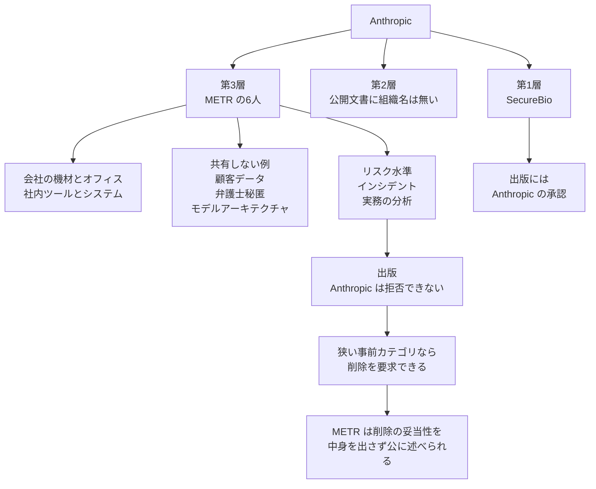

2026年10月15日、Anthropic は非営利のモデル評価団体 METR の従業員 6 人に、従業員相当のアクセスを与え始めたと発表しました。与えたのは、会社の機材、オフィス、そして自社のリスク評価チームとおおむね同水準の社内ツールとシステムです。METR は、リスク水準、インシデント、実務についての分析を出版します。Anthropic は出版そのものを拒否できません。顧客データ、弁護士秘匿特権、モデルアーキテクチャのように、あらかじめ決めた狭いカテゴリについては削除を要求できます。METR は、削除した中身を明かさずに、その削除が妥当だったかを公に述べてよい、と書かれています。

この発表は、CEO の Dario Amodei が 2026年9月のエッセイで、安全対策の第1歩として約束した埋め込み評価者の実行として置かれています。以下は、発表当事者と AI Evaluator Forum が公開したページの範囲です。

ここでは、6人が触れる条件、評価者の三つの階層、出版までの経路、そして発注者が外部評価の契約で分ける項目を整理します。

*この記事の全体像。以下、順に解説します。*

## METRへの従業員相当アクセスとは

Anthropic の10月15日の発表は、評価者に深い社内情報を渡し、その評価者がリスクについての証拠と結論を外へ出す、という経路を置いています。公衆に全部は出せない情報がある、というのが理由です。悪意のある行為者に有用なものや、計算資源や学習のように商業上敏感なものが、その例です。目指すのは、フロンティアの AI 企業のシステムについて評価者が理解していることと、会社自身が理解していることの差を縮めることです。

同じ発表は、評価者に次の四つが要る、と書いています。フロンティアモデルの能力を評価する専門性、独立性、意味のある評価に足るアクセス、観察と評価を出版する自由です。独立性は、被評価会社の株式を持たず、財務的にも運営的にも依存しないこと、と定義されています。

### 6人が使う条件

対象は METR の 6 人です。他の METR 職員は、別件で Anthropic と働く研究者を含めて、このチームの仕事から隔離されます。関与は、強制力のある合意の下の小さいチームに限られます。働き方は、会社の機材と、Anthropic のセキュリティ基準の下です。

比較対象は、全社員でも経営陣でもありません。自社のリスク評価チームが触れる社内ツールとシステムと、おおむね同水準です。除外カテゴリ以外では、Anthropic の従業員は、アライメントリスクを担当する同僚に話すのと同じように、この 6 人と情報を共有するよう促されます。

共有しない例は、顧客に関するデータ、弁護士秘匿特権の情報、モデルアーキテクチャの情報です。脚注は、アーキテクチャを原則として外に置く理由を書いています。漏えいのリスクが高く、リスク評価との関連は通常低い、というものです。関連が高いときは共有を求めるが、社内の明示的な承認が要ります。評価者が他社とも働きうるため、意図しない漏えいにも注意する、とも書いています。

出版の対象は、リスク水準、インシデント、実務の分析です。Anthropic に出版の拒否権はありません。狭い事前カテゴリに当たる情報は、削除を要求できます。METR は、その削除を公に特徴づけ、妥当だったと思うかを述べてよいです。条件は、削除した中身を明かさないことです。

Anthropic は、この関与を、他の組織が自社や顧客、パートナーの情報を得る経路にはしない、と書いています。埋め込みが渡すのは、同社のセキュリティ基準の下で働く少数の有資格者に対する、運営の近い視界です。

### 評価者の三つの階層

同じ発表は、評価者のアクセスを三つの階層にしています。時間をかけて、第3層に複数の評価者を置き、それぞれがリスクの態勢と主要な決定を分析して出版する、という目標です。

第1層は、範囲の狭いリスク調査です。アクセスは Anthropic が決めます。発見の出版には Anthropic の承認が要ります。SecureBio の現在の仕事は、8月のリスクレポートのうち、化学・生物兵器の章の審査です。以前のリスクレポートの試験的な審査を終えて出版したあとです。この審査が終わったあと、アクセスを増やす案件へ移すかを検討する、と発表は書いています。

第2層は、より多くの情報と、承認なしの出版です。特定カテゴリの削除は、なお要求できます。評価者は、削除が妥当だったかについての見解を出版できます。10月15日の文章は、第2層に組織の名前を付けていません。

第3層が、METR との取り決めです。従業員相当のアクセスに、第2層と同様の出版権が付きます。

他の提携は、初期段階として情報も出版権もより限る、と発表は書いています。機密を守り、評価に足る資源と専門性があるかを確かめるのが、初期の目的です。信頼ができた提携は、独立した評価者を完全に埋め込むところまで進める、と書いています。

Accenture と Faculty については、評価、レッドチーム、アライメント評価、セーフガードの試験、組織をまたいだ能力構築を含む提携へ向かっている、と書かれています。この提携を第2層とも第3層とも、10月15日の文章は置いていません。Hugging Face は、初期の協議中の組織の一つです。

Anthropic は、White House Accord on Super Intelligence に署名した、とも書いています。各社は、独立した外部の監査者または評価者と組むと誓った、という要約です。

銀行監督との類推も、同じ発表にあります。銀行は自分のリスクの持ち高を外部より知っているので、当局は最大手の中に常駐検査官を置く、という論理です。公衆を脅かしうるリスクテイクを、第三者が事前に見ようとする、という置き方です。参加は任意であり、すべてのフロンティア企業が同じことをすべきだ、とも書いています。

### 見てから出版するまでの経路

10月15日の発表が置いた経路は、次のとおりです。評価者は社内の情報を見て分析を書きます。Anthropic は狭いカテゴリだけ削除を要求します。METR は、削除の妥当性を公開側に残します。第1層の出版は、承認の側に残ります。

Amodei の9月のエッセイが第1歩に置いた役割は、安全対策と約束の遵守確認、インシデントの報告、完成したモデルだけでなく学習パイプラインとプロセスの評価です。近い装備として、机、入館証、会社のノート PC を挙げ、権限は社内のリスク評価チームとほとんど同程度、と書いています。

## 注意点

公開された権限は、見る範囲、書く自由、削除への反論までです。学習、出荷、配備を止める条項は、10月15日の文章にも、Amodei のエッセイにも出てきません。METR は10月14日、自分たちの役割は証拠を集めて渡すことであり、会社の開発や配備を決めるつもりはない、と書いています。同じ日の提案では、提案する評価はモデル配備の go / no-go を含まず、安全方針への準拠を監査するにも足りない、と書いています。契約本文は公開されていません。非公開の条項に停止権が無い、とまでは読めません。

### 従業員相当の比較対象

「従業員相当」は、AI Evaluator Forum の公開書簡が求める水準と、字面が違います。書簡は2026年9月18日に公開され、9月23日に更新されています。第5項は、評価の目的で、高度な権限を持つ自社従業員と同等のアクセスを与える、というものです。例外は、顧客その他の第三者の敏感なデータの保護です。中身は、同等のリスク評価を担う上級の内部従業員と同じシステム、データ、ツール、物理空間と、関係する職員との率直な一対一の対話です。

Anthropic の比較対象は、リスク評価チームです。表現は “roughly on par” と、エッセイの “mostly comparable” です。アーキテクチャは原則として外にあり、関連が高いときも社内承認があります。METR の他職員は隔離されます。

METR 自身も10月14日の提案で、書簡第5項が定義する真の従業員レベルのアクセスは要求しない、と書いています。アクセスは最終的に会社の裁量であり、拒否できる、とも書いています。実務上、同様のリスク評価をする上級の内部従業員と同じアクセスにはならない、という文です。削除も、会社が敏感と判断した情報についてできる、と提案は書いています。この文は提案の限界です。10月15日の契約が、この限界を引き継いだかは、どちらのページも書いていません。

### 削除できる情報の範囲

削除できるもののリストは、二つの一次文書で字面が違います。エッセイは、セキュリティ上敏感なもの、法的秘匿、商業上敏感なもの、第三者の機密を削除できる、と書きます。不利だからという理由では削除できない、とも書きます。10月15日の例は、顧客データ、弁護士秘匿、モデルアーキテクチャです。“e.g.” と “like the ones above” なので、この三つが完全なリストとは読めません。10月15日の前文は、悪意のある行為者に有用な情報や、計算資源や学習のように商業上敏感なものを公衆に全部は出さない、とアクセスを渡す理由を説明しています。これは削除カテゴリの定義文ではありません。どちらのリストが今回の契約を支配するかは、公開されていません。

### 銀行の常駐検査官との違い

Anthropic は、類推は厳密ではない、と断っています。常駐検査官の制度が持つ是正や停止の命令は、METR の公開された役割には含まれません。METR は、金融の監査や規制が与える保証と同程度の保証は、現状の評価演習では出せない、とも書いています。残る類似は、外の人間を社内に置く、という形です。

### 社内に入るのは初めてではない

METR が Anthropic の社内情報に触れるのは、10月15日が最初ではありません。2026年3月26日付の METR の記事では、職員の David Rein が約3週間、内部エージェント監視の一部をレッドチームしています。Anthropic は関連する社内システムと情報への相当なアクセスを提供した、と METR は書いています。26ページの報告書は Anthropic に渡り、削除版は METR 職員の一部に共有されました。全文は公開されていません。

2026年9月9日、Anthropic はサイバー評価中の4件のインシデントについて、METR と調査契約を結んだと書いています。アクセスは、インシデントの期間の外を含むトランスクリプトと、機密を話してよい従業員です。初期期間は8週間で、延長は相互合意です。関与したモデルは、Claude Opus 4.6 の初期チェックポイント、Claude Opus 4.7、Claude Mythos 5、社内の汎用研究モデルです。この契約と、10月15日の6人の常駐が同一だとは、どちらのページも書いていません。

新しいのは、6人、会社の機材とオフィス、リスク評価チームとおおむね同水準のツールとシステム、出版の拒否権が無いこと、という組み合わせです。

### 書いていない条件

10月15日の文章は、6人が見るモデルの名前、在籍の終期、社外の端末へコピーできるか、他社へ共有できるかを書いていません。持ち出しに近い一次の文言は、会社の機材と Anthropic のセキュリティ基準の下で働き、他の METR 職員からは隔離され、他組織が情報を得る手段ではない、というところまでです。

9月9日の別契約は、初期8週間、相互合意で延長、と期間を書いています。10月15日の6人の終期は、公開文書にありません。METR の10月14日の提案は、会社の機材の上で数週間から数か月、という一般形を書いています。これは提案の期間の目安であり、10月15日の契約の確定条項とは書かれていません。

### 出版の拒否権はまだ履行例がない

「出版を拒否できない」は、10月15日の宣言です。この条項で書かれた報告書は、2026年10月16日時点ではありません。

過去の METR の出版プロセスは、相手によって違います。2025年11月19日付の GPT-5.1-Codex-Max の報告では、OpenAI のコミュニケーションと法務のレビューと承認が必要だった、と METR は書いています。2026年5月の Frontier Risk Report では、業界向け最終稿の承認権は会社に与えなかった、と書いています。一方で、非公開情報の掲載前なら会社は黙って退出でき、不愉快だが核心の弱い主張は METR 側が控えた、ともプロセスを開示しています。

METR のプロセス透明性の方針は、相手に成果物レベルの拒否権を渡すこと自体は禁じていません。渡したと開示できればよい、と書いています。

### 参加は任意である

10月15日の埋め込みは、任意です。METR は提案の限界として、会社がいつでも関与を止められること、その圧力で評価者が相手を刺激しにくくなること、より緩い評価者を会社が選べることを書いています。不都合な結論への報復から完全には守られない、とも書いています。書簡の第4項が求めるのは、報復訴訟からの合理的な保護と、不都合な結論のあとでも資金が続くという確信です。10月15日の文章は、その保護にも、資金が続く仕組みにも触れていません。

関与を切る権利は、出版の拒否権とは別です。不都合な報告の前に契約を終える経路は、拒否権の代わりになりえます。切ったときに、書きかけの報告と、切られたという事実を出せるかは、公開文書にありません。

### 資金と独立性

METR は2026年8月14日、直近6か月で約7,100万ドルの資金コミットメントを集めたと書いています。同じ文章で、フロンティアの AI 企業からは資金を受け取っておらず、その職員の指示による寄付も受けない、と書いています。評価用の無料トークンは相当量ある、とも書いています。トークンの金額は書いていません。10月14日の方針では、無料のモデルアクセスは多く受けるが、運営に実質的な影響なく自費で払える量に抑える、と書いています。それでも、任意の関与の下で十分な独立性を保つのは難しい、と METR は書いています。

Anthropic が2026年9月18日に書いた区別は、Accenture の仕事には Anthropic が直接資金を出し、METR ほか非営利とは相手自身の資金で要素を試す、というものです。Anthropic と Accenture は、それぞれ今後5年で少なくとも10億ドルを、この分野の能力構築に投じると見込んでいます。これは支出済みの額ではありません。被評価会社の株式を持たず、財務的にも運営的にも依存しない、という独立性の基準は、10月15日の発表にもあります。Accenture への直接資金は、この基準と並べて読む必要があります。

### 二次報道との差

未公開モデルを審査する、フロンティア企業として初めて社内に入れた、という Business Insider の記述は、上の一次文書と一致しないため、この記事では採りません。Reuters は2026年10月13日、匿名の関係者として、10月5日時点でも Anthropic と OpenAI が出版内容への厳しい編集権を求めていた、と報じています。10月15日の公開文書は、METR について出版の拒否権は無い、と書いています。それと矛盾する契約の条文は、公開されていません。

## 見える範囲と止める権限

発注者が外部評価や委託診断を頼むとき、10月15日の公開条件から分けて書ける対応は、次の表です。左は契約で分ける問い、中央は METR について公開されていること、右は公開されていないことです。

| 契約で分けるもの | 10月15日の METR で公開されていること | 公開されていないこと |
|---|---|---|
| 誰が入るか | METR の6人。他職員は隔離 | 氏名。9月9日の調査チームと同一か |
| 何に触れるか | リスク評価チームとおおむね同水準の社内ツールとシステム。会社の機材とオフィス | システムの一覧。10月15日の文書にモデル名は無い |
| 触れてよい情報 | 除外例以外は、アライメントリスク担当の同僚と同様に共有するよう促す | 除外リストの完全版。エッセイの商業上敏感が残るか |
| 持ち出し | 他組織が情報を得る手段ではない、という方針 | コピー、持出媒体、他社同時常駐の可否 |
| 期間 | 9月9日の別契約は初期8週間、相互合意で延長 | 10月15日の6人の終期 |
| 書く権利 | リスク、インシデント、実務。出版の拒否権は無い。削除の妥当性は公に言える | この条項での履行例はまだ無い |
| 止める権利 | 公開された一次には付与が無い。METR は配備の go / no-go をしないと書く | 非公開契約の中身 |
| 誰が切れるか | 参加は任意。METR は、会社が関与を止めうると書く | 打ち切り時に、書きかけの報告を出せるか |

第1層の定義は、見える範囲も出版も Anthropic の承認側に残る、というものです。見えるだけの評価と、承認が要る評価は、同じ発表の中で既に別物です。

## 一次資料が支える読み

10月15日の取り決めについて、公開ページが支える読みと、支えにくい読みは分かれます。

支えられる読みは、次の三つです。

- Anthropic が、6人、機材、オフィス、リスク評価チームとおおむね同水準、出版の拒否権は無い、と自分で書いている。
- Amodei の第1歩は、遵守の確認、インシデントの報告、モデルだけでなく学習パイプラインの評価であり、訓練の停止ではない。
- METR が、証拠を渡すのが役割で、開発や配備の決定はしない、と書いている。

支えにくい読みは、次の五つです。

- 「従業員と同じ」を、書簡第5項や上級社員と同じ、と読むこと。比較対象の文言が違います。
- 「初めて社内に入れた」と読むこと。3月の3週間と、9月の調査契約があります。
- 削除が三カテゴリだけ、と読むこと。10月15日の文言は例示です。
- 銀行検査官と同じ実効性、と読むこと。公開資料では、METR に停止命令権が与えられたとは確認できません。
- 出版の拒否権の放棄を、すでに履行された監督、と読むこと。関与そのものを終える権利、過去の承認や自己抑制、この条項での報告書がまだ無いことと並びます。

## 公開文書がまだ答えていないこと

契約本文が非公開であるために、次は公開ページからは決まりません。

- 非公開契約に、停止権、持出禁止、報復からの保護があるか。
- 6人の終期と、見るモデルの範囲。
- 9月9日の8週間契約と、10月15日の6人常駐が同一か。
- 削除カテゴリの完全なリスト。エッセイの「商業上敏感」と「不利だから削除できない」が、今回の契約に残るか。
- METR がこの取り決めを自サイトで確認しているか。公開されている METR の文章は、10月14日の方針と提案です。
- 打ち切られたとき、書きかけの報告と、切られたという事実を公開できるか。

## 発注者が契約に書く二つの項目

外部評価を受ける側は、10月15日の公開条件を、監督が入ったという一語で扱わない方がよいです。契約は、少なくとも次の二つに分けます。

1. 見える範囲。入る人数、比較する内部チームの名前、触れるシステム、除外の完全なリスト、会社の機材に限るか、コピーと他社共有の可否、期間と、延長を拒める側。
2. 止める権限。学習、出荷、配備を止められるか。止められないなら、その旨を報告書に書く義務。関与を切れるのはどちらか。切ったとき、書きかけの報告と、切られたという事実を公開できるか。

見えるだけの評価は、検出を届ける役割に留まります。削除した中身を明かさずに、その削除が妥当だったかを書ける条項は、10月15日の公開条件のうち、発注者が写してよい部分です。受けたアクセスと受けなかったアクセスを主要な所見として出版する権利は、10月15日の文章には無く、Amodei の9月のエッセイにあります。METR は前日の提案で、削除、アクセスの限界、条件にもコメントできる、と書いています。止められるかは、別の条項が無い限り、この発表からは出てきません。

第1層のように、出版に発注者の承認が要る契約は、第3層の出版権とは別物として見積もります。資金を発注者が直接出す評価者は、METR が自分に課している「被評価会社から資金を受けない」という条件とは、別の独立性になります。Accenture への直接資金が、その例として一次にあります。

## まとめ

2026年10月15日、Anthropic は METR の6人に、リスク評価チームとおおむね同水準の社内ツールとシステム、会社の機材、オフィスを使う権限を与え始めました。出版の拒否権は無く、狭い事前カテゴリの削除は要求でき、METR は削除の妥当性を中身を出さずに公へ残せます。同じ発表の中で、承認が要る第1層と、METR の第3層は別です。

公開された権限は、見る範囲、書く自由、削除への反論です。学習や出荷や配備を止める条項は、公開ページにはありません。契約本文は非公開なので、非公開条項の不存在と、公開ページに付与が無いことは別です。従業員相当の比較対象はリスク評価チームであり、書簡第5項の上級社員と同じ、とは書かれていません。社内情報への接触自体は、3月と9月に先行例があります。

発注者は、見える範囲と止める権限を別の条項にします。削除の妥当性を公に残す条項は写せます。止められるかは、その条項を別に書かない限り、この発表からは出てきません。

この記事が少しでも参考になった、あるいは改善点などがあれば、ぜひリアクションやコメント、SNSでのシェアをいただけると励みになります！

## 参考リンク

- Anthropic, "An update on independent evaluators", 2026-10-15. [https://www.anthropic.com/news/an-update-on-independent-evaluators](https://www.anthropic.com/news/an-update-on-independent-evaluators)
- Dario Amodei, "We Must Pace the Frontier", 2026-09. [https://darioamodei.com/post/we-must-pace-the-frontier](https://darioamodei.com/post/we-must-pace-the-frontier)
- METR, "Our approach to working with AI companies", 2026-10-14. [https://metr.org/blog/2026-10-14-our-approach-to-risk-assessment/](https://metr.org/blog/2026-10-14-our-approach-to-risk-assessment/)
- METR, "A proposal for better informing the public about loss-of-control risks from frontier AI development", 2026-10-14. [https://metr.org/blog/2026-10-14-better-informing-the-public-about-loss-of-control-risks/](https://metr.org/blog/2026-10-14-better-informing-the-public-about-loss-of-control-risks/)
- AI Evaluator Forum, "Minimum Conditions for Embedding Evaluators", 2026-09-18（最終更新 2026-09-23）. [https://aievaluatorforum.org/initiatives/embedded-evaluation-letter](https://aievaluatorforum.org/initiatives/embedded-evaluation-letter)
- Anthropic, "An alignment assessment of recent cybersecurity incidents", 2026-09-09. [https://www.anthropic.com/research/alignment-assessment-cybersecurity-incidents](https://www.anthropic.com/research/alignment-assessment-cybersecurity-incidents)
- METR, "Red-Teaming Anthropic's Internal Agent Monitoring Systems", 2026-03-26. [https://metr.org/blog/2026-03-25-red-teaming-anthropic-agent-monitoring/](https://metr.org/blog/2026-03-25-red-teaming-anthropic-agent-monitoring/)
- Anthropic, "Partnering with Accenture on embedded evaluation", 2026-09-18. [https://www.anthropic.com/news/accenture-embedded-evaluation](https://www.anthropic.com/news/accenture-embedded-evaluation)
- METR, "Funding update", 2026-08-14. [https://metr.org/blog/2026-08-14-funding-update/](https://metr.org/blog/2026-08-14-funding-update/)
- METR, "Details about METR's evaluation of OpenAI GPT-5.1-Codex-Max", 2025-11-19. [https://metr.org/evaluations/gpt-5-1-codex-max-report/](https://metr.org/evaluations/gpt-5-1-codex-max-report/)
- METR, "Frontier Risk Report", 2026-05-19. [https://metr.org/blog/2026-05-19-frontier-risk-report/](https://metr.org/blog/2026-05-19-frontier-risk-report/)
- Reuters, "Behind AI industry's call for independent reviews, a fight over what gets made public", 2026-10-13. [https://www.reuters.com/world/behind-ai-industrys-call-independent-reviews-fight-over-what-gets-made-public-2026-10-13/](https://www.reuters.com/world/behind-ai-industrys-call-independent-reviews-fight-over-what-gets-made-public-2026-10-13/)
