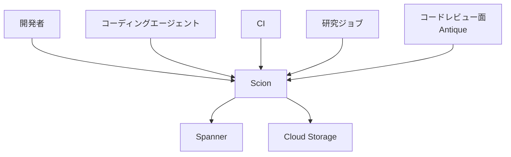
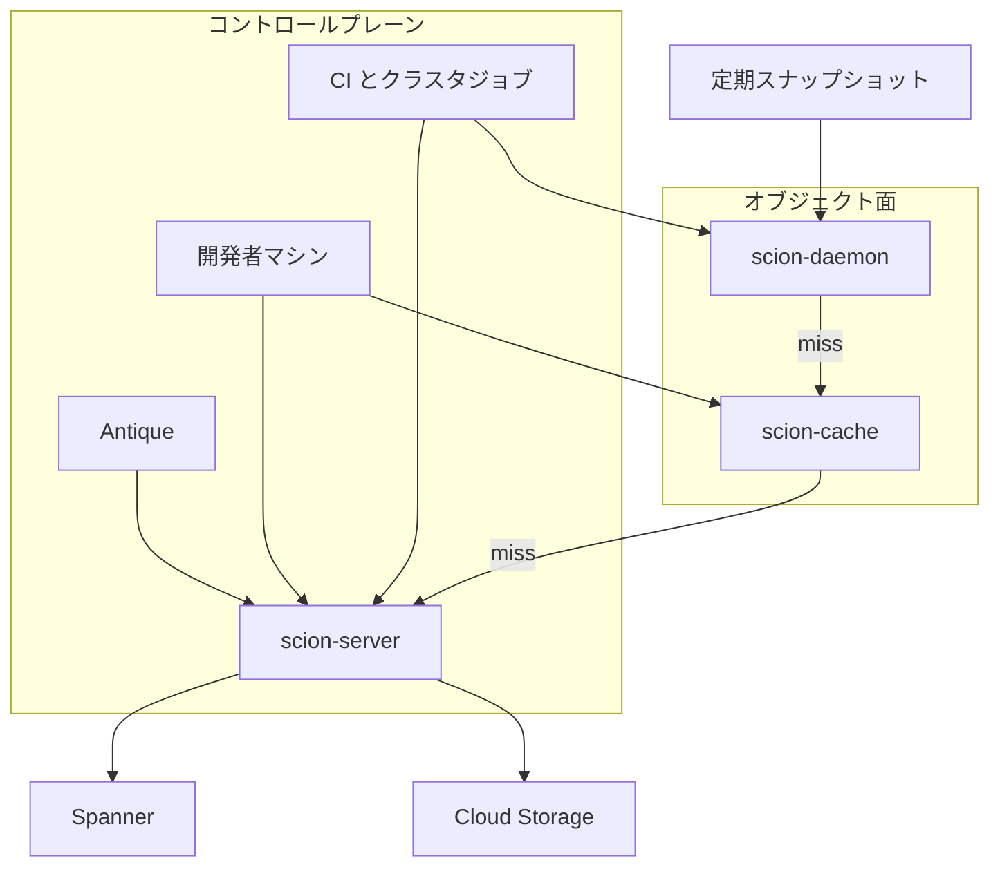
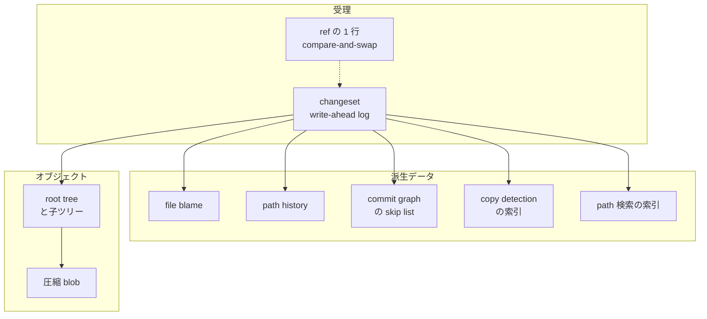
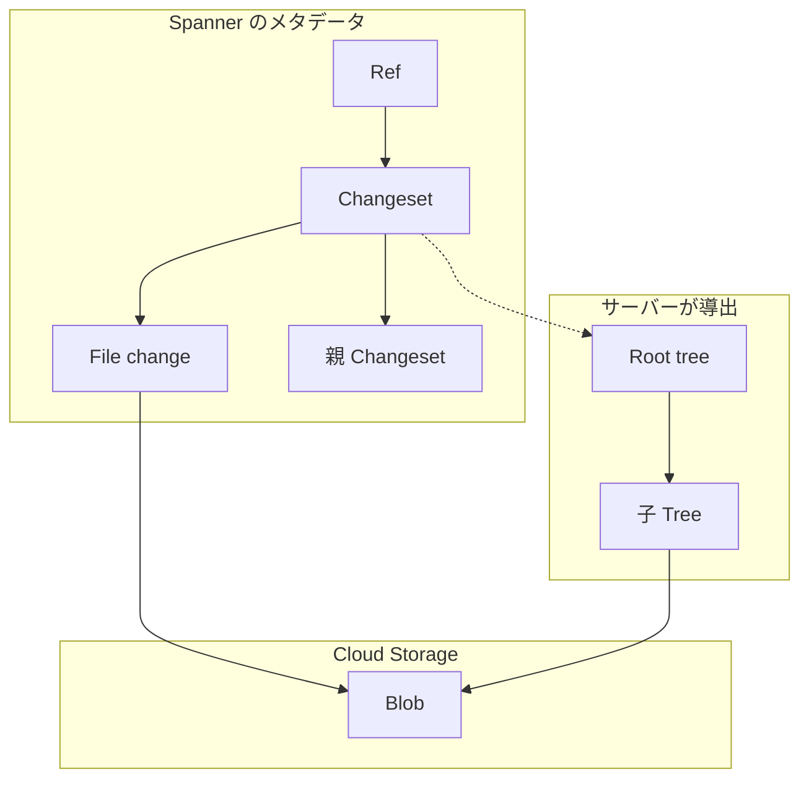
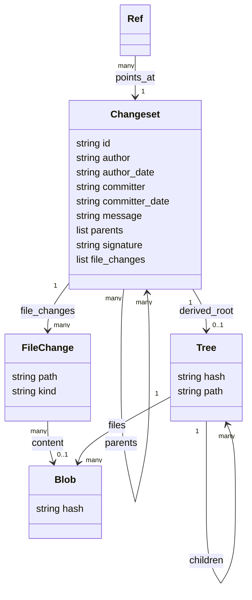

Anthropic は 2026-10-13 にエンジニアリングブログ [Redesigning source control at Anthropic](https://www.anthropic.com/engineering/redesigning-source-control) を公開し、社内モノレポのバージョン管理を git から自社製の **Scion** へ移したことを説明しました。本記事では、公式ブログの本文と埋め込みの公式図 6 枚を一次情報として、Scion の構造・データモデル・運用の考え方を整理します。巨大モノレポやエージェント向けの開発基盤を設計する人が、git のどこを変えればエージェント規模に耐えるのかを判断する材料にできます。

なお、Scion は社内システムです。2026-10-14 時点で公開リポジトリ、CLI リファレンス、プロトコル仕様は見当たりません。本記事のコマンド例のうち実行できるものは、公式ブログが「移行前に使った」と名指しした公開 git の機能だけです。


*この記事の全体像。以下、順に解説します。*

## Scion とは

Scion は、Anthropic が自社モノレポのために作った社内のバージョン管理システムです。クライアントのコマンド名は `scn` です。公式ブログによれば、モノレポへマージされるコード変更は 2026 年 5 月に 1 日平均約 2,500 件でしたが、2026 年 9 月には 1 日 30,000 件を超えました。ブログはこの伸びを「10 倍を超える」と表現し、ボトルネックがコーディングから、人間規模を前提にしたソースコントロール・ビルド・CI へ移ったと位置づけています。

チームは 5 か月でモノレポを git から Scion へ移しました。同じ期間に、コードレビュー面の Antique、コード検索、ソースコントロールの IAM、レビュー済み変更を大量に流し込む仕組みも出荷しています。


*出典: Anthropic「Redesigning source control at Anthropic」*

図のタイトルは「Changes merged per day / Anthropic monorepo, January–September 2026」です。凡例は Pull requests、Antique change requests、7-day average の 3 系列です。図に印刷された件数は 2026-09-09 の 30,401 件だけで、8 月上旬付近に Quiet week という注記があります。

公式ブログが示す規模は次のとおりです。

| 指標 | ブログの文言 | 読み方 |
|---|---|---|
| 2026 年 5 月のマージ | averaged around 2,500 code changes merged per day | 平均したおおよその日次 |
| 2026 年 9 月のマージ | over 30,000 per day | 本文の日次。図の 30,401 は 9 月 9 日の 1 日分 |
| main の履歴 | almost 100 GB | main ブランチの履歴だけ |
| 圧縮した作業コピー | over 25 GB | 圧縮後の作業コピー |
| CI のチェックアウト | on the order of 25 million per day | 開発者環境、エージェントサンドボックス、研究ジョブを数える前 |
| 素朴に全量を取った場合の転送 | over 600 PB of git traffic per day | 実測ではなく、毎回フル取得したときの見積もり |
| ピーク時の社内 git ミラー | several hundred | ディスクやメモリの上限で頭打ちになった |
| 構築と移行 | a team of seven people、five months | 7 人は Scion、Antique、約 6 件の関連システム、移行のすべてを担当 |
| インフラの足跡 | 200x smaller in CPU and memory | 以前の git ミラー基盤との比較。遅延の倍率ではない |
| キャッシュ | over 99% hit rate at each tier | 各段のヒット率 |
| CI の CPU | 25% CPU capacity win | CI だけで取り戻した容量 |

ブログは、巨大モノレポの先行事例として Google の Piper と Meta の Sapling を挙げ、それらの教訓の上に Scion を作ったと書いています。コードを流用したとは書いていません。

## 特徴

Scion の設計原則は「エージェントとジョブは常時オンラインである」という前提から来ています。

- **常時オンラインのクライアント**: 必要なときだけサーバーからデータを取ります。オフラインでも履歴・blame・任意リビジョンのチェックアウトができる git の完全クローンとは、目的が違います。
- **クライアントとサーバーの非対称**: 履歴、blame、コミット作成、マージ、リベースはサーバーが受け持ちます。クライアントが持つのは、上限付きのローカルオブジェクトキャッシュ、作業コピーの配置、ファイルシステム変更の監視、サーバーとの操作面です。
- **API による問い合わせ**: CI やツールは、ローカルにリポジトリを持たずに「この行を最後に変えたのは誰か」「2 つのコミットはどういう関係か」をサーバーに聞けます。ブログによれば、自動 bisect と自動 revert のパイプラインは、この安価なプログラムアクセスが無ければ規模的に実用になりません。
- **分散データと独立スケール**: コンポーネントは独立に水平スケールします。サーバー上にもリポジトリの完全な実体化コピーは置きません。packfile に相当する圧縮束も、リポジトリメンテナンスもありません。
- **サーバー上のコミット**: コミット、リベース、マージはサーバー上で起き、push の段がありません。作成コストと下流データ構造の更新コストは、リポジトリ全体ではなく変更の大きさに比例させます。changeset の受理にロックもサーバー間調整も要りません。
- **グローバル ref の最小化**: main とリリースブランチ以外の ref（ブランチやタグのような、コミットへのポインタ）は避けます。全サーバーが合意するグローバル状態はスケールの障害になる、という理由です。ref の移動は changeset 作成とは別の、Spanner の 1 行に対する compare-and-swap です。
- **任意でスパースな作業コピー**: コミットとマージベースの差分はサーバーに聞けます。書き込みの多くも API だけで済みます。ディスクにファイルが要るときは、指定したディレクトリだけを持つスパースチェックアウトか、読んだときに実体化する仮想チェックアウトを使います。

先行技術との位置づけは次のとおりです。数値はそれぞれの出典時点のものです。

| 項目 | git | Piper（Google） | Sapling（Meta） | Scion |
|---|---|---|---|---|
| 公開 | 公開プロトコルとクライアント | 社内。論文と解説が公開 | CLI は公開。サーバーと仮想ファイルシステムは公式 docs が “(not yet available publicly)” と記載 | 社内。ブログと図のみ |
| クライアントの前提 | クローンがサーバーにもなれる | 中央リポジトリ。多くの開発者は CitC 経由 | clone / pull / push。大規模時は専用サーバーと仮想ファイルシステム | 常時オンライン。重い計算はサーバー |
| 作業コピー | 取得したオブジェクトをローカルに持つ | CitC は FUSE で、完全なリポジトリの上に変更を重ねて見せる | スパース、Watchman、仮想ファイルシステム | スパースまたは仮想。FUSE かどうかは非公表 |
| コミットの場所 | ローカルで作り push で共有 | レビュー（Critique）のあと中央へ | ローカルコミットと push | サーバーが作り、即座にどこからでも見える |
| ブランチ | ref が第一級 | トランク開発が主 | bookmarks。stacked commits を強調 | main とリリースブランチ以外は避ける |
| 承認・アクセス制御 | リポジトリ単位のアクセス制御が基本 | ディレクトリの OWNERS による変更承認 | 公式 docs に記載なし | リポジトリ単位に加え、ディレクトリ単位のアクセス権限 |

向く場面は、ブログ自身が限定しています。

| 場面 | ブログが置く位置 |
|---|---|
| 数万のエンジニア、または大量のエージェントが書く巨大モノレポ | Scion の前提が意味を持つ |
| オフラインの完全クローン、小さなリポジトリ、既存の git ホスティング | Scion は一般的な git の代替にならない |
| git を捨てずにサーバー側だけ強めたい組織 | サーバー側 RPC、ネゴシエーション、sparse と shallow の合成を git 側で改善できる、と提案 |

## 構造

Scion は、コントロールプレーンの問い合わせと、ツリーおよびファイル実体の取得（オブジェクト面）を分けます。公式のチェックアウト構成図には、クライアント群（Antique、開発者マシン、CI とクラスタジョブ）、scion-server、Spanner、Cloud Storage、地域の scion-cache、ノードごとの scion-daemon、新しいノードへ種をまく定期スナップショットが描かれています。


*出典: Anthropic「Redesigning source control at Anthropic」*

### システムコンテキスト図



| 要素名 | 説明 |
|---|---|
| 開発者 | 作業コピーを使う人間。図では開発者マシンとしてオブジェクト面にも出る |
| コーディングエージェント | 常時オンラインのクライアント。ブログがスケールの主因に置く |
| CI | チェックアウトは 1 日およそ 2,500 万回（開発者環境、エージェントサンドボックス、研究ジョブを含まない） |
| 研究ジョブ | 上記の CI の回数には含まれない |
| コードレビュー面 | Antique。図ではコントロールプレーンのクライアント |
| Scion | ソースコントロールサービス本体 |
| Spanner | 図のラベルは Changesets, branches, trees |
| Cloud Storage | 図のラベルは File contents。不変で、ハッシュにより重複排除され、圧縮される |

### コンテナ図



| 要素名 | 説明 |
|---|---|
| Antique | コードレビュー面。コントロールプレーンで scion-server へ向かう |
| 開発者マシン | コントロールプレーンでは scion-server へ、オブジェクト面では scion-cache へ直結 |
| CI とクラスタジョブ | コントロールプレーンでは scion-server へ、オブジェクト面では scion-daemon 経由 |
| scn | クライアントのコマンド名。性能図の凡例に登場する。本文は、フリート上のクライアントがソケットで daemon に話すと書く |
| scion-daemon | ノード単位。地域の scion-cache だけに話す。定期スナップショットから起動する |
| scion-cache | 地域のツリーと blob のキャッシュ。daemon が消費するディスク形式のままメモリから流す |
| scion-server | 権威側。ブランチ、履歴、差分を答える。派生データをその場で計算し、Spanner へ書き戻せる |
| Spanner | changeset、ブランチ、ツリー。ref の移動は 1 行の compare-and-swap |
| Cloud Storage | 圧縮されたファイル実体 |
| 定期スナップショット | 図のラベルは Seeds new nodes。新しいノードの daemon へ種を渡す |

3 段（daemon、cache、server）は同じ RPC に答えるため、クライアントはキャッシュのトポロジを知る必要がありません。公式図は daemon から cache、cache から server の矢印に Misses と書いています。運用では段の飛び越えを禁止し、障害ドメインを分けます。地域キャッシュの障害が scion-server を押しつぶすのを避けるためです。

### コンポーネント図

scion-server が changeset から作るものと、クライアントが自分で計算しないものを分けると次の形になります。



| 要素名 | 説明 |
|---|---|
| changeset | 作業単位。git のコミットに近いメタデータと、first parent に対する変更ファイル一覧を持つ |
| ref の 1 行 | ブランチやタグ。changeset の作成とは別トランザクション |
| file blame | changeset から再帰的に作る派生データ。行の最終編集者を答える |
| path history | ファイル履歴用の派生データ |
| commit graph の skip list | 祖先クエリを速くする派生データ |
| copy detection の索引 | 成長の過程で後から足した派生データの例 |
| path 検索の索引 | 同じく後から足した派生データの例 |
| root tree | サーバーが導出する。changeset 自体には格納しない、と公式図が注記 |
| 圧縮 blob | 内容アドレス。Cloud Storage 上で不変 |

比較のため、移行前の git 側の構成も示します。公式図の説明は「The typical setup for scaling git checkouts.」です。


*出典: Anthropic「Redesigning source control at Anthropic」*

| 要素名 | 説明 |
|---|---|
| Jobs | CI jobs、Developer environments、Agent sandboxes、Research jobs |
| Packfile cache | クラスタごとの破線枠の入口 |
| Mirror replicas | 同じ枠内のミラー複製。Seed snapshot への矢印はここから出る |
| Mirror primaries | 同じ枠内のミラーのプライマリ |
| Upstream | 枠外。ミラーのさらに上流 |
| Blob storage / Seed snapshot | リポジトリのスナップショット。更新のあいだ main の先端から遅れる |
| Node seed | ノードへ配る種 |

## データ

データの単位は **changeset** です。write-ahead log の 1 エントリで、サーバーが作り、作った瞬間からどこでも見えます。git のコミットがツリーへのポインタを持つのに対し、Scion の changeset は first parent に対して変わったファイルの一覧と、圧縮ファイル実体への内容アドレスを持ちます。マージの変更ファイルを first parent 基準で持つのは様式上の選択です。トランクベースのモノレポでは、人が気にする履歴と blame はメインライン上のコミットだから、とブログは脚注で説明しています。


*出典: Anthropic「Redesigning source control at Anthropic」*

図のタイトルは「Shape of a Scion changeset」です。メールアドレス、日付、パス、ハッシュは例示です。フィールド名と「ツリーは changeset に入っていない」という注記は、図が一次情報として示しています。

### 概念モデル



| 要素名 | 説明 |
|---|---|
| Changeset | 受理の単位。メタデータと file_changes を Spanner に持つ |
| File change | パス、内容ハッシュまたは削除、ファイル種別 |
| 親 Changeset | parents。変更差分の基準は first parent |
| Ref | ポインタ。作成経路は changeset と分離 |
| Root tree | 破線。changeset には保存せず、サーバーが導出 |
| 子 Tree | ディレクトリのツリー |
| Blob | ファイル実体。不変、圧縮、ハッシュで重複排除 |

### 情報モデル

公式の changeset 図から推定した概念上の属性です。changeset のフィールド名（author、parents、file_changes など）は図に印刷されたものですが、`FileChange.kind`、`Tree.path`、`Blob.hash` などは図の値から説明用に補った名前で、公開 API のキーではありません。



| 要素名 | 説明 |
|---|---|
| id | changeset の識別子。図の例示は短縮ハッシュ |
| author / author_date | 必須列。図の例は Claude の noreply アドレスと 2026-09-15T01:25:09+00:00 |
| committer / committer_date | 図が Optional と記載 |
| message | コミットメッセージ |
| parents | 親 changeset の id |
| signature | 図が Optional と記載 |
| file_changes | パス、内容ハッシュ、種別。図の種別は Regular file、Deleted、Executable |
| content hash | Deleted の行には描かれていない |
| Tree.hash | 導出結果。changeset の列ではない |
| Blob.hash | Cloud Storage のキー |
| Ref | 移動は Spanner の 1 行の compare-and-swap。列名は非公表 |

派生データの値は、その changeset の親における同じ種類の値から再帰的に定義されます。種類ごとに、先に計算するか（eager）、必要になるまで遅延するか（deferred）を選べます。クライアントは内部構造を見ないので、サーバーはクライアントを変えずに構造を差し替えられます。

## 構築方法

Scion を外部の組織がインストールする手順はありません。git からの乖離が大きく、コードレビュー、コード検索、CI も自前になるため、広く使える形で提供するのは難しい、とブログは書いています。ここでは、移行の経緯と、移行前に使っていた公開 git の機能を整理します。コマンドは公開 git のものであり、Anthropic 社内の実コマンドではありません。

### 公開物が無い前提

- 2026-10-14 時点で、`anthropics` 組織に Scion の公開リポジトリは見当たりません。
- ブログは、社内版のレビュー、検索、CI は特注で、万人向けの公開版は有用になりにくいと書いています。
- 構築について公開されているのは、移行の期間、移行前の git 構成、git から Scion への取り込みパイプラインの作り直しです。

### 移行の期間と人員

- モノレポの git からの移行期間は 5 か月です。
- 7 人のチームが、Scion、Antique、約 6 件の関連システムを作り、移行を完了しました。
- その間に 1 日にマージされるコードの量は 10 倍になった、とブログ後半は書いています。
- 構築を始めた時期は、[Claude Mythos](https://www.anthropic.com/claude/mythos) の Preview と [Claude Tag](https://www.anthropic.com/news/introducing-claude-tag) が社内で使えるようになった時期と重なる、とブログは書いています。社内提供日は明記されていません。

### 移行前に使っていた git の仕組み

- shallow clone、sparse checkout、promisor remote を使っていました。
- 加えて、社内 git ミラーと、blob storage に置くリポジトリスナップショット（seed）を使っていました。
- ピーク時は数百の社内ミラーを運用していました。seed は更新のあいだ main の先端から遅れ、partial clone 上で diff と blame を動かし続ける手間が増えた、とブログは書いています。

### 部分クローン

git の partial clone は、clone と fetch のときに filter-spec を渡し、不要な blob や tree を packfile から外す仕組みです。欠けたオブジェクトは promisor remote が後から渡します（[git の partial-clone 文書](https://git-scm.com/docs/partial-clone)）。blob を最初から落とす filter は `blob:none` です。

```bash
git clone --filter=blob:none <repository>
```

- partial clone は、指定したコミット範囲の中の blob と tree を減らす仕組みで、shallow clone とは独立です。
- 欠けたオブジェクトの動的取得は、欠けるたびに fetch を起動しやすく遅い、と同文書が制限として書いています。ブログが「履歴に依存する diff と blame を partial clone で維持する手間」と書いたことと同じ方向の制約です。

### スパースチェックアウト

[git-sparse-checkout](https://git-scm.com/docs/git-sparse-checkout) の `set` は、作業ツリーを指定ディレクトリの配下に絞ります。cone mode が既定です。

```bash
git sparse-checkout set MY/DIR1 SUB/DIR2
```

- `set` は必要に応じて `core.sparseCheckout`、`core.sparseCheckoutCone` を設定し、作業ディレクトリをその一覧に合わせます。sparse index は既定でオフで、`--sparse-index` を付けたときだけ有効です。
- 同コマンドは公式文書上 experimental です。

### シャロークローンとシード

shallow clone は履歴の深さを切る機能です（[git-clone](https://git-scm.com/docs/git-clone)）。以下は公開 git の最小例で、Anthropic が使った深さはブログに書かれていません。

```bash
git clone --depth 1 <repository>
```

- seed は blob storage 上のスナップショットで、更新間隔のあいだ先端から遅れます。更新間隔の数値は公表されていません。

### git から Scion への取り込み

- 2026 年の早い時期に、git から Scion への取り込みパイプラインの初版を、ほぼ手書きのプロトタイプとして持っていました。
- その後、Claude Mythos Preview の初期の社内スナップショットに、追加指示なしで全体を書き直させました。
- 結果はメモリ 20 分の 1、速度 4 倍で、取り込み順序とデータ構造に関する暗黙の不変条件は保たれた、とブログは書いています。計測条件は公表されていません。


*出典: Anthropic「Redesigning source control at Anthropic」*

この図は、モノレポの `scm/` と `antique/` ディレクトリ、つまり Scion と Antique 自身への週次変更数です。1 月以降の合計は 12,257 件で、系列は途中で Pull requests から Antique change requests へ移っています。

## 利用方法

公開 CLI のフラグ一覧はありません。ここでは、ブログ本文と公式図が操作として名指ししているものを整理します。

### サーバーが作る changeset

利用の単位は、クライアントがローカルで commit して push することではなく、サーバーが changeset を作ることです。公式の changeset 図を基にした概念例を示します。`path`、`content hash`、`kind` は図の値から説明用に補った名前で、公開されたフィールド名ではありません。

```text
changeset
  id
  author
  author_date
  committer            optional
  committer_date       optional
  message
  parents              first parent を差分の基準にする
  signature            optional
  file_changes
    path
    content hash       Deleted では図に無い
    kind               Regular file / Deleted / Executable
root tree              サーバーが導出する。changeset には保存しない
blob                   Cloud Storage。不変、圧縮、ハッシュで重複排除
```

- 作成はロックフリーで、packfile を受け取らず、ref を動かさずに受理されます。
- 受理のコストは変更の大きさに比例し、リポジトリ全体の大きさには比例しません。

### 欲しいツリーと blob だけを取る

クライアントのネゴシエーションは、自分が既に持つものをサーバーに伝えません。欲しいツリーと blob だけを要求します。

```text
start at the root tree of the revision
repeat:
  look in the local store for missing trees
  request each missing tree by its immutable id
  walk the children the client actually wants
then:
  request each missing blob by its immutable id
```

- 要求は、一度保存されたら変わらないオブジェクト単位なので、どのキャッシュも答えられます。
- 応答は数ギガバイトの単一 packfile ではなく、途中から再開できます。
- スパースも仮想チェックアウトも、サーバー側の特別扱いを要しません。クライアントが欲しくないツリーを要求しないだけです。
- キャッシュは、クライアントの不足集合の計算もデルタ圧縮もしません。daemon が消費するディスク形式をメモリから流します。

### コントロールプレーンとオブジェクト面

公式図の線ラベルを操作の一覧として読むと、次のようになります。

```text
control plane, every client -> scion-server
  branches, history, diffs
  verbs on the diagram: upload, commit, land

object plane
  developer machines -> scion-cache
    trees and file contents
  CI and cluster jobs -> scion-daemon -> scion-cache -> scion-server
    miss at each hop

storage behind scion-server
  Spanner: changesets, branches, trees
  Cloud Storage: file contents
```

- 本文が API の例として挙げるのは、changeset の取得、diff の計算、merge base の検索、blob の取得です。
- 作業コピーが要らない読み取りとして、コミットと merge base の差分をサーバーに聞く使い方があります。
- 書き込みも、チェックアウトを飛ばして API だけで済む負荷があります。リクエスト本文の形式は公表されていません。
- `land` は図のラベルで、公開されたサブコマンド仕様ではありません。

### 派生データへの問い合わせ

blame、パス履歴、コミットグラフ上の祖先は changeset 単独では即答できません。サーバーが親から再帰的に作った派生データで答えます。

```text
for each derived data type:
  the value at a changeset is defined recursively
  from the same type of value at that changeset's parents
eager or deferred is chosen per type
```

- 種類ごとに eager か deferred かを選び、要らないデータの実体化を避けます。
- 移行の初期は、自前のクライアント、リポジトリ形式、プロトコルを持つ前に、この種のメタデータ問い合わせだけを Scion が答えていました。ファイル実体と作業コピーはその後に設計した、とブログは書いています。

### ref を changeset と分ける

```text
create changeset
  append the write-ahead record
  do not move a ref

move a ref
  compare-and-swap one Spanner row
  separate from changeset creation
```

- 技術的には ref をサポートしますが、コミットの作成も取得も ref を経由しません。
- 開発の流れでは、main とリリースブランチ以外の ref を避けます。

### ディレクトリ権限とレビューの制約

- リポジトリ単位のアクセス制御に加え、個々のディレクトリへ権限を付けられます。モノレポの利点を残したまま機密コードを守るためです。ポリシー言語の文法は公表されていません。
- Antique は承認に意味的な制約を表現でき、コメントだけの変更と敏感なロジック変更を分けられます。人間のレビュアーは影響の大きい変更に集中します。

## 運用

稼働後の要点は、三段キャッシュ、マージの通し方、監視、性能計測です。


*出典: Anthropic「Redesigning source control at Anthropic」*

### 三段のミス経路

daemon、地域キャッシュ、権威サーバーは同じ RPC に答えます。ミスのときの向きは固定です。

```text
client or job
  -> scion-daemon on the node
      hit: serve
      miss: regional scion-cache
          hit: stream the object from memory
               in the daemon's on-disk format
          miss: scion-server
              read Spanner or Cloud Storage
              optionally compute derived data
              write derived data back to Spanner
```

- キャッシュは長期状態を持ちません。ヒット率は各段で 99% を超えます（分母の定義は非公表）。
- クライアントもキャッシュも、リポジトリメンテナンスを行いません。

### 障害ドメインを段で切る

```text
allowed:
  daemon -> regional cache -> authoritative server
forbidden in their deployment:
  a failed regional cache sending the full
  request load to the upstream servers
```

- 理論上はどの段も他の段に話せますが、障害ドメインを隔離するために段を厳格に強制します。
- 地域の scion-cache の障害が scion-server を巻き込み、全体を落とす状況を避けるのが目的です。

### 移行前ミラーとの容量比較

- インフラの足跡は、以前の git ミラー基盤と比べて CPU とメモリで 200 分の 1 です。
- CI と研究ジョブのチェックアウトは、分単位から秒単位へ「二桁」（約 100 倍）速くなった、と本文は書いています。性能図の倍率とは一致しないため、「注意点」を参照してください。
- CI だけで 25% の CPU 容量を取り戻しました。

### 性能図に印刷されたコマンド時間

性能図は git と scn の比較です。下段の横軸ラベルは Median time です。

開発者環境のパネル:

| 操作 | git | scn | 図の倍率 |
|---|---|---|---|
| Pull latest | 87 s | 3.5 s | ×25 |
| Checkout | 15 s | 1.1 s | ×14 |
| Rebase | 13 s | 2.7 s | ×4.8 |
| Status | 3.9 s | 19 ms | ×207 |
| Commit | 1.4 s | 1.1 s | ×1.3 |
| Diff | 407 ms | 67 ms | ×6.1 |

エージェント環境のパネル:

| 操作 | git | scn | 図の倍率 |
|---|---|---|---|
| New worktree | 7.1 min | 5.1 s | ×84 |
| Pull latest | 3.0 min | 9.0 s | ×20 |
| Commit | 18 s | 761 ms | ×24 |
| Status | 4.3 s | <0.2 s | ×20+ |

変更要求あたりの時間と、CI・計算ジョブのパネル:

| 操作 | git | scn | 図の倍率 | 図の注記 |
|---|---|---|---|---|
| Agent environments の change request あたり | 34 min | 3.7 min | ×9.2 | ≈11,000 agent hours a day |
| Checkout at start of compute job | 175 s | 22 s | ×8.0 | ≈85,000 machine hours a day |
| Checkout in a CI job | 31 s | 3.5 s | ×8.8 | ≈195,000 machine hours a day |

サンプル数は図に印刷されていません。

### マージをグローバルロックで止めない

ブログは、エージェント規模では通常のマージキューが意味を持ちにくいと書いています。テスト実行中に数百から数千の変更がマージされ得るとき、CI が何を保証するのかを問い直しています。

```text
industry pattern they could not replicate:
  a global repository lock on the merge queue

what they invested in instead:
  post-merge automated testing
  pre-deploy automated testing

concurrent changes can conflict
agents fix those conflicts
```

- マージキュー上のグローバルなリポジトリロックは、実効的に再現できませんでした。
- 並行する変更は衝突し得ます。Claude はその衝突を、人間が衝突に気づくより速く直せるのが典型だ、とブログは書いています。

### スーパーファンと従来のアラート

運用監視には Claude Tag を使い、コンポーネントごとに Slack チャンネルを置いています。その Claude を superfan と呼んでいます。

```text
one Slack channel per component
examples named in the post:
  scion-daemon superfan
  scion-cache superfan
  Antique merge queue superfan
inputs:
  telemetry
  logs
still present:
  traditional alerts
```

- superfan は、経験のあるエンジニアがチャートを眺め続けて異常を探すように振る舞います。
- 従来のアラートもすべてのシステムに残しています。superfan は、従来アラートでは拾えない微妙で新しい問題を検出できる、とブログは書いています。

### テストとレート制限

- タイトな日程でも、遭遇した自明でないインフラとソースコントロールの相互作用ごとに hermetic なシミュレーションを作りました。
- fuzzing と、洗練されたレート制限も入れています。
- 祖先クエリが索引の 1 つを使っていなかったというアルゴリズム上の改善点を Claude が見つけた、とブログは書いています。

### レビューの見方

- チームはシステムへの変更要求をすべて見ますが、見方は全行を読むことから変更の意図を確かめることへ移りました。
- エンジニアの役割として、Claude に「no」と言うことを強調しています。エージェントはコア制約を破るパターンを通してしまうことがあるからです。
- 移行中の例として、変更が main に入った時刻をコードレビューツールに聞かず、コミットログを線形に読むシステムが複数ありました。
- 敵対的レビューは有効ですが近視眼的にもなります。別の社内サービスを信頼することに過剰に防御的なレビューが、検証と複雑さを積み増した例が挙げられています。

## ベストプラクティス

ブログが「うまくいった」と書く設計判断と、git エコシステムへの提案を整理します。

### 変更の大きさに比例する書き込み

- changeset の作成と下流構造の更新は、リポジトリの大きさではなく変更の大きさに比例させます。
- 受理経路から packfile、ロック、サーバー間調整、ref の移動を外します。
- ref が必要なら、作成トランザクションの外で 1 行を compare-and-swap します。

### グローバル状態を main とリリースに限る

- 全サーバーが合意する ref はスケール上の問題として扱います。
- 開発の流れでは、main とリリースブランチ以外の ref を避けます。
- 機能の隔離を個人ブランチに置かない選択は、Piper のトランク開発と似た方向です。

### チェックアウトを既定で省略する

- diff、merge base、blame はサーバーに聞きます。
- API で書ける負荷は API のままにします。
- ディスクが要るときだけ、要求したディレクトリか、読んだファイルだけを実体化します。
- CI が 1 日に数千万回チェックアウトする前提では、毎回のフル作業コピーを避けることが容量そのものです。

### 意味で承認を分ける

- コメントだけの変更と、敏感なロジック変更とで、必要な承認を変えます。
- 人間は影響の大きい変更に集中します。
- ディレクトリ単位の権限で、モノレポのまま機密領域を分けます。

### テストをマージ前のグローバルロックに置かない

- テスト実行中に大量の変更がマージされる前提で、マージキューの全体ロックを前提から外します。
- 代わりに、マージ後とデプロイ前の自動テストへ投資します。
- 衝突は起き得るものとして、エージェントが直す時間を設計に入れます。

### 監視をコンポーネントごとに分ける

- 従来アラートは残します。
- それに加え、1 つのコンポーネントだけを見続ける監視役をチャンネル単位で置きます。
- 入力はテレメトリとログです。

### git に持ち帰る範囲を限定する

ブログが他組織へ勧めるのは、Scion への置き換えではなく次の 4 点です。

- git サーバーは git クライアントと同じ構造でなくてよい。
- サーバー側の包括的な RPC を、複数の forge で揃った形にし、git クライアントがそれを話せるようにする余地がある。
- ネゴシエーションプロトコルは今の形のままでなくてよい。
- sparse と shallow はうまく合成できるようにできる。

ブログは、GitHub、GitLab、OSS コミュニティと組んでエージェント時代の要求を支えたい、と結んでいます。

## 注意点

公式ブログの本文と図には、言い方が異なる箇所や公表されていない箇所があります。数字を引用するときは次の点に注意してください。

| 対象 | 公式の記載 | 実態 | 読者への影響 |
|---|---|---|---|
| 9 月の日次マージ | 本文は over 30,000 per day | 図に印刷された件数は 2026-09-09 の 30,401 だけ。7 日平均の値は印刷されていない | 30,401 を 9 月の毎日の値や 7 日平均と読まない |
| 系列の定義 | 本文は code changes merged と一括 | 図の凡例は前半が Pull requests、後半が Antique change requests | 1 月〜9 月を単一定義の時系列と読まない |
| 10 倍 | 前半は more than tenfold、後半は increased by 10x | 約 2,500 と 30,000 超からの比率 | 「12 倍」など本文に無い倍率を使わない |
| 600 PB | over 600 PB of git traffic per day | 素朴に全量を取った場合の見積もり（2,500 万回 × 25 GB 超と桁が合う） | 実測の転送量として書かない |
| 二桁の高速化 | CI と研究ジョブのチェックアウトが two orders of magnitude faster（約 100 倍）、in seconds rather than minutes | 性能図の CI checkout は ×8.8、計算ジョブ開始時は ×8.0 で、約 100 倍とは整合しない。算出の基準は公表されていない | 本文の「約 100 倍」と図の倍率を混ぜて引用しない |
| 200 倍 | 200x smaller in CPU and memory | 遅延やディスクの倍率ではない | コマンド時間が 200 分の 1 とは読まない |
| 性能図の母集団 | 本文キャプションは native Scion repos | 図タイトルはモノレポ上の日常コマンド。Median time と読めるのは下段の軸だけ。サンプル数は無い | 全パネルを中央値と断定しない |
| 節約時間 | ≈11,000 agent hours など | 図の近似注記で、算出式は無い | 再計算で上書きしない |
| クライアント経路 | 本文はフリートのクライアントがソケットで daemon に話す | 図は開発者マシンが scion-cache へ直結 | 開発者マシンも必ず daemon 経由とは読まない |
| ツリーの置き場 | 図は root tree を changeset に保存しないと注記 | 構成図の Spanner ラベルは Changesets, branches, trees。派生データは Spanner へ書き戻せる | ツリーは changeset の列ではなく派生結果として Spanner にあり得る |
| 図の例示値 | author が Claude の noreply など | 形を示す例で、本番データとはされていない | 例示値を実在オブジェクトとして扱わない |
| ref の列名 | Spanner の 1 行に compare-and-swap | 列名・テーブル名は非公表 | 列名を補完しない |
| `land` | 構成図の動詞 | サブコマンド仕様は非公表 | `scn land` のオプションを推測で書かない |
| 7 人の範囲 | Scion、Antique、約 6 件の関連システム、移行 | Scion 単体の人数ではない | Scion 単体の工数と読まない |
| 20 分の 1、4 倍 | 取り込みパイプラインの書き直し | 計測条件は非公表 | モデル一般の性能倍率として引用しない |
| Quiet week | 日次図の 8 月上旬付近の注記 | 理由は書かれていない | 原因を推測しない |
| 先行技術 | Piper と Sapling の教訓を念頭に作った | コード流用とは書いていない。Scion の仮想チェックアウトが FUSE かどうかは非公表 | CitC の実装詳細と同一視しない |
| 同名の別物 | Scion は社内 VCS、クライアントは scn | ETH Zurich 系の SCION インターネットアーキテクチャとは無関係 | 公開の SCION 実装をこの Scion の資料として扱わない |
| 公開 | 広く使える形での提供は難しいと記載 | 2026-10-14 時点で公開リポジトリは見当たらない | インストール手順を二次情報から補完しない |

## トラブルシューティング

Scion は公開されていないため、ここでは公式ブログが書く運用上の症状と、そこで採られた設計上の対処をまとめます。git で同種の問題を抱えている場合の判断材料として使えます。

### 部分取得で履歴操作が苦しくなる

| 症状 | 原因 | 対処 |
|---|---|---|
| partial clone 上の diff や blame の維持が重い | 履歴に依存する操作が、欠けたオブジェクトの動的取得に頼る。動的取得は 1 件ずつ fetch を起動し得る | blame と祖先をサーバーの派生データに移し、クライアントは完全な履歴を持たない |
| seed を使ったジョブが main の先端から遅れる | blob storage のスナップショットは更新間隔のあいだ先端に追従しない | 不変オブジェクトを地域キャッシュから取り、packfile の種に依存しない経路へ移す |
| ミラーがディスクやメモリの上限で頭打ちになる | リポジトリが 1 台のディスクやメモリを超えると git ミラーはスケールしない | 完全な実体化コピーをサーバーにも置かず、段ごとに状態を持たせない |
| 地域キャッシュの障害が権威サーバーを巻き込む | 段を飛ばして上流へ負荷が落ちる | daemon、地域キャッシュ、権威サーバーの向きを固定し、障害ドメインを隔離する |
| マージキューの全体ロックが大量マージに追いつかない | テスト実行中に数百〜数千の変更がマージされ得る | 全体ロックをやめ、マージ後とデプロイ前の自動テストへ移す |
| 並行マージの衝突が残る | 全体ロックを外すと衝突は起き得る | エージェントが人間より速く衝突を直す前提で運用する |
| main へ入った時刻をコミットログの線形走査で探している | レビューツールに聞かずログを読む実装 | コードレビュー面に聞く。ログ全走査をマージ時刻の実装にしない |
| エージェントがコア制約を破る実装を入れる | 局所的には条件を満たしてしまう | エンジニアが意図を見て no と言う。敵対的レビューで複雑さが増えすぎたらそれも削る |
| 祖先クエリが遅い | クエリが既存の索引の 1 つを使っていない | 既存の索引を使うよう祖先クエリのアルゴリズムを改善する。クライアントは内部構造を見ないので、変更はサーバー側で完結する |
| sparse と shallow がうまく合成されない | git 側の両機能の合成が不十分 | 公式ブログは直し方を公開していない。git の改善提案として扱う |

公開 git で同種の作業をするときの補足です。

- partial clone の動的取得は、promisor remote が完全なビューを持つ前提です。複数 remote の細かい優先度指定は、[partial-clone 文書](https://git-scm.com/docs/partial-clone) が未実装の制限として挙げています。
- `git sparse-checkout set` は cone mode が既定で、非 cone パターンは非推奨です。
- マージやリベースのあと作業ツリーをスパース定義へ戻すには `git sparse-checkout reapply` を使います。これは sparse と shallow の合成問題の解決策ではありません。
- 性能比較をするときは操作名を揃えます。性能図の CI checkout は ×8.8 で、本文の「二桁（約 100 倍）」とは別の値です。
- 同名の SCION（インターネットアーキテクチャ）の設定例は、この Scion とは無関係です。

## まとめ

- Scion は、エージェント活用で増えた 1 日 30,000 件超の変更マージを支えるために Anthropic が作った社内バージョン管理システムで、7 人が 5 か月で git から移行しました。
- 設計の核は、常時オンラインのクライアントと、履歴・blame・マージを受け持つサーバーの非対称です。changeset はサーバーが作り、ツリーと派生データはサーバーが導出します。
- オブジェクトは不変 ID で取得し、daemon・地域キャッシュ・権威サーバーの三段で配ります。段を固定して障害ドメインを分けています。
- ref は changeset と分離し、main とリリースブランチ以外を避けます。マージキューの全体ロックはやめ、マージ後・デプロイ前のテストとエージェントによる衝突解消に移しました。
- Scion は公開されていません。git ユーザーが持ち帰れるのは、サーバー側 RPC、ネゴシエーション、sparse と shallow の合成を改善するという方向性です。
- 性能の数値は、本文と図で言い方が異なる箇所があるため、引用時は出典の図や文言を確認してください。

この記事が少しでも参考になった、あるいは改善点などがあれば、ぜひリアクションやコメント、SNSでのシェアをいただけると励みになります！

## 参考リンク

### 一次情報（Anthropic）

- [Redesigning source control at Anthropic](https://www.anthropic.com/engineering/redesigning-source-control)
- [Claude Mythos](https://www.anthropic.com/claude/mythos)
- [Introducing Claude Tag](https://www.anthropic.com/news/introducing-claude-tag)

### 公式図

- [日次マージ図](https://www-cdn.anthropic.com/images/4zrzovbb/website/1e2a750dba61db4a76b72eec5b0cf50b8a7f878c-3840x2160.png)
- [移行前 git のチェックアウト構成図](https://www-cdn.anthropic.com/images/4zrzovbb/website/ff019752973f6d83d2f6ba3bf56636aced3ea82c-3840x1238.png)
- [changeset の形](https://www-cdn.anthropic.com/images/4zrzovbb/website/71c83868210b4b571abb068ea4cd76de749566b1-3840x2995.png)
- [Scion のチェックアウト構成図](https://www-cdn.anthropic.com/images/4zrzovbb/website/cba1eaaa67385fd00f210badaacd147de480120b-3840x1718.png)
- [Scion と Antique の週次変更図](https://www-cdn.anthropic.com/images/4zrzovbb/website/dd91296719203f38229824bb9bc9e9a61c76ed67-3840x2160.png)
- [性能図](https://www-cdn.anthropic.com/images/4zrzovbb/website/c706fa6efb4b9e5cd2566cb080acbfce7218042d-3840x4684.png)

### 先行技術

- [Piper（Wikipedia）](https://en.wikipedia.org/wiki/Piper_(source_control_system))
- [Why Google Stores Billions of Lines of Code in a Single Repository（CACM, 2016）](https://cacm.acm.org/research/why-google-stores-billions-of-lines-of-code-in-a-single-repository/)
- [Software Engineering at Google, Chapter 16](https://abseil.io/resources/swe-book/html/ch16.html)
- [Sapling SCM](https://sapling-scm.com/docs/introduction/)
- [Sapling: Axes of scale](https://sapling-scm.com/docs/scale/axes)
- [Sapling: Differences from Git](https://sapling-scm.com/docs/introduction/differences-git)

### 公開 git

- [Git partial clone](https://git-scm.com/docs/partial-clone)
- [git-clone](https://git-scm.com/docs/git-clone)
- [git-sparse-checkout](https://git-scm.com/docs/git-sparse-checkout)
