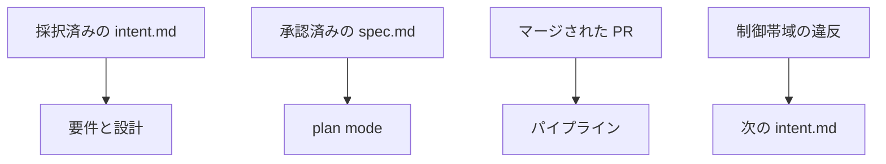

Anthropic の Applied AI チームが、コード生成が速くなったあとのソフトウェア開発ライフサイクルを、6つの段階に沿ったプレイとして書いた公式ガイドを公開しています。
英語の題は “The AI-native SDLC playbook” です。
著者は Louis Claxton で、英語ページの公開日メタデータは 2026-08-21 です。
時刻はページにありません。
日本語ページは同じ日付を持ち、同じ PDF を指します。

**SDLC** は、計画から保守までのソフトウェア開発ライフサイクルです。
**プレイ** は、各段階の中の具体的なやり方です。
何が変わるか、始め方、実装手順、ガバナンス、うまくいったかの見方、で構成されます。

この記事では、そのガイドが次の作業を始めるときに名指しする起動と、プレイごとに揃える成果物、承認する役割、前提を整理します。
**起動** は、次の作業が始まるきっかけとして本文が名指しする出来事です。

[Claude Academy のコース案内](https://academy.claude.com/courses/ai-native-sdlc-playbook) は、読み手を次のように置いています。
Claude Code をすでに使い、承認、レビュー、引き継ぎが人の速度の組織の、エンジニアリング、プラットフォーム、セキュリティのリードで、大規模かつ規制対象を想定する、というものです。
ガイド本文が書くボトルネックは、計画、レビューとテスト、デプロイが人の速度のまま残ることです。

手順の文言は、英語ページと、同じダウンロードリンクの PDF を正本にします。
日本語ページは同じ構成の翻訳です。

*この記事の全体像。以下、順に解説します。*

## AIネイティブSDLCプレイブックとは

ガイドが扱う6段階は、Plan、Design、Build、Test、Deploy、Maintain です。
日本語ページの目次と、各節の帯の見出しは、この英語6語のままです。

従来の直線的な段階から、各点に AI が入り、成果物の受け渡しで次が始まる形へ組み替える、と本文が定義しています。
段階の対比表は両端の見本であり、ほとんどの組織はその中間にいる、と表の前に書いています。
プレイはモジュールです。
組織は段階を同時に全部変えなくてよい、と本文が書いています。
各プレイは前提を書き、依存グラフがそれを示します。

初期の成果物は intent.md、spec.md、plan.md です。
**intent.md** は、何を採り何を採らないかを書き、共有のホームへ commit するファイルです。
**共有のホーム** は、そのファイルを commit してチームで残す置き場です。
採否は merge か closing review として残ります。
**closing review** は、採用しない判断を、会話の外へ残す見直しです。
**spec.md** は、intent.md と並べて置く仕様です。
**plan.md** は、実装の計画です。
Build 以降は、コードとその記録が成果物になります。

判断が要る決定の説明責任は人に残す、と本文が書いています。
測定はプレイごとに、先行指標と遅行指標で書かれます。
**先行指標** は、うまくいき始めたかを早く見る数です。
**遅行指標** は、あとから結果で見る数です。

ダウンロード案内は、同じ6段階、プレイ、worked example をオフライン用に並べた PDF だ、と英語のまま日英両方のページに出ます。
**worked example** は、架空の題材で手順を最後まで通した例です。
PDF は [同じ URL](https://cdn.prod.website-files.com/6889473510b50328dbb70ae6/6aba736348bdf4f08183f463_AI%20Native%20SDLC%20Playbook_designv2%20%281%29.pdf) を指します。
別の読み方として、Claude Academy のコースがあります。
レッスンは14です。
コースは全文を1ページで読む先として blog の URL を指します。
2026-10-26 にその URL へアクセスすると、英語のリソース記事へ転送されました。
応答は HTTP 308 です。
HTTP 308 は、別の URL へ移した、という応答です。

### 次が始まる4つの起動

本文が「次が始まる」と名指しするのは、次の4つです。
それぞれ別の起動であり、1本の循環矢印としては書いていません。

近い包括の文は、段階がバージョン管理へ1つ書いて終わり、次の段階がそれを読む、というものです。
括弧の例は、intent.md、spec.md、plan.md、diff とそのテスト、レビュー結果つきの PR、インシデント記録です。
引きの文は、intent、spec、plan、diff、レビュー結果を監査証跡と呼びます。

起動を名指しする文は、それより狭いです。
3つは、成果物を commit したことが次を始めます。
採択済みの intent.md が要件と設計を始め、承認済みの spec.md が plan mode を始め、マージされた PR がパイプラインを始めます。
4つ目は commit ではありません。
本番の制御帯域の違反が、次の intent.md を書きます。

**plan mode** は、Claude Code の計画モードです。
計画を承認するまで、ファイルの編集はできません。
**制御帯域** は、本番で守る数値や状態の範囲です。
本文は、帯域に入れる指標の名前までは書いていません。
違反のあと、次の intent.md が書かれます。
**PR** は、変更を取り込む前の pull request です。

plan.md、diff、そのテストは、この4つの矢印には出てきません。
包括の文が挙げる例と、次を始める起動は、粒が違います。

Test の証拠は、新しい Markdown ファイルではありません。
セッションに貼った `make test` の出力、ビルドログ、スクリーンショット差分、そして PR の check run です。
**check run** は、PR に付く自動チェックの結果です。
承認者の欄も、PR を見るコードオーナーになっています。
**コードオーナー** は、その変更の承認を任された人です。

## 注意点

ガイドは、生成が速くなったあとの詰まりを工程の話として書いています。
手順へ写すときは、見出しに無い語、期待として書かれた時間、別記事の割合、版で揺れるラベルを、このガイドの計測結果や現行の制限と読まないでください。

### 出口の公式の語

2026-10-26 に取得した英語 HTML、日本語 HTML、PDF テキストのいずれにも、exit criteria も、日本語の「完了条件」「出口基準」「終了条件」もありません。
公式が段階の終わりに置いているのは、成果物を commit して次がそれを読む、という包括の文と、上の4つの起動です。

6段階のすべてに、開始の成果物と完了の成果物が対である、という文も公式にはありません。
その言い方は QualityLogic の解説にあります。
公開日は 2026-09-29 です。
公式の本文には、その対を言う “trigger artifact” も “completion artifact” もありません。
二次情報として分けて読みます。

### 時間と割合

「数時間」「数分」は、このガイド自身の計測結果としては出てきません。
Plan の先行指標は、数週間の引き出しと洗練が数時間へ落ちる、という期待です。
英語は “The expectation is to fall from a multi-week elicitation and refinement cycle to hours.” です。
レビューの初回までの時間は “should fall to minutes” です。
PDF の図は “Hours, not weeks” と “build collapses to hours” と対比します。
計測の分母も件数も付いていません。

「マージされるコードの約80%を Claude が書く」は、このプレイブックの英語本文、日本語本文、PDF テキストにはありません。
別記事 [How Anthropic secures its AI-native software development lifecycle](https://claude.com/resources/articles/how-anthropic-secures-its-ai-native-software-development-lifecycle)（`datePublished` 2026-07-21）が “Claude authors about 80% of the code merged into our codebase today.” と書いています。
プレイブックはその系統の記事へリンクします。
リンクがあることと、80%をこのガイドの主張として引用できることは別です。

worked example の数字も、製品の制限ではありません。
管理設定例の `requiredMinimumVersion` は `"2.1.193"` です。
**requiredMinimumVersion** は、規制対象の組織向けの管理設定の例に出てくる、Claude Code の下限バージョンの項目です。
管理設定の各項目を説明したあとで、写すな、調整の起点だ、と書いています。
英語は “Consider the above a starting point to tailor, rather than a recommendation to copy.” です。
**claims** は、worked example の plan.md で、主張の状態を書いた行です。
その例にある 50 rps と、通話時間のおよそ3分の1は、同じ架空例の中の数字です。
例示の plan.md にある `intent.md 2026-06-02` も、架空の日付です。

### 版と製品ラベル

PDF のファイル作成日時は 2026-09-24 02:08:23 JST です。
`pdfinfo` で、54ページ、Creator は Adobe Illustrator 30.8 です。
ページの `datePublished` 2026-08-21 より後です。
ページは same six stages と言います。
日付が違うので、その文だけでは同一版の証明になりません。
**Code Review** は、管理者が有効にするレビューのサービスです。
英語は “the managed Code Review service enabled by an admin” です。
確認できた本文の差は、このサービスの文に “(research preview)” が付くかどうかです。
手順で使うのは、このサービス名ではありません。
指摘が PR を承認もブロックしない、という PR レビューの行です。
research preview の有無は、その行の手順には使いません。
手順の引用は、英語ページ（2026-10-26 取得）か PDF（ファイル作成 2026-09-24）のどちらから引いたかを添えます。
公開時刻は `datePublished` の日付だけで、ページに `dateModified` はありません。

Code Review の “(research preview)” は、2026-10-26 取得の日本語本文と PDF にはあり、同じ日の英語本文の当該文にはありません。
英語ページの HTML に “research preview” という文字列は別に2件あります。
それは Fast mode の文で、Code Review の文ではありません。
**Fast mode** は、その英語ページが research preview と書く、別の機能です。
どちらか一方を、2026-10-26 の製品状態とは決められません。

本文が自分で限定しているラベルは、次のとおりです。
**Claude Design** は、英語本文と PDF が beta と書く名前です。
**Claude Security** は、組織向けの枠である Claude Enterprise に対し、public beta として本文が書く名前です。
**Claude Enterprise** は、その公開先として本文が書く枠です。
**Claude Tag** は、本文時点では Slack で使える public beta の名前です。
スキャンのモデル名は “Claude Mythos 5” です。
このスキャンは、Claude Security の料金の話に付く語です。
料金は “Mythos 5 rates” と書くだけで額はありません。
Maintain の定期スキャンは別の節です。
**決定的スクリプト** は、モデルではなく、決まった手順で検知するスクリプトです。
定期スキャンの検知は、そのスクリプトです。
ここに書いた名前は、手順の表には出ません。
Design という段階名と、Claude Design という製品名は別です。
ここに書いたラベルは、プレイブック本文の限定です。
同じ日の製品画面の表示とは別です。

### 日本語の地の文

英語の見出し、PDF の目次、Academy の対比表は、Plan、Design、Build、Test、Deploy、Maintain で一致します。
揺れるのは、日本語ページの地の文と相互参照です。

| 順 | 英語の段階名 | PDF の目次 | 日本語の地の文 | ページ内の別の書き方 |
|---|---|---|---|---|
| 1 | Plan | Stage 1 — Plan | 計画 | プラン |
| 2 | Design | Stage 2 — Design | 設計 | デザイン |
| 3 | Build | Stage 3 — Build | 構築 | 構築 |
| 4 | Test | Stage 4 — Test | テスト | テスト |
| 5 | Deploy | Stage 5 — Deploy | 導入 | デプロイ。ページの説明文は「デプロイ」 |
| 6 | Maintain | Stage 6 — Maintain | 保守 | メンテナンス |

英語本文と PDF も、見出しは Maintain、本文の参照は “Stage 6: Maintenance” です。
第7段階ではありません。
同じ段階の言い換えです。

依存グラフの説明は、英語ページと PDF が “Start with any clay play — nothing points into it, so it needs nothing first.” と書きます。
続きから、入り矢印が無いプレイ、と読めます。
手順に残す意味は、それだけです。
語の綴りが誤記かどうかは、本文が断定していません。
語そのものは play の誤記に見えます。
日本語はこれを「演劇はステージとともにリストに表示されており、矢印が導入の順序を示しています。この 2 つは同じではありません。どのクレイプレイから始めても構いません」と訳します。
この「導入」は、採用する順番です。
Deploy の地の文の「導入」と、同じ字です。
Academy の導入レッスンは clay play を使わず、“The six plays in the top row of the graph above have no prerequisites” と書きます。
手順の文に、演劇、クレイプレイ、clay play は使いません。

12という数は、Academy 導入レッスンの画像の代替テキスト（“Dependency graph of the twelve plays in five rows.”）と、コース案内のリード（“Twelve plays for using Claude…”）にあります。
画面に見えるキャプションは、前提なしの上段、という説明で、twelve とは書いていません。
英語の記事本文と PDF は twelve plays と書いていません。
12は Academy の数です。
記事本文と PDF の節の個数には使いません。

Academy の依存グラフは画像です。
上段6つが前提なし、実線は依存、点線は非必須、という説明まではレッスン本文にあります。
矢印の対応は画像の中にあり、本文の文章だけでは一本ずつ追えません。

## 次の作業が始まるときに揃えるもの

段階名を社内の列に写しても、待ちの位置は決まりません。
公式は、段階の列と導入順は同じではない、と書いています。
英語は “The two are not the same.” です。
導入順は依存グラフの矢印です。
前提なしのプレイは、途中の段階から始めてよい、と書いています。

手順へ写す単位は、段階名ではありません。
プレイごとに本文が書く3つです。
揃う成果物、それを承認する役割、そのプレイの前提です。
6段階が同じ形、とは書きません。

表の語は、次のとおりです。
**スキル** は、人の技能ではなく、手順やチームのやり方を置く文書です。
**CLAUDE.md** は、リポジトリに置く、Claude Code への指示ファイルです。
**フック** は、決めた条件で処理を止める仕組みです。
**名前付きリリース承認** は、リリースマネージャーが本番へ出す前に行う承認です。
ガイドが書いているのは、その承認をフックが確認することまでです。
例示スクリプトは、承認が無いと終了コード 2 で止まります。
**高リスク** は、その組織がそう分類した変更です。
ガイドは、何をもって高リスクとするかの基準までは書いていません。
**加速された PR レビュー** は、Claude が指摘を付ける PR レビューです。
指摘だけでは PR を承認もブロックしません。
下の表の Deploy / PR レビューと同じ行です。
**行動境界** は、エージェントが越えてよい行動の線です。
フックがその線で止まります。
ガイドは、越えてよい行動の一覧までは書いていません。
本番の名前付きリリース承認を止めるフックは、下の表の Deploy の行です。
行動境界の定義そのものではありません。
**ロールバック経路** は、本番の変更を戻す手順です。

| 置き場所 | 次へ渡すときに本文が書くもの | 承認する役割 | 前提の強さ |
|---|---|---|---|
| Plan / Capture as intent.md | 共有ホームへ commit された intent.md。採否は merge か closing review として残り、Design へ送る | プロダクトオーナー | なし |
| Design / Requirements and design | intent.md と並ぶ spec.md。仕様への同意が plan mode を始める | プロダクトオーナー。高リスクはテクニカルリードと相談 | intent.md と、ブランド、セキュリティ、コンプライアンス、UX のスキル |
| Build / plan mode | 承認済み plan.md。実装が外れたら同じ commit で plan.md を更新する。後のレビューが diff を plan.md と照合する | 日常はエンジニア。高リスクはテクニカルリードかアーキテクト。計画承認まで plan mode はファイルを編集できない | intent.md または spec.md が「あれば」。CLAUDE.md は役に立つが必須とは書いていない |
| Test / フィードバックループ | 独立した md は無い。タスク完了の前にテスト、ビルド、lint。UI ならスクリーンショット。証拠はツールチェーンの出力 | 証拠が付いた PR を承認するコードオーナー。人が見る前の確認そのものではない | なし。テストスイートと1コマンドのビルドがインフラ |
| Test / evals | 設定が変わるときに回すスイート。合格率を落とす変更は merge 前にレビュー | 設定変更を担当するチーム | CLAUDE.md とフィードバックループ |
| Deploy / PR レビュー | 指摘は PR を承認もブロックもしない。how-to は、ブランチ保護がコードオーナー承認を要すると書く | コードオーナー | インフラの文は、コードオーナー承認を要するブランチ保護を “are also worthwhile” と置く。必須の語ではない |
| Deploy / 本番のフック | エージェントは本番ゲートの手前までやり、その先はやらない。例示スクリプトは、名前付きリリース承認が無ければ exit 2 で止まる | リリースマネージャー。開発環境ではエージェントが deploy し、本番は人が承認、と CI/CD 節 | フックのプレイ自体の前提はなし。CI/CD 自動化の前提は、PR レビューと承認ゲート |
| Maintain / ループを閉じる | 検知は決定的スクリプト。違反のあと Claude が診断を intent.md として書き、Plan から通常の経路へ戻す | サービスオーナーかオンコールが、今直す、予定する、却下する、を選ぶ | intent.md、加速された PR レビュー、行動境界のフック、ロールバック経路 |

**ブランチ保護** は、条件を満たすまで merge を拒むリポジトリの設定です。

plan mode の前提の英語は “The intent artifact (intent.md or spec.md) if one exists, and the CLAUDE.md file helps.” です。
`if one exists` なので、intent.md も spec.md も無いセッションでも、計画モード自体は置けます。
フィードバックループの前提は “Prerequisites: None.” です。

Maintain の定期スキャンは、4つ目の起動とは別の節です。
制御帯域の違反は、intent.md を書きます。
スキャンで見つかった修正は、1つの PR に収まるなら PR のレビューへ、それより広いなら intent.md へ行きます。
**PR のレビュー** は、コードオーナーが PR を見る関門です。
スキャン自体が本番へ出す経路にはしません。

前提なし、と Academy が箇条書きするのは次の6プレイです。
Design と Maintain はこの列にありません。

- Plan: Capture as intent.md
- Build: Claude Code plan mode
- Build: CLAUDE.md
- Build: Skills
- Test: Give Claude a feedback loop
- Deploy: Hooks as approval gates

CLAUDE.md と Skills は、上の表に行がありません。
4つの起動が、この2つを次の開始として名指ししていないためです。
開始の候補ではあっても、次へ渡すファイルと承認者の組としては書いていません。

スキルは助言的な統制で、セッションが遵守を強制するわけではない、とも書いています。
常に守るポリシーには、ブロックするフックか、PR で見直す通過が要ります。
検証をフックで保証するのは “where the organization wants them guaranteed” です。
全組織の必須、とまでは書いていません。

判断の基準は、次の作業を始めるファイル、または PR に付く証拠が、上の表の行と対応しているかです。
段階名の列だけが揃っていて、承認する役割が空なら、その行はまだ手順になっていません。

## 完了は3つに分かれる

手順に残す完了は、次の3つです。
人が見る前の測定できるチェック、コードオーナーの承認、本番の名前付きリリース承認です。
verifier subagent と、設定の eval は、この3つには入りません。

### 人が見る前の確認

3つのうち1つ目は、セッションの検証です。
表の Test / フィードバックループが、このチェックです。
人が見る前に、その変更が自分の作業を確認します。
本文の例は、`test_status.py` のテストがすべて成功する、スクリーンショットが添付されたモックと一致する、エンドポイントが新しいフィールドで 200 を返す、です。
英語は “All tests in test_status.py pass”、“the screenshot matches the attached mock”、“the endpoint returns 200 with the new field.” です。

承認済みモックと一致する、という文は、別の plan.md 例で確認方法を書く行にあります。
フィードバックループの文そのものではありません。
1サイクルに入れる検証範囲には近いです。
前提は None で、plan mode や spec が無くても置けます。

### verifier subagent

これは、3つの完了には入りません。
セッション末の verifier subagent は、完了と判断したあとの追加です。
**verifier subagent** は、完了と判断したあとに、別のコンテキストで最終確認を包むやり方の一つです。
生成した前提に引きずられないため、と本文が書いています。
本文は、フィードバックループとこれを混同するな、と書いています。
英語は “The feedback loop should not be confused with a verifier subagent” です。
1サイクルの検証そのものではありません。

人が見る前の確認を置いたあとに、別コンテキストの確認を足すかどうかは、そのチームの選択です。
足しても、コードオーナーの承認の代わりにはなりません。

### 設定の eval

これも、3つの完了には入りません。
設定の eval は、エージェントの設定が変わったときの別の周期です。
**eval** は、そのとき同じ基準で仕事をするかを見るスイートです。
モデルを替える、プロンプトを書き換える、CLAUDE.md やスキルやフックが変わる、ときに回します。
例示ワークフローの paths は `CLAUDE.md` と `.claude/**` です。
**`.claude`** は、リポジトリにある `.claude` ディレクトリです。
例示は、CLAUDE.md か、そのディレクトリ以下が変わったときに回します。
本文は、変更のたびではなく一定周期のオフラインでもよい、とも書いています。

段階表の Test 行は “Continuous evals woven through implementation” だけです。
人が見る前のループには触れていません。
本文は eval を “Evals are the AI-native equivalent of stage-gate QA” とも呼びます。
ステージゲート QA の相当物、という意味です。
だから Test という段階名を、1サイクルの検証の同義語にはしません。
設定変更の合格率を落とす変更は、merge 前に、設定を担当するチームが見ます。

Test の導入は、セッションが人の前に自分の作業を見ることと、エージェントを操縦する設定を、書くコードと同じように回帰テストすること、の両方を1文にしています。
英語は “Every session checks its own work before a human sees it, and the configuration that steers the agent gets regression-tested like the code it writes.” です。
前半が1サイクルの確認、後半が eval です。

### レビュー完了と本番の承認

3つのうち2つ目は、コードオーナーの承認です。
レビュー完了は、Claude の指摘が尽きたことではありません。
本文は “Findings do not approve or block a PR on their own, and branch protection still requires approval from a code owner.” と書いています。
指摘を直すループの終端も、チェックが緑になり、コードオーナーの承認だけを待っている状態、と書いています。
英語は “until the PR is green and waiting only on code owner approval.” です。
Claude がその PR を merge する、とまでは書いていません。

3つのうち3つ目は、本番の名前付きリリース承認です。
フックが、その承認を持っていることです。
本文は “The agent does everything up to the production gate and nothing past it.” と書いています。
開発環境ではエージェントが deploy し、本番は人が承認する、と CI/CD 節が書いています。

同じページには、この読みを弱める文もあります。
ブランチ保護は “worthwhile” と、推奨の強さでも書かれます。
検証のフックは、組織が保証したい場所に置きます。
スキルは助言で、セッションは遵守を強制しません。
コードオーナー承認を全リポジトリの必須と読むには、ブランチ保護の設定が要ります。
ガイドの文だけでは、必須とまでは固定できません。

## まとめ

AI ネイティブ SDLC プレイブックは、コード生成のあとの工程を Plan、Design、Build、Test、Deploy、Maintain の6段階で書いた公式ガイドです。
英語ページの公開日は 2026-08-21、著者は Louis Claxton です。
日本語ページの目次は英語の6語のままで、地の文の訳語は揺れます。

次の作業が始まる、と本文が名指しするのは4つです。
採択済みの intent.md、承認済みの spec.md、マージされた PR、制御帯域の違反です。
Test の証拠は PR に付く出力であり、独立した完了ファイルとしては出てきません。

社内手順へ写す単位は、段階名ではなく、プレイごとの成果物、承認者、前提です。
完了は3つに分けます。
人が見る前の測定できるチェック、コードオーナーの承認、本番の名前付きリリース承認です。
設定が変わったときの eval と、verifier subagent は、この3つには入れません。

80%、数時間、2.1.193、50 rps は、このガイドの効果や現行の制限としては書きません。
80%を使うなら、2026-07-21 の別記事の自己申告として、プレイブックから切り離します。
手順の文は英語ページか PDF から引き、どちらの版かを添えます。

この記事が少しでも参考になった、あるいは改善点などがあれば、ぜひリアクションやコメント、SNSでのシェアをいただけると励みになります！

## 参考リンク

- 英語ページ（手順の正本、`datePublished` 2026-08-21）: [The AI-native SDLC playbook](https://claude.com/resources/articles/the-ai-native-sdlc-playbook)
- 旧 blog URL（2026-10-26 のアクセスは上記へ HTTP 308）: [claude.com/blog/the-ai-native-sdlc-playbook](https://claude.com/blog/the-ai-native-sdlc-playbook)
- 日本語ページ（同じ公開日、同じ PDF）: [AI ネイティブの SDLC プレイブック](https://claude.com/ja/resources/articles/the-ai-native-sdlc-playbook)
- PDF（`pdfinfo` の CreationDate は 2026-09-24 02:08:23 JST、54ページ）: [AI Native SDLC Playbook](https://cdn.prod.website-files.com/6889473510b50328dbb70ae6/6aba736348bdf4f08183f463_AI%20Native%20SDLC%20Playbook_designv2%20%281%29.pdf)
- Academy 導入レッスン（依存の文章化）: [Introduction](https://academy.claude.com/courses/ai-native-sdlc-playbook/introduction)
- Academy コース案内（14レッスン、想定読者）: [AI-native SDLC playbook](https://academy.claude.com/courses/ai-native-sdlc-playbook)
- 80% の別記事（`datePublished` 2026-07-21）: [How Anthropic secures its AI-native software development lifecycle](https://claude.com/resources/articles/how-anthropic-secures-its-ai-native-software-development-lifecycle)
- 6段階すべてに開始と完了の成果物が対である、という言い換え（二次情報、2026-09-29）: [QualityLogic](https://www.qualitylogic.com/knowledge-center/ai-native-sdlc-playbook/)
