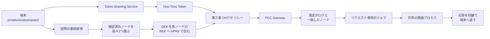

Apple の Private Cloud Compute（PCC）は、Apple Intelligence が端末だけで処理しきれない計算を、プライバシーを保ったままクラウドで行うための仕組みです。Apple は設計を説明するセキュリティガイドと、検証用のソースを [apple/security-pcc](https://github.com/apple/security-pcc) に公開しています。

この記事は、PCC が何をどう守る設計なのかをまず整理し、そのうえで公式の表現と第三者が今すぐ確かめられる範囲のずれ、二つのノード方式の違い、業務利用を判断するときの見方までをまとめます。想定読者は、クラウドやセキュリティの一般知識はあるが、PCC は初めて知る人です。

*この記事の全体像。以下、順に解説します。*

## Private Cloud Computeとは

Private Cloud Compute は、端末上のモデルでは足りない処理を、Apple が運用するクラウドのノードで行う仕組みです。端末は、公開の透明性ログ（追記専用の公開台帳）に記録されたリリースと測定値（起動したソフトウェアのハッシュ）が一致するノードの公開鍵に対してだけ、リクエストを暗号化します。この測定値の一致を端末が確かめる手続きを、証明（attestation）と呼びます。手前にあるロードバランサやプライバシーゲートウェイは信頼境界の外にあり、リクエストを復号する鍵を持ちません。

2024年6月10日のセキュリティブログが、Apple silicon のサーバを信頼の根とする初期の技術概要を公開しました。2026年6月8日のブログは、同じ5つの要件名のまま、Google Cloud 上のノードを追加すると書いています。GitHub の `apple/security-pcc` は、そのセキュリティガイドに付随するソースとツールの公開場所です。ガイド本文は [Private Cloud Compute Security Guide](https://security.apple.com/documentation/private-cloud-compute/) にあります。

### 5つのコア要件

公式が最初から掲げている要件は5つです。

| 要件 | 内容 |
| --- | --- |
| Stateless computation | 個人データをステートレスに処理し、処理後に残さない |
| Enforceable guarantees | 外部部品に依存せず、保証を強制できる形にする |
| No privileged runtime access | 運用スタッフ向けの特権ランタイムアクセスを置かない |
| Non-targetability | 特定のユーザだけを狙えないようにする |
| Verifiable transparency | 研究者が本番と同じソフトウェアだと確かめられる |

現行ガイドは、Apple silicon ノードでも Google Cloud ノードでも、この5つは PCC 全体の性質として同じだと書いています。

### リクエストが流れる経路

リクエストは、端末がノードを選んでから暗号化し、第三者が運ぶ中継のあとでノードが復号します。中継とゲートウェイは、送信元 IP とユーザ識別子を同時に持たない設計です。

主な用語の対応は次のとおりです。

| 名前 | 役割 |
| --- | --- |
| OTT（One-Time Token） | レート制限と不正利用防止のための単回相当トークン。RSA ブラインド署名なので、発行時の認証と引き換えを結び付けない |
| OHTTP | 端末と Apple の Oblivious Gateway の間を、第三者リレー経由で運ぶ。ガイドは HPKE と chunked OHTTP と書く |
| DEK（Data Encryption Key） | そのリクエストだけの対称鍵。ペイロードを暗号化する |
| REK（Request Encryption Key） | ノードが用意する受信鍵。端末は、証明を検証したノードの REK にだけ、DEK を HPKE（公開鍵でデータを暗号化して包む標準方式）で包む |
| 透明性ログ | リリースの測定とクライアント配布鍵を載せる追記専用ログ。ある測定値がこのログに確かに載っていることをログ側が示す証拠を包含証明と呼び、包含証明が無いノードへはユーザデータを送らない、という強制の錨 |
| cloudboardd | ネットワークを受けるデーモン。リクエストを復号する鍵は持たない |
| cb_jobhelper | リクエストごとに起動し、終了時に OS がアドレス空間ごと回収する |

端末は少なくとも40件の証明をプールし、リクエストごとに高々2件を無作為に選びます。ジャストインタイムの追加を含めても最悪は4件で、端末側がこの上限を強制します。サーバ設定はこの上限を下げることしかできません。

### データが残らない仕組み

Apple silicon では、データボリュームの鍵を起動のたびに Secure Enclave（Apple silicon が備える、鍵を扱う専用のハードウェア）が乱数化し、永続化しません（Ephemeral Data Mode）。Google Cloud では、書き込み可能なファイルシステムを1つだけにし、起動時にメモリ上で生成した鍵で暗号化します。再起動でその鍵は残りません。

モデルを載せる推論プロセスは、リクエストごとに破棄するわけではありません。リクエスト単位で捨てるのは、復号と前処理を行うアドレス空間（`cb_jobhelper`）です。長寿命の推論ソフトウェアは、壁時計時間とノードごとの揺らぎで定期的にリサイクルされます。間隔の具体的な秒数はガイド本文にありません。

### リポジトリの中身

公開リポジトリは 2024年10月24日に作られました。言語表示は Swift です。Release と tag は 0、Issues と Discussions は無効で、症状を追う GitHub issue の場はありません。主な構成は次のとおりです。

| コンポーネント | 役割 |
| --- | --- |
| Thimble（`privatecloudcomputed`） | デバイス側クライアント |
| CloudBoard | ノード側の受付 |
| CloudAttestation / CloudAttestation-GoogleCloud | 証明 |
| `srd_tools` の `pccvre` | 研究用 CLI |
| `darwinOSBits` の darwin-init | 起動ポリシー |

研究用の Virtual Research Environment（VRE）は Apple silicon の Mac 上の VM です。ユーザ空間は本番ノードと同じで、起動とカーネルは仮想化向けに変え、Secure Enclave は仮想、描画は準仮想化です。推論に使うのは本番の重みではなく、縮めた demonstration model です。要件は Apple silicon、ユニファイドメモリ 16GB 以上（推奨 24GB 以上）、macOS Sequoia 15.1 以降です。

## 注意点

公式の要件名と、第三者が今すぐ確かめられる範囲は一致しません。日本語の報道や短い要約で起きやすい読み違いを、公式の記述に沿って整理します。

### 用語・報道で取り違えやすい点

- **「100万ドルはユーザデータの漏洩」ではありません。** 2024年10月24日の報奨金表で100万ドルは、任意 entitlement（アプリやコードに与える権限）を伴うリモートコード実行です。信頼境界の外でリクエストデータへ到達するリモート攻撃の上限は25万ドルです。いずれも上限であり、支払実績の公表額ではありません。
- **「全 PCC が NVIDIA に移った」「Gemini が推論している」ではありません。** 2026年6月8日のブログは、Gemini ファミリーの背後にある技術で次世代の Apple Foundation Models を作ったと書き、要求の重い推論のために Google Cloud と NVIDIA GPU へ PCC を広げると書いています。Apple silicon 上の PCC は続いています。
- **「証明書（certificate）」という訳は attestation を狭くします。** ガイドが検証するのは、ノードの測定値が透明性ログのリリースと一致することです。
- **「エンドツーエンド暗号化」はメッセージングの E2E と同じ保証には読まない方がよいです。** 公式が書くのは、端末が検証済みノードの公開鍵へ暗号化し、中間のロードバランサは復号できない、という境界です。
- **「シェルも SSH もソースに存在しない」は言い過ぎです。** 本番ノードにリモートシェルと対話デバッグを置かないのは事実ですが、Google Cloud の研究環境では、申請した研究者が公開鍵を渡し、Identity-Aware Proxy 越しに SSH します。本番ノードの管理シェルと、研究枠の SSH は別物です。

### 公開範囲とライセンスの限定

- ソースのライセンスは、ダウンロードから90日、所有または管理する Apple 製コンピュータ1台、目的は PCC のセキュリティとプライバシー特性の検証だけ、再配布禁止です。OSS の再利用許諾ではありません。`CONTRIBUTING.md` は外部からのコード貢献を受け付けません。
- ソフトウェア公開の「90日」は、2つの意味が混ざりがちです。初期ブログの「ログ掲載から90日以内に出す」と、後のガイドの「機微な修正では公開を最大90日遅らせ得る」です。モデルとアダプタのイメージは、計測はしても透明性の公開対象外です。VRE が落とす研究用モデルは demo model です。
- 「研究者によって検証が終わっている」とは言えません。2024年10月24日の研究ブログは、検証できるガイド・VRE・一部ソースを公開し、公開前に第三者監査人と選ばれた研究者へ早期アクセスしたと書きますが、名前付きの監査報告書の URL はそこにありません。

### 削除とキャッシュの正確な意味

- **処理後の削除は、情報理論的に痕跡が消えることではありません。** 公式が書くのは、推論プロセスがリクエスト関連データを消し、アドレス空間を OS が回収し、再起動でデータボリューム鍵が残らない、ということです。削除はソフトウェアの性質であり、暗号だけで強制できるものではない、という限界は独立研究も指摘しています。
- 複数ターンの途中状態は、端末が渡す鍵で暗号化したキャッシュとしてノードに残り得ます。端末が鍵を再送しない限り PCC は復号できない、という条件付きです。

### 既知の脆弱性と未強制の検査

- **CVE-2026-20685**（公開 2026年5月18日）は、特権的なネットワーク位置から機微情報が漏れ得たという Apple の記録です。修正は PCC Release 5E290.3 で、affected は 5E290.3 未満です。深刻度は CVSS 3.1 で 6.5 と評価されています。公的な脆弱性データベース（NVD）や採番機関（CNA）、CISA のいずれも、本番環境で悪用された記録は残していません（CISA の評価は Exploitation none）。
- リリースノートの既知事項として、ノード証明書は DCA CA 署名を見るものの、透明性ログへの包含証明をまだ強制しない、という項目（167793384）が残っています。2026年10月時点では未強制のままです。

## 二つのノード方式の違い

PCC には Apple silicon と Google Cloud の2系統があります。検証の深さや公開範囲が異なるため、同じ保証水準として一括りにしない方が安全です。

| 項目 | Apple silicon | Google Cloud |
| --- | --- | --- |
| 発表 | 2024年6月10日のセキュリティブログ | 2026年6月8日の拡張ブログ。本番初回はリリースノート 6A375 / 6AX1661 |
| ハードウェア | 独自の Apple silicon サーバ。Secure Enclave と Secure Boot | A4 ベアメタル。NVIDIA B200 が8基、Intel Emerald Rapids が2基、Google Titan を TPM |
| 誰が機械を持つか | Apple | Google が供給し物理運用。他テナントは載せない |
| 証明の根 | Secure Enclave と Boot ROM。製造時の立会いは独立監査人 | Titan と Intel TDX の両方の quote（証明の署名付き出力）。GPU ファームウェアは NVIDIA のみ |
| 再起動で消えるもの | Ephemeral Data Mode。Secure Enclave がデータボリューム鍵を永続化しない | 起動時生成のメモリ上の鍵で、唯一の書き込み可能ファイルシステムを暗号化 |
| 研究手段 | Mac 上の VRE と `pccvre` | Mac では TDX / Titan / NVIDIA を模倣できない。忠実な調査は実機。招待枠は SSH |
| メモリ暗号化 | — | CPU 処理中のメモリは暗号化。GPU の高帯域メモリ（HBM）上の重みと活性化は暗号化しない |

Google Cloud では、ユーザデータは CPU と GPU の間の PCIe、および GPU 間の NVLink を渡るときに暗号化されます。GPU の HBM を暗号化しない公式の理由は、GPU 単独ではネットワークへ出られず、データをマシンの外へ動かせないから、というものです。周辺の NIC や PCIe スイッチのファームウェアは測定しません。

## 第三者がどこまで検証できるか

現時点で確かめられることと、まだ確かめられないことを分けて見ます。

**公式と公開ソースの両方で示されていること**

- 2024年6月のブログと現行のコア要件が、5要件と「端末がログ上の測定へだけ暗号化する」を同じ方向で書いています。
- 公開ソースの `TransparencyPolicy` は、リリースダイジェストの包含を期限付きで検証し、証明欠如・未掲載・期限切れを分けます。検証を無効化する研究経路だけが、失敗をログして継続します（fail open）。
- デバイス側の Thimble とノード側の CloudBoard が、OTT・OHTTP・ジョブ分離というガイドの名前と対応します。
- 査読付きの独立論文が1本あります。Dittmar らの “Unlocking Apple's Private Cloud Compute”（WiSec 2026、[DOI 10.1145/3765613.3811691](https://doi.org/10.1145/3765613.3811691)）は、`privatecloudcomputed` が PCC プロトコルを使っていることを確認したと書いています。

**まだ確かめられないこと**

- 同じ論文は、TGT（Token Granting Token、OTT を受け取る前段として端末が持つトークン）派生の検査と OTT の単回性が、実験条件では文書より弱かったと報告します。開示後、Apple は文書を明確化しただけで、プロトコルと検査は変えなかったと書いています。実験当時は、端末が持つ TGT を OTT に交換する二段の経路でした。現行の iOS / macOS 27 は TGT を廃止し、Token Granting Service が OTT を直接出すので、実験世代とは経路が違います。
- 再現ビルドは無く、サーババイナリにシンボルが無く、モデル重みと問い合わせ API は非公開であると論文は書きます。
- USENIX と IEEE Xplore の検索では、Apple PCC を主題とする論文は見つかりませんでした。名前付きの監査報告書も、研究ブログ以外には見つかっていません。

2024年秋の批判（Hacker News などで引かれるもの）は、ライセンスがオープンソースではないこと、証明の根が Apple であること、選ばれた監査では足りないことを指摘します。これは設計上の信頼の置き方への批判であり、本番ノードを破った記録ではありません。

## 業務で使うときの判断

まず、`apple/security-pcc` を製品の依存関係や一般的なライブラリとして採用することはできません。ライセンスが検証以外の利用と再配布を禁じています。検証するときは、90日と Apple 製コンピュータ1台という条件の内側で、ガイドとソースを突き合わせます。

Apple Intelligence を業務で使うかを判断するなら、Apple silicon 上の PCC を、文書・VRE・一部ソースが揃った経路として扱えます。「端末がログ上の測定へだけ暗号化する」「中間装置が復号鍵を持たない」「再起動でデータボリューム鍵が残らない」ことは、公式が機構として書いています。そのうえで、モデル重みは非公開であること、削除はソフトウェアと暗号消去の組み合わせであること、証明書のログ包含はリリースノート上まだ強制されないこと、CVE-2026-20685 が 5E290.3 未満に記録されていることを、同じ判断に入れます。

Google Cloud 上の PCC は、27.0 の起動以降に本番リクエストを処理するリリースがあります。ただし、2026年6月時点の「保護一式へ段階的に上げる」という留保、HBM の非暗号化、測定しない周辺ファームウェア、公開されない起動アセット、研究環境を Mac の VRE では再現できないことは、Apple silicon と同じ検証深度とは読みません。

開発者側の口は、iOS 27 / macOS 27 以降の `PrivateCloudComputeLanguageModel()` です。開発者は API キーを持たず、managed entitlement `com.apple.developer.private-cloud-compute` が要ります。資格は App Store Small Business Program に入り、いずれのアプリも first-time downloads が200万未満であることが条件です。レート上限の具体的な回数、契約 SLA、リージョン選択、データ所在地の条項、ドル建て単価は、公式ページには見当たりませんでした。コンテキスト長は、Foundation Models の Developer 記事が PCC サーバモデルを 32K token、オンデバイスを 4K としています。

更新を追うなら、次の3点に絞ると過不足がありません。

1. [Release Notes](https://security.apple.com/documentation/private-cloud-compute/releasenotes) で、透明性ログ包含の強制（167793384）などの既知事項が Resolved になったか。
2. ライセンス条件を満たす Apple silicon の Mac で `pccvre release list` を実行し、Google Cloud のリリースがパースできるか。別イメージの取り違えを避けるため `--overwrite` を確認する。
3. 端末の Apple Intelligence Report を、Merkle 包含やログヘッドの署名を再計算するツールで照合する。ただしこれはレポートが正直に書かれたことの証明にはならない。

## まとめ

Private Cloud Compute は、端末が透明性ログ上の測定と一致したノードへだけ暗号化し、手前の中継装置は復号鍵を持たない、という信頼境界を公式文書と公開ソースの両方で示しています。一方で、公開ソースは検証のための証拠であって実装キットではなく、ライセンスも検証用途に限られます。証明書のログ包含の強制や、Google Cloud ノードの検証深度など、公式の要件名が「今すぐ確かめられる範囲」をそのまま意味しない箇所も残ります。設計の思想と、第三者が検証できる範囲を切り分けて読むことが、PCC を正しく評価する近道です。

この記事が少しでも参考になった、あるいは改善点などがあれば、ぜひリアクションやコメント、SNSでのシェアをいただけると励みになります！

## 参考リンク

- [Private Cloud Compute（初期概要、2024年6月10日）](https://security.apple.com/blog/private-cloud-compute/)
- [Security research on Private Cloud Compute（2024年10月24日）](https://security.apple.com/blog/pcc-security-research/)
- [Expanding Private Cloud Compute（2026年6月8日）](https://security.apple.com/blog/expanding-pcc/)
- [Private Cloud Compute Security Guide](https://security.apple.com/documentation/private-cloud-compute/)
- [apple/security-pcc](https://github.com/apple/security-pcc)
- [CVE-2026-20685](https://www.cve.org/CVERecord?id=CVE-2026-20685)
- [Dittmar ら、Unlocking Apple's Private Cloud Compute（WiSec 2026、DOI 10.1145/3765613.3811691）](https://doi.org/10.1145/3765613.3811691)
- [Apple Developer: Adding server-side intelligence with Private Cloud Compute](https://developer.apple.com/documentation/foundationmodels/adding-server-side-intelligence-with-private-cloud-compute)
- [Apple Developer: Accessing Private Cloud Compute](https://developer.apple.com/private-cloud-compute/)
