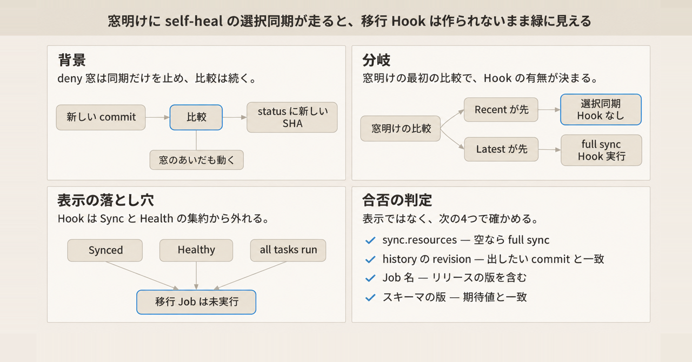
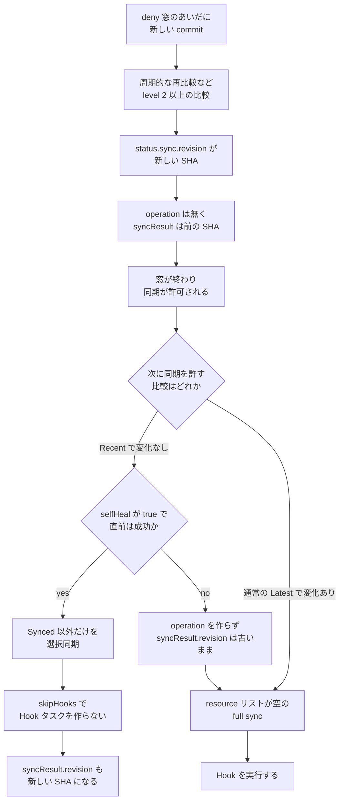

Argo CD の同期窓（sync window）と self-heal を組み合わせた環境では、データベース移行用の Hook が実行されないまま、Application が Synced かつ Healthy に見えることがあります。2026-11-20 の [CNCF Blog](https://www.cncf.io/blog/2026/11/20/when-a-sync-window-closes-how-argo-cd-self-heal-skipped-the-migration-hook/) が、この事象を顧客事例と再現実験で報告しました。

この記事では、公開タグ v3.6.2（2026-11-18 リリース）のコントローラのソースと公式ドキュメントを読み、どの条件がそろうと Hook が飛ばされるのかを整理します。読み終えると、次の 3 点を判断できるようになります。

- 自分の Application がこの経路に入りうるか
- リリースの合否を、Sync と Health の表示以外の何で判定するか
- 2 つの回避策のどちらを選び、何を引き受けるか

なお、ブログは対象の Argo CD バージョンを書いていないため、以下の分岐は v3.6.2 のソースで読んだものであり、著者のクラスタの挙動を確認したものではありません。


*この記事の全体像。以下、順に解説します。*

## Argo CD の同期窓・self-heal・Resource Hook とは

Argo CD は、Git リポジトリに置いたマニフェストを Kubernetes クラスタへ反映し続ける GitOps のコントローラです（GitHub の説明は "Declarative Continuous Deployment for Kubernetes"）。登場する主なリソースは 2 つです。

- **Application**: どの Git リポジトリのどのパスを、どのクラスタと namespace へ同期するかを宣言するリソース
- **AppProject**: 複数の Application をまとめ、同期窓などの制約を掛けるリソース

コントローラは Git の望ましい状態とクラスタの実際の状態を定期的に比べ（この処理を比較または refresh と呼びます）、結果を Application の status に書きます。差を埋める適用処理を同期（sync）と呼び、1 回の同期の実行単位を operation と呼びます。

status には 2 種類の状態が出ます。Sync は Git と一致しているか（Synced / OutOfSync / Unknown）、Health はリソースが正常に動いているかを集約した状態（Healthy / Progressing など）です。

同期の起こし方には、人が指示する手動同期と、自動同期があります。自動同期（`spec.syncPolicy.automated`）は、Git に新しい revision が入ったことを検知すると、Application の全リソースを対象にした同期（以下 full sync）を起こす機能です。この記事の主役である self-heal は、自動同期に足すオプションです。

この事象には、同期窓、比較レベル、self-heal、Resource Hook の 4 つの仕組みが関わります。

### 同期窓

同期窓は、AppProject に置く「同期してよい時間帯」と「同期してはいけない時間帯」の定義です。

- allow 窓と deny 窓を、cron と duration で置く
- 対象の一致は、既定ではアプリ名、宛先クラスタ、namespace のいずれか（OR）。`andOperator: true` のときは、設定した条件のすべてが一致する必要がある
- 窓が 1 つも無ければ、同期は常に許可される
- 一致する allow 窓が 1 つでもあれば、その allow 窓が開いているあいだだけ同期できる
- 開いている deny 窓は同期を拒み、allow 窓より強い
- `manualSync` は、同期が窓で止められているあいだでも、手動同期だけは通す
- `syncOverrun` は、許可されていたときに始まった自動同期を、窓が変わったあとも続けさせる。まだ始まっていない同期は起こさない
- UI は、拒否を赤、手動だけ可を橙、許可を緑で示す

重要なのは、**deny 窓などで同期が止められているあいだも、比較は止まらない**点です。止まるのは同期だけで、比較結果は Application の status に書かれ続けます。

### 比較レベルと 2 つのリビジョン

比較には、どの revision と比べるかの違いで 2 つのレベルがあります。

| レベル | 値 | 比較に使う revision | 主な契機 |
|---|---|---|---|
| `CompareWithRecent` | 1 | 直近の比較が残した `status.sync.revision`（SHA） | クラスタ上の管理下リソースの更新 |
| `CompareWithLatest` | 2 | spec の `targetRevision`（`HEAD` やブランチ名）。比較の中で最新の commit に解決される | 期限が切れた周期的な再比較 |

`CompareWithLatest` は、マニフェストを作るときに `targetRevision` を最新の commit の SHA に解決し、その SHA を status に書きます。ただし「リビジョンが変わったか」の判定には解決前の名前（`HEAD` など）が渡るので、通常の Application では、この判定は SHA と一致せず常に「変化あり」になります。ここでいう通常の Application は、source hydrator も `manifest-generate-paths` も使っていない構成です（どちらも後述）。この違いが、後で説明する分岐の鍵になります。

周期的な再比較の既定の間隔は 120 秒で、jitter（ばらつき）は最大 60 秒です。

この事象では、Application が持つ 2 つの revision を区別する必要があります。

- **`status.sync.revision`**: 直近の比較が使った commit の SHA。同期が窓で止められていても、比較のたびに更新される
- **`status.operationState.syncResult.revision`**: 最後に実行された operation が適用した commit の SHA。operation が走らなければ更新されない

### self-heal

self-heal は、クラスタ側の状態が Git とずれたときに、コントローラが自動で同期し直す機能です。`spec.syncPolicy.automated.selfHeal` で有効にします。

v3.6.2 では、self-heal は次の条件がそろったときに動きます。

- 比較の結果が「リビジョンに変化は無い」
- 直前の同期が成功している
- Application 全体が OutOfSync である
- backoff の待ち時間が経過している

このとき self-heal は、Application の全リソースではなく、**status が Synced でないリソースだけ**を `operation.sync.resources` に入れて同期します。対象は OutOfSync と Unknown のリソース、それに status が空の Hook です。このように対象リソースを指定した同期を、選択同期（selective sync）と呼びます。

待ち時間は、コントローラの起動フラグで決まります。既定値は次のとおりです。

- `--self-heal-timeout-seconds`: 0
- `--self-heal-backoff-timeout-seconds`: 2 秒。再試行のたびに 3 倍（factor）に延び、上限は 300 秒。この秒数が 0 でなければ、コントローラはこの backoff の待ちを使う

### Resource Hook

Resource Hook は、`argocd.argoproj.io/hook` annotation を付けて、同期の特定のフェーズでだけ実行するようにしたリソースです。データベース移行の Job を、アプリの Deployment を更新する前に流す用途でよく使われます。

- 種別は PreSync、Sync、PostSync、SyncFail、Skip
- Hook の成否は Hook リソース自身だけで判定する。Job の終了コードが 0 なら、そのフェーズは成功になる。データベースの中身が期待どおりかは見ない
- Hook の実行中、Application は Progressing のままで、operation は終わらず実行中のままになる

### status と履歴の扱い

Hook は、Application の見た目の状態に影響しにくい作りになっています。

- Hook リソースは、Application 全体の sync status に入らない
- クラスタ上のリソースが Hook なら、Application の health の集約からも外れる
- 同期の履歴（`status.history`）が残るのは、resource リストが空で、成功し、dry-run でないときだけ

### 窓が開いたあとの分岐

ここまでの仕組みを組み合わせると、deny 窓のあいだに新しい commit が入ったときの流れは次の図になります。



順に追います。

1. deny 窓のあいだに level 2 以上の比較（`CompareWithLatest` のように `targetRevision` を解決する比較。典型は周期的な再比較）が走ると、新しい commit の SHA が `status.sync.revision` に書かれる。operation は始まらないので、`syncResult.revision` は前の SHA のまま残る
2. 窓が終わったあと、最初に同期を許された比較が `CompareWithRecent` だったとする（窓明けにどれくらいの頻度で Recent が先に来るかは、ここでは確認していない）。Recent は比較の revision に `status.sync.revision`（すでに新しい SHA）を渡すので、「リビジョン変化なし」と判定される
3. 変化なしのとき、同期を試みたかどうかの判定（`alreadyAttemptedSync`）は `syncResult.revision` を比べず、source（Application が参照する Git リポジトリ・パス・`targetRevision` の指定）が同じなら「試行済み」と扱う。試行済みなら通常の自動同期はここで止まり、self-heal が有効な場合だけ先へ進む
4. self-heal が有効で直前の同期が成功していれば、Synced 以外のリソースだけの選択同期になる
5. resource リストが空でないので、`skipHooks` が立ち、Hook のタスク（同期のなかで 1 つのリソースを適用・実行する単位）が作られない。リストに status が空の Hook が入っていても同じで、Hook の種別も問わない
6. 選択同期でも `syncResult.revision` は新しい SHA に更新される。履歴は残らない

一方、窓が終わったあとの最初の比較が通常の `CompareWithLatest` なら、結果は変わります。前述のとおり、通常の Application で Latest の判定に渡るのは `HEAD` やブランチ名なので、判定は「変化あり」になります。このとき `alreadyAttemptedSync` は `syncResult.revision`（前の SHA）と、マニフェスト生成で解決された新しい SHA を比べ、違うので「未試行」と判断します。resource リストが空の full sync になり、Hook は走ります。

つまり、窓が開いた直後に **Recent と Latest のどちらが先に同期を許されるか**で、Hook が走るかどうかが分かれます。

選択同期が成功したときのメッセージは、作られたタスクが終わったという意味です。

- 残タスクが 0 になったとき: `successfully synced (all tasks run)`
- 最初からタスクが無いとき: `successfully synced (no more tasks)`

Hook のタスクを作らなかった場合でも `all tasks run` は出ます。そして選択同期が `syncResult.revision` を新しい SHA にしたあとは、次の Latest も revision が一致するので full sync に戻りません。**周期的な再比較を待っても、Hook はそのあと実行されません。**

### 実行中の operation と同期窓

ここまでは、窓のあいだに operation が始まっていない場合の話です。deny 窓が始まった時点ですでに operation が実行中だった場合は、別の入口を通ります。

- 実行中の operation を進める同期処理は、比較の前に窓を見る
- deny 窓で同期が許されず、operation の phase（実行状態）が Terminating でなければ、同期も中断も呼ばずに戻る
- phase が Running なら、message が `Sync operation blocked by sync window` になるだけで、phase は Failed にならない
- この戻りは、すでにクラスタへ出した Hook のプロセスを止めない
- `syncOverrun` が効くのは、operation の開始時刻を渡したときだけ。refresh 側から始まる新しい自動同期は開始時刻を渡さないので、overrun では始まらない

## 注意点

### ブログの数字は著者の報告

ブログの件数と時間は著者の報告であり、ここでは再実験していません。

- 顧客事例: 5 region のうち 3 つが移行し、2 つが移行しなかった。所要は 36 分から 44 分
- 再現実験: deny 窓 4 分、6 回中 5 回で再現、対象リソース 13 個、self-heal の試行回数が 1、イメージ `busybox:1.36`、sleep 3

ブログは Argo CD のバージョンを書いていないため、v3.6.2 の分岐が著者のクラスタと同じだという確認もありません。

### 「窓が開いた直後に必ず Hook が飛ぶ」とは言えない

コードから言えるのは、次の条件がすべてそろったときに Hook が飛ぶ、ということまでです。

- 窓のあいだに level 2 以上の比較が、新しい SHA を `status.sync.revision` へ書いた
- そのあと同期を許された比較が「変化なし」だった（典型は `CompareWithRecent`）
- self-heal が有効
- 直前の同期が成功
- backoff が経過
- Application 全体が OutOfSync

通常の `HEAD` への `CompareWithLatest` は、status に新しい SHA が書いてあっても「変化あり」のままで、`syncResult.revision` が前の SHA なら full sync になり、Hook は走ります。著者は、窓の 15 秒前に level 1 の refresh を入れて周期的な refresh を後ろへずらした、と書いています。最初の再現は周期側が先に勝って失敗した、とも書いています。この手順の秒数も著者の報告です。

### selfHeal を切ったときの観察

ブログは、`selfHeal: false` にすると約 2 分後に full sync が Hook を実行した、と報告しています。これも著者の報告ですが、v3.6.2 のコードと両立します。

- 変化なしの分岐で self-heal を切ると、`Skipping auto-sync: most recent sync already to ...` を出して operation を作らない
- `syncResult.revision` は古いままなので、次の通常の Latest は `syncResult.revision` と新しい SHA の差で full sync になり、Hook は走る
- 周期的な再比較の既定が 120 秒、jitter が最大 60 秒なので、「約 2〜3 分」はこの既定の幅と重なる。ただし保証ではなく、コントローラの起動フラグ（再比較の間隔や self-heal の待ち）を変えていればこの秒数にならない

### 公式ドキュメントと実装の食い違い

公式ドキュメントの記述が、v3.6.2 の実装と合わない箇所が 2 つあります。

- `sync-waves.md` は、selective sync では Hook が走らないと書く（35 行）。同じファイルで、self-heal や UI の手動同期や無関係な変更でも Hook は再実行される、とも書く（243 行）。v3.6.2 の self-heal は resource リストを埋める選択同期なので、35 行は実装と一致し、243 行の self-heal の句はこの経路では一致しない
- `auto_sync.md` は、self-heal の待ちを既定 5 秒、フラグは `--self-heal-timeout-seconds` と書く。v3.6.2 のそのフラグの既定は 0 で、実際に効く待ちの既定は backoff の初期値 2 秒

なお、resource を指定しない手動同期と、`alreadyAttemptedSync` が false になる自動同期では、Hook は走ります。`ApplyOutOfSyncOnly` は、resource リストを空のまま、差分のあるリソースだけを適用する別のオプションで、Hook も履歴も残ります。self-heal がリストを埋める経路とは別物です。

### 試されていない回避策

著者は、PreSync への変更、未マージの `RunHooksOnPartialSync`（選択同期でも Hook を走らせるオプションの提案）、窓の短縮について、コードは読んだが自分では試していない、と書いています。v3.6.2 のコードから言えることは次のとおりです。

- 選択同期の `skipHooks` は Hook の種別を見ないので、PreSync と Sync を入れ替えてもこの経路は変わらない
- deny 窓が終わったことをきっかけに同期を起こす処理は、コントローラに無い。窓が終わったあとの最初の比較で分岐が決まるので、窓を短くしてもこの経路は残る
- PR [argoproj/argo-cd#26044](https://github.com/argoproj/argo-cd/pull/26044) は 2026-11-19 時点で open、未マージ。本文は、self-heal を含む automated sync ではこのオプションを無視する、と書いている。書かれた範囲のままマージされても、今回の自動経路は対象に入らない
- v3.6.2 のソースと、2026-11-21 時点の GitHub code search（`repo:argoproj/argo-cd` の `RunHooksOnPartialSync`）は 0 件

この挙動に対応する CVE は、NVD、MITRE、ベンダー advisory の検索では見つかりませんでした。見つからなかったことは、番号が存在しないことの証明ではありません。

### 確認できていないこと

- 実行中の operation を窓のあとで再開したとき、Hook タスクを最初から作り直すか
- Hook の annotation を外した Job が失敗したあと、同じ名前の Job を再実行できるか（Kubernetes の Job の不変制約と TTL との関係）
- 著者が推奨する sync wave（同期のなかでリソースを適用する順番を数値で指定する annotation）の Job は、self-heal の経路でも ConfigMap と Deployment の 1 秒前に終わった、と書かれている。失敗する移行は著者も試していない
- operation の message が UI のどの欄に出るか

## Hook が飛ばされる経路はコードのどこで決まるか

結論は次のとおりです。deny 窓のあいだに level 2 以上の比較が新しい SHA を `status.sync.revision` へ書き、そのあと変化なしの比較が self-heal に入ると、Synced 以外だけの選択同期になり、全種別の Hook は走りません。通常リソースが Git と一致すれば、Application は Synced かつ Healthy になりえます。その表示は、移行 Job が走ったことも、スキーマが期待の版であることも意味しません。

根拠は v3.6.2 の次の箇所です（行番号は v3.6.2 タグのもの）。

| 振る舞い | 箇所 |
|---|---|
| 窓で同期できなくても、`app.Status.Sync` は比較結果で上書きされる | [`controller/appcontroller.go`](https://github.com/argoproj/argo-cd/blob/v3.6.2/controller/appcontroller.go) 2114 行、2121 行 |
| 渡した revision が `status.sync.revision` と同じなら「変化なし」で戻る。551 行にある解決後の SHA での短絡は、source hydrator（マニフェストを別の場所へ生成してから同期する機能）を使う構成に限られる | [`controller/state.go`](https://github.com/argoproj/argo-cd/blob/v3.6.2/controller/state.go) 496 行 |
| 変化なしのとき `alreadyAttemptedSync` は `syncResult.revision` を比べない。変化ありのときは比べ、違えば false を返す | `appcontroller.go` 2794 行以降、2801 行付近 |
| self-heal は status が Synced でないリソースをリストに入れる。Application 全体が OutOfSync でなければ自動同期は戻る | `appcontroller.go` 2723〜2732 行、2652 行 |
| リストが空でないとき `skipHooks` が立ち、Hook のタスクを積まない | [`controller/sync.go`](https://github.com/argoproj/argo-cd/blob/v3.6.2/controller/sync.go) 389 行、vendored [`sync_context.go`](https://github.com/argoproj/argo-cd/blob/v3.6.2/gitops-engine/pkg/sync/sync_context.go) 150 行と 1019 行 |
| 履歴はリストが空の成功時だけ残る | `sync.go` 486 行 |
| Hook は sync status と health の集約から外れる | `state.go` 1058 行、[`controller/health.go`](https://github.com/argoproj/argo-cd/blob/v3.6.2/controller/health.go) 36 行 |

この結論には、次の限定が付きます。

- 窓のあいだに SHA が書かれていなければ、Recent は前の revision のまま「変化なし」になり、新しい Deployment をこの比較だけでは選ばない
- 直前の同期が失敗で、かつ試行済みなら、self-heal も full の自動同期も始まらない（`appcontroller.go` 2701〜2704 行）
- `manifest-generate-paths`（変更を監視するパスを限定する annotation）は、SHA がすでに書かれたあとの Recent の短絡を外さない。差が出るのは Latest でパス単位の判定が「変化あり」を返したときで、そのときは `syncResult.revision` との差で full sync になりうる
- Issue [#18569](https://github.com/argoproj/argo-cd/issues/18569)（open、更新 2025-09-11）と [#16696](https://github.com/argoproj/argo-cd/issues/16696)（open、更新 2026-11-12）は、この挙動を直してほしいという要望であり、挙動が無いという反証ではない

## リリースの合否を何で判定するか

合否は、Application の Sync と Health、および `successfully synced (all tasks run)` のメッセージに置かないほうが安全です。ここまで見たとおり、Hook を作らなかった選択同期でも、この 3 つは「成功」を示しうるからです。

移行を Hook で流している構成では、見るものは次の 4 つで足ります。

1. **その operation の `sync.resources` が空であること**。空でない選択同期は Hook を作らない
2. **`status.history` の revision が、出したい commit と一致すること**。選択同期は履歴を残さない
3. **クラスタにある移行 Job が、そのリリースの名前のものであること**。Job 名にリリースの版を含めている場合に使える。例は `db-migration-v11`
4. **スキーマの版が、そのリリースの期待値であること**。Hook の終了コード 0 は、中身の版までは保証しない

1 と 2 は Application の status から読めます。`<app>` と namespace は環境に合わせて置き換えてください。

```bash
# 直近の operation が対象リソースを指定していたか（空なら full sync）
kubectl -n argocd get application <app> \
  -o jsonpath='{.status.operationState.operation.sync.resources}'

# 直近の operation が適用した revision と、履歴の最後の revision
kubectl -n argocd get application <app> \
  -o jsonpath='{.status.operationState.syncResult.revision}{"\n"}{.status.history[-1:].revision}{"\n"}'
```

1 つ目の出力が空でなく、2 つ目で `syncResult.revision` だけが新しい commit に進み、履歴の revision が前のままなら、選択同期で Hook を飛ばした可能性があります。

### 窓の境界をどうテストするか

窓の境界の固定テストは、「窓が開いたあとの最初のイベント」を待つ形では足りません。どちらの比較が先に来るかは毎回変わるからです。このテストの目的は、自動経路に頼らず、resource リストが空の full sync を明示的に起こす手順で、Hook が走ることを確かめることです。次の状態を意図して作ります。

1. deny 窓のあいだに新しい commit を入れ、周期的な再比較（既定 120 秒ごと）を一度通して、`status.sync.revision` を新しい SHA にする
2. deny 窓が終わったあと（窓の中で行うなら `manualSync` が必要）、resource を指定しない full sync を明示的に走らせ、Hook が実行されることを確かめる

self-heal の再試行は、この経路では Hook を再実行しません。選択同期が `syncResult.revision` を新しい SHA に書いたあとは、次の Latest も full sync に戻らず、周期的な再比較を待っても移行は埋まりません。

## 回避策をどう選ぶか

ブログが挙げる回避策は 2 つで、どちらも移行の失敗そのものを直すものではありません。

| 選択 | 窓のあとに起きること | 引き受けるもの |
|---|---|---|
| Hook を外し、リリースごとに名前が変わる Job を `sync-wave: "-1"` の通常リソースにする | クラスタにその Job が無ければ OutOfSync になり、選択同期の対象に入る | 既存の同名オブジェクトが Synced のままなら再適用されない。失敗した移行の再実行は確認できていない |
| 移行用 Application（移行 Job を入れた Application）の `selfHeal` を false にし、prune（Git から消えたリソースをクラスタからも削除する設定）は維持する | 変化なしの比較では operation を作らない。`syncResult.revision` は古いままなので、次の通常の Latest で full sync になり Hook が走る | そのあいだ Application は OutOfSync のまま。手動のドリフトも次の full sync まで残る |

`sync-wave` を `-1` にすると、既定の 0 のリソース（Deployment など）より先に適用されます。

選び方の軸は、**移行 Job を Argo CD の差分検出に乗せるか、Hook のまま full sync を待つか**です。

- 前者は、Job が「クラスタに無い」こと自体を OutOfSync として扱わせるので、self-heal の選択同期でも適用されます。そのぶん、Job 名をリリースごとに変える運用と、失敗時の再実行手順を自分で持つ必要があります
- 後者は、Hook の仕組みをそのまま使えますが、移行用 Application ではドリフトの自動修復を手放します。移行 Job をアプリ本体と同じ Application に置いている場合は、アプリ全体の self-heal を切ることになります。また、self-heal を切った状態で新しい commit の full sync が走ったときに、手動で変更したリソースがそのまま残るとは、公式ドキュメントは書いていません

前節の判定 1 と 2 は、Hook で移行を流す構成で Hook が飛ばされたかを見分けるためのものです。Job を通常リソースにした構成では、選択同期でも Job が適用されるので、1 と 2 は合否を表しません。この構成では 3 と 4 で判定します。

また、`RunHooksOnPartialSync` のマージを待ってこの自動経路が塞がる前提にはしないほうが安全です。2026-11-21 時点の PR 本文は、automated sync ではこのオプションを無視すると書いています。

## まとめ

- Argo CD は、deny 窓のあいだも比較を続け、新しい commit の SHA を `status.sync.revision` に書く。同期は止まるので、`syncResult.revision` は前の SHA のまま残る
- 窓が開いたあと、最初に同期を許された比較が「変化なし」（典型は `CompareWithRecent`）で、self-heal が有効なら、Synced 以外だけの選択同期になる。選択同期は全種別の Hook を作らない
- Hook は sync status と health から外れ、選択同期でも `all tasks run` が出るため、Application は Synced かつ Healthy に見えうる。そのあとの周期的な再比較でも Hook は走らない
- 通常の `CompareWithLatest` が先に同期を許されれば full sync になり、Hook は走る。必ず飛ぶわけではなく、条件の重なりで起きる
- Hook で移行を流す構成では、合否を operation の `sync.resources` が空か、履歴の revision、移行 Job の名前、スキーマの版の 4 つで判定する。Job を通常リソースにした構成では、後ろの 2 つで判定する
- 回避策は、Job を sync wave の通常リソースにするか、移行用 Application の self-heal を切るかで、どちらも引き受けるものがある

この記事が少しでも参考になった、あるいは改善点などがあれば、ぜひリアクションやコメント、SNSでのシェアをいただけると励みになります！

## 参考リンク

- [CNCF Blog（Afzal Ansari, 2026-11-20）](https://www.cncf.io/blog/2026/11/20/when-a-sync-window-closes-how-argo-cd-self-heal-skipped-the-migration-hook/)
- [Argo CD v3.6.2 controller/appcontroller.go](https://github.com/argoproj/argo-cd/blob/v3.6.2/controller/appcontroller.go)
- [Argo CD v3.6.2 controller/sync.go](https://github.com/argoproj/argo-cd/blob/v3.6.2/controller/sync.go)
- [Argo CD v3.6.2 controller/state.go](https://github.com/argoproj/argo-cd/blob/v3.6.2/controller/state.go)
- [Argo CD v3.6.2 controller/health.go](https://github.com/argoproj/argo-cd/blob/v3.6.2/controller/health.go)
- [Argo CD v3.6.2 gitops-engine/pkg/sync/sync_context.go](https://github.com/argoproj/argo-cd/blob/v3.6.2/gitops-engine/pkg/sync/sync_context.go)
- [Argo CD v3.6.2 docs/user-guide/sync-waves.md](https://github.com/argoproj/argo-cd/blob/v3.6.2/docs/user-guide/sync-waves.md)
- [Argo CD v3.6.2 docs/user-guide/sync_windows.md](https://github.com/argoproj/argo-cd/blob/v3.6.2/docs/user-guide/sync_windows.md)
- [Argo CD v3.6.2 docs/user-guide/sync-options.md](https://github.com/argoproj/argo-cd/blob/v3.6.2/docs/user-guide/sync-options.md)
- [Argo CD v3.6.2 docs/user-guide/selective_sync.md](https://github.com/argoproj/argo-cd/blob/v3.6.2/docs/user-guide/selective_sync.md)
- [argoproj/argo-cd#16696](https://github.com/argoproj/argo-cd/issues/16696)
- [argoproj/argo-cd#18569](https://github.com/argoproj/argo-cd/issues/18569)
- [argoproj/argo-cd#26044](https://github.com/argoproj/argo-cd/pull/26044)
