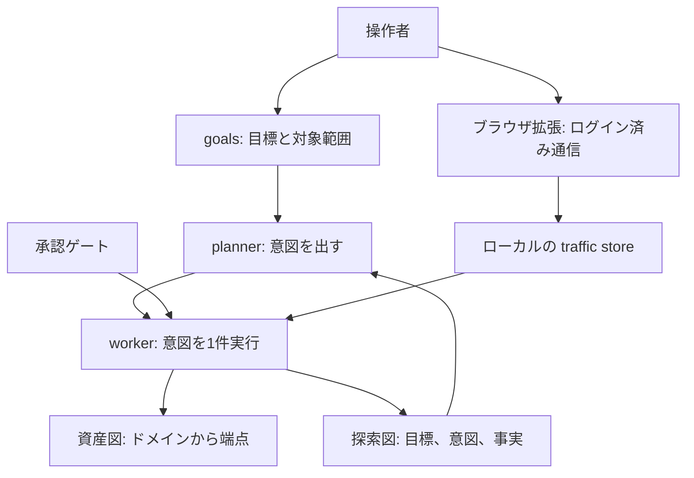

GMOサイバーセキュリティ byイエラエは、2026年10月19日の公開記事で、日本企業向け侵害の攻撃元インフラに ARTEX が使われていることを確認した、と書いています。公開記事の確認は、同社が調査した結果の表明です。この記事では、ARTEX が操作者の範囲指定と図の更新をどうつなぐか、公開資料の上で確認がどの層まで届くか、防御側が許可の台帳と連続試行をどう並べるかを整理します。

*この記事の全体像。以下、順に解説します。*

## ARTEXとは

ARTEX は、LLM を接続して使う自律型ペネトレーションテストのオーケストレーションです。オーケストレーションとは、探索の手順を複数の役割に分担させる仕組みを指します。操作者が目標と対象範囲を渡します。planner が意図を切ります。worker がツールを実行します。結果は資産図と探索図に書き戻されます。

planner は、渡された目標を、実行する単位である意図へ切り分ける役割です。worker は、その意図を 1 件ずつツール実行へ落とす役割です。

2026年10月19日、GMOサイバーセキュリティ byイエラエの福森氏は、日本企業向け侵害の攻撃元インフラを調べ、この ARTEX が使われていることを確認したと書きました。前回記事は、フォレンジックログから AI 利用を推定したものです。前回記事にツール名はありません。前回記事の URL は `/blog/20261014/` で、ページ上の公開日は 2026.10.15 です。

### planner と worker

planner が意図を出します。worker が意図を 1 件ずつ実行します。探索図は、タスクごとの目標、意図、事実、発見を置く図です。タスクは、その図が目標や意図をまとめる単位です。そのタスクあたりの worker 数の初期値は 3 です。この初期値は、英語訳 README の Concurrency に書かれています。

### 資産図と探索図

資産図は、会社に属する共有の台帳です。ノードは root_domain、subdomain、ip、service、app、endpoint です。探索図は、タスクごとの目標、意図、事実、発見を置く図です。

対象範囲は、task scope と会社の asset scope で持ちます。task scope は、そのタスクで対象にしてよい範囲です。asset scope は、会社の資産として持つ範囲です。README が外部の資産同期の例として挙げる項目は、domain、subdomain、IP、port、site、endpoint です。どの外部の台帳から取り込むかは、この記述にはありません。

### 承認ゲートとコンソール

ツール呼び出しには承認ゲートがあります。承認ゲートは、ツール呼び出しの前に人の承認を挟む仕組みです。README は、承認ゲートの呼称として guard と intercept を挙げます。二つの呼称の差は、この記述にはありません。コンソールは、初回の管理者パスワードと JWT で入ります。

### ブラウザ拡張と記録

ブラウザ拡張は、操作者が開いたタブの通信を、ローカルの traffic store に入れます。traffic store は、その通信を置くローカルの保存先です。README の例には、ログイン、メール OTP、2FA を含む閲覧があります。取り込んだ通信の本文は 256 KiB で切ります。1 バッチは 50 件までです。バイナリ本文は取り込みません。

記録用のトラフィックプロキシも同梱します。データは、操作者の PostgreSQL とローカルの traffic store に置きます。構成はセルフホストです。セルフホストとは、操作者自身の環境にデータを置くことを指します。探索には外部 LLM の API キーが要ります。README が名指しするのは、Anthropic と OpenAI のキーです。

利用条件は、自分が所有するか、明示的にテストを認可された対象に限る、と README が書いています。

### 1回の探索の流れ

製品の 1 回の探索は、人の範囲指定から始まります。図の更新が、次の意図を起こします。認証済みの中身は、別経路で人のブラウザから入ります。

資産図のノードは、domain、IP、service、app、endpoint です。ここまでのノードの並びは、README の箇所ごとに違います。同じ集合には畳みません。公開面の列挙から始まることが多いです。README では、公開資産に加え、探索で得た内部の資産も同じ図に載り得ます。ログイン後のリクエストと応答は、操作者が認証済みタブの取り込みを始めたときに traffic store へ入ります。

planner の計画メモは、依存のある複数段を順に意図へ割るためのものです。製品 README はその例に、認証情報の取得や横移動を含みます。

## 注意点

### 確認の表明

GMO の 2026年10月19日の記事は、「ARTEX が使われていることを確認」と書きます。公開本文には、個々のリクエストと各社の侵害結果を結ぶログは付いていません。読者が追えるのは、調査主体による確認の表明までです。

確認の対象は、最初に調べた攻撃元インフラです。同じ記事が後から挙げた 6 台は、「AI を使った攻撃インフラ」です。各台を ARTEX とは書いていません。

韓国の金融機関キャンペーンと「同じ手口」とした箇所は、「推察」です。CrowdStrike の結果と「併せて考察すると」、国と業種ごとにホストを分けている、と続きます。日本と韓国以外を狙っているかは、「現在調査中」です。

### 社数の分母

約 20 社、うち 9 社が同業種、は「今回調査した攻撃元インフラ」の標的です。9 社の業種名は公開本文にありません。6 台の業種一覧とは別の記述です。漏えいリリース済み 8 社は、「標的とされていたと我々が確認した日本企業のうち」です。約 20 社の内数だと、本文だけでは確定できません。8 社は、2026年9月から10月にリリースを出している、という事実の表明です。各社の侵害手順を、ARTEX の操作単位で公開しているわけではありません。社名はありません。

### 数を足さない

前回記事の「合計で数百の IP」は、WAF の閾値ぎりぎりで送信元を変えた、という傾向分析の記述です。記事自身が、特定事案の説明ではないと断っています。CrowdStrike が韓国側で列挙したプロキシは 9 件です。別の計測です。数を足しません。

### 自律と呼ぶ範囲

「自律」は、人が目標を渡さないという意味ではありません。英語訳 README には、人との対話と承認ゲートがあります。

CrowdStrike は、韓国側のオープンディレクトリに、中国語のペネトレーションテスト用プロンプトと Claude Code のセッション履歴があったと書きます。一方、AhnLab ASEC の自社実験は、対象と目標と許容範囲だけの短い依頼のあと、追加の人手介入なしに目的へ到達したと報告します。この実験のページ表示は Oct 14 2026、datePublished は 2026-10-13T15:00:00Z、更新は 2026-10-15T06:30:38Z です。ゲートの存在と、その実行で承認が必須だったかは別です。日本事案の承認設定は公開されていません。

### 名前と User-Agent

製品名だけを検知条件にすると、名前を変えた配布を落とします。AhnLab ASEC の分析は、元の GitHub リポジトリが消えたあとに、製品名、UI、ファイル構成、エージェント設定、言語を変えた再配布が増えていると書きます。ページ表示は Oct 15 2026 です。datePublished は 2026-10-14T15:00:00Z で、日本時間の 2026年10月15日 0:00 です。同記事が別名の例に挙げるのは、ScopeWeaver、Tangora PTaaS、Horda、Meze、AegisLoop、Bob Research Labs です。これは、GMO が観測したホストが別名版だった、という証拠ではありません。AhnLab は別記事で、単一の User-Agent も ARTEX 使用や侵害成功の決定的証拠にしない、と書きます。

### 星の数と上流リポジトリ

英語訳ミラー BaaRai/ARTEX の star は、2026年10月20日時点で 23 です。ライセンスは AGPL-3.0 です。pushedAt は 2026-10-18 です。star は採用規模の指標には使いません。上流の Autumn-27/ARTEX は、同日の `gh repo view` でリポジトリを解決できませんでした。削除、非公開、移転のどれかは、このエラーだけでは分かりません。AhnLab の同じ記事は、元のリポジトリが消えたと書いています。

## 2026年10月19日の記事で増えた観測

前回記事から続報へ、公開本文の差分は次のとおりです。

| 項目 | 前回（URL 20261014、ページ日付 2026.10.15） | 2026年10月19日 |
|---|---|---|
| AI の根拠 | フォレンジックログから、AI が使われたことはほぼ間違いない、という著者の判断。ツール名は無い | 攻撃元インフラ上で ARTEX が使われていることを確認した、と書く。前回を「可能性が高いと推定」と言い換えて参照する |
| 対象の切り方 | 個別事案ではなく、相談を受けた多くの事案の傾向 | 調査した攻撃元インフラ、約 20 社、うち 9 社が同業種。観測範囲ではほぼ日本のみ |
| インフラの数 | 数百 IP を切り替えながら、という送信元の話 | そのインフラに加え、日本企業ばかりを狙った AI 利用インフラを 6 台。業種はデジタルギフト・小売り流通、教育・ギフト・印刷、ポイントギフト・マーケティング、保険・金融、EC・メディア・物流、EC |
| 被害との接続 | 特定事案には言及しない | 確認した標的のうち、2026年9月から10月に漏えいリリース済みが 8 社。社名は無い |
| 韓国との関係 | 書かない | CrowdStrike が報じた韓国の金融機関キャンペーンと「同じ手口」との見方は推察。同一犯・同一インフラかは本文から不明 |

前回の 3 点は、2026年10月19日の記事では繰り返されません。3 点は、CVE に載らない版、外部からの非破壊検査と攻撃側の非対称、WAF の閾値回避です。続報が足したのは、ツール名と、インフラ単位の標的観測です。

## 公開資料の上で到達が分かれる三層

公開資料の上では、到達は三層に分かれます。日本の事案がどの層だったかは、GMO の本文にはありません。

1. 外部から始まる資産。製品の資産図が名前を付ける単位は、domain から endpoint までです。公開面の列挙が起点になりやすいです。README は、ノードを公開資産だけに限定していません。内部で見つけた資産も同じ図に載り得ます。CrowdStrike が industry reports として伝える韓国側の具体は、金融ブローカー向けのローン進捗照会と、従業員向けモバイル勤務支援です。これは CrowdStrike が業界報道を伝えた二次情報です。同記事は、これらが認証前だけか認証後かを分類していません。ARTEX を載せたホストが韓国側の攻撃を実行した、は CrowdStrike の “likely” です。
2. 操作者が渡した認証済み通信。英語訳 README のブラウザ拡張は、操作者自身が認証済みタブを開き、取得を開始します。機能があることと、日本の攻撃元がそれを使ったことは別です。GMO の続報に、認証済みブラウザやログイン後操作の記述はありません。
3. 足がかりの先。AhnLab の自社実験は、脆弱性の名前と手順を実験者から与えず、対象と目標と許容範囲だけを渡したうえで進んだと報告します。ページ表示は Oct 14 2026、datePublished は 2026-10-13T15:00:00Z で日本時間の 2026年10月14日 0:00、更新は 2026-10-15T06:30:38Z です。一つの環境では対象ホスト上のプログラム実行まで進みました。別の環境では、境界の足がかりのあと、内部ホストでの遠隔コマンドまで進みました。これは実験環境の能力確認です。日本企業の侵害経路の記録ではありません。

防御側が今切れる線は、次のとおりです。製品は、外部の公開面だけを見るスキャナではありません。認証後と、足がかりの先は、人が範囲を渡し、通信を渡すか、実験のように短い目標だけで進んだ例が、製品側と実験側にあります。日本向けインフラの確認記事は、そのうちどこまで使われたかを公開していません。

## いまの公開本文から言えること

2026年10月19日の増分は、ログの質感からツール名と攻撃元インフラへ進んだことです。約 20 社規模の標的観測と、漏えいリリース 8 社の併記は、そのインフラ調査の結果として読みます。韓国との同一犯、6 台全部が ARTEX であること、日本側が認証後まで進んだことは、この公開本文の結論に含めません。

支持できる点は次のとおりです。

- GMO が前回を明示し、推定から ARTEX の使用確認へ進んだと、自分で差分を書いています。
- CrowdStrike は 2026年10月7日に、韓国の金融組織向けキャンペーンの攻撃者インフラから、Claude Code の履歴、ARTEX の設定、Claude のメモリを見たと書きます。キャンペーンの期間は、2026年9月下旬から10月上旬です。一覧上の公開は 2026-10-07、schema.org の dateModified は 2026-10-13T18:12Z です。CrowdStrike が書くその攻撃者インフラの主 LLM は、DeepSeek v4.1-flash です。追加セッションには GLM-5.3 と Grok 4.6 があります。これは、製品 README が名指しする Anthropic と OpenAI のキーとは別の記述です。話者が中国語で金銭目的である、という CrowdStrike の評価は moderate confidence です。
- 製品 README は、公開資産の図と、認証済み閲覧の取り込みと、承認ゲートを分けて説明しています。

留保は次のとおりです。

- 「インフラにファイルがあっただけ」へ弱める文言は、GMO 本文にはありません。同本文は使用を確認したと書きます。ただし操作単位のログは公開されていません。
- 日韓が同一インフラだという突合は、GMO にも CrowdStrike にもありません。別物だと確定する反証もありません。
- 試行間隔だけを攻撃とみなすと、正規の診断と死活監視に当たります。Tenable の Web App Scanning 手引きは、スキャナが複数利用者として同時に巡回し得ることと、毎秒リクエストの調整を書きます。AWS の Application Load Balancer 文書は、登録先へ設定間隔でヘルスチェックを送ると書きます。AWS WAF のレート規則の留保は、精密な間隔制限が目的ではないと書きます。いずれも、今回の通信が正規診断だった、という証拠ではありません。

## まだ閉じない問い

公開資料のままでは、次は閉じません。

- 日本側の確認は、ARTEX のどの機能に対応するか。候補は、公開面の探索、認証済み通信の取り込み、足がかりの先です。
- 6 台のうち、ARTEX と確認できた台数。
- 約 20 社と 8 社の包含関係。8 社のリリースが、同一グループの侵害をどこまで個別に示すか。
- 前回記事の数百 IP と、続報のインフラが、同じ送信元集合か。
- 韓国側の “likely” と moderate confidence を、日本側の確認がどこまで共有するか。CrowdStrike は、個人情報を含むプロンプトについて、脅威アクターと確定はできないと書きます。個人情報そのものはここへ転記しません。
- 元リポジトリの消滅の意味。削除か、非公開か、移転か。

## 防御側は許可の台帳と連続試行を同時に見る

公開 API を台帳と認可で止める見方の隣に、診断ツールが攻撃側の実行基盤になる見方を足します。足すときの単位は、製品名ではありません。許可の台帳と、台帳に無い連続試行です。

台帳に残す正規の診断は、次の 5 つです。対象（ホスト、パス、環境）。期限。許可した試行間隔または上限レート。送信元の識別子。承認者。

台帳に無い連続試行は、先に調査対象にします。送信元、対象パス、認可の有無が揃ってはじめて、許可のない試行として扱います。ヘルスチェックや、台帳に書き忘れた正規診断を、不一致だけで攻撃と閉じません。

検知は次を同時に見ます。

- 周期と継続。間隔だけは、ヘルスチェックと認可済みスキャナも満たします。
- 送信元が、その期限の台帳にあるか。
- 対象パスが、許可した公開面の中か、認証後の API か。
- 名前と User-Agent。AhnLab の観察どおり、名前も User-Agent も単独では決定的にしません。

認可の無い連続試行を、「診断に似ている」で残しません。似ていること自体が、このツールの設計と重なります。設計は、範囲を渡して探索させることです。

## まとめ

ARTEX は、操作者が目標と対象範囲を渡し、planner が意図を切り、worker が実行し、資産図と探索図へ書き戻すオーケストレーションです。承認ゲートと、認証済みタブの取り込みは、公開面の列挙とは別の経路です。

2026年10月19日の増分は、推定からツール名へ進み、攻撃元インフラの標的を約 20 社規模で書いたことです。漏えいリリース 8 社は併記です。6 台全部が ARTEX であること、韓国と同一犯であること、日本側が認証後まで進んだことは、この公開本文の結論に含めません。

防御側が先に置く単位は、製品名でも User-Agent でもありません。許可の台帳に残る正規診断と、台帳に無い連続試行です。送信元、対象パス、認可が揃ったところまでを、許可のない試行として扱います。

この記事が少しでも参考になった、あるいは改善点などがあれば、ぜひリアクションやコメント、SNSでのシェアをいただけると励みになります！

## 参考リンク

- [相次ぐ不正アクセスの攻撃元の多くがAIであることを確認（GMOサイバーセキュリティ byイエラエ、福森、公開 2026.10.19）](https://gmo-cybersecurity.com/blog/20261019/)
- [相次ぐ不正アクセスに備える３つのポイント（同、URL `/blog/20261014/`、ページ上の公開日 2026.10.15）](https://gmo-cybersecurity.com/blog/20261014/)
- [Unknown Threat Actor Uses AI-Driven ARTEX to Target South Korean Finance（CrowdStrike Intelligence、一覧上の公開 2026-10-07、dateModified 2026-10-13T18:12Z）](https://www.crowdstrike.com/en-us/blog/unknown-threat-actor-uses-artex-to-target-south-korean-finance/)
- [BaaRai/ARTEX README（英語訳ミラー、AGPL-3.0、pushedAt 2026-10-18）](https://github.com/BaaRai/ARTEX/blob/main/README.md)
- [The Threat of AI-Driven Autonomous Penetration Testing, as Examined by ARTEX（AhnLab ASEC、datePublished 2026-10-13T15:00:00Z、dateModified 2026-10-15T06:30:38Z）](https://asec.ahnlab.com/en/95845/)
- [Analysis of the Infrastructure of ARTEX … #4 - The Birth of Copy Cat（AhnLab ASEC、datePublished 2026-10-14T15:00:00Z）](https://asec.ahnlab.com/en/95875/)
- [Tenable Web App Scanning, Getting Started](https://docs.tenable.com/web-app-scanning/Content/WAS/GettingStarted/GetStarted.htm)
- [Health checks for Application Load Balancer target groups（AWS）](https://docs.aws.amazon.com/elasticloadbalancing/latest/application/target-group-health-checks.html)
- [Rate-based rule caveats（AWS WAF）](https://docs.aws.amazon.com/waf/latest/developerguide/waf-rule-statement-type-rate-based-caveats.html)
