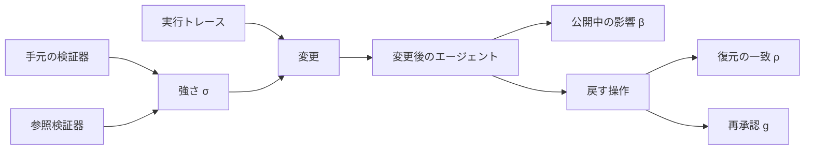

配備済みのエージェントが、自分の実行トレースから変更を作り、自動の検証器が承認し、人が著者にならないまま出す自己改修について、Wang と Qi の論文は無人で回してよい範囲を二つの測れる量で区切ります。一つは検証器の強さです。もう一つは、悪い変更を戻せるかという回復可能性です。

この記事では、二つの量の定義、著者らのプラットフォームでの置き方、公開ベンチマーク上で測られた範囲を整理します。自分のエージェント基盤で、人を外してよい変更の種類を先に決める材料にしてください。

論文は [arXiv:2610.27465v1](https://arxiv.org/abs/2610.27465)（2026-10-20 提出）です。NeurIPS 2026 の AgenticOS ワークショップ採録は著者のコメントと PDF の欄にあり、公式サイトの採択一覧では 2026-10-22 時点で確認していません。

*この記事の全体像。以下、順に解説します。*

## 無人のエージェント自己改修とは

論文が扱う自己改修の 1 ステップは、自分の実行トレースから変更を導出し、人が書かず、検証器を通して入れることです。推論の途中で自分の出力を直す自己修正と、人が書いた修正は、この定義に入りません。

対象は、すでに配備されたエージェントです。エージェントは、重み、システムプロンプト、ツールスキーマ、スキルの組として書きます。スキルは、プロンプトやツール定義と並ぶ編集対象の一つです。変更の種類ごとに、戻し方と、戻すときに再承認が要るかを別のリソースとして持ちます。

検証器の強さ σ は、手元の検証器が信頼できる参照検証器とどれだけ一致するかを、Matthews 相関で −1 から 1 まで表した量です。Matthews 相関は、合否のような二値判定の一致を、件数の多い側の割合に引っ張られにくい形でまとめた係数です。検証器が自分で付けた点数ではありません。常に同じ答えを返す検証器は σ = 0 になります。精度だけを見ると多数派の割合に見えてしまうため、論文は Matthews 相関を使います。

回復可能性は、悪い変更を戻す側の性質です。三つの指標に分かれます。

- 再承認の要否 g は 0 か 1 です。古いプロンプトやスキーマ、残したチェックポイントへ書き戻すだけなら 0 で、同じ検証器の再承認は要りません。古い値が残っておらず、戻す変更そのものを生成してゲートに通すなら 1 です。ゲートは、変更を出してよいかを検証器が決める関門です。
- 復元の一致 ρ は、戻したあと合否が変更前と同じタスクの割合です。
- 公開中の影響 β は、変更が載っているあいだに合否が変わったタスクの割合です。合否を見るために用意した課題の集合（プローブ集合）の中だけを見るので、下限です。発行済みの返金のような、すでに実行された作用は、この集合の外です。ツールを呼び出した境目で別に追う、と論文は書きます。

無人で出してよい条件は、古い値を残していて書き戻せる（g = 0）ことと、強さ σ を測ってあり下限 σ_min 以上であること、の両方です。σ_min は、無人での公開を許す強さの下限です。どちらかが未測定なら拒否します。ゲートの結果は採用と却下の二つではありません。無人では決められない拒否を、欠けている条件とともに記録します。

著者らのプラットフォームでは、プロンプト、ツールスキーマ、スキルの編集を無人で進め、重みの更新は人の承認に残します。主な貢献は定義と測り方です。試験は自社の承認ゲートと、τ²-bench 上のプロンプト編集です。τ²-bench は、会話エージェントのツール利用を課題単位で合否にする公開ベンチマークです。本文は 6 ページに付録が付きます。

1 ステップは、トレースから変更を作り、検証器が採否を出し、公開中の影響を残し、古い版へ戻す、という流れです。強さ σ は採否の側に付きます。g と ρ と β は戻す側に付きます。

fine-tune の前に、訓練集合の多様性を 0 から 1 で採点する LLM 判定器があります。多様性は、種課題（訓練集合のもとになる課題）がどれだけ違って並ぶかです。不均衡は、いちばん多い種課題が例の何割を占めるかで、入力にはその割合が数として渡されます。本番設定はこの不均衡を無視して同じ点数を返し、エラーを出さないことがありました。信号を消す検査（測ると称する性質を入力から消し、点数が変わるかを見る検査）と、リクエスト設定が実際に効いたかの検査を、プラットフォームに置きます。制御実験は τ²-bench の airline と retail です。この二つは、そのベンチマークの課題領域です。主に使うのは airline で、retail は傾向の確認です。エンドツーエンドで動かしたのはシステムプロンプトの改訂です。

## 注意点

論文の要約と表 3 は、ゲートが健康に見えて何でも承認しうることと、公開中にタスクの 17% の結果が通常のばらつきを超えて変わることを、短い文で述べます。測られた事実は、その文より狭いです。

### 定数の点数は、常に承認する検証器そのものではない

多様性ゲートの本番設定は、入力の不均衡を無視して 40 回すべて 0.250 を返しました。不均衡の記述を消したプロンプトと同じ点数です。4 水準すべてで点数が動かない構成は 37 中 9 で、いずれも本番の判定器でした。その判定器は 37 構成中 33 を担当したので、件数だけでは有意ではありません。付録 A の Fisher の正確検定は p = 0.55 です。Fisher の正確検定は、件数が少ない分割表の偏りを直接計算する検定です。

同一入力の比較では、breadth が 3 の本番判定器だけが平坦でした。breadth は、互いに違う種課題の個数です。大きい二つの判定器（比較対象の claude-sonnet-5 と claude-opus-5。本番の claude-haiku-4-5 より大きい側）は不均衡に追従しました（各 p < 10^-11）。表 3 の “approving anything” は、この定数を σ = 0 の点とみなした含意です。低すぎる集合は訓練に使わない、と本文は書きます。0.250 が採用側か不採用側かは、カットオフが本文にありません。

常に承認する合成検証器は表 1 の別行です。失敗した軌跡（1 回の実行の記録）42 本をすべて通し、σ = 0 です。breadth 6 の本番ゲートは、不均衡の四水準で 0.938、0.506、0.445、0.371 と動きます。点数と不均衡の順位相関は −0.836 で、定数ではありません。

### 17% はシミュレートした課題結果の床超えである

17% は、生の影響範囲そのものではありません。影響範囲は、ここでは β の実測です。採用した変更 4 件のうち、テスト実行が残った 3 件の影響範囲は 0.24、0.28、0.24 です。何も変えないときの床 β0 = 0.08 を、3 件をまとめると 0.17 超えます。差は β − β0 = 0.17、区間 [0.08, 0.27]、片側 p = 0.0002 です。この 0.17 は、0.24 から 0.08 を引いた値そのものではありません。

合格から不合格が 20、不合格から合格が 18 で、平均の合格率はほとんど動きません。測ったのは airline のシミュレートされた課題結果です。本番の返金率ではありません。

### 強さの下限は、このデータが固定しない

σ_min は、このデータが固定しません。弱い検証器が害を出し始める強さは、ゲートが平均する回数で ±0.15 動く、と本文が書きます。付録 E の三点は、60 回で 0.41、30 回で 0.56、15 回で 0.49 です。これは推奨カットオフではなく、regret が上がり始める位置です。regret は、完全な検証器が選ぶ候補に比べて、その検証器が選んだ候補がどれだけ劣るかです。

airline の候補プールは field-limited です。最良と平均の差は 0.069 です。ノイズとの比 0.62 は、この差を測定のノイズで割った値です。1 を下回ると field-limited です。field-limited は、その比が小さく、閾値を推定できない状態を指します。付録 E はその場合、閾値は推定できない、と書きます。最初の比の見積もり 1.39 は、実行後に 0.62 へ訂正されています。

「弱い検証器は悪い変更を選ぶ」は、点の並びとしては σ = 1 の regret 0.000 から σ ≈ 0 の 0.067 へ上がります。傾き −0.065 の区間 [−0.234, 0.120] は 0 を含み、片側 p = 0.23 です。0.067 は、完全な検証器が選べる最大差 0.069 の 98% でもあります。

retail の傾きは +0.008、区間 [−0.115, 0.109] です。論文は失敗した再現ではなく未試験と書きます。retail の最良と平均の差は −0.009 で、こちらも field-limited です。

### 一致 0.70 の区間は広く、偽承認はタスクで数えると開く

LLM 判定器の σ = 0.70 は、同じ 80 軌跡上のプログラム検査との一致で、ゼロより上です（Fisher p < 10^-9）。タスク単位で再標本すると区間は [0.36, 1.00] になります。偽承認（参照が不合格とした実行のうち、判定器が合格としたもの）4 件は 1 タスクの 4 試行です。偽拒否（参照が合格とした実行のうち、判定器が不合格としたもの）8 件は 2 タスクです。付録 E は、タスクで数えた偽承認の上側が約 0.37 で、実行回数で数えると 0.20 に見える、と書きます。表の 0.10 は、参照が不合格とした軌跡に対する偽承認の割合そのものです。0.20 と 0.37 は、その割合の上側で、実行回数で数えた場合とタスクで数えた場合です。0.10 と同じ量ではありません。

参照のコミュニケーション検査（発話が参照の条件を満たすかを見る検査）がかかるのは 80 本中 4 本だけです。残り 76 本では、参照はデータベース状態の一致そのものです。

### 保存した書き戻しと、作り直した取り消しは別の結果である

保存したプロンプトの書き戻しは、テスト 20 タスクで ρ − ρ0 = 0.000 でした。ρ0 = 0.95 です。TOST の幅 ±0.05 で p = 0.007 です。TOST は、差が事前に決めた幅の中に収まるかを見る同等性の検定です。

古いプロンプトを隠して作り直した 3 つの undo（戻すための変更そのもの）は、訓練 30 タスクで床 0.98 よりまとめて 0.16 低くなりました。本文の差は −0.16、区間 [−0.27, −0.07]、片側 p = 0.0001 です。ゲートは 3 つとも拒否しました。論文は、三本の訓練合格率 0.567、0.517、0.517 が元の 0.617 を下回ったことを拒否の根拠にし、その差を −0.05、区間 [−0.23, 0.13] で有意でない、と書きます。各本の引き算（−0.05、−0.10、−0.10）そのものではありません。

この比較は、拒否された undo を仮に入れた場合の話です。分割も、g = 0 のテスト 20 タスクとは揃っていません。

### 完全な検証器でも、訓練上の利得は過大に見える

完璧な検証器でも、選んだ候補の訓練スコアは held-out を 0.20 上回りました（片側 p = 0.08）。held-out は、訓練に使っていないテスト課題です。内訳は、どの候補にもかかる訓練課題とテスト課題の差 0.09 と、勝者の呪い 0.11 です。どちらも有意ではありません。勝者の呪いは、候補の中から一番良く見えたものを選ぶと、偶然の上振れを拾いやすいことです。retail では差 −0.02 で再現しません。補正は推奨しますが、著者らは自分のデータではまだ比較していません。

### エンドツーエンドはプロンプト編集だけである

エンドツーエンドの試験はプロンプト編集だけです。ツール、スキル、重みの無人化の判定は定義からで、別に試していません。規則は事後に当てはめています。場所は本番ではなく τ²-bench です。敵対的なエージェントは対象外です。

実験のスクリプトとデータは著者に請求する、と付録 A が書きます。2026-10-22 の GitHub リポジトリ検索（`2610.27465`）は 0 件でした。公開の批判や追試は、投稿から 2 日の時点では見つかっていません。

ワークショップの公式サイト [AgenticOS @ NeurIPS 2026](https://agentic-fmos.github.io/) は、2026-12-11 の Sydney 開催、通知 2026-09-29、camera-ready 2026-10-19 を載せます。採択論文の一覧は、2026-10-22 にそのページと OpenReview の検索では確認できませんでした。

### 成果物を戻せることと、外部効果を戻せることとは別である

隣接する一次文献は、成果物を書き戻せることを、外部効果の回復と同一視しない、という留保を強めます。

[DART](https://arxiv.org/abs/2605.23311) は、局所チェックポイントからの復元が、もはや無い上流の履歴に結びついた下流の成果を残し得ると書きます。評価した commitment-sensitive の事例では、入口だけを戻す復元が失敗し、許容できるチェックポイントは成功した、と述べます。commitment-sensitive は、途中の約束や確定が後段の成果に残る性質です。LangGraph 上の決定的な schedule-form の行では、組み込みのチェックポイント復元が 0.00 になった、と本文が書きます。

[ACRFence](https://arxiv.org/abs/2603.20625) の要旨は、復元後の再試行が元の呼び出しと同一になるという仮定は LLM エージェントでは外れ、二重支払いや消費済み資格の再利用が起き得る、と述べます。検証は proof of concept です。

どちらも、この論文の 17% を本番の返金率として測ったものではありません。

## 検証器と回復をどの設定で測ったか

多様性ゲート（§5.1、付録 A、B）の因子は次のとおりです。判定器 3、プロンプト変種 4、不均衡 4 水準、breadth 3 から 12、エージェント構成 2 です。二つの構成は、ツール数 4 と 6 のエージェントです。本文は 172 設定を各 10 回と書きます。付録は、1,720 呼び出しのうち 1,718 が点数を返し、2 つは平文だった、と書きます。点数が実行ごとに動く設定は 172 中 98 です。定数は、同じ入力で常に同じ出力を返す復号（貪欲デコード）だけでは説明しません。

本番のモデル名は claude-haiku-4-5 です。比較は claude-sonnet-5 と claude-opus-5 です。これらは論文に書かれた識別子です。

閾値文言「最大シードが 50% を超えたら点数は高々 0.10」は、50% 超の 16 設定すべてで守られました。ここでのシードは乱数の種ではなく、種課題です。最大シードは、いちばん多い種課題が例に占める割合です。この閾値文言は、同一入力で 30 回中 30 回守られました。元の文言は、同じ入力で 30 回中 0 回でした。Fisher p < 10^-16 です。

効かなかったリクエスト設定は 3 つです。ツール呼び出しの強制は、extended reasoning（その強制と両立しなかった、論文が併記した推論の設定）と併用できず、API が拒否しました。社内ゲートウェイは、固定出力形式の指定を形式なしで転送し、何も言いませんでした。判定器は温度指定を拒否しました。測定は 2026-08-13、提供者 1、ゲートウェイ 1 です。

τ²-bench airline（§5.2、表 1、表 2）のタスクは 50 です。訓練 30、テスト 20 です。テスト軌跡は 20 タスク × 4 試行で 80 です。訓練は各 2 回です。区間は、課題を復元抽出する再標本の 95% です。実験 A（弱い検証器が悪い変更を選ぶかの実験）の再標本は 2,000 回、それ以外は 20,000 回です。エージェントを動かした回数ではありません。

表の偽承認と偽拒否は、80 本全体に対する割合ではありません。偽承認は参照が不合格とした軌跡を分母にし、偽拒否は参照が合格とした軌跡を分母にします。

| 検証器 | σ | 偽承認 | 偽拒否 | 承認率 | 本数 |
|---|---|---|---|---|---|
| データベースとコミュニケーション（参照） | 1.00 | 0.00 | 0.00 | 0.48 | 80 |
| データベース一致だけ | 1.00 | 0.00 | 0.00 | 0.48 | 80 |
| LLM 判定器（自然言語の表明） | 0.70 | 0.10 | 0.21 | 0.43 | 80 |
| 参照行動との一致 | 0.67 | 0.21 | 0.12 | 0.53 | 72 |
| コミュニケーションの部分文字列 | 定義できず | — | 0.00 | 1.00 | 4 |
| 常に承認 | 0.00 | 1.00 | 0.00 | 1.00 | 80 |

自然言語の表明は、各課題に付いた自然言語の合否条件です。LLM 判定器の行は、それを見ます。コミュニケーションの部分文字列は、発話の部分文字列を見る検査です。かかるのは 4 本だけで、参照はその 4 本をすべて合格にします。相関を取る不合格が残らないので、σ は定義できません。参照行動との一致は、参照の行動と揃うかを見る行で、本数は 72 です。72 本になる理由は、論文のこの表だけでは書けません。

参照判定を確率 ε で反転したときの regret と、訓練スコアから held-out を引いた校正ギャップは次のとおりです。表 2 は 0.05 刻みのうち一段おきを載せます。各点は 400 回の反転の平均です。

| ε | σ | regret | 校正ギャップ |
|---|---|---|---|
| 0.00 | 1.000 | +0.0000 | +0.2000 |
| 0.10 | 0.802 | −0.0007 | +0.1604 |
| 0.20 | 0.602 | +0.0026 | +0.1311 |
| 0.30 | 0.399 | +0.0164 | +0.1255 |
| 0.40 | 0.199 | +0.0328 | +0.1308 |
| 0.50 | 0.001 | +0.0671 | +0.1573 |

候補のテスト合格率は 0.26 から 0.60 です。20 テストタスクでは、候補スコアの不確実性が約 ±0.24 です。傾きの確認には held-out 約 220 タスク、過大な利得の確認には約 60 タスク、と付録 D は書きます。導入の “just over half” はベースラインの定性的な記述で、百分率としては本文にありません。undo 比較に出てくる元プロンプトの訓練合格率 0.617 は、この句の言い換えではありません。

回復（実験 B、付録 C）の主な値は次のとおりです。Holm は、複数の検定で偶然の有意を抑える補正です。

| 量 | 値 |
|---|---|
| 何もしないときの ρ0（テスト 20） | 0.95、区間 [0.89, 1.00] |
| 何もしないときの β0（airline 50、各 4 回） | 0.08、区間 [0.02, 0.16] |
| 保存コピーの書き戻し | ρ = 0.95、差 0.000、区間 [−0.038, 0.038] |
| 作り直した undo 3 本の ρ（訓練 30、床 0.98） | 0.75、0.83、0.90 |
| 同、床との差（個別、Holm 後も有意） | 0.23、0.15、0.08。p = 0.0005、0.004、0.04 |
| 同、訓練合格率 | 0.567、0.517、0.517。元は 0.617 |
| 残った 3 変更の影響範囲 | 0.24、0.28、0.24 |

作り直した 3 本は互いに近い書き換えで、undo の種類は一つ、と付録は書きます。

## 変更の種類ごとに無人と人の承認を分ける

論文の規則は、検証器の自己採点と回復可能性を交換しません。強い検証器があっても、古い値が無い変更は無人にしません。書き戻しが安くても、強さを測っていない検証器では無人にしません。

著者らのプラットフォームでの置き方は、付録 C の表 6 と §4 を合わせると次になります。4 種類とも古い版は残るので g = 0 です。いずれも、すでに利用者へ届いた副作用は戻しません。adapter は、学習済み重みのうち差し替える単位です。

| 変更 | 戻し方 | g | 届いた副作用 | 無人か |
|---|---|---|---|---|
| システムプロンプト | 前の値を書き戻す | 0 | 戻らない。すでに返した応答 | 強さを測ってあれば無人にしてよい、と規則は置く |
| ツール定義 | 前の値を書き戻す | 0 | 戻らない。すでに行った呼び出し | 同上。エンドツーエンド試験は無い |
| スキル | 前の値を書き戻す | 0 | 戻らない。すでに返した応答 | 同上。エンドツーエンド試験は無い |
| 重み | 前の adapter をピンし直す | 0 | 戻らない。すでに返した応答 | 人の承認。多様性を採点する判定器が §5.1 のように黙って壊れる種類のため |
| チェックポイントを残さない fine-tune | undo を生成して同じゲートへ | 1 | 戻らない | 人の承認。検証器がどれだけ良くても拒否 |
| 訓練データフィルタ | 使える検証器が無い | 未測定 | — | 無効のまま出荷 |

訓練データフィルタは、訓練の行を一本ずつ除く側の関門です。使える検証器が無いので、無効のまま出荷します。スキルに何が含まれるかは、プロンプトやツール定義と並ぶ編集対象であること以上は、この論文では分けて書いていません。

重みが g = 0 でも無人にならない点が、要約の「プロンプト、ツール、スキルは無人、重みは人」の中身です。戻せるかどうかだけで線を引くと、重み更新まで無人側に入ります。論文はそこに、黙って壊れる検証器という別の理由を置いています。§5.1 の種類とは、多様性を採点する学習済み判定器が、入力の不均衡を消しても同じ点数を返し、エラーを出さない壊れ方です。

## 自社の基盤では論文の図より狭い線を置く

自社の変更は、先に二つに分けます。戻せる設定変更と、戻せない外部操作です。論文をそのあとに読む、という順番で足ります。読むときに使う線は、検証器の自己採点ではありません。次の二段です。

1. 成果物の版です。古いプロンプト、スキーマ、スキル、adapter を残します。戻す操作が書き込みだけで、同じ検証器の再承認を要しないことを確認します。残っていなければ無人にしません。残っていても、重み更新は人の承認に残します。この論文が使った種類の学習済み判定器が、黙って壊れるためです。モデル、プロンプト、リクエスト形式が変わった検証器は、未測定として拒否します。
2. 公開窓の外部効果です。その変更が載っているあいだに、返金、送信、本番データへの書き込みが起きうるなら、成果物を書き戻せても人の承認に残します。論文の図 2 は、プロンプト、ツール、スキルを、この外部効果があっても無人側に置いています。ここでの線はそれより狭いです。根拠は表 6 と、β がすでに届いた結果を戻さないという定義と、実副作用はツール境界で別に追うという留保です。τ²-bench はその外部効果を測っていないので、この第二段は測定の外挿です。

採用しないものは、σ_min の数値です。0.41、0.56、0.49 をカットオフとしてコピーしません。下限を自社で置くなら、付録 E の手順を自社の候補プールでやり直します。プールが field-limited なら、その手続き自身が閾値を推定できないと言います。偽承認の上限は σ とは別に、タスク単位で見ます。

自社ゲートにすぐ使える検査は二つです。測ると称する性質を入力から消し、点数が変わるかを見ます。依存しているリクエスト設定が、実際に効いているかを見ます。論文のゲートウェイでは、2026-08-13 の時点で 3 つが効いていませんでした。

逆転条件は、自社の候補プールが field-limited でなく、regret の傾きが区間ごとゼロを外れ、かつ公開窓の外部効果をツール境界で無効化または補償できることです。そのとき初めて、プロンプトやスキーマの無人化を論文の図 2 に近づけてよいです。それまでは、外部操作を含む自己改修の繰り返しは人の承認付きのまま残します。

## まだこの論文だけでは決まらないこと

次の問いは、論文の中では閉じていません。

- 本番の返金、送信、データベース更新を、β と同じ定義で測ったとき、床を超える割合はいくらか。この論文にはありません。
- ツール定義とスキルの編集を、プロンプトと同じ手順でエンドツーエンドに動かすと、g = 0 の ρ と β は再現するか。
- 参照検証器がプログラムで書けない業務で、一度ラベルした軌跡集合の再採点は、どの頻度で σ を未測定に戻すか。
- claude-haiku-4-5、claude-sonnet-5、claude-opus-5 という識別子が、公開のモデル名と一致するか。ゲートの挙動は 2026-08-13 の 1 ゲートウェイの測定です。
- AgenticOS の採択は、ワークショップ当日までに公式一覧で確認できるか。日程は 2026-12-11 です。

## まとめ

無人の自己改修は、検証器が自分に付けた点数では区切りません。古い版へ書き戻せるか（g = 0）と、参照検証器との一致として強さ σ を測ってあるか、の両方です。どちらかが未測定なら拒否します。

著者らの置き方では、プロンプト、ツール、スキルは g = 0 で、強さを測ってあれば無人側です。重みは g = 0 でも人の承認に残します。チェックポイントの無い fine-tune は g = 1 なので、検証器が良くても拒否します。使える検証器が無い訓練データフィルタは、未測定のまま出荷しません。

測られた 17% は、airline のシミュレートした課題結果が、何もしない床を超えて入れ替わった幅です。保存したプロンプトの書き戻しはノイズ床まで戻り、作り直した undo は戻りませんでした。弱い検証器が悪い変更を選ぶ傾きは、この候補プールでは有意ではありません。σ_min の 0.41、0.56、0.49 はカットオフとしてコピーしません。

返金、送信、本番への書き込みが公開窓で起きうる変更は、成果物を書き戻せても人の承認に残す、という線は論文の図 2 より狭いです。τ²-bench がその外部効果を測っていないためです。すぐ置ける検査は、測る性質を入力から消して点数が動くかと、依存するリクエスト設定が実際に効いているか、の二つです。

この記事が少しでも参考になった、あるいは改善点などがあれば、ぜひリアクションやコメント、SNSでのシェアをいただけると励みになります！

## 参考リンク

- Wang, D. and Qi, P. Recoverability and Verifier Strength: Two Measured Preconditions for Unattended Agent Self-Improvement. arXiv:2610.27465v1, 2026-10-20. [概要](https://arxiv.org/abs/2610.27465) / [HTML](https://arxiv.org/html/2610.27465v1) / [PDF](https://arxiv.org/pdf/2610.27465)
- AgenticOS workshop site. [https://agentic-fmos.github.io/](https://agentic-fmos.github.io/)（2026-10-22 取得。採択一覧は未確認）
- Yang, K. et al. DART: Semantic Recoverability for Structured Tool Agents. arXiv:2605.23311. [https://arxiv.org/abs/2605.23311](https://arxiv.org/abs/2605.23311)
- Zheng, Y. et al. ACRFence: Preventing Semantic Rollback Attacks in Agent Checkpoint-Restore. arXiv:2603.20625. [https://arxiv.org/abs/2603.20625](https://arxiv.org/abs/2603.20625)
