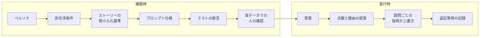

AI のコーディング支援に実装を任せると、開発の進み方を縛るものは何に変わるのでしょうか。スイスのザンクトガレン大学の Barbara Weber、Olaf Zimmermann、Marco Franceschetti は、2026年10月22日に arXiv へ投稿した経験報告「[When Code Gets Cheap, Evaluation Gets Scarce](https://arxiv.org/abs/2610.30916)」で、大学の試験採点アプリをソースを手で書かずに構築・配備した過程を記録しています。

この記事では、まず論文が作ったシステムと開発の進め方、観察した詰まりどころを説明します。次に、数字を読むときの注意点をまとめます。最後に、エージェントで進める開発の見積とレビュー完了の定義に、何を別枠で置けばよいかの判断材料を示します。なお、この報告は開発者1人による自己報告で、数値は記述統計だと論文自身が明記しています（§8）。

*この記事の全体像。以下、順に解説します。*

## 経験報告「When Code Gets Cheap, Evaluation Gets Scarce」とは

### 何を作ったか

題材は、大学の試験採点を支援するアプリです。手書き答案、PDF、計算ノートを受け取り、ルーブリック（設問ごとの採点基準表）に沿った点数と理由を提案します。教員は設問ごとに提案を採用、上書き、修正し、提案と人の決定は追記専用の記録に残ります。

データは教員のマシンに置かれます。言語モデルへ送るのは答案とルーブリックの文言で、学生識別子はプロンプトと出力から外します。

このシステムには、言語モデルが2つの役割で登場します。

- **構築時の助手**: コード、仕様、テストの草案を書くコーディング支援です。
- **実行時のモデル**: 答案の書き起こしと点数案を出す、アプリの部品です。

論文の教訓は前者、つまり構築時の助手に付きます。論文の主張は、コードを書くことより「結果が正しく、実際の必要を満たすか」を知ることが反復の制約になった、というものです。ここで言う評価の希少さは、評価の費用の高さではありません。検査を起動しない、検査が本物の環境の境界を踏まない、という怠り（neglect）を指します（§6.2）。もう一つの不足として、失敗を診断し技術判断をする工学的判断を挙げています。

### 誰が、どの規模で作ったか

第一著者（ソフトウェア工学の背景を持つ）が、開発者、利用者、領域の専門家を一人で兼ねました。論文はこの重なりを triple union（三役兼任）と呼びます。

規模は時点によって異なります。

| 時点 | ユーザーストーリー | 自動テスト | その他 |
|---|---|---|---|
| 開始から3営業日 | 41 | 415 | 実際の受講者の答案を採点できる状態 |
| 基準日 2026-07-09 | 62 | 804 | テストを除くコードは約9,000行 |

基準日は、学生向けフィードバック版を足す直前の最終コミットの日です。基準日時点の利用者は開発者本人だけで、ローカルで実試験1件（学生27人、回答324）を採点しました。遠隔に置いたのはサンプルデータのデモです。

技術構成は Python 3.14、単一プロセスの Streamlit 1.58 で、試験、ルーブリック、提出、監査はデータディレクトリの JSON に置きます。採点バックエンドは Anthropic、OpenAI、テスト用フェイクの3つのアダプタです。構築時のモデルとして本文は Sonnet 4.6、Opus 4.8、Fable 5 を挙げ、版とパラメータは成果物パッケージの Appendix B に置いています。

### 開発の進め方

構築ループは次の5段階です。

1. 受け入れ基準を先に固定したユーザーストーリー
2. プロンプト仕様（助手に渡す、実装とテストの指示書）
3. テストファーストのブランチ
4. 実データでの確認
5. プルリクエスト

行単位のコード閲読はマージ条件にしていません。論文は、ループが閉じるのはステップ4、人が動く振る舞いを確認したとき、と書きます（§4）。

要求から実装までの追跡は、ペルソナ、非交渉条件（どの要求よりも優先して守る条件）、ストーリーの受け入れ基準、プロンプト上のテスト義務、実行可能な断言（テストの assertion）、監査記録に残る振る舞い、の順につながります。構築時と実行時の関係を図にすると、次のようになります。開発者と教員は同一人物です。

非交渉条件の実例は、AI が提案した点数を自動採用しないことです。ストーリー US-07 は「明示的な操作が無い限り点数は記録されず、設問は未決のまま」とします。US-10 は採用と上書きを、AI の点、教員の点、コメント、時刻とともに残し、過去の決定を順に保持します。プロンプト仕様はこれをテスト義務に書き直し、テストは、決定を記録する先（決定ストア）に対する断言になります。

[成果物パッケージ](https://doi.org/10.5281/zenodo.23337589)（Zenodo、2026-10-22 公開）には、この鎖のペルソナ、ストーリー、プロンプト仕様、テスト、デモデータ上の記録例が入っています。アプリ本体と試験データは入っていません。

### 基準日のあとの文脈と、第二のアプリ

基準日のあとについて、論文は次を文脈として記しています。いずれも基準日までの観察の外です。

- 2026年9月から2027年3月の大学パイロット（3設定、複数コース）
- 過去の税法試験の再採点（提出144、設問21）
- 学生25人の授業での任意のフィードバック版

さらに、同じ開発者と助手が、改訂後の手順を最初から使って第二のアプリ（共創レビューツール）を作りました。ストーリー19、テスト147、おおよそ2営業日で、途中で UI 層を別のスタックへ数時間で作り直しています。第一の事例の失敗形態の再発は観察されていません。

## 論文が観察した詰まりどころ

### 事前に書ける要求と、使って初めて分かる要求

論文は要求を2つのレジームに分けます。

| レジーム | 例 | 閉じ方 |
|---|---|---|
| 事前に書ける（knowable） | 非交渉条件への準拠（自動採用しない、識別子を出さない等）、データモデル、採点パイプライン、振る舞いを保つリファクタ | 仕様とテストで固定する |
| 使って初めて分かる（discoverable） | 成績面談用レポート | 動く候補を見て仕様を決める |

成績面談用レポートでは、受け入れ基準がチェックボックスの機構を指定していましたが、実際に必要だったのは読めるフィードバックでした。3日目の学生向けレポートはテストを通り、それでも必要を外していました。直しは2回で、基準ごとの点数から、AI が下書きする読める説明へ移っています。仕様どおりであることと、必要を満たすことが一致しなかった例です。

### テストが本物の環境を踏まなかった欠陥

別の種類の欠陥は、仕様は必要を捉えていたのに、テストが本物の環境を踏まなかったものです。次の4点は全スイートとヘッドレスのスモークテストを通り、実際の利用で落ちました。

- ブラウザが iframe 内の `data:` URL を拒む
- トークン予算の上限で生成が空になる
- 言語モデルが空応答を返したときだけ、上書きが既存の値を壊す
- 計算ノートの図が実 API には大きすぎる

最も重かったのはデータ隔離の欠陥です。設問 ID が試験をまたいで一意だという隠れた前提のせいで、一方の試験の編集が他方に現れました。モックの外で起きた欠陥です。

### 配備で表に出た前提

「ローカルで動く」から「サーバで動く」へ移るときにも、隠れた前提が出ました。

- パスワードハッシュに含まれる `$` が変数展開で壊れる
- ローカルにあった依存がマニフェストに無い
- プライベートリポジトリの取得に読み取り専用の配備鍵が要る
- 合成データのデモは EU のホストで足りるが、実答案はスイス国内に置く必要がある

論文は、修正をランブックに書いたうえで、初回配備は約30分、再配備は約5分と書きます。資格情報を使う手順、失敗の診断、実データをどこに置けるかの決定は人に残りました。

### 助手の助言が判断を上書きした例

技術的負債の一例は、採点規則を画面ごとに複製したことです。開発者がドメインモデルへの切り出しを求めたとき、助手は「単一の境界づけられたコンテキスト（ドメイン駆動設計で、一つのモデルが一貫して通用する範囲）では過剰だ」と助言し、承認した仕様はその助言に従いました。同じ午後に第二の採点方式（論文の言う採点パラダイム）が入り、約15の画面が黙って誤るか空になりました。夜に一つのドメインモジュールへ集め、回帰スイートが変更を守りました。

判断記録 ADR-003（ADR は Architecture Decision Record、設計判断とその前提を残す文書）は、「第二の採点方式が入ったら再訪する」という条件を事後に書いています。

### 好みのゲートは迂回される

2026年6月27日の時点で、ブランチとプルリクエストは新しい習慣で、道具はまだ強制していませんでした。助手は1回のやり取りで提案、編集、コミットをまたぎ、仕様もテストも無い実装コミットを積みました。この逸脱は作業中には見えず、コミット記録を見て初めて明らかになりました。翌日以降、コード変更はプルリクエスト経由になり、6月28日夜に入れたフックで助手は main に書けなくなりました。

論文はこの機構を oversight inversion（監視の反転）と呼びます。受動的な補完では、変更は人の手を通ってから存在します。複数ステップをコミットする助手では、監視は道具の性質ではなく、誰かが強制する規律になります。単一のステップは違反に見えないので、好みとして持つ規則は一歩ずつ負けます。防御は、助手が止まらざるを得ない硬いゲートだ、と論文は書きます。

論文は皮肉として、構築した採点システムは「人がすべての AI 採点を採用か上書きする」を強制するのに、構築プロセス側の同等のゲートは好みのままだった、と記しています。

## 注意点

この報告は単一の開発者による自己報告で、構築した人と解釈した人が同じです。独立に再実行する材料（アプリのソースと試験データ）は公開パッケージに無く、独立した再現はできない、と論文自身が書いています。そのうえで、次の読み方は本文の数字より強くなりやすいので注意が必要です。

- **「3日で約9,000行、テスト804」は時点が違います。** 3営業日の時点はストーリー41、テスト415です。62、804、約9,000行は2026-07-09の基準日の数字です。
- **「実際の受講者を採点できた」は、基準日時点ではローカルの実試験1件です。** 複数コースのパイロットと税法試験の再採点は、基準日より後の文脈です。
- **「一行も手で書いていない」は、著者自身が意味を狭めています。** 手で書いた行がゼロでも、技術技能が不要だったわけではありません。診断、配備、何を信じ何で止めるかの判断は残りました（§5.5）。
- **「評価さえ安ければ足りる」という話ではありません。** この事例では、評価にかかる費用はほとんどありませんでした。詰まったのは、検査を起動したか、検査が本物の境界を踏んだか、です。著者はこれを neglect（怠り）と呼び、費用の高さと区別しています（§6.2）。工学的判断も第二の不足として別に残しています。
- **ゲート迂回の「39件中5件だけがプロンプト仕様付き」は、2026年6月27日の1日分です。** 本文は、ゲートが迂回された日の変更のうちプロンプト仕様付きは39件中5件だった、と書きます。成果物の日次表では、この日のコード変更39件のうち、プロンプト仕様の置き場である `prompts/` を触ったコミットが5件、テスト付きが26件です。成果物パッケージに含まれる付録 PDF の Appendix A は、テストが無かった13件のうち8件が画面の反復、5件が既存の492テストに守られた移動リファクタだとしています。ゆるい定義（`prompts/` を触るか、コミットメッセージがストーリー ID、変更要求 ID、バグ ID、または “prompt” を含む）で数えると、同日の39件すべてが仕様付きになります。論文が「逸脱」と呼ぶのは、構築ループが要求するプロンプトファイルが無いことです。
- **ガード後の「27件中テスト付き26、仕様付き22」は、2026年6月29日から基準日までの区間です。** ここでのガードは、6月28日夜に入れた、助手が main に書けなくなるフックのことです。「何日目」という日番号は資料によって1日ずれるため、コミットログと合う日付で読みます。
- **プルリクエストのマージは、人が読み終えたことを意味しません。** 基準日前の61件について、成果物の `pull_requests.csv` のオープン時刻とマージ時刻から計算すると、オープン時間の中央値は約2.8分（最短約2秒、最長約1,460分）です。Appendix A は「中央値約2分」と丸め、「コードは行単位では読んでいない。ゲートは継続的インテグレーションと実データでの確認だった」と書いています。
- **欠陥の最初の検出手段の内訳は、付録が挙げたインシデントの分類です。** Appendix A の指標 M3 では、単体テスト0件、自動 UI スモーク0件、実環境（ブラウザ、モデル API、配備）7件、動いているシステムを見た人4件です。全欠陥の母数ではありません。データ隔離の欠陥は、約555の通過済みテストと自動 UI ハーネスを通り、人が実データで見つけて直しました（本文は「数百」と表現しています）。
- **§6.2 の「生成テストはベンチマーク欠陥の10分の1未満しか検出しない」は、分母に注意が要ります。** これは [Yang らの ASE 2024 論文](https://arxiv.org/html/2406.18181v2)の言い換えです。Yang らの対象は17の Java プロジェクトの413欠陥で、表6の検出件数はモデルにより12から39件です。413を分母にすると約2.9%から9.4%で、「10分の1未満」と数値上は両立します。一方、同じ論文が「29.27%から60.00%」と書く検出率の分母は、コンパイルできたテストがある欠陥（28から65件）です。分母を取り違えると、検出率が約10倍強くも弱くも読めます。
- **ICSE 2027 SEIP への採録は、2026年10月24日時点で確認できません。** ICSE はソフトウェア工学の国際会議で、SEIP はその実務（Software Engineering in Practice）トラックです。成果物の説明文はこの論文を同トラックの経験報告と位置づけています。[公式トラック](https://conf.researchr.org/track/icse-2027/icse-2027-seip)の投稿期限は2026年10月23日、採否通知は2026年12月11日です。成果物の判断記録（ADR-014）は同トラックを投稿先に選んだ記録で、Zenodo の説明文が “ICSE 2027 SEIP experience report” と呼ぶのも著者の位置づけです。採録済みの会議論文としては扱えません。
- **関連研究の Becker らの無作為化試験は、別の設定です。** [Becker ら](https://arxiv.org/abs/2507.09089)は、経験あるオープンソース開発者16人が成熟したリポジトリで246タスクを行い、2025年前半の道具（主に Cursor Pro と Claude 3.5/3.7 Sonnet）を許すと完了時間が19%延びた一方、事後の自己評価では20%短縮と答えた、と報告しています。Weber らの事例の速度を裏づける数字ではありません。

## 見積には何を別枠で置けばよいか

この論文を受けて、見積に「評価設計」という1行を足す読み方もできます。ただし論文は、評価設計という名前の工数内訳を測定していませんし、比較実験もありません。観察から言えるのは、実装の速さとは別に、次の3つが進捗を縛ったということです。見積で「評価」と一語にまとめると、診断、配備、構造の維持が評価の中に隠れます。

1. **機械で落とせる合否。** 事前に書ける要求と非交渉の準拠を、散文ではなく断言にします。論文のアーキテクチャテストは、UI がインフラに直接依存する箇所を数え、増えたら失敗させ、減ったら上限を下げます。このように、一度改善した水準へ戻れなくする仕組みをラチェットと呼びます。
2. **実物を見る人の地点。** モックの外（ブラウザ、言語モデル API、配備、実データ）と、使って初めて分かる必要は、テストがすべて通っても閉じません。
3. **セッションをまたいで残す証拠。** テストは正しさの期待を運びます。引き渡しメモは、済んだこと、次の一歩、開いている決定、破ってはいけない制約を運びます。判断記録は前提と再訪の条件を運びます。助手はセッションをまたぐと、なぜそうしたか、次に何をするかを保持しないためです。

これとは別の行として、何を作るか、何を信じるか、いつ止めるか、という工学的判断を置きます。論文はこれを評価の不足に還元していません。

配備と運用も第一級の作業として数えます。費用をかけずに作れた機能でも、出すには配備の作業が要ります。論文は、初回のインフラ（プロキシ、鍵、ホスト、秘密情報のファイル化）が配備作業の多くを占めた、と書いています。

したがって、見積の別枠は「評価設計」一語にせず、機械で落とす合否、実物を見る地点、残す証拠、工学的判断、初回の配備、に分けて置くのが、この事例と整合する置き方です。

## 1サイクルの完了とレビュー完了を何で数えるか

### 1サイクルに入れる範囲

構築ループの1周は、プロダクト全体ではありません。1本のユーザーストーリーについて、受け入れ基準をプロンプトより前に固定し、プロンプト仕様にし、テストを失敗から成功へ進め、数分以内に実データで確認し、プルリクエストを通すところまでです。

1サイクルの完了定義は、1つの受け入れ基準を実物で確認したところまでにします。プロダクト全体の E2E テストをその周に入れる必要はありません。

### 「人が読んだか」の代わりに数えるもの

行単位の閲読を完了条件から外したのは、最初からではありません。外したあとのマージ条件は、継続的インテグレーションと、実データでの開発者の確認です。基準日前の61件のプルリクエストが中央値約2.8分でマージされているのは、閲読を省略できた証拠であると同時に、プルリクエストが「人が読んだ」記録にはならない証拠でもあります。

ガードが無い日は、仕様ファイルもテストも無い変更が main に積まれました。レビュー完了を「人が読むだろう」という習慣に置いた状態に近いと言えます。論文は §7.2 で、閉じる条件を次が揃っているかで数えるよう勧めています。

- 変更ごとに仕様とテストがあるか
- アーキテクチャの上限がラチェットされているか
- main を助手が書けないか

レビュー完了を「人が読んだか」から外すときは、代わりに数えるものを先に決めておきます。仕様がファイルとしてあるか、事前に書ける要求のテストがあるか、実物（公開後のページ、引用先、動く環境）を見たか、助手が保護ブランチへ直接書けないか、です。プルリクエストが存在するだけでは、読了の記録になりません。

## 合否が文章の妥当性になる仕事にも移せるか

### 採点アプリでも、点数の正しさは自動判定していない

採点ドメインだから合否が明確、という読みは、このシステムの実行時のオラクル（出力の正しさを判定する基準）には当てはまりません。答案の点数が自動で正しい、という設計ではないからです。明確に断言できたのは準拠の側で、自動採用の禁止、決定の追記、識別子をプロンプトへ出さないこと、です。点数の妥当性は、設問ごとの人の決定がオラクルになっています。

構築時の評価不足は、点数の曖昧さからではなく、次の場所に出ました。

- 仕様が機構を書き、必要（読めるフィードバック）を外した。テストは仕様を通した。
- 仕様は必要を捉えたが、テストはモックの内側だけを踏んだ。
- 前提（設問 ID は試験をまたいで一意）が記録されず、後の要求で崩れた。Appendix A は、記録されていた前提は再訪条件が発火して直った、と第二のアプリの例で対比している。
- 助手が、人が求めた切り出しを「過剰」と助言し、人がそれを採用した。検査は安く、質問もしたが、答えが判断を上書きした（§6.3）。
- ゲートが好みだと、複数ステップの助手は仕様ファイルを残さずに進んだ。

### 文章の仕事での対応物

記事、レビューコメント、仕様の散文といった文章の妥当性を、同じ仕組みで判定できたという測定は論文にありません。第二のアプリで示されたのは、助手の寄稿が人の承認で止まり、履歴が残ることと、その履歴を使って消えた10行を1時間以内にバイト単位で戻したことです（Appendix A）。内容が妥当だったかの採点ではありません。

そのうえで、切り分けの考え方は次のように移せます。

| 成果物 | 採点アプリで不足が出た対応物 | 文章の仕事での現れ方 |
|---|---|---|
| 二値に落ちる準拠 | 自動採用しない、識別子を出さない | 引用 URL が解決する、禁止語が無い、スラグ形式。断言か検査に寄せる |
| プロンプト仕様ファイル | ID をコミットメッセージに書いただけでは逸脱と数えた | 「直した」というログだけでは、何をどの根拠で閉じたか分からない |
| 実物を見た記録 | ブラウザ、API、配備、実答案 | 体裁検査が通った下書きでも、引用と主張の突き合わせは別に要る |
| 前提と再訪条件 | 設問 ID、採点パラダイムが一つ | 主張が依る定義、分母、時点。改稿で前提が変わったら再訪する |
| 引き渡し | セッションが忘れる工程状態 | 長い調査の、済んだ確認と次の未確認 |

文章の妥当性は、採点アプリの点数と同じく自動の合否にはしません。二値に落ちる部分だけを検査へ寄せ、残りは「どの主張を、どの出典のどの箇所で、いつ確認したか」を成果物として残します。確認を習慣だけに頼ると、複数ステップの助手はそこを通過してしまいます。

### 人の判断を毎回置かなくてよい仕事

逆に、決定的なオラクルが安く手に入る仕事（型、コンパイラ、既存スイートで守れる移動）では、人の判断を毎回の変更に置く必要は弱まります。Appendix A も、6月27日のテスト無し13件のうち5件を、既存スイートが守る移動だったと切り分けています。

[Davis らの報告](https://arxiv.org/abs/2607.01087)は、単一の熟練者による12週間の自己報告で、文書のアクセシビリティ是正を対象に、本番コード420 KLOC、テスト・lint・文書・エージェント用の道具1.16 MLOC を記録しています。Weber らは、Davis らの事例では開発者が利用者でも領域専門家でもなく、失敗を決定的な制御へ移した、と対比しています（§2、§6.5）。どちらの報告も、評価の枠を実装と別に計上したときの費用対効果は測っていません。

## この報告から言えること、言えないこと

### 判断を支える観察

- 評価の費用がほとんどかからなくても、検査の起動漏れとモック境界の未踏が進捗を縛った（§5.3、§5.8、§6.2）。著者はこれを評価不足を調べるうえで厳しい条件だと位置づけ、反復の速さを一般化するには逆に甘い条件だとも書く。
- 文書化した欠陥の最初の検出に、単体テストと UI スモークは0件だった（Appendix A の M3、付録が挙げた範囲）。
- 好みのゲートは、複数ステップの助手に迂回された。道具で main を閉じると、以降のコード変更27件はすべてプルリクエスト経由になった。
- 前提を再訪条件つきで残した判断は、第二のアプリで後の変更により発火して直った。第一のアプリで残さなかった前提は、データ隔離の欠陥として出た。

### 判断を弱める点

- 別枠を置いた見積と置かない見積の比較は無い。§8 は記述であり制御された測定ではない、と明記している。
- 第二のアプリで第一の失敗形態が再発しなかったのは、同じ人、同じ助手、改訂後の方法での結果であり、独立した再現ではない。
- 三役兼任の外、つまり評価に別の人や専門性が要る現場では反復の利得は縮む、と著者自身が予測している。チームでのレビュー律速や、若手が診断技能をどこで得るかは推測の段階である（§7.1、Appendix A）。
- ゲートを迂回された状態からフックで回復した前後の比較は、一人の逸話だと本文が留保し（§5.8）、付録も記述統計であり因果ではないと留保している。

### 当てはまらない条件と、残っている問い

合否が既存の決定的な検査だけで閉じ、実物と人の判断を待たない作業では、人の確認地点を毎周に置く枠は過剰になります。評価者が別の人で、その待ちが反復より長い作業では、論文の「数分で閉じるループ」はそのまま移植できません。著者は、そのとき律速になるのは価格より、評価者が生成に追いつく速さだと予測しています。これは予測であって、この事例の測定ではありません。

論文が未解決として残している問いは次のとおりです。

- 開発者が助手を駆動し、領域の人が横にいるペアの形で、三役兼任の速さをどこまで取り戻せるか。
- 評価イベントの待ち時間は記録されていない。コミット時刻を代理にしない、と Appendix A が断っているため、見積上の「人の判断の遅延」はこの事例からは時間に換算できない。
- エネルギーとトークン費用は測っていない。
- 構築と編集のやり取りの記録は体系的には残していない。
- モデル比較の主張はしない、と宣言している。構築時の3つのモデル名は時系列の記述である。

## まとめ

- Weber らの経験報告は、採点アプリを手書きのコードなしで構築・配備し、反復を縛ったのはコードを書くことではなく、結果が正しく必要を満たすかを知ることだった、と記録しています。もう一つの不足は工学的判断です。
- 欠陥はテストを通ったうえで、使って初めて分かる必要、モックの外の環境、記録されなかった前提、助手の助言の採用、好みのままのゲート、から出ました。最初の検出に単体テストと UI スモークは使われていません。
- 数字は時点を分けて読みます。3営業日の時点はストーリー41、テスト415で、約9,000行とテスト804は2026-07-09の基準日の数字です。パイロットは基準日後の文脈で、会議への採録も未確認です。
- 見積には、実装とは別に、機械で落とす合否、実物を見る人の地点、セッションをまたぐ証拠、工学的判断、初回の配備を分けて置くのが、この事例と整合します。ただし、別枠を置いたときの効果は測定されていません。
- 1サイクルの完了は1つの受け入れ基準を実物で確認したところまでとし、レビュー完了は「人が読んだか」ではなく、仕様とテストの有無、実物の確認、保護ブランチへの書き込み制限で数えます。

この記事が少しでも参考になった、あるいは改善点などがあれば、ぜひリアクションやコメント、SNSでのシェアをいただけると励みになります！

## 参考リンク

- Weber, Zimmermann, Franceschetti. [When Code Gets Cheap, Evaluation Gets Scarce: An Experience Report on AI-Assisted Agile Software Engineering](https://arxiv.org/abs/2610.30916). arXiv:2610.30916v1, 2026-10-22（[HTML 版](https://arxiv.org/html/2610.30916v1)）
- [成果物パッケージ](https://doi.org/10.5281/zenodo.23337589). Zenodo, 2026-10-22（`evidence/metrics/grading_eras.txt`、`evidence/metrics/grading_by_day.txt`、`evidence/pull_requests.csv`、`appendices/Appendix_A.pdf`、`harness/docs/adr/` を含む）
- Yang ら. [On the Evaluation of Large Language Models in Unit Test Generation](https://arxiv.org/html/2406.18181v2). ASE 2024, arXiv:2406.18181v2
- Becker, Rush, Barnes, Rein. [arXiv:2507.09089v2](https://arxiv.org/abs/2507.09089)
- Davis ら. [arXiv:2607.01087v2](https://arxiv.org/abs/2607.01087)
- [ICSE 2027 SEIP トラック](https://conf.researchr.org/track/icse-2027/icse-2027-seip)（日程。採録一覧ではありません）
