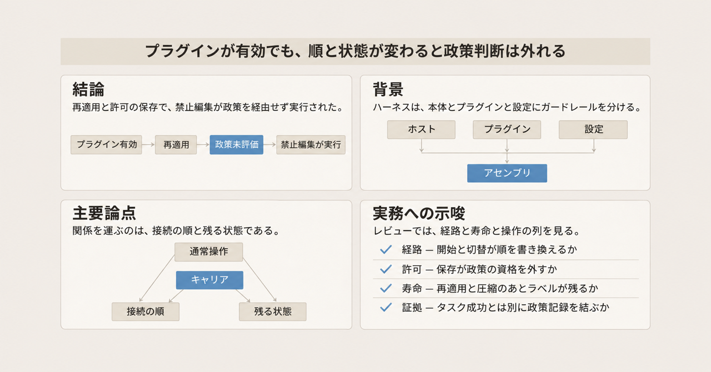
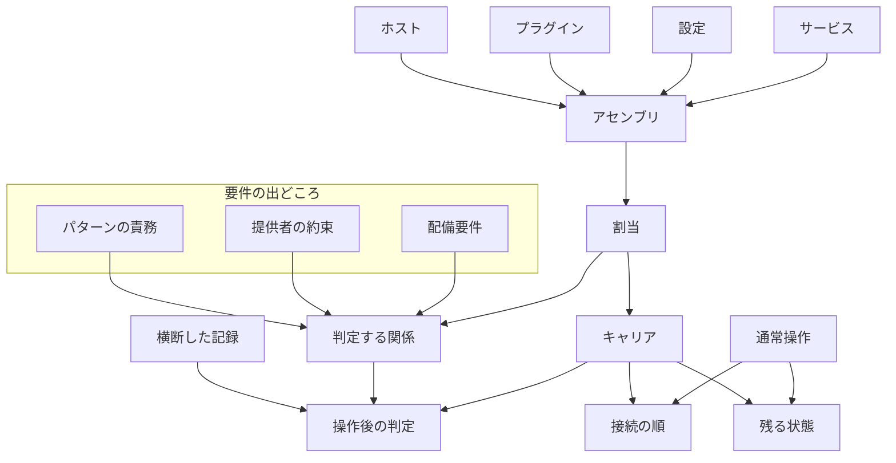

LLM エージェントのハーネスが、ツールの呼び出し、実行状態、安全のガードレールを、本体の機能、独立して書かれたプラグイン、設定の 3 か所へ分けて持つとき、その組み合わせは実行時にもアーキテクチャパターンの関係を保つのか。Boming Xia、Qinghua Lu、Dino Sejdinovic、Liming Zhu は、2026 年 11 月 6 日に arXiv へ投稿した論文「[When Routine Operations Break Architectural Pattern Relationships in LLM Agent Harnesses](https://arxiv.org/abs/2611.09088)」（arXiv:2611.09088v1）で、これを多重ケース研究として調べました。ハーネスとは、エージェントがツールと状態とガードレールを載せて動く実行基盤です。

この記事では、判定する関係、関係を運ぶ接続の順と残る状態、論文が通常操作と呼ぶ操作を説明します。続いて、ピン留めした版で要件を外した記録と、同じ操作でも要件を満たした割当を示します。そのあと、頻度や要件の強さの読み方をまとめ、レビュー項目へ移します。

この記事が読むのは arXiv 投稿 v1 であり、採録会議の proceedings は確認していません。PDF 先頭の記号に従うと、Xia は Responsible AI Research Centre、Adelaide University、CSIRO、Lu は CSIRO、UNSW、Responsible AI Research Centre、Sejdinovic は Responsible AI Research Centre、Adelaide University、Zhu は CSIRO、UNSW に所属します。

*この記事の全体像。以下、順に解説します。*

## LLMエージェントのハーネスとは

論文が調べるのは、パターン全体が残るかではありません。1 つの関係と、その要件が、実行時に保たれるかです。要件の出どころは 3 つです。パターンの責務、提供者の約束、研究が固定した配備要件です。

### ホスト、アセンブリ、割当

ハーネスの中核がホストです。論文が版をピンして比べたホストは、DeepSeek Harness、OpenCode、Claude Code、Pi、Deep Agents です。アセンブリとは、特定版のホストに、プラグイン、設定、サービスを足したものです。プラグインは、ホストとは別に書かれた追加部品です。サービスとは、独立プラグインとは別にアセンブリへ足す処理です。論文は、その中身をこれ以上は分けていません。

提供者とは、そのアセンブリの中で、パターンの責務を出す部分です。割当（allocation）とは、パターンの責務を、ハーネスのどの部分が持つかです。保持は、プラグイン単体の性質ではありません。割当全体が、操作のあとも要件を満たすかどうかです。

関係を運ぶものを、論文は carrier と呼びます。この記事ではキャリアと書きます。キャリアは 2 種類です。接続の順（コールバック連鎖のどこにいるか）と、残る状態（保存した同意、プラグインインスタンスのラベル、メンバーのキャッシュ）です。コールバック連鎖とは、プラグインが順に呼ばれる列です。先のプラグインが連鎖を終えると、後ろのプラグインへ届きません。1 つの関係が、順と状態の両方に依存することがあります。

通常操作とは、ホストが通常利用でサポートし、提供者のコードを変えずに、キャリアを変えうる操作です。論文の導入が名前を挙げるのは、プラグインの再適用、同意の保存、履歴の圧縮です。実行経路は操作とは別です。Deep Agents の通常経路と直接経路は、操作者がメンテナンス画面で行う操作ではありません。判断を経由するかのルートです。ツールノードとは、ツールを実行する段です。ルータとは、通常経路で、拒否した呼出しをその段へ渡す前に止める位置です。直接経路とは、そのルータを飛ばして、ツールノードへ middleware が跳ぶ経路です。middleware とは、ツール実行の前後に挟まる処理です。呼出しをまとめて尋ねる審査はルータに頼り、呼出しごとの審査はツールを実行する段で応答を適用します。

### 結びつくパターンと、5つの問い

対象の関係は 5 つで、次の 3 つのパターンに結びつき、比較の表では次の名前で分かれます。

- Guardrail Enforcement Point（以下 GEP）。実行前に、指定政策が判断する執行点です。指定政策とは、禁止を実行前に判断するよう指定された規則です。比較では、政策参加（指定政策が実行前の判断に入るか）と、判断情報（判断が読む出典の印）の 2 関係に分かれます。
- Autonomy Controller（以下 AC）。操作者の応答を、保留中の動作へ、進行の前に適用する制御です。比較では、応答の適用と、完了作業の 2 関係に分かれます。完了作業は、完了した編集を再開時に繰り返さない、というタスク由来の配備要件です。
- Blackboard。共有の黒板です。比較では、メンバーシップです。誰が参加しているかを共有し、停止したメンバーをどう扱うかが関係です。

論文がキャリアの失敗と制御について立てた問いは、関係の名前とは別の 5 つです。問いどうしは重なります。

| 問い | 見ること |
|---|---|
| 到達性 | 対象動作の実行前に、必要な判断へ届くか。全件評価が要件なら、他の提供者が終えた試行にも届くか |
| 資格 | 要件が覆う要求状態のすべてに、その提供者が作用するか |
| 寿命 | 判断が読む状態が、必要なあいだ残り、古くならないか |
| 解釈 | 読む側と書く側で、形式と意味が一致するか |
| 制御 | 順、寿命、同意、表現を変えるのは誰か。それに依存する提供者と同じか |

判定手続きは、この研究が規定した PatternOps です。入力は、固定したパターン記述、アセンブリ、評価の問いです。出力の契約を、論文は Pattern Realisation Contract と呼びます。判定は、提供者を横断して結んだ記録に、satisfied、violated、unsupported、not exercised、not applicable を付けます。satisfied は要件を満たした、violated は要件を外した、unsupported は支えがない、not exercised は試していない、not applicable は当該要件の対象外、というラベルです。効果が無いことだけでは、政策が参加した証拠にはしません。

要件、アセンブリ、割当、キャリア、通常操作の関係は次のとおりです。

### 政策参加の3つの強さ

GEP の政策参加には、入れ子の 3 要件があります。

1. 一番弱い配備要件は、禁止された効果が出ないことです。
2. GEP の責務は、対象動作の実行前に指定政策が判断し、禁止を執行することです。
3. さらに厳しい配備要件が every-edit です。ホストがツール呼出しとして受け取った編集を、すべて評価します。他の提供者が、政策より前に拒否して終えたものも含みます。

禁止効果だけを止める割当は、GEP の責務を満たしても、every-edit には落ちることがあります。

### 主標本とピン留めした版

関係は、パターン全体ではなく、1 つの関係とその要件に対して判定します。主標本は、ソースから分析した独立プラグイン 14 個です。内訳は、DeepSeek Harness 向け 11 個と、OpenCode 向け 3 個です。OpenCode 向けとして論文が名前を挙げるのは、Permission Reviewer、ACP、Ensemble です。ACP は、OpenCode 上で、既に許可された要求もレビューする政策レビュー用プラグインの名前です。論文本文は、この略称を展開していません。ホスト比較で動かしたのは、標本のうち 10 個です。14 個の全名は、実験補足の Section IV にあります。

比較に使ったピン留め版は次のとおりです。

| ホスト | ピンした版 | 主に見た関係 |
|---|---|---|
| DeepSeek Harness | 0.2.1-alpha.2、0.2.1-rc.2、0.2.1-rc.5、0.1.0-rc.8 | GEP の政策参加と判断情報 |
| OpenCode | 2.2.5 | GEP の政策参加 |
| OpenCode | 1.19.3 | AC の応答適用 |
| OpenCode | 1.18.30、2.0.32 | Blackboard のメンバーシップ |
| Claude Code | 2.1.317 | GEP の政策参加 |
| Pi | 1.5.0 | GEP の判断情報 |
| Deep Agents | 0.7.13、0.7.28 | AC の応答適用と完了作業 |

DeepSeek Harness の対象版は developer preview である、と論文は書きます。プロセスとは、ホストを新しく起動した 1 回です。論文の表で括弧が無い条件は、条件あたり 2 プロセスです。この記事で「N プロセス」と書いた箇所は、その数です。書いていない a/b は、条件あたり 2 プロセスの比です。選択編集とは、政策が評価したかを見る対象に選んだ編集です。a/b の分子は政策が評価した数、分母はその比較が選んだ編集試行の数です。

## 通常操作が書き換える順と状態

論文が通常操作と呼ぶのは、ホストが通常利用でサポートし、提供者のコードを変えずにキャリアを変えうる操作です。observe は観察するモード、enforce は禁止を執行するモードです。許可ステージは、OpenCode が許可を扱う段階です。来歴ラベルは、判断が読む出典の印です。ネイティブとは、プラグインではなくホスト自身の機能です。グラフとは、Deep Agents が再作成する実行の構造です。チェックポイントとは、その時点の実行状態の保存です。ストアとは、チェックポイントを置く保存先です。スレッドとは、保留要求と承認の宛先です。定義は次のとおりです。

| 操作 | 論文の定義 | どこで見たか |
|---|---|---|
| 再適用（reapplication） | 設定変更のあと、インスタンスを破棄して作り直す。observe から enforce への切替が、政策プラグインに対してこれを行う | DeepSeek Harness |
| リロード（reload） | 設定を変えずにインスタンスを入れ替える | OpenCode、Pi |
| 履歴の圧縮（compaction） | 会話の前半を要約へ置き換え、後半の尾は原文のまま残す | DeepSeek Harness |
| 保存した許可（saved allow / consent） | 操作者の「always」等が許可を残し、以後の要求の資格を変える | OpenCode、Claude Code では比較に使用 |
| 無効化して再有効化 | 公開のプラグイン管理。コードと設定は変えない | DeepSeek Harness |
| 設定の編集 | プラグイン設定の変更が再登録を起こす | DeepSeek Harness（Intutic、Edit Approval） |
| 取り消し（revoke） | ネイティブの許可取り消し | OpenCode |
| 再開（resumption） | 承認または拒否のあと、保存した結果から続ける | Deep Agents |
| 再起動、削除して復元 | 黒板プラグインの初期化をやり直す | OpenCode 上の Ensemble |
| グラフの再作成、クライアントの再接続 | 保留中の要求が、チェックポイントやサーバ側状態に残るか | Deep Agents、OpenCode 1.19.3 |

observe は、政策プラグインが観察するモードです。enforce は、禁止を執行するモードです。再適用は、この切替でインスタンスを作り直します。保存した許可は、操作者の「always」等が許可を残し、以後の要求の資格を変える、と論文は定義します。

表がホストごとに対応づけた操作は次のとおりです。GEP の政策参加が主ケースです。

| ホストと版 | 関係 | キャリアと、試した操作または経路 |
|---|---|---|
| DeepSeek Harness rc.2、alpha.2、rc.5、rc.8 | GEP 政策参加 | コールバック順。開始、切替、設定編集、無効化と再有効化 |
| OpenCode 2.2.5 | GEP 政策参加 | 保存済み同意の下の許可ステージ。リロード、allow の保存、取り消し |
| Claude Code 2.1.317 | GEP 政策参加 | フックの優先。保存した allow |
| DeepSeek Harness rc.2、alpha.2、rc.5 | GEP 判断情報 | インスタンスまたは履歴の来歴ラベル。再適用、圧縮、圧縮のあと再適用 |
| Pi 1.5.0 | GEP 判断情報 | セッションログ。リロード、再開 |
| Deep Agents 0.7.28、0.7.13 | AC 応答の適用 | ツールノードへの通常経路と直接経路。保留要求とグラフ再作成 |
| OpenCode 1.19.3 | AC 応答の適用 | 保留要求。クライアントの再接続 |
| Deep Agents 0.7.28 | AC 完了作業 | 保存したタスク結果。承認または拒否のあとの再開 |
| OpenCode 1.18.30、2.0.32 | Blackboard メンバーシップ | メンバーキャッシュと保存ステータス。実行中の参照、再起動、削除と復元 |

許可ステージとは、OpenCode の許可の段階です。Permission Reviewer は、その段階の中で、ホストが操作者へ尋ねるより前に政策を適用します。Claude Code でこの記事が書く結果は、保存した allow のあとの Hookify です。Hookify は、主標本の外にある、ベンダーのフックです。来歴ラベルとは、判断が読む「この編集の出典は何か」という印です。インスタンスの私的状態に持つ場合と、履歴に持つ場合があります。

## 配布版で要件を外した記録

ここでの「外した」は、論文がその行の要件を violated としたことです。研究が組んだ行は、次の節へ分けます。連鎖を終える承認プラグインによる損失は、そのプラグインが覆うツールについて、政策より前に走ったときに限る、と論文は書きます。

### コールバック順が政策の前で終わる

observe から enforce への切替は、政策プラグインの再適用です。対象は DeepSeek Harness rc.2 です。rc.5、プラグインの梱包を変えた比較、ホストに研究用の制御を置かない公開操作、モデル自身が次の操作を選ぶ実行でも再発する、と §IV は書きます。政策プラグインとして論文が名を挙げるものの一つが Governance で、承認側は Tool Approval です。再登録は末尾へ付きます。承認プラグインが連鎖を終えると、政策へ届きません。操作者が承認すると、政策が禁止する編集が実行されます。キャリアは到達性（コールバック順）です。両プラグインは有効なままです。enforce では、read の実行では政策が動きます。プラグインマネージャは警告しません。外した要件は、効果の防止、GEP の責務、every-edit です。論文が政策を承認より前に並べた順を、policy-first と呼びます。その observe は 1/1 で、文書化された切替がその順を戻したあとは 0/5 です。

未整理の開始も、同じペアで GEP の政策参加を外します。未整理の開始とは、並びを組み直す前の cold observe と、最終設定から始める fresh enforce です。cold observe は、観察モードのまま始めた状態です。fresh enforce は、執行モードで新規に始めた状態です。rc.2 と alpha.2 の、順を記録した 24 開始すべてで、承認が先でした。設定ファイルは政策を先に並べます。ベースプロファイルとは、プラグインを 1 行に 1 つ書くホストの既定設定です。そこには "Row order carries no load semantics" と書いてあります。行の並びは、読み込む順を意味しません。画面やファイル上の並びは、政策が先のまま残ります。ローダは、各プラグインの import が終わったときに登録します。選択編集の評価は 0 です。cold observe は 0/1、fresh enforce は 0/5 です。ホスト内に研究コードが無い、公開操作のみの開始 32 run すべてで、開始時の損失が起きた、と §IX は書きます。

無効化と再有効化のあとは、公開のプラグイン管理でも、次の切替で戻ります。再有効化で評価は戻ります。3 プロセスで 5/5 です。次の切替で再び 0/5 です。これは 2 プロセスです。最終の設定は、保持したプロセスと同じです。復元は次の切替までです。

設定変更または切替による再登録は、Intutic へ政策側を入れ替える比較でも起きます。Intutic は、政策プラグイン Governance の代わりに置いたプラグインです。Edit Approval は、承認プラグイン Tool Approval の代わりに置いたプラグインです。その損失を見たホストの版は、DeepSeek Harness 0.1.0-rc.8 です。変わったプラグインが末尾へ再登録され、承認が先に連鎖を終えます。プラグインは載ったままです。Intutic は、6 プロセスすべてで、承認後に禁止編集が実行されました。

承認プラグインの下で、5 つの API モデルは 28 の read と 28 の edit を行いました。政策はすべての read を評価し、edit は評価しませんでした。時点は開始時または切替後です。CLI から呼んだモデルの供給元の識別子は未報告です、と §III は書きます。

切替をまたぐ保守タスクでは、native consent 側の切替後 44 の対象試行には政策判断が結びつき、承認プラグイン側の 19 にはありませんでした。native consent とは、プラグインの承認ではなく、ホスト自身が持つ同意です。別の API モデルでは、承認プラグイン側の切替後 32 の edit と shell が未評価でした。受理条件の 390 個の上流テストは、両方の割当で CLI モデルの成果が通過しました。論文は、タスク成功は政策参加を示さない、と §IV で書きます。

### 保存した許可がレビュー資格を外す

OpenCode 2.2.5 と Permission Reviewer では、allow の保存が GEP の政策参加を外します。参考文献が挙げる版は 2.5.0 で、比較に使った 2.2.5 とは別です。「always」が任意ファイルへの編集許可を残します。要求は既許可になり、Reviewer は棄権します。次の禁止編集が実行されます。キャリアは資格（保存した同意）です。Reviewer は、「ask だけをレビューする」という文書の約束は守ります。ask は、その都度尋ねるモードです。リロード自体は、未保存なら 5/5 のままです。外した要件は GEP の責務です。常設の承認は政策判断の代わりにならない、と §IV は書きます。表の数は、4 プロセスで 0/1 です。once は、always の対照として後続を評価した側です。その対照は 2 プロセスです。公開の revoke で評価は戻ります。3/3 です。

### 来歴ラベルがインスタンスと履歴でずれる

来歴プラグインの再適用は、ログ先だけを変える操作でも、GEP の判断情報を外します。対象は DeepSeek Harness の rc.2、alpha.2、rc.5 です。プラグインは Airlock 0.1.0 と RiskProof 0.2.0 です。新しいインスタンスは、私的状態のラベルを持ちません。制約されるはずの編集、または組み込み規則下の bash が実行されます。RiskProof は、切替が observe の読取を捨てます。キャリアは寿命（インスタンス）です。出典のノートは、モデル要求に残ることがあります。プラグインが状態を所有し、寿命はホストの再適用が決めます。外したのは配備要件です。非信頼の出典が関連するあいだ、編集を制約する、という要件です。Airlock の「圧縮はラベルを洗濯しない」という約束は、この行とは別です。

圧縮のあと、出典が原文の尾にある場合は、解釈がずれます。Airlock は、文書化されたホスト版とは違う履歴フィールド名を読みます。要約された出典はラベルを継ぎ、圧縮直後は拒否されます。尾にある出典は、要求に残っていても編集が許可されます。プラグインは旧フィールド名を読みます。ホストは、置換範囲に新しいフィールド名を使う、と §V は書きます。外したのは、Airlock の提供者約束のうち、尾についての読みです。互換範囲の宣言は無く、ホストの互換チェックは強制できない、と §V は書きます。

### 直接経路が保留中の応答を飛ばす

Deep Agents 0.7.28 と 0.7.13 では、直接経路と batched review が、AC の応答適用を外します。batched review とは、複数の呼出しをまとめて操作者へ尋ねる承認です。承認オプションとは、Deep Agents が、この batched review を組む選択肢です。直接経路はルータを飛ばします。batched review は、直接経路の 6 ワークフローのうち 4 つで要件を外しました。middleware が審査より前に跳ぶと、質問の前に 3 呼出しが実行され、届けた拒否のあとに 1 呼出しが実行されます。承認オプションは、拒否後の実行を 2 プロセスで再現します。通常経路では、batched も per-call も保持します。per-call とは、呼出しごとに尋ね、結果を 1 件ずつ残す審査です。per-call は、9 ワークフローすべてで保持しました。その 9 件には、直接経路の 6 件が含まれます。外したのは AC の責務です。保留中の動作への応答を、進行の前に適用することです。論文の読みは、「その保留動作への応答」です。

### 停止ステータスよりキャッシュが先に読まれる

OpenCode 上の Ensemble では、実行中のメンバー参照が、再初期化なしで Blackboard のメンバーシップを外します。比較したプラグインの版名は、この記事が読む範囲では書かれていません。損失は、再初期化しない実行中の参照についてです。実行中の参照は、期限なしのキャッシュを読みます。保存ステータスは停止なのに、新しい項目が次のモデル要求へ届きます。再起動、または同一プロセスでの削除と復元のあと、保存ステータスを見る経路は、停止メンバーを除外します。停止していない継続メンバーは、再初期化した側でも、していない側でも、項目を受け取ります。外したのは、提供者約束（停止していないメンバーだけを返す）と、明示的再登録という配備要件です。後者は研究側の読みです。再開プロンプトを再登録と解釈すれば、Ensemble の配信は正しい、と §VI は書きます。

## 研究が組んだ行で落ちた要件

次の行は、研究が組んだ構成です。配布版が、日常の操作だけで外した記録と同じ列には置きません。完了済み作業の再実行は、完了した編集と保留中の編集を 1 ノードにまとめた研究製の構成で起きました。通常の per-call task は結果を保存し、再開してもその編集を繰り返しませんでした。dispatch とは、編集呼出しを後ろの処理へ渡す点です。ステージ提供者とは、許可ステージに置く研究製の部品で、許可の判定を変えずに残します。設定が拒否する編集は、その段階まで届きません。エスカレーションとは、操作者へ上げて判断を求めることです。デコーダ修正とは、圧縮で名前が変わった履歴フィールドを読むようにした修復で、ラベル自体はプラグインインスタンスに残します。きれいな作業とは、非信頼の出典が関係しない作業です。

| 操作または構成 | 関係 | 何が落ちたか | 落ちなかったもの |
|---|---|---|---|
| 連鎖のあと、dispatch を包む研究製の政策ラッパー | GEP 政策参加 | every-edit。1 プロセスで、切替後 6 編集のうち 4 つを評価し、承認が先に拒否した 2 つは政策へ届かない | 試した列では禁止効果を防止。GEP の責務は満たす、と §IV |
| 資格だけを広げた Permission Reviewer と、ステージ提供者 | GEP、保存 allow のあと | every-edit。設定が拒否する編集はステージへ届かない（各条件 0/1）。資格拡張版は許可済み編集を再度尋ねる | 後続の選択編集は 6/6 を評価。禁止効果は防止 |
| ツール本体の前の研究製チェック | GEP | 操作者へ尋ねられないため、エスカレーションを拒否へ変える | 設定拒否の編集も含め 6/6 と 1/1。禁止効果は防止 |
| 公開 ACP | GEP、保存 allow のあと | エスカレーションした編集が、新しい質問なしに実行される | 1 プロセスで選択編集 3/3 と設定拒否 1/1 を政策が判断。禁止効果は防止 |
| 圧縮を生き延びたデコーダ修正のあと、再適用 | GEP 判断情報 | 新しいインスタンスは出典を持たない。4 回の再適用セルでも同じ | 圧縮だけでは制限を保持 |
| 入力だけを見る提供者 | GEP 判断情報 | 要約が同一だと出典の信頼が分からず、きれいな作業 4 件も拒否 | 制約編集 8 件は防止 |
| 完了編集と保留編集をまとめた研究製ノードからの再開 | AC 完了作業 | 完了済み編集を繰り返す。承認後は重複変更でコンパイルできない | 通常の per-call task はこの繰り返しをしない |
| 履歴からラベルを再構成する研究製の修復 | GEP 判断情報 | 上流テスト 390 のうち 41 が失敗。テストのモックに、修復が使うセッション取得が無い | 試した再適用と圧縮の列では、制限ときれいな作業を保持 |

公開 ACP の「質問を更新しない」は、政策判断の欠落とは論文が分けています。禁止編集は止まり、エスカレーションの扱いが違います。

このラッパーは、効果の防止と GEP の責務は満たし、every-edit だけを満たさない、と論文は分けます。

## 検証した条件で要件を満たした割当

prepend は、コールバックを列の先頭へ足す登録です。readiness は、政策の登録が終わるまで先へ進まない待ちです。AgentGuard は、承認プラグイン Tool Approval の代わりに置いた外部プラグインです。論文が、検証した条件で要件を満たしたと書いた主だった行は次のとおりです。条件は行に残しています。

| 割当 | 操作 | 保持した要件 | 論文が書く条件 |
|---|---|---|---|
| 連鎖の後の native consent | observe から切替 | 効果の防止、GEP、every-edit（切替後） | 非既定の read-only。ファイル編集はホストの承認が要る。前に連鎖を終えるコールバックが無い。5 API モデルのうち 4 つは 54 の read/edit をすべて評価。残り 1 つは、この比較でホストが受け取った呼出しが無かった |
| 政策コールバックを先頭へ固定する研究製の登録 | enforce の開始と切替 | 3 要件 | 競合する prepend は未試験 |
| 政策の登録を待つ readiness | 開始、切替、承認プラグインの再適用 | 3 要件。2 プロセスで選択編集を評価 | 私的フィールド。readiness を外すと、コード読解では承認プラグインが読み込まれなくなり、政策プラグインの再登録のあと承認プラグインが再び起動する |
| AgentGuard の委譲する承認分岐 | 開始、無効化と再有効化、切替 | 3 要件。2 プロセスで選択編集 5/5 | 自身の拒否分岐は政策より前に連鎖を終える。その分岐は未実行 |
| Hookify（主標本の外） | 保存 allow のあと | 試した Bash 呼出しを評価し、一致する破壊的 delete を拒否 | ベンダーのフック。規則は研究側ハンドラが保存。ネイティブの deny 規則だけなら効果の防止にとどまる、と表 V |
| インスタンスの外の状態、または履歴からの再構成 | 再適用と圧縮の列 | 制限ときれいな作業 | 出典記録が読めること。登録表現は、その場で終わり、別の状態へ副作用を残さない更新である、とコード読解。Pi の plan-mode はセッションログから、リロードと再開のあと制限を戻した |
| per-call review | 通常経路と直接経路 | AC の応答適用。9 ワークフロー | 論文の表は、middleware の順、再開、複数呼出しをまとめた回答、という限界の項目名だけを書く。中身は本文に展開していない |
| 同じチェックポイントとスレッドでのグラフ再作成 | 保留要求 | 対応する応答が適用される | 空のストアは保留を失う。別スレッドへの承認は両方を保留のままにする |
| OpenCode のサーバ | クライアント再接続 | 保留要求が残る | OpenCode 1.19.3 |
| 結果を 1 呼出しずつ保存する per-call task | 承認または拒否のあとの再開 | 完了作業を繰り返さない | 承認後に 390 上流テストが通過 |

Hookify は、主標本の外で、保存 allow のあとも Bash を評価したベンダーのフックです。plan-mode は、Pi がセッションログから制限を戻したモードです。

opencode-guard は、主研究のあと境界事例として選ばれました。保存 allow があっても、規則が操作者へ送る編集は再び尋ね、拒否は編集を止めました。2 つのプログラムされたワークフローが、8 予測すべてに一致しました。このガードは、指定政策の判断を出さない、と §IV は書きます。

## 注意点

論文は、事例を意図的に選んだ多重ケース研究です。損失がどのくらいの頻度で起きるかは測っていません。論文の外部妥当性は "not how often" と書きます。「通常操作をすれば関係は壊れる」という割合には読めません。

「壊れた」は、要件の強さで変わります。every-edit や明示的再登録を外すと、違反の集合は小さくなります。禁止編集が実行された主結果は、every-edit を外しても、GEP の責務の違反として残る、と論文は書きます。Blackboard の「停止したメンバーは明示的に再登録するまで除外」は、研究側の読みです。RiskProof の「observe の読取が最初の enforce 判断を制約する」も、研究側の配備要件です。

DeepSeek Harness の対象版は developer preview です。rc.5 では、公開プラグインのアーカイブを直接配置した、と §IX は書きます。連鎖を終える承認は、覆うツールかつ政策より前のときだけ、損失を起こします。

論文がアスタリスクを付けた結果は、収集後に同じ記録を再分析したものです。この記事では、readiness、許可ステージの研究製の提供者、ツール本体の前の研究製チェック、満たした割当のうち「登録表現は副作用のない更新」と書いた行が、それに当たります。上流テスト 41 件が落ちた「履歴からラベルを再構成する研究製の修復」は、この再分析には入れていません。独立した追試は、2026 年 11 月 10 日時点で見つかっていません。これは結果の否定ではなく、再現が未検証だという印です。モデル自身が操作を選ぶ比較が繰り返したのは、4 つの GEP 損失と、native consent の保持です。操作者の応答は、全体としてプログラムされています。人間の承認操作のばらつきは、範囲外です。

パターン責務の元論文である AgentOps catalogue の本文は、この記事では読んでいません。表 I の "must return before execution proceeds" と、AC の対応箇所は、本論文が参考文献から転記した文言として読みます。DOI [10.1016/j.infsof.2026.108307](https://doi.org/10.1016/j.infsof.2026.108307) は、Elsevier の論文識別子へ解決します。SSRN の同題 preprint（2025-09-25、abstract_id=5534588）と雑誌版を、同じ本文とは扱いません。実験補足（[pattern-relationships-supplement](https://anonymous.4open.science/r/pattern-relationships-supplement-C35A/)）の実験記録も、この記事では取得していません。PatternOps と Pattern Realisation Contract は、この研究が規定した手続きと出力契約の名前です。外部の標準仕様としては確認していません。

未確定の点は次のとおりです。

- コード読解では、連鎖を終える承認分岐を持つプラグインは 6 個です。政策プラグインの Governance と、来歴プラグインの Airlock も、委譲せずに呼出しを終える分岐を持つため、その 6 個に含まれます。14 個のうち、この 6 個の残りの名前は実験補足にあり、この記事では確認していません。
- AgentOps catalogue の該当節が、本論文の転記と一致するか。
- 安定版の DeepSeek Harness、および論文がコード比較のみとした後続の Deep Agents と LangChain で、同じ操作列がどうなるか。LangChain は、Deep Agents が batched review と per-call review に使う側の名前です。
- 2026 年 11 月 10 日時点の独立追試は見つかっていません。

GitHub の公開報告は、論文の実験そのものではありません。[OpenCode issue 48456](https://github.com/anomalyco/opencode/issues/48456)（open、2026-09-11、garnus）は、SSH の ask が SQLite の Always allow で、将来セッションまで上書きされる報告です。設定の deny は、別チェックで残ります。報告者は、新規の end-to-end 再現をしていない、と書きます。[LangChain issue 40492](https://github.com/langchain-ai/langchain/issues/40492)（open、2026-09-16、Tardfyou）は、langchain 1.4.0 の `jump_to="tools"` が HITL を迂回する報告です。HITL とは、人の承認を挟む制御です。論文は、Deep Agents の直接経路の根拠に引きます。issue の再現を、Deep Agents 0.7 系の実験と同一視しません。

操作の名前だけでは、損失は予測できません。native consent、Hookify、per-call、インスタンス外の状態は、検証した列で保持しました。Permission Reviewer の損失は、提供者の約束の違反ではありません。約束と、より強い GEP 配備の不一致です。

## レビュー項目に足す列

記事で使える主張は、条件付きです。政策への経路がコールバック連鎖だけであり、その順をホストの再適用や開始が書き換えるなら、有効なプラグインと最終設定が同じでも、編集は指定政策を経由しません。許可を保存する操作は、ツール集合の境界を更新すると同時に、政策レビューの資格を外すことがあります。テストの単位は、ツール名の在庫ではありません。判断の経路、状態の寿命、実際に使う操作の列です。

許可ツールの集合は、境界の外側の一覧として残してよいです。論文が足すのは、その境界の内側と、境界を書く操作の側です。レビューで見る列は次のとおりです。

1. 指定政策へ届く経路は、連鎖だけか。その順を、開始、切替、設定保存、無効化と再有効化のどれが書き換えるか。
2. 保存した許可は、政策の資格を外すか。外すなら、常設の承認を政策判断の代わりにしない要件があるか。
3. 判断が読むラベルは、プラグインインスタンスの中か。再適用と履歴圧縮の両方のあとも残るか。読むフィールド名は、いまのホストの履歴と一致するか。
4. 操作者の応答は、ツールが実行される場所で適用されるか。ルータを飛ばす経路があるか。
5. 停止、完了、同意の状態は、キャッシュと保存ステータスのどちらが正か。再開はその正を上書きするか。
6. 合格の証拠は、タスク成功やプラグインが有効であることとは別に、対象動作 1 件と政策記録を結んだものか。

逆転条件は、配備が every-edit を要求せず、禁止効果の防止だけで足りると決めた場合です。そのときは、他者が先に拒否した編集を政策が見なくても、論文の区分では GEP の責務を満たしえます。禁止編集が政策を経由せず実行される場合は、この逆転には入りません。

主結果の 2 例は、検証した版と操作列の記録として残ります。切替のあと、および保存許可のあと、禁止編集が政策評価なしで実行された、という記録です。プラグインは有効なままでした。そこから進む意味は、プラグイン追加を拒否することではありません。追加と、その後の再適用、許可の保存、履歴の圧縮が、誰の順と誰の状態を書き換えるかを、レビュー項目にすることです。

同じ最終設定で履歴だけが違うと、政策の被覆が違います。無効化と再有効化の 5/5 と、次の切替の 0/5 がそれです。1 つの操作を通った修復が、次の操作で落ちることもあります。デコーダ修正は圧縮を通り、再適用で落ちました。390 の上流テストは通過し、切替後の編集判断は欠けました。

## まとめ

LLM エージェントのハーネスでは、パターンの関係は、プラグインが有効かだけでは決まりません。接続の順と、残る状態が、関係を運びます。再適用、開始時の登録、許可の保存、履歴の圧縮、直接経路、期限なしのキャッシュは、ピンした版と操作列で、指定政策や停止ステータスを外すことがありました。同じ名前の操作でも、連鎖の後ろに置いたホスト自身の同意、呼出しごとの審査、インスタンスの外に置いた状態は、検証した列で要件を残しました。

読むときの単位は、割合ではありません。どの要件か、どの版か、どの操作の列かです。every-edit を外しても、禁止編集が政策を経由せず実行された主結果は、GEP の責務の違反として論文に残ります。レビューでは、ツール名の在庫に加え、判断の経路、状態の寿命、実際に使う操作の列を見ます。

この記事が少しでも参考になった、あるいは改善点などがあれば、ぜひリアクションやコメント、SNSでのシェアをいただけると励みになります！

## 参考リンク

- Xia, Lu, Sejdinovic, Zhu. arXiv:2611.09088v1（2026-11-06）: https://arxiv.org/abs/2611.09088
- 同論文の PDF: https://arxiv.org/pdf/2611.09088
- AgentOps catalogue として論文が引く DOI（本文は未確認）: https://doi.org/10.1016/j.infsof.2026.108307
- SSRN の同題 preprint（本文は未確認。雑誌版との一致は未確認）: https://papers.ssrn.com/sol3/papers.cfm?abstract_id=5534588
- 実験補足（記録は未取得）: https://anonymous.4open.science/r/pattern-relationships-supplement-C35A/
- OpenCode issue 48456: https://github.com/anomalyco/opencode/issues/48456
- LangChain issue 40492: https://github.com/langchain-ai/langchain/issues/40492
