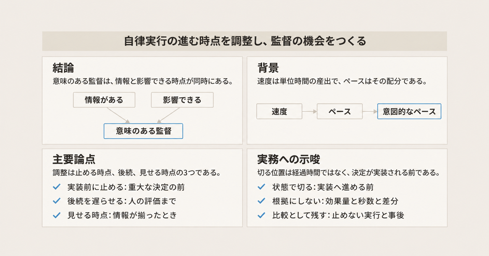
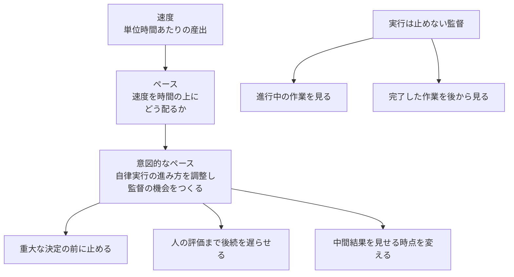
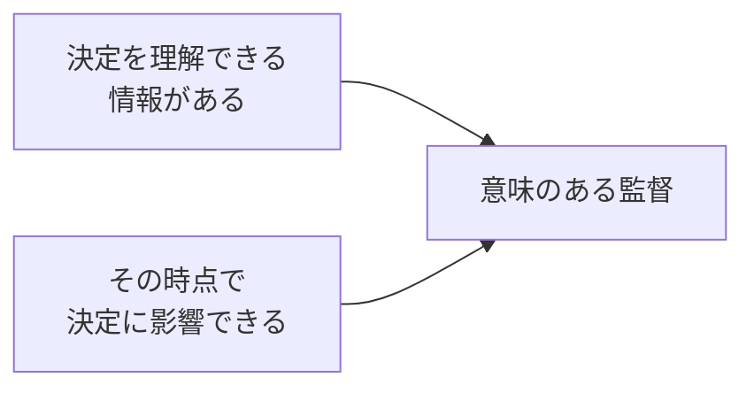
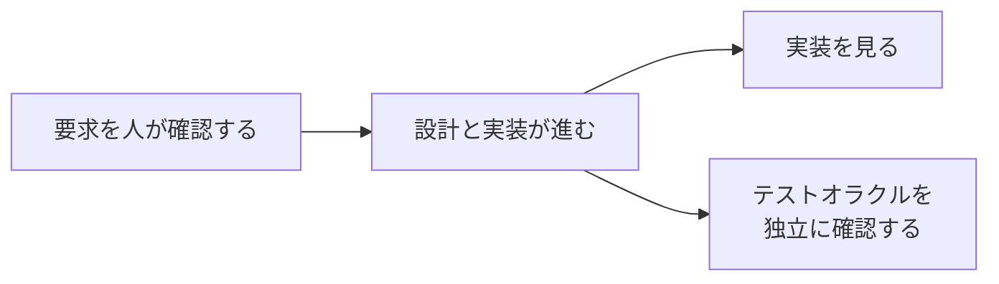

エージェントが人の常時の関与なしにソフトウェア開発を進めるとき、人はどの時点で監督できるのでしょうか。Tobias Reichel、Michèle Stassen、Anamaria Mojica-Hanke、Maria Teresa Baldassarre、Sebastian Baltes、Alexander Serebrenik、Steffen Herbold は、その問いに対するビジョンを論文に書いています。論文は「[Deliberate Pacing for Human Oversight in Agentic Software Development](https://arxiv.org/abs/2611.09550)」（arXiv:2611.09550v1、cs.SE、2026年11月6日提出、PDF は 6 ページ）です。cs.SE は、arXiv のソフトウェア工学の分類です。著者の所属は、ハイデルベルク大学、アイントホーフェン工科大学、パッサウ大学、バーリ大学です。

この版はビジョンと研究計画であり、効果の大きさはこれから測る、と論文自身が書いています。

この記事では、速度とペースの違い、論文が挙げる 3 つの調整、監督が意味を持つ条件、確認を置く位置を整理します。

*この記事の全体像。以下、順に解説します。*

## 意図的なペースとは

意図的なペースとは、自律的な開発がいつ、どのように進むかを調整し、人が監督できる機会をつくることです。論文は、速度とペースを分けたうえで、この語を定義しています。

速度は、単位時間あたりの産出です。ペースは、その速度を時間の上にどう配るかです。意図的なペースが調整するのは、自律実行が進むタイミングです。開発を遅くすること自体は、目的に含まれません。

動機は、意図的に開発を遅くする理由を問う探索的な文献レビュー 20 件です。内訳は学術文献 8 件と、灰色文献 12 件です。灰色文献は、査読付き論文以外の公開資料です。このレビューは、人が自分で開発を意図的に遅くした理由の探索です。エージェントの実行を止める調整の効果を測ったものではありません。

### 3つの調整

論文が挙げる調整は 3 つです。

1. 重大な決定を実装する前にエージェントを止める。
2. 人のレビューが終わるまで後続の活動を遅らせる。
3. 中間結果を評価に出す時点を変える。評価に出すとは、人に見せることです。

導入の具体例は、エージェントがアーキテクチャ上の依存を選び、対応する部品とテストまで人に聞かずに進める場面です。見た時点では、複数の成果物がその決定に乗っています。見直すには、手戻りがあります。1 つ目の調整は、依存を選んだあと、その決定に乗った部品とテストができる前に止める、という位置に対応します。

導入の末尾は、普遍的なチェックポイントを提案する代わりに、研究計画を置く、と書いています。普遍的なチェックポイントとは、対象を問わず同じ地点で必ず止める点です。

意図的なペースの費用として挙げるものは 3 つです。人の注意、開発時間、手戻りです。

### 意味のある監督

意味のある監督の条件は 2 つです。関係する決定を理解できる情報があること。その時点で決定に影響を与えられることです。

どちらか片方では、論文が置く意味には届きません。情報が無い時点で止めても、何を変えればよいかは決まりません。情報が揃ったあとで、決定に乗った成果物をあとから見るだけなら、影響の機会は後にずれます。

### 概念の関係

論文が置いている関係は、定義、調整の種類、監督が意味を持つ条件、の 3 段です。速度からペース、ペースから意図的なペースへ進み、意図的なペースから 3 つの調整へ分かれます。図の「実行は止めない監督」は、意図的なペースの外にある枝です。

実行は止めない監督とは、エージェントの実行を遅くせずに見る監督です。進行中の作業を見ることと、完了した作業を後から見ることが、その例です。図では、意図的なペースからこちらの枝へ矢印を引いていません。論文は、この 2 つを意図的なペースの下位分類としてではなく、実行を遅くしない監督の例として分けて書いています。

意味のある監督は、2 つの条件が揃った状態です。

### 確認の位置は代わりにならない

ライフサイクルの例は、要求の確認、テストオラクルの独立した確認、実装のレビューが、必ずしも互いに代わりにはならない、という論証です。テストオラクルとは、テストが正しい結果かを判定する基準です。実装を後から見ても、利害関係者の必要を外した要求を必ず埋め合わせられるわけではない、と論文は書いています。

矢印は時間順の依存です。後の確認が前の確認の代わりになる、という意味ではありません。要求を人が確認したあとで設計と実装が進み、その後に実装を見ることと、テストオラクルを独立に確認することが並びます。

### 文献レビューが繰り返したテーマ

レビューで繰り返し出たテーマは 5 つです。いずれも、開発を意図的に遅くした理由の題目です。上の 3 つの調整そのものではありません。

- 品質のための減速
- 長期の持続可能性のための減速
- ケアと倫理のための減速
- 加速への抵抗としての減速
- 状況に合うペースで開発すること

### これから比べる見方

論文が今後の問いとして置くものは 3 つです。見方そのものではありません。どの状況で意図的なペースが監督の役に立つか。割り込みのタイミングは監督にどう効くか。ライフサイクル上の割り込みは、互いの効果と費用をどう変えるか。

2 つ目の問いが比較する見方は、継続的な監視、重大な決定の実装前の意図的な停止、事後レビューです。ここまでは、論文が比べる予定の見方の名前です。前の図は、実行を遅くする調整と、遅くしない監督の例を分けた図であり、この 3 つの対応表ではありません。

## 注意点

### 測っていないことと、未来形の研究計画

この版に、意図的なペースの効果量はありません。待ち時間、バッチ境界、差分サイズの定義もありません。バッチ境界とは、作業をまとめて区切る境目です。差分サイズとは、変更の行数などの大きさです。いずれも、この版の文言には落ちていません。

第 4 節は、"we will examine"、"we will compare"、"these studies will provide empirical evidence" と未来形です。面接、開発セッションの記録、エージェントの実行トレース、準実験、シミュレーションをこれから行う、と書いています。実行トレースとは、エージェントが何をどの順で実行したかの記録です。準実験とは、無作為な割付をしない比較です。現在形で「比較済み」「効果はこれ」とは書いていません。

ライフサイクル全体にわたる介入と相互作用を調べる制御実験は負荷が高く、すでに有効性の証拠がある方法を試すときに限る、と書いています。この留保の対象は、その全工程の制御実験です。

### 意図的なペースと比べる側の監督

論文は、監督のすべてが実行を遅くするわけではない、と書いています。進行中の作業を見る、完了した作業を後から見る、でも監督は成立し得ます。これは意図的なペースの下位分類ではありません。意図的なペースと比べる側の監督です。

中心命題の動詞は "may not" です。完了後のレビューは、重大な決定を実装する前の介入と、同じ影響機会を持たないことがある、と書いています。持たないと断定してはいません。実行を止めない監督もあり得る、とも書いています。未決なのは、どのとき、止めない実行と事後評価では、意図的なペースと同じ効果が得られないか、です。

早すぎる割り込みは、判断に足る情報が無い状態で、進んでいる自律実行を止めます。頻繁な中断は、遅れと調整の負荷を増やし、結果を良くしないことがあります。

### 文献と引用の届く範囲

多声の文献レビューは、ビジョンの動機です。多声とは、学術文献と灰色文献のように、複数の種類の資料を並べて読むことです。検索は ACM Digital Library、IEEE Xplore、Scopus と、Google 検索です。Google の検索語は "slow software development"、"slow programming movement"、"slow code movement" で、シークレットウィンドウ、ログアウトの状態で探しています。包含は「なぜ、どんな状況で、人・チーム・組織は開発を意図的に遅くするのか」という問いに役立つか、で篩っています。表 I は検索式です。20 件の書誌リストは本文にありません。

論文自身が、AI によるコーディングを論じる文献（例として Zechner）を除いた、と書いています。収録した文献は、開発者自身がコードを書く前提です。エージェントが実装し、人が振り返る時間だけが残る、という分離は、このレビューの外で著者が置いた主張です。

加速や減速の割合の数値は、この論文にはありません。導入は、方向だけで 3 つを引用しています。孤立したプログラミング課題の対照実験が大きな加速を報告したこと（Peng ほか、arXiv:2302.06590）。経験のあるオープンソース開発者が自分のリポジトリでは AI ツールで遅くなったこと（Becker ほか、arXiv:2507.09089）。その後続が加速の兆候を見たが、参加者の選ばれ方の変化で真の効果は測りにくいと注意していること（[METR の 2026年2月24日の記事](https://metr.org/blog/2026-02-24-uplift-update/)）。割合の数値は、論文が書いていないので、ここでも書きません。

2 つ目の研究課題が挙げる 3 つの見方の直後には、Dhanorkar、Passi、Vorvoreanu の [FAccT 2026 論文](https://doi.org/10.1145/3805689.3812402)が引用されています。FAccT は、ACM の会議です。引用先の要旨は、経験のある開発者 17 人への面接です。事前の制御、共同計画、実行中の監視、事後レビュー、という少なくとも 4 形態の監督作業を見た、という探索です。3 条件の比較実験ではありません。ページ範囲は 6438 ページから 6465 ページで、Reichel 論文の参照と、OpenAlex の書誌（2026年11月10日取得）で一致します。OpenAlex は、論文の書誌を集める公開の索引です。ACM DL の本文 PDF に印字されたページは、この範囲の確認には使っていません。同じ論文の arXiv 版は [arXiv:2606.05391](https://arxiv.org/abs/2606.05391) です。

同じ Dhanorkar ほかの面接では、参加者が実行中の監視をほとんどせず、事後レビューを多く語った、と書いています。実時間で見れば監督が良くなる、という実験結果は出していません。人のコーディング作業への割り込み研究は、エージェントを止める間隔の実験ではありません。効果の数値は転用しません。

コードレビューボットの引用（Wessel ほか、Empirical Software Engineering、2022、[DOI](https://doi.org/10.1007/s10664-022-10130-9)）を、論文は「開発活動の自動化はスループットと開発者間のコミュニケーションの両方に影響し得る」とだけ使っています。スループットとは、単位時間に通る作業の量です。「自動化は監督機会を消す」とは書いていません。

### 採録と実装の所在

会議・ジャーナルへの採録は、2026年11月10日時点で未確認です。arXiv の履歴は v1（2026年11月6日 14:57:38 UTC、101 KB）のみです。コメント欄は API 上にありません。Semantic Scholar は venue が空で、引用数は 0 でした。Semantic Scholar は、論文の掲載先と引用を示す書誌サービスです。arXiv の abs ページでは、DOI `10.48550/arXiv.2611.09550` に "pending registration" と出ていました。abs ページとは、arXiv の概要ページです。Crossref はその時点で 404 でした。Crossref は、DOI の登録を引くサービスです。

GitHub のリポジトリ検索は、`2611.09550` と `"deliberate pacing" Reichel` がともに 0 件でした。コード検索は未認証で未了です。実装が無いことの証明にはなりません。

### HTML版とPDFで引用番号がずれる

HTML 版（[arXiv HTML](https://arxiv.org/html/2611.09550v1)）の導入は、加速を述べる文の引用番号が [28]、[43]、[24] に見えます。PDF（[arXiv PDF](https://arxiv.org/pdf/2611.09550)）の同じ箇所は [24]、[31]、[43] です。番号つきで追うときは、PDF を開きます。

### 操作的な定義がまだ無い

操作的な定義とは、秒数、件数、差分の大きさのように、測って区切れる形の定義です。PDF 全文に、経過時間のタイムアウト、バッチ、差分サイズ、チェックポイント間隔、待ち秒数、しきい値、測定手順、システム実装はありません。`checkpoint` は「普遍的チェックポイントは提案しない」の 1 文だけです。論文が `budget` と書く箇所は、セキュリティの優先度を決める資源としての "time, budget and competence" です。意図的なペースの待ち秒数や差分の大きさの上限ではありません。`wait` は、第3節末尾の "when it waits for human judgment" です。人が判断するまでエージェントが進まない、という概念です。長さも開始条件も書いていません。

論文の文言に一番近い単位は、経過時間でも差分の行数でもなく、決定の状態です。例が示す境界は、「依存を選んだ」のあと、「その決定に乗った部品とテストができ、見直しに手戻りが出る」前です。2 つ目の単位は、後続活動を始めるかどうか、です。3 つ目は、中間結果を人に見せる時点です。いずれも秒数、件数、差分サイズへ落ちていません。

経過時間で区間を切ること、差分サイズで区間を切ることは、この論文の結果ではありません。区間とは、自律実行をどこまで進めるかの範囲です。止めない区間（人を待たずに実行を進める範囲）で、監督しないと明示して責任をエージェント側に残すことも、論文の実装結果ではありません。論文が置いているのは、止めない実行と事後評価が意図的なペースの比較相手であること、そして止めない区間では人の影響機会が後にずれること、までです。

## 確認の種類を増やすこととは別である

論文が分けるのは、確認の中身の種類ではありません。その確認や採否が、まだ決定を変えられる時点で起きるか、です。

確認の中身を分ける例は、別にあります。画面が動く、期待した結果になる、失敗したときに扱える、利用者に渡せる、という引き渡しの段階は、確認する中身の種類を分けます。機能フラグの撤去は、修正案ができたことと、所有者が採否を決めることを分けます。機能フラグとは、機能の有効無効をコードの外から切り替える仕組みです。これらは、この論文が新たに推奨した確認項目ではありません。

論文は、確認の種類を増やすことを推奨していません。普遍的なチェックポイントは提案しない、と書いています。頻繁な中断は、費用だけが増えることがある、と留保しています。チェックリストが揃っていても、エージェントが決定を実装し、後続の成果物がその決定に乗ったあとでは、同じ確認が手戻りの判定になります。

すでに種類を分けた確認を、まだ決定を変えられる位置に置けるか。これが、この論文の問いです。確認を足す前に区間を切る、という読み方は、頻繁な中断への留保と両立します。切る位置の根拠として論文が書いているのは、経過時間ではなく、重大な決定が実装される前、です。

## 区間をどこで切るか

現場の区間は、論文が例示した状態で切ります。秒数やしきい値の差分行数で機械的に切る規則は、この論文からは出てきません。

切る位置は 3 つです。

| 調整 | 切る状態 | まだ書かれていないもの |
|---|---|---|
| 実装前に止める | 重大な決定を実装へ進める前 | 何を重大と見なすかの判定手続 |
| 後続を遅らせる | 人の評価が終わるまで次を始めない | 待ち時間の長さと開始条件 |
| 見せる時点を変える | 決定を理解できる情報が揃ったとき | 情報の量をしきい値にした定義 |

依存を選ぶ例では、選んだ直後が境界の候補です。対応する部品とテストがその決定に乗ったあとでは、見直しは手戻りの判定になります。後続の活動は、人の評価が終わるまで始めません。中間結果を出す時点は、その決定を理解できる情報が揃ったときです。

早すぎる割り込みは、情報が無い状態で実行を止めます。見せる時点を遅らせすぎると、影響の機会が後にずれます。2 つの条件を同時に置く、が区間の目安です。

止めずに進める区間を置くこと自体は、論文の比較相手として書かれています。置くなら、その区間では実装前の影響機会を使っていない、と明示します。責任をエージェント側に残す、は運用上の解釈であり、論文の文言ではありません。

## 引用してよい範囲

この論文は、効果の実証としてではなく、監督の条件の名前として使います。引用してよい核は 3 つです。

- 速度とペースを分けること。
- 意味のある監督には、理解できる情報と、影響できる時点の両方が要ること。
- 確認の位置が、ライフサイクル上で必ずしも代わりにはならないこと。

監督の成否を見る枠組みは、人を挟んだかどうかではありません。理解できる情報と、影響できる時点が同時にあったか、です。その枠組みを、待ち時間、バッチ、差分サイズの実装としては、この版はまだ持っていません。効果は未測定です。

採録、効果量、20 件の包含リスト、操作的な秒数のいずれも、この版を根拠には書きません。表 I の検索式は再実行できます。包含リストが無いので、同じ 20 件の選定と、そこからのテーマ抽出は、検索式だけでは再現できません。

読みを弱める材料も、引用の範囲に含めます。事後レビューを無力だとは書いていません。実行を止めない監督を、意図的なペースの外に明示しています。収録文献の大半は、開発者自身がコードを書き、振り返るのもその開発者だ、という前提です。

## まだ開いている問い

論文が中心の未決問題にしているのは、止めない実行と事後評価で足りる条件は何か、です。加えて、記事や運用メモへ落とす前に残っている問いは次のとおりです。

- どの決定を重大と見なし、実装前に止めるのか。論文は依存選択を例にするだけで、判定手続はありません。
- ライフサイクル上の割り込みが、後の監督の費用をどう変えるか。測定はこれからです。著者は、全工程の制御実験が高い、と書いています。
- 20 件の包含リストが公開されるか。公開されるまでは、テーマ抽出の再現は検索式だけでは足りません。
- 後の版が、待ち時間、バッチ、差分サイズのいずれかを操作的に定義するか。2026年11月10日時点の v1 にはありません。
- 実装リポジトリがあるか。無いと言えるのは、同日のリポジトリ検索の範囲に限ります。

これらの問いが閉じる前に、秒数や差分行数の規則をこの論文の結果として書くことはできません。

## まとめ

意図的なペースは、開発を遅くすること自体の名前ではありません。自律実行が進むタイミングを調整し、人が監督できる機会をつくる、というビジョンの名前です。速度は単位時間の産出、ペースはその配分です。

意味のある監督には、決定を理解できる情報と、その時点で決定に影響できることの両方が要ります。論文が挙げる調整は、重大な決定の実装前に止めること、人の評価が終わるまで後続を遅らせること、中間結果を見せる時点を変えることです。要求の確認、実装のレビュー、テストオラクルの確認は、必ずしも互いに代わりにはなりません。

この版は、その効果を測っていません。待ち時間、バッチ境界、差分サイズの定義もありません。止めない実行と事後のレビューは、意図的なペースの外に置かれた比較相手です。区間を切るなら、経過時間ではなく、重大な決定が実装される前の状態で切ります。

この記事が少しでも参考になった、あるいは改善点などがあれば、ぜひリアクションやコメント、SNSでのシェアをいただけると励みになります！

## 参考リンク

- Reichel ほか。Deliberate Pacing for Human Oversight in Agentic Software Development。arXiv:2611.09550v1 [cs.SE]、2026年11月6日。[abs](https://arxiv.org/abs/2611.09550) / [PDF](https://arxiv.org/pdf/2611.09550) / [HTML](https://arxiv.org/html/2611.09550v1)
- Dhanorkar, Passi, Vorvoreanu。Human oversight of agentic systems in practice。FAccT 2026、6438ページから6465ページ。[DOI](https://doi.org/10.1145/3805689.3812402) / [arXiv:2606.05391](https://arxiv.org/abs/2606.05391)
- Wessel ほか。Quality gatekeepers。Empirical Software Engineering, 27(5), 108, 2022。[DOI](https://doi.org/10.1007/s10664-022-10130-9)
- Peng ほか。arXiv:2302.06590。Becker ほか。arXiv:2507.09089。METR の実験設計の更新。[2026年2月24日の記事](https://metr.org/blog/2026-02-24-uplift-update/)
