コーディングエージェントのおかげで、既存コードを調べる作業はずいぶん楽になりました。ただ、大規模なレガシーシステムでは、仕様が複数の処理やトランザクションスクリプト（1 つの業務処理を 1 本の手続きとして書く実装パターン）に分散しています。個々の処理は説明できても、関連する仕様を横断的に把握するのは別の難しさがあり、コードを読めることと、システムの仕様を把握できることの間には距離があります。

この記事では、その距離を埋めるために私が作った OSS の **as-built-atlas** を紹介します。AI によるコード解析を「その場限りの回答」で終わらせず、根拠付きの構造化データとして蓄積し、人もエージェントも繰り返し使えるようにする道具です。

この記事で得られるものは次のとおりです。

- as-built-atlas の設計思想（なぜ事前解析と構造化なのか）
- 入口（処理が始まる単位）を起点にした解析、根拠付きデータ、Webapp と MCP による利用の仕組み
- 実際の分析画面と分析結果で見る、できることと、まだできないこと

内容は GitHub のタグ `v0.6.0`（2026-11-22）時点のものです。

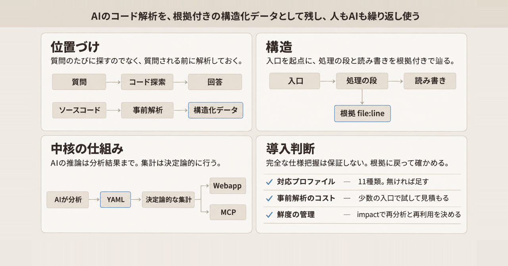
*この記事の全体像。以下、順に解説します。*

## as-built-atlasとは

as-built-atlas は、既存システムの入口から処理・依存・読み書きを辿り、根拠付きの分析結果として残す道具です。**入口**とは、バッチのジョブ、画面、API など、処理が始まる単位を指します。保守担当者は Webapp で、コーディングエージェントは MCP で、同じ集計結果を読みます。

### 作った背景

私はまず、ソースコードを対象にした RAG（検索拡張生成。質問に関係しそうなコード断片を検索して LLM に渡し、回答させる方式）と、Agent Search を試しました。ここでの **Agent Search** は、コーディングエージェントが質問のたびにコードを検索・読解して、その場で回答を組み立てるオンデマンド探索を指します。

私が試した方式では、対象が大規模になるほど探索範囲が広がり、必要な処理や依存関係を取りこぼしました。特に、トランザクションスクリプトに散在する仕様を、一度の探索で再構成するのは難しいと感じました。

これは RAG 一般の限界を示すものではありません。RAG は幅広いアーキテクチャであり、as-built-atlas が作る構造化情報も、検索拡張生成の情報源になり得ます。ここで述べたのは、私が実際に試した方式で直面した問題です。

### 発想の転換：質問される前に解析しておく

そこで、オンデマンドでコード断片を探してその場で仕様を再構成するのではなく、**事前に実装を解析して、後から検索・集計できる形で蓄積する**方向に切り替えました。

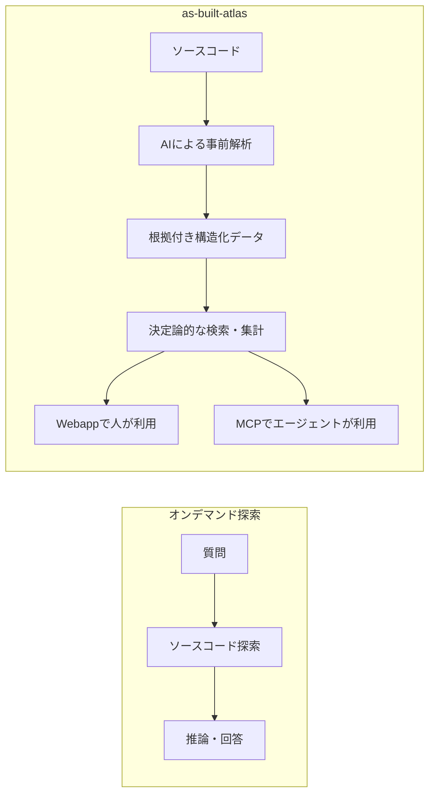

中心にある考え方は、**AI の推論を分析結果の作成までで区切り、その結果を再利用可能な情報資産にする**ことです。as-built-atlas の紹介ページ（LP）では、AI の使いどころを次の 3 つの段階に分けています。

| 段階 | 何をするか |
|---|---|
| 推論を使う | AI が入口から処理・依存・読み書きを追い、主張ごとに根拠を添える |
| 結果を確定・保存 | 形式と項目間の整合性を検査し、入口ごとの YAML に保存する |
| 決定論的に利用する | 同じ結果から依存関係や CRUD を集計し、図や表にする |

リポジトリの README が置く困りごとは、「コードを全部読む時間は無く、根拠の無い LLM の要約は判断に使えない」という状態です。そのため、解く単位を自由文の wiki ではなく、形式を固定したデータにしています。

製品が掲げる 5 つの約束は次のとおりです。

| 約束 | 仕組みのどこで守るか |
|---|---|
| 入口から辿る | 入口 1 件が分析 1 件。入口は、エージェントが拾い方を決め、ツールが列挙し、人が承認する |
| 根拠の無い主張を出さない | 項目ごとに事実・解釈・不明と理由を持つ。根拠はファイルと行 |
| 人とエージェントが同じものを見る | 正本は分析結果の YAML。画面と MCP は同じ API を読む |
| 決定論でできることは決定論で | 列挙・検査・集計・突き合わせはツール。エージェントは発見と解釈 |
| 対象の種類はプロファイルで増やす | 同じ手順でプロファイルを足せる |

**プロファイル**は、対象技術ごとの「層の定義・入口の拾い方・分類」のセットです。**層**は、処理が通る役割の区分で、たとえばバッチなら scheduler（ジョブ定義）、shell（起動スクリプト）、program（本体のプログラム）です。v0.6.0 には 11 個あります。バッチ（Kestra。ジョブを定期実行するワークフロー基盤で、ジョブ定義を Flow と呼ぶ。ほかに GitHub Actions）、dbt、CLI、API、画面（Next.js、Vue Router、Nuxt、SvelteKit、Android、iOS）です。

見本はプロファイルごとに 1 つ、全 11 個あり、そのうち 2 つが中心です。**ことり書店**は架空の Kestra バッチで、生成スクリプトがコードと分析結果を同じ仕様から作る「正解」です。入口 34 件をすべて結果にしています。**umami** は公開されている Web 解析ソフトの Next.js 画面を AI が分析した実例で、入口 83 件をすべて結果にしています。こちらは正解ではありません。

## 特徴

as-built-atlas の特徴は、AI の推論を「分析結果を作るところ」に閉じ込め、それ以降をツールの決定論的な処理にしていることです。

- **分析の単位は入口 1 件**。結果は `analysis/results/` の YAML 1 ファイルです。
- **AI とツールの分担を固定**。エージェントが行うのは、入口の拾い方の決定と、入口から処理を読むことです。列挙、形式検査、データ変換、dbt（SQL でデータ変換を定義するツール）による集計はツールが行います。集計表は dbt のモデルで、名前は `mart_` で始まります。
- **主張に確からしさの区分を持たせる**。各主張は `status` を持ち、`fact`（事実）と `interpretation`（解釈）は `evidence`（ファイルと行の配列）が必須です。`unknown`（不明）は決められた語彙の理由キーが必須です。
- **読み書きの操作を固定語彙にする**。RDB なら create / read / update / delete で、画面のセルは C / R / U / D です。
- **人とエージェントが同じ API を読む**。Webapp も MCP サーバーも、同じ集計表 API の上に乗っています。
- **分析する役と、結果を使う役を分ける**。結果を使うエージェントは、分析をやり直さずに集計表を読みます。
- **鮮度を追える**。対象の Git を進めたあとは、`impact` コマンドが入口ごとの再作業理由を出し、`reuse` コマンドが再利用の確認記録を残します。
- **正解との突き合わせ**。ことり書店の結果は正解なので、`evaluate` コマンドで、処理の段（呼び出しの各ステップ）、読み書き、各段が受け取るパラメータのそれぞれについて適合率と再現率を出せます。見本での評価値はリポジトリに公開されていないため、本記事では示しません。

ここで大事なのは、決定論的な集計が保証するのは「同じ入力から同じ表ができる」ことまでだという点です。元の解析結果の正しさは保証しません。集計の前には形式・呼び出しの木・語彙・層の検査を通し、対象コードがあれば根拠のファイルと行の実在も確かめます。ただし、読み取りの妥当性は、根拠に戻って人が判断する工程として分けています。

## 構造とアーキテクチャ

### システムコンテキスト図

as-built-atlas に関わる人とシステムは次のとおりです。分析するエージェントと、結果を使うエージェントを別の役にしています。

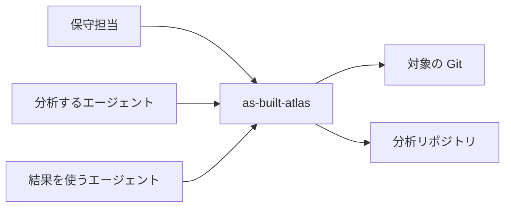

| 要素名 | 説明 |
|---|---|
| 保守担当 | 分析する入口を承認し、Webapp で結果を読む |
| 分析するエージェント | 入口の拾い方を決め、入口ごとに処理を辿って YAML を書く。レビューは分析とは別のセッションのエージェントが行う |
| 結果を使うエージェント | MCP で集計表を読む |
| as-built-atlas | 列挙、検査、集計、API、MCP、Webapp を持つツール |
| 対象の Git | 読み取り専用の clone。固定コミットを作業定義に書く |
| 分析リポジトリ | 対象ごとに 1 つ。作業定義、入口一覧、分析結果、対象ごとに追加する集計表を持つ |

### コンテナ図

ツールは 1 つのコンテナイメージにまとまっています。CLI の `enumerate` が入口一覧を書き、承認済みの入口を分析するエージェントが結果 YAML を書き、CLI の検査と `build` がそれを読みます。正本は YAML で、DuckDB の集計表は毎回作り直す派生物です。Webapp と MCP は同じ `serve` プロセスから出ており、どちらも同じ集計表 API を読みます。これが「人とエージェントの両方が同じものを使う」ための構造です。

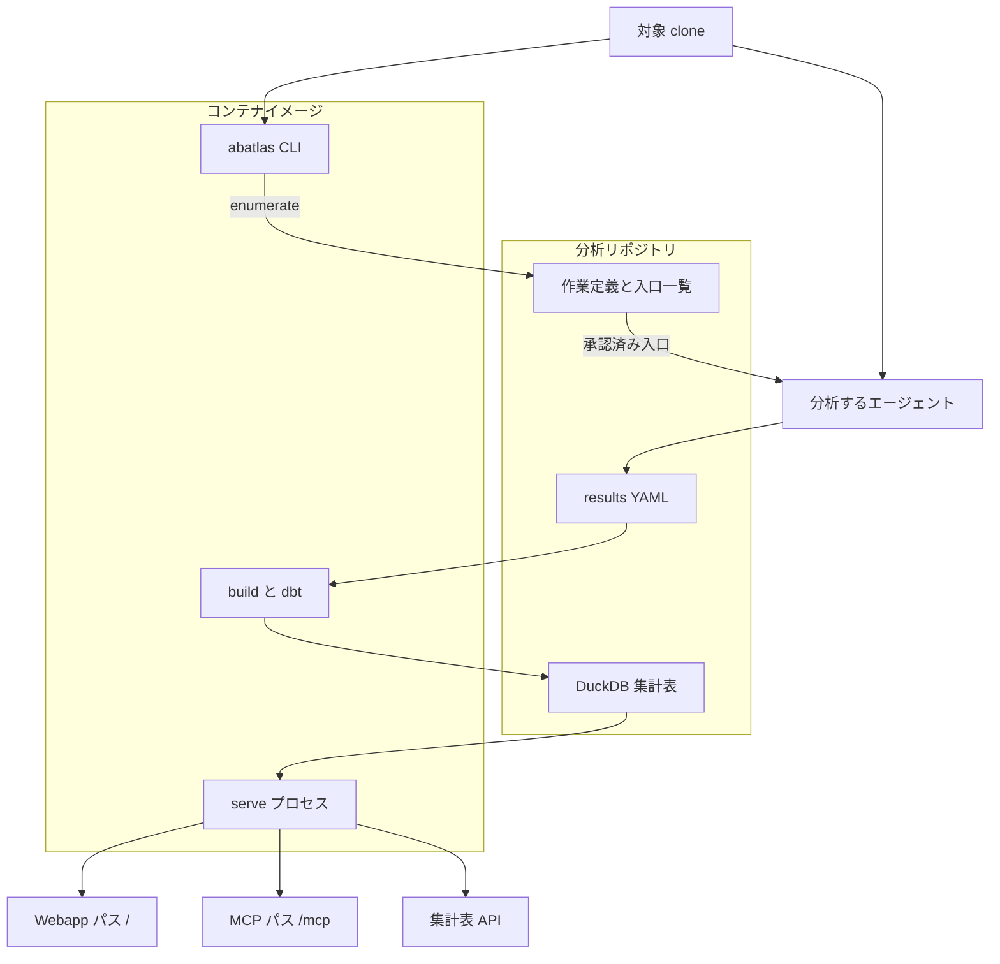

| 要素名 | 説明 |
|---|---|
| 作業定義と入口一覧 | `analysis/work-definition.yaml` と `analysis/entry-list.yaml` |
| results YAML | 入口 1 件につき 1 ファイル。正本 |
| DuckDB 集計表 | `analysis/data/abatlas.duckdb`。集計のたびに作り直す派生物 |
| abatlas CLI | as-built-atlas のコマンド名。イメージの ENTRYPOINT で、`init`、`enumerate`、`build`、`serve` など |
| build と dbt | YAML を CSV にし、dbt で集計表を作る |
| serve プロセス | 既定ポート 8765。API、MCP、Webapp を 1 プロセスで出す |
| Webapp パス / | 静的ファイル。API だけを読む |
| MCP パス /mcp | streamable HTTP。同じプロセス内で API に直接つなぐ |
| 集計表 API | `/meta` と `/marts/...`。dbt モデルに画面・API 向けの公開宣言（`meta.abatlas`）がある表だけを出す |

### コンポーネント図

解析は入口を起点にします。ことり書店の売上確定ジョブ `daily.sales.settle_orders` は、プロファイル `batch-kestra` の層を次の順で通ります。Flow 自体は読み書きを持たず、Python ジョブの段に CRUD が付きます。

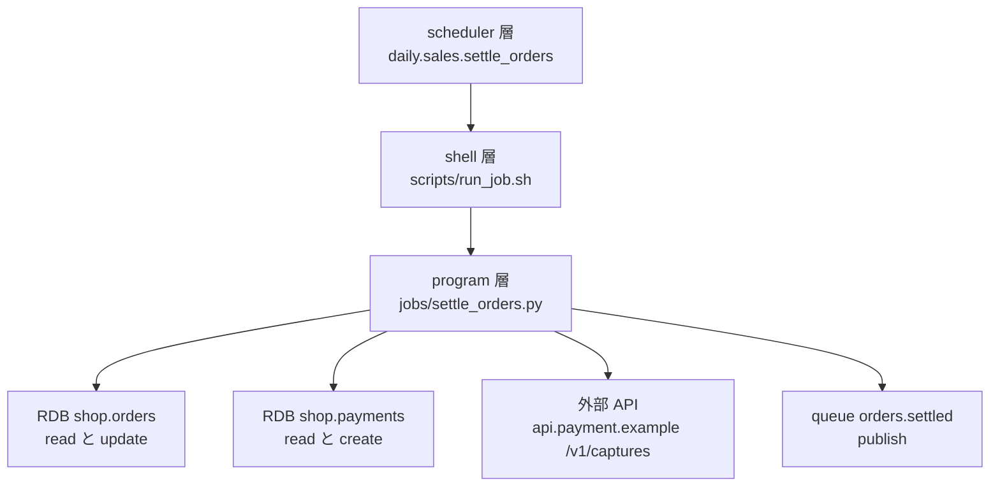

| 要素名 | 説明 |
|---|---|
| scheduler 層 | `flows/daily/sales/settle_orders.yaml`。入口の段なので呼び出し元は無い |
| shell 層 | `scripts/run_job.sh`。環境変数で設定ファイルを選ぶ |
| program 層 | `jobs/settle_orders.py`。読み書きの根拠行を持つ |
| RDB shop.orders | read が 25 行目、update が 39 行目 |
| RDB shop.payments | read が 26 行目、create が 44 行目 |
| 外部 API | ホスト `api.payment.example`、パス `/v1/captures`、35 行目 |
| queue orders.settled | publish。49 行目 |

作業の工程と担当は次のとおりです。AI が担うのは「入口を見つける」「分析」「レビュー」で、そのほかはツールか人です。**抽出器**は、入口の候補をコードから機械的に拾い出す仕組みです（YAML のキー、ファイルの glob、構文木の検索など）。

| 工程 | 誰が | 出力 |
|---|---|---|
| init | ツール | 分析手順の skill、作業定義のひな形、エージェント設定 |
| 入口を見つける | エージェント | 抽出器の設定。道具が取れない入口はファイル・行・理由付きで足す |
| enumerate | ツール | 抽出器の候補を入口一覧に書き戻す |
| 全体の承認 | 人 | `propose` で案を見て、`approve` で一度に承認 |
| 分析 | エージェント | 入口ごとの結果 YAML |
| validate result | ツール | 形式、呼び出しの木、語彙、層、根拠の実在を検査 |
| レビュー | 分析とは別セッションのエージェント | レビュー記録 |
| build | ツール | DuckDB 集計表。検査に落ちると、画面と MCP が読む公開用の DuckDB は前の版のまま残す |
| serve | ツール | API、`/mcp`、Webapp |

入口の列挙は、道具だけでは漏れが出ます。設計記録は、抽出器だけでは入口が漏れるため、入口を見つける責任をエージェントに置く（拾い方を決め、道具が取れない入口を足す）と決めており、道具が読めない例として Vue の単一ファイルを挙げています。エージェントが足した入口には `attributes.listed_by: agent` と理由が付き、道具が出した入口と同じく人が承認します。

Webapp の全体構成ページでは、層とその間の呼び出し・読み書きの数を俯瞰できます。

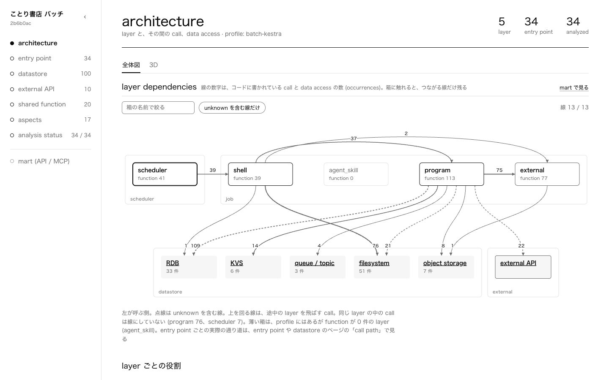

掲載している画面の左上の対象 ID は `2b6b0ac` です。v0.6.0 同梱の見本を開くと、作業定義の `target.commit` に合わせて `caf558f` と表示されます。

## 根拠付きの構造化データ

### 概念モデル

分析結果は、処理の段・主張・根拠・読み書き・資源の関係でできています。

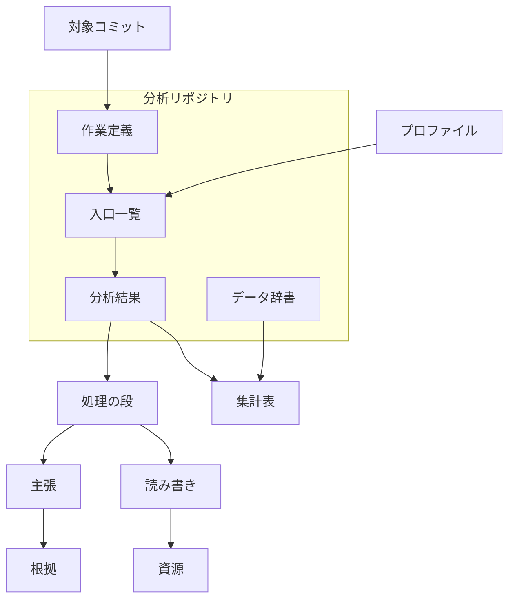

| 要素名 | 説明 |
|---|---|
| 作業定義 | 対象リポジトリ、範囲、固定コミット、プロファイル |
| 入口一覧 | 抽出器の設定、候補、承認状態 |
| 分析結果 | 入口 1 件の YAML。形式の正本は JSON Schema |
| 処理の段 | 呼び出しの木の 1 要素。`caller` で親を指す |
| 主張 | `status` と、根拠または不明理由 |
| 根拠 | `file` と `line` |
| 読み書き | 操作と資源 |
| 資源 | RDB、KVS、キュー、ファイルシステム、オブジェクトストレージ、外部 API |
| データ辞書 | 列の区分（個人情報など）。人が承認した区分だけを、個人情報を使う入口の集計表に使う |
| 集計表 | dbt のモデル（`mart_...`）。画面と MCP が読む派生物 |

### 情報モデル

結果 YAML の主な型は次のとおりです。

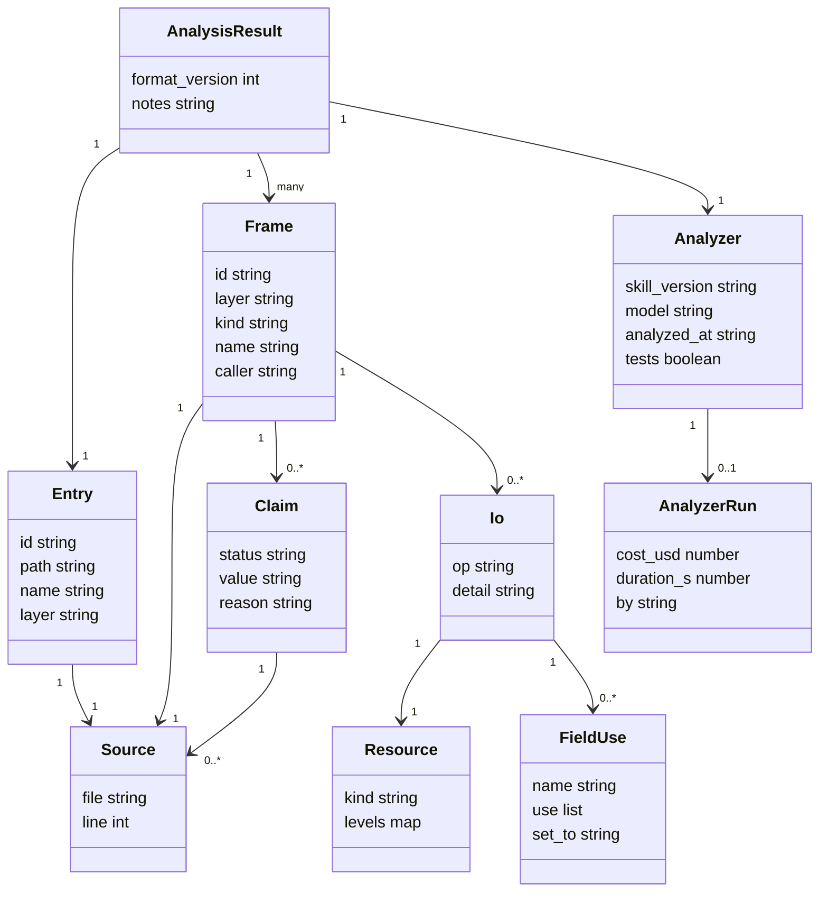

| 要素名 | 説明 |
|---|---|
| AnalysisResult | 結果 1 件。`notes` は正本の項目にしない自由記述 |
| Entry | 入口の id、階層パス、層、定義位置 |
| Source | 根拠と定義位置の共通形。`file` と `line` が必須 |
| Claim | `fact` / `interpretation` / `unknown`。前の 2 つは根拠が 1 件以上必須で、不明は `reason` だけでもよい |
| Frame | 処理の段。入口の段は `caller: null` |
| Io | 読み書きの操作。種類ごとの許可操作は語彙ファイルで固定 |
| Resource | 資源の種類と、接続先の階層（ホスト・DBMS・DB・スキーマ・表）のマップ |
| FieldUse | 列名、`read` / `write` / `filter`、書く値が決まっていれば `set_to` |
| Analyzer | プロファイルと分析 skill の版、モデル、分析日時 |
| AnalyzerRun | 費用と時間。任意で、エージェントを呼び出した側が書く |

実際の結果を見てみます。ことり書店の正解 YAML で、`shop.orders` を更新する I/O は次のとおりです。書く列は `status`（`settled` に設定）と `settled_at` で、`id` は絞り込み条件です。

```yaml
  - op: update
    status: fact
    resource:
      kind: rdb
      levels:
        host: db.internal
        dbms: postgresql
        database: kotori
        schema: shop
        table: orders
    detail: 確定できた注文
    evidence:
    - file: jobs/settle_orders.py
      line: 39
    fields:
    - name: status
      use:
      - write
      set_to: settled
    - name: settled_at
      use:
      - write
    - name: id
      use:
      - filter
```

AI が分析した umami のログイン画面では、結果ファイルにどのモデルがいつ分析したかが残ります。

```yaml
entry:
  id: login
  path: /login
  layer: page
  source: { file: src/app/login/page.tsx, line: 6 }
analyzer:
  profile: { id: ui-nextjs, version: "0.4.0" }
  skill_version: "0.4.0"
  model: "claude-fable-5-2"
  analyzed_at: "2026-11-18T20:38:31Z"
summary:
  status: interpretation
  evidence:
    - { file: src/app/login/page.tsx, line: 7 }
```

不明の理由は 7 つの語彙に固定しています。`not_traceable_in_repo`、`dynamic_dispatch`、`generated_at_runtime`、`binary_or_vendored`、`out_of_scope`、`ambiguous`、`not_analyzed` です。理由の種類を固定しているのは、品質の集計表が理由別の件数を決定的に出せるようにするためです。

コアの集計表は 30 個あります。入口の概要、読み書きの行列、処理の段の木、外部 API、共有処理、権限、設定、ルール、分析結果のどこにも現れないファイル、多くの画面が使う大きな部品の分割候補などです。

## 導入

試すのに必要なのは Docker と git です。README の「10 分で試す」がこの経路です。公開イメージは `ghcr.io/suwa-sh/as-built-atlas` で、README は `latest` タグを使いますが、本記事では手順を v0.6.0 に固定するため `0.6.0` タグを使います。

```bash
git clone https://github.com/suwa-sh/as-built-atlas.git
cd as-built-atlas
git checkout v0.6.0
docker pull ghcr.io/suwa-sh/as-built-atlas:0.6.0
```

見本は checkout の外へ、対象と分析リポジトリを並べてコピーして初期化します。`init` の `--profile` は必須で、ことり書店は `batch-kestra` です。

```bash
mkdir -p ~/abatlas-try && cp -r examples/kotori-books examples/kotori-books-atlas ~/abatlas-try/
cd ~/abatlas-try/kotori-books-atlas
docker run --rm -v "$PWD:/ws/analysis" -w /ws/analysis ghcr.io/suwa-sh/as-built-atlas:0.6.0 init . --profile batch-kestra
```

以降の `docker compose` は、環境変数 `ABATLAS_IMAGE` が未指定だと `latest` を使います。版を固定するときは、分析リポジトリの `.env` に `ABATLAS_IMAGE=ghcr.io/suwa-sh/as-built-atlas:0.6.0` を書きます。

自分のシステムで使うときは、空のディレクトリで同じ `init` を行い、`.env` の `ABATLAS_TARGET` と作業定義を書きます。作業定義の必須項目は `format_version`、`target.repo`、`target.commit`、`profile.id` です。

`init` は、コーディングエージェントが読む分析手順（**skill**。エージェント向けの手順書ファイル）と、エージェント製品ごとの設定を配ります。自分の対象での流れは次のとおりです。

1. エージェントで skill `abatlas-discover-entries` を実行し、入口の拾い方（抽出器の設定）を書く
2. `enumerate` で入口の候補を一覧にする
3. skill `abatlas-run-analysis` が、AI が調べても決まらない点への質問と、入口一覧・作業一覧の案を示す。人が `propose` と `approve` で一度に承認すると、対象の入口から分析が始まる
4. 承認済みの入口 1 件ごとに、skill `abatlas-analyze-entry` が結果 YAML を書き、機械チェックに通し、別のエージェントがレビューする
5. `build` で集計し、画面と MCP を起動する

`init` は分析リポジトリに `compose.yaml` も置くので、以降のコマンドは `docker compose` 経由で実行します。

## 使い方：実際に何ができるのか

同じ分析結果を、目的を変えて使う様子を、見本の実際の画面と結果で示します。ことり書店の見本は分析済みの結果を同梱しているので、`init` のあとは集計して画面を開くだけで試せます。

```bash
docker compose run --rm abatlas build .
docker compose up -d api
```

http://localhost:8765 を開くと Webapp が表示されます。

### 入口から処理経路を辿る

入口詳細の画面では、左に「その入口が触る相手」、右に「そこまでの呼び出し経路（call path）」が並びます。次はことり書店の売上確定ジョブで、外部 API の行を選ぶと、scheduler → shell → program → 外部 API の経路と、各段の定義ファイル・行が出ます。

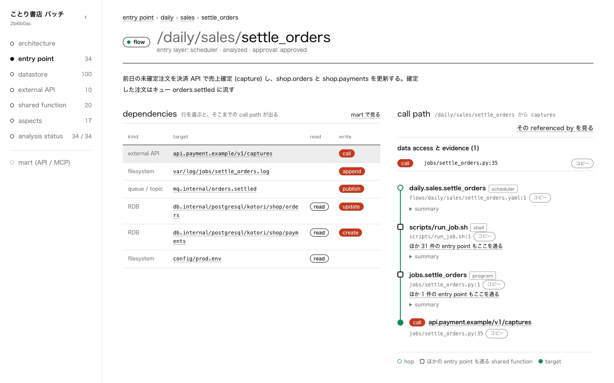

画面だけでなく、分析結果そのものも呼び出し元で繋がっています。umami のログイン画面の結果からフレームの id、名前、呼び出し元、定義位置、user 表の read だけを抜粋すると、画面 → フォーム → フック → API → クエリまでが 1 本に繋がっています。

```yaml
- id: login_form
  name: "LoginForm"
  caller: login_page
  source: { file: src/app/login/LoginForm.tsx, line: 19 }
- id: use_update_query
  name: "useUpdateQuery('/auth/login')"
  caller: login_form
  source: { file: src/components/hooks/queries/useUpdateQuery.ts, line: 6 }
- id: api_login
  name: "POST /api/auth/login"
  caller: use_update_query
  source: { file: src/app/api/auth/login/route.ts, line: 14 }
- id: q_get_user_by_username
  name: "getUserByUsername (src/queries/prisma/user.ts)"
  caller: api_login
  source: { file: src/queries/prisma/user.ts, line: 60 }
  io:
    - op: read
      status: fact
      resource: { kind: rdb, levels: { dbms: postgresql, table: user } }
      fields:
        - { name: username, use: [read, filter] }
        - { name: password, use: [read] }
        - { name: deleted_at, use: [filter] }
      evidence:
        - { file: src/queries/prisma/user.ts, line: 32 }
```

接続先が環境変数で決まる `host` と `database` は書かれていません。ui-nextjs プロファイルは、接続先の階層のうち読めないものは省略し、表名と操作がコードから読めれば I/O を `fact` にする、と決めています。

### データアクセスを横断的に確認する

データの読み書き画面は、行が入口、列がデータの CRUD 表です。トランザクションスクリプトに散らばった「どの処理がどの表を書くか」を、入口をまたいで一覧できます。

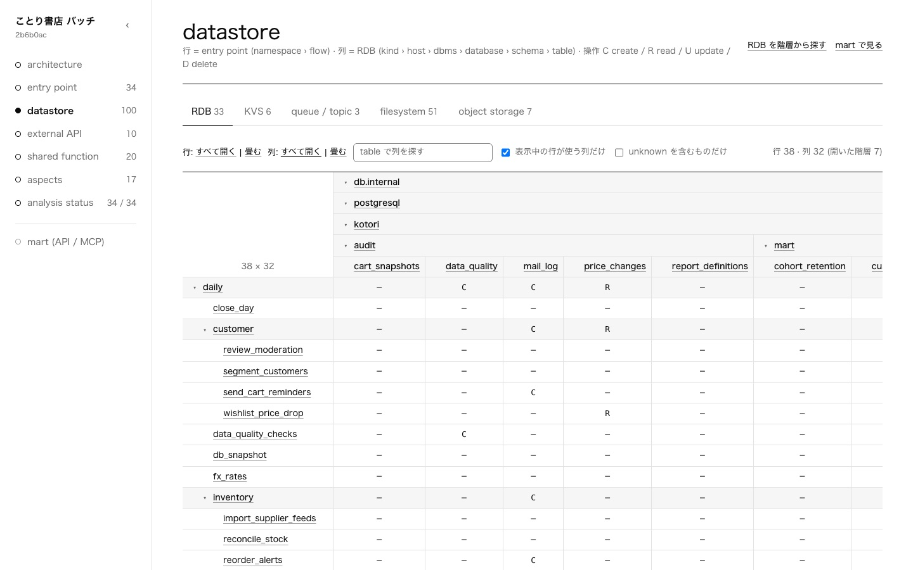

観点ごとの横断表もあります。次は「動きを変える設定とルール」のタブにある表で、条件付きの呼び出し、業務ルール（判定・検証・計算）、設定の数を入口ごとに並べます。設定やルールが集中する入口をここで見つけ、特定の設定を変えたときの影響先は、同じタブの設定（setting）の表で設定名を絞って調べます。

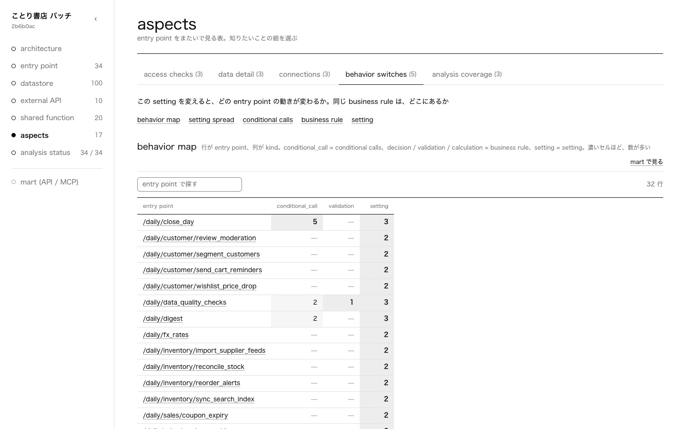

### 根拠となるソースコードへ戻る

`fact` と `interpretation` の主張には、根拠のファイルと行が付きます（`unknown` は理由だけでも記録できます）。画面では `file:line` をコピーして、対象コミットのソースをエディタで開けます。次は売上確定ジョブの `shop.orders` に対する読み書きと、その根拠行です。

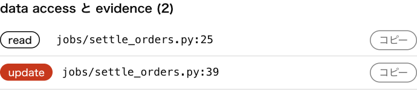

### MCP 経由でエージェントに分析結果を参照させる

コーディングエージェントからは、MCP サーバーとして登録して使います。README の登録例は HTTP トランスポートです。

```bash
claude mcp add --transport http abatlas http://localhost:8765/mcp
```

登録名（例では `abatlas`）は利用者が任意に付ける名前で、サーバー自身が名乗る名前は `as-built-atlas` です。ツールは 6 つです。

| ツール | 役割 |
|---|---|
| `list_marts` | 集計表の一覧 |
| `describe_mart` | 1 表の説明 |
| `query_mart` | 行を取る。`filters` で絞り込み、`limit` 既定 200・最大 10000 |
| `group_mart` | 行の多い表をまとめて見る |
| `recompute` | `build` と同じ再集計を、画面や MCP から起動する |
| `describe_atlas` | 分析の前提や意味を確かめる |

紹介ページは、画面と MCP が同じものを読むことを、次の呼び出し例で示しています。

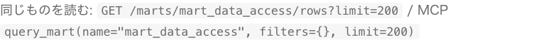

```text
GET /marts/mart_data_access/rows?limit=200
query_mart(name="mart_data_access", filters={}, limit=200)
```

応答は 1 回で最大 `limit` 行です。行数の多い表は、`offset` を進めて続きを取ります。

#### 実際に MCP で問い合わせてみる

ことり書店の見本を v0.6.0 のイメージ（`ghcr.io/suwa-sh/as-built-atlas:0.6.0`）で `build` し、`docker compose up -d api` で起動した MCP サーバーに問い合わせた結果です（2026-11-23 実行）。`initialize` に対してサーバーは `as-built-atlas` と名乗り、`tools/list` は 6 ツールを返しました。

`describe_mart` で `mart_data_access` を見ると、全体は 206 行です。`shop.orders` に触る入口を `query_mart` で絞ると 10 件が返り、操作 `ops` に `U`（更新）を含むのは次の 2 行でした（応答の `rows` から抜粋）。

```json
{
  "name": "mart_data_access",
  "filters": { "resource_path__contains": "shop/orders" }
}
```

```json
[
  {
    "entry_id": "daily.close_day",
    "path": "/daily/close_day",
    "kind": "rdb",
    "resource_path": "/rdb/db.internal/postgresql/kotori/shop/orders",
    "ops": "RU",
    "io_count": 3,
    "has_unknown": false
  },
  {
    "entry_id": "daily.sales.settle_orders",
    "path": "/daily/sales/settle_orders",
    "kind": "rdb",
    "resource_path": "/rdb/db.internal/postgresql/kotori/shop/orders",
    "ops": "RU",
    "io_count": 2,
    "has_unknown": false
  }
]
```

この表には根拠の行がありません。根拠は処理の段ごとの呼び出しの並びを持つ `mart_sequence` から取ります。売上確定ジョブを絞ると、`shop.orders` の read と update が根拠の行付きで返りました（抜粋）。

```json
[
  {
    "seq": 5,
    "from_node": "jobs.settle_orders",
    "to_node": "/rdb/db.internal/postgresql/kotori/shop/orders",
    "message": "read",
    "status": "fact",
    "evidence": "jobs/settle_orders.py:25"
  },
  {
    "seq": 8,
    "from_node": "jobs.settle_orders",
    "to_node": "/rdb/db.internal/postgresql/kotori/shop/orders",
    "message": "update",
    "status": "fact",
    "evidence": "jobs/settle_orders.py:39"
  }
]
```

次に、コーディングエージェント（Claude Code の非対話モード `claude -p`）にこの MCP サーバーだけを渡し、「`shop.orders` を更新する入口と、その根拠のファイルと行を、ソースコードを読まずに MCP の集計表だけで答えて」と頼みました。エージェントは `describe_atlas` → `list_marts` → `describe_mart` → `query_mart`（`mart_data_access`、`mart_sequence`、`mart_field_access`）の順に呼び、次のように答えました（回答の一部を抜粋）。

> ことり書店のバッチで shop.orders を更新する入口は **2 件**あります。ただし更新している処理の実体は `jobs/settle_orders.py` の 1 か所だけです。
>
> | 入口 (Flow) | 更新の経路 | 更新の根拠 |
> |---|---|---|
> | `/daily/sales/settle_orders` | 自分で直接実行する | `jobs/settle_orders.py:39` |
> | `/daily/close_day` | `settle_orders` を Subflow として呼ぶ | `flows/daily/close_day.yaml:20` で呼び出し → `jobs/settle_orders.py:39` |
>
> すべての段が確定した事実 (fact) で、不明 (unknown) はありません。

ソースを確かめると、`flows/daily/close_day.yaml` は `settle_orders` を Subflow として呼び（20 行目が `flowId: settle_orders`）、`jobs/settle_orders.py` の 39 行目は `UPDATE shop.orders SET status = 'settled', settled_at = now() WHERE id = %s` でした。エージェントはコードを探索せずに、入口をまたいだ更新元と、確かめに行くべき行を挙げています。

ここで想定している組み合わせ方は、エージェントがまず集計表で「どの入口がどのデータを触るか」を掴み、そこから根拠のファイルを開いて確かめる流れです。オンデマンドの Agent Search と競合するものではなく、探索の起点になる参照可能な情報基盤として組み合わせます。v0.6.0 に、会話中のコード探索専用の連携機能はありません。

なお、`mart_data_access` の行は入口と資源の対応までで、根拠のファイルと行は持ちません。ファイルと行は、処理の段ごとの呼び出しの並びを持つ集計表 `mart_sequence` の `evidence` 列か、結果 YAML にあります。

## 運用

事前解析した結果は、対象のコードが変われば古くなります。as-built-atlas は鮮度の管理を運用の中心に置いています。

- **状態を見る**。`#/status` の画面は、承認済みの入口に対する分析の進捗と、不明の理由を出します。入口ごとの事実・解釈・不明の件数や、プロファイルが古いかは、入口概要の集計表（`mart_entry_overview`）で見ます。まず `analyzed` 列で結果の有無を見ます。`false` なら `update_status` は空（null）です。`true` のときの `update_status` は `analyzed`（分析済み）、`reused`（再利用）、`stale`（旧版の結果）です。進捗の分母は承認済みの入口なので、承認前の候補がどれだけ残っているかは入口一覧で確かめます。
- **対象の更新に追従する**。まず前回の分析資産を分析リポジトリにコミットし、対象を今回の版に checkout して、`work-definition.yaml` と `entry-list.yaml` の `target.commit` を今回の対象コミットにそろえます。`impact` は、今回の対象コミットを一時ディレクトリに展開して入口を全件列挙し、承認待ち・追加分析・再分析・廃止確認・再利用候補を出します。影響一覧はファイル単位で、挙動の判断は差分を読む分析担当が行います。`--from` に渡すのは、対象コードではなく**分析リポジトリ**の、前回の分析資産を保存したコミットです。

```bash
docker compose run --rm abatlas impact . --from <前回の分析資産を保存した分析リポジトリのコミット> --json
```

- **再利用を記録する**。変更の影響を受けない入口は、人が理由と確認者を付けて再利用を確定します。元の結果、分析日時、レビューは上書きしません。
- **費用を記録する**。結果の `analyzer.run` に費用（`cost_usd`）と時間（`duration_s`）を任意で記録できます。分析 skill 自身は書かず、エージェントを呼び出した側が終了後に追記します。記録があれば、進捗の集計表が残件の費用と時間を見積もります。
- **配布物を更新する**。配布物は、`init` が分析リポジトリに置く skill・hook・プロファイル・形式の定義のコピーで、`upgrade` が新しい版に置き換えます。ふだんの更新は 4 コマンドです。`.env` の `ABATLAS_IMAGE` で版を固定している場合は、先にその値を更新先のタグへ変えます。

```bash
docker compose pull
docker compose run --rm abatlas upgrade .
docker compose run --rm abatlas build .
docker compose up -d --force-recreate api
```

## ベストプラクティス

- **入口の承認を先に終える**。道具が出した入口も、エージェントが足した入口も、同じ一覧に並びます。エージェントが足した入口には理由が付くので、承認時に見分けます。
- **不明は理由の語彙で残す**。分からない段を推測で埋めず、`unknown` と理由にします。ことり書店の正解に入っている不明は、リポジトリから辿れないホスト、実行時に決まる読み書き先、実行時生成の SQL、ソースの無いバイナリです。
- **見本で分析の差を測る**。正解があるのはことり書店だけです。README の手順では、結果を `analysis/truth` に退避し、対象 `../kotori-books` を git リポジトリにして初回コミットを作り、`work-definition.yaml` と `entry-list.yaml` の `target.commit` をそのコミットに変えてから、1 入口を自分のエージェントで分析して `evaluate` します（同梱の `target.commit` は内容ハッシュで、実在するコミットではないためです）。`evaluate` が測るのは、処理の段・読み書き・パラメータの抽出漏れと余分な抽出です。書く値（`set_to`）、説明文、根拠行の妥当性は別途照合します。正解側に全 34 入口を渡すと、未分析の 33 入口も分母に入り、総合の再現率は低く出ます。1 入口だけ見るときは、結果と正解の両方に同じ入口のファイルを指定します。

```bash
docker compose run --rm abatlas evaluate analysis/results/daily.sales.settle_orders.yaml --truth analysis/truth/daily.sales.settle_orders.yaml
```
- **プロファイルを対象に合わせる**。層の id は分析結果の `layer` と一致させます。出力の形や判断の規則が変わったときだけプロファイルの版を上げます。上げると旧版の結果が再分析対象になります。
- **人とエージェントで同じ API を読む**。エージェントには `describe_atlas` で前提を確かめてから `query_mart` で行を取らせます。画面からの書き込みは再集計だけで、分析結果は画面から直せません。

## 注意点

as-built-atlas は、完全な仕様把握を保証するものではありません。根拠付きの分析結果を蓄積・検証・利用できる仕組みを提供するものです。できることと、まだできないことを分けて書きます。

| 観点 | 現状 | 読者への影響 |
|---|---|---|
| 事前解析のコスト | 入口ごとに AI が処理を読むので、時間と費用がかかる。見本には費用の記録は入っていない | 対象の規模に応じた費用を、少数の入口で試して見積もる |
| AI の誤り・見落とし | 検査は形式と根拠行の実在までで、解釈が対象の挙動と一致するかは見ない | 集計が成功しても、AI の読み取りが正しいことにはならない |
| 根拠行と説明文のずれ | ことり書店の正解でも、orders の read は根拠の 25 行が `FROM shop.orders`、絞り込みの WHERE は 27 行で、detail の `status = 'authorized'` はその WHERE に無い | 根拠行が実在しても、説明文がソースの条件と一致するとは限らない。根拠に戻って読む |
| 解析済みと未解析の区別 | ことり書店と umami 以外の 9 見本は、入口一覧の一部（3〜7 件）だけを分析している | `#/status` の進捗は承認済みの入口が分母なので、入口一覧に残る未承認の候補もあわせて確かめてから結果を読む |
| 届かないファイルの表 | 対象範囲のファイルから、入口一覧の定義位置（未承認の候補を含む）・分析済みの段の定義位置・主張の根拠に現れるものを除いた表。対象 clone を読めない集計では空になる。未分析の入口が残る間は未使用と未分析が混ざり、全入口を分析した後も、import されて使われる設定モジュールなどが載り得る | 死にコードの確定リストとして扱わない。削除の判断には、参照箇所を別途確かめる |
| 個人情報の流れ | 辞書で承認した列を使う入口と、同じ入口が呼ぶ外部接続を出す | 値が実際に送られるかは、根拠の処理に戻って確認する |
| 鮮度 | コード変更に追従するには `impact` と再分析・再利用の確定が要る | 分析コミットと最新コミットの差を運用で管理する |
| 適用しやすさ | 対象の種類はプロファイルに依存する。道具が読めない入口はエージェントが足す | 対応プロファイルが無い技術では、プロファイルを足す作業が先に要る |
| MCP ツールの数 | README のメニュー表は `describe_atlas` と `query_mart` を挙げる | 実装には 6 ツールある。README だけだと集計と再集計の手段を見落とす |

## トラブルシューティング

| 症状 | 原因 | 対処 |
|---|---|---|
| `build` のあと公開用 DuckDB が変わらない | 結果が 1 件でも形式、呼び出しの木、語彙、層の検査に落ちた | `validate result` の指摘を直し、再度 `build` する |
| 画面の集計が古い | 分析のあとに `build` をしていない。または、対象コミットが変わって `stale` の結果が集計に含まれている | `build` が成功したら画面を再読み込みする（api の再作成はイメージ更新のときだけでよい）。それでも古ければ、該当入口の `mart_entry_overview.update_status` を見て、`stale` なら再分析か再利用の確認を済ませてから再集計する |
| 再集計が 409 | 再集計の実行中 | 終わってから再度呼ぶ |
| 読む API が 403 | Host がループバックでも `ABATLAS_ALLOWED_HOSTS` でもない | ループバックで開くか、許可ホストを設定する |
| 根拠の行が検査で落ちる | ファイルが範囲外、または行番号がファイル行数を超える | `source` と `evidence` のパスと行を、対象コミットのファイルに合わせる |
| MCP が表を返さない | `serve` 前、または DuckDB が無い | 分析リポジトリで `build` してから api を起動する |

## まとめ

AI がソースコードを読めるようになったことで、既存システムの仕様を理解する手段は増えました。しかし、毎回の調査で得られた理解が、その場限りの回答として消費されてしまうのは惜しいと感じています。

as-built-atlas は、その理解を根拠付きの構造化データとして残し、人間もAIも繰り返し利用できるようにする試みです。

- AI の推論は、入口ごとの分析結果を作るところまでに区切る
- 結果は事実・解釈・不明と根拠のファイル・行を持つ YAML として残す
- 検索と集計は決定論的に行い、Webapp と MCP で人とエージェントが同じものを読む
- 決定論的な集計は解析の正しさを保証しないので、根拠に戻って確かめる

同じような課題に直面している方は、ぜひ見本で試してみてください。

- [GitHubで試す](https://github.com/suwa-sh/as-built-atlas)
- [LP・利用例を見る](https://suwa-sh.github.io/as-built-atlas/?lang=ja#start)

この記事が少しでも参考になった、あるいは改善点などがあれば、ぜひリアクションやコメント、SNSでのシェアをいただけると励みになります！

## 参考リンク

- [as-built-atlas（GitHub）](https://github.com/suwa-sh/as-built-atlas)
- [README 日本語（v0.6.0）](https://github.com/suwa-sh/as-built-atlas/blob/v0.6.0/README.ja.md)
- [紹介ページ](https://suwa-sh.github.io/as-built-atlas/?lang=ja#start)
- [変更記録（v0.6.0）](https://github.com/suwa-sh/as-built-atlas/blob/v0.6.0/CHANGELOG.md)
- [データの流れと集計表](https://github.com/suwa-sh/as-built-atlas/blob/v0.6.0/docs/architecture/pipeline.md)
- [集計表 API と MCP](https://github.com/suwa-sh/as-built-atlas/blob/v0.6.0/docs/architecture/api.md)
- [プロファイル](https://github.com/suwa-sh/as-built-atlas/blob/v0.6.0/docs/architecture/profiles.md)
- [MCP サーバー実装](https://github.com/suwa-sh/as-built-atlas/blob/v0.6.0/abatlas/mcp_server.py)
- [分析結果の形式](https://github.com/suwa-sh/as-built-atlas/blob/v0.6.0/docs/architecture/formats.md)
- [分析結果スキーマ](https://github.com/suwa-sh/as-built-atlas/blob/v0.6.0/schema/analysis-result.schema.json)
- [不明の理由](https://github.com/suwa-sh/as-built-atlas/blob/v0.6.0/schema/vocab/unknown-reasons.yaml)
- [ことり書店 売上確定の結果](https://github.com/suwa-sh/as-built-atlas/blob/v0.6.0/examples/kotori-books-atlas/analysis/results/daily.sales.settle_orders.yaml)
- [umami login の結果](https://github.com/suwa-sh/as-built-atlas/blob/v0.6.0/examples/umami-atlas/analysis/results/login.yaml)
- [公開サンプルと突き合わせ](https://github.com/suwa-sh/as-built-atlas/blob/v0.6.0/docs/architecture/examples.md)
- [対象コードの差分](https://github.com/suwa-sh/as-built-atlas/blob/v0.6.0/docs/architecture/impact.md)
- [umami](https://github.com/umami-software/umami)
