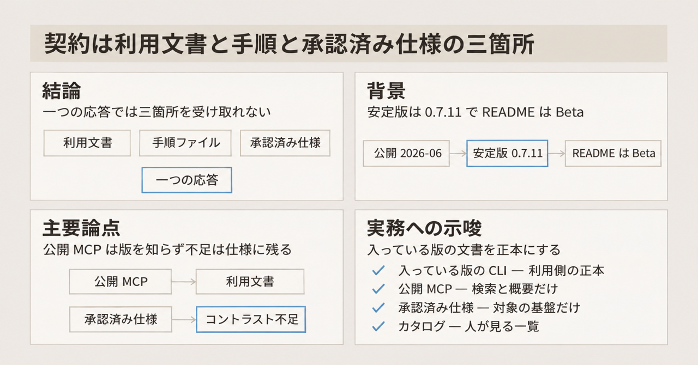
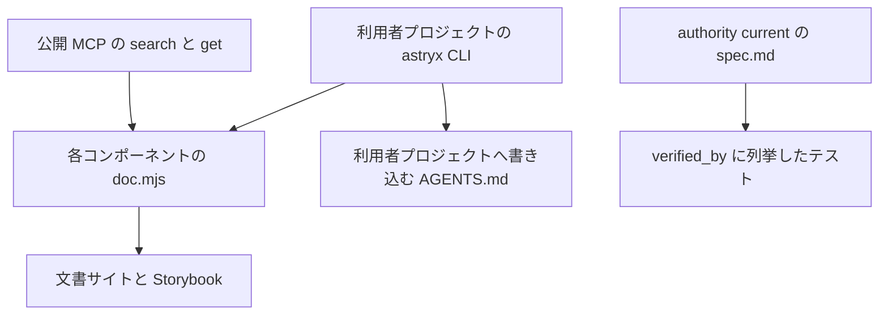

Meta が MIT で公開しているデザインシステム Astryx は、React 19 以降の型付きコンポーネント、あらかじめビルドした CSS、テーマ、CLI を一つの系統として配ります。公式は、人と、その横でコードを書くエージェントが、同じ API・文書・CLI を参照する、と説明しています。

README は 2026年11月10日時点でも "Currently in Beta" と書いています。

契約は、誰がどのファイルを根拠にしてよいかの取り決めです。この記事では、その契約が三箇所に分かれることを追います。三箇所は、CLI と公開 MCP が返す利用文書、利用者プロジェクトへ書く手順、承認済みの仕様です。公開 MCP は、エージェントが文書を引く入口です。人がブラウザで見るカタログは、この三箇所とは別の出口です。読み取りの基準は GitHub の [meta/astryx](https://github.com/meta/astryx) の main、コミット [b6b0c68](https://github.com/meta/astryx/commit/b6b0c68ad570ca85c8028aa1d4e416ac76453023) です。committer date は 2026-11-10T02:28:58Z です。

*この記事の全体像。以下、順に解説します。*

## Astryxとは

Astryx は、人とエージェントが同じ入口を参照する前提で配られているデザインシステムです。公開の告知は 2026年6月18日の公式ブログです。文書と Storybook は [astryx.atmeta.com](https://astryx.atmeta.com) にあります。

配られるものは四つが一つの系統です。React 19 以降向けの型付きコンポーネント、ビルド済みの CSS、テーマ、CLI です。Storybook は [astryx.atmeta.com/storybook/](https://astryx.atmeta.com/storybook/) で公開されている、人向けのカタログです。

リポジトリの中の `AGENTS.md` は、Astryx 自体を変更する人向けの手順です。利用側のアプリへ後から書き込む `AGENTS.md` とは別のファイルです。

## 配っているものの特徴

安定版として npm に出ているのは `@astryxdesign/core` 0.7.11 です。公開日は 2026年11月7日です。GitHub Release の [v0.7.11](https://github.com/meta/astryx/releases/tag/v0.7.11) と、npm の `latest` は一致しています。

番号は見る場所で違います。基準コミットの `packages/core/package.json` は 0.7.12 です。これは次の宣言で、npm `latest` の 0.7.11 とは別です。リポジトリ直下の `package.json` は private の 0.0.0 です。

| 見る場所 | 番号 | 読み方 |
|---|---|---|
| npm `latest` と GitHub Release | 0.7.11 | 公開された安定版 |
| 基準コミットの `packages/core/package.json` | 0.7.12 | 次の宣言。npm `latest` の 0.7.11 とは別 |
| リポジトリ直下の `package.json` | 0.0.0（private） | リポジトリ内部の番号 |

peer は、利用側が自分で入れる依存です。三つあります。`react` と `react-dom` は `>=19.0.0` です。`@stylexjs/stylex` は `^0.19.0` です。StyleX（`@stylexjs/stylex`）は、コンポーネントのスタイルを書くための必須の peer です。peer が無いと npm は警告します。

core の README は、最短の利用を `reset.css`、`astryx.css`、テーマ CSS の順の import と Theme provider としています。Theme provider は、選んだテーマを配下へ適用する部品です。ビルドプラグインが要らない、と書いてあるのはこの CSS を import する経路です。StyleX の peer は、その経路でも残ります。PostCSS も Babel も、この経路の前提には入っていません。

既製テーマは README が 7 つ挙げます。neutral、butter、chocolate、matcha、stone、gothic、y2k です。見た目は CSS カスタムプロパティの上書きで変えます。コンポーネントのソースをフォークせずに見た目を変えられる、と README と core の README が書いています。

コンポーネントの利用文書は、各ディレクトリの `{Name}.doc.mjs` です。CLI の `astryx component <Name>` と、公開 MCP の `search` / `get` が、この索引をエージェントに返します。公開 MCP は [astryx.atmeta.com/mcp](https://astryx.atmeta.com/mcp) にある、エージェントがツールとして文書を引く入口です。

`astryx init --features agents` は、利用者プロジェクトの `AGENTS.md` などに、テンプレートから始める手順と CLI の引き方を書き込みます。

変更を拘束する記録は `docs/specs/` です。`authority: current` は承認済みで、実装とレビューを拘束します。`draft` は拘束しません。Button の契約は 2026年10月25日に current になっています。

原則は "Guidance over enforcement" です。渡した値は描き、デザイン上の意見は文書と例に置く、と README にあります。

## 三つの出口という概念構造

エージェントが実行前に読む面と、変更を拘束する面と、人がブラウザで見る面は、同じデザインシステムの別の出口です。実行前に読む面は、利用文書と、利用者プロジェクトの手順です。変更を拘束する面は、承認済みの仕様です。人が見るカタログは出口の一つで、契約の三箇所には入りません。

`doc.mjs` は、コンポーネントごとの利用文書です。CLI と公開 MCP は、ここを返します。文書サイトと Storybook も、この文書から出ます。`astryx init --features agents` が書く `AGENTS.md` は、利用者プロジェクト側の手順ファイルです。

`authority: current` の `spec.md` は、別の出口です。`verified_by` は、その spec が検証先として列挙したテストです。図の上では、spec はテストへつながり、component doc とは別の線です。

`get("Button")` が 2026年11月10日に返した中身は、次の項目です。props（型、既定値、必須）、使い方の `bestPractices`（`guidance` が true か false か）、アクセシビリティの合格基準、anatomy（部品の構成）、テーマ用 CSS 変数、例、install 行です。`guidance` は、助言の文に付く印です。Button の `guidance: false` は、「ページ遷移にはボタンを使うな」という文です。`false` は、その助言が誤りだという印ではありません。true でも false でも、実行時に値を拒みません。

Button の `spec.md` にある優先順位は、size、操作可否、要素、accessible name（支援技術が読む名前）、スタイルの順で、どれを先に採用するかです。レビューで却下する条件と、実装が契約に届いていない箇所は、この応答の項目には入っていません。

## 注意点（誇張への注意）

公式の到達宣言と、同じ公式の但し書きは、分けて読みます。

### 到達宣言と Beta

2026年6月18日の導入記事は、"production-ready (and growing)"、"built ground-up to be AI-operable"、"without dependencies" と書いています。同じページで Beta とも書いています。README は 2026年11月10日時点でも "Currently in Beta" のままです。

"without dependencies" と、React 19 および StyleX 0.19 の peer は、両立しません。peer が無いと npm は警告します。

### 社内規模の自己申告

「社内で 8 年、13,000 以上のアプリ、150 以上のアクセシブルなコンポーネント」は、README と導入記事の自己申告です。公開リポジトリの GitHub `createdAt` は 2026年1月9日です。npm パッケージの created は 2026年6月24日です。どちらも、社内年数の独立した裏取りにはなりません。

同じコミットで `packages/core/src` の直下ディレクトリは 122 個あります。theme なども含みます。150 という宣伝文の否定にも肯定にもなりません。内訳の公式な数え方は、公開資料からは見つかっていません。

### 公開後の数字

2026年7月22日の "One Month of Astryx" にある star 数、npm ダウンロード数、訪問数は、その記事の自己申告です。2026年11月10日の GitHub API では、star は約 2.0 万、fork は約 1,500 です。7月の自己申告と、この現在値は、並べて一つの系列にはしません。

### agentic states は draft

`docs/design/agentic-states.md` は `authority: draft` です。承認者は空です。人がエージェントの作業状態（待ち、実行、ストリーミングなど）を見る視覚言語の未決事項です。ファイル自身が、エージェントのプロトコルや進捗イベントのスキーマは定義しない、と書いています。エージェント向け機械可読仕様の本体ではありません。

### 禁止の組み合わせは機械検証されない

コンポーネント props の「禁止の組み合わせ」を検証する JSON Schema は、公開資料からは見つかっていません。近いものは二種類です。

MCP の `guidance: false` は、文章の助言です。Button の spec は、優先順位（size、操作可否、要素、accessible name、スタイル）と、レビューで却下する条件を文章で持ちます。accessible name は、支援技術が読む名前です。README の原則は、実行時に値を拒むのではなく、意見を文書に置く、です。

### Button のコントラストと disabled

Button の current な spec は、暗いアクセント上の hover と pressed で、ラベルのコントラストが 4.35:1 と 4.02:1 になり、4.5:1 を下回る、と自分で書いています。tooltip の無い disabled は、`aria-disabled` ではなくネイティブの `disabled` になり、キーボードのタブ順から外れます。`aria-disabled` は、無効であることを伝えつつ要素自体は操作対象に残す書き方です。

2026年11月10日の MCP `get("Button")` は、上に書いたコントラスト不足と disabled の違いを返しません。install 行は `npm install @astryxdesign/core` のみで、テーマと StyleX の peer を含みません。この比率は spec 自身の記載です。0.7.11 のビルド済み CSS で同じ値になるかは、公開された再測定としては示されていません。

### 公開 MCP は版を受け取らない

公開 MCP の `get` に、インストール済みバージョンを渡す引数はありません。ツールは `search` と `get` だけです。2026年11月10日に `tools/list` で確認されています。

ホスト側の最新文書を返す、という読みを弱める提案が [meta/astryx#5134](https://github.com/meta/astryx/issues/5134) として open です。この issue の「エージェントが API を捏造する」は、起票者の推論です。測定結果ではありません。

### 夜間テストに残る名前

夜間テストは、エージェントに文書を読ませてプロンプトを与えた記録です。記録 [meta/astryx#3164](https://github.com/meta/astryx/issues/3164) は open です。本文の追跡表には、Button で `label` が `children` より必須になること、variant を `filled` / `outlined` と書いてしまうこと、が 2026年6月から残っています。

2026年8月5日のメンテナコメントは、Button の文書を読んだエージェントが 10 プロンプト中 8 つで `onPress` を出し、型が拒否した、と書いています。`onPress` は、この文書の prop ではない名前です。分類は「CLI 文書は正しく、文書側は直さない」です。一夜の再現であり、現在の失敗率ではありません。

### 0.6 から 0.7 の移行

v0.7.0 の公式記事（2026年10月12日）は、"All 26 breaking migrations" という節を持ちます。正本は、人とエージェントが根拠にしてよい文書です。0.6 から 0.7 のあいだに、エージェント向け文書をその版の正本として保つには `astryx upgrade` が要る、という公式の移行案内があります。

### charts と lab は core と同じ入れ方ではない

`@astryxdesign/charts` と `vega` の npm `latest` は、2026年11月10日時点で `0.0.0-bootstrap.0` です。`vega` は、charts と並んで stable が無いパッケージです。README は、stable（安定版タグ）が無く `@canary` のみ、と書いています。`@canary` は、stable より前の配布タグです。`@astryxdesign/lab` は、README が「npm に出していない」と書き、同じ日のレジストリには canary があります。core の `get` が返す install 文と同じ形で charts を入れると、canary のチャートは入りません。

### React Native の読み分け

2026年7月10日のメンテナ返信（[meta/astryx#3417](https://github.com/meta/astryx/discussions/3417)、open）は、React Native を「いま計画していない」と書いています。

その後、main にある `packages/native` は、iOS、Android、macOS、Windows の実験です。README は canary のみ、production 非対応と書いています。React Native のパッケージではありません。

仕様案 [meta/astryx#10919](https://github.com/meta/astryx/pull/10919) は 2026年11月9日の作成です。基準コミットの時刻（02:28:58Z）では open で、未マージでした。同日 03:24:51Z に、作成者 imdreamrunner が main へマージしています。PR の APPROVED は astracat-bot（03:23:54Z）で、cixzhang の承認はありません。入った `docs/specs/AST-112-react-native-foundation/spec.md` は `authority: draft`、`approved_by` は空、`phase: proposed` です。これはコンポーネントの提供ではありません。

一方、基準コミットにある current な `docs/specs/AST-082-native-first-surfaces/spec.md`（approved 2026年10月24日、cixzhang）の FR12 は、その spec の要求項目です。ネイティブの作り方の比較候補に React Native components を含め、同じ比較表で測る、とすでに書いています。7月の返信より新しい公式記録ですが、提供の決定ではありません。基準コミットに、利用者が入れる React Native パッケージはありません。

基準コミットの DEC-7 は、ネイティブ実装の置き場を決めた決定項目です。この時点にある文は、置き場を `@astryxdesign/native` とするものです。AST-112 への参照はありません。AST-112 を参照する 1 文は、基準コミットより後、同日 03:24:51Z のマージで DEC-7 に足されています。

### current をディレクトリごと渡すと Swift も入る

`authority: current` の spec をディレクトリごと正本にすると、Web の Button だけでなく、Swift の TextInput が同じ権威で入ります。識別子は `component:swift/TextInput`、approved は 2026年10月31日、検証先は `packages/native` のテストです。これは canary のネイティブ実験の契約です。

### 脆弱性情報の範囲

2026年11月10日に、NVD（National Vulnerability Database。公開されている脆弱性データベース）の keyword `astryx` と `astryxdesign` は、いずれも `totalResults: 0` でした。無い、という証明ではありません。SECURITY.md は、セキュリティ更新の対象を各パッケージの最新リリースだけ、と書いています。

公開 MCP のレート制限と、認証なしで読める範囲の正式な権限モデルは、2026年11月10日時点の公開資料では確認できていません。

## 契約は三箇所に分かれるときの読み方

画面生成の上手さではなく、正本をエージェントとの共作に開いたとき、契約をどこに置くか、が読み方の問いです。Astryx の公開物は、その答えを一つに寄せていません。

| 置き場所 | 誰が読むか | 何が書いてあるか | 何が書いてないか |
|---|---|---|---|
| `{Name}.doc.mjs` を CLI と MCP が返す層 | アプリを書く人とエージェント | props、例、助言（`guidance` true/false）、アクセシビリティの合格基準、テーマ変数、入れるコマンド | spec の優先順位、実装が契約に届いていない箇所、`authority` |
| `astryx init --features agents` が書く層 | 利用者プロジェクトのエージェント | テンプレートから始める手順、CLI の引き方、避ける書き方 | インストール済みバージョンにピンした契約全文 |
| `docs/specs/**/spec.md` のうち current | リポジトリを変更する人とレビュー | 振る舞い、状態、優先順位、アクセシビリティ、却下条件、検証するテスト | 利用側 MCP の応答には載らない |

Storybook は、契約の三箇所のどれでもありません。人がコンポーネントを見るカタログです。エージェントに渡す正本を Storybook の画面だけにすると、props の型も、current な契約も、実装が契約に届いていない箇所も落ちます。

Button では、三つの記述が同時に見えます。利用文書の MCP 応答は、`href` をリンクとして描きます。同じ応答の `guidance: false` は、ページ遷移にはボタンを使うな、という助言です。変更側の spec は、`href` があり disabled でなければリンク要素になる、と優先順位で書きます。描き方は、MCP と spec で同じです。助言は、その描き方とは別の文です。夜間テストの記録では、Button の文書を読んだエージェントが `onPress` を出しています。`onPress` は、この文書の prop ではない名前です。移行の案内も、文書を読んでもそのような名前が出る、と記録しています。

## 支持と反証を分けて読む

### いまの結論

Astryx は、デザインシステムの正本をエージェントとの共作に開いています。トークンは、色や余白のように名前を付けて再利用する値です。開いた契約の本体は、そのトークンではありません。コンポーネント文書を CLI と MCP から引けるようにしたことと、変更側には承認済み spec とテストを置いたことです。トークン、アクセシビリティ、禁止に近い条件は、それぞれ別のファイルにあります。エージェントは、一つの応答で全部は受け取りません。

### 支持

- 利用文書、CLI、MCP が同じ component doc を返す、と `working-with-ai.doc.mjs` が書いています。2026年11月10日の `tools/list` と `get("Button")` は、それに沿っています。
- Button の spec は current で、テストパスを `verified_by` に列挙しています。アクセシビリティの合格基準は、MCP の Button 応答にも WCAG の番号つきで入ります。WCAG は、ウェブのアクセシビリティ指針です。
- テーマは CSS カスタムプロパティです。コンポーネントのソースをフォークせず、見た目を変えられます。
- Beta と 0.x のリリース手順がリポジトリにあります。v0.7.11 は GitHub Release と npm `latest` で一致します。

### 反証

- 文書を読んでも慣れた prop 名が出る、という記録が [#3164](https://github.com/meta/astryx/issues/3164) に残ります。文書を渡した時点で共作が閉じる、とは読めません。
- 禁止の組み合わせは機械検証されません。これは欠落というより、"Guidance over enforcement" という方針です。「禁止組み合わせまでスキーマ化した」と書くと、一次資料より強くなります。
- current な spec を一括でエージェントに渡すと、Web の契約と canary の Swift 契約が混ざります。MCP だけを渡すと、spec が自分で書いたコントラストの不足が落ちます。
- チャートと lab と native は、core の安定版と同じ「入れれば使える」ではありません。

## 未解決の問いが止めないこと

次は、いまの一次資料では書き切れません。

- 150 以上、という公式の数え方の分母です。ディレクトリ数でも spec 数でもありません。
- 13,000 アプリと 8 年を、公開後のどの範囲に読み替えてよいかです。独立した内訳はありません。
- 公開 MCP のレート制限と、認証なし応答のサポート範囲です。公開資料では確認できていません。
- [#3164](https://github.com/meta/astryx/issues/3164) の `onPress` が、0.7.11 の文書を読んだ現在のモデルでも同じ割合で出るかです。2026年8月5日の夜間記録は、現在値にはできません。
- 2026年7月10日の「計画していない」と、2026年10月24日に current になった AST-082 FR12（比較候補の一つとして React Native components を名指しする）を、提供の有無とどう読み分けるかです。基準コミットに、利用者が入れる React Native パッケージはありません。
- Button の 4.35:1 と 4.02:1 が、0.7.11 のビルド済み CSS でまだ再現するかです。spec の自己申告であり、ピクセルの再測定は公開されていません。

これらが未解決でも、契約が三箇所であるという読みは止まりません。数値の自己申告と、契約が三箇所であることは、いまの一次資料で確認できます。現在の失敗率、全コンポーネントが WCAG を満たすこと、React Native 対応は、この基準コミットからは確認できません。

## 推奨する正本の置き方

主語は、画面をそれっぽく出すことではなく、契約の置き場所です。

1. 利用側の正本は、そのプロジェクトに入っている版の CLI（`astryx component <Name> --dense`）と、同じ版から生成した agent docs にします。agent docs は、入っている版の CLI が返すコンポーネント文書です。`astryx init --features agents` が書く `AGENTS.md` は、その CLI の引き方をプロジェクトへ置く手順ファイルで、版にピンした契約全文は持ちません。公開 MCP は検索と概要には使えます。版を知らないので、install 行と props を最新の公開文書としてそのまま採用しません。
2. 変更側の正本は、`authority: current` の、対象プラットフォームの spec と、その `verified_by` にします。`draft` の agentic states は、エージェントプロトコルの仕様として引用しません。
3. 禁止に近い条件は、スキーマではなく、「文書の助言」と「レビューで却下する文章」の二つとして書きます。実行時に組み合わせを拒む、とは書きません。
4. 150 以上、13,000 アプリ、8 年、production-ready は、公式の自己申告として日付つきで置きます。アクセシブル、は Button のように、契約と、契約自身が書く不足がセットで存在する、と書きます。
5. 自分のデザインシステムへ写すなら、Storybook を人のカタログのまま残します。エージェントには、props・状態・助言を返す文書と、承認状態つきの振る舞い契約を、別ファイルで持たせます。一つのカタログに混ぜると、Astryx がすでに分けている欠落を、自分側で再導入します。

次の条件が満たされたら、上の記述を撤回します。

- 公開 MCP が、問い合わせたバージョンの spec と implementation gap（実装が契約に届いていない箇所）を `get` で返すようになったら、「利用側文書にはギャップが載らない」は撤回します。
- React Native のコンポーネントが、利用者が入れる提供物として current な契約に載ったら、2026年7月10日の「計画していない」は当時の発言に限定します。基準コミットの AST-082 FR12 は比較候補の列挙です。同日 03:24:51Z の [#10919](https://github.com/meta/astryx/pull/10919) は draft の配置案です。どちらも、この条件を満たしません。
- 禁止組み合わせの JSON Schema が current な契約として追加されたら、"Guidance over enforcement" の記述をその範囲だけ更新します。

## まとめ

Astryx は、人とエージェントが同じデザインシステムを参照する前提で公開されています。利用側が引く component doc、利用者プロジェクトへ書く手順、変更側の承認済み spec は、別のファイルです。エージェントは、一つの応答で全部を受け取りません。

安定版として合わせる番号は、npm `latest` と GitHub Release の 0.7.11 です。150 以上、13,000 アプリ、8 年、production-ready は、公式の自己申告として日付つきで扱います。React Native の提供と、全コンポーネントの WCAG 充足と、いまの `onPress` の失敗率は、この基準コミットからは書けません。

この記事が少しでも参考になった、あるいは改善点などがあれば、ぜひリアクションやコメント、SNSでのシェアをいただけると励みになります！

## 参考文献

- リポジトリ: [meta/astryx](https://github.com/meta/astryx)（基準コミット [b6b0c68](https://github.com/meta/astryx/commit/b6b0c68ad570ca85c8028aa1d4e416ac76453023)）
- README: [README.md](https://github.com/meta/astryx/blob/b6b0c68ad570ca85c8028aa1d4e416ac76453023/README.md)
- 利用側の AI ガイド: [working-with-ai.doc.mjs](https://github.com/meta/astryx/blob/b6b0c68ad570ca85c8028aa1d4e416ac76453023/packages/cli/assets/docs/working-with-ai.doc.mjs)
- Button 契約: [Button.spec.md](https://github.com/meta/astryx/blob/b6b0c68ad570ca85c8028aa1d4e416ac76453023/docs/specs/components/Button/Button.spec.md)
- agentic states（draft）: [agentic-states.md](https://github.com/meta/astryx/blob/b6b0c68ad570ca85c8028aa1d4e416ac76453023/docs/design/agentic-states.md)
- 導入記事（2026年6月18日）: [Introducing Astryx](https://astryx.atmeta.com/blog/introducing-astryx)
- v0.7.0（2026年10月12日）: [Astryx v0.7.0](https://astryx.atmeta.com/blog/astryx-v0-7-0)
- npm latest: [@astryxdesign/core](https://www.npmjs.com/package/@astryxdesign/core)
- 公開 MCP: [astryx.atmeta.com/mcp](https://astryx.atmeta.com/mcp)
- 文書サイト: [astryx.atmeta.com](https://astryx.atmeta.com)
- Storybook: [storybook](https://astryx.atmeta.com/storybook/)
- 夜間テストの API 記録: [meta/astryx#3164](https://github.com/meta/astryx/issues/3164)
- 公開 MCP の読み方の提案: [meta/astryx#5134](https://github.com/meta/astryx/issues/5134)
- React Native の議論: [meta/astryx#3417](https://github.com/meta/astryx/discussions/3417)
- React Native foundation の仕様案: [meta/astryx#10919](https://github.com/meta/astryx/pull/10919)
- GitHub Release v0.7.11: [v0.7.11](https://github.com/meta/astryx/releases/tag/v0.7.11)

## 参考リンク

まず開く入口は次の四つです。

- リポジトリ: [meta/astryx](https://github.com/meta/astryx)
- 文書と Storybook: [astryx.atmeta.com](https://astryx.atmeta.com)
- 安定版パッケージ: [@astryxdesign/core](https://www.npmjs.com/package/@astryxdesign/core)
- 公開 MCP: [astryx.atmeta.com/mcp](https://astryx.atmeta.com/mcp)

日付つきの一次資料は、直前の参考文献に列挙しています。
