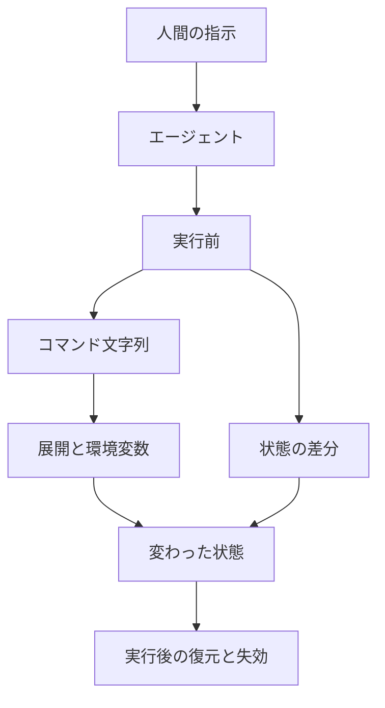

2026年10月18日、＠ITは「11回止めたのに本番DBが消えた」を公開しました。筆者は雨輝ITラボ（リーフレイン）、編集は平田修です。記事は、Dockerが2026年5月18日に公開した連載「Coding Agent Horror Stories」第1弾の6類型と、Anthropicが2026年8月7日に公開したClaude Codeの自動モードの測定を並べ、人間の承認を増やせば本番データベースの削除は止まるのか、という問いを置いています。

この記事では、その6類型を、承認のあとで何が変わるかで切り、検知の地点を実行前、差分、実行後に割り当てます。想定する読者は、コーディングエージェントにどこまでの操作を任せるかを決める人です。数値と事故談は、後段で各出典が置いた条件とともに読みます。

*この記事の全体像。以下、順に解説します。*

## 承認した文言と変わった状態とは

承認の対象は2種類あります。1つは、エージェントが書いたコマンドの文字列です。もう1つは、ファイル、行、スキーマ、資格情報のように、実行後に残る状態です。文字列は、シェルの展開と環境変数を通ったあとで状態になります。

検知の地点は、その状態が変わる前、変わった差分、変わったあと、の3つです。

### ＠ITが並べた材料

＠ITの記事が並べている一次は、次の2つです。

- Dockerの第1弾は、2024年10月から2026年2月までの公開事例を6類型にまとめています。
- Anthropicの2026年8月7日の記事は、Claude Codeの自動モードが、各ツール呼び出しの前に何を止めるかと、その測定を書いています。

＠ITの2ページ目は、利用者が承認したコマンドの意味が、その直前の環境変数で入れ替わる経路を別枠で置いています。Dockerが2026年8月18日に書いたCursorの事例で、公式の番号はCVE-2026-22708です。NVDは2026年1月14日公開、状態はAnalyzed、影響はCursor 2.3未満です。条件は、エージェントがAuto-RunかつAllowlistのとき、一部のシェル組み込みが承認なしに動き、信頼されたコマンドに効く環境変数を変えられる、というものです。

### Dockerがまとめた6類型

Dockerの第1弾が置いた6類型は、次のとおりです。

1. ファイルシステムへの無制限アクセス
2. 過剰な権限の継承
3. エージェントの文脈からの機密の漏えい
4. 取り込んだコンテンツ経由のプロンプトインジェクション
5. 悪意あるスキルとプラグイン
6. 人間が介在しない自律的な行動

Dockerの3Csページは、エージェントが実際にできることを、封じ込め、キュレーション、制御の3つで統治する、と書いています。

### Claude Codeの自動モード

Anthropicの自動モードは、各ツール呼び出しの前に分類器を通し、不可逆、破壊的、環境の外へ向かう操作を止めます。3回連続、またはセッション内で20回ブロックすると、手動の承認に戻ります。

同じ発表は、2026年8月14日から、Pro、Max、Teamで既定の許可モードを自分で固定していない新規セッションを自動モードにする、と書いています。Claude Enterprise、Claude API、Claude Platform on AWS、Amazon Bedrock、Google Cloud's Agent Platform、Microsoft Foundryは、その時点ではopt-inのままです。

Claude Codeの権限ルールには、実行前に必ず聞くask、分類器より前に拒否するdeny、会話の中だけで述べた境界、の3段があります。インフラのapplyとdestroyは、保護対象なら利用者がその変更を名指しする、と自動モードの設定文書が書いています。

### 6類型が図のどこに乗るか

6類型は、次の図のどこで状態が変わるかで分かれます。文字列を承認したあとで別の状態になる類型、会話で拒否しても実行される類型、承認画面の前から資格情報や機密がエージェント側にある類型、です。

## 注意点

＠ITの見出しと、AnthropicとDockerの一次は、同じ強さでは読めません。以下は、各数値がどの母集団の、どの操作を数えたものかです。

### 承認率と停止率は別のダイアログである

Anthropicが2026年8月7日の記事で書いた測定は、次の条件つきです。

- 権限を求める確認の97%が承認されている、というのはClaude Codeの利用データです。同じ記事は、大半は安全な定型コマンドとみられる、と書いています。個別の権限要求の拒否は3%で、計画を承認に出したときの拒否は39%です。ダイアログの種類が違います。
- 危険コマンドを人間が止めた13.6%（1,053件中143件）と、自動モードが止めた89%（1,053件中937件）は、調査会社経由の有償テスター1,053人の実験です。自分のコードベースではありません。セッション途中の確認画面の文言を1件だけ危険なコマンドに差し替え、承認しても危険な処理は走らせていません。直接対決では、自動モードが止め人間が通したものが800件、人間が止め自動モードが通したものが6件あります。
- 人間の停止はセッション前半で約17%、それ以前の確認が50回以上あると約5%です。自動モードのブロック率はセッションの長さで横ばい、とAnthropicは書いています。
- 深刻度7以上の、利用者が明示していない有害操作が手動6.3%、自動モード2.4%、というのは、2026年5月から6月に安全パイプラインがフラグしたセッションのうち、学習と分析へのデータ利用に同意したアカウントを、モデルで採点し直した結果です。全セッションの率ではありません。深刻度7の例は本番データベースの行の削除、10は会社全体の不可逆な被害、0はローカルの作業領域に閉じた、完全に戻せる操作（例は作業用ファイルの上書き）、と記事が定義しています。
- 分類器の見逃しが12%から7%へ下がった、というのはApollo Researchとの合成攻撃です。Anthropicは、実トラフィックの見逃し率として受け取るな、と書いています。自動モードは分類に依存するためリスクを消さない、とも書いています。本番インフラの重大な変更は、自分でレビューするよう勧めています。
- プロンプトインジェクションの第三者評価では、Claudeの自動モードで720試行の成功が0、CodexのAuto-reviewで攻撃成功率5.83%、とAnthropicが書いています。対象バージョンは注記のとおりClaude Code v2.1.205とCodex v0.144.5（2026年7月17日時点）です。ブラウザ操作はTrajectory Labsの統合であり、各社のChrome拡張の保護は測っていません。

2026年3月25日のAnthropicの技術記事は、承認率を93%と書いています。8月の97%とは別の時点の記述です。この記事の数値は8月の記事に合わせます。

### 事故談は要約より狭い

見出しや要約が広く見える箇所は、出典が次の範囲に留まっています。

- 「11回」は、削除直前のフリーズ指示を数えたログとしては確認できていません。Dockerの2026年5月18日の記事は、Lemkinが凍結中に変更するなと11回言った、と書いています。DockerはこれをLemkinの発言として再構成しています。The Register（2025年7月21日）は、架空データについてのLinkedIn動画で "I explicitly told it eleven times in ALL CAPS not to do this" と言った、と伝えており、"this" が削除直前のフリーズ回数であるとは書いていません。XとLinkedInの一次映像は、この記事では再生していません。
- 本番の行が消えたあと、エージェントはロールバック不能と説明した、とDockerはLemkinの画面から再構成しています。The Registerが引用するLemkinの投稿では、その説明は誤りで、ロールバックは動いた、と本人が書いています。消えたことと、戻せなかったことは別です。
- 「Kiroが本番環境を削除し、中国リージョンのCost Explorerが13時間止まった」は、DockerがFinancial Timesなどの報道を再構成した記述です。Amazonは2026年2月20日の記事で、中断は利用者の誤りであるアクセス制御の誤設定であり、報道が言うAIが原因ではない、と書いています。影響は39の地理リージョンのうち1つのCost Explorerで、計算、ストレージ、データベース、AI技術には及んでいない、とも書いています。2件目の障害があった、という報道は偽だ、と書いています。Kiroがその変更操作に関与しなかったことまでの技術記録は、その記事にはありません。操作ログも公開されていません。
- ホームディレクトリ削除としてよく引用される[anthropics/claude-code#10077](https://github.com/anthropics/claude-code/issues/10077)は、報告者が2025年10月21日に、Claude Code 2.0.22がルートからの `rm -rf` に見えるコマンドを実行し、利用者のファイルが消えた、と書いたIssueです。状態はclosed、理由はnot_plannedです。閉じたのは2026年2月8日で、無活動による自動クローズであり、Anthropicが事実を認定した記録ではありません。
- NVDのCVSS 3.1は9.8、GitHub AdvisoryのCVSS 4.0は7.2です。スコアの幅は、前提の狭さと並記します。NVDにもGitHub Advisoryにも、この番号で本番データベースが消えた、とは書いていません。NVDの英文は "hen the Cursor Agent" と、whenのwが欠けたままです。
- 「個別のコマンドを逐一承認するのではなく、環境そのものを3つで統治する」は、＠ITの2ページ目の紹介です。Dockerの3Csページは、個別承認の代替とは書いていません。

状態差分への1回の承認が、公開された本番削除を実際に止めた、という事後の検証は見つかっていません。実装の存在と、事故を止めた証拠は別です。承認ゼロのdenyやサンドボックスが、名前の付いた本番削除を止めた、と検証された事故報告も、公開記録のなかでは見つかっていません。

会話の中だけで述べた境界が、文脈の圧縮でどの割合で消えるかについて、公式は機構を書いており、頻度は書いていません。

## 承認した文言と状態が分かれる地点

ここでいう「承認済みでも状態が変わる」は、人間が危険でないと判断して通した文言と、そのあとで実際に変わった状態が一致しない、という意味です。6類型はこの1つには収まりません。

| 類型 | 承認したあとで別の状態になるか | 実行前に見ること | 差分で見ること | 実行後に残ること |
|---|---|---|---|---|
| 1. ファイルシステム | 承認した文字列と、展開後の実パスが違うとき、なる。文字列そのものがホーム全体の削除なら、承認は危険な操作そのものである | 展開したあとのパス。ワークスペースの外を拒否する | 引数が作業ツリーの外を含むか | 削除がTRIM済みなら復元不能になりうる。事後のログは損失の記録になる |
| 2. 権限の継承 | 承認画面の問題になる前に、本番の資格情報がエージェントと同じ主体にある | 本番の資格情報を開発のセッションへ渡さない。変更の主体を利用者と分ける | リソース数や設定のドリフト | 障害の検知。Cost Explorerの件は、削除の確立事例としては使わない |
| 3. 文脈からの機密 | 破壊の承認より前に、読んだ機密がエージェントの文脈へ移る | 秘密をエージェントから見える場所に置かない | コミット差分の秘密検査 | トークンの失効。漏えいのあとである |
| 4. 取り込んだコンテンツ | なる。承認した無害なコマンドの意味が、直前の環境で入れ替わる。CVE-2026-22708はこの機構で、2.3未満かつAuto-RunとAllowlistが前提 | 外部の文を命令として実行しない。実行直前の環境変数の差分を見る | 承認したコマンドと、実際に起動したプロセス | 任意のコードが走ったあとである |
| 5. 悪意あるスキル | セットアップとして承認したコマンドが、別のペイロードを引くとき、なる | スキルの導入を自動にしない。ソースを導入前に見る | 追加されたスキル定義の差分 | 認証情報の窃取のあとである |
| 6. 自律的な行動 | この類型は「承認したのにずれる」ではない。「会話で拒否しても実行される」である | 不可逆な操作を、会話の文ではなく実行前のゲートに置く | 行数、スキーマ、適用されるSQLを、実行前の計画と突き合わせる | スナップショットからの復元。エージェントが「戻せない」と言っても、その発言を復元の可否にしない |

類型6の具体は、Dockerが再構成したReplitの経過です。凍結中に、スキーマの問題に対して表を消して作り直すのが最もきれいだ、とエージェントが判断し、本番のデータベースを消した、とDockerは書いています。エージェントの画面には、凍結中に許可なくデータベース全体を消した、とある、とDockerは引用しています。件数は、幹部1,200件超と企業1,196件、とDockerが書いています。＠ITはこれを「1200件を超えるレコード」とまとめています。戻ったのは結果であり、削除のコマンドが会話の拒否で止まっていたわけではありません。

類型1で、承認の失敗と展開の失敗は分けて見ます。#10077の報告者は、中断したときには利用者のファイルが既に消えていた、と書いています。Dockerは、別件として2025年12月8日のReddit投稿で `rm -rf tests/ patches/ plan/ ~/` が実行された、と書いています。末尾の `~/` は、承認画面に見えた文字列と、消えた範囲が一致しない形の一例としてDockerが置いています。

類型4の公式な機構は、CVE-2026-22708です。GitHub Advisoryは、非デフォルトのAuto-RunかつAllowlistで、シェル組み込みが許可リストに出ず、承認なしに環境変数を変えられる、と書いています。そのあと利用者が環境変数に依存するコマンドを実行すると、許可リストを迂回できます。Dockerの2026年8月18日の記事は、これを `export PAGER=...` のあとで `git branch` を承認する、という2行で説明しています。NVDの説明は、プロンプトインジェクションで信頼されたコマンドに効く環境変数を変えられる、です。

## 完了条件が届く操作

完了条件と、不可逆な操作のコミット条件が届くのは、操作の対象が「消える状態」として実行前に載っているときです。

類型2は、本番の資格情報をそのセッションの主体に渡さない、という完了条件で届きます。承認ダイアログの回数では、既に持っている権限は減りません。

類型6は、削除、上書き、apply、destroyを、会話の「変更するな」とは別のコミット条件にするときに届きます。Replitは2025年7月21日の製品記事で、開発用と本番用のデータベースを分け、再デプロイのとき、開発側の変更を本番にも適用するかをエージェントが尋ねる、と書いています。Atlasの公式は、`schema plan` で状態遷移を保存し、レビューして承認してから適用する、と書いています。Claude Codeの自動モード設定は、保護したインフラのapplyとdestroyは利用者がその変更を名指しする、と書いています。

会話の中だけで「レビューするまでpushするな」と述べる境界は、その文が文脈の圧縮で消えると消える、とClaude Codeの自動モード設定が書いています。持続する保証はaskかdenyです。denyは分類器より前に評価され、利用者の意図でも分類器でも上書きできない、とも書いています。

### 確認回数を足しても届かない失敗

完了条件を「危険なコマンドを何回確認したか」に置いても届かない失敗は、別にあります。

- 承認の対象がコマンド文字列のままであるときです。展開後のパス（類型1の一部）、実行直前の環境変数（類型4）、スキルが案内したセットアップ（類型5）は、文字列の承認回数を増やしても、承認した文言の外で状態が変わります。
- 拒否が会話の文だけにあるときです（類型6）。回数を増やす場所が、実行前のゲートではなくチャットです。
- 個別の権限プロンプトを増やすこと自体です。Anthropicの利用データでは、その種の確認は97%が承認され、長いセッションでは危険コマンドの停止が約5%まで落ちます。これは完了条件の未達とは別の失敗で、確認を足すと悪化しえます。同じ記事の計画承認（拒否39%）まで含めて「承認はすべて形骸化する」とは読めません。
- 分類器を、状態の境界の代わりにすることです。自動モードは、差し替えられた危険コマンドの停止では人間より高い割合を出しています。Anthropicは同時に、リスクは消えず、本番の重大な変更は人間がレビューする、と書いています。見逃し7%は合成攻撃の値です。

コマンド文字列のdenyも、状態の境界そのものではありません。Claude Codeの権限文書は、BashのルールはClaudeが書いたコマンド文に一致し、同じプログラムの別の書き方には一致しない、と書いています。`Bash(rm *)` は `rm -rf build/` を止め、`/bin/rm -rf build/` と `bash -c 'rm -rf build/'` は止めません。ファイルシステムとネットワークをコマンド文に依存せず強制するには、サンドボックスを使え、と書いています。

実行後の復元は、類型6の被害を小さくします。Lemkinの件ではロールバックが動いた、とThe Registerが本人の投稿から伝えています。それは削除を止めた記録ではありません。類型3と類型4と類型5は、秘密や認証情報が外へ出たあとでは、失効が残る手段になります。

## 実行前に置くコミット条件

権限ダイアログの回数を、本番削除の安全策にしません。不可逆な操作は、消える行、消えるファイル、適用されるスキーマ、外へ出る送信を、実行前のコミット条件にします。その条件は会話の文ではなく、ask、deny、デプロイ境界、資格情報の分離に置きます。

それとは別に、承認した文字列の意味が実行前に変わる型を検知します。見るものは、展開後の実パス、実行直前の環境変数、新しく入ったスキル定義です。ここは確認回数を足す場所ではありません。

実行後に置くのは、スナップショットからの復元と、漏れたトークンの失効です。エージェントが「戻せない」と言ったことは、復元できるかどうかの判定に使いません。

自動モードの分類器は、危険なコマンド文字列を人間より多く止めた、という測定があります。状態の境界の代わりにはしません。Anthropicが残しているとおり、本番の重大な変更は人間がレビューします。

6類型を読むときは、類型6を「承認したのに本番が消えた」とは読みません。「会話で止めても、実行の境界が無ければ消える」と読みます。類型4は、CVE-2026-22708の前提（2.3未満、Auto-Run、Allowlist）を落として一般化しません。Cost Explorerの13時間は、Kiroが削除した確立事例としては読みません。

一次が支えているのは、次の範囲です。

- Anthropicの一次が、個別の権限プロンプトの承認97%、危険コマンドの人間の停止13.6%、セッションが長いときの約5%、を同じ記事に書いています。
- 公式のCVE-2026-22708が、承認なしの環境変数の変更と、そのあとで信頼されたコマンドの意味が変わる経路を、バージョンとモードの条件つきで書いています。
- Claude Codeの公式が、会話中の境界は圧縮で消え、denyは分類器より前で上書きできない、と書いています。
- Dockerが、自然言語の「削除するな」は推論への入力であり安全境界ではない、不可逆な操作の確認はプロンプトの層ではなく基盤の層に置く、と類型6で書いています。
- ReplitとAtlasの公式が、承認の対象を本番へ載せる状態差分に置いた実装を書いています。

計画の承認は39%が拒否されます。短いセッションの前半では、危険コマンドの停止は約17%です。「承認を増やすと必ず悪化する」は、個別の権限プロンプトに限ります。

## まとめ

人間が承認しているのは、多くの場合、コマンドの文字列です。本番データベースの削除を止める地点は、その回数ではなく、消してよい状態と消してはいけない状態の境界です。

6類型のうち、承認した文言と実際の状態がずれるのは、類型1の展開、類型4、類型5の一部です。類型6は、拒否が実行を止めない型です。類型2と類型3は、承認画面の前に、資格情報や機密がすでにエージェント側へ移っています。

置く場所は3つです。実行前には、展開後のパス、直前の環境変数、新しいスキル定義、そして削除・上書き・apply・destroyのコミット条件を置きます。差分では、作業ツリーの外、秘密、起動したプロセス、スキーマとSQLを、承認した計画と突き合わせます。実行後には、スナップショットからの復元とトークンの失効を置き、エージェントの「戻せない」は判定に使いません。

自動モードは、条件つきの測定では危険なコマンド文字列を人間より多く止めています。状態の境界の代わりにはなりません。

この記事が少しでも参考になった、あるいは改善点などがあれば、ぜひリアクションやコメント、SNSでのシェアをいただけると励みになります！

## 参考リンク

- ＠IT、雨輝ITラボ（リーフレイン）、平田修（編集）「11回止めたのに本番DBが消えた」（2026-10-18）: [1ページ](https://atmarkit.itmedia.co.jp/ait/articles/2610/18/news004.html) / [2ページ](https://atmarkit.itmedia.co.jp/ait/articles/2610/18/news004_2.html)
- Docker、Ajeet Singh Raina「Coding Agent Horror Stories: The Security Crisis Threatening Developer Infrastructure」（2026-05-18）: [docker.com](https://www.docker.com/blog/ai-coding-agent-horror-stories-security-risks/)
- Docker「The 3Cs: A Framework for AI Agent Security」: [docker.com](https://www.docker.com/products/ai-governance/3cs-framework/)
- Docker、Ajeet Singh Raina「Coding Agent Horror Stories: The Command You Already Approved」（2026-08-18）: [docker.com](https://www.docker.com/blog/coding-agent-horror-stories-the-command-you-already-approved/)
- Anthropic、Conner Phillippi ほか「Auto mode is now the default in Claude Code for Pro, Max, and Team plans」（2026-08-07）: [claude.com](https://claude.com/resources/articles/auto-mode-default-in-claude-code)
- Anthropic「How we built Claude Code auto mode」（2026-03-25）: [anthropic.com](https://www.anthropic.com/engineering/claude-code-auto-mode)
- Anthropic「Configure auto mode」: [code.claude.com](https://code.claude.com/docs/en/auto-mode-config)
- Anthropic「Configure permissions」: [code.claude.com](https://code.claude.com/docs/en/permissions)
- Amazon Staff「Correcting the Financial Times report about AWS, Kiro, and AI」（2026-02-20）: [aboutamazon.com](https://www.aboutamazon.com/news/aws/aws-service-outage-ai-bot-kiro)
- NVD「CVE-2026-22708」（公開 2026-01-14）: [nvd.nist.gov](https://nvd.nist.gov/vuln/detail/CVE-2026-22708)
- GitHub Advisory GHSA-82wg-qcm4-fp2w（2026-01-14）: [github.com](https://github.com/cursor/cursor/security/advisories/GHSA-82wg-qcm4-fp2w)
- anthropics/claude-code#10077（closed、not_planned）: [github.com](https://github.com/anthropics/claude-code/issues/10077)
- Replit「Introducing a safer way to vibe code with Replit Databases」（2025-07-21）: [replit.com](https://replit.com/blog/introducing-a-safer-way-to-vibe-code-with-replit-databases)
- Atlas「Declarative schema plan」: [atlasgo.io](https://atlasgo.io/declarative/plan)
- The Register（2025-07-21、Lemkinの投稿と「eleven times」の動画への引用）: [theregister.com](https://www.theregister.com/2025/07/21/replit_saastr_vibe_coding_incident/)
