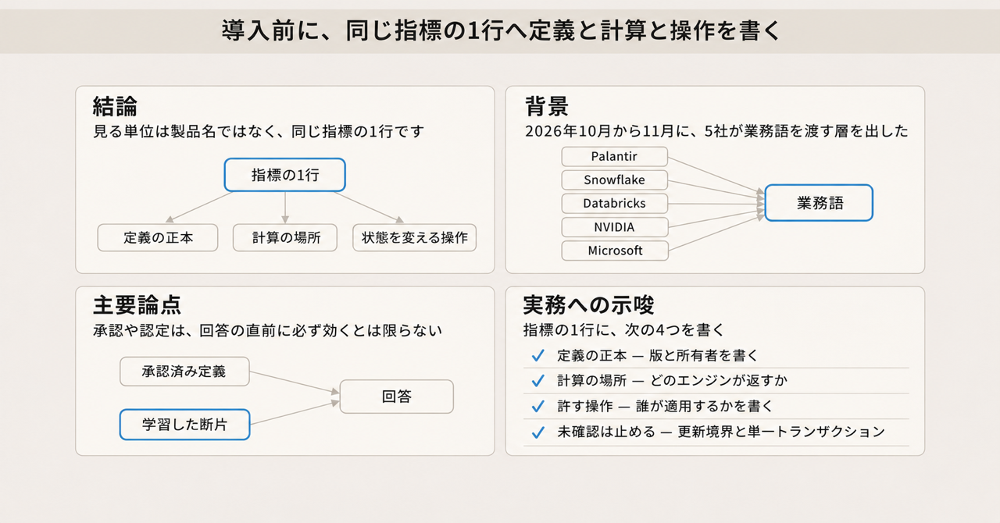
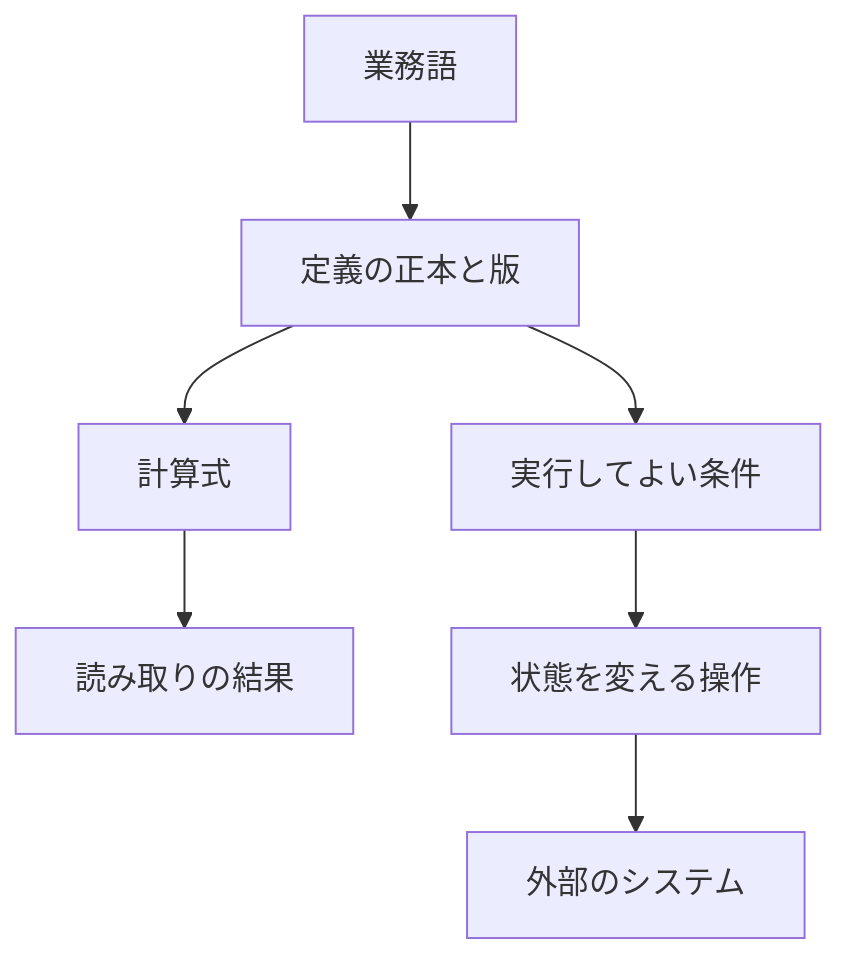

2026年10月から11月にかけて、Palantir、NVIDIA、Snowflake、Databricks、Microsoft は、業務の言葉をエージェントへ渡す層を公開または更新しました。以下の製品記述は、各社が公開している公式文書に沿っています。

この層が扱うのは、用語、その用語が指すデータ、計算、その語で誰が何をしてよいか、です。同じ指標名について、定義の正本（どの版を正とするか、誰が所有者か）、計算（どのエンジンが式を実行するか）、状態を変える操作（注文取消やチケット作成のように、外のシステムを変えてよいか）を、製品ごとに並べられるようにします。

*この記事の全体像。以下、順に解説します。*

## オントロジーとは

ここでいうオントロジーは、業務の言葉をエージェントへ渡す層です。用語、その用語が指すデータ、計算、その語で誰が何をしてよいかを、一つの名前の下にまとめます。

業務の1語は、次の箱に分かれます。製品は、どの箱をオントロジーという名前の中に置くかが違います。

定義の正本は、その語が何を指すかと、どの版をエージェントが参照してよいかを持ちます。

計算式は、その語の数字をどのエンジンが返すかを持ちます。

状態を変える操作は、読み取りの先で、外の注文やチケットやメッセージを変えます。

### Palantir Foundry Ontology

Palantir Foundry Ontology は、意思決定を Data、Logic、Action、Security の4要素で表します。オブジェクトは名詞です。アクションは動詞です。

Action type は、オブジェクトのプロパティを1トランザクションで変える操作の型です。side effect（付随処理）として、通知や Webhook を持てます。その操作を提出できるかは、submission criteria で決まります。計算は Logic が担います。公式は、ルール、モデル、複数エンジンのオーケストレーションを挙げています。

Foundry が意思決定の正本（system of record）になる場合と、Foundry 以外が組織の正本（source of truth）である場合があります。後者では、公式は外部への書き出しを decision orchestration と呼びます。AIP Logic は、オントロジー編集を自動適用するか、人間のレビュー用にステージするかを選ぶ機能です。

### Snowflake Business Ontology

Snowflake Business Ontology は、共有の用語、実体、関係、指標を定義し、所有者と承認状態を記録し、実装するデータと Semantic Views へつなぎます。実体は、用語が指す対象です。Semantic Views は指標の計算を定義します。Business Ontology はその計算を変えません。

2026年11月3日のエンジニアリングブログは、Business Ontology を private preview と書いています。同じ日の製品ブログは、public preview soon と書いています。Cortex Sense（同じく public preview soon）は文脈を推定します。承認済み定義と衝突したときは、エージェントが承認済み定義を使います。

製品ブログの FAQ は、CoCo と CoWork 上の AI エージェントには承認済み定義だけを渡す、と書いています。CoCo と CoWork は、この FAQ が承認済み定義の渡し先として名指しするエージェントです。ツール呼び出しと、企業システムでの action の統治は、別発表の Cortex AI Gateway に置かれています。

### Databricks Genie Ontology

Databricks Genie Ontology は、2026年11月11日に Generally Available（一般提供）になりました。学習した Ontology Snippets と、Unity Catalog で人が定義する Metric Views、Domains、Pages、認定を、1つの文脈層に置きます。Ontology Snippets は、学習して得た知識の断片です。Unity Catalog は、人が Metric Views、Domains、Pages、認定を定義し、権限が付く場所です。

Metric Views は、人が定義する指標の計算です。Page は、正確さが必要な概念を人が置く定義です。質問に定義済み概念が含まれるとき、Genie は Page を正本として扱います。

Genie One は、他プラットフォームのエージェントがこの層を使うための MCP サーバです。同じ Unity Catalog 権限のまま使えます。MCP は、エージェントが外部のツールを呼ぶ接続です。メール下書き、Slack 投稿、Jira 更新のような操作は、オントロジー定義の外の MCP コネクタが行います。

### NVIDIA Auto-Ontology

NVIDIA Auto-Ontology は、生データを customers、products、orders のような概念へ写すライブラリです。要素は Concept、Mapping、Relationship、Metric、Lineage、Certification の6つです。Metric は、レビュー済みの SQL です。Certification は、人が certify することです。生成したあと、人が certify します。certify は、その用語と SQL を手順上の正本として認めることです。

certify の前に、Chat または MCP の `ask_question` で下書きを試せます。`ask_question` は、答え、SQL、行を返します。ライセンスは Apache-2.0 です。2026年11月19日時点の star は約1.4万で、リポジトリはアーカイブされていません。

2026年10月21日の NVIDIA ブログは、OpenShell を、エージェントが何にアクセスし何をできるかを決める別コンポーネントとして、Auto-Ontology と並べています。OpenShell はランタイムの境界です。Auto-Ontology は、概念へ写すライブラリです。

### Microsoft Fabric IQ の ontology

Microsoft Fabric IQ の ontology は preview です。エンティティ、関係、自然言語のルール、ソースが所有するメジャー（ソース側が持つ定義）を、消費者（その文脈を受け取る側）へ渡す文脈として持ちます。エージェントと可視化は、バインドされたソースに対して実行します。

Ontology agent は、問合せ言語である DAX、KQL、SQL、GQL で背後のデータを問えます。Act mode では、オントロジー定義を項目へ書いて公開します。Plan mode が既定です。旧体験は、2027年1月31日に終了します。

## 注意点

### 「業務実行型」と「文脈提供型」は業界用語ではない

[@IT の一色政彦氏の記事](https://atmarkit.itmedia.co.jp/ait/articles/2611/19/news008.html)（2026年11月19日）は、各社の発表を「業務実行型」と「文脈提供型」に分けて整理しています。この二つの呼び名は、筆者自身が、業界で定まった用語ではないと書いたものです。製品の公式名として扱わないでください。この記事の導入判断は、この呼び名ではなく、後の3列で行います。

### 91%は架空ワークスペースの自己評価である

Databricks の GA 記事は、Turing と作った架空の英国エネルギー小売りのワークスペースで、事前のルーブリック（事前に決めた採点基準）に対する合格率を書いています。

Genie は 91%、100秒、432K tokens です。比較相手の Agent A は 45%、435秒、889K tokens です。Agent B は 58%、307秒、1.05M tokens です。記事は、確立済みの展開での結果だと書いています。独立した再現はしていません。数値は、ベンダーが自分の条件で出した自己評価です。

### 承認と認定は、回答の直前に必ず効くわけではない

Databricks の文書（Last updated Nov 16, 2026）は、学習した知識（先の Ontology Snippets）だけでも質問に答え始める、と書いています。同じページは、モデル化された知識を学習より権威があるものとして扱い、衝突時に優先する、とも書いています。衝突の解決の節は、認定資産とキュレーションされた Genie Agent を含め、generally に優先し、解消できなければ利用者へ確認することがある、と書いています。generally は、常に優先する、という書き方ではありません。文書の中に、「優先する」と「generally」の両方があります。

外部知識源から作ったスニペットは、アカウントの全利用者から見えます。スニペット整備は、現時点では課金されません。Databricks は価格を更新しうると書いています。スニペットは、顧客管理キーに対応しません。

NVIDIA の README は、専門家の certify の前に、下書きへ質問する手順を書いています。未クローズの [NVIDIA/auto-ontology#268](https://github.com/NVIDIA/auto-ontology/issues/268)（2026年11月18日更新）は、certify のフラグ（課題本文では認証と書かれている）はレビュー用であり、回答時のエージェントは `certified` を見ない、と述べています。これはログインの確認の話ではありません。課題本文の記述です。main の回答経路のコードと一致するかは、未確認です。

同じ README は、利用者が直した結合を、次のコンパイルが意味上の外部キーの選び直しで上書きしうると書いています。`ask_question` が SELECT 以外の SQL を拒むかは、README の範囲では確認していません。

### 書き込みの承認は、製品の中でも一面ではない

Genie Agent は、オントロジーの外で外部ツールを呼ぶ実行側です。その外部ツール文書（Last updated Nov 9, 2026、Beta）では、ワークスペース管理者がプレビューを有効にします。読み取りツールは自動で走ります。書き込みツールは、実行前に止まります。選択肢は、一度だけ許可する、この会話の残りで常に許可する、拒否する、です。ツールは、質問した利用者の権限で走ります。Agent mode は、UI とは別の API 経路です。この経路では読み取りだけが動き、書き込みの承認は UI で行います。

Genie One の外部接続（Last updated Nov 9, 2026）では、ツール呼び出しごとの承認は、Unity Gateway のサービスポリシーの例として書かれています。Unity Gateway は、Unity Catalog とは別の名前です。既定の動作としては書かれていません。Glean（Beta）とレガシー MCP 接続はゲートウェイを通らず、この制御は適用されません。Gmail コネクタは下書きまでで、送信はしません。Slack コネクタはメッセージを送れます。

Palantir の AIP Logic は、オントロジー編集を自動適用するか、提案としてステージするかを選べます。自動実行は、目的と影響と復旧経路がそれを正当化するときだけ選ぶ、と文書が書いています。Action の行と列のアクセス制御は、利用者が Action を呼ぶときの読み取りを濾します。Action の書き込みには及びません。Action だけが編集を許す型では、閲覧できないオブジェクトを作れます。

### 近くにある機能を、オントロジーの実行と混ぜない

Fabric のルール文書が「実行しない」と書く対象は、自然言語ルールと、そこからのアクション実行です。概要は、エージェントと可視化がバインド先のデータソースに対して実行する、と書いています。グラフは、可視化の図とは別の構造です。任意で、選ばなければその構造は作られません。先に書いた実体（用語が指す対象）とは別です。Ontology agent は、DAX、KQL、SQL、GQL で背後のデータを問えます。Act mode が書くのはオントロジー定義であり、業務上の注文取消ではありません。KQL、SQL、GQL は既定で最大 1,000 行、DAX は最大 200 行を返します。

NVIDIA ブログ（`datePublished` 2026年10月21日）は、OpenShell をランタイムの境界、Auto-Ontology を概念へ写すライブラリとして並べています。Auto-Ontology の呼び出しが OpenShell を経由する、とは書いていません。README 本文に OpenShell の語はありません。README が書く露出は別です。ポート 3001 と 3002 は私設網に置きます。取り込みの ingest、delete、reset、compile には、独自の認証がありません。フロントが渡す `x-auto-ontology-user-id` を、バックエンドは信じます。

Snowflake の概要文書は、Semantic Views をメタデータだと書いています。Cortex Agents は定義を読み、物理テーブルに対する SQL を生成します。同時に、Semantic View への `SELECT` でも指標を実行できます。同じ指標名に、承認済みの別定義を複数置けます。

速度の事例は、別の話です。SAP の reranker が nearly 3 倍、といった記述は Retriever の話であり、Auto-Ontology の定義精度ではありません。

公式の組み合わせもあります。NVIDIA のサプライチェーンは、Agent Knowledge Foundation を Palantir Foundry、Ontology、AIP 経由で使います。この AIP が、先の AIP Logic と同一だとは書いていません。Databricks は、NVIDIA Kumo Anomaly と Genie Ontology を組にします。Snowflake の顧客は、Kumo Engine と Kumo Relational を Snowflake Notebooks で使える、と NVIDIA ブログが書いています。

### 古典の定義と特許は、現行の4要素と同一を示さない

Thomas R. Gruber（1993）の著者サイトは、オントロジーを、共有領域の表現語彙の仕様だと書いています。広く引かれる「An ontology is an explicit specification of a conceptualization.」は、論文本文の該当頁を開いて確認していません。

特許 US7962495B2 の書誌は、priority（優先日）と filing（出願日）が 2006年11月20日、公開が 2011年6月14日、出願人が Palantir Technologies Inc です。書誌は、現行 Foundry の4要素と特許の請求項（特許が権利として書く文）が同一であることを示しません。

## 同じ指標を3列で見る

導入前のチェックは、製品名を3種類に排他で分けることではありません。同じ指標の1行に、次の3列を並べます。

| 製品 | 定義の正本と、エージェントが参照する版 | 計算を実行する場所 | 状態を変える操作と、誰が適用するか |
|---|---|---|---|
| Palantir Foundry Ontology | オブジェクト、リンク、Logic。意思決定の正本になる場合と、外部が正本で decision orchestration になる場合がある | Logic。公式はルール、モデル、複数エンジンのオーケストレーションを挙げる | Action type がオブジェクトを変える。Webhook は外へ書く。提出は submission criteria。AIP Logic 経由の編集は自動適用または人間のレビュー。読み取り制御は書き込みに及ばない |
| Snowflake Business Ontology | 承認済みの用語、関係、指標。所有者と承認状態。2026年11月3日時点は private preview で、public preview は soon。CoCo と CoWork には承認済みだけを渡す | Semantic Views。オントロジーは計算を変えない。Cortex Agents は物理テーブル向け SQL を生成し、ビューへの SELECT でも実行できる | オントロジーの役割としては書かれていない。ツールと action の統治は Cortex AI Gateway |
| Databricks Genie Ontology | 正確さが必要な概念は Pages、Metric Views、認定。学習スニペットは、人が1件ずつ承認した正本としては書かれていない。衝突時の優先は、文書内に「優先する」と「generally」の両方がある | Metric Views と、スニペットに含まれる計算 | オントロジーの外。Genie Agent では書き込み前に利用者承認（会話の残りへ広げられる、Beta）。Genie One の都度承認はサービスポリシーの例 |
| NVIDIA Auto-Ontology | certify された用語と SQL 属性が手順上の正本。下書きの試行が手順に含まれる。issue 268 は、回答時に認証フラグを使っていないと述べる（課題本文） | Metric のレビュー済み SQL。`ask_question` がソース DB で SQL を実行して行を返す | MCP の掲載ツールに、業務更新の action は無い。OpenShell は README 上のゲートとしては書かれていない |
| Microsoft Fabric ontology（preview） | エンティティ、関係、自然言語ルール、ソース所有のメジャー。旧体験は 2027年1月31日に終了 | ルール文書は、ルールをデータに対して実行しないと書く。消費者と Ontology agent はバインド先で問合せを実行する。グラフの実体化は任意 | ルールからのアクション実行はオントロジーがしない、とルール文書が書く。Act mode が公開するのはオントロジー定義 |

## 維持できる結論と、それを弱める材料

現時点で維持できる結論は、次のとおりです。導入前に、指標1行へ、定義の正本と版、所有者、計算の置き場、エージェントが参照してよい版、状態変更を許す操作と承認、を並べます。

この並びを支持する公式の書き方は、次の5点です。

- Snowflake は、意味の承認と計算の実行を文で分けています。承認済み定義は、推定と衝突したときに勝ちます。
- Databricks は、定義済み概念について Page を正本とし、リアルタイムのチケット作成を MCP と並べて書いています。
- NVIDIA の MCP 掲載ツールは読み取り側の名前です。`ask_question` は行を返します。
- Fabric のルール文書は、ルール実行とアクション実行をオントロジーの外に置いています。
- Palantir は、Action をオントロジーの動詞として公式に置いています。

同じ結論を弱める材料は、次の5点です。

- 3列は、実装上の排他の壁ではありません。Palantir、Databricks、Snowflake と NVIDIA の組み合わせは、公式に書かれています。
- 承認や certify は、回答のたびに未承認を止める保証にはなっていません。Databricks の学習スニペット、NVIDIA の下書きと issue 268 が、その材料です。
- 「書き込みは必ず都度承認」は、Genie 全体の既定ではありません。
- Palantir の読み取り制御は、Action の書き込みを包みません。Foundry が常に業務の正本でもありません。
- Fabric の「実行しない」は、ルールの文です。バインド先への問合せや、定義の公開を含みません。

結論の範囲は、上の表を製品選定の排他ラベルにしない、という限定のもとで維持します。

## 未確認の問いが止めること

次は、2026年11月19日時点で公式文書から閉じていません。

- Auto-Ontology の `ask_question` は、SELECT 以外を拒むか。
- Webhook が失敗したとき、Foundry 側のオブジェクト編集は戻るか。
- Snowflake Business Ontology は、2026年11月19日時点で private preview のままか。2026年11月3日の「public preview soon」を更新する公式発表は、見当たりませんでした。
- issue 268 の記述は、main の回答経路のコードと一致するか。
- Fabric の known issues 本文は、未取得です。

これらの未確認は、3列の表を作ることを止めません。止めるのは、次の二つです。Auto-Ontology を更新系の境界として採用すること。Foundry の外部書き戻しを、1トランザクションとみなすこと。

## 導入は指標の1行で切る

導入の単位は、製品名ではなく、指標の1行にします。行には、定義の正本と版、所有者、計算式の置き場、エージェントが参照してよい版、状態を変えてよい操作、その操作を適用できる者、を置きます。

条件の目安は、次のとおりです。

- 操作と権限を同じ意思決定モデルに置き、外部の正本へ書き戻すなら、Palantir の Action、submission criteria、Webhook を読みます。AIP Logic 経由の自動適用は、影響と復旧が説明できる操作に限る、と公式が書いています。
- 承認した意味を先に固定し、計算は Semantic Views に残すなら、Snowflake を読みます。2026年11月3日時点の Business Ontology は private preview で、public preview は soon です。
- 少数の KPI を Pages と Metric Views にし、残りを学習に任せるなら、Databricks を読みます。学習スニペットは、Page が無くても答えます。外部知識源のスニペットは、アカウント全員に見えます。
- 下書きと読み取り SQL をライブラリに置き、業務の更新は別システムに残すなら、NVIDIA Auto-Ontology を読みます。certify は、未クローズ課題の記述では、回答時のゲートではありません。この記述は課題本文です。
- ルールを文脈として渡し、強制はソースシステム側に残すなら、Fabric の ontology を読みます。preview であり、旧体験は 2027年1月31日に終了します。

同じ指標の行は、複数製品にまたがってよいです。NVIDIA の発表は、Palantir、Databricks、Snowflake との組み合わせを書いています。

## まとめ

業務語をエージェントへ渡す層は、2026年10月から11月に、Palantir、Snowflake、Databricks、NVIDIA、Microsoft で公開または更新されました。定義の正本、計算を実行する場所、状態を変える操作は、オントロジーという名前の中に同じようには入っていません。

導入前に見る単位は、製品名ではなく指標の1行です。行には、定義の正本と版、所有者、計算の置き場、エージェントが参照してよい版、許す操作と、その操作を適用できる者を置きます。91% の合格率、certify、書き込み承認は、それぞれ条件付きです。表は、排他の選定ラベルにはしません。

この記事が少しでも参考になった、あるいは改善点などがあれば、ぜひリアクションやコメント、SNSでのシェアをいただけると励みになります！

## 参考リンク

- [@IT、一色政彦「オントロジーの定義範囲と実行範囲がベンダーで分かれる」（2026年11月19日）](https://atmarkit.itmedia.co.jp/ait/articles/2611/19/news008.html)
- [Palantir, Why Ontology](https://palantir.com/docs/foundry/ontology/why-ontology/)
- [Palantir, Ontology system](https://palantir.com/docs/foundry/architecture-center/ontology-system/)
- [Palantir, Action types](https://palantir.com/docs/foundry/action-types/overview)
- [Palantir, Side effects](https://www.palantir.com/docs/foundry/action-types/side-effects-overview)
- [Palantir, Submission criteria](https://palantir.com/docs/foundry/action-types/submission-criteria/)
- [Palantir, Action permissions](https://www.palantir.com/docs/foundry/action-types/permissions)
- [Palantir, AIP Logic integration with Automate](https://palantir.com/docs/foundry/logic/aip-logic-integration-automate/)
- [Snowflake, Business Ontology（2026年11月3日）](https://www.snowflake.com/en/blog/business-ontology-context/)
- [Snowflake, engineering blog（2026年11月3日、private preview）](https://www.snowflake.com/en/blog/engineering/business-ontology-context/)
- [Snowflake, Expedition 2026 press](https://www.snowflake.com/en/news/press-releases/expedition-2026-business-ontology-ai-gateway/)
- [Snowflake, Semantic views overview](https://docs.snowflake.com/en/user-guide/views-semantic/overview)
- [Databricks, Announcing GA of Genie Ontology（2026年11月11日）](https://www.databricks.com/blog/announcing-ga-genie-ontology)
- [Databricks, Genie Ontology（Last updated Nov 16, 2026）](https://docs.databricks.com/aws/en/genie/genie-ontology/)
- [Databricks, Genie Agent external tools（Last updated Nov 9, 2026）](https://docs.databricks.com/aws/en/genie-agents/external-tools)
- [Databricks, Genie One external sources（Last updated Nov 9, 2026）](https://docs.databricks.com/aws/en/genie-one/external-sources)
- [NVIDIA, Enterprise platforms and agent toolkit（2026年10月21日）](https://blogs.nvidia.com/blog/enterprise-platforms-agent-toolkit/)
- [NVIDIA/auto-ontology README](https://github.com/NVIDIA/auto-ontology/blob/main/README.md)
- [NVIDIA/auto-ontology#268](https://github.com/NVIDIA/auto-ontology/issues/268)
- [Microsoft, Ontology overview](https://learn.microsoft.com/en-us/fabric/iq/ontology/overview)
- [Microsoft, Rules](https://learn.microsoft.com/en-us/fabric/iq/ontology/how-to-use-rules)
- [Microsoft, Ontology agent](https://learn.microsoft.com/en-us/fabric/iq/ontology/how-to-use-ontology-agent)
- [Thomas R. Gruber の著者サイト（1993）](https://tomgruber.org/writing/ontolingua-kaj-1993/)
- [Google Patents, US7962495B2](https://patents.google.com/patent/US7962495B2/en)
