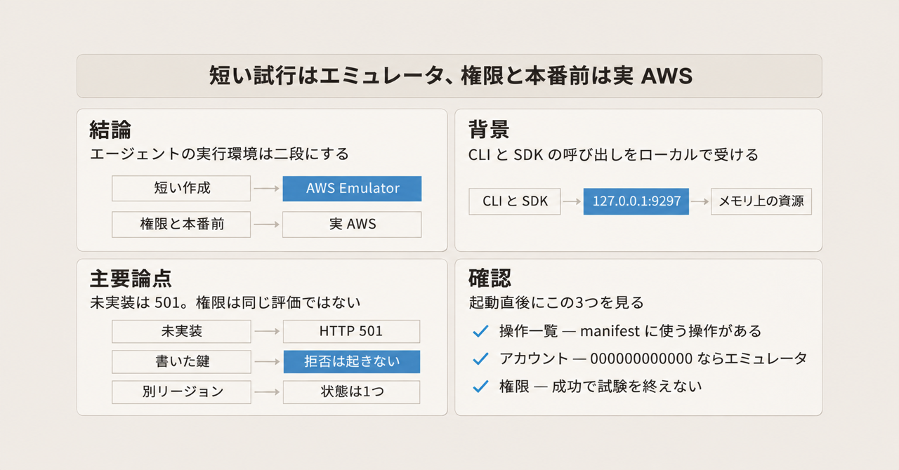
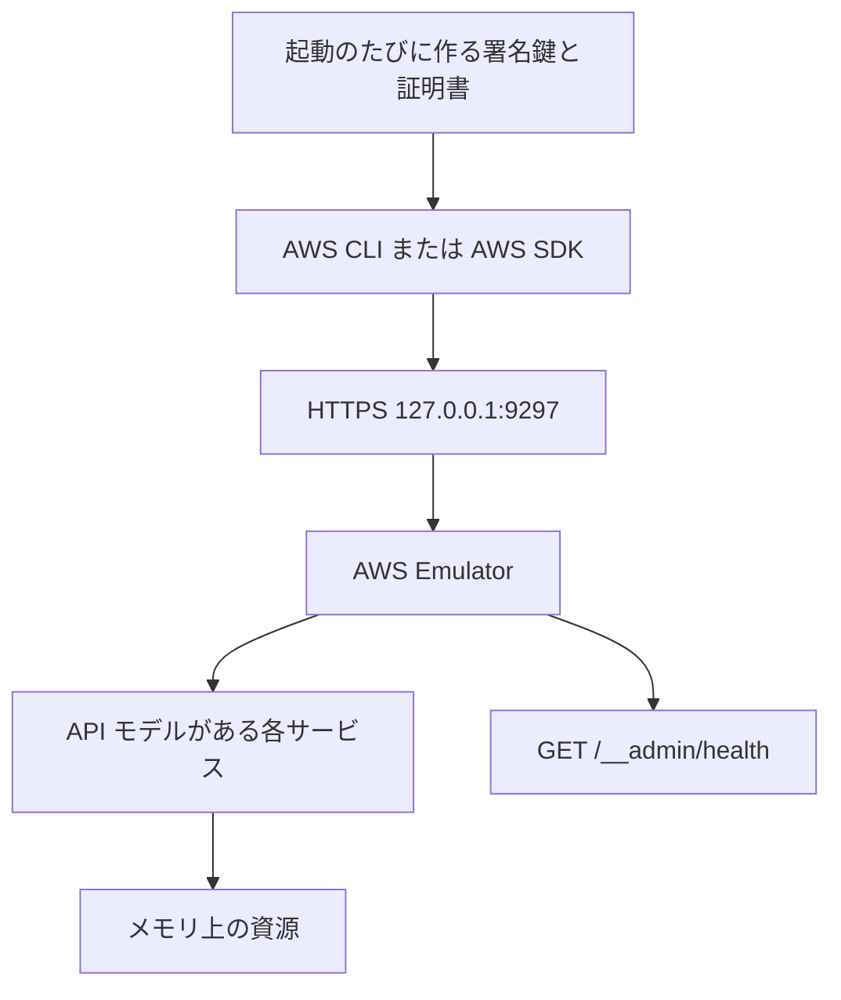
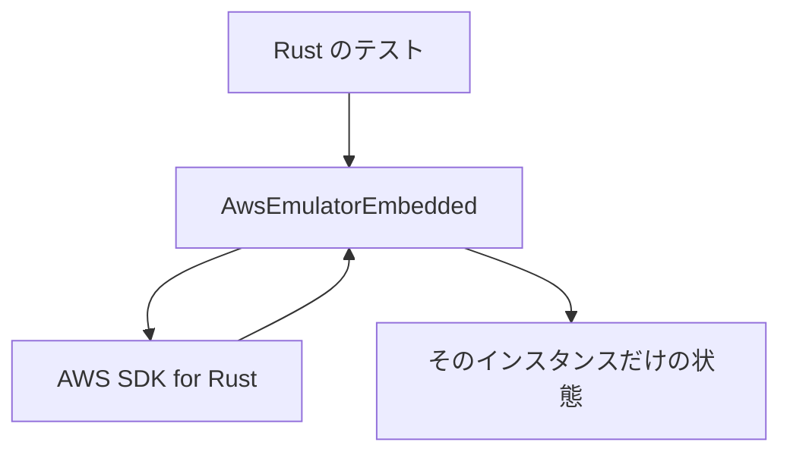

AWS は、自分のマシンや CI の上で AWS の API を受けられる AWS Emulator を公開しました。コーディングエージェントがクラウドへ出していた作成、参照、入力の検証を、同じ CLI と SDK の呼び出しのままローカルへ向けられます。この記事を読むと、エミュレータが受け取るものと状態の置き場、呼び出しの向け方、試行をエミュレータと実 AWS のどちらに置くかが分かります。

記述は、2026-11-12 に読んだ [AWS Emulator User Guide](https://docs.aws.amazon.com/emulator/latest/userguide/what-is-service.html) と、同日の製品ページ、AWS News Blog、公開リリースに基づきます。告知は Daniel Abib の [Test your applications against AWS locally with AWS Emulator](https://aws.amazon.com/blogs/aws/test-your-applications-against-aws-locally-with-aws-emulator/)（ページ表示は 11 NOV 2026、`datePublished` は 2026-11-11T11:00:44-08:00）です。接続に使う環境変数の実体は、同日の [Pointing your AWS SDK at AWS Emulator](https://docs.aws.amazon.com/emulator/latest/userguide/point-sdk-to-emulator.html) です。


*この記事の全体像。以下、順に解説します。*

## AWS Emulatorとは

AWS Emulator は、自分のマシンや CI の上で AWS の API エンドポイントを立て、AWS CLI と AWS SDK からの呼び出しをそこで受けるプログラムです。アカウントは要りません。作った資源は AWS 上の資源ではなく、エミュレータの中の資源です。追加のサービス料金は無く、料金が発生するのは AWS へデプロイした資源だけです。画面はありません。呼び出し側がエンドポイントと鍵を環境変数で向け、コード側の API 呼び出しはそのままです。

### 1つのエンドポイントで受ける

ローカルプロセスは、既定で `127.0.0.1:9297` の HTTPS を待ち受けます。対象の API は、GitHub の aws/api-models-aws に API のモデルがあるサービスです。モデルは、そのリポジトリにあるサービス API の記述です。全サービスがこの 1 つのエンドポイントに載ります。ヘルス確認は `GET /__admin/health` で、HTTP 200、body は `ok` です。

ローカルプロセスの既定は認証オンです。認証がオンのとき、起動のたびに署名用の鍵、設定ファイル、証明書を `~/.aws/emulator/<port>/` に書きます。署名は SigV4 です。SigV4 は、アクセスキーで AWS の要求に付ける署名方式（Signature Version 4）です。`--auth off` では資格情報ファイルを書かず、署名の無い要求も受けます。現行のアクセスキー ID は 20 文字で `EMULATOR` で始まり、続く 12 文字は大文字の十六進です。シークレットは大文字十六進 40 文字です。ガイドは、大きさと形式はどのリリースでも変わりうるので、コードでこの形を検証するな、と書きます。

呼び出し元の確認は `aws sts get-caller-identity` です。このコマンドは、今の認証情報のアカウントと Arn を返します。Arn は、その認証情報を一意に指す名前です。エミュレータに届くと Account は `000000000000`、Arn は `arn:aws:iam::000000000000:user/emulator` です。

未実装の操作は HTTP 501、エラーコード `NotImplemented` を返します。実装した操作は、妥当な呼び出しの結果と不正な呼び出しのエラーを AWS と同じにすることを目指します。What is AWS Emulator? の例では、2 文字の DynamoDB テーブル名 `ab` が `ValidationException` になります。DynamoDB は、項目をキーで持つデータベースです。テーブル名は 3 文字以上、という AWS と同じ検証エラーになります。

```bash
aws dynamodb create-table --table-name ab \
  --attribute-definitions AttributeName=id,AttributeType=S \
  --key-schema AttributeName=id,KeyType=HASH \
  --billing-mode PAY_PER_REQUEST
```

ガイドが載せるエラーは、`Member must have length greater than or equal to 3` です。

### 入れ方と埋め込み

Linux では RPM または Debian パッケージ（x86_64 と aarch64、glibc 2.17 以降）として入れます。macOS と Windows では、ドキュメントの Dockerfile からイメージを作り Docker で動かします。公開済みのイメージは無い、とガイドが書きます。ネイティブ実行は Linux だけです。

埋め込みモードは、テストプロセスの中で AWS SDK for Rust の HTTP クライアントを差し替える動かし方です。ネットワークのエンドポイントは使いません。インスタンスごとに状態が分かれます。クレート（Rust のパッケージ）は、GitHub の commit を指定します。埋め込みの既定は認証オフです。

AI エージェント向けには `aws-emulator` skill があります。これは、エミュレータの導入、起動、接続、プロジェクトが動くかの確認をエージェントに渡す手順書です。導入コマンドは AWS CLI 2.35.0 以降の次です。

```bash
aws agent-toolkit add-skill --skill-name aws-emulator --region us-east-1
```

この 2.35.0 は、skill を入れるコマンドの条件として書かれています。ガイドが名指しするエージェントは Kiro、Cursor、Claude Code です。

ソースは [aws/aws-emulator](https://github.com/aws/aws-emulator) にあり、CC0 1.0 です。`vendor/` は Apache License 2.0 です。

### 状態はプロセスのメモリだけ

資源はメモリに置きます。停止すると消えます。呼び出しの間は残ります。アイドル時は約 160 MiB で、資源を作ると増える、と Linux の手順が書きます。Docker の開始例はメモリ 2 GiB、スワップ無しで、超えると exit code 137 で止まり、資源は失われます。

1 つのプロセスは、要求に書かれたリージョンやアカウント ID を受け取っても、資源をリージョンやアカウントでは分けません。複数リージョンを分けるには、ポートの違うプロセスを並べます。プロセスを分けると状態も分かれます。

エミュレータが動かす関数コードは、マシンから隔離されません。実行ユーザーの権限でファイルを読み書きできます。Lambda は、渡した関数を動かす AWS のサービスです。その `Invoke` について、main ブランチの実装コメントは、Python ランタイムと Node のエンジンだけを同一プロセスのインタプリタで呼び、それ以外は `InvalidRuntimeException`、コンテナイメージは実行できない、と書きます。これはコメントであり、呼び出しを再実行した結果ではありません。

忠実度テストは [aws/aws-emulator-evaluation-suite](https://github.com/aws/aws-emulator-evaluation-suite) で公開され、未合格のものも含みます。忠実度テスト（fidelity test）は、エミュレータの応答が AWS と揃うかを見る試験です。スコアはリリースごとに GitHub のリリースへ出ます。v1.0.322 の資産は `scores.json.gz` です。

呼び出しの向きは、次のとおりです。



埋め込みモードは、同じプロセスの中で閉じます。



## 注意点

公式文の強さは、文書によって違います。数値も、分母を固定してから読んでください。

### 同じ結果、という一文の範囲

製品ページの FAQ は「妥当な呼び出しでは AWS と同じ結果を返し、不正な呼び出しでは AWS と同じエラーを返す」と書きます。User Guide は、未実装なら HTTP 501 の `NotImplemented` であり、忠実度はサービスと機能でばらつくと書きます。コントロールプレーンは、資源の作成、参照、更新、削除、一覧のように資源を扱う API です。例は S3（オブジェクトを置くストレージ）のバケットの作成です。データプレーンは、そのサービスの主機能です。例は S3 オブジェクトの取得と保存です。今日いちばん近いのはコントロールプレーンだと、ガイドは書きます。データプレーンと、インフラをコードで書く CloudFormation、Terraform、AWS CDK は、サービスによる、とも書きます。FAQ の一文は、ガイドが置いている条件を落としています。

### サンドボックスという語

同じ製品ページは、エージェントが「ネットワークの無いサンドボックス」でエミュレータを走らせられる、とも書きます。ガイドが言う保護は、既定の待受が `127.0.0.1` であることと、通常のローカル実行では SigV4 を検証することです。受け付けない鍵や、署名時刻が 15 分を超えてずれた要求は拒否します。関数コードの隔離は、前節のとおりありません。テレメトリは既定でオンです。ガイドは、要求と応答の中身は送らず、操作の回数や結果の区分、OS、SDK の種類などを送る、と書きます。切る方法は後の節にまとめます。

### IAM とリソースポリシー

ブログは、IAM とリソースベースポリシーを AWS と同じようには評価せず、AWS が拒否する要求が成功しうると書きます。IAM は、AWS の認証と権限のサービスです。リソースベースポリシーは、バケットポリシーのように資源側に付く許可です。[Security in AWS Emulator](https://docs.aws.amazon.com/emulator/latest/userguide/security.html) はそれに加えて、エミュレータが起動時に書いた鍵で署名した要求は拒否しないこと、KMS のキーポリシーと S3 のバケットポリシーは見ないこと、一部サービスだけがエミュレータ内の IAM ユーザーとロールを AWS とは違うやり方で評価すること、AWS が許可する要求が失敗しうることを書きます。KMS は、暗号鍵を管理する AWS のサービスです。どのサービスが IAM を評価するかは、security の頁では名指しされていません。ブログ前半の S3 と DynamoDB のデモだけでは、権限の試験が終わったことにはなりません。

### 更新回数と版の番号

「1 日に何度も更新する」は User Guide の自己申告です。2026-11-12 時点で、GitHub Releases API が返した公開リリースは 12 件（v1.0.250 の 2026-11-07 から v1.0.322 の 2026-11-11）でした。同じ日のパッケージ一覧 [versions.json](https://downloads.aws.com/aws-emulator/packages/aws-emulator/LTS/versions.json) は 23 件で、版の文字列は GitHub のタグと違います（例: タグ `v1.0.322`、パッケージ `1.0.322.1`）。「何度も」の完全な回数は、この 2 つの一覧だけでは確定しません。接尾辞 `.1` の規則を書いた案内は、見つかっていません。

### 忠実度の分数

User Guide のスコアは「そのサービスの fidelity test のうち、いくつ合格したか」です。比較してよいのは、同じ版のテスト集合同士だけです。合格したテストは退行しない、とガイドは言います。テストを足すと、エミュレータが良くなっていても分数の見た目は下がりえます。テストがカバーしない挙動は、正しく動いていても未確認です。

v1.0.322 の `scores.json.gz`（schemaVersion 1、commit `7753983c6e495ec3612695b1336bf4936fc7b7fd`、scoredAt 2026-11-11T00:09:58.257602+00:00）を unit 単位に数えると、次のとおりです。ガイドがこの JSON の 1 行を 1 fidelity test と呼ぶとは書いていません。したがって次の比は、公式の k of n そのものではなく、このファイルの unit 集計です。`scores.json.gz` の unit と、評価スイートの `manifest.jsonl` の 1 テストが 1 対 1 かは突合していません。サービス別の比を、ガイドが言う k of n として引用しないでください。次の表は、このファイルの区分ごとの数であり、採用の根拠にはしません。

| 集計 | pass | 合計 | pass/合計 |
|---|---:|---:|---:|
| behavioral 全体 | 20364 | 32402 | 0.629 |
| wire 全体 | 3879 | 10535 | 0.368 |
| 複数サービスにまたがる behavioral | 2752 | 6634 | 0.415 |

behavioral と wire は、このファイル上の集計区分です。この 2 つが応答のどの一致を見ているかは、User Guide の k of n の説明には書かれていません。単一サービスだけの behavioral unit では、s3 が 763/924、dynamodb が 656/801、sqs（メッセージのキュー）が 286/304、iam が 359/464、cloudformation が 354/451、lambda が 293/616、ec2（仮想サーバ）が 576/1300、sts（`get-caller-identity` を含む、呼び出し元の API）が 83/149 でした。比率が 1 に近いサービスがあっても、そのサービスの AWS 全体を再現したことにはなりません。分母はそのリリースの unit 数です。wire は behavioral より pass の割合が低いです。1 つの比率だけを「忠実度」と呼ばないでください。

### 監査と人気の数

実装がエージェントによることと、別のセキュリティエージェントが変更とリリースを見ることは、ブログが書いています。それに対応する第三者の監査報告書は、2026-11-12 時点では見つかっていません。見つからなかったことは、報告書が無いことの証明ではありません。NVD（公開された脆弱性を集めるデータベース）の keyword 検索（`AWS Emulator` と `aws-emulator`、2026-11-12）は totalResults 0 でした。GitHub の security-advisories は空配列でした。これは製品を特定する識別子を指定した全件照合ではなく、別名の CVE までは見ていません。番号は挙げません。

リポジトリの star は変動します。2026-11-12 の `gh repo view` では aws/aws-emulator が 1798、評価スイートが 15 でした。本文では約 1.8k、約 15（同日時点）と読みます。どちらも archived ではありません。評価スイートの `pushedAt` は 2026-11-11T16:47:47Z で、これは任意ブランチへの push 時刻であり、default ブランチの最新コミット日とは限りません。

User Guide の日本語版は確認していません。英語版との差は未確認です。

## 試行をどの段に置くか

判断の単位は、エージェントに渡す実行環境を一段にするか、二段にするかです。一段は、作成も権限も同じ場所で見ることです。二段は、短い試行と、権限や境界の確認を分けて持つことです。

| 基準 | AWS Emulator | 実 AWS のサンドボックス | 手書きのモック |
|---|---|---|---|
| 呼び出しの形 | CLI と SDK を環境変数で向け替える | 本物の API | テストが指示した応答 |
| 状態 | メモリ。停止と再起動で消える。呼び出しの間は残る | サービスが保持する | 自分で持つなら持つ |
| 未実装 | HTTP 501 でその場で落ちる | サービスの本物のエラー | 書いた分岐しか無い |
| IAM、キーポリシー、バケットポリシー | AWS と同じ評価ではない。エミュレータが書いた鍵の要求は拒否しない | アカウントの本物の評価 | 書いた範囲だけ |
| アカウントとリージョン | ID は受け取るが、状態は分かたれない | 本物の境界 | 無し |
| 関数コード | 隔離しない。実行ユーザーの権限 | サービスの実行環境 | 通常は実行しない |
| 料金 | エミュレータの追加料金は無い | AWS の利用料 | 追加料金は無い |
| 保証 | 製品 FAQ は、耐久性・可用性・セキュリティの保証は無い、と書く | 各サービスの契約 | 無し |

製品ページが比べている相手は手書きモックです。手書きモック以外のローカル代替について、料金と star は一次確認していません。優劣の数には使いません。

エミュレータに置くのが合うのは、バケットやテーブルを作り、不正な名前が AWS と同じ検証エラーになるかを見て、エージェントが次の修正へ進む、という短い試行です。

実 AWS に残すのは、次です。

- IAM ポリシー、permissions boundary、バケットポリシー、KMS のキーポリシー、その他のセキュリティ制御。permissions boundary は、IAM 権限に掛ける上限です。
- アカウント間とリージョン間。リージョンによる提供差は、ガイドの検証が us-west-2 だけ（ガイドが global services と呼ぶものは us-east-1）なので、エミュレータには出ません。global services がどの API かは、この文では挙げられていません。
- fidelity test がカバーしていない挙動。ガイドは、カバーが無いものは正しく動いていても未確認だ、と書きます。
- 長時間起動と負荷。ガイドは未検証だと書きます。
- 本番データ。ガイドはテストデータだけを入れろ、と書きます。

ガイドは、データプレーンを一括で実 AWS に置けとは書いていません。一括で回す読み方は、ガイドの文言より強いです。SQS は、メッセージを受け渡すキューです。その `SendMessage` は、main ブランチの実装コメントが「到着順の deque に追加する。実装済み」と書きます。deque は、両端から出し入れできる待ち行列です。Step Functions は、状態機械で処理をつなぐサービスです。その `StartExecution` は「実行記録を保存し、Amazon States Language を実行する。実装済み」と書きます。Amazon States Language は、Step Functions の状態機械を書く言語です。どちらも再実行した結果ではありません。コメントです。

Lambda の `Invoke` が前節のコメントどおり動いたとしても、Lambda のサンドボックスや実行ロールの証明にはなりません。実行ロールは、その関数が動くときに使う IAM の権限です。security の頁が、関数コードを隔離しないと書いているからです。

これらの未確認は、二段に分ける判断をひっくり返しません。ひっくり返るのは、対象の操作が 501 に集中しているとき、または使うリリースのスコアで失敗が集まっているときです。そのときは最初の段から実 AWS にします。unit の 1 行を公式の 1 テストとは呼ばないので、サービス全体の比率だけではこの判断をしません。unit と公式スコアの対応が後で違っても、比を「公式スコア」と呼ばなければ、この判断の文は残ります。

## 実行環境を二段にする

エージェントの既定の試行環境は AWS Emulator にします。権限、アカウント間、リージョン差、カバーの無い挙動、本番前の全体は、実 AWS の別段に置きます。

既定に置ける根拠は、次です。

- エンドポイントを向けたあとのコードは、CLI と SDK の通常の呼び出しのままです。
- 未実装は 501 で落ちるので、未実装が成功には見えません。権限の拒否や、アカウントとリージョンの分離は、成功でも実 AWS の結果ではありません。
- `get-caller-identity` のアカウントが `000000000000` でなければ、実 AWS を叩いています。
- エミュレータの追加料金は無い、と What is AWS Emulator? と製品 FAQ が一致します。
- 評価スイートの README は、各 fidelity test を少なくとも 2 つのサンドボックス AWS アカウントで確認した、と書きます。カバー外は未確認、とも読めます。

### 向け替えても届かない呼び出し

次の条件では、成功や失敗の意味が狭まります。

- エミュレータが起動時に書いた鍵では、IAM の拒否が起きません。Deny があるべき呼び出しが成功します。これは、呼び出し側が持つ実 AWS の鍵の話ではありません。実鍵を残したときの扱いは、下のエンドポイントの条件で分けます。`--auth off` と、埋め込みモードの既定（認証オフ）では、署名の無い要求も受けます。
- アカウント ID やリージョンを変えても状態は分かれません。分離の試験は成功に見えます。
- `AWS_ENDPOINT_URL` がテストのシェルに無いと、見つかった資格情報で実 AWS を呼びます。逆に、エンドポイントがセットされ実鍵の環境変数だけが残っているときは、ガイドはエミュレータが拒否する、と書きます。転送するとは書いていません。
- S3 の別 API である S3 Control は、SDK がアカウント ID をホスト名に付けるため届きません。例は `000000000000.127.0.0.1` です。これはオフにできません。
- ホスト接頭辞を切らないと、別のホストへ行きます。Cloud Map（サービス検出）の `DiscoverInstances` は `data-`、Step Functions の `StartSyncExecution` は `sync-`、CloudWatch Logs（ログを貯めるサービス）の `StartLiveTail` は `stream-` です。行き先の例は `data-127.0.0.1` です。`AWS_DISABLE_HOST_PREFIX_INJECTION=true` は CLI と、Python の SDK である Boto3 向けです。JavaScript と Java は、Pointing your AWS SDK at AWS Emulator がクライアント設定で切る、と書きます。この変数を実 AWS 向けのシェルに残すと、接頭辞が必要な操作は AWS 上で失敗します。ガイドの例は Cloud Map の `DiscoverInstances` が `UnknownOperationException` になる、です。
- `AWS_ENDPOINT_URL` に `localhost` を使うと、JavaScript、Java、Go の SDK はバケット名をホスト名に載せます。エミュレータはそれを受けません。`127.0.0.1` を使います。
- ブログの環境変数例には、ガイドが CLI、Boto3、Go に挙げる `AWS_CA_BUNDLE` がありません。`AWS_CA_BUNDLE` は、その 3 つにエミュレータの証明書 `ca.pem` を信頼させる変数です。Java の truststore は、Java が信頼する証明書の格納先です。これをエミュレータの格納先に向けると既定の信頼を置き換えるので、同じプロセスから AWS を含む他の HTTPS が `PKIX path building failed`（証明書の経路を構築できない）で失敗します。Node の `NODE_EXTRA_CA_CERTS` は、既定の信頼を置き換えず `ca.pem` を追加します。置き換える設定が多い中で、ガイドが例外だと書くのはこの追加です。
- Docker のコンテナ内は `0.0.0.0` で待ち、`-p 9297:9297` はネットワークへ開く、とガイドが書きます。公開は `127.0.0.1` 側にします。データベースのように、作った資源が `127.0.0.1` の別ポートを自分のエンドポイントとして使うことがあります。security の頁の例はデータベースで、製品名の一覧はありません。そのポートは署名を見ません。別リージョン用にポートを変えて並べたエミュレータとは別です。
- 合格済みの fidelity test は退行しない、とガイドは言います。カバー外の応答は、AWS に合わせる修正で変わり、古い応答に依存したテストが落ちえます。セキュリティ修正は最新リリースだけに入り、メジャーの中でも破壊的になりえます。例として、資格情報なしで動いていた操作が資格情報を要求し始める、とあります。Docker の例は `LTS/latest` の RPM を取ります。埋め込みのガイドは、動くタグではなく commit をピンせよ、と書きます。ピンすると、その時点以降のセキュリティ修正は入りません。
- テレメトリは既定オンで、AWS 所有のエンドポイントへ送ります。ガイドは、要求と応答の中身、コード、資格情報、資源名、ARN、個人データは送らない、と書きます。送るのは操作の回数や結果の区分、OS、SDK の種類、AI 支援の種類などです。届かなければローカルにキューし、14 日より古いものは捨てます。保持は最大 90 日、と [Telemetry](https://docs.aws.amazon.com/emulator/latest/userguide/telemetry.html) の頁が書きます。閉域で問題になるのは秘密の本文ではなく、操作名と実行環境が外へ出ることと、復帰後の再送です。オフは `--telemetry off`、`EMULATOR_TELEMETRY=off`、エミュレータ自身の設定ファイル `config.toml`（Linux と macOS では `~/.aws/emulator/config.toml`。CLI が読む `~/.aws/emulator/9297/config` とは別です）、埋め込みの `Telemetry::Off` です。オフが優先されます。
- 本体リポジトリは PR を受け付けません。Issue は開け、対応時期は約束できない、と CONTRIBUTING が書きます。評価スイートは Issue も PR も受け付けません。忠実度テストの誤りを外からパッチでは直せません。報告の経路が無い、という意味ではありません。本体の Issue は開きます。

### 推奨する分け方

1. 既定の段は AWS Emulator です。追加の設定を足さないときは、起動スクリプトで次をセットし、実鍵の環境変数と `AWS_PROFILE` を外します。`AWS_PROFILE` は、使う認証情報の組を選ぶ名前です。ポートが 9297 以外なら、各値の `9297` を置き換えます。`AWS_EC2_METADATA_DISABLED=true` は、EC2（AWS の仮想サーバ）のインスタンスメタデータへ資格情報を聞きにいくのを止めます。EC2 上のテストで実鍵を拾わないためです。`AWS_SHARED_CREDENTIALS_FILE` は、起動時に書かれる `emulator_credentials` を指します。`AWS_CONFIG_FILE` は、そのシェルでは自分の設定ファイルの代わりに、エミュレータが書いた `~/.aws/emulator/9297/config` を読みます。これはテレメトリ用の `config.toml` とは別の、CLI が読むファイルです。リトライなどを足すときだけ、この `config` をコピーします。エミュレータが書いたファイルは起動のたびに書き直されるので、設定はコピーに足し、そのときだけ `AWS_CONFIG_FILE` をコピーに向けます。下のスクリプトは、追加の設定を足さない場合の CLI 向けです。Boto3 と Go も `AWS_CA_BUNDLE` を読みます。ホスト接頭辞の環境変数は CLI と Boto3 です。Node の証明書は `NODE_EXTRA_CA_CERTS`、JavaScript と Java の接頭辞はクライアント設定です。Go のホスト接頭辞の切り方は、このスクリプトにはありません。`AWS_REGION=us-east-1` は、2026-11-12 の Pointing your AWS SDK at AWS Emulator の例の値です。1 つのプロセスではリージョンを 1 つにします。別の値でも、そのプロセスの状態は分かれません。

```bash
export AWS_ENDPOINT_URL=https://127.0.0.1:9297
export AWS_SHARED_CREDENTIALS_FILE=~/.aws/emulator/9297/emulator_credentials
export AWS_CONFIG_FILE=~/.aws/emulator/9297/config
export AWS_CA_BUNDLE=~/.aws/emulator/9297/ca.pem
export AWS_EC2_METADATA_DISABLED=true
export AWS_DISABLE_HOST_PREFIX_INJECTION=true
export AWS_REGION=us-east-1
export AWS_DEFAULT_REGION=us-east-1
unset AWS_ACCESS_KEY_ID AWS_SECRET_ACCESS_KEY AWS_SESSION_TOKEN AWS_PROFILE
aws sts get-caller-identity
```

Account が `000000000000` でなければ止めます。閉域や利用状況を出したくない作業では、テレメトリをオフにしてからエージェントを起動します。macOS では Docker で、ポート公開は `127.0.0.1` に縛ります。

2. 昇格の段は実 AWS です。IAM、バケットポリシー、KMS、アカウント間、リージョン差、カバーの無いデータプレーン、本番前の一式は、エミュレータの成功を根拠にしません。プロジェクトが使う操作を、評価スイートの manifest と、使うリリースのスコアで見てから「ローカルで足りる」と言います。サービス名の pass 比だけでは判断しません。

3. 再現したい CI は、パッケージの版を固定します。セキュリティ修正を取り込む確認は、別の作業で最新を見て差分を取ります。`LTS/latest` の再ビルドを、結果を固定したいジョブの唯一の供給源にしません。

4. エージェントへの指示文に、次を書きます。エミュレータで通ったことは権限の正しさではありません。501 は未実装です。アカウントやリージョンを変えても状態は分かれません。関数コードはローカルユーザーとして動きます。

既定にしない条件は、次です。

- そのエージェントの仕事が、最初から権限境界やアカウント間の拒否を見ることである。このときはエミュレータを既定にしません。
- 使う操作の大半が、そのリリースで 501 である。または、使うリリースのスコアで失敗が集まっている。ローカル成功を待たず実 AWS で見ます。unit の 1 行を公式の 1 テストとは呼ばないので、サービス全体の比率だけではこの判断をしません。
- テストの並列隔離が必要で、言語が Rust ではない。埋め込みモードは SDK for Rust だけです。プロセスを分ければ他言語でも状態は分かれますが、インプロセスの隔離とは違います。
- テレメトリを切れないまま、操作名も外へ出せない。その環境では既定設定のまま採用しません。

直近の確認は 3 つで足ります。使う操作が、評価スイートの `manifest.jsonl`（各 fidelity test が呼ぶサービスと操作の一覧）にあるか。`get-caller-identity` が `000000000000` か。権限のテストをエミュレータの成功で終えていないか。

## まとめ

AWS Emulator は、CLI と SDK の呼び出しを既定の `127.0.0.1:9297` で受け、資源をそのプロセスのメモリに置きます。未実装は HTTP 501 で落ちます。アカウントとリージョンの ID は受け取っても、状態は分かれません。権限の評価は AWS と同じではありません。

エージェントに渡す実行環境は二段にします。短い作成と入力検証はエミュレータを既定にし、権限、アカウント間、リージョン差、カバーの無い実行、本番前の一式は実 AWS に残します。忠実度の分数は、同じ版のテスト集合の中だけで比べ、1 つの比率を忠実度とは呼びません。起動直後に Account が `000000000000` であることを確認します。

この記事が少しでも参考になった、あるいは改善点などがあれば、ぜひリアクションやコメント、SNSでのシェアをいただけると励みになります！

## 参考リンク

- AWS News Blog, Daniel Abib, 11 NOV 2026. [Test your applications against AWS locally with AWS Emulator](https://aws.amazon.com/blogs/aws/test-your-applications-against-aws-locally-with-aws-emulator/)
- [What is AWS Emulator?](https://docs.aws.amazon.com/emulator/latest/userguide/what-is-service.html)
- [Fidelity in AWS Emulator](https://docs.aws.amazon.com/emulator/latest/userguide/fidelity.html)
- [Security in AWS Emulator](https://docs.aws.amazon.com/emulator/latest/userguide/security.html)
- [Pointing your AWS SDK at AWS Emulator](https://docs.aws.amazon.com/emulator/latest/userguide/point-sdk-to-emulator.html)
- [Getting started with AWS Emulator](https://docs.aws.amazon.com/emulator/latest/userguide/getting-started.html)
- [Getting started with an AI coding agent](https://docs.aws.amazon.com/emulator/latest/userguide/getting-started-agent.html)
- [Getting started with Docker](https://docs.aws.amazon.com/emulator/latest/userguide/getting-started-docker.html)
- [Getting started with embedded mode](https://docs.aws.amazon.com/emulator/latest/userguide/getting-started-embedded.html)
- [Getting started on Linux](https://docs.aws.amazon.com/emulator/latest/userguide/getting-started-linux.html)
- [AWS Emulator command reference](https://docs.aws.amazon.com/emulator/latest/userguide/cli-reference.html)
- [Versions and compatibility](https://docs.aws.amazon.com/emulator/latest/userguide/versioning.html)
- [Telemetry](https://docs.aws.amazon.com/emulator/latest/userguide/telemetry.html)
- [Setting up](https://docs.aws.amazon.com/emulator/latest/userguide/setting-up.html)
- [Checking whether your project works](https://docs.aws.amazon.com/emulator/latest/userguide/check-project.html)
- [AWS Emulator 製品ページ](https://aws.amazon.com/products/developer-tools/emulator/)
- [aws/aws-emulator](https://github.com/aws/aws-emulator) と [リリース v1.0.322](https://github.com/aws/aws-emulator/releases/tag/v1.0.322)
- [aws/aws-emulator-evaluation-suite](https://github.com/aws/aws-emulator-evaluation-suite)
- パッケージ一覧: https://downloads.aws.com/aws-emulator/packages/aws-emulator/LTS/versions.json
- Lambda Invoke の実装コメント: https://github.com/aws/aws-emulator/blob/main/services/service-com-amazonaws-lambda-awsgirapiservice/src/ops/invoke.rs
- SQS SendMessage の実装コメント: https://github.com/aws/aws-emulator/blob/main/services/service-com-amazonaws-sqs-amazonsqs/src/ops/send_message.rs
- Step Functions StartExecution の実装コメント: https://github.com/aws/aws-emulator/blob/main/services/service-com-amazonaws-sfn-awsstepfunctions/src/ops/start_execution.rs
