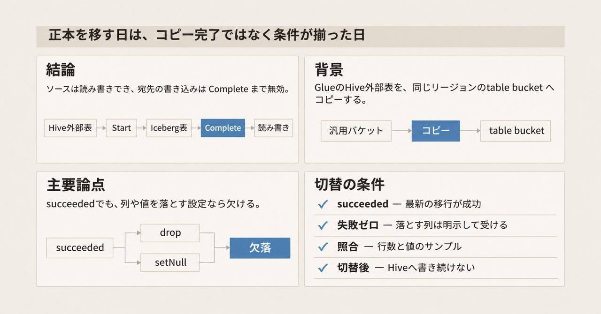
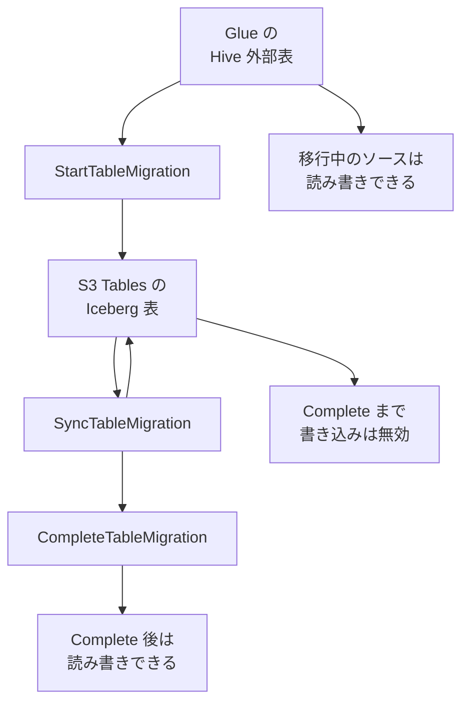

Amazon S3 Tables は、2026年11月4日の発表で、AWS Glue Data Catalog に登録された Apache Hive の外部表を、table bucket 上の管理された Apache Iceberg 表へ移す機能を出しました。Apache Hive は、外部表という形の表を持つ仕組みです。AWS Glue Data Catalog は、その表定義を登録するカタログです。サービスがデータを新しい表へコピーし、Hive の型を Iceberg の型へ変換します。利用者は、この移行のために計算資源を用意しません。移行ジョブのあいだ、ソースのオブジェクトはそのまま残り、ソース表は読み取りと書き込みに使えます。

この記事では、三つの操作、型とパーティションの変換、リージョンとクォータ、権限、掲載されている料金例、読み書きの正本をいつ Iceberg へ移すかを整理します。読み書きの正本は、書き手と読み手が実際に使う表です。英語の AWS News Blog の公開日は 2026-11-04 で、日本語の AWS ブログは同記事の翻訳です。

*この記事の全体像。以下、順に解説します。*

## S3 Tables のマネージド移行とは

Amazon S3 Tables は、Apache Iceberg の表を AWS が管理するサービスです。表を置く場所は table bucket で、オブジェクトを自由に置く汎用バケットとは別です。Apache Iceberg は、表の状態をスナップショットとして持つオープンな表形式です。スナップショットは、その時点で表に含まれるデータファイルの記録です。

移す元は、Glue Data Catalog に登録された Hive の外部表です。外部表は、表の定義がカタログにあり、データファイルは汎用バケット上の Apache Parquet にある表です。Parquet は列指向のファイル形式です。移行ジョブはその内容を読み、table bucket に新しい Iceberg 表のファイルを書きます。ソースのファイルは移動しません。

発表の日付は、英語 News Blog（Channy Yun、byline は 04 NOV 2026、Published は 2026-11-04）、What's New（Posted on Nov 4, 2026）、ユーザーガイドの該当トピック（November 4, 2026）で揃っています。日本語ブログ（Sotaro Hikita、05 11月 2026）は、2026年11月4日に公開された英語記事の翻訳だと同ページに書かれています。

### 三つの操作

移行の操作は三つです。

`StartTableMigration` は、指定した名前の宛先表を作り、ソースをコピーします。`SyncTableMigration` は、前回の start または sync 以降に変わったオブジェクトとパーティションをコピーします。回数に公式の上限は書かれていません。失敗またはキャンセルした移行を、有効な計画が残っていれば再開するのにも使います。`CompleteTableMigration` は、宛先を読み書きできる表にし、table maintenance を有効にします。table maintenance は、表を整える処理です。compaction は、そのうちファイルを目標サイズへまとめたり分割したりする処理です。未参照ファイルの削除も maintenance に含まれます。完了後の追加の migration operation はできません。

同じ宛先表で同時に走せる start または sync は 1 つです。

Start で宛先表ができ、コミットのたびにスナップショットが増えます。Sync は差分を同じ宛先へ足します。Complete まで、宛先は問い合わせ専用です。Complete のあと、宛先は通常の S3 Tables の表として読み書きと maintenance の対象になります。以降の sync はできません。

### 移行中にできること

移行中、ソース表のオブジェクトは読み取り、書き込み、削除ができます。宛先は、そこまでにコミットされたデータを問い合わせできます。宛先への書き込み、ファイル compaction、未参照ファイルの削除は、Complete まで無効です。snapshot management は有効のままで、Start で指定した設定を使います。snapshot management は、残すスナップショットの本数と年齢を管理する設定です。

各コミットは Iceberg のスナップショットを追加します。失敗またはキャンセルしても、宛先にコミット済みのデータは残ります。Boto3 の `get_table_migration` は、失敗またはキャンセルのとき、移行済みオブジェクトの一部がコミットされていないことがある、と `objectsMigrated` を説明します。`objectsMigrated` は、その応答が返す移行済みオブジェクト数です。

### 状態

状態は `new`、`planning`、`pendingReview`、`queued`、`migrating`、`succeeded`、`failed`、`cancelling`、`cancelled` です。

`pendingReview` は `reviewMigrationPlan` を true にしたときだけ現れます。この値は、計画を人が確認してから続行する指定です。その計画を 30 日以内に続行もキャンセルもしなければ、移行は失敗します。`succeeded` は、計画したオブジェクトが移行し終えた状態です。キャンセルできるのは `new`、`planning`、`pendingReview`、`queued`、`migrating` です。

### 型の変換

互換ポリシーは Start で固定され、後続の sync も同じ値を使います。

`unmatchedSourceFieldsPolicy` の既定は `fail` です。宛先スキーマに無いソース列があると、そのオブジェクトは失敗し、移行も失敗します。`drop` はその列を落とします。`incompatibleValuesPolicy` の既定は `fail` です。変換できない値があると失敗します。`setNull` はその値を null にします。

いずれかのオブジェクトが失敗すると、ジョブは `failed` になります。列の照合は名前で、大文字小文字を区別せず、ネストの各階層で行います。一つの宛先列に二つのソース列が当たると、planning で失敗します。スキーマを指定しない場合、Glue の定義から推論し、すべての列は optional になります。optional は、値が無くてもよい列です。

型の対応は次のとおりです。

- `tinyint` と `smallint` は Iceberg の `int` へ広がります。
- `varchar(n)` は `string` になり、長さ制限は残りません。
- `char(n)` は `string` になり、長さと末尾の空白パディングは残りません。
- timestamp の型は、サンプルオブジェクトの Parquet 表現から `timestamp` か `timestamptz` を選びます。`timestamptz` はタイムゾーン付きの時刻型で、`timestamp` はタイムゾーン無しです。
- INT96 はマイクロ秒未満を捨てて `timestamptz` になります。INT96 は、Parquet が時刻を 96 ビット整数で持つ表現です。
- ナノ秒が必要なら Iceberg の format version 3 を選びます。format version は Iceberg の表仕様の版で、既定は 2 です。
- `uniontype`、`void`、interval、精度が 38 を超える decimal は、どのポリシーでも失敗します。

### パーティションと書き出し

Hive のパーティションは、Iceberg の identity transform になります。identity transform は、パーティション値を加工せず、そのままの値で分ける指定です。パーティション値はデータファイルへ書きます。パーティションは、Glue に登録された table location の配下に置きます。table location は、その表に登録されたデータの置き場所です。

Athena は、移行後の表を問い合わせる経路の一つです。partition projection は、Athena がパーティションの規則から読む機能です。この移行では、Glue へパーティションを登録するまで、その機能は使えません。登録のしかたの例が `MSCK REPAIR TABLE` です。`MSCK REPAIR TABLE` は、ストレージ上のパーティションをカタログへ登録するコマンドです。binary、uniontype、ネスト型のパーティション列は非対応です。

ソート順の既定は無しで、最大 5 列まで指定できます。ソート順を付けるには、利用者が宛先スキーマを指定します。

コピー時の既定は次のとおりです。後続の sync では、これらの設定を変えません。

| 設定 | 既定 | 取りうる値 |
|---|---|---|
| compressionCodec | zstd | zstd、snappy、gzip、uncompressed |
| dictionaryEncoding | true | true、false |
| targetFileSizeMB | 512 | 64 から 512 |
| compaction strategy | binpack | 移行中は binpack。別戦略は Complete 後の maintenance |
| sort order | なし | 最大 5 列 |
| minSnapshotsToKeep | 3 | 3 以上 |
| maxSnapshotAgeHours | 120 | 1 以上 |
| icebergFormatVersion | 2 | 2 または 3 |

binpack は、ファイルを目標サイズへまとめたり分割したりする compaction の戦略です。News Blog の JSON 例は `maxSnapshotAgeHours` を 168 と書いています。168 は既定 120 の上書き例です。

### 対象になるソースと置き場所

対象になるソースは Parquet です。圧縮は、非圧縮、Snappy、gzip、Zstandard、Brotli、LZ4 のいずれかです。Zstandard は、宛先の既定である zstd と同じ圧縮方式です。ソース表、宛先の table bucket、レポート用の汎用バケットは、同じアカウントの同じリージョンに置きます。レポート用の汎用バケットは、移行のレポートを書き出す場所です。namespace は先に存在します。namespace は、table bucket の中で表を入れる名前空間です。宛先の表名は先に存在しません。

ORC、Avro、JSON、LZO、transactional な Hive、すでに Iceberg などの open table format である表、storage handler、header または footer 行のスキップは非対応です。open table format は、Iceberg のように複数のエンジンが同じ表形式を読む仕様です。storage handler は、ファイルを直接読む以外の方法で表の中身を取り出す Hive の仕組みです。

Lake Formation にも登録された Glue 表は非対応です。Lake Formation は、Glue の表に対するアクセス制御のサービスです。これはソース側の制限です。宛先を Lake Formation で制御することとは別です。クロスアカウントと、federated な Glue catalog は非対応です。federated なカタログは、Glue 自身が表を持たず、ほかのカタログを参照する登録です。SSE-C は非対応です。SSE-C は、利用者がリクエストのたびに暗号鍵を渡すサーバ側暗号化です。

1 オブジェクトの上限は 10 GiB です。リストアが必要な Glacier Flexible Retrieval、Glacier Deep Archive、Intelligent-Tiering の Archive Access と Deep Archive Access は、先に restore または copy しないと対象外です。これらは、取り出す前に復元が要る S3 のストレージクラスです。

Glue の table parameters、SerDe、column statistics、column comments、table description はコピーしません。SerDe は、ファイルのバイト列と列の値を変換する Hive の定義です。directory marker、空オブジェクト、名前またはフォルダが `_` または `.` で始まるオブジェクトもコピーしません。

提供リージョンは 10 です。US East (N. Virginia)、US East (Ohio)、US West (Oregon)、Asia Pacific (Mumbai)、Asia Pacific (Singapore)、Asia Pacific (Sydney)、Asia Pacific (Tokyo)、Europe (Frankfurt)、Europe (Ireland)、Europe (Stockholm) です。What's New、News Blog、ユーザーガイドのリストは一致します。Asia Pacific (Tokyo) は含まれます。クォータのページは、リージョン名の一覧ではなく、エンドポイントの案内へ誘導します。移行クォータの数値表は同ページにあります。いずれも Adjustable は No です。Adjustable は、上限の引き上げ申請ができるかという区分です。

| クォータ | 既定 |
|---|---|
| Source objects per migration | 1,000,000,000 |
| Column type nesting depth | 20 |
| Partitions per source table | 100,000 |
| Source object size | 10 GiB |
| Concurrent migrations per account | 10 |
| Concurrent migrations per destination table | 1 |

1 秒あたりのリクエスト数の数値は、この表にありません。API は `TooManyRequestsException`（HTTP 429）を返します。説明は、1 秒あたりのリクエスト数の上限を超えた、というものです。

### 権限

呼び出しは IAM です。移行ロールは、コピーを実行するサービスが引き受けるロールです。呼び出し元はそのロールを `migration.s3tables.amazonaws.com` へ渡します。移行ロールの信頼先は `migration.s3tables.amazonaws.com` で、例では `aws:SourceAccount` と宛先 table bucket の `aws:SourceArn` で絞ります。呼び出し元には、バケットに対する `s3tables:StartTableMigration` と `s3tables:ListTableMigrations`、表に対する Sync、Get、Update、Complete、そして `iam:PassRole` が要ります。`iam:PassedToService` は `migration.s3tables.amazonaws.com` です。移行ロールは、開始した主体と同じアカウントに置きます。

| 対象 | 使う権限 |
|---|---|
| Glue | `glue:GetTable`、`glue:GetPartitions`、`glue:GetColumnStatisticsForPartition` |
| ソースバケット | `s3:ListBucket`、`s3:GetObject`、`s3:GetObjectVersion` |
| 宛先 | 表の作成、メタデータ位置の取得と更新、データの取得と書き込み、maintenance 設定の更新 |
| レポートバケット | `s3:PutObject` |
| ソースが SSE-KMS | `kms:Decrypt` |

暗号化やストレージクラスを指定するときは、対応する権限を追加します。SSE-KMS は、AWS KMS の鍵でサーバ側暗号化する方式です。宛先を SSE-KMS にするにはカスタマー管理キーが要り、そのキーは `maintenance.s3tables.amazonaws.com` も許可します。AWS の agent skill は、この移行に `sts:ExternalId` を足さない、と書きます。S3 Tables はその値を送らない、と同 skill は書きます。この skill は、ユーザーガイドとは別の GitHub 文書です。

### Complete のあとから見る

Complete のあと、Athena から見るには table bucket を Glue Data Catalog と統合します。カタログ名は `s3tablescatalog/` に table bucket 名を続けたものです。統合の文書は、表名と列名をすべて小文字にする、と書きます。大文字が含まれると Lake Formation と Glue Data Catalog はその表をサポートせず、統合していても Athena から見えません。エラー例は `Unsupported Federation Resource - Invalid table or column names` です。

News Blog は、Iceberg REST API 互換のツールから直接問い合わせできる、とも書きます。Athena の経路と REST の経路は別です。ソースの Glue 登録と、宛先 table bucket の Glue 統合は別の設定です。

`failureReason` として Running a table migration のページが挙げるのは、`tableCompatibilityReport`、`objectCompatibilityReport`、`objectMigrationReport`、`rolePermissions`、`sourcePermissions`、`destinationPermissions`、`resourceNotFound`、`reportBucketNotSupported`、`sourceNotSupported`、`internalError` です。Start、Sync、Complete の HTTP エラーとしてリファレンスが挙げるのは、`AccessDeniedException`、`BadRequestException`、`ConflictException`、`ForbiddenException`、`InternalServerErrorException`、`NotFoundException`、`TooManyRequestsException` です。公式に示されている例は CLI、SDK、Agent Toolkit の skill です。

### 料金の掲載例

料金の掲載例は、US East (N. Virginia)、取得日 2026-11-07 です。1 TB の Hive 表、Snappy Parquet のオブジェクト 250,000 個を、同じリージョンの table bucket へ移します。宛先は Iceberg のデータファイル 1,639 個になります。期間は 4 か月で、2 週ごとの sync が 8 回、その前後に start と complete があり、migration request は 10 回です。

PUT は 1,000 リクエストあたり $0.005 です。1,639 ファイルと 10 回の API で 1,649 PUT になり、1,649 × $0.005 / 1,000 = $0.0082 です。3 か月以内の最初の 500 migration sync は無料です。1 から 3 か月目の 6 回は無料で、4 か月目の 2 回が課金されます。3 か月の起算日は、この料金例には書かれていません。250,000 × $0.002 / 1,000 = 1 sync あたり $0.50 で、2 回分は $1.00 です。例の合計は $1.0082 です。内訳はこの PUT と sync の 2 行です。ユーザーガイドは、宛先の file compaction を Complete まで無効にします。移行ジョブ自身は、書き出し時に再圧縮し、ファイルを目標サイズへまとめたり分割したりします。Intelligent-Tiering のソースは、現在の階層のままであり、最終アクセスからの日数もリセットしない、とユーザーガイドは書きます。

## 注意点

英語 News Blog は、切替時の数分を除き、ソースへの書き込みを止めずに何度でも sync できる、と書きます。日本語訳は「切り替え時の数分間だけ」と書きます。ユーザーガイドは、ソースへの書き込みを止める必要は無い、切替のダウンタイムを小さくする、と書きます。分数、計測条件、どの API がソースの writer を止めるかは、ユーザーガイドにはありません。「数分」は発表文の表現であり、ユーザーガイドの SLO ではありません。SLO は、サービスが約束する所要時間の目標です。[Amazon S3 Service Level Agreement](https://aws.amazon.com/s3/sla/) の Last Updated は November 28, 2023 です。同ページは月間稼働率とサービスクレジットを定義します。移行ジョブの所要時間や切替の停止時間は定義しません。

「本番を動かしたまま」は、移行ジョブのあいだソースが読み書きできる、という意味まではユーザーガイドが支えています。次の条件では、ジョブは最後まで成功しません。

以前の start または sync が移したソースオブジェクトを、その後に上書きすると、その sync は失敗します。内容が同じ上書きでも失敗します。オブジェクトの古い世代を残すバケットでも失敗します。Sync API の文は "If a source object that an earlier migration migrated has since been overwritten, the sync fails." です。既定の fail / fail では、宛先スキーマに無い列や変換できない値があると、そのオブジェクトで移行全体が失敗します。10 GiB を超えるオブジェクト、要リストアのストレージクラス、前節の非対応形式、Lake Formation 登録、クロスアカウント、SSE-C は対象外です。

`succeeded` は、計画したオブジェクトの移行が終わった状態です。`drop` または `setNull` を選んだ run も `succeeded` になりえます。そのとき列や値は欠けます。AWS の agent skill は、これをデータ欠落として明示の承認が要る、と書きます。行数の一致だけでは、その欠落は見えません。

Complete API は、最新の migration が `succeeded`、`failed`、`cancelled` のいずれかであれば呼べます。失敗やキャンセルのあとに Complete すると、部分的なコピーが読み書き可能になり、それ以上の sync はできなくなります。検証してから succeeded だけを Complete するのは、運用の規律です。API がその状態以外を拒む、という意味ではありません。操作は取り消せません。API の説明は、同じ表への再呼び出しが `ConflictException` を返す、と書きます。エラー一覧の `ConflictException` は、先行する書き込みとの競合でも返り、再試行できる、と書きます。`BadRequestException` は、リクエストが不正または形式違反である、と書きます。これらの例外だけでは、移行が完了したことにはなりません。

What's New の "roll back to your source data" は、ソースが変わっていないので Hive を使い続け、宛先を捨てられる、という意味と整合します。Complete を元に戻せる、という意味ではありません。サービスは Complete のときにソースの writer を止めません。Complete のあと writer が Hive へ書き続けると、Iceberg はそこから離れ、sync では追いつけません。

What's New と News Blog は、コピーしたデータにだけ支払い、Hive から Iceberg への変換には課金しない、と書きます。同じ料金例の請求単位は、コピーした GB ではなく、宛先ファイルの PUT と、無料枠を超えた sync のソースオブジェクト数です。例の合計 $1.0082 に、宛先のストレージ、オブジェクト監視、Complete 後の compaction、ソースの GET は含まれません。料金例に変換の行はありません。「変換は無料」は、例に変換行が無いことまでです。別の掲載例では、binpack compaction が処理オブジェクト 1,000 あたり $0.002、処理 GB あたり $0.005 です。移行ジョブの書き出しを、無効になっているメンテナンス compaction の料金とは扱いません。移行中の snapshot management が compaction として請求されるかは、参照した料金ページとユーザーガイドには書かれていません。掲載例以外のリージョンの移行単価も、この例からは確認できません。

AWS の agent skill は、ソースを廃止するまでストレージはおよそ倍になる、大きい表は数時間かかりうる、と書きます。これはユーザーガイドの測定値でも SLO でもありません。

この移行は、既存ファイルに Iceberg のメタデータを被せる in-place ではありません。in-place は、データファイルを書き換えず、メタデータだけを足して Iceberg として読む方法です。この機能はファイルを新しい table bucket へ書き、パーティションは identity のままです。hidden partitioning への設計変更は、この機能の変換内容に含まれません。hidden partitioning は、分け方をクエリに書かなくても、Iceberg のメタデータ側でパーティションを持つ設計です。

スナップショットの最新は、Hive の現在の中身と同じではありません。既定では最小 3 本を残し、最大年齢は 120 時間です。120 時間を超えた初期スナップショットが必ず消える、とは書きません。最小本数の制約があります。最大年齢を超えたスナップショットが、最小本数を除いて残る保証も、参照した文書にはありません。初期のスナップショットを残すなら、Start の時点で `maxSnapshotAgeHours` を上げるか、スナップショット ID を控えます。この設定は後の sync では変えられません。

移行ガイドは、列名を小文字へ正規化する、とは書いていません。照合は大文字小文字を無視します。推論スキーマが Glue の列名をそのまま使うなら、大文字が宛先に残りえます。その場合、Glue 経由の Athena は前節のエラーで表を見ない可能性があります。これは二つの公式記述からの推論であり、移行 API の実測ではありません。小文字の宛先スキーマを Start で指定すれば、この相互作用は避けられます。

次の点は、参照した文書だけでは決まりません。

- 切替時の停止が何分で、どの操作がソース書き込みを止めるかは、ユーザーガイドにありません。
- 古いオブジェクトを削除し、新しいオブジェクト名で書く更新が、すべての Hive レイアウトで sync の成功条件を満たすかは未確認です。ここでのオブジェクト名は、バケット内のオブジェクトを指すキーです。API は追加と削除を変更例に挙げ、上書きを失敗と分けているだけです。
- 参照した公式資料には、この機能固有の CVE、移行時間の SLO、in-place で S3 Tables へ移せる例外は書かれていません。

## 公式資料が支えている範囲

次の読み方は、参照した公式資料と整合します。

- ソースオブジェクトは移動しません。移行ジョブのあいだ、ソースは読み書きできます。
- 計算資源の用意は、この機能の手順に含まれません。
- 変換料金の行は、掲載されている料金例にありません。
- 東京を含む 10 リージョンで、2026-11-04 の発表時点の一覧がユーザーガイドと一致します。
- 失敗してもソースは残り、コミット済みの宛先データも残ります。有効な計画があれば sync で再開できます。

次の読み方は、同じ資料が弱めます。

- ファイルのコピー完了は、読み書きの正本の切替ではありません。宛先は Complete まで書き込めません。
- Complete は完全なコピーの証明ではありません。failed と cancelled でも呼べます。
- `succeeded` は無損失の証明ではありません。`drop` と `setNull` でも成功しえます。
- 既存キーの上書きが残る本番は、sync のたびにジョブ全体が失敗しえます。
- 移行中の宛先クエリは、コミット済みの範囲であり、`migrating` のあいだは全量とは限りません。
- 対象外の形式、Lake Formation 登録、クロスアカウント、要リストアのオブジェクトは、発表の対象表から外れます。

## ほかの移行方式との違い

AWS Prescriptive Guidance の "Migrating existing tables to Iceberg" は、既存ファイルにメタデータを被せる方法と、ファイルを書き換える方法を分けています。同ページは "In-place migration cannot be used when migrating to Amazon S3 Tables." と書きます。比較表の "Can be used to migrate to Amazon S3 Tables" は、`snapshot` と `migrate` が No、CTAS が Yes です。CTAS は `CREATE TABLE AS SELECT` で、読み手のエンジンが新しい表へ行を書き直す方法です。表の `snapshot` と `migrate` は、別の移行手順の名前です。Iceberg のスナップショット（時点の記録）とは別です。

| 方式 | データファイル | S3 Tables へ | 移行中のソース | 設計の変更 |
|---|---|---|---|---|
| 今回のマネージド移行 | 新しい table bucket へコピーし、既定では zstd で書き直す | これがその機能 | 読み書きできる。既に移したオブジェクトの上書きは sync を失敗させる | パーティションは identity。ソートは最大 5 列で任意 |
| `snapshot` | 既存ファイルを指すメタデータを作る | 不可 | ソースのファイル追加や削除は Iceberg に乗らない。追従は別手順の `add_files` | ファイル配置は変わらない。`gc.enabled` は false。true にするとソース参照を壊しうる |
| `migrate` | ソースをバックアップ名へ改名し、Iceberg として登録する | 不可 | 実行前に writer を止める。Glue Data Catalog は `RENAME` が無く、HMS 向け | 同上 |
| CTAS または CREATE TABLE と INSERT | 読み手のエンジンで書き直す | 可 | 自前のジョブと計算資源が要る | hidden partitioning、ソート、ファイルサイズを設計し直せる |

`snapshot` は、既存ファイルを指す Iceberg のメタデータを作る手順です。`add_files` は、その後に増えたファイルを Iceberg へ足す別手順です。`gc.enabled` は、Iceberg が不要になったファイルを削除するかの設定です。`migrate` は、ソースのディレクトリをバックアップ名へ改名してから Iceberg として登録する手順です。HMS は Hive Metastore で、Glue Data Catalog とは別のカタログ実装です。Glue Data Catalog には、この手順が使う `RENAME` がありません。

in-place は、宛先が既存ファイル上の Iceberg で、メタデータだけで足りるとき、Prescriptive Guidance が速い安い方法として書きます。宛先が S3 Tables であるこの発表では、その方法は使えません。マネージド移行はファイルを書き直しますが、パーティション設計のやり直しは CTAS 側に残ります。

S3 Tables が宛先でないなら、既存ファイルへメタデータを被せる `snapshot` の方が、公式が安い方法として書く条件に当たることがあります。hidden partitioning へパーティションを設計し直すなら、CTAS 側の書き換えが要ります。このマネージド移行は、その設計変更を代行しません。

## 読み書きの正本を移す条件

読み書きの正本を Hive から Iceberg へ移すのは、次が同じ窓で揃ったときだけにします。

1. 最新の migration が `succeeded` である。Complete が failed や cancelled を受け付けることは、その状態を完了にしてよい理由にしません。
2. 失敗したオブジェクトは 0 である。ポリシーは既定の `fail` と `fail` である。`drop` または `setNull` を使うなら、欠ける列と値を明示して受けます。
3. 行数、パーティション数、値のサンプルが、ソースと宛先で合う。AWS の agent skill は、Complete の前に行数の一致を確認する、と書きます。行数だけでは、`drop` と `setNull` の欠落は見えません。
4. 既存キーを上書きする writer を止めたか、最後に成功した sync が最後の上書きより後である。
5. `CompleteTableMigration` を呼ぶ。成功時の応答は HTTP 204 です。`ConflictException` と `BadRequestException` だけでは完了と判定しません。完了の確認は、agent skill が書く `get-table` の `managedByService` が null であることと、migration の状態を見ることです。`managedByService` は、その表をどのサービスが管理しているかを示す `get-table` の項目です。
6. writer、reader、エージェントが参照するカタログを、その窓で Glue の Hive から Iceberg へ移す。ここでのエージェントは、表の内容を参照する呼び出し元です。前に書いた AWS の agent skill（GitHub 文書）とは別です。Athena ならカタログは `s3tablescatalog/` に table bucket 名を続けたもので、table bucket は Glue と統合済みです。REST 互換ツールなら、そのエンドポイントを参照先にします。
7. Complete のあと、writer を Hive に残さない。sync はもうできません。

Hive 上の今の読み取りを、エージェントが参照する内容に含める期間は、writer が Hive にいる期間と揃えます。Iceberg 側へ切り替える日は、上記 1 から 7 が揃った日であり、ファイルコピーが終わった日ではありません。

## 移行中に参照するスキーマ

移行ジョブのあいだ、エージェントの書き込み正本は Hive です。Iceberg を読むなら、コミット済みスナップショットの遅れであり、状態が `migrating` のあいだは部分的である、とラベルを付けます。

見せるスキーマは、Start で固定した宛先スキーマです。互換レポートの Lossless、Widened、Converted を、そのスキーマの説明として残します。これらは、互換レポートが型の対応結果へ付ける区分名です。各区分がどの変換に当たるかは、そのレポートの出力が正です。移行中に Glue へ足した列は、既定では次の sync を失敗させます。ライブの Glue スキーマを、宛先のスキーマとしてエージェントに渡しません。

最新スナップショットを、移行開始時の絵としても、ライブの業務表としても扱いません。初期スナップショットが必要なら、Start で最大年齢を上げるか、スナップショット ID を控えます。両方を読むジョブが残る期間にエージェントへ見せるのは、進化中の Glue スキーマではありません。見せるのは、Start で固定した宛先スキーマと、Start の時点でコミット済みのスナップショットです。

## まとめ

S3 Tables のこの機能は、Glue に登録された Hive 外部表の Parquet を、同じアカウントと同じリージョンの table bucket へコピーし、管理された Iceberg 表にします。Start、Sync、Complete の三つで進み、移行ジョブのあいだソースは読み書きできます。宛先への書き込みと maintenance は Complete まで無効です。

コピーが終わった日は、読み書きの正本を移した日ではありません。`succeeded`、失敗オブジェクト 0、照合、上書きの停止、Complete の確認、カタログの切替、Hive への writer を残さないこと、が同じ窓で揃ってから移します。パーティションを hidden partitioning へ設計し直す作業は、この機能は代行しません。

この記事が少しでも参考になった、あるいは改善点などがあれば、ぜひリアクションやコメント、SNSでのシェアをいただけると励みになります！

## 参考リンク

- [英語 News Blog（04 NOV 2026、Published 2026-11-04）](https://aws.amazon.com/blogs/aws/amazon-s3-tables-now-offer-managed-migration-of-apache-hive-tables-to-apache-iceberg/)
- [What's New（Posted on Nov 4, 2026）](https://aws.amazon.com/about-aws/whats-new/2026/11/amazon-s3-tables-managed-migration-hive-to-iceberg/)
- [日本語 AWS ブログ（05 11月 2026、英語記事の翻訳）](https://aws.amazon.com/jp/blogs/news/amazon-s3-tables-now-offer-managed-migration-of-apache-hive-tables-to-apache-iceberg/)
- [Migrating tables to S3 Tables](https://docs.aws.amazon.com/AmazonS3/latest/userguide/s3-tables-migrate.html)
- [How it works](https://docs.aws.amazon.com/AmazonS3/latest/userguide/s3-tables-migrate-how-it-works.html)
- [Setting up](https://docs.aws.amazon.com/AmazonS3/latest/userguide/s3-tables-migrate-setting-up.html)
- [Data type mappings](https://docs.aws.amazon.com/AmazonS3/latest/userguide/s3-tables-migrate-data-type-mappings.html)
- [Running a table migration](https://docs.aws.amazon.com/AmazonS3/latest/userguide/s3-tables-migrate-running.html)
- [Regions and quotas](https://docs.aws.amazon.com/AmazonS3/latest/userguide/s3-tables-regions-quotas.html)
- [StartTableMigration](https://docs.aws.amazon.com/AmazonS3/latest/API/API_s3Buckets_StartTableMigration.html)
- [SyncTableMigration](https://docs.aws.amazon.com/AmazonS3/latest/API/API_s3Buckets_SyncTableMigration.html)
- [CompleteTableMigration](https://docs.aws.amazon.com/AmazonS3/latest/API/API_s3Buckets_CompleteTableMigration.html)
- [boto3 complete_table_migration](https://docs.aws.amazon.com/boto3/latest/reference/services/s3tables/client/complete_table_migration.html)
- [S3 Tables と AWS 分析サービスの統合](https://docs.aws.amazon.com/AmazonS3/latest/userguide/s3-tables-integrating-aws.html)
- [Athena からの登録](https://docs.aws.amazon.com/athena/latest/ug/gdc-register-s3-table-bucket-cat.html)
- [Athena 統合](https://docs.aws.amazon.com/AmazonS3/latest/userguide/s3-tables-integrating-athena.html)
- [Prescriptive Guidance: Migrating existing tables to Iceberg](https://docs.aws.amazon.com/prescriptive-guidance/latest/apache-iceberg-on-aws/table-migration.html)
- [Amazon S3 料金](https://aws.amazon.com/s3/pricing/)
- [Amazon S3 Service Level Agreement](https://aws.amazon.com/s3/sla/)
- [AWS agent skill: migrating Hive tables to S3 Tables](https://github.com/aws/agent-toolkit-for-aws/blob/main/skills/specialized-skills/analytics-skills/migrating-hive-tables-to-s3-tables/SKILL.md)
