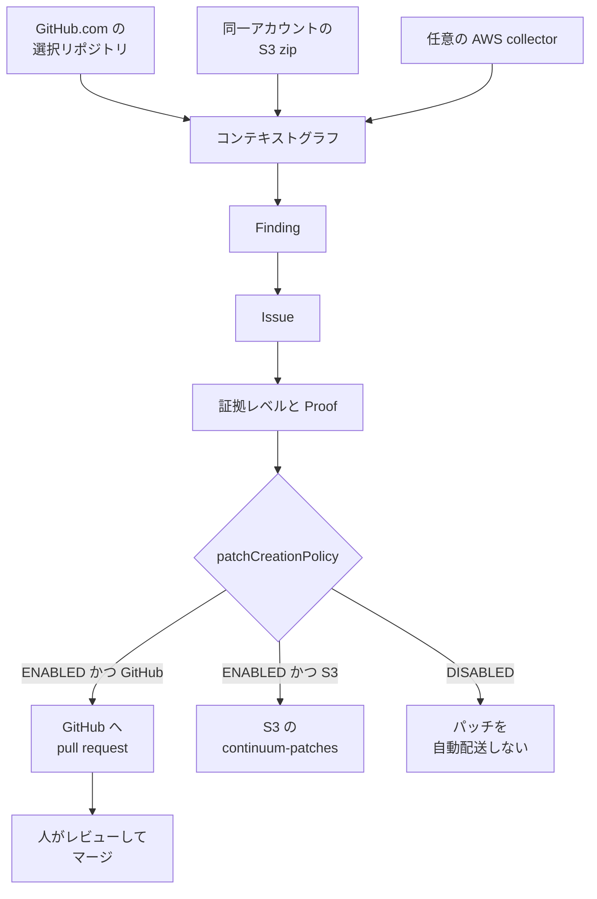

2026-10-22 に、AWS Continuum for code vulnerabilities の一般提供が告知されました。
ここで扱うのはコード脆弱性機能であり、ペネトレーションテスト機能や、コードレビューの preview とは別です。

この機能は、選んだコードと任意の AWS 構成からコンテキストを作ります。
コンテキストは、そのコードと AWS 構成を、検出が参照できる形にまとめたものです。
検出を検証して優先度を付け、レビュー用の修正を GitHub の pull request、または Amazon S3 上の patch として届けます。

セキュリティ運用と、導入を判断する購買の担当者向けに、入力、issue の扱い、修正案の届け先、料金、クォータ、データの保管を説明します。
続けて、文書の読み分けと、導入前に決める受入条件を書きます。

*この記事の全体像。以下、順に解説します。*

## AWS Continuum for code vulnerabilities とは

告知は、Esra Kayabali による [AWS News Blog](https://aws.amazon.com/blogs/aws/aws-continuum-for-code-vulnerabilities-is-now-generally-available/) と、同日の [What's New](https://aws.amazon.com/about-aws/whats-new/2026/10/aws-continuum-for-code-vulnerabilities-is-now-generally-available/) です。

### 入力

コードの取り込みは 2 通りです。
GitHub.com では、OAuth で選んだリポジトリを対象にします。
S3 では、同じ AWS アカウントで、Continuum を有効にする Region に置いた zip を対象にします。

任意の collector は、コードとは別の経路です。
collector は、AWS の構成を読んで同じコンテキストへ入れる収集です。
読む対象の例は、AWS Config、Lambda の API、EKS のオブジェクト、ECR のイメージです。

### 検出と issue

検出（finding）は、コード上で見つかった脆弱性の候補です。
検証と優先度付けを経たものを、issue として扱います。

再現できる finding については、隔離されたサンドボックスで exploit を実行します。
この文は、2026-10-22 の News Blog のものです。

各 issue には、証拠レベルと Proof が付きます。
証拠レベルは、コンソールが issue に付ける区分です。
Proof は、その issue に示される根拠の種類です。
News Blog のコンソール例では、証拠レベルが Static proven、Proof が source analysis、exploitability が Exploitable と表示されます。
Static proven、source analysis、Exploitable は、この画面例に出る表示名です。
exploitability は、その画面例の項目名です。
出ている値は Exploitable だけです。

### 修正案の配送

修正の中身は、コードの patch、依存関係の更新、設定変更です。

コンソールの「Automatically deliver remediation patches」は、既定で選択されています。
GitHub 連携では pull request になります。
S3 連携では、`continuum-patches/` 配下のオブジェクトになります。
Advanced は、コンソール上で、既定の自動配送を外す設定箇所です。

API の `patchCreationPolicy` は、修正案を自動で届けるかどうかの設定です。
有効値は `ENABLED` と `DISABLED` です。
出典は、2026-10-22 掲載の [EnvironmentConfiguration](https://docs.aws.amazon.com/continuum/latest/APIReference/API_EnvironmentConfiguration.html) です。

コンソールのスキャン間隔は、毎日、2 日、7 日、手動のみです。
API の `scanFrequency` は、長さ 3 から 64 の ISO 8601 duration です。
ISO 8601 duration は、`P1D` のように期間を書く表記です。
手動のみとの対応表は、EnvironmentConfiguration の同じページにはありません。

### collector の権限

マネージドポリシー `AWSContinuumCollectorServiceRolePolicy` は、サービスリンクロール `AWSServiceRoleForContinuumCollector` にだけ付きます。
文書の更新日は 2026-10-13 です。
サービスリンクロールは、その AWS サービス自身に付く IAM ロールです。
出典は [マネージドポリシーの説明](https://docs.aws.amazon.com/continuum/latest/userguide/security-iam-awsmanpol.html) です。

顧客アカウントでは、タグ `AWSContinuum=true` を条件に、Network Insights の path と analysis を作成、開始、タグ付け、削除できます。
Network Insights の path と analysis は、ネットワーク到達性を調べる AWS のリソースです。

同じポリシーは、Tiros の `CreateQuery` と `GetQueryAnswer` を別に許可します。
Tiros は、Network Insights とは別の文で許可される API 名です。
タグ `AWSContinuum=true` の条件は、この Tiros の許可文には付いていません。

### リージョンとクォータ

News Blog が名指しする提供リージョンは、US East (N. Virginia) と US West (Oregon) です。

Region 単位の既定クォータは、[Quotas](https://docs.aws.amazon.com/continuum/latest/userguide/quotas.html) のとおりです。
environment は、クォータ上、リポジトリがぶら下がるまとまりです。
1 つの取り込み接続を、いくつの environment に分けるかは、Quotas の説明には書かれていません。
Integrations は、取り込み先の登録数に対するクォータ名です。
表の collector は、数える単位が違います。
アカウントかつ Region あたりの 1 は、そのアカウントのその Region での上限です。
environment あたりの 100 は、1 つの environment での上限です。
この 2 つの数字を同時にどう効かせるかは、Quotas の説明だけでは閉じていません。

| 単位 | 既定 |
| --- | --- |
| Integrations | 10 |
| Environments | 10 |
| environment あたりのリポジトリ | 10 |
| アカウントかつ Region あたりの collector | 1 |
| environment あたりの collector | 100 |

引き上げは、Service Quotas のコードではなく、AWS の account team への連絡です。
既定を超える既存の environment は閲覧できます。
リポジトリ数を減らすまで、再スキャンはできません。

### 料金

公開料金は、2026-10-23 に取得した [料金ページ](https://aws.amazon.com/continuum/pricing/) です。
内訳は、保護する行数に対する月額のコンテキスト料 `ContinuumContext-Code` と、推論料 `ContinuumInference` です。

推論の単位は Continuum inference unit（CIU）です。
1 CIU は 10 USD です。
料金ページは、モデルごとの請求ではなく、セキュリティ作業を 1 CIU にまとめる、と説明します。
1 件の脆弱性が何 CIU になるかは、code vulnerabilities の節には書いてありません。

コンテキスト料は 100 万行あたりです。
前払いと最低料金は無い、と料金ページは書いています。

| 行数の帯 | 100 万行あたり |
| --- | --- |
| 最初の 1,000 万行 | 200 USD |
| 次の 9,000 万行 | 180 USD |
| 1 億行超から 10 億行まで | 160 USD |
| 10 億行超から 100 億行まで | 130 USD |
| 100 億行超 | 100 USD |

### GitHub App

[GitHub App の公開ページ](https://github.com/apps/aws-continuum) の短い名前（slug）は `aws-continuum` です。
説明文の開発元表示は AWS-Continuum です。
取得日は 2026-10-23 です。
選んだリポジトリだけにアクセスする、と書いてあります。
コードの取り込みで書いた OAuth と、この GitHub App が同じ接続かは、これらの説明だけでは結ばれていません。

### 画面例

News Blog のウォークスルー例では、pull request のタイトルが「Continuum fix」です。
対象は cart service です。
重大度は High です。
変更は 4 ファイルで、追加 50 行、削除 24 行です。
Likelihood は High で、到達でき、認証も利用者の操作も要らない、という表示です。
Impact は Moderate で、同一テナントの業務データを変更する、という表示です。

### 稼働率クレジット

[サービスレベル合意](https://aws.amazon.com/continuum/sla/) の最終更新は 2026-10-22 です。
月間稼働率が 99.9% 未満かつ 99.0% 以上なら、料金の 10% をクレジットにします。
99.0% 未満かつ 95.0% 以上なら 25% です。
95.0% 未満なら 100% です。
計測は 5 分間隔です。
アイドル区間は 100% と数えます。
何をアイドルと呼ぶかは、この合意の説明ではそれ以上は書かれていません。

### データの保管

[データ保護](https://docs.aws.amazon.com/continuum/latest/userguide/data-protection.html) の説明は、ペネトレーションテストを対象外と断っています。
保管場所は、リクエストの起点になった Region です。
推論は、起点の Region の外で処理され得ます。
ただし、地理的区域の中に留まります。
米国発のリクエストは、米国内で処理する、と書いてあります。
列挙されている区域は United States だけです。

現時点では、サービス改善のために AWS Continuum Content を収集も保存もしません。
AWS Continuum Content は、このページが、サービスへ渡した内容を指す呼称です。
将来は収集し得る、と書き、そのときはページを更新する、としています。
opt-out は、AWS Organizations の AI services opt-out ポリシーです。
対象は、Organizations が中央管理するアカウントです。
過去に収集したサービス改善用の Content があれば、opt-out で削除する、と書いてあります。

### 処理の流れ

コード側の入力と collector は、別経路で同じコンテキストに入ります。
届けるかどうかは、`patchCreationPolicy` が決めます。
届け先は、取り込みが GitHub か S3 かです。
GitHub App の説明では、マージは利用者が行います。

コンテキストグラフは、選んだコードと任意の AWS 構成から作るコンテキストです。

## 注意点

同日の文書でも、「検証した」「再現できる」「自動で直す」の強さが揃っていません。
受入の数値にする前に、どの文を読んでいるかを分けます。

### 証拠の強さ

News Blog は、再現できる finding に限って、サンドボックスで exploit を実行する、と書きます。
[issues の見方](https://docs.aws.amazon.com/continuum/latest/userguide/cv-viewing-issues.html) を含む User Guide は、Proof の種類は issue 依存であり、unit test も executable proof も無いことがある、と書きます。
executable proof は、実行して確かめられる根拠です。
コンソール例の証拠レベルは Static proven で、Proof は source analysis です。

GitHub App は "real, reproducible issues instead of noise" と書きます。
[製品ページ](https://aws.amazon.com/continuum/) は "proves which are exploitable" と書きます。
この 2 つの売り文句は、User Guide の Proof 留保より強いです。
Static proven と source analysis だけの issue を、サンドボックスで再現済み、誤検知ではない、直してよい範囲である、とは読みません。

到達性も同じです。
User Guide は、ネットワーク到達性は設定からの推論であり、formal network reachability proof ではない、と書きます。
formal network reachability proof は、経路の有無を形式的に証明したものを指します。
経路が有ることも無いことも保証せず、優先度の信号として扱え、とあります。
collector のマネージドポリシーは、顧客アカウントで Network Insights と Tiros を実行します。
ここで顧客アカウント側に書いてあるのは、この 2 つの実行です。
exploit を顧客アカウントで実行する、とは書いてありません。
検証の場所は、隔離サンドボックスだけではありません。

What's New（2026-10-22）は、隔離サンドボックスで試して exploitable だと確定する、と一律に書きます。
この文は、News Blog と User Guide より強いです。

### 自動適用と Enforce

What's New は現在形で、Learn mode と Enforce mode を書きます。
Learn mode では修正案を提案し、利用者が承認します。
精度への信頼が貯まると Enforce mode に切り替え、設定した guardrail の中で自律させる、と書きます。
guardrail は What's New が使う語です。中身の操作定義は、User Guide にはありません。
Learn mode は提案と承認の段階、Enforce mode は guardrail 内で自律させる段階、という What's New の説明です。

News Blog は、自動適用を "In the future" とし、現行は利用者がレビューしてマージする、と書きます。
生成した patch は、issue が修正済みであることを意味しない、とも書きます。
User Guide と Code Vulnerabilities API には、Learn と Enforce という操作名がありません。
公開の GitHub App は "Continuum never merges changes on its own." と書きます。

現行の制御として文書にあるのは、パッチを自動で届けるかどうかです。
値は `patchCreationPolicy` の `ENABLED` と `DISABLED` です。
Enforce を、今マージ権限をサービスへ渡す機能としては扱いません。

### CyberGym-E2E は顧客環境の精度ではない

[AWS Security Blog](https://aws.amazon.com/blogs/security/aws-continuum-sets-a-new-standard-in-autonomous-code-security/)（2026-10-05、Alexander Greaves-Tunnell と Neha Rungta）の CyberGym-E2E は、AWS 自身の計測です。
920 タスク、139 の OSS、中央値は 60 万行超です。
対象は C/C++ のメモリ安全性と OSS-Fuzz です。
OSS-Fuzz は、OSS を継続的にファズする仕組みです。
制限時間は 90 分です。
脆弱性の説明も、PoC も、クラッシュも、元の patch も与えません。
ネットワークは隔離です。

| 段 | 内容 | 今回 | 先行の最高 |
| --- | --- | --- | --- |
| S1 | クラッシュする入力を見つけて再現する | 92.5% | 67.9% |
| S2 | そのクラッシュをパッチで止める | 89.6% | 66.2% |
| S3 | 機能テストを維持する | 89.0%（819/920）。先行比 +23.1 ポイント | 65.9% |
| S4 | ベンチマークが選んだ脆弱性を直したか | 37.8% | 26.2% |

時間制限を外した S3 は 93.7% です。
公式に掲げた 89.0% とは別条件です。
AWS は、S4 が診断であり、別の実在欠陥を直しても S3 は通り得る、と書きます。
顧客のデプロイ文脈は、このベンチマークの外です。
89.0% を、本番リポジトリで意図した欠陥が直る率としては使いません。

### 料金例は仮定である

料金ページの 3 例は、1 件あたり 1 CIU または 2 CIU という仮定です。
本文は "Actual inference varies" と書きます。
1 件が何 CIU になるかの換算式と、端数の丸めは、code vulnerabilities の節にはありません。

2026-10-23 に取得したページの合計は、次のとおりです。
100 万行、100 件、1 CIU で 1,200 USD です。
1,000 万行、1,000 件、1 CIU で 12,000 USD です。
1 億行のコンテキストは 18,200 USD です。
そこに 1 万件、2 CIU、10 USD の 200,000 USD を足すと 218,200 USD です。

code vulnerabilities の無料枠は、この料金ページでは確認できません。
無料試用が書いてあるのは penetration testing です。
新規顧客は、最初のテストから 2 か月、各月 400 task-hour までです。
task-hour は、ペネトレーションテストの作業時間を時間で数える単位です。
超過と終了後は 50 USD / task-hour の秒課金です。
finding あたり最初の 3 回の再検証は課金しません。
試算例は 173.13 USD、1,200.00 USD、1,562.92 USD です。

[FAQ](https://aws.amazon.com/continuum/faqs/) は、design review をアカウントあたり月 200 件まで、code review を 1,000 件まで、preview 中は課金しない、と書きます。
この design review と code review は、コード脆弱性機能とは別の preview の件数です。
この code review は、冒頭で分けたコードレビューの preview と同じ枠です。
この上限は、code vulnerabilities の CIU には使いません。

### 学習と保管の読み分け

FAQ の「顧客データをモデル学習に使わない。第三者にも共有しない」は、見出しが Continuum for penetration testing です。
code vulnerabilities 用の同じ文は、この FAQ では確認できません。
データの扱いの正本は、先に書いたデータ保護のページです。

### SLA の Request

クレジット対象の Request は、文書に載る AWS Continuum API または AWS Security Agent API の呼び出しです。
AWS Security Agent API は、同じ合意が並べる別の API 名です。
この API 名は、コード脆弱性の API と同一ではありません。
Error は 500 または 503 です。
クレジットは、当該 Region の Continuum 料金に対する割合です。
原則は、将来の AWS Continuum の支払いに充てます。
返金ではありません。
クレジットカードへの充当は、AWS の裁量で行い得ます。
唯一の救済です。
請求期限は、2 番目の請求サイクルの末までです。
件名は "AWS Continuum SLA Credit Request – Claim" です。
顧客の行為、文書不遵守、顧客設備、停止措置は除外されます。

### ウォークスルーの差分は一例である

追加 50 行、削除 24 行、4 ファイルは、News Blog が示した cart service の画面例です。
修正サイズの代表値ではありません。

## 近い手段との違い

差は、検出を届けるか、修正案のファイルを作るか、その証拠を誰が確定するか、マージを誰がするか、にあります。

| 観点 | 未検証の検出を届けるスキャナ | Continuum のコード脆弱性 | Continuum のペネトレーションテストの修正 | GitHub code scanning の Agentic Autofix | Semgrep Autofix | Anthropic の到達面縮小（2026-10-20） |
| --- | --- | --- | --- | --- | --- | --- |
| 何を確定するか | 検出そのもの | finding を検証し、再現できるものはサンドボックスで試す。Proof は issue 依存 | ペネトレーションテストの finding | 既存アラートに対する修正案 | Semgrep の finding に対する修正 | 未認証で到達できるコードを縮める。個別脆弱性の修正が目的ではない |
| 修正の届け方 | 届かないことが多い | GitHub なら pull request。S3 なら `continuum-patches/` | GitHub の pull request（公式の enable-remediate） | 検証後に draft pull request | pull request または merge request | パッチをメンテナと作る研究。サービス連携ではない |
| マージ | 人が別途直す | App は自分ではマージしない、と書く | 人がマージする前提の記事が多い | 人がレビューする | 人がレビューする | メンテナがリリースする |
| 作者の識別子 | スキャナ依存 | User Guide と App ページに bot のログインは無い。短い名前は `aws-continuum` | 二次情報の DevelopersIO は `aws-security-agent[bot]` を観察 | GitHub 側の機能 | Semgrep 側 | 論文の著者は Chris Rohlf |
| 2026-10-23 時点の範囲 | 製品による | News Blog は N. Virginia と Oregon。取得先は GitHub と S3 | 別発表でリージョンが広い。料金は task-hour | 既存の code scanning | Semgrep Code と Supply Chain | OpenSSH 10.4 から 10.6 の事例を含む研究 |

[GitHub の一次文書](https://docs.github.com/en/code-security/concepts/code-scanning/autofix-for-code-scanning) は、Agentic Autofix がコードベースを調べ、修正を生成し、変更を validate してから draft pull request を開く、と書きます。
Agentic Autofix は、GitHub code scanning の既存アラートに修正案を付ける機能です。
検証の対象は、既存アラートへの修正案です。
脆弱性の悪用再現ではありません。

[Semgrep の一次文書](https://docs.semgrep.dev/semgrep-multimodal/overview) は、Autofix が修正を生成して pull request または merge request を作る、と書きます。
悪用を確定してから、とは書いてありません。
"over 95%" は、ノイズフィルタの偽陽性分類についてです。
Continuum の再現率ではありません。

Aikido、Socket、Endor Labs について、「悪用を確定してから修正の pull request を出す」という一次記述は、公開の確認範囲では見当たりません。

[Anthropic（Chris Rohlf、2026-10-20）](https://www.anthropic.com/research/attack-surface-reduction) は別件です。
OpenSSH 10.4 の既定 sshd では、未認証クライアントが到達できる ML-DSA-44 のコードが約 4,500 行ありました。
ML-DSA-44 は、その記事が扱う署名方式の実装です。
OpenSSH 自身の pre-auth の約 16% でした。
pre-auth は、認証が終わる前に実行される処理です。
修正は、既定ビルドで未認証クライアントが到達できたコードのおよそ 5 分の 1 を取り除いた、と書きます。
ほとんどは ML-DSA です。
10.5 でチェックをパースの前へ移し、残ったギャップへの変更は 10.6 で出荷された、と本文は書きます。
これは、到達できるコードを縮める側です。
Continuum が証拠を確定する話ではありません。

[Getting started](https://docs.aws.amazon.com/continuum/latest/userguide/cv-getting-started.html) にある取得先は、GitHub と S3 です。
GitLab、GitHub Enterprise Server、Bitbucket、および Claude Code、Codex、Kiro への組み込みは、この一般提供の Getting started と Code Vulnerabilities API の取得先にはありません。

## 受入条件の分け方

検証済み、Exploitable、Static proven を、マージしてよい許可としては扱いません。
受入条件は 3 つに分けます。

1. 証拠の種類を分けます。静的解析、サンドボックスでの再現、未確定、実行可能な Proof の有無です。
2. 誤検知として却下する条件を分けます。
3. 直してよい範囲を分けます。ファイル、許可したドメイン経由の依存更新、設定、テストです。

マージ権限は、この 3 つとは別に人へ残します。
既定で自動なのは、pull request または S3 patch の配送までです。

この分け方を支持する一次資料は、次のとおりです。

- News Blog は、現行のマージを人に残し、自動適用を将来形で書きます。
- User Guide は、パッチ配送と、Proof が無い場合があることを書きます。
- GitHub App は、自分ではマージしない、と書きます。
- API は、配送のオンとオフしか置きません。
- CyberGym-E2E の同じ表に、見出しの 89.0% と、選ばれた欠陥を直した 37.8% が並びます。

同じ結論を弱める一次資料は、次のとおりです。

- What's New の Enforce は、同日の操作説明より先に、自律を現在形で書きます。
- 製品ページと GitHub App は、再現と悪用の証明を User Guide より強く書きます。
- [What is AWS Continuum](https://docs.aws.amazon.com/continuum/latest/userguide/what-is-continuum.html) は、high-priority な露出を automatically remediate すると書きます。
- code vulnerabilities の説明は、recommends remediation と書きます。
- 同じガイド内で、動詞が違います。
- automatically remediate を、修正案の配送とも、マージとも、この 2 文だけでは決めません。
- 次の文は、その動詞の意味を決めたものではありません。コンソールの既定では、人が承認する前に、pull request の作成または S3 への patch 配置まで進みます。

顧客の本番で誤った修正が入った事例は、公開情報としては確認できません。
確認できないことは、起きないことの証明ではありません。

## 導入前に決めておくこと

マージ権限を渡す前に、次を文書にします。

1. 証拠の種類を issue ごとに記録します。Static proven と source analysis だけ、サンドボックスで再現した、実行可能な Proof が無い、を同じ「検証済み」にまとめません。
2. 誤検知として却下する条件を、マージ権限を持つ人とは別のチェックにします。
3. 直してよい範囲を先に決めます。触ってよいパス、依存更新に使うドメイン、設定変更、テストの追加を分けます。
4. 自動配送は既定オンとして設計します。マージは人に残します。What's New の Enforce は、API と User Guide に操作が出てから権限設計に入れます。
5. 最初の pull request で、作者のログイン、対象ブランチ、コミットが CI をスキップするかを記録します。ペネトレーションテスト側で観察された `[skip ci]` と bot 名は、コード脆弱性機能の識別子として採用しません。
6. 見積もりは、CIU を仮定と明記します。89.0% は受入の合格率にしません。
7. データの扱いは、ペネトレーションテストの FAQ ではなく、Continuum のデータ保護ページを正本にします。米国発の推論は米国内、保管は起点の Region、将来のサービス改善収集と Organizations の opt-out を、契約確認の項目にします。
8. 対象が 10 リポジトリを超える environment、GitHub と S3 以外のホスティング、N. Virginia と Oregon 以外の Region を前提にする場合は、クォータとリージョンを先に account team へ確認します。

判断をひっくり返す条件は 2 つです。
1 つ目は、User Guide と API に Enforce または自動マージの操作が載り、GitHub App の never merges が更新されたときです。
2 つ目は、顧客の初回 pull request で、作者と対象範囲が契約と違うときです。

## 公開文書がまだ答えない点

次は、公開文書のあいだで閉じていません。
閉じるまでは、推測で権限や見積もりに入れません。

- pull request を作る GitHub のログインです。News Blog にあるのは、タイトル「Continuum fix」までです。`aws-continuum[bot]` とは置きません。`aws-security-agent[bot]` は、ペネトレーションテストの観察を書いた二次情報（[DevelopersIO、2026-10-22、浅野](https://dev.classmethod.jp/articles/2026-10-22-security-agent-pentest-code-remediation/)）であり、コード脆弱性機能へは移しません。
- 公開 GitHub リポジトリへの pull request を、コード脆弱性機能が拒むかです。User Guide と GitHub App では、禁止文を確認できません。DevelopersIO の「パブリックだと修正 pull request は作られない」は、ペネトレーションテストの実験です。公式の [enable-remediate](https://docs.aws.amazon.com/securityagent/latest/userguide/enable-remediate-findings.html) も、公開と非公開の区別を本文に書いていません。
- GitHub App の permission 一覧です。公開ページにはありません。
- What's New の Learn / Enforce と、`patchCreationPolicy` が同じスイッチかです。どの文書も対応を書いていません。
- 1 件の脆弱性が何 CIU か、見積もりの端数をどう丸めるかです。
- 対応言語の一覧です。User Guide、API、What's New、一般提供の News Blog では確認できません。
- コンソールの「手動のみ」が、API のどの `scanFrequency` 値かです。
- リージョン表の公式な行です。名前を本文に書いた一次資料は News Blog です。What's New は Region table を見よ、とだけ書きます。この 2 つだけでは、それ以外の Region が無いとは言えません。
- 配送失敗理由 `GREEN_ATTEMPT_NOT_SUCCESSFUL` と `GREEN_COMPLETION_NOT_OBSERVED` が、再エクスプロイトなのかビルド確認なのかです。再攻撃の成功とは読みません。

## まとめ

AWS Continuum for code vulnerabilities は、選んだ GitHub リポジトリまたは同一アカウントの S3 zip と、任意の AWS 構成からコンテキストを作ります。
検出を検証し、修正案を pull request または `continuum-patches/` の patch として届けるところまでが、現行の自動です。
マージは、GitHub App の文言では利用者が行います。

Static proven、Exploitable、検証済みを、マージしてよい許可にはしません。
証拠の種類、却下条件、直してよい範囲を分け、89.0% と CIU の例は仮定として見積もります。
Enforce は、API と User Guide に操作が出てから権限へ入れます。

この記事が少しでも参考になった、あるいは改善点などがあれば、ぜひリアクションやコメント、SNSでのシェアをいただけると励みになります！

## 参考リンク

- [AWS News Blog（2026-10-22、Esra Kayabali）](https://aws.amazon.com/blogs/aws/aws-continuum-for-code-vulnerabilities-is-now-generally-available/)
- [What's New（2026-10-22）](https://aws.amazon.com/about-aws/whats-new/2026/10/aws-continuum-for-code-vulnerabilities-is-now-generally-available/)
- [What is AWS Continuum](https://docs.aws.amazon.com/continuum/latest/userguide/what-is-continuum.html)
- [Code vulnerabilities](https://docs.aws.amazon.com/continuum/latest/userguide/code-vulnerabilities.html)
- [Getting started](https://docs.aws.amazon.com/continuum/latest/userguide/cv-getting-started.html)
- [Viewing issues](https://docs.aws.amazon.com/continuum/latest/userguide/cv-viewing-issues.html)
- [Viewing patches](https://docs.aws.amazon.com/continuum/latest/userguide/cv-viewing-patches.html)
- [Adding context](https://docs.aws.amazon.com/continuum/latest/userguide/cv-adding-context.html)
- [Quotas](https://docs.aws.amazon.com/continuum/latest/userguide/quotas.html)
- [Data protection](https://docs.aws.amazon.com/continuum/latest/userguide/data-protection.html)
- [Managed policy](https://docs.aws.amazon.com/continuum/latest/userguide/security-iam-awsmanpol.html)
- [EnvironmentConfiguration](https://docs.aws.amazon.com/continuum/latest/APIReference/API_EnvironmentConfiguration.html)
- [料金（2026-10-23 取得）](https://aws.amazon.com/continuum/pricing/)
- [FAQ（2026-10-23 取得）](https://aws.amazon.com/continuum/faqs/)
- [SLA（Last Updated October 22, 2026）](https://aws.amazon.com/continuum/sla/)
- [製品ページ（2026-10-23 取得）](https://aws.amazon.com/continuum/)
- [GitHub App（2026-10-23 取得）](https://github.com/apps/aws-continuum)
- [CyberGym-E2E（2026-10-05）](https://aws.amazon.com/blogs/security/aws-continuum-sets-a-new-standard-in-autonomous-code-security/)
- [ペネトレーションテストの enable remediate](https://docs.aws.amazon.com/securityagent/latest/userguide/enable-remediate-findings.html)
- [GitHub Agentic Autofix](https://docs.github.com/en/code-security/concepts/code-scanning/autofix-for-code-scanning)
- [Semgrep Autofix](https://docs.semgrep.dev/semgrep-multimodal/overview)
- [Anthropic（2026-10-20、Chris Rohlf）](https://www.anthropic.com/research/attack-surface-reduction)
- [DevelopersIO（2026-10-22、浅野）二次情報](https://dev.classmethod.jp/articles/2026-10-22-security-agent-pentest-code-remediation/)
