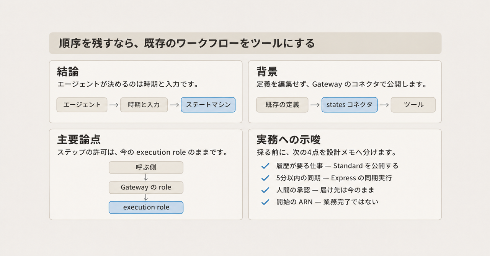
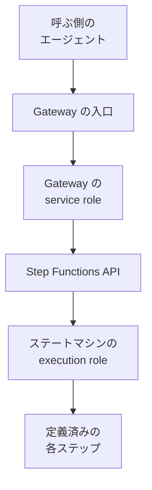
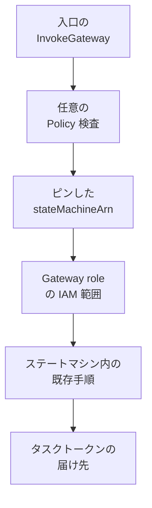

既存の AWS Step Functions ステートマシンを、定義を編集せずに、エージェントのツールとして公開できます。公開に使うのは、Amazon Bedrock AgentCore Gateway の組み込みコネクタです。エージェントは実行を始める時期と入力を決め、ステートマシンは定義済みの順序で各ステップを実行します。

この記事では、公開される 10 個の操作、呼ぶ側と Gateway とステートマシンの権限の置き場所、Standard と Express で参照できる範囲、見積もりに足す料金を、2026-11-04 時点の一次資料に沿って整理します。Standard は実行履歴が残るワークフローです。Express は、5 分以内の同期か、非同期の短い実行です。週次の紹介は到達範囲の要約であり、操作と IAM の条件はコネクタの手順と API リファレンスにあります。

*この記事の全体像。以下、順に解説します。*

## 既存の Step Functions をエージェントのツールにするとは

[Amazon Bedrock AgentCore Gateway](https://docs.aws.amazon.com/bedrock-agentcore/latest/devguide/gateway-target-connector-step-functions.html) は、エージェントが外の操作をツールとして発見し、呼び出す入口です。発見と呼び出しの手順は MCP（Model Context Protocol）です。発見は `tools/list`、呼び出しは `tools/call` です。

Step Functions 向けの組み込みコネクタは、`connectorId` が `states` です。コネクタ版の一覧での版は `1.0.0` で、Released は 2026-10-21 です。Gateway がツールのスキーマを作り、パラメータの固定、エンドポイントの解決、Step Functions への認証を行います。利用側は、この公開のためだけに Lambda や自前の MCP サーバを書きません。

Gateway から Step Functions API を呼ぶのは、Gateway の service role です。service role は、`bedrock-agentcore.amazonaws.com` が引き受ける IAM ロールです。ステートマシンの各ステップは、そのステートマシンに定義された execution role で動きます。execution role は、`states.amazonaws.com` が引き受ける IAM ロールで、作成時の `--role-arn` に当たります。

[What's New（2026-10-29）](https://aws.amazon.com/about-aws/whats-new/2026/10/step-functions-workflows-ai-agent-tools/) と [AWS Weekly Roundup（Daniel Abib、2026-11-02）](https://aws.amazon.com/blogs/aws/aws-weekly-roundup-gpt-6-1-terra-on-bedrock-step-functions-as-agent-tools-and-more-november-2-2026/) は、この公開を週次の到達範囲として紹介しています。紹介の例は返金です。適格確認、上長承認、返金が、定義された順序で毎回走ります。

コネクタの説明では、エージェントが時期と入力を決め、ステートマシンが順序を決めます。エージェントは、ステップを飛ばしたり並べ替えたりできません。

### 公開される操作

コネクタが公開する操作は 10 個です。ターゲットは、Gateway に登録する公開単位です。ツール名は、そのターゲットの名前と操作名を `___`（アンダースコア 3 つ）でつなぎます。公開例は `orders___StartExecution` です。

次の 4 操作は、ターゲット作成時に `stateMachineArn` を 1 つ固定します。この固定を pin と呼びます。pin した値はツールの引数から外れ、呼び出しのたびに Gateway が付与します。

| 操作 | 呼び出し側が渡すもの | pin |
|---|---|---|
| `StartExecution` | 開始入力。結果は実行 ARN | `stateMachineArn` を 1 つ |
| `StartSyncExecution` | 同期実行の入力。同じ呼び出しで結果が返る | 同上 |
| `ListExecutions` | 一覧の条件 | 同上 |
| `DescribeStateMachine` | `includedData`。既定はメタデータのみ | 同上 |

残る 6 操作は、pin できません。範囲は gateway service role の IAM です。

| 操作 | 呼び出し側が渡すもの |
|---|---|
| `DescribeExecution` | 実行 ARN |
| `StopExecution` | 実行 ARN |
| `GetExecutionHistory` | 実行 ARN |
| `SendTaskSuccess` | タスクトークン |
| `SendTaskFailure` | タスクトークン |
| `SendTaskHeartbeat` | タスクトークン |

タスクトークンは、ワークフローが途中で止まったとき、再開の権利を表す値です。`SendTaskSuccess`、`SendTaskFailure`、`SendTaskHeartbeat` は、そのトークンを渡して待ちを完了したり、生存を伝えたりします。

`StartExecution` に渡す `input` は、JSON を収めた文字列です。実行が始まると、その文字列は JSON として解釈され、ステップ間ではその JSON が渡ります。API の最大長は 262,144 UTF-8 バイトです。Gateway の tool-call ペイロード上限は 6 MB（2026-11-04 のクォータ表、引き上げ可）なので、開始入力の短い方は Step Functions 側です。

Standard ワークフローは実行履歴を残し、最大 1 年動き続けられます。エージェントのセッションが終わったあとも、その実行は継続できます。Express の同期実行は `StartSyncExecution` で、同じツール呼び出しの中で結果が返ります。

Standard では、`.waitForTaskToken` でワークフローを止め、トークンと作業内容をアプリケーションへ届け、エージェントが `SendTaskSuccess` または `SendTaskFailure` で再開するパターンが文書化されています。`.waitForTaskToken` は、タスクの完了通知が来るまで状態を止める統合の接尾辞です。

チュートリアルの入口認可は `AWS_IAM` です。これは SigV4（AWS リクエストの署名バージョン 4）で呼びます。アウトバウンドの認証プロバイダ例は `GATEWAY_IAM_ROLE` です。これは、下流の AWS API を Gateway の service role で呼ぶ設定です。同じ Gateway 上のターゲットは、その Gateway の service role を共有します。

リージョンは、AgentCore Gateway が使えるリージョンと、ステートマシンのリージョンを揃えます。料金は、Step Functions と AgentCore Gateway のそれぞれの標準料金です。

### 呼び出しの経路

呼ぶ側、Gateway、ステートマシンは、文書上別の主体として並びます。

入口では、呼ぶ側のアイデンティティに対する `bedrock-agentcore:InvokeGateway` を評価します。Policy エンジンは、この IAM の許可とは別に、Gateway へ任意で付ける検査です。付けた場合、その検査もこの入口で行います。Gateway から先は gateway service role が Step Functions を呼びます。[チュートリアル](https://docs.aws.amazon.com/step-functions/latest/dg/tutorial-agentcore-gateway.html) は、Gateway が開始した実行について、AWS CloudTrail（API 呼び出しを残す AWS の記録）上の呼び出し元が gateway service role に見える、と書きます。ステップの実行に使うロールは、ステートマシン作成時の execution role です。`DescribeStateMachine` の `roleArn` は、その作成時に使ったロールです。

## 注意点

週次記事は到達範囲を短く要約しています。操作表と IAM の文まで読むと、次の幅が出ます。

### 220 を超えるサービスの読み方

What's New（2026-10-29）は、Step Functions を「220 を超える AWS サービスを編めるワークフローサービス」と説明し、そのワークフローをエージェントのツールにできる、と続けています。Weekly Roundup（2026-11-02）も「すでに 220 以上を編む Step Functions を、エージェントのツールとして渡せる」と書きます。

この 220 は、コネクタが新たに露出したサービスの計測値ではありません。コネクタがツールにするのは Step Functions の操作で、数は 10 個です。同じ「over 220」は、[2025-02-05](https://aws.amazon.com/about-aws/whats-new/2025/02/aws-step-functions-100-000-state-machines-activities-account/)、[2024-11-22](https://aws.amazon.com/about-aws/whats-new/2024/11/aws-step-functions-variables-jsonata-transformations/)、[2024-01-22](https://aws.amazon.com/about-aws/whats-new/2024/01/aws-step-functions-integration-33-services/)、[2022-12-01](https://aws.amazon.com/about-aws/whats-new/2022/12/aws-step-functions-large-scale-parallel-workflows-data-processing-serverless-applications/) の What's New にもあります。2021-09-30 の What's New は [over 200](https://aws.amazon.com/about-aws/whats-new/2021/09/aws-step-functions-200-aws-sdk-integration/) です。

### 実行を参照できるワークフロー

発表文と週次は、エージェントが実行を調べられる、と書きます。コネクタの表では、`ListExecutions` は Standard のみで、Express には `StateMachineTypeNotSupported` が返ります。`DescribeExecution`、`GetExecutionHistory`、`StopExecution` は Standard の実行が対象で、Express の実行 ARN には `InvalidArn` が返ります。理由は、Express の実行は開始後に ARN でアドレスできない、とコネクタが書く点にあります。非同期 Express の結果確認先は CloudWatch Logs です。

週次の「Standard and Express の両方がターゲットになる」は、開始できる、という範囲ではコネクタと一致します。夜間に失敗した実行を ARN で特定する、という文は Standard 側の話です。

### 定義を編集しない公開と、リビジョンの固定

コネクタは、既存のステートマシンを変更せず公開できる、と書きます。週次の「rewrite なし」もこの文と一致します。pin の例は、バージョンもエイリアスも付かない ARN です。

`arn:aws:states:<REGION>:<ACCOUNT_ID>:stateMachine:OrderWorkflow`

[StartExecution API](https://docs.aws.amazon.com/step-functions/latest/apireference/API_StartExecution.html) は、unqualified ARN（version も alias も付かない ARN）で開始すると最新リビジョンを使う、と書きます。qualified ARN（version または alias が付いた ARN）で開始すればそのリビジョンになる、とも書きます。これは API の規則です。Gateway の pin がその qualified ARN を受け付けるとは、states の手順に書かれていません。unqualified ARN のまま定義を更新すると、次にエージェントが開始する実行は更新後のリビジョンになります。

### 実行開始の応答

`StartExecution` のツール結果は、新しい実行の ARN を含む Step Functions の応答です。Standard で完了を知るには、`DescribeExecution` の status が `RUNNING` でなくなるまで見ます。チュートリアルもその確認順を書きます。`StartSyncExecution` は同じ呼び出しで status と output を返せます。

一方、[StartSyncExecution API](https://docs.aws.amazon.com/step-functions/latest/apireference/API_StartSyncExecution.html) は、実行が失敗しても HTTP `200 OK` を返します。ステータスコードは function error（ワークフロー側の失敗）を反映しない、と API が書きます。ボディの status には `FAILED` がありえます。コネクタが、この HTTP 200 かつ `FAILED` を MCP の `isError: true` に写す、という文は、確認したコネクタページにはありません。`isError: true` とエラー名の同梱は、Step Functions がエラーを返したとき、と書かれています。例は `ExecutionDoesNotExist` と `StateMachineTypeNotSupported` です。

### 料金の切り方

単価は 2026-11-04 時点の公開料金です。米国東部（バージニア北部）の例と、Gateway の呼び出し料は別行です。GB-秒と GB-hour は、料金ページが duration に付ける単位です。何と時間を掛けてその単位にするかは、この記事では特定していません。別々の Example を、一つの計算式にはまとめていません。

| 対象 | 公開されている単価 | 条件 |
|---|---|---|
| Standard の state transition | 1 回 $0.000025 | 状態を 1 回進める課金単位。米国東部（バージニア北部）の例。再試行も数える |
| Standard の無料枠 | 月 4,000 state transitions | 12 か月の AWS 無料枠終了後も継続。既存顧客と新規顧客の両方に無期限 |
| Express のリクエスト | 100 万回あたり $1.00 | 米国東部（バージニア北部）の例。ワークフロー開始のたび |
| Express の duration 例 | $0.00001667 / GB-秒 | Example 3。先頭 1,000 GB-hour は米国東部で $0.0600（Example 5） |
| Gateway の API 呼び出し | 1,000 回あたり $0.005 | Gateway の API 名は ListTools、InvokeTool、Ping。ポーリング回数として数えるのは InvokeTool。MCP の `tools/list` や `tools/call` と同じ名とは書かれていない |
| Gateway の Search API | 1,000 回あたり $0.025 | セマンティック検索を使う場合 |
| ツールのインデックス | 100 ツールあたり月 $0.02 | 検索用インデックス |
| Policy の認可リクエスト | 1 回 $0.000025 | Policy エンジンを付けた場合。表注に、先頭 100 temporal policies は追加の認可料金なし、とある。何を 1 件と数えるかは、この記事では特定していない |

[Step Functions の料金](https://aws.amazon.com/step-functions/pricing/) の Example 4 には `$0.06000`、`$0.03000`、`$0.01642`（いずれも GB-hour）があります。その 3 行自体にリージョン名はありません。他リージョンの表は料金ページのウィジェット側にあり、この記事では全行を写していません。確認した料金ページ本文の無料枠は、Standard の state transition 月 4,000 回です。Express のリクエストや duration に専用の無料枠は見当たりませんでした。一覧、説明、履歴の API に、Step Functions 料金ページ上のリクエスト単価は見当たりませんでした。ポーリングで文書上メーターされるのは、Gateway の InvokeTool です。

### 稼働率の読み方

[Step Functions の SLA](https://aws.amazon.com/step-functions/sla/)（Last Updated May 5, 2022）は、月間稼働率 99.9% 以上を書きます。クレジットは、99.9% 未満かつ 99.0% 以上で 10%、99.0% 未満かつ 95.0% 以上で 25%、95.0% 未満で 100% です。

AgentCore Gateway 専用の SLA ページは、確認した範囲では見つかりませんでした。[災害対策のページ](https://docs.aws.amazon.com/bedrock-agentcore/latest/devguide/disaster-recovery-resiliency.html) は、Amazon Bedrock の SLA が AgentCore に適用され、可用性はリージョンごとに測る、と書きます。[Bedrock の SLA](https://aws.amazon.com/bedrock/sla/)（Last Updated October 4, 2023）の Availability は、Amazon Bedrock 上のモデル向け API に限る、と書きます。この 99.9% を Gateway の数値として読まないでください。

### 返金例と承認の主体

What's New と週次の返金例は、適格確認、上長承認、返金が、定義された順序で毎回走る、という説明です。これはステートマシンが順序を持つ、というコネクタの使い方と一致します。承認ステップの主体が誰かは、トークンの届け先と、`SendTask*` をツールに出すかで変わります。

### 逆向きのサンプル

Step Functions から AgentCore を呼ぶ aws-samples は、このコネクタではありません。公式の手順は Developer Guide のチュートリアルです。

### Gateway のレート制限と、Step Functions のスロットリング

顧客が Gateway に付けるレート制限は、ツール名 `targetName___toolName` や JWT クレームで切れ、Gateway 自身の規則より前に評価されます。超過は JSON-RPC `-32003`、メッセージ `Rate limit exceeded`、`data.retryAfter` です。JSON-RPC は、MCP の呼び出しが使うメッセージ形式です。JWT は、Bearer トークンに載る署名付きのクレーム集合です。

この応答は、Step Functions のスロットリングを HTTP 429 に写す説明ではありません。[`tools/call` の HTTP ステータス](https://docs.aws.amazon.com/bedrock-agentcore/latest/devguide/gateway-using-mcp-call.html) の一覧に 429 は無く、ツール実行失敗は HTTP 500（`ToolExecutionError` と `InternalServerError`）です。states 専用のバックオフ手順は、確認した範囲では見つかりませんでした。

## 権限はどの主体に残るか

権限がエージェントの身元に付くのか、ワークフロー定義の実行主体に残るのかが、設計の分かれ目です。公開文書は、その二者ではなく三者を分けています。

| 主体 | 何の許可か | 文書上の置き場所 |
|---|---|---|
| 呼ぶ側のエージェント | Gateway を呼べるか。Policy を付けた場合は、どのツールをどの入力で呼べるか | `bedrock-agentcore:InvokeGateway`。任意で Cedar などの Policy。チュートリアルの認可は `AWS_IAM` |
| Gateway の service role | どの Step Functions API を、どのステートマシンと実行に対して呼べるか | `bedrock-agentcore.amazonaws.com` が引き受けるロール。信頼ポリシーにアカウントと Gateway の ARN を置く。CloudTrail 上の Step Functions 呼び出し元は、チュートリアルによればこのロール |
| ステートマシンの execution role | 各ステップが AWS を呼ぶときの許可 | `states.amazonaws.com` が引き受けるロール。作成時の `--role-arn`。`DescribeStateMachine` の `roleArn` は、作成時に使ったこのロール |

Cedar は、Policy エンジンが評価するポリシー言語です。マッチするポリシーが無ければ DENY で、forbid が permit に優先します。

実行中に参照できる `Execution.RoleArn` は、IAM ロール ARN の欄です。その説明は、この欄を execution role とは書いていません。

呼ぶ側の IAM が、この execution role に引き継がれる、とは書かれていません。確認した states の手順、チュートリアル、StartExecution のコンテキスト説明には、その文がありませんでした。アウトバウンドの作成例は `GATEWAY_IAM_ROLE` です。`CALLER_IAM_CREDENTIALS` は Gateway ターゲット一般の説明にあり、下流が呼ぶ側に基づいて IAM を適用できる、と書かれます。states の手順がそのプロバイダを使う、または拒否する、という文は確認できていません。同じ設定ページの別節、Managed Knowledge Bases には、コネクタターゲットは `GATEWAY_IAM_ROLE` だけ、という文があります。これはその節の文であり、states の手順の文ではありません。認可ページは、`JWT_PASSTHROUGH` を HTTP ターゲットに限る、と書きます。states の手順の方式ではありません。

同じ Gateway の全ターゲットは 1 つの service role を共有します。IAM の境界がワークフローごとに違うなら、Gateway を分けます。チュートリアルがその共有を注意しています。pin と IAM は、コネクタの説明では代替ではなく併用です。

監査も二系統です。Step Functions 側の CloudTrail 呼び出し元は gateway service role です。`InvokeGateway` は CloudTrail のデータイベント（`AWS::BedrockAgentCore::Gateway`、`bedrock-agentcore.amazonaws.com`）です。Event history は、その記録のうち既定で見える範囲です。このデータイベントはそこには出ず、有効化は追加料金です。データイベントの身元説明は、その API が SigV4 ではなく JWT だから標準の AWS identity が無く、`sub`（JWT に入る主体の識別子）などのクレームで残す、と書きます。この文は、`AWS_IAM` のチュートリアル経路で呼び出し元 IAM が欠ける、という証明にはなりません。

実行履歴の `ExecutionStarted` の `roleArn` は、Lambda タスク実行に使う IAM ロールの ARN、と API が書きます。呼ぶ側のプリンシパルの欄ではありません。

## 承認はどこで切れるか

長い業務手続きを 1 つのツールに入れるとき、承認は「呼ぶ前」と「定義の中」に残ります。

1. 誰が `InvokeGateway` できるかを、呼ぶ側の IAM と、必要なら Gateway のリソースベースポリシーで決めます。
2. Policy エンジンを付けると、ツール名、入力、プリンシパルを、ツール呼び出しの前に Gateway が評価します。エンジンの mode は `ENFORCE` か `LOG_ONLY` です。`LOG_ONLY` は判定を記録するだけで、呼び出しを止めません。エンジンが無ければ、`InvokeGateway` ができればツール呼び出しに進みます。返金金額の上限を Policy で切る例は、別の Lambda や API ツールのパターンとして文書にあります。states コネクタが金額フィールドを自動では切りません。
3. pin できる 4 操作には、必ず `parameterValues.stateMachineArn` を置きます。空のままでもターゲット作成は成功しえますが、そのツールは毎回失敗する、とコネクタが書きます。エージェントが `stateMachineArn` を渡すと、Gateway は `Invalid request parameters: cannot set parameter(s): [/stateMachineArn]` で拒みます。1 ターゲットにつき、1 操作に 1 つの pin です。同じ操作で複数のステートマシンを出すなら、ターゲットを分けます。
4. pin できない 6 操作の範囲は、gateway service role の IAM です。`DescribeExecution`、`StopExecution`、`GetExecutionHistory` は `execution:<StateMachineName>:*` に絞れます。`SendTaskSuccess`、`SendTaskFailure`、`SendTaskHeartbeat` にはリソースレベルの IAM が無く、許可は `"*"` になります。トークンを持つ呼び出し元が、そのタスクを完了できます。コネクタはトークンを秘密として扱うよう書きます。ドキュメントは `states:*` を `Resource: "*"` で渡さないよう注意します。
5. ステートマシン内の既存の承認状態は、定義を変えない限り、これまでと同じ順序で走ります。
6. 公式のコールバック手順は、ワークフローがトークンと作業内容をエージェントのアプリケーションへ届けます。届け先の例は SQS（メッセージを置くキュー）、または Step Functions の Activity（ワーカーが仕事を受け取って完了を返す仕組み）です。そのエージェントが `SendTask*` を呼べるなら、待ちの完了者はそのエージェントになります。人間のキューを残すなら、届け先は今の人間側のままにします。`SendTask*` をツール一覧に出さないことは補助です。公式が制御として名指しするのは、トークンの受け取り手です。タスクトークンは同一 AWS アカウントのプリンシパルから送ります。コールバックと Activity は Standard のみです。

読み取り側の境界も入口のうちにあります。`DescribeExecution` の `includedData` は既定フィールドで、既定値は `METADATA_ONLY` です。呼び出し側は `ALL_DATA` を指定でき、そのとき input と output が入ります。`ListExecutions` を pin したステートマシンと、実行 ARN への `DescribeExecution` を組み合わせると、gateway service role が許す範囲の他の実行の入出力を読めます。`DescribeStateMachine` も `includedData` が既定フィールドで、`ALL_DATA` には Amazon States Language（ステートマシン定義の言語。以下 ASL）の定義が入ります。`METADATA_ONLY` のとき API は definition を `{ }` で返します。`GetExecutionHistory` の API 既定は `includeExecutionData=true` です。コネクタの既定フィールドは `executionArn` だけで、省略時に Gateway が false を付ける、という文は見つかりませんでした。履歴にタスクトークンが出る、という文も見つかりませんでした。

実行名の `name` は、既定ではツールから見えません。`parameterOverrides` で visible にしない限り、呼び出し側は実行名を渡せません。冪等とは、同じ入力の再呼び出しが新しい実行を増やさず、同じ結果に着地することです。Standard の同一 name と同一 input の冪等は、名前を出せるようにした場合の API 動作です。実行中なら同じ実行を返し、閉じた実行や違う input は `400 ExecutionAlreadyExists` です。name はクローズ後 90 日で再利用できます。Express の `StartExecution` は冪等ではありません。同じ name でも並走しえます。

## Standard と Express のどちらを公開するか

| 判断 | Standard | Express |
|---|---|---|
| 向く仕事 | 順序、履歴、停止、1 年までの継続、人間または別システムとのコールバック | 5 分以内の同期的な要求と応答 |
| 開始 | `StartExecution`。結果は ARN。その後 `DescribeExecution` | 同期は `StartSyncExecution`。非同期の `StartExecution` は開始確認のみ |
| 開始後の参照 | 一覧、説明、履歴、停止ができる | 開始後は ARN で説明、一覧、停止、履歴取得ができない。非同期の結果は CloudWatch Logs |
| 履歴 | 1 実行 25,000 イベントまで。超えるとその実行は失敗する。閉じた実行の履歴参照は 90 日（30 日へ短縮する申請ができる） | 実行履歴の API 参照は上記のとおり不可。ログを有効にすると CloudWatch Logs とコンソールで見られる |
| 意味論 | exactly-once。各ステップは一度だけ実行される | 非同期は at-least-once。少なくとも一度実行され、重複しうる。同期は at-most-once。多くても一度で、届かないことがありうる |
| このツール化での既定 | 履歴と停止が要る手続きはこちら | 5 分を超えると `States.Timeout`。コンソールの同期テストは 60 秒で切る、と別の説明がある。Gateway 経由の同期呼び出しが 60 秒か 5 分かは、確認した文書では特定できていない |

Gateway の invocation timeout の既定は 15 分で、引き上げ可です（2026-11-04 のクォータ表）。tool-call と tool-list は、Gateway 単位とアカウント単位でそれぞれ 200 TPS（1 秒あたりの呼び出し数）、同時接続 5,000 が既定で、どちらも引き上げ可です。通常の tool-call の 200 TPS とは別枠で、検索ベースの tool-call は毎分 25 が既定です。料金表の Search API は、その単価の行であり、この毎分 25 の枠そのものではありません。検索ベースにどの呼び出しが入るかの境界は、この記事ではクォータの名前以上には特定していません。アカウントあたりの Gateway は 1,000、Gateway あたりのターゲットは 100、ターゲットあたりのツールは 1,000 が既定です。

## 既存ワークフローをツールにする判断

順序をステートマシンに残し、ステップの許可が今の execution role のままでよいなら、新しいエージェント用 API を足す前に、既存ステートマシンをこのコネクタでツールにします。呼ぶ側の許可、Gateway の service role、execution role は別々に書きます。人間の承認を残すなら、タスクトークンの届け先は今の人間側のままにします。

三者の分離と、Standard に寄せた参照は、一次資料の中で一貫しています。週次の一文を、操作ごとの保証として読むと範囲を超えます。ツール化の判断自体は、順序と execution role を維持したい場合に有効なままです。

公開文書が週次の要約より狭い点は、前の節までに書いたもののほか、次です。

- `Describe*` の `ALL_DATA` は既定フィールドなので、そのツールを出せる呼び出し側は定義や入出力を読めます。
- `SendTask*` は `"*"` であり、トークンが秘密でなければ承認点が広がります。
- 呼ぶ側の IAM をステップ内の条件にしているワークフローは、この公開手順だけではその IAM を受け取れません。
- Gateway の数値 SLA は、確認した範囲では見つかっていません。Step Functions の 99.9% だけを経路全体の約束として読まないでください。
- このコネクタを名指しした批判的な GitHub Issue と CVE は、公開文書の範囲では確認できていません。確認できないことを、Issue や CVE が無いこととしては扱いません。

手順に書かれておらず、条件つきで先に確かめる項目は次です。これらは、ツール化するかの大枠を止めるものではありません。定義を固定したい、呼ぶ側の IAM をステップで見たい、同期 Express の失敗をツールエラーとして扱いたい、監査で呼ぶ側の IAM を `InvokeGateway` に残したい、という条件のときだけ先に確かめます。

- pin は version ARN または alias ARN を受け付けるか。
- states ターゲットは `CALLER_IAM_CREDENTIALS` を受け付けるか、拒否するか。
- Gateway の interceptor Lambda（REQUEST はターゲット呼び出し前、RESPONSE は応答後、各 1 つ）は states ターゲットに適用されるか。契約の説明は MCP ターゲットと HTTP ターゲットを扱い、states は `targetConfiguration.mcp.connector` です。名指しの包含も除外も見つかっていません。
- `AWS_IAM` の InvokeGateway データイベントに、呼ぶ側の IAM プリンシパルが記録されるか。
- `StartSyncExecution` の HTTP 200 かつ status `FAILED` は、MCP の `isError` になるか。
- `GetExecutionHistory` で `includeExecutionData` を省略したとき、Gateway は API 既定の true を使うか。
- Gateway 経由の同期 Express は 60 秒で切れるか、5 分まで待つか。
- AgentCore Gateway の月間稼働率の数値。
- states コネクタ専用のリトライ手順。
- 米国東部以外の Express 単価の全表。Example 4 の段階単価の適用リージョン。

採るときの手順は次です。

1. 手順の順序を維持し、ステップの爆発半径（そのロールで触れられる AWS の範囲）が今の execution role でよいとき、新しい API の前に既存ステートマシンのツール化を選びます。
2. 設計メモに三者を分けて書きます。入口は呼ぶ側の `InvokeGateway` と任意の Policy です。Step Functions API は gateway service role です。ステップは今の execution role です。
3. 履歴、停止、説明、人間の承認待ちが要る手続きは Standard にします。5 分以内の同期応答だけ Express の `StartSyncExecution` にします。非同期 Express を「あとから ARN で調べる」前提にしません。
4. pin できる操作にはすべて pin を置きます。IAM の境界が違うワークフローは Gateway を分けます。`states:*` を `"*"` にしません。
5. 人間の承認を残すなら、トークンの届け先を今の人間側キューのままにします。そのエージェントに承認を完了させるなら、届け先と `SendTask*` の公開をセットで書きます。
6. `StartExecution` の ARN 返却を業務完了と扱いません。Standard は status が `RUNNING` でなくなるまで `DescribeExecution` を見ます。Express 同期はボディの status を見ます。HTTP 200 だけでは成功と読みません。
7. 入出力や定義を読ませたくない操作は、ツールに出しません。出すなら `ALL_DATA` を呼べる前提で IAM と Policy を書きます。
8. 実行名による冪等が要るときだけ `name` を visible にします。既定のツールにはその欄がありません。Express では同じ name が冪等になりません。
9. 定義を固定したいときは、pin が version または alias を受けるかを先に確認します。受けると確認できるまでは、unqualified ARN の更新が次の実行を変える前提で運用します。
10. 見積もりは、米国東部の Step Functions 単価に、ポーリング回数ぶんの Gateway InvokeTool（1,000 回あたり $0.005、2026-11-04）を足します。Policy を付けるなら認可リクエスト（1 回 $0.000025）も別行にします。他リージョンへ単価をコピーしません。

次のどれかに当たるときは、ツール化の前に、ワークフローか実行ロールか、別の API かを見直します。ステップの中で呼ぶ側の IAM を条件にしている。トークンをこのエージェントへ渡すと人間承認が消える。Express のまま、開始後の ARN 参照が必須である。

## まとめ

既存の Step Functions は、定義を編集せずに AgentCore Gateway の `states` コネクタで MCP のツールにできます。エージェントが決めるのは時期と入力で、順序とステップの execution role はステートマシン側に残ります。

権限は三者です。入口は呼ぶ側の `InvokeGateway` と任意の Policy、Step Functions API は gateway service role、各ステップは今の execution role です。開始の ARN は業務完了ではなく、Express は開始後に ARN でたどれません。人間の承認を残すなら、タスクトークンの届け先を今の人間側のままにします。

この記事が少しでも参考になった、あるいは改善点などがあれば、ぜひリアクションやコメント、SNSでのシェアをいただけると励みになります！

## 参考リンク

- [What's New: Step Functions workflows as AI agent tools（Posted on Oct 29, 2026）](https://aws.amazon.com/about-aws/whats-new/2026/10/step-functions-workflows-ai-agent-tools/)
- [AWS Weekly Roundup（Daniel Abib、02 NOV 2026）](https://aws.amazon.com/blogs/aws/aws-weekly-roundup-gpt-6-1-terra-on-bedrock-step-functions-as-agent-tools-and-more-november-2-2026/)
- [states コネクタ](https://docs.aws.amazon.com/bedrock-agentcore/latest/devguide/gateway-target-connector-step-functions.html)
- [コネクタ版](https://docs.aws.amazon.com/bedrock-agentcore/latest/devguide/gateway-target-connector-versions.html)
- [ターゲット設定（IAM と GATEWAY_IAM_ROLE）](https://docs.aws.amazon.com/bedrock-agentcore/latest/devguide/gateway-add-target-api-target-config.html)
- [チュートリアル: Step Functions を AgentCore Gateway のターゲットにする](https://docs.aws.amazon.com/step-functions/latest/dg/tutorial-agentcore-gateway.html)
- [ワークフロータイプの選択](https://docs.aws.amazon.com/step-functions/latest/dg/choosing-workflow-type.html)
- [Step Functions のサービスクォータ](https://docs.aws.amazon.com/step-functions/latest/dg/service-quotas.html)
- [StartExecution](https://docs.aws.amazon.com/step-functions/latest/apireference/API_StartExecution.html)
- [StartSyncExecution](https://docs.aws.amazon.com/step-functions/latest/apireference/API_StartSyncExecution.html)
- [ExecutionStarted の roleArn](https://docs.aws.amazon.com/step-functions/latest/apireference/API_ExecutionStartedEventDetails.html)
- [タスクトークンと同一アカウント](https://docs.aws.amazon.com/step-functions/latest/dg/connect-to-resource.html)
- [AgentCore Gateway のクォータ](https://docs.aws.amazon.com/bedrock-agentcore/latest/devguide/agentcore-limits.html)
- [AgentCore のリージョン](https://docs.aws.amazon.com/bedrock-agentcore/latest/devguide/agentcore-regions.html)
- [ターゲットの認可（JWT_PASSTHROUGH は HTTP ターゲット）](https://docs.aws.amazon.com/bedrock-agentcore/latest/devguide/gateway-building-adding-targets-authorization.html)
- [Policy の default deny と forbid](https://docs.aws.amazon.com/bedrock-agentcore/latest/devguide/policy-understanding-cedar.html)
- [Policy エンジンの mode（LOG_ONLY / ENFORCE）](https://docs.aws.amazon.com/bedrock-agentcore-control/latest/APIReference/API_GatewayPolicyEngineConfiguration.html)
- [コンテキストの Execution.RoleArn](https://docs.aws.amazon.com/step-functions/latest/dg/input-output-contextobject.html)
- [tools/call の HTTP ステータス](https://docs.aws.amazon.com/bedrock-agentcore/latest/devguide/gateway-using-mcp-call.html)
- [Gateway のレート制限応答](https://docs.aws.amazon.com/bedrock-agentcore/latest/devguide/gateway-rate-limits-enforcement.html)
- [InvokeGateway のデータイベント](https://docs.aws.amazon.com/bedrock-agentcore/latest/devguide/gateway-event-types.html)
- [Gateway interceptor](https://docs.aws.amazon.com/bedrock-agentcore/latest/devguide/gateway-interceptors.html)
- [Step Functions の料金](https://aws.amazon.com/step-functions/pricing/)
- [Amazon Bedrock AgentCore の料金](https://aws.amazon.com/bedrock/agentcore/pricing/)
- [Step Functions の SLA（Last Updated May 5, 2022）](https://aws.amazon.com/step-functions/sla/)
- [Amazon Bedrock の SLA（Last Updated October 4, 2023）](https://aws.amazon.com/bedrock/sla/)
- [AgentCore と Bedrock SLA の関係](https://docs.aws.amazon.com/bedrock-agentcore/latest/devguide/disaster-recovery-resiliency.html)
- [2025-02-05 の over 220](https://aws.amazon.com/about-aws/whats-new/2025/02/aws-step-functions-100-000-state-machines-activities-account/)
- [2024-11-22 の over 220](https://aws.amazon.com/about-aws/whats-new/2024/11/aws-step-functions-variables-jsonata-transformations/)
- [2024-01-22 の over 220](https://aws.amazon.com/about-aws/whats-new/2024/01/aws-step-functions-integration-33-services/)
- [2022-12-01 の over 220](https://aws.amazon.com/about-aws/whats-new/2022/12/aws-step-functions-large-scale-parallel-workflows-data-processing-serverless-applications/)
- [2021-09-30 の over 200](https://aws.amazon.com/about-aws/whats-new/2021/09/aws-step-functions-200-aws-sdk-integration/)
