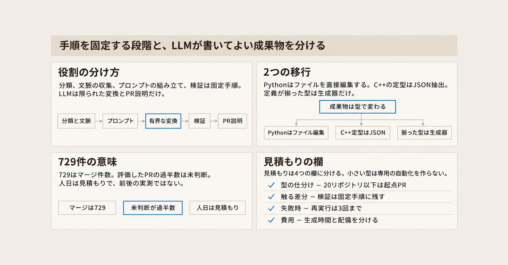
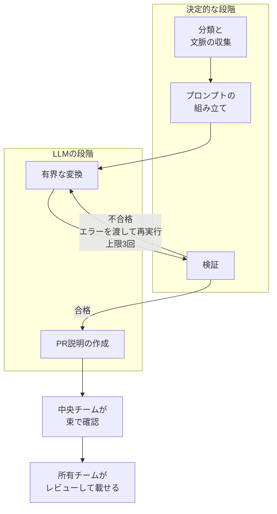
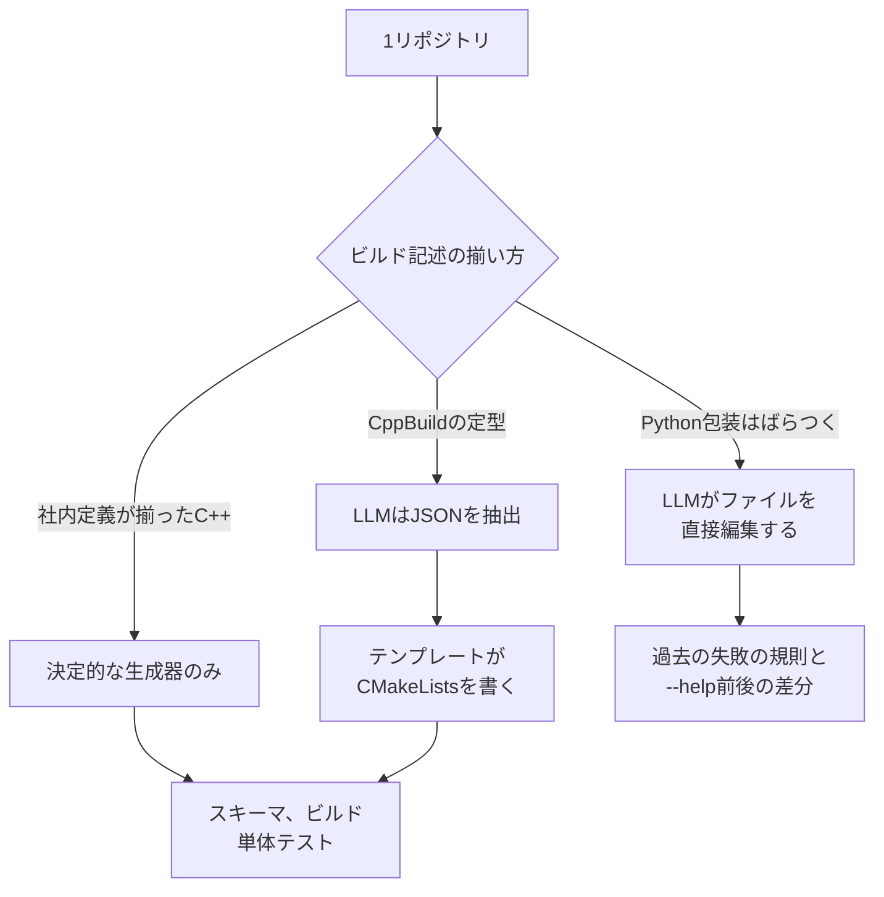

Bloomberg の中央チームは、機能開発と競合しにくいインフラ移行を、リポジトリごとに pull request（PR）として作る取り組みを Automated Uplift と呼んでいます。一次資料は Mario Corchero ほかによる [arXiv:2611.05457v1](https://arxiv.org/abs/2611.05457) です。投稿日は 2026-11-03 で、著者の所属は Bloomberg と University College London です。

この記事では、そのパイプラインがどの段階を決定的な処理に固定し、LLM にどの成果物を書かせているかを整理します。決定的な処理とは、LLM を呼ばず、同じ入力に同じ手順を適用する処理です。読み終えると、同種の移行を発注するときに、見積もりの欄をどこで分けるかが決まります。

根拠は、査読会議の採録ではなく、対照実験を伴わない 1 社の経験報告です。

*この記事の全体像。以下、順に解説します。*

## Automated Upliftとは

Automated Uplift は、Bloomberg の中央チームが、リポジトリごとに PR を作ってインフラ移行を進める社内の取り組みです。Uplift とは、ビルド、包装、配備、保守の仕方を、いま使っている基盤へ移すことです。ここでの包装は、依存や設定を含め、ソフトウェアを配布できる形にまとめることです。

論文が持続キャンペーンとして報告するのは 2 本です。1 本は、リポジトリごとのばらつきが大きい Python の包装の移行です。もう 1 本は、形式の揃った C++ のビルド系の移行です。

共通の骨格は 5 段階です。分類、文脈の収集、プロンプトの組み立て、検証は決定的な処理です。LLM が受け持つのは、事前に組んだ文脈の中での、範囲を限った変換です。検証のあと、PR の説明を書く呼び出しも LLM です。対象リポジトリは 1 件ずつ、コンテナの中で動きます。

アーキタイプとは、移行対象を、ビルド記述の揃い方で分けた型のことです。同じ 5 段階でも、型によって LLM が書く成果物は変わります。PyPackaging と CppBuild は、論文中の社内ツールの仮名です。公開されている製品名ではありません。CppBuild は、CMake へ移す前の C++ ビルド方式の仮名です。PyPackaging は、Python の包装に使う社内ツールの仮名です。

以下、Table I や III-B のような表記は、この論文の表と節の番号です。

Python の包装では、LLM が包装の設定、パッケージ内のファイルの配置、ビルドの更新を直接編集します。この配置は、所有チームが行う配備とは別です。論文の Table I が主モデルとして書くのは、Anthropic の Claude Opus 4.6 です。

C++ の定型では、LLM は makefile からソース、ライブラリ、依存、フラグ、独自規則を JSON として抽出します。CMakeLists.txt はテンプレートが書きます。Table I が主モデルとして書くのは Claude Sonnet 4.5 です。

会社の中で定義まで揃った C++ のビルド設定には、LLM を通さない決定的な生成器があります。上の図で、この型だけは JSON 抽出を通りません。

Python の文脈は 12 のデータ源です。実行時のテレメトリ、パッケージのメタデータ、抽象構文木（AST）、ビルド設定の 4 群に分かれます。実行時のテレメトリとは、プログラムが本番で動いたときの記録です。

検証に落ちた再実行は、エラーを追加の文脈にして LLM へ戻します。上限は 3 回です。検証の規則そのものは、モデルに渡しません。

中央チームは、生成した PR を束ねて確認してから、所有チームにレビューと配備を求めます。

Table I の主モデルは、キャンペーンごとに上のとおり分かれます。期間中には、これとは別に、モデルを Claude Sonnet 4.5 から Opus 4.6 へ更新し、生成側の決定的な前処理の一部を外しています。どの前処理を外したかは、この記述では特定されていません。検証は決定的な側に残しています。

## キャンペーンでLLMが書く差分

2 本のキャンペーンは、検査の届く範囲と、LLM が書くものが違います。

| 項目 | C++（CppBuild から CMake） | Python の包装 |
|---|---|---|
| 母集団 | 形式が揃う。アーキタイプは 3 | 18 分類。専用テンプレートは 3 分類、337 タスク |
| 評価対象の PR | 2,039 | 294 |
| PR を開く前の検査 | スキーマ、ビルド、単体テスト | 過去の失敗から作った 7 規則、パッケージング、`--help` の前後の差分 |
| 検査が届く範囲 | 浅い。論文は、コンパイルが正しさの代理になりやすいと書く | 検査項目は多い。包装とスモークは通っても、依存の選び間違いは配備後に出る、と論文が書く |
| 本番の実行ログ | 不要だと Table I が書く | 中心的な入力 |
| LLM の仕事 | JSON の抽出。ファイルはテンプレートが書く | ファイルの直接編集 |
| 実行環境 | 両キャンペーンとも、リポジトリ 1 件ずつコンテナで動かす。それ以上の記述は無い | そのコンテナの中で、ファイルとシェルだけ。ネットワークは無く、作業ディレクトリはリポジトリに固定する（III-B） |

タスクは、論文が型ごとの生成率の分母に使っている件数です。1 件がリポジトリ 1 つかは、この表では定義されていません。あとの節の候補数とも一致しません。18 分類のうち、専用テンプレートがあるのは 3 分類です。`--help` の前後の差分とは、移行の前後で、その出力を比べたものです。どのコマンドかは、論文のこの記述では特定されていません。

C++ の生成率は Table II です。チームが定義したビルド設定は、タスク 2,889 に対して PR 1,283（44.4%）です。コード生成の型は、タスク 1,355 に対して PR 854（63.0%）です。会社として定義が揃った型はタスク 1,877 で、PR の列は N/A です。注は、決定的な別ツールが主経路だと書いています。この会社定義の型が、前の図の「決定的な生成器のみ」です。チーム定義とコード生成は、どちらも PR が出る C++ の型です。この 2 つが図の「CppBuild の定型」の内訳かは、論文の表と図だけでは対応づけられません。

Python の生成率は Table III です。現行ビルドでメタデータだけが欠けている型は、96 タスク中 77 PR（80.2%）です。この 80.2% は Python 全体の平均ではなく、この型だけの PR 生成率です。従来の共有環境だけの型は 186 中 105（56.5%）です。壊れた既存の包装は 55 中 30（54.5%）です。この 3 つが、専用テンプレートを持つ 3 分類です。タスク数 96、186、55 の合計は、表の 337 です。

論文は、PR を出さない失敗の多くは意図的だと書きます。データ収集が、安全に移行できないと示したときです。例は、解けない依存と、1 つのリポジトリに複数のパッケージがある場合です。

## 段階ごとに固定する境界

共通しているのは段階です。リポジトリごとに変わるのは、その段階の中で LLM が受け持つ変換の形です。

決定的な側に固定されているものは、次のとおりです。

- アーキタイプへの分類。Python では、初期実験で LLM による分類を試しています。同じパッケージが実行のたびに別の型へ入ること、失敗の切り分けにくさ、全候補へのモデル呼び出しの費用を理由に、事前計算の台帳へ移しました（III-B）。
- 文脈の収集と、プロンプトの組み立て。論文は、同じ文脈からは同じプロンプトになると書きます。
- 検証。新しい検証は足すだけです。検証をモデルへ移したことは無い、と III-D が書きます。
- 定型の C++ では、JSON からファイルを書く処理。抽出の誤りはスキーマかプロンプトを締めます。テンプレートの誤りは 1 回直せば、残りのリポジトリに効く、と III-C が書きます。
- 会社標準まで揃った C++ の一型では、変換の全体。

LLM に渡しているものは、次のとおりです。

- Python では、専用テンプレートか汎用プロンプトの範囲でのファイル編集。専用テンプレートは 3 種で、各 500〜600 行です。
- C++ の定型では、スキーマ付き JSON の抽出。
- 検証に失敗したあと、エラーを添えた再実行。上限は 3 回です。
- 検証のあと、証拠と残った警告から PR の説明を書く、読み取り専用の呼び出し。

生成側の境界は、一度見積もったあとにも動きます。モデルが import の解析を自分で扱えるようになると、それを補っていた AST の前処理は重要性を下げました。論文の作業規則は、変更の生成では LLM の役割を広げ、検証では広げない、というものです。モデルが既にその処理を扱えるようになったあと、なお決定的な前処理を残すのは、再現しやすさか、デバッグのしやすさが増す場合です（III-D、Lesson 4）。これは、分類や検証のように最初から決定的な段とは別の判断です。

件数が少ない型には、専用の自動処理を作りません。約 20 リポジトリ以下では、追加の端の処理を作る費用が、人手で省ける分を超える、と Lesson 7 が書きます。そこでは、開発者が仕上げる起点 PR が答えだと書きます。起点 PR とは、未完成であることをラベルで示したうえで、所有チームが仕上げる前提で出す PR です。

ランタイムの本番データは、Python の依存解決に入ります。これは、さきの表で Python の中心的な入力とした本番の実行ログです。分け方は 3 つです。

- AST と実行時の両方に見た依存は、配備環境で使える版をピンします。
- ソースにしか無いものは、条件付き、テスト専用、または死んだコードの可能性があります。ピンせず、LLM に渡します。
- 実行時にしか無いものは、多くの場合、推移的依存として外します（III-B）。推移的依存とは、直接指定していないが、依存先がさらに連れてくるパッケージです。

Python の移行ツールの行数は、決定的な Python が約 4,300 行、LLM のインターフェースが約 230 行、プロンプトと参照文書が約 3,600 行です（IV-A）。論文は、この行数を努力の測度として読まないよう断っています。

型ごとに変えているのは、データ収集と検証です。C++ では CMakeLists のひな型、Python では LLM に渡す専用テンプレートも、型によって違います（Lesson 2）。

## 検証に落ちたあとの手順

論文の図 1 と III-A が示す再実行は、エラーを追加の文脈にして LLM を呼び直し、上限を 3 回とすることです。この記事の先頭付近の図は、その流れを書き直したものです。

PR を開かない判断は、この再実行とは別の段にあります。場所はデータ収集です。安全に移行できないと分かったときは PR を出さない、と IV-A が書きます。挙げている例は、解けない依存と、1 リポジトリに複数パッケージがある場合です。

未完成のまま出す判断も、別の規則です。約 20 リポジトリ以下のアーキタイプでは、ラベル付きの起点 PR を出し、所有チームが仕上げます（III-B、Lesson 7）。

IV-C2 には、開発者からの一文があります。所有チームがボットのブランチへ push できず、PR を閉じて、もう一度作り直した、という内容です。論文は Python 側の改善として、生成した PR へ所有チームが直接 push できるようにすることと、PR の前にそのリポジトリ自身のテストを走らせることを挙げています。

C++ でビルドファイルが間違っていたときの直し先は、スキーマ、プロンプト、または全リポジトリ共通のテンプレートです（III-C）。

## 件数を数えた期間

評価の期間中に、パイプライン、プロンプト、検証規則、モデルの版が同時に変わっています（V-B）。

時間の切り方は、次のとおりです。

- プロジェクトの開始は 2025-10 です。実験は約 3 か月です。両キャンペーンの実施は 2026-01 からです（IV）。
- 集計する PR は 2026-04-30 までに開いたものに限ります。帰結の観測日は 2026-06-30 です。各 PR は、開いてから少なくとも 2 か月たっています。
- 論文の図 2 の横軸は 2025-11 から 2026-06 末までです。破線は 2026-04-30 です。この記事にはその図を置いていません。C++ では、最後の PR のあと 2 か月たっても、マージが一定のペースで増えていた、と本文が図を説明します。週次の件数は本文にありません。
- 除外は、個人と sandbox のテスト PR、およびボットが自分で閉じた PR です。ボットが閉じる主目的は、再生成です。
- 未判断には、開いたままと、stale bot のような自動化で閉じたものが入ります。stale bot とは、長期間更新がない PR を閉じる自動化です。開発者が拒否した件数とは別です。

## 注意点

仮説検定も信頼区間も、論文にはありません。設計し、作り、評価したのは著者のチームです。数値は、その条件のうえの件数です。

### 729件はマージ件数である

抄録の「729 successful migrations」は、Table IV のマージ件数と一致します。内訳は Python 31 と C++ 698 です。生成に成功した件数でも、候補全体の完了率でもありません。評価対象の PR は 2,333（294 と 2,039）です。候補とは、論文が母集団の規模として書く概数です。書き方は、Python 約 1,900、C++ 約 6,700、合わせて約 8,600 です。さきのタスク数とは一致しません。

2026-06-30 時点の帰結は、次のとおりです。PR は 2026-04-30 までに開いたものに限ります。割合の分母は、評価対象の PR です。

| 帰結 | Python の包装 | C++ のビルド系 |
|---|---:|---:|
| マージ | 31（10.5%） | 698（34.2%） |
| 開発者が未マージで閉じた | 64（21.8%） | 165（8.1%） |
| 開発者の判断が無い | 199（67.7%） | 1,176（57.7%） |

過半数は未判断です。論文は、制約になったのは生成ではなく、所有チームがレビューし、テストし、配備する費用だと書きます。優先度が低く、期限も、セキュリティ上の強制も無いキャンペーンだとも書きます。

マージ率は、影響の全体ではありません。Python で PR が却下された 51 リポジトリのうち 34 は、その後、所有チームが自分たちで移行を完了しています。14 は、その差分の大部分を再利用しています（IV-C2）。却下された PR は 64 件なので、51 はリポジトリ数です。対応表は論文にありません。34/51 を、64 件に対する割合としては使えません。

### 候補数は論文の中で1つに揃っていない

- C++ の候補は約 6,700 です。Table II のタスクは 1,877、2,889、1,355 で、合計 6,121 です。差の説明はありません。
- Table II の PR 列は 1,283 と 854 で、合計 2,137 です。評価対象の 2,039 との差 98 の説明もありません。評価の分母には Table IV を使います。
- Python のタスク数は本文で 1,880 です。候補の書き方は約 1,900 です。専用テンプレート 3 種の PR は 77、105、30 で、合計 212 です。キャンペーン全体の 294 との差 82 の内訳は、表にありません。

### 人日と実行時間は実測の前後比較ではない

人日は実測ではありません。IV-C3 は、ドメインの専門家が人手の移行を、C++ タスクあたり約 2 人日、Python タスクあたり 1〜2 人日と見積もった、と書きます。同じ段落は、構築チーム自身の見積もりとして読むよう求めています。構築チームとは、このパイプラインを設計して作った著者のチームです。V-B は、時間を計った値ではないこと、正式な費用比較には人手移行のサンプル計測が要ること、を書きます。「マージ分だけで千人日を大きく超える」は、この見積もりに基づくチームの推定です。

実行時間も、1 つの平均には潰せません。Table I は、C++ が平均 48 秒、Python が平均 7.2 分です。IV-A は、Python について、Sonnet 4.5 の PR が平均 4.1 分、その後の Opus 4.6 でより難しいアーキタイプを扱う PR が平均 7.7 分、と書きます。論文は、アーキタイプの混合が同時に変わったので、モデルの効果とは分離できない、と書きます。4.1 分、7.2 分、7.7 分は、同じ母集団の同じ統計ではありません。

推論費用は、パイプラインを作って運用する工学作業に比べて無視できる、という定性的な判断です。金額はありません（IV-C3）。

ランタイムのデータを入れた効果の大きさは、測っていません。依存を、両方に見たもの、ソースだけ、実行時だけ、の 3 つに分ける規則も同様です。論文は、包装の移行には欠かせない入力だと判断し、対照実験は費用と本番への影響のためやらなかった、と V-B に書きます。

観測されていないものは、次の 3 つです。

- 自動化の前後で、同じリポジトリの人手時間を計った差。
- 所有チームがレビュー、テスト、配備に使った人日。論文は、ここが主制約だと言います。
- ランタイムのデータを足したことによる、精度の差。

### 導入が引用する合格率はこのキャンペーンのマージ率ではない

導入とは、この論文の冒頭の節です。そこに引用された 91.3% と 15.3% は、別論文 [arXiv:2602.22518](https://arxiv.org/abs/2602.22518) の抄録にある、4 つのエージェント構成の平均合格率です。このエージェントは、そのベンチマークが動かした実行プログラムです。1 万行未満と 5 万行超は、同じベンチマークが比べたリポジトリの規模です。このキャンペーンのマージ率ではありません。

### 差の原因と他社への移し方は分離できない

2 キャンペーンの差を、検査の深さだけには帰せません。論文がそう書きます。C++ の方が早く始まり、ビルド変更はリスクが低く見えた可能性があり、レビューを支援する兼任の技術者がいました。母集団の揃い方も違います。キャンペーンが 2 つなので、これらの寄与は分離できません（IV-C1）。

どの欠落なら PR を出さず、どの欠落なら起点 PR にするかは、見送りの例と、約 20 リポジトリ以下という記述だけでは一覧になりません。

開発者の push に関する一文は、その 1 件のフィードバックです。正式な利用者調査はしていない、と V-B が書きます。

外への移し方にも留保があります。モノレポで、1 つの変更が影響箇所へまとめて入る組織では、リポジトリごとの PR 着地は同じ形になりません（V-B）。モノレポとは、複数のコンポーネントを 1 つのリポジトリに置く構成です。

近い産業の例として論文が挙げる Google の移行も、この着地の問題とは設定が違います。Ziftci ほかの一次論文は、39 件の移行、12 か月、3 人の開発者、595 件の変更、93,574 編集、LLM が変更の 74.45% と編集の 69.46% を生成した、と抄録に書きます。同じ論文の Threats To Validity は、報告された 50% の時間短縮が、開発者の知覚と見積もりであり、精密な時間計測に基づかない、と書きます（arXiv:2504.09691。ACM 版は [DOI 10.1145/3696630.3728542](https://doi.org/10.1145/3696630.3728542)）。

### データは公開されていない

データとソースは公開されていません（VIII）。識別子 DOI 10.48550/arXiv.2611.05457 は、arXiv の抄録ページでは DataCite への登録待ちです。DataCite は、DOI を登録する機関です。

## 見積もりを4つの欄に分ける

発注範囲の読み方は、リポジトリごとに LLM の判断と決定的な変換を振り分けることではありません。アーキタイプごとに、決定的な段階と、LLM が書いてよい成果物を分けることです。

失敗時の契約は、決定的な処理へ戻すことではありません。LLM を最大 3 回再実行し、安全に出せないものは出さず、件数の少ない型は起点 PR にします。

人日の前後は、この論文の実験設定では未測定です。見積書の単価欄に「論文では 2 人日から数秒へ下がった」とは書けません。書けるのは、構築チームが人手作業を約 2 人日、または 1〜2 人日と見積もったこと、エージェントの計算時間はその見積もりより桁が小さいこと、所有チームがレビューと配備に使う人日は不明なこと、までです。この見積もりでいうエージェントは、1 リポジトリのコンテナの中で移行を実行するプログラムです。別論文の実行プログラムとは別です。

レガシー刷新の見積もりは、次の 4 行に分けると、この事例の境界と実験設定に沿います。

1. 型の仕分け。形式が揃い、PR の前にビルドとテストが通る型は、抽出や分類を規則側に寄せ、LLM の成果物を JSON のような検査できる形に限ります。最初から決定的な生成器で足りる型は、LLM の行を見積もりません。約 20 リポジトリ以下の型は、専用パイプラインを作らず、起点 PR か人手とします。
2. エージェントが触ってよい差分。事前に組んだ文脈の中のファイル編集、またはスキーマ付きの抽出に限ります。分類、文脈の収集、プロンプトの組み立て、検証、定型ファイルの生成は、規則側に残します。検証を、エージェントの自己判断に含めません。
3. 失敗時の契約。検証エラーを渡して再実行する回数の上限を書きます。依存が解けない等の見送り条件と、起点 PR でよい条件は、別の箇条書きにします。「失敗したら決定的な処理へ戻す」は、この論文からは文言を借りられません。
4. 費用の欄を 2 つに分ける。生成の計算時間と、所有チームのレビュー、テスト、配備です。後者は、この論文の数値では埋まりません。前者の人日比較に約 2 人日や 1〜2 人日を使うなら、構築チームの専門家判断であり実測ではない、と欄外に書きます。

この分け方が合いやすいのは、リポジトリが分かれていて、所有チームが PR を受け取り、変更の正しさをパイプラインの中でかなりのところまで検査できるときです。

合いにくいのは、次のときです。モノレポで変更がまとめて入るとき。検査が配備のあとまで残るのに、期限もリスク要因も無いとき。生成側の境界を、モデル更新のたびに見直す費用を、見積もりに入れていないとき。

次に発注側が埋めるものは 3 つです。

1. 対象リポジトリを、形式の揃い方と、PR の前に自動で走らせられる検査の深さで分ける。
2. 所有チームのレビューと配備の人日を、この論文とは別に、サンプルで計る。
3. ランタイムの本番ログを文脈に入れるなら、効果の大きさは未測定だと、見積もりの前提に書く。

## まとめ

Automated Uplift は、分類、文脈の収集、プロンプトの組み立て、検証を決定的な処理に固定し、LLM には事前に組んだ文脈の中の変換と、PR 説明を渡す取り組みです。C++ の定型は JSON 抽出、Python の包装はファイル編集、定義まで揃った C++ の一型は LLM を通さない生成器、という分け方です。チーム定義とコード生成の 2 型が、その定型の内訳かは、論文の表と図だけでは対応づけられません。

抄録の 729 件は、2026-06-30 時点のマージ件数です。評価対象の過半数は未判断で、論文が主制約として書くのは、所有チームのレビュー、テスト、配備です。人手の人日は専門家の見積もりであり、同じリポジトリの前後を計った値ではありません。

見積もりでは、型の仕分け、触ってよい差分、失敗時の再実行と見送り、生成の計算時間、所有チームのレビューとテストと配備を、別の欄にします。

この記事が少しでも参考になった、あるいは改善点などがあれば、ぜひリアクションやコメント、SNSでのシェアをいただけると励みになります！

## 参考リンク

- Corchero ほか. Hybrid LLM–Deterministic Pipelines for Enterprise-Scale Code Migration at Bloomberg. arXiv:2611.05457v1, 2026-11-03. [抄録](https://arxiv.org/abs/2611.05457) / [PDF](https://arxiv.org/pdf/2611.05457)
- Li ほか. RepoMod-Bench. arXiv:2602.22518, 2026-02-26 投稿。参照したのは抄録の合格率です。[抄録](https://arxiv.org/abs/2602.22518)
- Ziftci ほか. Migrating Code At Scale With LLMs At Google. arXiv:2504.09691。50% の記述は HTML 版の Threats To Validity です。ACM 版は [DOI 10.1145/3696630.3728542](https://doi.org/10.1145/3696630.3728542)
